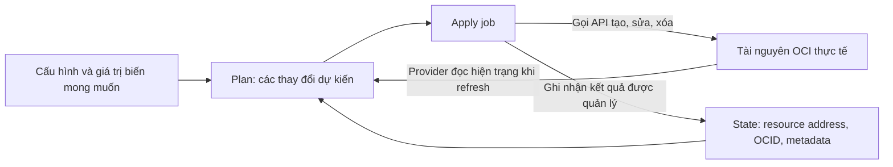
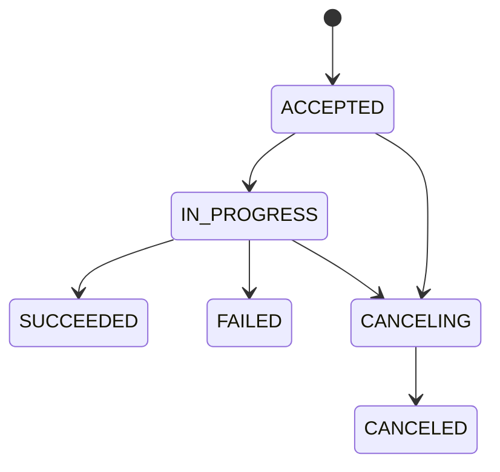
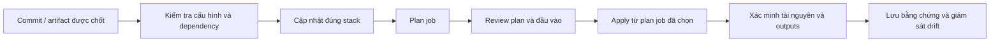

# OCI Resource Manager với stacks, jobs và state

## 1. Mục tiêu và phạm vi

Trong chương **Hạ tầng dưới dạng mã** của module **CLOUD_PROVIDERS_ORACLE**, OCI Resource Manager cung cấp môi trường được quản lý để chạy Terraform, giữ state và ghi lại lịch sử thực thi. Thay vì để mỗi người dùng một bản state trên laptop, nhóm làm việc với các stack và job có định danh rõ ràng trong OCI.

Bài học tập trung vào ba câu hỏi:

- **Stack** giữ những thông tin gì và xác định phạm vi quản lý ra sao?
- **Job** thực hiện Plan, Apply, Import state hoặc Destroy như thế nào?
- **State** liên kết mã Terraform với tài nguyên OCI thực tế và cần được bảo vệ như thế nào?

Người học sẽ xây dựng một lab VCN/subnet nhỏ, tạo stack, đọc plan, áp dụng đúng plan đã xem xét, kiểm tra state và quan sát drift. Bài cũng giải thích cách xử lý job thất bại, hủy job, chuyển state từ môi trường cũ và kết thúc vòng đời stack.

Các khối HCL và lệnh dưới đây dành cho **môi trường lab riêng của người học**. Chúng không phải yêu cầu triển khai ngay vào tenancy đang sử dụng. Thay OCID, region, compartment, tên và CIDR theo môi trường được phép.

Ví dụ chọn Terraform **1.5.x** trên Resource Manager và OCI provider thuộc dòng **6.x** làm nền minh họa. Đây là lựa chọn có chủ đích để giải thích quy trình, không phải tuyên bố phiên bản mới nhất. Trước khi áp dụng, xác minh phiên bản dịch vụ đang hỗ trợ và bộ provider mà nhóm đã duyệt.

## 2. Mô hình stack, job và state

| Khái niệm | Nội dung chính | Ví dụ |
| --- | --- | --- |
| Terraform configuration | Khai báo resource, data source, variable, output và yêu cầu provider | Một file HCL tạo VCN và subnet |
| Stack | Đơn vị quản lý gắn với nguồn cấu hình, biến, phiên bản Terraform và state | `rm-network-lab` |
| Job | Một lần thực hiện thao tác trên stack | Plan job hoặc Apply job |
| Execution plan | Các hành động dự kiến để đi từ hiện trạng tới cấu hình | Thêm hai resource |
| State | Ánh xạ resource address trong Terraform tới tài nguyên thực tế, cùng metadata | `oci_core_vcn.lab` gắn với một VCN OCID |
| Job artifacts | Dữ liệu phục vụ kiểm tra lần chạy | Logs, plan, cấu hình và state tùy loại job |
| Work request | Đối tượng theo dõi một thao tác bất đồng bộ của dịch vụ | Yêu cầu chạy drift detection |

Một stack có thể có nhiều job trong lịch sử. Mỗi job có OCID riêng; không dùng display name làm khóa duy nhất khi liên kết một lần Plan với lần Apply.

Stack là tài nguyên ở một region và compartment cụ thể. Tài nguyên được cấu hình trong stack có thể nằm ở compartment khác hoặc nhiều region nếu provider và IAM cho phép. Vị trí của stack không tự giới hạn mọi resource bên trong nó. Oracle mô tả quan hệ này trong [Overview of Resource Manager](https://docs.oracle.com/en-us/iaas/Content/ResourceManager/Concepts/resourcemanager.htm).

Một stack cũng không phải toàn bộ compartment. Nó quản lý các tài nguyên thuộc tập cấu hình và state của mình; những tài nguyên khác trong compartment có thể do stack khác, người vận hành hoặc dịch vụ khác sở hữu.

## 3. Phân biệt cấu hình, state và hạ tầng thực tế

Có ba thứ cần quan sát đồng thời:



- **Cấu hình** mô tả ý định: VCN nào, subnet nào, thuộc tính gì.
- **State** ghi nhận Terraform đang liên kết địa chỉ nào với đối tượng nào.
- **OCI thực tế** là các tài nguyên đang tồn tại và trạng thái của chúng.

Ví dụ:

```text
Resource address: oci_core_vcn.lab
OCID thực tế:     ocid1.vcn.oc1.<region>.<unique-id>
Display name:    rm-lab-vcn
```

Display name đổi không tự làm resource address đổi. Ngược lại, đổi nhãn Terraform từ `lab` sang `network` mà không xử lý refactor state có thể khiến Terraform hiểu đó là một resource address mới.

State không phải bản sao lưu dữ liệu ứng dụng. Có state của database không đồng nghĩa đã sao lưu dữ liệu Oracle Database; có state của Compute không đồng nghĩa đã sao lưu boot volume.

Terraform sử dụng state để duy trì các liên kết với đối tượng thực tế, không chỉ để lưu kết quả hiển thị. Xem [Terraform — State](https://developer.hashicorp.com/terraform/language/state) để hiểu vì sao mất hoặc thay sai state có thể làm kế hoạch tiếp theo sai lệch.

## 4. Resource Manager thay nhóm vận hành phần nào

Resource Manager quản lý việc chạy Terraform và lưu state gắn với stack. Người dùng không cần tự dựng một backend Object Storage và cơ chế khóa riêng chỉ để chạy stack theo luồng này.

Tuy nhiên, nhóm vẫn phải chịu trách nhiệm về:

- Nội dung HCL, giá trị biến và các dependency được tham chiếu.
- Phân quyền IAM cho stack/job và tài nguyên đích.
- Phạm vi thay đổi, kế hoạch triển khai và dữ liệu cần sao lưu.
- Quy trình review, phê duyệt và liên kết plan với apply.
- Chi phí, service limits, quota và khả năng sẵn có của tài nguyên.
- Cách xử lý drift, job thất bại và thay đổi ngoài Terraform.

Resource Manager không tự chứng minh rằng cấu hình mạng là an toàn, database có HA hoặc triển khai đạt SLO. Job `SUCCEEDED` chỉ phản ánh lần thực thi đã hoàn thành theo điều kiện của thao tác đó; các kiểm tra chức năng sau triển khai vẫn cần thiết.

Resource Manager tự giữ và cập nhật state cho stack, đồng thời chỉ cho phép một job chạy trên một stack tại một thời điểm. Cơ chế được trình bày trong [Resource Manager and Terraform](https://docs.oracle.com/en-us/iaas/Content/ResourceManager/Concepts/resource-manager-and-terraform.htm).

## 5. Chuẩn bị IAM theo hai lớp quyền

### 5.1. Quyền điều khiển Resource Manager

Nhóm vận hành cần quyền phù hợp đối với stack và job. Ví dụ phạm vi lab:

```text
Allow group RMNetworkLabOperators to manage orm-stacks in compartment iac-lab
Allow group RMNetworkLabOperators to manage orm-jobs in compartment iac-lab
```

Tên nhóm và compartment phải tồn tại trong tenancy; cú pháp nhận diện nhóm có thể cần điều chỉnh theo identity domain.

Hai policy trên là ví dụ cho người vận hành lab, không phải bộ quyền tối thiểu cho mọi vai trò. `manage` bao gồm khả năng rộng; không gán cùng quyền đó cho mọi người chỉ cần đọc kết quả.

### 5.2. Quyền đối với tài nguyên được tạo

Có quyền tạo Apply job không đồng nghĩa có quyền tạo mọi tài nguyên OCI. Với lab mạng trong `network-lab`, người thực hiện còn cần quyền mạng thích hợp:

```text
Allow group RMNetworkLabOperators to manage virtual-network-family in compartment network-lab
```

Khi thêm Compute, Database, Vault hoặc tài nguyên ở compartment khác, cần đánh giá thêm quyền tương ứng. Không thêm toàn bộ quyền tenancy để xử lý một lỗi thiếu quyền cụ thể. Oracle phân biệt quyền Resource Manager với quyền tài nguyên đích trong [Securing Resource Manager](https://docs.oracle.com/en-us/iaas/Content/Security/Reference/resourcemanager_security.htm).

Trong cấu hình OCI provider dành cho Resource Manager, bài chỉ khai báo `region`. Không đưa API signing private key, fingerprint hoặc đường dẫn credential cá nhân vào ZIP.

### 5.3. Vai trò review và quyền xem state

Thiết kế vai trò theo trách nhiệm: người sửa stack, người chạy job, người đọc logs/state và người cho phép hủy tài nguyên có thể khác nhau.

Quyền đọc stack/job có thể cho phép truy cập artifact chứa thông tin nhạy cảm. Một vai trò được gọi là “reviewer” không mặc nhiên chỉ thấy plan đã che dữ liệu.

Có thể dùng điều kiện policy để chỉ cấp một số loại job cho một nhóm, nhưng IAM OCI cộng dồn các quyền được cho phép. Một policy có điều kiện không vô hiệu hóa quyền rộng đã được cấp qua policy hoặc nhóm khác.

Ngoài ra, Plan không phải môi trường thực thi mã không tin cậy. Nó tải provider/module, đọc data source và có thể sử dụng quyền để truy cập dữ liệu. Cần review nguồn cấu hình ngay cả khi chỉ định chạy Plan.

## 6. Chốt nguồn cấu hình, phiên bản và working directory

### 6.1. Nguồn cấu hình

Resource Manager hỗ trợ nhiều cách tạo stack, chẳng hạn ZIP/folder, nguồn Git được hỗ trợ, Object Storage, template hoặc discovery từ compartment. Với nguồn versioned, cần ghi lại revision thực tế được job sử dụng.

Phân biệt:

- **OCI Terraform provider:** plugin như `oracle/oci` để gọi API OCI.
- **Configuration source provider:** thông tin kết nối Resource Manager với hệ thống chứa mã nguồn.

Hai khái niệm này phục vụ hai nhiệm vụ khác nhau.

Ví dụ bài dùng ZIP để tập cấu hình lab dễ kiểm soát. Với Git, một branch đang thay đổi có thể có commit mới giữa hai lần chạy; không chỉ ghi tên branch rồi cho rằng plan và apply dùng cùng đầu vào.

### 6.2. Working directory và gói upload

Thư mục làm việc phải có ít nhất một file `.tf`. Trong luồng upload ZIP đơn giản, đặt file HCL ở root của ZIP hoặc chọn working directory đúng với cấu trúc đã đóng gói.

Không đưa các nội dung sau vào gói cấu hình:

- Thư mục `.terraform/`.
- File `terraform.tfstate` và bản backup.
- Credential, private key hoặc file chứa secret.
- Plan/artifact cũ không cần thiết.

File state được nhập qua thao tác **Import state**, không đặt chung vào ZIP cấu hình. Yêu cầu cấu trúc được nêu trong [Terraform Configurations for Resource Manager](https://docs.oracle.com/en-us/iaas/Content/ResourceManager/Concepts/terraformconfigresourcemanager.htm).

### 6.3. Terraform và provider là hai lớp phiên bản

Phiên bản Terraform chọn trên stack phải đáp ứng `required_version` trong HCL. Phiên bản OCI provider được xác định bởi constraint và dependency lock tương ứng.

Resource Manager có danh sách Terraform được hỗ trợ riêng; không giả định phiên bản cài trên laptop sẽ có trong dịch vụ. Ví dụ chọn 1.5.x theo [Supported Terraform Versions](https://docs.oracle.com/en-us/iaas/Content/ResourceManager/Reference/terraformversions.htm).

Constraint `~> 6.0` trong ví dụ cho phép provider 6.x trong phạm vi tương thích đã khai báo; nó không khóa một bản vá duy nhất. Ghi nhận phiên bản thực tế của lần chạy và chỉ nâng cấp provider có chủ đích.

`.terraform.lock.hcl` là dependency lock file của provider, không phải state file hay khóa chống chạy đồng thời. Nó cũng không khóa mọi nguồn module Git. Các vai trò này được phân biệt trong [Terraform — Dependency Lock File](https://developer.hashicorp.com/terraform/language/files/dependency-lock).

## 7. Lab HCL: một VCN và một private subnet

### 7.1. Phạm vi tài nguyên

Lab tạo hai resource được khai báo:

```text
oci_core_vcn.lab
└─ oci_core_subnet.app
```

Không tạo Compute, database, load balancer, Internet Gateway hoặc NAT Gateway trong cấu hình này. Mục tiêu là quan sát vòng đời stack/job/state với số đối tượng ít.

VCN có thể có các đối tượng mặc định do OCI tạo kèm. Không đồng nhất số resource address khai báo trong Terraform với tổng số đối tượng phụ thuộc mà Console có thể hiển thị.

CIDR minh họa cần được thay nếu xung đột với mạng hiện có hoặc kế hoạch peering/VPN. Không nối lab vào production chỉ vì nó có private subnet.

### 7.2. Nội dung main.tf

Tạo file `main.tf` trong thư mục lab của người học:

```hcl
terraform {
  required_version = ">= 1.5.0, < 1.6.0"

  required_providers {
    oci = {
      source  = "oracle/oci"
      version = "~> 6.0"
    }
  }
}

variable "region" {
  description = "OCI region used by the network resources."
  type        = string
}

variable "compartment_ocid" {
  description = "Target compartment for the VCN and subnet."
  type        = string

  validation {
    condition     = can(regex("^ocid1.compartment.", var.compartment_ocid))
    error_message = "Use the OCID of the target compartment."
  }
}

variable "network_name" {
  description = "Name prefix for the lab network."
  type        = string
  default     = "rm-lab"

  validation {
    condition     = can(regex("^[a-z][a-z0-9-]{2,30}$", var.network_name))
    error_message = "Use 3 to 31 lowercase letters, digits, or hyphens."
  }
}

provider "oci" {
  region = var.region
}

locals {
  lab_tags = {
    ManagedBy   = "ResourceManager"
    Environment = "lab"
    Purpose     = "stack-job-state"
  }
}

resource "oci_core_vcn" "lab" {
  compartment_id = var.compartment_ocid
  cidr_blocks    = ["10.70.0.0/16"]
  display_name   = format("%s-vcn", var.network_name)
  dns_label      = "rmlab"
  freeform_tags  = local.lab_tags
}

resource "oci_core_subnet" "app" {
  compartment_id             = var.compartment_ocid
  vcn_id                     = oci_core_vcn.lab.id
  cidr_block                 = "10.70.1.0/24"
  display_name               = format("%s-app", var.network_name)
  dns_label                  = "app"
  prohibit_public_ip_on_vnic  = true
  freeform_tags              = local.lab_tags
}

output "vcn_id" {
  description = "VCN managed by this stack."
  value       = oci_core_vcn.lab.id
}

output "subnet_id" {
  description = "Private subnet managed by this stack."
  value       = oci_core_subnet.app.id
}
```

Validation của `compartment_ocid` là kiểm tra hình thức sơ bộ, không xác minh tài nguyên tồn tại hoặc người dùng có quyền. Provider/API mới kiểm tra các điều kiện thực tế khi job chạy.

Tham chiếu `oci_core_vcn.lab.id` tạo dependency của subnet vào VCN. Không cần thêm `depends_on` chỉ để lặp lại mối quan hệ này.

Không khai báo `availability_domain` cho subnet trong ví dụ, nhằm tạo regional subnet. `prohibit_public_ip_on_vnic = true` ngăn VNIC trong subnet có public IP; nó không thay thế route, NSG, security list hoặc mọi kiểm soát mạng khác. Các thuộc tính nằm trong tài liệu [OCI provider — VCN](https://docs.oracle.com/en-us/iaas/tools/terraform-provider-oci/latest/docs/r/core_vcn.html) và [OCI provider — Subnet](https://docs.oracle.com/en-us/iaas/tools/terraform-provider-oci/latest/docs/r/core_subnet.html).

### 7.3. Đóng gói nội dung lab

Giả sử người học có cấu trúc:

```text
rm-network-lab/
└─ main.tf
```

Từ thư mục cha, PowerShell có thể đóng gói đúng file:

```powershell
Compress-Archive -LiteralPath '.\rm-network-lab\main.tf' -DestinationPath '.\rm-network-lab-v1.zip'
Get-FileHash -LiteralPath '.\rm-network-lab-v1.zip' -Algorithm SHA256
```

Kiểm tra ZIP có `main.tf` ở root. Ghi lại SHA-256 của artifact, commit nguồn nếu có và các biến đã chọn. Hash này nhận diện gói upload, không chứng minh cấu hình bên trong đã đúng.

Nếu kiểm tra cú pháp ở môi trường phát triển, dùng Terraform phiên bản tương thích. Không chạy local apply để tạo cùng tài nguyên với một state độc lập trong lúc Resource Manager đang sở hữu lab.

## 8. Tạo stack nhưng chưa áp dụng hạ tầng

Trong OCI Console:

1. Chọn đúng region đang dùng cho Resource Manager.
2. Mở Resource Manager và danh sách Stacks.
3. Chọn compartment chứa stack, ví dụ `iac-lab`.
4. Tạo stack từ ZIP `rm-network-lab-v1.zip`.
5. Đặt tên dễ nhận diện, chẳng hạn `rm-network-lab`.
6. Chọn Terraform 1.5.x phù hợp constraint của ví dụ.
7. Xác minh working directory.
8. Nhập các biến và tạo stack mà chưa chạy Apply tự động.

Giá trị biến minh họa:

| Biến | Giá trị cần cung cấp |
| --- | --- |
| `region` | Region đích thực tế, ví dụ một region tenancy đã đăng ký |
| `compartment_ocid` | OCID của compartment `network-lab` |
| `network_name` | `rm-lab` |

Một số biến như region/compartment có thể được Console điền sẵn theo luồng tạo stack. Phải kiểm tra lại: compartment chứa stack và compartment tạo mạng không nhất thiết giống nhau.

Sau khi tạo stack, ghi lại **stack OCID**, region, compartment và Terraform version. Tạo stack chỉ chuẩn bị đơn vị quản lý; nó không chứng minh VCN/subnet đã được provision.

Tài liệu [Creating a Stack](https://docs.oracle.com/en-us/iaas/Content/ResourceManager/Tasks/create-stack.htm) liên kết các luồng tạo tương ứng với từng nguồn cấu hình.

## 9. Chạy Plan và đọc đúng kết quả

### 9.1. Plan job làm gì

Plan job đọc cấu hình, biến và state, dùng provider để xây dựng kế hoạch thay đổi. Với stack mới trong lab và chưa có state tài nguyên, kỳ vọng thông thường là thêm hai resource khai báo.

Ví dụ phần tóm tắt:

```text
Plan: 2 to add, 0 to change, 0 to destroy.
```

Đây là kết quả mong đợi cho cấu hình lab sạch, không phải chuỗi output bắt buộc mọi lần chạy. Nếu thấy hành động khác, đọc từng resource address và nguyên nhân.

Plan không provision hai resource theo kế hoạch. Tuy nhiên, nó vẫn có thể gọi API để đọc dữ liệu, tải dependency và phát sinh logs/artifacts.

Oracle giải thích việc tạo execution plan trong [Creating a Plan Job](https://docs.oracle.com/en-us/iaas/Content/ResourceManager/Tasks/create-job-plan.htm).

### 9.2. Những điểm cần xem trước khi Apply

| Nội dung | Điều cần xác nhận |
| --- | --- |
| Định danh | Đúng stack OCID, region, compartment và môi trường |
| Đầu vào | Đúng ZIP/revision, biến và provider/Terraform version |
| Resource address | Chỉ những resource thuộc phạm vi lab |
| Hành động | Add/update/delete/replace có đúng ý định |
| Mạng | CIDR, public IP policy, route/security liên quan |
| Dữ liệu | Có resource chứa dữ liệu cần backup hoặc retention không |
| Chi phí | Có phát sinh shape, storage, gateway hoặc dịch vụ ngoài dự kiến không |
| Giá trị chưa biết | Thuộc tính nào chỉ có sau Apply và có chấp nhận được không |

Ký hiệu thường gặp trong plan:

```text
+    tạo mới
~    cập nhật tại chỗ
-    xóa
-/+  thay thế bằng thao tác hủy rồi tạo
+/-  thay thế theo thứ tự tạo rồi hủy khi điều kiện cho phép
```

Không chỉ nhìn số lượng. Một thay đổi có một resource bị replace có thể ảnh hưởng lớn hơn nhiều resource chỉ cập nhật tag.

Plan thành công cũng không bảo đảm Apply chắc chắn thành công: quota/capacity, IAM, dữ liệu thực tế hoặc điều kiện dịch vụ có thể thay đổi sau đó.

### 9.3. Định danh plan cần được giữ lại

Ghi lại plan job OCID sau khi job `SUCCEEDED` và plan được xem xét. Khi apply, chọn đúng plan đó thay vì chọn một kế hoạch mới chưa được đọc.

Nếu nguồn, biến, provider hoặc state đã thay đổi, tạo plan mới và review lại. Không xem một kế hoạch cũ như giấy phép vô thời hạn cho mọi lần Apply tiếp theo.

Với nguồn Git hoặc Object Storage có thể thay đổi nội dung giữa các job, dùng quy trình cố định revision/artifact và lưu bằng chứng đầu vào. Việc tên stack vẫn giống nhau không bảo đảm đầu vào vẫn giống.

## 10. Apply đúng plan và xác minh tài nguyên

Trong phần Apply của stack, chọn plan đã tạo khi luồng dịch vụ cho phép và xác nhận định danh của nó. Console chỉ cung cấp các lựa chọn plan hợp lệ; không cố áp dụng một plan đã lỗi thời hoặc của stack khác.

Apply job gọi API để thực hiện các hành động đã lên kế hoạch. Với lab:

1. VCN được tạo.
2. Subnet được tạo sau khi có VCN OCID.
3. Kết quả quản lý và outputs được ghi nhận.

Sau khi Apply job `SUCCEEDED`:

- Mở tài nguyên VCN/subnet trong đúng region và compartment.
- Đối chiếu OCID với output của job.
- Kiểm tra CIDR, tên, freeform tags và cấm public IP trên subnet.
- Kiểm tra state có ánh xạ `oci_core_vcn.lab` và `oci_core_subnet.app`.
- Ghi lại Apply job OCID và thời điểm hoàn thành.

Không lấy việc tạo được Apply job làm dấu hiệu đã triển khai xong. Tạo job là thao tác bất đồng bộ; job có thể vẫn đang `ACCEPTED` hoặc `IN_PROGRESS`.

`AUTO_APPROVED` là cơ chế chạy không dựa vào một plan đã được cung cấp trước theo luồng đó. Nó không tạo ra bằng chứng rằng con người đã review. Cách liên kết plan và apply được mô tả trong [Creating an Apply Job](https://docs.oracle.com/en-us/iaas/Content/ResourceManager/Tasks/create-job-apply.htm).

Trong bài, ưu tiên luồng Plan–review–Apply với plan job ID rõ ràng.

## 11. Lifecycle của job và ví dụ OCI CLI

### 11.1. Trạng thái job



Sơ đồ thể hiện các đường đi phổ biến để đọc trạng thái, không phải cam kết mọi chuyển trạng thái nội bộ đều diễn ra đúng một lần theo sơ đồ.

| Trạng thái | Cách hiểu |
| --- | --- |
| `ACCEPTED` | Dịch vụ đã nhận job |
| `IN_PROGRESS` | Job đang thực thi |
| `SUCCEEDED` | Job đã hoàn thành thành công |
| `FAILED` | Job thất bại; có thể đã thực hiện một phần |
| `CANCELING` | Đã yêu cầu hủy nhưng chưa hoàn tất |
| `CANCELED` | Job đã bị hủy; không có nghĩa các thay đổi trước đó đã được hoàn nguyên |

Nếu CLI hết thời gian chờ hoặc terminal đóng, không suy ra job đã dừng. Dùng job OCID để hỏi trạng thái trước khi tạo lại một job khác.

### 11.2. Tạo Plan job từ PowerShell

Các lệnh này dùng OCI CLI đã được cài, cấu hình xác thực và có policy thích hợp. Thay placeholder trước khi chạy:

```powershell
$labRegion = '<oci-region>'
$stackId = '<stack-ocid>'

$planResponse = oci resource-manager job create-plan-job --region "$labRegion" --stack-id "$stackId" --display-name 'lab-plan-v1' --wait-for-state SUCCEEDED --wait-for-state FAILED --wait-for-state CANCELED --max-wait-seconds 1200

if ($LASTEXITCODE -ne 0) {
    throw 'Lệnh tạo/chờ Plan lỗi hoặc timeout; kiểm tra job trên OCI trước khi gửi lại.'
}

$planJob = ($planResponse -join [Environment]::NewLine) | ConvertFrom-Json

if ($planJob.data.'lifecycle-state' -ne 'SUCCEEDED') {
    throw 'Plan chưa thành công; đọc logs và không chuyển sang Apply.'
}

$planJobId = $planJob.data.id
$planJobId
```

Chờ tới một terminal state không đồng nghĩa terminal state đó là thành công. Script kiểm tra riêng `lifecycle-state` vì `FAILED` và `CANCELED` cũng nằm trong các trạng thái đang chờ.

Nếu lỗi/timeout khiến CLI không trả JSON đầy đủ, mở Jobs của stack, đối chiếu thời gian, display name và job OCID. Không resubmit liên tục chỉ vì chưa nhận được phản hồi.

Mở plan job trong Console để đọc toàn bộ execution plan. Việc script in được OCID không thay thế bước review.

### 11.3. Apply plan đã được xem xét

Sau khi đã review plan và chắc chắn không có đầu vào mới cần lập kế hoạch lại:

```powershell
$applyResponse = oci resource-manager job create-apply-job --region "$labRegion" --stack-id "$stackId" --execution-plan-strategy FROM_PLAN_JOB_ID --execution-plan-job-id "$planJobId" --display-name 'lab-apply-v1' --wait-for-state SUCCEEDED --wait-for-state FAILED --wait-for-state CANCELED --max-wait-seconds 1200

if ($LASTEXITCODE -ne 0) {
    throw 'Lệnh tạo/chờ Apply lỗi hoặc timeout; kiểm tra job trên OCI.'
}

$applyJob = ($applyResponse -join [Environment]::NewLine) | ConvertFrom-Json

if ($applyJob.data.'lifecycle-state' -ne 'SUCCEEDED') {
    throw 'Apply không thành công; xác minh tài nguyên thực tế và state.'
}

$applyJobId = $applyJob.data.id
$applyJobId
```

`FROM_PLAN_JOB_ID` là strategy; `--execution-plan-job-id` chứa OCID của Plan job. Không đặt OCID của stack vào tham số plan hoặc tráo hai loại ID. Tra [OCI CLI — create-apply-job](https://docs.oracle.com/en-us/iaas/tools/oci-cli/latest/oci_cli_docs/cmdref/resource-manager/job/create-apply-job.html) khi dùng một phiên bản CLI khác.

Để kiểm tra một job đã biết:

```powershell
oci resource-manager job get --region "$labRegion" --job-id "$applyJobId"
```

Lệnh đọc trạng thái có thể dùng để tiếp tục theo dõi sau khi terminal trước đó mất kết nối. Kết quả kiểm tra cần bao gồm cả failure details/logs khi job không thành công.

## 12. State được lưu và đọc như thế nào

### 12.1. Ánh xạ quan trọng hơn display name

Hình thức dưới đây chỉ minh họa một phần ý nghĩa state, không phải state file hợp lệ để import:

```text
resources:
  oci_core_vcn.lab
    id -> ocid1.vcn...
    compartment_id -> ocid1.compartment...

  oci_core_subnet.app
    id -> ocid1.subnet...
    vcn_id -> ocid1.vcn...
```

State thật chứa thêm phiên bản schema, provider metadata, dependency và nhiều thuộc tính khác. Không sửa JSON thủ công để “cho Terraform nhận ra” một tài nguyên nếu chưa có quy trình quản lý state phù hợp.

Đổi tên resource trong mã, chuyển resource vào module hoặc chuyển từ `count` sang `for_each` là thay đổi về địa chỉ quản lý. Nó cần được thiết kế như refactor, đọc plan và dùng cơ chế hỗ trợ tương thích phiên bản; không chỉ đổi tên hiển thị.

### 12.2. State của stack và artifact theo job

Có thể đọc state từ stack hoặc từ các job có artifact tương ứng. Oracle mô tả state tải từ stack là state gắn với **job thành công gần nhất** trong [Getting a Stack's State File](https://docs.oracle.com/en-us/iaas/Content/ResourceManager/Tasks/get-stack-tf-state.htm).

Do đó, sau một Apply thất bại hoặc force cancel, một state tải về từ trang stack không tự chứng minh rằng nó mô tả đầy đủ mọi thay đổi đã xảy ra trong lần lỗi. Cần đối chiếu lịch sử job, artifact khả dụng và tài nguyên thực tế.

Ví dụ tải state để phục vụ điều tra trong thư mục được kiểm soát:

```powershell
oci resource-manager stack get-stack-tf-state --region "$labRegion" --stack-id "$stackId" --file '.\rm-network-lab.tfstate'
```

File tải về là **bản sao tại một thời điểm**, không phải kết nối backend tự đồng bộ với stack. Chạy Terraform local trên bản sao này có thể tạo thêm một writer ngoài Resource Manager.

Một số artifact có thể chưa sẵn sàng ngay lập tức khi job vừa kết thúc. Phân biệt độ trễ xuất bản artifact với việc job chưa thành công; kiểm tra trạng thái và thử lại thao tác tải có giới hạn thay vì tạo lại Apply.

### 12.3. Bảo vệ state, plan và logs

State có thể chứa dữ liệu nhạy cảm, gồm giá trị credential mà provider cần giữ. `sensitive = true` chủ yếu che hiển thị ở một số giao diện, không bảo đảm giá trị bị loại khỏi state hoặc plan.

Dùng OCI Vault có thể giảm việc đặt secret trực tiếp trong cấu hình, nhưng nếu Terraform đọc giá trị secret rồi dùng nó, cần xem dữ liệu đó có đi vào state hay logs không. Đừng đồng nhất secret reference với việc toàn bộ chuỗi xử lý không còn plaintext.

Các giới hạn và lựa chọn bảo vệ được trình bày trong [Terraform — Manage Sensitive Data](https://developer.hashicorp.com/terraform/language/manage-sensitive-data).

Thực hành phù hợp:

- Giới hạn người được tải state/plan/logs.
- Không commit state vào Git hoặc đính kèm công khai vào ticket.
- Không xuất secret qua output chỉ để thuận tiện cho bước tiếp theo.
- Hạn chế detailed/debug logs và xem lại thông tin có thể lộ.
- Giữ bản sao điều tra/migration theo chính sách lưu trữ và xóa có kiểm soát.

## 13. State locking và phạm vi sở hữu tài nguyên

Resource Manager chỉ chạy một job trên một stack tại một thời điểm. Khóa này giảm nguy cơ hai lần thực thi cùng sửa state của stack.

Nó không bảo vệ khỏi:

- Hai stack khác nhau cùng quản lý một VCN/NSG/database.
- Một bản Terraform local dùng bản state riêng.
- Người dùng sửa tài nguyên trực tiếp trên Console.
- API hoặc công cụ khác thay đổi tài nguyên trong lúc job chạy.
- Một cấu hình khác chỉnh cùng thuộc tính hoặc tập quy tắc.

Áp dụng nguyên tắc **một đối tượng được quản lý có một chủ sở hữu state rõ ràng**. Nếu một stack chỉ cần dùng subnet do nhóm mạng sở hữu, nhận subnet OCID qua hợp đồng đầu vào hoặc đọc bằng data source phù hợp; đừng nhập lại chính subnet vào state của stack ứng dụng.

Một số tài nguyên có thao tác cập nhật cả tập danh sách/rule. Hai công cụ cùng chỉnh các phần được cho là khác nhau vẫn có thể ghi đè nhau; cần thiết kế quyền sở hữu ở mức thuộc tính và resource phù hợp với provider.

Khi tách stack, đặt ranh giới theo vòng đời và trách nhiệm:

| Stack | Phạm vi gợi ý | Tính chất |
| --- | --- | --- |
| Network foundation | VCN, subnet, cấu phần kết nối được nhóm mạng quản lý | Thường thay đổi ít, nhiều bên phụ thuộc |
| Application runtime | Compute/OKE và cấu phần riêng của ứng dụng | Thay đổi theo nhịp triển khai |
| Database foundation | Database và cấu phần dữ liệu | Cần chính sách backup, bảo trì và phục hồi riêng |

Đây là ví dụ tổ chức, không phải quy tắc phải tách đúng ba stack. Một stack khổng lồ làm tăng phạm vi ảnh hưởng; quá nhiều stack nhỏ lại làm tăng phụ thuộc và chi phí điều phối.

Outputs của stack mạng không tự trở thành biến của stack ứng dụng. Pipeline hoặc quy trình vận hành phải lấy đúng output, xác minh môi trường và cung cấp cho stack nhận. Tránh cấp quyền đọc toàn bộ state chỉ để lấy một OCID nếu có cách chia sẻ đầu ra hẹp hơn.

## 14. Drift detection và quyết định xử lý

### 14.1. Drift là sự lệch ngoài cấu hình đã thực thi

Ví dụ VCN được Apply với display name `rm-lab-vcn`, sau đó một người sửa trực tiếp thành `manual-change`. Mã và state được quản lý chưa thể hiện ý định mới này; hạ tầng thực tế đã khác.

Resource Manager có drift detection cho stack đủ điều kiện, chẳng hạn đã có Apply/Import state phù hợp hoặc tạo từ compartment theo hỗ trợ của dịch vụ. Có thể kiểm tra tất cả hoặc một số resource address.

Drift detection là thao tác bất đồng bộ có **work request**, không phải cứ thấy tên tác vụ là có một Plan job OCID. Oracle hướng dẫn theo dõi work request và kết quả trong [Detecting Drift in a Stack](https://docs.oracle.com/en-us/iaas/Content/ResourceManager/Tasks/detect-drift.htm).

### 14.2. Lab thay đổi thuộc tính ít ảnh hưởng

Sau khi Apply lab thành công:

1. Ghi lại tên VCN hiện tại và resource address quản lý.
2. Trong đúng VCN lab, thay display name bằng một giá trị nhận diện được.
3. Chạy drift detection theo điều kiện hỗ trợ của stack.
4. Theo dõi work request tới khi hoàn tất.
5. Mở kết quả theo resource address và đọc thuộc tính bị lệch.

Không dùng thay đổi security rule, xóa subnet hoặc thay CIDR làm bước thử đầu tiên trên mạng đang có người dùng.

Drift detection không có nghĩa tự động khắc phục. Sau khi có kết quả, chọn một trong các cách:

- **Giữ cấu hình chuẩn:** tạo plan mới và Apply để đưa thuộc tính được quản lý về mong muốn.
- **Chấp nhận thay đổi có chủ đích:** cập nhật mã/biến cho đúng ý định, review rồi Plan–Apply.
- **Điều chỉnh quyền sở hữu:** nếu thuộc tính phải do công cụ khác quản lý, thiết kế lại ranh giới thay vì để hai bên giành quyền ghi.

Không dùng `ignore_changes` một cách đại trà để làm báo cáo hết drift. Cơ chế bỏ qua thuộc tính là một quyết định về quyền sở hữu, có thể che mất thay đổi đáng quan tâm.

### 14.3. Plan không thay thế mọi ý nghĩa của drift report

Một plan mới có thể cho thấy cách Terraform dự kiến xử lý chênh lệch giữa đầu vào hiện tại và hạ tầng. Drift report giúp nhìn sự lệch so với cấu hình đã thực thi theo cơ chế của Resource Manager.

Nếu vừa sửa mã nhưng chưa Apply, phần khác biệt mong muốn trong mã mới không đồng nghĩa hạ tầng vừa bị ai đó sửa trái phép. Ghi nhận revision đã triển khai và revision đang đề xuất để phân biệt hai trường hợp.

Sau khi giải quyết drift và giữ nguyên đầu vào, chạy Plan xác minh. Kỳ vọng là không còn thay đổi ngoài dự kiến; đọc chi tiết nếu provider hoặc hệ thống vẫn có các trường được chuẩn hóa/computed gây khác biệt.

## 15. Import state và tiếp nhận hạ tầng đang có

### 15.1. Hai khái niệm import dễ nhầm

| Thao tác | Đầu vào | Mục đích |
| --- | --- | --- |
| Resource Manager Import state job | Một Terraform state file | Đặt state được cung cấp làm state hiện tại của stack |
| Terraform resource import | Resource address và định danh đối tượng đang có | Tạo liên kết quản lý cho đối tượng chưa ở state tương ứng |
| Resource discovery | Phạm vi tài nguyên OCI được hỗ trợ | Sinh cấu hình/state từ tài nguyên đã triển khai |

Import state không tạo bản sao VCN hoặc database. Nó thay cơ sở ánh xạ quản lý; nhập sai state có thể khiến lần Apply tiếp theo tác động nhầm đối tượng.

Oracle mô tả chính xác việc thay state hiện tại trong [Creating an Import Job](https://docs.oracle.com/en-us/iaas/Content/ResourceManager/Tasks/create-job-import.htm).

### 15.2. Chuyển một môi trường Terraform local sang Resource Manager

Một quy trình có thể kiểm soát:

1. Xác định state/backend hiện đang sở hữu tài nguyên và người chịu trách nhiệm.
2. Dừng các pipeline/writer cũ theo cửa sổ chuyển đổi.
3. Ghi nhận cấu hình, biến, Terraform/provider version và bản state mới nhất.
4. Lưu bản backup được bảo vệ và kiểm tra đúng region/compartment/OCID.
5. Tạo stack Resource Manager có cấu hình tương ứng, chưa Apply tạo mới.
6. Chạy Import state vào đúng stack.
7. Chờ Import job thành công và kiểm tra các resource address/OCID.
8. Chạy Plan, đọc mọi thay đổi; với migration không đổi ý định, kỳ vọng không có thay đổi ngoài dự kiến.
9. Chỉ mở lại luồng triển khai sau khi đã chọn Resource Manager làm writer có thẩm quyền.

Không Apply stack với state trống trước rồi mới import vì “cấu hình giống nhau”. Terraform có thể tạo tài nguyên trùng hoặc gặp lỗi tên/định danh trước khi biết những đối tượng đang có thuộc về mình.

Không tiếp tục giữ writer local hoạt động sau migration. Một bản state backup không nên trở thành môi trường triển khai thứ hai.

### 15.3. Discovery cần được review như mã mới

Sinh cấu hình từ compartment giúp bắt đầu tiếp nhận tài nguyên nhưng không chứng minh mã đã có cấu trúc module, naming, policy và vòng đời phù hợp.

Cần kiểm tra phạm vi provider/resource được hỗ trợ, các phụ thuộc ngoài phạm vi, giá trị nhạy cảm và những đối tượng có owner khác. Không discovery/import toàn compartment rồi mặc định có quyền Destroy tất cả.

## 16. Job thất bại, hủy job và rollback

### 16.1. Apply không phải một transaction toàn bộ hạ tầng

Ví dụ giả định job đã tạo VCN nhưng thất bại khi tạo subnet:

```text
Create VCN       -> thành công
Create subnet    -> thất bại
Apply job        -> FAILED
```

Không suy rằng VCN đã tự bị xóa. Resource Manager/Terraform không cung cấp tính nguyên tử tương tự một transaction database bao trùm mọi API dịch vụ.

Trước khi thử lại:

- Đọc lỗi gốc trong logs và failure details.
- Xác định các thao tác đã thành công hoặc còn đang hoàn tất ở dịch vụ đích.
- Đối chiếu state/artifact khả dụng với OCID thực tế.
- Sửa đúng nguyên nhân, rồi tạo plan mới.
- Chỉ Apply khi phần thay đổi còn lại và quyền sở hữu đã rõ.

Nếu một API tạo tài nguyên thành công nhưng kết quả chưa được ghi nhận đúng, có thể cần thao tác reconcile/import theo quy trình chuyên môn. Không xóa state hoặc tạo stack khác chỉ để chạy lại cho nhanh.

### 16.2. Cancel khác rollback

Cancel yêu cầu dừng job. Graceful cancellation có thể vẫn để lại phần việc đã thực hiện; force cancel còn có thể làm state không khớp tài nguyên thực tế.

Oracle nêu rõ rủi ro này trong [Canceling a Job](https://docs.oracle.com/en-us/iaas/Content/ResourceManager/Tasks/cancel-job.htm).

Sau yêu cầu hủy, theo dõi tới trạng thái kết thúc và xác minh hạ tầng. `CANCELING` chưa phải `CANCELED`; `CANCELED` cũng không phải “không có tài nguyên nào được tạo”.

Không lặp force cancel để xử lý lỗi quyền/quota thông thường. Việc bỏ qua thời gian chờ hoàn tất có thể làm bước khôi phục phức tạp hơn.

### 16.3. Rollback dùng một kế hoạch mới để đi về cấu hình trước

Resource Manager hỗ trợ các thao tác Plan rollback và Apply rollback. Luồng điển hình là chọn một Apply job thành công làm đích, tạo rollback plan, đọc kế hoạch rồi áp dụng. Xem [Creating a Plan Rollback Job](https://docs.oracle.com/en-us/iaas/Content/ResourceManager/Tasks/create-job-plan-rollback.htm).

Rollback vẫn là thao tác thay đổi hạ tầng từ hiện trạng, có thể cần tạo lại, xóa hoặc cập nhật resource. Nó không khôi phục dữ liệu đã mất chỉ nhờ chọn một job cũ.

Vì vậy:

- Khôi phục cấu hình không đồng nghĩa khôi phục dữ liệu database.
- Chọn image/shape cũ không khôi phục nội dung volume đã bị xóa.
- Nhập một state file cũ không làm tài nguyên OCI quay ngược thời gian.
- Một rollback plan cần được review về replacement, dependency và khả năng thực hiện.

Trong một số tình huống, sửa cấu hình tiến về phía trước tạo ít tác động hơn quay lại phiên bản cũ. Chọn dựa trên kế hoạch cụ thể và mục tiêu phục hồi.

## 17. Destroy và Delete stack có hậu quả khác nhau

| Hành động | Tác động chính | Điều cần nhớ |
| --- | --- | --- |
| Destroy job | Thực hiện teardown các tài nguyên được quản lý theo cơ chế Terraform/provider | Có thể xóa tài nguyên và dữ liệu; có thể thất bại một phần |
| Delete stack | Xóa đối tượng stack cùng state liên quan trong Resource Manager | Các tài nguyên OCI liên quan có thể vẫn tồn tại |
| Xóa resource thủ công | Thay hạ tầng ngoài state | Tạo drift và có thể làm lần chạy tiếp theo khó dự đoán |

Oracle xác nhận rằng xóa stack để lại tài nguyên nhưng xóa state liên quan trong [Deleting a Stack](https://docs.oracle.com/en-us/iaas/Content/ResourceManager/Tasks/delete-stack.htm).

### 17.1. Kết thúc lab đúng thứ tự

Với lab mạng của bài:

1. Xác minh VCN/subnet đúng là tài nguyên lab và không có workload khác đang dùng.
2. Kiểm tra state, OCID và các dependency đã phát sinh sau khi lab được tạo.
3. Chạy Destroy job trong đúng stack khi được phép dọn tài nguyên.
4. Chờ job kết thúc, đọc logs và kiểm tra các tài nguyên đã được xử lý.
5. Nếu thất bại, giải quyết dependency/quyền rồi reconcile; không xóa stack để che lỗi.
6. Khi không còn tài nguyên cần quản lý và đã giữ bằng chứng cần thiết, mới xóa stack nếu không còn dùng.

Một Plan thông thường với cấu hình hiện tại không phải preview của Destroy job. Đừng review một plan “không có thay đổi” rồi suy ra Destroy không có tác động.

Với hạ tầng dữ liệu, cần xét backup, retention, deletion protection, volume còn giữ và tài nguyên ngoài state trước khi dọn. Một stack không còn dùng không tự làm chi phí tài nguyên OCI biến mất.

### 17.2. Phân quyền Destroy có giới hạn

Có thể hạn chế việc chạy Destroy job theo policy, nhưng điều đó không chặn mọi hành động xóa. Một Apply cũng có thể xóa resource khi mã bỏ resource hoặc yêu cầu replacement.

Vì vậy, kiểm soát phá hủy cần xét cả quyền sửa cấu hình, quyền Apply, nội dung plan và quyền đối với tài nguyên đích. Không dựa duy nhất vào việc ẩn nút Destroy.

## 18. Tổ chức CI/CD và bằng chứng triển khai

Một pipeline phù hợp có thể đi theo luồng:



Mỗi lần triển khai nên gắn được các dữ liệu:

| Bằng chứng | Mục đích |
| --- | --- |
| Source commit hoặc ZIP SHA-256 | Xác định mã đã giao |
| Stack OCID và region | Xác định đơn vị quản lý |
| Bộ biến và phiên bản phù hợp | Giải thích đầu vào; bảo vệ giá trị secret |
| Plan job OCID | Xác định kế hoạch đã review |
| Người/quy trình phê duyệt | Chứng minh quyết định triển khai |
| Apply job OCID và kết quả | Liên kết thực thi với kế hoạch |
| Outputs và kiểm tra sau triển khai | Xác minh hạ tầng thực tế |
| Thời điểm và mã lỗi khi có sự cố | Hỗ trợ điều tra/audit |

Không trộn outputs của lab/staging với production. Không dùng một biến chung để thay state giữa nhiều môi trường trong cùng stack rồi coi đó là tách môi trường.

Nếu pipeline đang chạy mà stack bị cập nhật đầu vào, cần dừng tiến trình phê duyệt cũ và lập plan phù hợp. Lock chống chạy đồng thời không thay thế việc giữ nguyên nguồn cấu hình và quy trình review.

Không bật nâng cấp provider trong mọi job chỉ vì có tùy chọn. Việc nâng cấp cần plan, kiểm tra tương thích và bằng chứng riêng, đặc biệt với tài nguyên có nguy cơ replacement.

## 19. Giám sát vận hành, chi phí và tính sẵn sàng

Theo dõi job không chỉ ở kết quả cuối:

- Job nào đang chạy, thời gian chờ và thời gian thực thi.
- Lỗi provider/API, throttling, quota và capacity.
- Các job bị hủy hoặc thất bại lặp lại.
- Drift mới và thời điểm được xử lý.
- Sự khác nhau giữa revision mong muốn và revision đã Apply.
- Tài nguyên còn tồn tại sau khi dọn hoặc xóa stack.

Gắn tags phù hợp cho stack/job và cho tài nguyên OCI được tạo. Tag trên stack không tự bảo đảm mọi resource con có cùng tag; trong ví dụ, freeform tags được khai báo trực tiếp trong từng resource.

Khi tính chi phí, xét tài nguyên provision, volume, gateway, IP, lưu trữ backup, truyền dữ liệu và loại job/tính năng Resource Manager đang dùng theo điều kiện dịch vụ. Không suy rằng dùng IaC hoặc dùng một stack nhỏ đồng nghĩa mọi tài nguyên đều miễn phí.

Đối với tính sẵn sàng, plan cần được đọc theo dependency và vòng đời:

- Thay đổi subnet có làm ứng dụng mất kết nối không?
- Replacement Compute có giữ được số replica cần thiết không?
- Tài nguyên dữ liệu có thể phục hồi trong thời gian yêu cầu không?
- Stack foundation đang được nhiều ứng dụng phụ thuộc có bị thay đổi ngoài cửa sổ không?

Resource Manager giúp thực thi và lưu bằng chứng; thiết kế HA vẫn nằm trong cấu hình, kiến trúc ứng dụng và quy trình vận hành.

## 20. Khoanh vùng lỗi thường gặp

| Triệu chứng | Nguyên nhân cần kiểm tra | Hướng xử lý |
| --- | --- | --- |
| Không thấy stack | Region, compartment, IAM hoặc bộ lọc | Đối chiếu stack OCID và đúng phạm vi Console/CLI |
| Job báo thiếu file Terraform | ZIP root/working directory sai | Mở lại cấu trúc artifact và chọn đúng thư mục |
| Terraform version không phù hợp | Stack version khác constraint | Chọn bộ phiên bản được hỗ trợ, lập kế hoạch nâng cấp |
| Provider không tải được | Constraint, nguồn provider hoặc dependency/network | Kiểm tra init logs và bộ version đã chốt |
| Tạo job được nhưng tạo VCN bị từ chối | Thiếu quyền tài nguyên đích | Kiểm tra IAM ở compartment của VCN |
| `NotAuthorizedOrNotFound` | Sai OCID/region hoặc không được phép nhìn tài nguyên | Kiểm tra cả định danh lẫn quyền, không kết luận ngay tài nguyên đã bị xóa |
| Apply không dùng được plan | Plan sai stack, lỗi thời hoặc đầu vào/state đã thay đổi | Tạo và review plan mới phù hợp |
| Apply thất bại sau khi đã tạo một phần | API/quota/capacity/dependency | Đối chiếu tài nguyên và state trước khi retry |
| Không chạy được job mới | Có job đang hoạt động trên stack | Kiểm tra lifecycle; không tạo stack thứ hai để né lock |
| Plan đòi tạo lại toàn bộ | State trống, nhập sai state hoặc đổi resource address | Dừng Apply và kiểm tra ánh xạ quản lý |
| Drift không chạy hoặc không có kết quả | Điều kiện stack, work request, quyền/provider | Kiểm tra điều kiện hỗ trợ và lỗi work request |
| Destroy thất bại | Tài nguyên đang dùng, protection hoặc thiếu quyền | Giải quyết dependency theo owner, không xóa stack trước |
| Xóa stack nhưng vẫn phát sinh chi phí | Tài nguyên OCI còn tồn tại | Kiểm tra tài nguyên và kế hoạch cleanup theo OCID |

Khi cần hỗ trợ, giữ stack/job/work request OCID, thời gian, region, error code và log đã loại dữ liệu nhạy cảm. Không gửi toàn bộ state hoặc debug log chỉ để thay cho một đoạn lỗi cụ thể.

## 21. Quy trình thực hành và tiêu chí hoàn thành

Thực hiện tuần tự trên lab riêng:

1. Chuẩn bị IAM, compartment và region; xác nhận không có stack khác sở hữu tài nguyên sẽ dùng.
2. Viết HCL VCN/subnet, kiểm tra phiên bản và đóng gói ZIP không có state/credential.
3. Tạo stack và xác minh biến, working directory, Terraform version.
4. Chạy Plan; đọc hành động trên từng resource và ghi lại plan job OCID.
5. Apply đúng plan đã xem xét; chờ kết quả và xác minh OCID/thuộc tính thực tế.
6. Xem state để nhận diện hai resource address và dependency của subnet vào VCN.
7. Tạo drift bằng thay display name trên tài nguyên lab; quan sát work request và báo cáo.
8. Chọn giữ cấu hình chuẩn hoặc cập nhật ý định bằng mã; Plan–Apply theo quyết định.
9. Chạy Plan xác minh khi đầu vào và hạ tầng đã ổn định.
10. Dọn tài nguyên bằng Destroy theo phạm vi được phép, xác minh rồi mới cân nhắc Delete stack.

Hoàn thành bài khi người học giải thích được vì sao một tài nguyên có mặt trong state, job nào đã tạo/thay đổi nó, plan nào đã được áp dụng và phải làm gì nếu thực tế lệch khỏi cấu hình.

Một quy trình Resource Manager đáng tin cậy giữ được mối liên hệ giữa mã, đầu vào, kế hoạch, lần thực thi và tài nguyên OCI thực tế, kể cả khi có lỗi hoặc thay đổi ngoài luồng.
