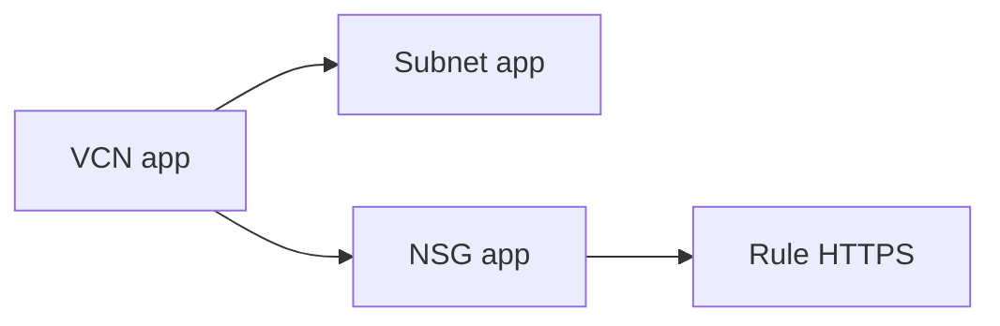

# Plan review, dependency graph và áp dụng thay đổi có kiểm soát

## 1. Mục tiêu và bối cảnh trên OCI

Trong chương **Hạ tầng dưới dạng mã** của module **CLOUD_PROVIDERS_ORACLE**, một thay đổi Terraform cần được đánh giá theo tác động lên Oracle Cloud Infrastructure (OCI): đúng tenancy, đúng compartment, đúng quyền IAM, đúng kết nối mạng và đúng mức gián đoạn cho phép. Một dòng sửa cấu hình có thể ảnh hưởng nhiều Compute instance hoặc làm ứng dụng mất đường đến cơ sở dữ liệu Oracle.

Sau bài này, người học có thể đọc một execution plan, giải thích quan hệ phụ thuộc giữa các tài nguyên và thiết kế quy trình áp dụng có bằng chứng phê duyệt. Trọng tâm là ra quyết định trước khi thay đổi hạ tầng, sau đó xác nhận hệ thống vẫn đáp ứng yêu cầu vận hành, chi phí và tính sẵn sàng.

Tình huống xuyên suốt: đội ứng dụng vận hành dịch vụ Java trong một compartment dành riêng cho ứng dụng. Hạ tầng gồm VCN, subnet riêng, NSG, Compute và kết nối tới cơ sở dữ liệu. Một yêu cầu chỉ cần bổ sung HTTPS từ tầng trung gian tới ứng dụng; người review phải phát hiện nếu plan đồng thời mở rộng truy cập hoặc đề xuất thay thế máy đang chạy.

Các lệnh trong bài là ví dụ để người học thực hiện trong môi trường thực hành đã chuẩn bị. Không cần tạo Compute hay cơ sở dữ liệu chỉ để học cách đọc graph; ví dụ HCL bên dưới tập trung vào phần mạng.

## 2. Plan cho biết điều gì?

Terraform tạo plan từ cấu hình mong muốn, state và thông tin tài nguyên đọc qua provider. Ở chế độ thông thường, nó refresh thông tin, đối chiếu và đề xuất hành động; riêng việc chạy `plan` chưa thực thi các thay đổi tài nguyên được đề xuất. Chạy với `-out` tạo một tệp plan có thể đưa vào bước apply. Nếu không lưu, kết quả chủ yếu phục vụ xem trước. [Tài liệu terraform plan](https://developer.hashicorp.com/terraform/cli/commands/plan).

Cần phân biệt ba câu hỏi:

| Câu hỏi | Bằng chứng cần xem |
| --- | --- |
| Cấu hình muốn thay đổi gì? | Diff mã nguồn, biến đầu vào, phiên bản module |
| Terraform dự kiến làm gì? | Plan, địa chỉ resource, thuộc tính trước và sau |
| Dịch vụ có chịu được thay đổi không? | Kiến trúc, lưu lượng, dữ liệu, runbook và giám sát |

Ví dụ, sửa route table có thể chỉ là một hành động cập nhật nhưng ảnh hưởng toàn bộ subnet dùng chung. Ngược lại, tạo thêm nhiều rule giới hạn đúng nguồn có thể có phạm vi ảnh hưởng nhỏ hơn. Số lượng hành động giúp định hướng việc đọc; quyết định triển khai phải dựa trên từng thay đổi và các hệ thống sử dụng nó.

### 2.1. Đọc ký hiệu trước khi đọc thuộc tính

Các ký hiệu thường gặp trong phần thay đổi resource:

| Ký hiệu | Ý nghĩa cần nhận ra |
| --- | --- |
| `+` | Tạo tài nguyên |
| `~` | Cập nhật tài nguyên hiện có |
| `-` | Xóa tài nguyên |
| `-/+` | Xóa rồi tạo lại |
| `+/-` | Tạo mới trước khi xóa đối tượng cũ |
| `<=` | Đọc data source |

Replacement phải được xét như một lần thay đổi danh tính và vòng đời tài nguyên. Hãy tìm thuộc tính dẫn tới thay thế, các tham chiếu OCID, dữ liệu gắn kèm và cách chuyển lưu lượng. Quy tắc lifecycle có thể ảnh hưởng thứ tự tạo/xóa, nhưng không tự bảo đảm ứng dụng liên tục phục vụ. [Tài liệu lifecycle](https://developer.hashicorp.com/terraform/language/meta-arguments/lifecycle).

Đoạn diff sau chỉ minh họa thay đổi thuộc tính cần điều tra; hành động đầy đủ phải đọc trong plan thực tế của provider đang dùng:

```text
~ source = "10.20.10.0/24" -> "0.0.0.0/0"
```

Nếu yêu cầu chỉ cho phép một subnet nguồn, thay đổi này mở rộng phạm vi cho phép và cần sửa trước khi duyệt. Mức độ truy cập thực tế còn phụ thuộc route, IP, NSG gắn vào VNIC, security list và các lớp lọc khác. Tuy nhiên, chưa có đường Internet ở thời điểm hiện tại cũng không phải lý do để chấp nhận một rule vượt yêu cầu.

### 2.2. Hiểu giá trị chưa biết

`(known after apply)` biểu thị giá trị chưa xác định được lúc lập plan. OCID của một resource sắp tạo là ví dụ bình thường. Với thuộc tính quyết định quyền truy cập hoặc đích kết nối, người review cần hiểu giá trị đó được tính từ đâu và giới hạn của nó là gì.

Trong biểu diễn JSON, `after_unknown` đánh dấu các giá trị chưa biết; `before`, `after` và `change.actions` cho phép đọc thay đổi có cấu trúc. Các chuỗi hành động có cả `delete` và `create` biểu thị replacement. [Định dạng JSON của Terraform](https://developer.hashicorp.com/terraform/internals/json-format).

Không phê duyệt một chính sách IAM chỉ vì nội dung quan trọng bị ẩn sau giá trị chưa biết. Có thể cần làm rõ đầu vào, thu hẹp dependency hoặc tách thay đổi thành các đợt có mục tiêu rõ ràng.

### 2.3. Những điều plan chưa chứng minh

Một plan hợp lệ chưa chứng minh được:

- Shape Compute còn capacity tại nơi triển khai hoặc quota còn đủ.
- Ứng dụng Java khởi động xong, health check đạt và pool kết nối cơ sở dữ liệu hoạt động.
- Credential ở bước apply có đủ quyền với mọi tài nguyên liên quan.
- Hệ thống đạt RTO/RPO, hay dữ liệu có thể phục hồi trong khoảng thời gian mong muốn.
- Chi phí sau thay đổi nằm trong ngân sách.

Đây là các tiêu chí chấp nhận bổ sung của đội vận hành. Chẳng hạn, tăng số instance cần kèm dự toán chi phí và điều kiện giảm tải; thay đổi truy cập database cần có phép thử kết nối từ đúng subnet ứng dụng.

## 3. Review theo phạm vi ảnh hưởng trên OCI

Một trình tự review hữu ích là xác định đích triển khai, tìm hành động phá hủy, rồi lần theo mạng, quyền và dữ liệu.

### 3.1. Xác nhận đúng đích trước khi đọc diff

Ghi rõ tenancy, region, compartment OCID, backend/state và môi trường. Nếu dùng provider alias, kiểm tra tài nguyên đang dùng cấu hình provider nào. Nếu dùng Resource Manager, ghi thêm Stack OCID và Plan Job OCID.

Tên `prod` của workspace hoặc tên hiển thị của compartment chỉ là một phần bằng chứng. Hãy đối chiếu định danh thực với hồ sơ thay đổi. Một plan nhìn hợp lý trong sai compartment vẫn là một thay đổi sai đích.

### 3.2. Ma trận kiểm tra theo tài nguyên

| Nhóm | Nội dung cần xem trong plan | Tác động cần giải thích |
| --- | --- | --- |
| IAM | Chủ thể được cấp quyền, động từ, loại tài nguyên, phạm vi compartment | Có tăng quyền vượt nhu cầu hoặc ảnh hưởng nhiều ứng dụng không? |
| VCN và subnet | CIDR, route table, security list, khả năng gán public IP | Có xung đột mạng, mất kết nối hoặc mở thêm đường truy cập không? |
| NSG | Hướng lưu lượng, nguồn/đích, protocol, cổng, VNIC sử dụng | Rule có khớp luồng cần mở và có bị mở quá rộng không? |
| Compute | Replacement, shape, cấu hình khởi tạo, VNIC, boot volume | Có cần drain, chuyển lưu lượng, capacity dự phòng không? |
| Lưu trữ | Volume, attachment, bucket, thời hạn lưu dữ liệu | Có mất dữ liệu, thay đổi quyền hoặc phát sinh dung lượng lưu không? |
| Cơ sở dữ liệu Oracle | Hành động trên database, cấu hình kết nối, backup | Có gián đoạn, cần phục hồi hoặc thay đổi điều kiện HA không? |
| Giám sát | Alarm, log, đích thông báo và metric liên quan | Sau triển khai còn quan sát được lỗi và độ trễ không? |

Đây là gợi ý review cho kiến trúc OCI trong bài, không phải khẳng định mọi thuộc tính đều sửa được tại chỗ. Hành động thực tế do loại dịch vụ, provider, phiên bản và cấu hình cụ thể quyết định.

Với dữ liệu quan trọng, yêu cầu bằng chứng backup và phương án phục hồi đã được kiểm tra. Với hạ tầng dùng chung như route table hoặc IAM policy, ghi danh sách hệ thống tiêu thụ trước khi duyệt.

### 3.3. Các kết quả review có thể hành động được

Một nhận xét tốt liên kết tài nguyên, thuộc tính và yêu cầu:

```text
Chưa duyệt:
- Rule HTTPS đổi source từ subnet trung gian sang 0.0.0.0/0.
- Phạm vi này vượt yêu cầu chỉ mở lưu lượng nội bộ.
- Sửa source, tạo plan mới và gửi lại đúng artifact để review.
```

Một chấp thuận nên có điều kiện cụ thể: plan nào được duyệt, môi trường nào, ai chịu trách nhiệm triển khai, thời điểm áp dụng và cách xác nhận thành công. Khi nội dung plan thay đổi, chấp thuận cũ không còn đại diện cho thay đổi mới.

## 4. Dependency graph: thứ tự được suy ra từ quan hệ

Terraform dùng dependency graph để tổ chức thao tác. Tham chiếu thuộc tính giữa resource tạo quan hệ phụ thuộc; `depends_on` bổ sung cạnh tường minh. Graph cũng gồm các thành phần phục vụ provider và các thao tác vòng đời. Những nút đủ điều kiện có thể được xử lý song song; thứ tự xuất hiện trong tệp HCL không phải lịch thực thi. [Dependency graph của Terraform](https://developer.hashicorp.com/terraform/internals/graph).

### 4.1. Ví dụ mạng OCI nhỏ để đọc graph

Giả định root module đã có cấu hình OCI provider, xác thực và backend phù hợp, cùng phiên bản Terraform/provider được dự án phê duyệt. `compartment_id` là OCID của một compartment thực hành đã tồn tại và principal có quyền tạo tài nguyên mạng trong đó.

Đoạn sau có thể đặt trong cấu hình thực hành; nó tạo một VCN, subnet riêng, NSG và rule HTTPS. Đây chưa phải kiến trúc ứng dụng hoàn chỉnh.

```hcl
variable "compartment_id" {
  type        = string
  description = "OCID compartment thực hành"
}

variable "https_source_cidr" {
  type        = string
  description = "Subnet của tầng trung gian được phép gọi ứng dụng"
  default     = "10.20.10.0/24"
}

resource "oci_core_vcn" "app" {
  compartment_id = var.compartment_id
  cidr_blocks    = ["10.20.0.0/16"]
  display_name   = "iac-review-vcn"
  dns_label      = "iacreview"
}

resource "oci_core_subnet" "app" {
  compartment_id             = var.compartment_id
  vcn_id                     = oci_core_vcn.app.id
  cidr_block                 = "10.20.20.0/24"
  display_name               = "iac-review-private-subnet"
  dns_label                  = "app"
  prohibit_public_ip_on_vnic = true
}

resource "oci_core_network_security_group" "app" {
  compartment_id = var.compartment_id
  vcn_id         = oci_core_vcn.app.id
  display_name   = "iac-review-app-nsg"
}

resource "oci_core_network_security_group_security_rule" "https" {
  network_security_group_id = oci_core_network_security_group.app.id
  direction                 = "INGRESS"
  protocol                  = "6"
  source_type               = "CIDR_BLOCK"
  source                    = var.https_source_cidr
  stateless                 = false
  description               = "HTTPS từ tầng trung gian"

  tcp_options {
    destination_port_range {
      min = 443
      max = 443
    }
  }
}
```

Trong ví dụ, `protocol = "6"` biểu diễn TCP; cổng đích được giới hạn bằng `destination_port_range`. Cấu trúc và ý nghĩa trường rule được mô tả trong [tài liệu resource NSG security rule của OCI provider](https://docs.oracle.com/en-us/iaas/tools/terraform-provider-oci/latest/docs/r/core_network_security_group_security_rule.html).

Subnet tham chiếu trực tiếp VCN qua `vcn_id`. Khi bỏ qua cấu hình route table hoặc security list riêng, subnet sử dụng các giá trị mặc định tương ứng của VCN; vì vậy phải xem các mặc định này trước khi triển khai workload. [Tài liệu resource subnet của OCI provider](https://docs.oracle.com/en-us/iaas/tools/terraform-provider-oci/latest/docs/r/core_subnet.html).

VCN được tạo kèm các tài nguyên mặc định như route table, security list và DHCP options. Tổng số resource trong plan không nhất thiết mô tả mọi đối tượng mà OCI tạo kèm. [Tài liệu resource VCN của OCI provider](https://docs.oracle.com/en-us/iaas/tools/terraform-provider-oci/latest/docs/r/core_vcn.html).

Việc tạo NSG và rule chưa gắn NSG vào VNIC nào, cũng chưa có server lắng nghe cổng 443. Khi bổ sung Compute, phải cấu hình gắn NSG và kiểm tra đường truyền thực tế.

### 4.2. Graph khái niệm của ví dụ

Sơ đồ dưới dùng mũi tên **điều kiện trước → tài nguyên phụ thuộc**, để mô tả thứ tự tạo. Đây là sơ đồ giải thích; chiều cạnh trong đầu ra DOT cần được đọc theo ý nghĩa của công cụ.



`oci_core_subnet.app` và `oci_core_network_security_group.app` cùng cần VCN nhưng không tham chiếu nhau, nên có thể trở thành hai nhánh xử lý độc lập. Rule HTTPS cần NSG trước, nhưng không có quan hệ thứ tự với subnet trong cấu hình này. `source` chỉ nhận một chuỗi CIDR, không tạo dependency tới một subnet khác có CIDR trùng chuỗi đó.

Để minh họa luồng phụ thuộc của workload lớn hơn, có thể mở rộng sơ đồ với VNIC và ứng dụng. Không nên biến mọi tài nguyên trong sơ đồ kiến trúc thành `depends_on`: cạnh phục vụ lưu lượng và cạnh phục vụ thứ tự tạo có thể khác nhau.

### 4.3. Khi nào cần depends_on?

Ưu tiên thể hiện quan hệ bằng tham chiếu dữ liệu, như `vcn_id = oci_core_vcn.app.id`. `depends_on` phù hợp khi có phụ thuộc hành vi mà Terraform không suy ra được từ các thuộc tính. Khai báo quá rộng, đặc biệt ở cấp module, có thể làm plan bảo thủ hơn và tăng số giá trị chưa biết. [Tài liệu depends_on](https://developer.hashicorp.com/terraform/language/meta-arguments/depends_on).

Ví dụ thiết kế: script bootstrap trong một Compute instance cần quyền instance principal để đọc một đối tượng cấu hình. Trong root module đã có `oci_identity_policy.app_access`, và code tạo instance không tham chiếu thuộc tính nào của policy. Có thể bổ sung vào block instance hiện có:

```hcl
# Đoạn bổ sung bên trong resource instance đã khai báo đầy đủ.
# Bootstrap cần policy này để truy cập dịch vụ OCI.
depends_on = [oci_identity_policy.app_access]
```

Cạnh này biểu diễn thứ tự hoàn tất thao tác quản lý resource policy trước thao tác instance. Sau đó vẫn cần kiểm tra quyền có sử dụng được từ workload; nếu API tạm thời chưa sẵn sàng, bootstrap cần retry hữu hạn, thông báo lỗi và thời hạn rõ ràng. Không xem thời gian chờ cố định là bằng chứng dịch vụ đã sẵn sàng.

Tương tự, một VM có trạng thái hoạt động chưa đủ chứng minh tiến trình Java sẵn sàng nhận request. Điều kiện đưa VM vào phục vụ nên dựa trên health check của ứng dụng và kiểm tra phụ thuộc database.

### 4.4. Vòng phụ thuộc và dependency giữa các state

Nếu A cần B hoàn tất nhưng B cũng cần A hoàn tất, cấu hình tạo vòng phụ thuộc. Cách xử lý là xem lại đối tượng nào thực sự cần tồn tại trước, tách phần khởi tạo khỏi phần liên kết hoặc bỏ cạnh thừa. Giảm mức song song không giải quyết được vòng này.

Ví dụ, khi hai nhóm mạng cần tham chiếu lẫn nhau qua rule, hãy cân nhắc tạo hai NSG trước rồi tạo các resource rule riêng tham chiếu tới cả hai. Mỗi rule phụ thuộc các NSG cần thiết mà các NSG không phải phụ thuộc ngược lại vào rule.

Nếu mạng và ứng dụng thuộc hai state khác nhau, tham chiếu một OCID do hệ thống bên ngoài cung cấp không tự tạo lịch điều phối xuyên hai lần chạy. Pipeline phải quy định rõ: hoàn tất thay đổi mạng, kiểm tra kết quả, chuyển đầu ra hợp lệ cho ứng dụng, rồi mới chạy thay đổi ứng dụng. Cần xác định chủ sở hữu cho từng state và tránh để hai state cùng quản lý một tài nguyên OCI.

### 4.5. Xem graph từ công cụ

Sau khi khởi tạo cấu hình, có thể xem graph cấu hình hoặc graph cho saved plan:

```powershell
terraform graph
terraform graph -plan=review.tfplan
```

Đầu ra dùng định dạng DOT. Graph mặc định trình bày dependency resource/data; tùy chọn `-plan` dựng graph apply từ plan đã lưu. Graphviz có thể chuyển DOT thành hình khi cần quan sát. [Tài liệu terraform graph](https://developer.hashicorp.com/terraform/cli/commands/graph).

Với graph lớn, tập trung vào chuỗi dẫn tới tài nguyên có nguy cơ cao: VCN dùng chung, policy IAM, database hoặc Compute cần thay thế. Tìm cạnh thiếu, cạnh quá rộng và các thao tác có thể diễn ra song song. Graph giải thích thứ tự; đánh giá gián đoạn vẫn cần thông tin về ứng dụng.

## 5. Giữ ổn định các đầu vào của lần triển khai

Muốn phê duyệt có ý nghĩa, đội triển khai cần tái lập được bối cảnh của plan. Nên ghi lại một bộ thông tin tối thiểu:

| Thành phần | Thông tin cần ràng buộc |
| --- | --- |
| Mã nguồn | Commit cụ thể, thư mục root module, nguồn và phiên bản module |
| Công cụ | Phiên bản Terraform và OCI provider đã chọn |
| Biến | Bộ biến của đúng môi trường và phiên bản secret liên quan |
| Đích | Tenancy, region, compartment, backend/state hoặc stack |
| Artifact | Định danh plan, thời gian tạo và SHA-256 nếu dùng tệp |
| Phê duyệt | Người duyệt, điều kiện áp dụng, thời hạn và phạm vi được duyệt |

`.terraform.lock.hcl` lưu lựa chọn phiên bản và checksum của provider. Cần quản lý nó cùng mã nguồn; lock file này không khóa phiên bản các remote module, nên nguồn module cũng phải được ghim phù hợp. Thay đổi provider cần được review như một thay đổi có thể ảnh hưởng plan. [Tài liệu dependency lock file](https://developer.hashicorp.com/terraform/language/files/dependency-lock).

Không chạy nâng cấp provider xen giữa hai bước review và apply của cùng lần triển khai. Nếu cần nâng cấp, tạo một lần lập plan mới với thông tin phiên bản mới.

### 5.1. Bảo vệ plan, state và log

Plan có thể chứa giá trị nhạy cảm dù giao diện terminal che chúng. Không commit plan, state hay bản JSON thô vào kho mã nguồn; lưu artifact trong hệ thống có kiểm soát truy cập, mã hóa và thời hạn lưu phù hợp. Nhãn `sensitive` không có nghĩa các giá trị đó được mã hóa trong tệp. [Hướng dẫn quản lý dữ liệu nhạy cảm của Terraform](https://developer.hashicorp.com/terraform/language/manage-sensitive-data).

Bản plan để review rộng nên được lọc dữ liệu theo quy định của dự án. Người chịu trách nhiệm cuối cùng vẫn cần quyền xem nội dung cần thiết để xác nhận thay đổi, qua kênh được kiểm soát. Tránh đưa mật khẩu database hoặc private key vào nhận xét pull request.

### 5.2. Phân quyền pipeline theo nhiệm vụ

Ở mức thiết kế vận hành, tách nhiệm vụ tạo plan, phê duyệt và thực thi thay đổi. Principal tạo plan cần đủ quyền đọc trạng thái và data source liên quan; principal apply cần các quyền quản lý được yêu cầu. Quyền truy cập backend và các dịch vụ dùng trong cấu hình cũng phải được tính riêng.

Với OCI IAM, ghi rõ principal nào thực thi và policy nào cho phép nó thao tác trong compartment đích. Không mặc định việc plan thành công đồng nghĩa quyền tạo, cập nhật hoặc xóa cũng đã đủ. Đường chạy production nên chỉ nhận mã nguồn và artifact đã được duyệt, tránh để thay đổi mã chưa tin cậy chạy với quyền triển khai.

## 6. Quy trình CLI: tạo, duyệt và áp dụng cùng một plan

Các lệnh dưới dùng PowerShell trong root module Terraform thực hành. Đây là hướng dẫn cho người học, không phải yêu cầu thực thi trên hạ tầng đang vận hành.

Điều kiện trước khi chạy: xác thực OCI đã cấu hình, biến đầu vào đã được chuẩn bị, backend đúng môi trường và lock file đã được tạo, review, lưu cùng mã nguồn. Nếu đây là lần khởi tạo đầu tiên, cần hoàn tất bước chuẩn bị lock file trước khi dùng ví dụ `-lockfile=readonly`.

### 6.1. Khởi tạo và kiểm tra cấu hình

```powershell
terraform init -input=false -lockfile=readonly
if ($LASTEXITCODE -ne 0) { throw "Khởi tạo Terraform thất bại" }

terraform fmt -check
if ($LASTEXITCODE -ne 0) { throw "Cần chuẩn hóa định dạng cấu hình" }

terraform validate
if ($LASTEXITCODE -ne 0) { throw "Cấu hình Terraform không hợp lệ" }
```

Các bước này phát hiện lỗi chuẩn bị và cấu hình. Sau đó vẫn phải lập plan và kiểm tra tác động lên OCI. Nếu dùng child module do dự án tự quản lý, bổ sung kiểm tra định dạng theo phạm vi thư mục phù hợp của dự án.

### 6.2. Tạo artifact plan và xử lý mã thoát

```powershell
terraform plan -input=false -lock-timeout=5m -detailed-exitcode -out=review.tfplan
$planExitCode = $LASTEXITCODE

if ($planExitCode -eq 1) {
    throw "Plan thất bại; dừng triển khai"
}
if ($planExitCode -notin @(0, 2)) {
    throw "Mã thoát plan không hợp lệ: $planExitCode"
}
if ($planExitCode -eq 0) {
    Write-Output "Plan không có thay đổi; có thể kết thúc luồng triển khai"
}
if ($planExitCode -eq 2) {
    Write-Output "Plan có thay đổi; chuyển sang review"
}

terraform show -no-color review.tfplan
if ($LASTEXITCODE -ne 0) { throw "Không đọc được plan" }

Get-FileHash -LiteralPath './review.tfplan' -Algorithm SHA256
```

Với `-detailed-exitcode`, `0` là thành công không có thay đổi, `1` là lỗi và `2` là thành công có thay đổi. Pipeline cần xử lý riêng mã `2`. [Tham chiếu tùy chọn plan](https://developer.hashicorp.com/terraform/cli/commands/plan).

Tên `review.tfplan` được dùng để minh họa. Trong CI/CD, lưu mỗi lần chạy thành artifact riêng, gắn định danh bất biến; một plan mới phải có bản review và phê duyệt tương ứng. Nếu dự án cần `-var-file`, chỉ định đúng bộ biến khi lập plan và ghi lại nguồn biến trong hồ sơ.

### 6.3. Ghi nhận phê duyệt gắn với artifact

Một hồ sơ review có thể theo mẫu:

```text
Môi trường: production
Đích OCI: tenancy/region/compartment đã đối chiếu
Mã nguồn: commit cụ thể của lần chạy
State hoặc Stack: định danh môi trường đã đối chiếu
Plan artifact: định danh của lần chạy
SHA-256: giá trị đã ghi nhận khi review
Thay đổi được duyệt: bổ sung HTTPS từ subnet trung gian
Thay thế hoặc xóa: không được duyệt trong lần này
Điều kiện vận hành: còn capacity, có giám sát và người trực
Thời hạn: theo cửa sổ thay đổi của hệ thống
Người review và người triển khai: ghi theo quy trình đội
```

Hash chỉ hỗ trợ xác nhận nội dung tệp. Cần lưu hash đã duyệt trong bản ghi được bảo vệ; tự tính lại hash của một tệp mới rồi coi đó là bằng chứng cũ sẽ làm mất ý nghĩa kiểm soát.

### 6.4. Áp dụng artifact đã duyệt

Bước apply phải nhận đúng commit, công cụ, backend và artifact đã ghi nhận. Có thể đối chiếu SHA-256 trước khi chạy:

```powershell
# CI cung cấp hash từ bản ghi phê duyệt được bảo vệ.
$approvedPlanSha256 = $env:APPROVED_PLAN_SHA256
if ([string]::IsNullOrWhiteSpace($approvedPlanSha256)) {
    throw "Thiếu hash plan đã được phê duyệt"
}

$actualPlanSha256 = (Get-FileHash -LiteralPath './review.tfplan' -Algorithm SHA256).Hash
if ($actualPlanSha256 -ne $approvedPlanSha256) {
    throw "Artifact không khớp plan đã duyệt"
}

terraform apply -input=false -lock-timeout=5m review.tfplan
if ($LASTEXITCODE -ne 0) {
    throw "Apply chưa hoàn tất; cần điều tra trạng thái thực tế"
}
```

Khi truyền saved plan, Terraform thực hiện plan đó và không hỏi xác nhận tương tác. Ngược lại, `terraform apply` không kèm plan tự lập một plan mới. Vì vậy, điểm phê duyệt phải đặt trước bước thực thi artifact; `-auto-approve` không tạo ra bằng chứng đã review. [Tài liệu terraform apply](https://developer.hashicorp.com/terraform/cli/commands/apply).

Nếu runner apply khác runner plan, cần chuẩn bị đúng môi trường thực thi: phiên bản công cụ tương thích, provider đã khóa, module và các tệp phụ trợ cần thiết. Việc mang một tệp plan sang runner mới chưa đủ bảo đảm mọi điều kiện thực thi đã sẵn sàng.

### 6.5. Khi nào phải tạo plan và review lại?

Trong quy trình đề xuất của bài, hãy tạo vòng phê duyệt mới khi thay đổi mã nguồn, biến, provider, module, đích triển khai, hoặc khi plan đã vượt thời hạn được đội quy định. Tương tự, nếu phát hiện một thay đổi ngoài luồng có thể ảnh hưởng kết quả, dừng để đánh giá và lập lại plan.

Terraform có thể từ chối saved plan khi state không còn phù hợp. Không diễn giải điều này thành cơ chế bắt được mọi thay đổi trực tiếp trên OCI: một thay đổi ngoài Terraform có thể chưa được phản ánh vào state. Vì vậy, giảm khoảng cách giữa review và apply và kiểm soát thay đổi ngoài luồng là hai phần của cùng quy trình.

Nếu cần lập plan lại, kết quả mới phải được review lại. Một bản plan xem trước từ nhiều giờ trước không phải bằng chứng đầy đủ cho nội dung sắp thực thi. [Hướng dẫn tạo và áp dụng saved plan](https://developer.hashicorp.com/terraform/tutorials/cli/plan).

## 7. Tự động sàng lọc trước khi người review quyết định

Có thể dùng JSON plan để phát hiện điều kiện cần chặn sớm. Đoạn PowerShell sau minh họa quy tắc của một đợt triển khai **không cho phép xóa hoặc thay thế managed resource**:

```powershell
$planJsonText = terraform show -json review.tfplan
if ($LASTEXITCODE -ne 0) { throw "Không xuất được JSON plan" }
$planDocument = ($planJsonText -join "`n") | ConvertFrom-Json

$changesWithDelete = @(
    $planDocument.resource_changes | Where-Object {
        $_.mode -eq 'managed' -and $_.change.actions -contains 'delete'
    }
)

if ($changesWithDelete.Count -gt 0) {
    $blockedAddresses = $changesWithDelete | ForEach-Object { $_.address }
    throw ("Đợt triển khai không cho phép delete/replacement: " + ($blockedAddresses -join ', '))
}
```

Cách kiểm tra `contains 'delete'` bắt cả xóa thuần túy và replacement theo hai thứ tự tạo/xóa. Script chỉ là một bước sàng lọc; nó chưa kiểm tra IAM, CIDR, cổng hoặc ảnh hưởng dịch vụ. Không in toàn bộ JSON ra log công khai.

Có thể bổ sung các quy tắc theo yêu cầu dự án: chặn nguồn Internet ở cổng quản trị; yêu cầu tag quản lý chi phí khi tạo Compute; yêu cầu phê duyệt dữ liệu khi thay đổi database; hoặc yêu cầu giải thích với thuộc tính mạng quan trọng chưa biết tại thời điểm plan. Với giá trị unknown, policy cần phân biệt OCID sắp sinh với giá trị quyết định quyền truy cập.

Nếu có ngoại lệ, gắn ngoại lệ vào địa chỉ resource, thay đổi cụ thể, người chịu trách nhiệm và lần chạy đã duyệt. Tránh tắt toàn bộ bộ kiểm tra để cho qua một thay đổi đơn lẻ.

## 8. State locking và điều phối lần chạy

Nếu backend hỗ trợ, Terraform tự khóa state cho các thao tác có thể ghi state. Không phải backend nào cũng hỗ trợ locking; cần kiểm tra đúng backend của dự án. Khi có tranh chấp lock, xác định lần chạy đang giữ lock và chờ hoặc xử lý theo quy trình. Không dùng `-lock=false` để bỏ qua một lần chạy còn hoạt động. [Tài liệu state locking](https://developer.hashicorp.com/terraform/language/state/locking).

Lock không phải cơ chế bảo vệ toàn bộ OCI tenancy. Nó không ngăn một người sửa trực tiếp trong Console, cũng không ngăn một state khác quản lý nhầm cùng OCID. Hơn nữa, thời gian chờ phê duyệt giữa plan và apply không được coi là một giao dịch giữ khóa xuyên suốt.

Vì vậy, đội triển khai nên có hàng đợi theo môi trường/state, quy định một chủ sở hữu cho từng tài nguyên và đối chiếu các thay đổi xảy ra trong thời gian chờ. Nếu cần giải phóng lock bị bỏ lại, chỉ thực hiện sau khi đã xác nhận không còn tiến trình giữ lock hoạt động; lưu bằng chứng sự cố và quyết định xử lý.

### 8.1. Song song có kiểm soát

Trong OCI Resource Manager, tùy chọn số thao tác song song giới hạn mức đồng thời khi Terraform duyệt graph. Tăng quá cao có thể dẫn tới throttling từ dịch vụ OCI. [Tùy chọn apply job của Resource Manager](https://docs.oracle.com/en-us/iaas/Content/ResourceManager/Tasks/create-job-apply.htm).

Khi gặp throttling hoặc cần giảm áp lực API, có thể đánh giá giảm parallelism. Tuy nhiên, giảm parallelism không sửa một cạnh dependency bị thiếu, không xác nhận ứng dụng đã sẵn sàng và không giải quyết được vòng phụ thuộc. Một vấn đề về thứ tự cần được xử lý ở cấu hình hoặc quy trình điều phối.

## 9. Chia thay đổi thành các đợt có mục tiêu

Thay đổi nhỏ, có mục tiêu và điều kiện thành công rõ ràng thường dễ review hơn một plan trộn nâng cấp provider, thay mạng và chuyển database. Có thể đề xuất các đợt triển khai cho ứng dụng Java:

| Đợt | Thay đổi dự kiến | Điều kiện trước khi chuyển đợt |
| --- | --- | --- |
| Chuẩn bị | Tạo tài nguyên thay thế và bổ sung đường truy cập cần thiết | Đủ capacity, quyền và kết nối kiểm thử |
| Thử nghiệm | Đưa một phần workload vào cấu hình mới | Health check, lỗi, độ trễ và kết nối database đạt yêu cầu |
| Chuyển tiếp | Chuyển dần lưu lượng theo runbook | Các chỉ số giữ trong giới hạn đã định |
| Thu hồi | Xóa tài nguyên cũ hết vai trò | Hết thời gian quan sát, xác nhận không còn người dùng |

Đây là cách tổ chức công việc; mỗi đợt vẫn cần plan, review và điều kiện khôi phục riêng. Nếu schema database thay đổi không tương thích với phiên bản Java cũ, phải thiết kế khả năng chạy chuyển tiếp trước khi coi việc quay lại phiên bản ứng dụng là phương án phục hồi.

`create_before_destroy` thay đổi thứ tự replacement và cần đáp ứng điều kiện cùng tồn tại. `prevent_destroy` chỉ bảo vệ khi quy tắc còn trong cấu hình; xóa block resource cũng làm mất bảo vệ đó. `ignore_changes` cần phạm vi rõ vì nó bỏ qua các cập nhật tương ứng. [Giới hạn các quy tắc lifecycle](https://developer.hashicorp.com/terraform/language/meta-arguments/lifecycle).

### 9.1. Đổi tên địa chỉ Terraform có chủ đích

Một lần đổi tên block HCL có thể làm Terraform hiểu đó là địa chỉ resource khác. Khi mục đích chỉ là đổi tên quản lý, hãy xem xét `moved` block để giữ liên kết với đối tượng hiện có. [Hướng dẫn refactor module bằng moved block](https://developer.hashicorp.com/terraform/language/modules/develop/refactoring).

Ví dụ đổi tên resource subnet từ `app` thành `app_private`, đồng thời cập nhật các tham chiếu trong cấu hình:

```hcl
moved {
  from = oci_core_subnet.app
  to   = oci_core_subnet.app_private
}
```

Đây là phần bổ sung cho thao tác đổi tên resource thật trong cùng cấu hình, không phải block tạo subnet mới. Reviewer cần thấy kết quả di chuyển địa chỉ đúng ý định trong plan và xác nhận không có replacement ngoài dự kiến. Nếu cùng lúc đổi thuộc tính khác, vẫn phải review từng thay đổi đó.

### 9.2. Không dùng thao tác từng phần để né review

Nếu một plan có thay đổi không mong muốn, sửa cấu hình hoặc tách phạm vi quản lý hợp lý trước khi duyệt. Việc chỉ áp dụng một phần graph để tạm tránh tài nguyên có rủi ro có thể để lại trạng thái chưa hoàn chỉnh.

Khi có thao tác khôi phục đặc biệt chỉ tác động một phần hệ thống, cần ghi mục tiêu, phần còn dang dở và cách quay lại quy trình đầy đủ. Sau đó lập lại plan trên toàn phạm vi quản lý để hiểu những thay đổi còn lại.

## 10. Áp dụng quy trình trong OCI Resource Manager

Resource Manager tổ chức cấu hình và state theo **stack**, rồi thực thi qua các job. Dịch vụ lưu state và khóa stack để chỉ một job chạy tại một thời điểm trên stack đó. Điều này hỗ trợ phối hợp nhóm nhưng vẫn cần cơ chế review và phê duyệt thay đổi. [Resource Manager và Terraform](https://docs.oracle.com/en-us/iaas/Content/ResourceManager/Concepts/resource-manager-and-terraform.htm).

Một quy trình đề xuất:

1. Đối chiếu tenancy, compartment, Stack OCID, phiên bản công cụ, cấu hình và biến của stack.
2. Chạy Plan Job; chờ job thành công và đọc kết quả đầy đủ, gồm thay thế/xóa và các giá trị chưa biết quan trọng.
3. Ghi Plan Job OCID, nguồn mã, biến và kết luận review vào hồ sơ thay đổi.
4. Giữ ổn định đầu vào; nếu stack hoặc nguồn thay đổi, đánh giá lại và tạo vòng phê duyệt mới.
5. Khi chạy Apply Job, chọn đúng plan đã review trong mục phân giải plan và đối chiếu định danh.
6. Theo dõi job, kiểm tra tài nguyên thực tế và chạy xác nhận ứng dụng sau khi hoàn tất.

Console chỉ cho chọn Plan Job mới nhất được tạo cho stack. Nếu một plan mới đã thay thế plan đang được duyệt, phải review plan mới trước khi tiếp tục. Tài liệu Oracle cũng lưu ý nguồn trong hệ thống quản lý mã có thể được lấy theo commit mới nhất khi chạy job; quy trình cần kiểm soát nguồn trong thời gian chờ duyệt. [Hướng dẫn tạo Apply Job](https://docs.oracle.com/en-us/iaas/Content/ResourceManager/Tasks/create-job-apply.htm).

Không chọn `Automatically approve` chỉ vì trước đó đã xem một plan. Quyết định triển khai phải gắn với plan mà Apply Job thực sự sử dụng. Với yêu cầu kiểm soát chặt, đội nên sử dụng nguồn hoặc gói cấu hình đã cố định theo lần chạy và hạn chế cập nhật stack trong cửa sổ phê duyệt.

Quy trình Resource Manager và quy trình CLI là hai cách vận hành khác nhau. Chọn một đường quản lý state có chủ sở hữu rõ; không tự đưa cùng resource OCI vào cả stack và state riêng trên máy cá nhân.

## 11. Khi apply lỗi một phần

Terraform không tự rollback toàn bộ một lần apply đã hoàn thành một phần. Sau lỗi, một số tài nguyên có thể đã thay đổi và state có thể đã được cập nhật cho các thao tác thành công. Cần xác định trạng thái thực trước khi quyết định tiếp tục. [Hướng dẫn xử lý lỗi khi apply](https://developer.hashicorp.com/terraform/tutorials/cli/apply).

Ví dụ tình huống vận hành: NSG đã được cập nhật nhưng tạo Compute mới thất bại do điều kiện ở OCI. Không kết luận môi trường hoàn toàn giữ nguyên chỉ vì job cuối cùng báo lỗi. Runbook nên hướng dẫn:

1. Dừng các lần triển khai tiếp theo và xác định có tiến trình nào còn chạy.
2. Lưu log, địa chỉ resource lỗi, mã lỗi/request ID OCI nếu có và định danh lần chạy.
3. Đối chiếu state với OCI bằng các thao tác đọc được phân quyền; xác định phần đã hoàn thành, phần chưa hoàn thành và ảnh hưởng ứng dụng.
4. Xử lý nguyên nhân, chẳng hạn quyền, giới hạn tài nguyên, capacity hoặc lỗi cấu hình.
5. Lập plan mới trên trạng thái hiện tại, review phần còn lại rồi mới tiếp tục.
6. Nếu cần phục hồi, thực hiện theo runbook đã duyệt và kiểm tra lại dữ liệu, lưu lượng, giám sát.

Không lặp lại vô hạn một artifact cũ sau khi môi trường đã thay đổi. Nếu tài nguyên tồn tại ở OCI nhưng chưa có liên kết đúng trong state, cần quy trình đối chiếu và tiếp quản được phê duyệt; tránh tự tạo thêm bản sao hoặc chỉnh sửa state tùy tiện.

Revert commit chỉ thay đổi mã nguồn. Muốn đưa hạ tầng về cấu hình trước đó vẫn phải lập plan từ trạng thái hiện tại; tài nguyên đã xóa, dữ liệu đã đổi hoặc OCID đã thay thế có thể không quay lại bằng một lần apply. Với database, phương án phục hồi dữ liệu cần được thiết kế riêng theo RPO/RTO.

## 12. Xác nhận sau triển khai

Một lần triển khai được chấp nhận cần cả bằng chứng hạ tầng và bằng chứng dịch vụ. Với ứng dụng Java trên OCI, có thể ghi kết quả theo bảng:

| Lớp kiểm tra | Bằng chứng thực tế |
| --- | --- |
| Thực thi IaC | Apply hoặc Apply Job hoàn tất, log và định danh lần chạy được lưu |
| Định danh OCI | Resource nằm đúng compartment/region, OCID và tag khớp mục đích |
| Mạng | Luồng HTTPS cần thiết đi được từ đúng nguồn; luồng ngoài yêu cầu bị hạn chế |
| Ứng dụng | Health check đạt, tỉ lệ lỗi và độ trễ nằm trong giới hạn |
| Database | Ứng dụng kết nối và thực hiện được thao tác kiểm thử phù hợp |
| Giám sát | Metric, log và alarm cần thiết vẫn hoạt động |
| Chi phí | Số lượng/shape/dung lượng mới khớp dự toán; có chủ sở hữu thu hồi tài nguyên |
| Tính sẵn sàng | Workload còn năng lực phục vụ khi chuyển lưu lượng hoặc mất một thành phần theo thiết kế |

Sau đó có thể chạy plan mới để đối chiếu cấu hình với trạng thái hiện tại:

```powershell
terraform plan -input=false -lock-timeout=5m -detailed-exitcode
$postApplyPlanExitCode = $LASTEXITCODE

if ($postApplyPlanExitCode -eq 1) {
    throw "Không kiểm tra được trạng thái sau triển khai"
}
if ($postApplyPlanExitCode -eq 2) {
    throw "Còn thay đổi cần giải thích sau triển khai"
}
if ($postApplyPlanExitCode -ne 0) {
    throw "Mã thoát kiểm tra không hợp lệ: $postApplyPlanExitCode"
}
```

Kết quả không có thay đổi chỉ áp dụng cho phạm vi và thuộc tính Terraform đang quản lý. Nó chưa chứng minh API của ứng dụng hoạt động, không có đường truy cập thừa hoặc chi phí thực tế đúng dự báo. Những tiêu chí đó cần phép kiểm tra riêng như trong bảng.

## 13. Thực hành đọc plan trong compartment thử nghiệm

Bài thực hành sử dụng cấu hình mạng ở mục 4, trong môi trường được phép tạo tài nguyên. Tự xác định giới hạn chi phí, quyền và quy tắc thu hồi trước khi triển khai; không dùng tenancy production làm nơi thử replacement.

1. Chuẩn bị OCI provider, backend, phiên bản công cụ và compartment thực hành; ghi định danh môi trường.
2. Tạo plan cho ví dụ mạng. Tìm các địa chỉ VCN, subnet, NSG và rule; giải thích vì sao subnet và NSG không cần đợi nhau.
3. Xem graph của saved plan và đối chiếu các tham chiếu `vcn_id`, `network_security_group_id` với HCL.
4. Chỉ trong bản cấu hình thử nghiệm, đổi nguồn HTTPS thành `0.0.0.0/0`, lập plan để đọc diff và ghi lý do từ chối; không áp dụng thay đổi vượt yêu cầu này.
5. Khôi phục nguồn được phép, lập một plan mới, ghi hash, review và chỉ áp dụng nếu môi trường thực hành cho phép. Xác nhận rằng NSG vẫn cần gắn vào VNIC trước khi có tác dụng lên workload.
6. Sau khi kiểm tra kết quả, lập plan thu hồi đúng tài nguyên thực hành, review rồi mới thực hiện; xác nhận không còn tài nguyên phát sinh chi phí ngoài dự kiến.

Sản phẩm học tập là khả năng giải thích từng hành động và quyết định áp dụng: tài nguyên nào thay đổi, vì sao đúng thứ tự, điều gì đã được phê duyệt và bằng chứng nào xác nhận thành công. Khi chưa giải thích được một thay thế, một quyền mở rộng hoặc một giá trị mạng quan trọng chưa biết, vòng review còn việc phải hoàn thành.
