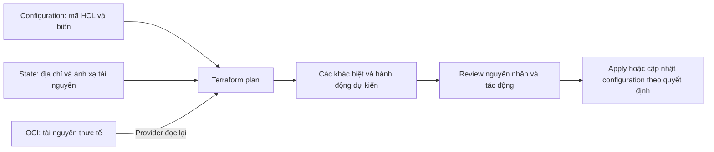

# Import tài nguyên hiện hữu và phát hiện configuration drift

## 1. Mục tiêu: đưa hạ tầng đang chạy vào một quy trình quản lý có kiểm soát

Trong chương **Hạ tầng dưới dạng mã** của module **CLOUD_PROVIDERS_ORACLE**, không phải mọi VCN, máy Compute hay database Oracle đều được tạo bằng Terraform từ đầu. Một hệ thống có thể đã hoạt động qua OCI Console, OCI CLI hoặc script riêng trước khi nhóm quyết định quản lý nó bằng mã.

Hai công việc cần được phân biệt:

- **Import tài nguyên hiện hữu**: thiết lập ánh xạ giữa tài nguyên OCI đã tồn tại và một địa chỉ resource trong Terraform state.
- **Phát hiện configuration drift**: nhận biết khác biệt do thay đổi ngoài quy trình, rồi quyết định cập nhật mã, khôi phục hạ tầng hoặc phân chia quyền sở hữu thuộc tính.

Import không phải sao chép tài nguyên sang region khác và cũng không tự biến mọi cấu hình hiện tại thành thiết kế đúng. Drift detection không đồng nghĩa được phép tự động sửa mọi khác biệt.

Bài này dùng VCN và subnet OCI làm ví dụ xuyên suốt. Người học sẽ xây dựng một baseline có thể review, import mà không thay đổi cấu hình hạ tầng ngoài ý muốn, rồi thực hành phân tích drift ở một thuộc tính ít ảnh hưởng như tag. Những lệnh minh họa được thực hiện trong môi trường đã được cấp quyền, không phải kết quả đã chạy trên tenancy của người học.

## 2. Hiểu ba thành phần: configuration, state và hạ tầng thật

Đặt:

- **C — Configuration**: mã HCL, giá trị biến và phiên bản dependency thể hiện mong muốn.
- **S — State**: thông tin Terraform đang ghi nhận về các đối tượng nó quản lý.
- **R — Remote infrastructure**: trạng thái thực tế mà OCI API trả về tại thời điểm đọc.



State gắn một địa chỉ như `oci_core_vcn.existing` với VCN OCID cụ thể. Khi import, Terraform bổ sung ánh xạ đó. Khi lập plan thông thường, Terraform đọc hạ tầng qua provider rồi tính hành động để tiến tới configuration.

Không phải mọi dòng diff đều là drift ngoài quy trình:

| Tình huống | Cách diễn giải |
| --- | --- |
| Một người sửa tag trên Console, mã không đổi | Có thay đổi ngoài Terraform cần phân tích |
| Nhóm sửa CIDR trong pull request | Đây là thay đổi mong muốn trong mã, chưa thể kết luận có drift ngoài hệ thống |
| Nâng provider làm cách biểu diễn thuộc tính khác | Có thể là thay đổi schema hoặc chuẩn hóa dữ liệu |
| Tài nguyên có trong OCI nhưng chưa nằm trong state | Chưa được root/state này quản lý, không tự trở thành drift của nó |

Muốn kết luận nguyên nhân, cần biết commit configuration, provider version, state/backend và thời điểm quan sát. Hướng dẫn [HashiCorp: quản lý resource drift](https://developer.hashicorp.com/terraform/tutorials/state/resource-drift) trình bày cách phối hợp mã và trạng thái thực tế.

## 3. Trước import: xác định phạm vi và quyền sở hữu

### 3.1. Lập bảng kiểm kê nhỏ nhưng chính xác

Đừng bắt đầu bằng việc import cả compartment. Chọn một nhóm tài nguyên có quan hệ rõ, chẳng hạn VCN và một subnet regional đang dùng trong môi trường lab.

| Thông tin | VCN | Subnet |
| --- | --- | --- |
| Region | Region của VCN | Cùng region với VCN |
| Compartment | OCID compartment chứa VCN | OCID compartment chứa subnet, có thể khác VCN |
| Định danh | VCN OCID | Subnet OCID |
| Cấu hình quan trọng | CIDR blocks, DNS label, tags, IPv6 nếu có | VCN ID, CIDR, DNS label, public-IP policy, route/security/DHCP associations |
| Chủ sở hữu hiện tại | Nhóm hoặc hệ thống tạo/quản lý | Nhóm hoặc controller liên quan |
| Terraform đã quản lý chưa? | Root/state/Resource Manager stack nào | Root/state/stack nào |
| Phạm vi nhận quản lý | Chỉ VCN hay cả đối tượng mặc định | Chỉ subnet hay cả các đối tượng đang được gắn |

Display name trên OCI không nhất thiết duy nhất; dùng OCID và region để nhận diện. Ghi nhận thuộc tính thực tế từ Console hoặc OCI API bằng danh tính được cấp quyền, không suy đoán chỉ từ tên tài nguyên.

### 3.2. Một đối tượng phải có một chủ sở hữu quản lý rõ

Không gắn cùng một tài nguyên OCI vào nhiều địa chỉ Terraform hoặc nhiều state đang cùng hoạt động. Hai pipeline có thể thay nhau ghi đè cấu hình dù từng lần apply đều hợp lệ khi xét riêng.

Kiểm tra cả root Terraform chạy bên ngoài OCI và stack trong OCI Resource Manager. Nếu đã có state sở hữu tài nguyên, vấn đề có thể là tìm lại đúng state, refactor địa chỉ hoặc chuyển quyền quản lý; không phải import thêm một bản ánh xạ mới.

HashiCorp mô tả import như việc nhận đối tượng hiện hữu vào state tại [tổng quan import](https://developer.hashicorp.com/terraform/language/import).

### 3.3. Xác nhận provider, IAM và backend

Cần biết rõ:

- Tenancy, danh tính chạy Terraform và phương thức xác thực.
- Region đúng cho tài nguyên.
- Compartment chứa tài nguyên và quyền đọc cần thiết.
- Backend và workspace/state dự kiến nhận tài nguyên.
- Quyền cập nhật state hoặc chạy job trong dịch vụ thực thi.
- Ai đang có thể apply đồng thời và cơ chế locking của backend.

Import thuần túy chủ yếu cần đọc tài nguyên OCI và ghi state. Một apply có cả action update sẽ cần quyền thay đổi hạ tầng tương ứng. Quyền truy cập state và quyền IAM trên OCI là hai lớp độc lập.

Ví dụ dùng OCI profile của người học; khi chạy trong Compute hoặc Resource Manager, chọn phương thức xác thực được hỗ trợ cho môi trường đó. Không đưa private key hay mật khẩu database vào mã. Xem [Oracle: cấu hình Terraform provider](https://docs.oracle.com/en-us/iaas/Content/dev/terraform/configuring.htm).

Nếu state đã tồn tại, dùng cơ chế versioning/backup của backend trước thao tác nhận quản lý. Có thể lấy bản sao phục vụ khôi phục theo quy trình của nhóm, nhưng phải bảo vệ như dữ liệu nhạy cảm và không commit vào Git.

## 4. Chọn phương thức import

| Phương thức | Điều cần chuẩn bị | Kết quả chính |
| --- | --- | --- |
| `import` block rồi plan/apply | Resource configuration và định danh tài nguyên | Import được thể hiện trong mã và plan có thể review |
| `terraform import ADDRESS ID` | Resource block đã tồn tại và provider phù hợp | Ghi ánh xạ trực tiếp vào state; không tự viết configuration |
| Sinh configuration từ import block | Provider, import target và ID; chưa có resource block tương ứng | Sinh HCL khởi đầu để chỉnh sửa và review |
| OCI Resource Discovery | Phạm vi compartment/service được hỗ trợ | Sinh configuration/state phục vụ tiếp nhận một phạm vi lớn hơn |

Bài ưu tiên import block vì có thể xem cùng pull request và saved plan. Lệnh import CLI vẫn hữu ích khi tiếp nhận từng đối tượng hoặc thao tác state theo runbook.

Các import ID phụ thuộc resource type. Với `oci_core_vcn` và `oci_core_subnet`, ví dụ dùng OCID tương ứng; không suy ra mọi resource OCI đều nhận cùng một định dạng. Một số loại có định danh ghép hoặc cách import riêng. Xem mục Import của [VCN resource](https://docs.oracle.com/en-us/iaas/tools/terraform-provider-oci/latest/docs/r/core_vcn.html) và [subnet resource](https://docs.oracle.com/en-us/iaas/tools/terraform-provider-oci/latest/docs/r/core_subnet.html).

## 5. Ví dụ: nhận quản lý VCN và subnet đang tồn tại

### 5.1. Giả định của môi trường thực hành

Ví dụ giả định có sẵn:

- VCN IPv4 tên `orders-vcn`, DNS label `orders`, CIDR `10.40.0.0/16`.
- Subnet regional private tên `orders-app`, DNS label `app`, CIDR `10.40.10.0/24`.
- Route table, security list và DHCP options đang được subnet sử dụng.
- Không có IPv6 hoặc tính năng bổ sung cần mô tả ngoài phạm vi mẫu.
- Không có state khác đang sở hữu hai tài nguyên được import.

Không dùng các giá trị này để ép một VCN sản xuất khác trở thành giống lab. Thay chúng bằng cấu hình đã kiểm kê. Nếu tài nguyên có nhiều CIDR, IPv6, defined tags hoặc thuộc tính khác, bổ sung cấu hình phù hợp trước khi chấp nhận plan.

Trong giai đoạn đầu, mục tiêu là **tiếp nhận baseline hiện hữu**, chưa kết hợp với đổi tên, chia lại subnet hoặc thắt chặt security policy. Những thay đổi đó nên có plan và đánh giá tác động riêng.

### 5.2. Cấu hình Terraform và provider

Trong một root configuration dành cho phạm vi tiếp nhận, file `versions.tf`:

```hcl
terraform {
  required_version = ">= 1.6.0, < 2.0.0"

  required_providers {
    oci = {
      source  = "oracle/oci"
      version = "~> 9.0"
    }
  }
}
```

Mức Terraform tối thiểu của ví dụ hỗ trợ import block. Provider được giới hạn trong dòng 9.x và lock file sẽ ghi phiên bản cụ thể đã chọn; điều chỉnh theo phiên bản được môi trường thực thi của tổ chức hỗ trợ.

File `providers.tf`:

```hcl
provider "oci" {
  region              = var.region
  config_file_profile = var.oci_config_profile
}
```

Không trỏ root mới vào backend đã dùng cho một hệ thống khác chỉ để tận dụng state sẵn có. Trong lab cá nhân có thể bắt đầu với local state; khi cộng tác, dùng backend/dịch vụ thực thi với quyền và locking phù hợp.

### 5.3. Định nghĩa dữ liệu kiểm kê

File `variables.tf`:

```hcl
variable "region" {
  type     = string
  nullable = false
}

variable "oci_config_profile" {
  type     = string
  default  = "DEFAULT"
  nullable = false
}

variable "vcn_id" {
  description = "OCID of the existing VCN to adopt."
  type        = string
  nullable    = false
}

variable "subnet_id" {
  description = "OCID of the existing subnet to adopt."
  type        = string
  nullable    = false
}

variable "vcn_baseline" {
  type = object({
    compartment_id = string
    display_name   = string
    dns_label      = string
    cidr_blocks    = list(string)
    freeform_tags  = map(string)
    defined_tags   = map(string)
  })
  nullable = false
}

variable "subnet_baseline" {
  type = object({
    compartment_id            = string
    display_name              = string
    dns_label                 = string
    cidr_block                = string
    prohibit_public_ip_on_vnic = bool
    route_table_id            = string
    dhcp_options_id           = string
    security_list_ids         = set(string)
    freeform_tags             = map(string)
    defined_tags              = map(string)
  })
  nullable = false
}
```

File `terraform.tfvars`, thay toàn bộ OCID placeholder bằng giá trị thật:

```hcl
region             = "ap-singapore-1"
oci_config_profile = "DEFAULT"
vcn_id             = "<existing-vcn-ocid>"
subnet_id          = "<existing-subnet-ocid>"

vcn_baseline = {
  compartment_id = "<vcn-compartment-ocid>"
  display_name   = "orders-vcn"
  dns_label      = "orders"
  cidr_blocks    = ["10.40.0.0/16"]
  freeform_tags  = {
    Environment = "lab"
    Owner       = "platform"
  }
  defined_tags = {}
}

subnet_baseline = {
  compartment_id            = "<subnet-compartment-ocid>"
  display_name              = "orders-app"
  dns_label                 = "app"
  cidr_block                = "10.40.10.0/24"
  prohibit_public_ip_on_vnic = true
  route_table_id            = "<existing-route-table-ocid>"
  dhcp_options_id           = "<existing-dhcp-options-ocid>"
  security_list_ids         = ["<existing-security-list-ocid>"]
  freeform_tags = {
    Environment = "lab"
    Owner       = "platform"
  }
  defined_tags = {}
}
```

Tag và association phải phản ánh tài nguyên thật. Gán `defined_tags = {}` cho tài nguyên đang có defined tags có thể dẫn tới đề xuất xóa tag; không sao chép file ví dụ mà bỏ qua phần kiểm kê.

### 5.4. Viết resource configuration

File `main.tf`:

```hcl
resource "oci_core_vcn" "existing" {
  compartment_id = var.vcn_baseline.compartment_id
  display_name   = var.vcn_baseline.display_name
  dns_label      = var.vcn_baseline.dns_label
  cidr_blocks    = var.vcn_baseline.cidr_blocks
  freeform_tags  = var.vcn_baseline.freeform_tags
  defined_tags   = var.vcn_baseline.defined_tags

  lifecycle {
    prevent_destroy = true
  }
}

resource "oci_core_subnet" "app" {
  compartment_id = var.subnet_baseline.compartment_id
  vcn_id         = oci_core_vcn.existing.id

  display_name              = var.subnet_baseline.display_name
  dns_label                 = var.subnet_baseline.dns_label
  cidr_block                = var.subnet_baseline.cidr_block
  prohibit_public_ip_on_vnic = var.subnet_baseline.prohibit_public_ip_on_vnic

  route_table_id    = var.subnet_baseline.route_table_id
  dhcp_options_id   = var.subnet_baseline.dhcp_options_id
  security_list_ids = var.subnet_baseline.security_list_ids
  freeform_tags     = var.subnet_baseline.freeform_tags
  defined_tags      = var.subnet_baseline.defined_tags

  lifecycle {
    prevent_destroy = true
  }
}
```

Trong ví dụ, không gán `availability_domain` vì subnet hiện hữu là regional. Nếu subnet thật gắn với một availability domain, phải khai báo đúng thay vì dùng nguyên mẫu.

VCN dùng `cidr_blocks` cho cấu hình danh sách CIDR; không gán đồng thời thuộc tính `cidr_block` đã deprecated của VCN. Tham chiếu từ subnet sang VCN thể hiện dependency thay vì chép lại VCN ID vào resource block.

`prevent_destroy` giúp chặn kế hoạch destroy/replacement khi quy tắc vẫn còn trong configuration. Nó không chặn người khác xóa trên OCI, không ngăn update gây gián đoạn và không bảo vệ khi cả resource block chứa quy tắc đã bị xóa.

### 5.5. Khai báo import

File `imports.tf`:

```hcl
import {
  to = oci_core_vcn.existing
  id = var.vcn_id
}

import {
  to = oci_core_subnet.app
  id = var.subnet_id
}
```

Import block xác định đối tượng cần nhận quản lý và địa chỉ đích. Resource block mới là nơi mô tả cấu hình mong muốn. Thiếu các thuộc tính hiện hữu có giá trị khác mặc định có thể khiến plan đề xuất sửa tài nguyên ngay trong lần apply import.

Xem [HashiCorp: import một resource hiện hữu](https://developer.hashicorp.com/terraform/language/import/single-resource).

## 6. Review kế hoạch tiếp nhận trước khi ghi state

Các lệnh trong bài dùng Bash, phù hợp Linux hoặc WSL. Chạy trong đúng root configuration:

```bash
terraform init
terraform workspace show
terraform state list
terraform fmt -check
terraform validate
terraform plan -out=adopt.tfplan
terraform show adopt.tfplan
```

Nếu state mới chưa tồn tại, việc liệt kê state có thể không có dữ liệu để hiển thị. Không vì thế mà bỏ qua kiểm tra backend và quyền sở hữu bên ngoài root này.

Với baseline khớp và hai tài nguyên chưa có trong state, mục tiêu là phần hành động tương đương:

```text
Plan: 2 to import, 0 to add, 0 to change, 0 to destroy.
```

Đây là kết quả kỳ vọng, không phải log thực thi của bài. Nếu có `change`, `destroy` hoặc `must be replaced`, dừng bước apply và tìm thuộc tính gây khác biệt. Nếu plan đề xuất `create` cho một tài nguyên đã tồn tại, kiểm tra import target, ID và state đang dùng.

Không chỉ đọc dòng tổng kết: xem đúng OCID, region, compartment, thuộc tính nhạy cảm với thay đổi và mọi action trên resource ngoài phạm vi.

Khi saved plan đã được xem xét và việc tiếp nhận state nằm trong phạm vi được cho phép:

```bash
terraform apply adopt.tfplan
terraform state show oci_core_vcn.existing
terraform state show oci_core_subnet.app
terraform plan
```

Apply saved plan thực thi kế hoạch đã lưu và không hỏi lại như luồng interactive lập plan mới. Không dùng một saved plan đã cũ sau khi thay code, input hoặc biết có thay đổi hạ tầng liên quan; lập và review plan mới. Xem [HashiCorp: terraform apply](https://developer.hashicorp.com/terraform/cli/commands/apply).

`terraform state show` đọc nội dung đã ghi trong state, không phải một lần truy vấn mới tới OCI. Kết hợp với plan có refresh để xác nhận baseline; xem [HashiCorp: state show](https://developer.hashicorp.com/terraform/cli/commands/state/show).

Sau khi import hoàn tất, normal plan nên không còn action ngoài mong muốn. Có thể giữ import block làm hồ sơ nguồn gốc hoặc bỏ chúng; không xóa resource block tương ứng chỉ vì bước import đã xong.

## 7. Những gì không tự được import theo VCN

Nhận VCN vào state không đồng nghĩa đã nhận:

- Các subnet khác.
- Route table, security list hoặc DHCP options.
- NSG và các rule của chúng.
- Internet/NAT/Service Gateway, DRG hoặc peering.
- Compute, OKE, load balancer và các dịch vụ database sử dụng mạng.

Trong mẫu, route table, security list và DHCP options được tham chiếu bằng ID nhưng chưa trở thành resource do root này quản lý. Khi các rule bên trong chúng thay đổi, việc chúng chưa được nhận quản lý làm giới hạn phạm vi phát hiện drift của bài.

Các đối tượng mặc định của VCN có cơ chế quản lý riêng. Không chọn bừa loại resource thông thường để quản lý chúng rồi đồng thời để state khác sở hữu. Tham khảo [Oracle: quản lý default VCN resources](https://docs.oracle.com/en-us/iaas/Content/dev/terraform/default-vcn.htm).

Với Compute, một lần import instance không phải nhập toàn bộ vòng đời boot volume, data volume và network theo mọi mô hình. Với Oracle Database, import dịch vụ không phải sao lưu dữ liệu và không thay quy trình khôi phục database.

## 8. Import CLI và địa chỉ trong module

Nếu chọn cách import CLI, chuẩn bị cùng resource configuration nhưng **không đồng thời thực hiện lại luồng declarative import** cho cùng đối tượng. Ví dụ:

```bash
terraform import oci_core_vcn.existing '<existing-vcn-ocid>'
terraform import oci_core_subnet.app '<existing-subnet-ocid>'
terraform plan
```

Lệnh CLI ghi state trực tiếp cho đối tượng import và không tự sinh file HCL. Nó không bảo đảm plan tiếp theo sẽ không thay đổi tài nguyên. Xem [HashiCorp: terraform import CLI](https://developer.hashicorp.com/terraform/cli/commands/import).

Khi resource nằm trong module hoặc dùng `for_each`, địa chỉ phải đầy đủ. Ví dụ cú pháp Bash:

```bash
terraform import 'module.network.oci_core_subnet.private["app"]' '<existing-subnet-ocid>'
```

Module call và instance key phải thực sự tồn tại trong configuration. Khi dùng shell khác, kiểm tra cách truyền dấu nháy cho native command; không bỏ khóa instance chỉ để tránh lỗi quoting.

Nếu đối tượng đã ở trong state tại địa chỉ cũ và chỉ chuyển sang module mới, dùng quy trình refactor/migration địa chỉ phù hợp, chẳng hạn `moved` trong cùng state. Import thêm một lần không phải cách sửa mọi thay đổi cấu trúc mã.

## 9. Sinh configuration để hỗ trợ khảo sát

Khi thuộc tính resource nhiều, có thể bắt đầu từ import block và nhờ Terraform sinh HCL. Đây là **luồng thay thế trước khi tiếp nhận**, không phải yêu cầu tạo thêm state sở hữu tài nguyên đã import ở phần trên.

Ví dụ một thư mục khảo sát riêng chỉ có configuration sau:

```hcl
terraform {
  required_version = ">= 1.6.0, < 2.0.0"

  required_providers {
    oci = {
      source  = "oracle/oci"
      version = "~> 9.0"
    }
  }
}

variable "region" {
  type = string
}

variable "vcn_id" {
  type = string
}

provider "oci" {
  region              = var.region
  config_file_profile = "DEFAULT"
}

import {
  to = oci_core_vcn.discovered
  id = var.vcn_id
}
```

Chưa thêm resource block cho `oci_core_vcn.discovered`. Chạy:

```bash
terraform init
terraform plan -var='region=ap-singapore-1' -var='vcn_id=<existing-vcn-ocid>' -generate-config-out=generated-vcn.tf
```

File đích phải chưa tồn tại. Tính năng sinh configuration được tài liệu Terraform mô tả là experimental; file có thể vẫn được sinh khi một phần plan gặp lỗi. Cần đọc, sửa và validate trước khi xem nó là cấu hình có thể vận hành. Xem [HashiCorp: generating configuration](https://developer.hashicorp.com/terraform/language/import/generating-configuration).

Không chép mọi thuộc tính state thành HCL: có thuộc tính computed/read-only hoặc các tổ hợp không được cấu hình cùng nhau. Thay ID hard-code bằng tham chiếu khi phù hợp, giữ thuộc tính mang ý định và xác định những phần chưa thể đọc từ API.

Không apply từ thư mục khảo sát để nhận lại một tài nguyên đã có chủ sở hữu state khác. Chuyển configuration đã review vào đúng root sở hữu rồi lập plan ở đó.

## 10. Phát hiện drift: normal plan và refresh-only có vai trò khác nhau

| Thao tác | Mục tiêu | Có chủ đích sửa tài nguyên OCI không? |
| --- | --- | --- |
| `terraform state show` | Xem snapshot đã lưu | Không |
| `terraform plan` | Đọc thực tế rồi tính thay đổi để tiến tới mã | Chưa thực hiện; plan có thể đề xuất update/create/delete |
| `terraform plan -refresh-only` | Xem thay đổi dự kiến đối với state/output để phản ánh thực tế | Không đề xuất hội tụ hạ tầng theo configuration |
| Apply một refresh-only plan | Ghi nhận trạng thái thực tế vào state/output | Không sửa đối tượng remote theo configuration |
| Apply một normal plan | Thực hiện các action đã duyệt | Có thể có |

Refresh-only không sửa HCL. Nếu đã chấp nhận một tag mới vào state nhưng mã vẫn giữ tag cũ, normal plan sau đó vẫn có thể đề xuất đưa tag về giá trị cũ.

Để xem sự thay đổi của thực tế so với baseline state:

```bash
terraform plan -refresh-only -out=observed.tfplan
terraform show observed.tfplan
```

Chỉ khi quyết định ghi nhận snapshot đó là phù hợp mới apply:

```bash
terraform apply observed.tfplan
```

Không nhầm thao tác này với việc phê duyệt thay đổi nghiệp vụ hoặc cập nhật configuration. Dữ liệu state là bản ghi vận hành, còn mã vẫn cần được duy trì theo quyết định sở hữu.

Tránh `-refresh=false` trong job dò drift vì nó bỏ qua thay đổi ngoài Terraform. Không thu hẹp phạm vi bằng `-target` rồi kết luận toàn bộ hệ thống không drift. Các chế độ plan được giải thích tại [HashiCorp: terraform plan](https://developer.hashicorp.com/terraform/cli/commands/plan).

Lệnh `terraform refresh` cũ đã deprecated và tương đương luồng refresh-only có tự động chấp nhận; ưu tiên plan rồi review thay vì vô tình ghi state ngay. Xem [HashiCorp: terraform refresh](https://developer.hashicorp.com/terraform/cli/commands/refresh).

## 11. Thực hành drift có kiểm soát bằng tag

### 11.1. Tạo một khác biệt ít ảnh hưởng

Sau khi baseline đạt normal plan không có thay đổi, trong môi trường lab, sửa free-form tag `Owner` của VCN qua Console từ `platform` thành `incident-team`. Giữ nguyên HCL và các dependency.

Sau đó:

```bash
terraform plan -out=drift.tfplan
terraform show drift.tfplan
```

Normal plan thường đề xuất cập nhật tag về `platform`, vì đó là giá trị configuration đang khai báo. Phần hiển thị cũng có thể cho biết đối tượng đã thay đổi ngoài Terraform.

Mô tả diff rút gọn:

```text
Thuộc tính thực tế: freeform_tags.Owner = "incident-team"
Thuộc tính trong mã: freeform_tags.Owner = "platform"
Action dự kiến: cập nhật VCN theo configuration
```

Đây là minh họa ý nghĩa, không phải định dạng log cố định của provider.

### 11.2. Điều tra trước khi chọn hướng sửa

Cần trả lời:

- Tag có đổi do xử lý sự cố được chấp thuận hay do sửa nhầm?
- Có hệ thống khác đang tự ghi tag này không?
- Khác biệt có xuất hiện sau một lần nâng provider hoặc đổi input không?
- Danh tính và timestamp trong OCI Audit có phù hợp với hoạt động đã biết không?
- Apply plan có chạm tới thuộc tính mạng, database hoặc tài nguyên khác ngoài tag không?

OCI Audit ghi các lời gọi tới API được hỗ trợ, gồm thông tin thời gian, nguồn và đối tượng hoạt động. Nó giúp đối chiếu ai hoặc hệ thống nào tạo thay đổi; bản thân diff Terraform không cung cấp đầy đủ nguyên nhân. Xem [Oracle: Audit overview](https://docs.oracle.com/en-us/iaas/Content/Audit/Concepts/auditoverview.htm).

### 11.3. Ba quyết định có thể có

| Quyết định | Việc cần làm |
| --- | --- |
| Giá trị trong mã vẫn đúng | Review normal plan rồi apply để khôi phục theo mã |
| Giá trị thực tế là thay đổi hợp lệ cần giữ | Cập nhật HCL/tfvars qua review, lập normal plan mới và hoàn tất theo quy trình |
| Thuộc tính được giao cho hệ thống khác | Ghi rõ chủ sở hữu, giới hạn phạm vi Terraform quản lý và thiết kế quan sát tương ứng |

Không dùng refresh-only để thay cho việc sửa mã trong nhánh thứ hai. Không sửa HCL chỉ để “làm plan xanh” khi chưa hiểu thay đổi có hợp lệ không.

Với lỗi cấu hình security hoặc hành vi nghi ngờ, xử lý theo mức ảnh hưởng thực tế của hệ thống. Không để job drift tự động hợp thức hóa mọi trạng thái đang đọc được từ OCI.

## 12. ignore_changes: phân chia quyền sở hữu, không che mọi khác biệt

Nếu một hệ thống vận hành được phép quản lý riêng tag `OperationsOwner`, có thể cân nhắc quy tắc hẹp trong lifecycle của resource:

```hcl
lifecycle {
  prevent_destroy = true
  ignore_changes = [
    freeform_tags["OperationsOwner"]
  ]
}
```

Đây là phần để ghép vào lifecycle hiện hữu, không thêm hai lifecycle block cho cùng resource. Quy tắc không áp dụng cho tag `Owner` trong phép thử ở trên.

`ignore_changes` làm Terraform bỏ qua thuộc tính đó khi tính cập nhật sau tạo. Nó không biến thuộc tính thành bất biến, không ngăn hệ thống khác thay đổi và không thay thế cảnh báo ở lớp bảo mật/tuân thủ.

Không đặt `ignore_changes = all` để tránh nhìn một danh sách diff dài. Với network ingress, policy public hoặc backup database, việc che thuộc tính khỏi kế hoạch hội tụ có thể bỏ qua một điều kiện quan trọng. Xem [HashiCorp: lifecycle rules](https://developer.hashicorp.com/terraform/language/meta-arguments/lifecycle).

Khi bỏ một quy tắc ignore, Terraform lại có thể đề xuất thay đổi theo mã. Hãy xem đây là thay đổi phạm vi quản lý cần review.

## 13. Dò drift trong CI mà không tự apply

### 13.1. Chạy với baseline đủ ổn định

Một job có ý nghĩa cần sử dụng:

- Đúng root, backend, workspace và danh tính đọc OCI.
- Commit configuration đã xác định, cùng giá trị môi trường phù hợp.
- Provider lock file đã commit, tránh vô tình nâng dependency trong lần dò.
- Quyền lưu báo cáo và xử lý state lock theo backend.
- Cách phân biệt lỗi thực thi với một plan có thay đổi.

Nếu mỗi lần dò đồng thời đổi code và nâng provider, khó biết diff đến từ drift hay từ chính thay đổi của job.

Ví dụ Bash, có Terraform và `jq`, chạy tại root đã được khởi tạo/quản lý:

```bash
set -euo pipefail

terraform init -input=false -lockfile=readonly

plan_status=0
terraform plan -input=false -detailed-exitcode -out=drift.tfplan || plan_status=$?

case "$plan_status" in
  0)
    printf '%s\n' "Plan completed without a planned diff."
    ;;
  2)
    printf '%s\n' "Plan completed with differences; review is required."
    ;;
  *)
    printf '%s\n' "Planning failed; drift status is not established."
    exit 1
    ;;
esac

terraform show -json drift.tfplan > drift.json

jq '{
  observed_external_changes: [
    (.resource_drift // [])[] |
    {address, actions: .change.actions}
  ],
  planned_managed_changes: [
    (.resource_changes // [])[] |
    select(.mode == "managed") |
    select(.change.actions != ["no-op"]) |
    {address, actions: .change.actions}
  ]
}' drift.json
```

Với `-detailed-exitcode`, 0 nghĩa plan thành công và không có diff, 2 nghĩa thành công với diff, còn 1 là lỗi. Mã 2 không tự chứng minh có thay đổi trái phép: code, input, import action hoặc output cũng có thể làm plan khác. Không chuyển lỗi quyền đọc, lỗi API hoặc state lock thành kết quả “không drift”.

### 13.2. Đọc hai phần JSON khác nhau

`resource_drift` ghi nhận thay đổi quan sát được ngoài Terraform so với state trước đó; `resource_changes` mô tả hành động dự kiến trong kế hoạch. Hai danh sách có mục đích khác nhau, không phải hai tên cho cùng một dữ liệu.

Một thuộc tính bị ignore hoặc computed có thể tạo khác biệt quan sát được mà không dẫn tới action sửa tương ứng. Báo cáo cũng cần xử lý thay đổi output và các thông tin khác nếu đó là một phần tiêu chí của pipeline. Xem [HashiCorp: JSON plan format](https://developer.hashicorp.com/terraform/internals/json-format).

Script trên chỉ xuất báo cáo và giữ khác biệt để phân loại. Kết nối nó với hệ thống xử lý của nhóm theo phạm vi được cấp; không thêm `apply -auto-approve` vào job drift chỉ để đạt trạng thái xanh.

Saved plan, JSON plan và state có thể chứa dữ liệu nhạy cảm ở dạng đọc được. Hạn chế quyền artifact, thời gian lưu và nội dung được đẩy vào log công khai.

## 14. Dùng OCI Resource Manager cho discovery và drift

### 14.1. Resource Discovery để tiếp nhận phạm vi lớn hơn

OCI Resource Manager có thể khảo sát tài nguyên được hỗ trợ trong compartment và xuất configuration/state. Đây là điểm khởi đầu cho hạ tầng có nhiều tài nguyên chưa quản lý bằng Terraform.

Cần kiểm tra:

- Phạm vi compartment và danh sách loại tài nguyên được hỗ trợ.
- Root compartment so với compartment ứng dụng.
- Thuộc tính không đọc được từ API, placeholder và secret không thể khôi phục.
- Các lifecycle ignore được sinh để xử lý thuộc tính thiếu.
- Quan hệ với những state đang sở hữu một phần tài nguyên.

Discovery không phải công cụ bảo đảm tái tạo đầy đủ hệ thống sang region/tenancy khác. Configuration được sinh có thể cần sửa và có thể thiếu thuộc tính. Xem [Oracle: Resource Discovery](https://docs.oracle.com/en-us/iaas/Content/ResourceManager/Concepts/resource-discovery.htm).

Không import state vào Resource Manager rồi tiếp tục để root cũ apply độc lập trên cùng tài nguyên. Cần một quá trình bàn giao quyền sở hữu và nơi thực thi.

### 14.2. Drift detection của stack

Với stack đáp ứng điều kiện của dịch vụ, có thể chạy drift detection cho toàn bộ hoặc một số resource trong stack. Các bước thực hành:

1. Chọn đúng region, compartment và stack.
2. Xác nhận baseline phù hợp từ Apply/Import state hoặc stack được tạo từ compartment theo khả năng dịch vụ.
3. Chạy chức năng **Run drift detection** cho phạm vi đã chọn.
4. Theo dõi work request, log và kết quả theo từng địa chỉ resource.
5. Phân loại thay đổi trước khi tạo plan xử lý.

Chức năng này có phạm vi stack, không thay thế kiểm kê mọi tài nguyên trong tenancy. Giữ provider và configuration đủ ổn định để phân tích nguyên nhân. Xem [Oracle: detecting drift in a stack](https://docs.oracle.com/en-us/iaas/Content/ResourceManager/Tasks/detect-drift.htm).

Một lần drift detection thành công chưa có nghĩa hạ tầng đã được sửa. Nó tạo thông tin để người vận hành quyết định bước tiếp theo.

## 15. Giới hạn phát hiện và các tình huống cần thận trọng

| Tình huống | Vì sao kết quả chưa đủ | Hành động tiếp theo |
| --- | --- | --- |
| Tài nguyên mới được tạo ngoài state | Normal plan không tự quét toàn tenancy để tìm tài nguyên lạ | Bổ sung kiểm kê, discovery và rà soát chi phí |
| Thuộc tính bị ignore hoặc không được provider đọc | Không có đầy đủ quan sát/hội tụ cho thuộc tính | Xác định chủ sở hữu và cơ chế quan sát khác |
| OCI API trả lỗi quyền hoặc sai region | Có thể không đọc được đối tượng đúng | Kiểm tra danh tính, region và diagnostic; không kết luận đã bị xóa |
| Tài nguyên bị xóa ngoài Terraform | Normal plan có thể đề xuất tạo lại | Xem khả năng khôi phục dữ liệu và thay đổi định danh trước apply |
| Thay đổi database chỉ ảnh hưởng dữ liệu | Schema resource không biểu diễn toàn bộ dữ liệu nghiệp vụ | Dùng cơ chế giám sát/backup database phù hợp |
| Controller khác liên tục sửa cấu hình | Hai hệ thống đang tranh quyền quản lý | Điều chỉnh ranh giới sở hữu |
| Provider vừa nâng phiên bản | Diff có thể do schema/default/chuẩn hóa | Đối chiếu release note và kiểm tra riêng |
| State bị bỏ quên hoặc chuyển sai backend | Tài nguyên thật vẫn tồn tại nhưng ánh xạ không đúng | Tìm nguồn state và lịch sử trước khi import lại |

Drift ở security rule có thể ảnh hưởng truy cập dữ liệu; drift ở shape, số node hoặc dung lượng lưu trữ có thể tăng chi phí; drift ở backup hoặc placement có thể ảnh hưởng tính sẵn sàng. Phân loại theo tác động thay vì xử lý mọi diff như một lần đổi tag.

Nếu phát hiện import sai đối tượng, dừng apply và kiểm tra cả configuration lẫn state. `terraform state rm` chỉ bỏ liên kết trong state, không xóa đối tượng OCI; nếu resource block vẫn còn, lần plan tiếp theo có thể đề xuất tạo mới. Không dùng lệnh đó theo thói quen để xóa một diff khó hiểu. Xem [HashiCorp: state rm](https://developer.hashicorp.com/terraform/cli/commands/state/rm).

Khôi phục bản state cũ không tự đảo ngược các thay đổi đã xảy ra trên OCI. Nếu đã có apply thay đổi hạ tầng, kế hoạch khôi phục phải xét cả resource thật, dữ liệu và lịch sử state.

## 16. Bằng chứng cần có khi hoàn tất

Một lượt tiếp nhận và dò drift hoàn tất về mặt vận hành khi có:

- Danh sách tài nguyên, OCID, region, compartment và chủ sở hữu được xác nhận.
- Một nơi quản lý state rõ ràng cho từng đối tượng.
- Configuration thể hiện baseline cần quản lý, không chứa credential.
- Import plan được review, không có add/change/destroy ngoài ý định.
- State sau import trỏ đúng đối tượng; normal plan đạt baseline mong muốn.
- Một phép thử drift có phạm vi, với báo cáo phân biệt quan sát ngoài Terraform và action dự kiến.
- Quyết định giữ hiện trạng, khôi phục theo mã hoặc giao thuộc tính cho hệ thống khác được ghi nhận.
- Cơ chế theo dõi định kỳ không nhầm lỗi đọc API với trạng thái đồng bộ.

Không chạy destroy để “dọn lab” trên những tài nguyên hiện hữu vừa nhận quản lý nếu chúng vẫn phục vụ hệ thống. Chỉ giải phóng tài nguyên được tạo riêng cho thực hành theo quyền sở hữu và kế hoạch của môi trường đó.

Import thiết lập trách nhiệm quản lý; drift detection giúp duy trì trách nhiệm ấy theo thời gian. Giá trị của quy trình nằm ở việc biết rõ mã nào, state nào và danh tính nào đang quyết định trạng thái của hạ tầng OCI.
