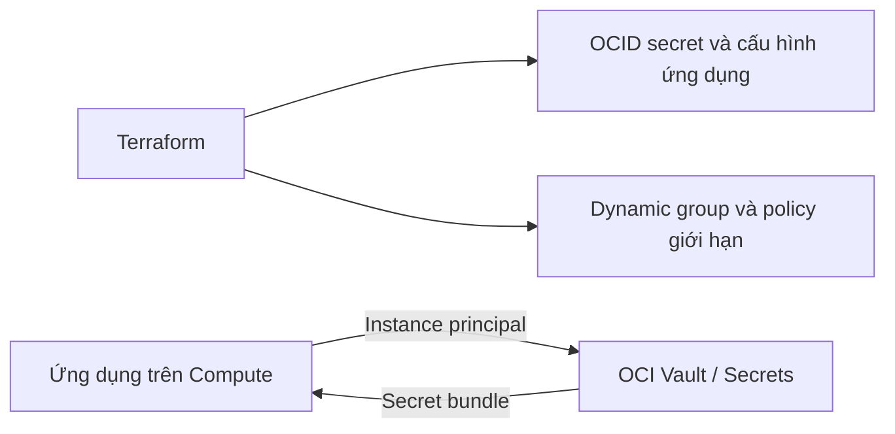

# Bảo vệ secrets, xử lý destroy và phục hồi triển khai lỗi

## 1. Mục tiêu và bối cảnh OCI

Trong chương **Hạ tầng dưới dạng mã** của module **CLOUD_PROVIDERS_ORACLE**, một triển khai an toàn cần bảo vệ đồng thời thông tin xác thực, dữ liệu nghiệp vụ và khả năng quản lý tài nguyên sau sự cố. Terraform tạo được VCN, Compute hay cơ sở dữ liệu chưa đủ; đội vận hành còn phải biết ai được đọc secrets, kế hoạch nào có thể xóa dữ liệu và phải làm gì khi triển khai dừng giữa chừng.

Bài học đặt Terraform CLI và OCI Resource Manager trong cùng một quy trình vận hành. Bối cảnh là ứng dụng chạy trên OCI, sử dụng VCN, Compute, Block Volume hoặc dịch vụ cơ sở dữ liệu Oracle; quyền truy cập được giới hạn bằng IAM và compartment. Các ví dụ là mẫu hướng dẫn, cần thay OCID, region và tên tài nguyên theo môi trường thực tế.

Sau bài này, người học có thể:

- Nhận diện những nơi secrets xuất hiện ngoài mã nguồn, đặc biệt là state, plan và log.
- Chọn danh tính triển khai phù hợp và tách quyền triển khai khỏi quyền đọc secrets của ứng dụng.
- Đánh giá destroy, replacement và các lớp bảo vệ tài nguyên lưu dữ liệu.
- Phân loại lỗi triển khai, đối chiếu state với tài nguyên OCI và lập kế hoạch phục hồi.
- Xác nhận hệ thống hoạt động, tài nguyên vẫn được quản lý và chi phí còn lại có chủ sở hữu.

Người học cần biết cấu trúc Terraform cơ bản, chu trình `init → plan → apply`, OCID và cách định vị tài nguyên theo tenancy, region, compartment. Lệnh minh họa dùng PowerShell; chúng chỉ được thực thi khi người học chủ động thực hành trong môi trường đã chuẩn bị. Đối với Resource Manager, thực hiện thao tác tương ứng bằng stack và job, không tự tạo một bản state local để điều khiển cùng tài nguyên.

## 2. Phân biệt cấu hình, state và dữ liệu nghiệp vụ

Ba thành phần này phục vụ ba mục đích khác nhau:

| Thành phần | Ví dụ trên OCI | Giúp phục hồi điều gì? | Không thay thế được điều gì? |
|---|---|---|---|
| Cấu hình mong muốn | HCL khai báo VCN, subnet, Compute, volume | Mô tả hạ tầng cần có | Không chứa toàn bộ trạng thái vận hành hoặc dữ liệu ứng dụng |
| Terraform state | Ánh xạ `oci_core_volume.app_data` tới OCID volume | Giữ liên hệ giữa địa chỉ Terraform và tài nguyên thật | Không phải bản sao nội dung volume hay cơ sở dữ liệu |
| Dữ liệu nghiệp vụ và bản sao lưu | Dữ liệu trên volume, backup cơ sở dữ liệu, object | Khôi phục dữ liệu theo khả năng của từng dịch vụ | Không tự tái tạo IAM, routing, kết nối hoặc ánh xạ Terraform |

Một commit Git cũ không thể tự khôi phục những giao dịch đã bị mất. Một state cũ cũng không đưa OCI trở lại quá khứ: nó chỉ thay đổi thông tin Terraform dùng để suy luận. Vì vậy, kế hoạch phục hồi phải chỉ ra cả nguồn cấu hình, nguồn state đáng tin cậy và nguồn backup dữ liệu.

Với dịch vụ quan trọng, xác định trước **RPO** — mức mất dữ liệu chấp nhận được theo thời gian — và **RTO** — thời gian tối đa để phục hồi dịch vụ. Chẳng hạn, mục tiêu RPO 15 phút và RTO 60 phút đòi hỏi cơ chế sao lưu, quyền truy cập, dung lượng và quy trình restore đã được thử nghiệm; riêng việc giữ file `.tfstate` không đáp ứng hai mục tiêu này.

## 3. Secrets có thể rò rỉ ở đâu?

Secrets gồm OCI API private key, mật khẩu cơ sở dữ liệu, token, khóa riêng SSH và wallet có khả năng cấp quyền truy cập. OCID thường là định danh, không tự đóng vai trò mật khẩu, nhưng danh sách OCID và thông tin mạng vẫn cần được chia sẻ đúng phạm vi.

| Bề mặt | Ví dụ dễ gặp | Biện pháp thiết kế |
|---|---|---|
| Mã nguồn và lịch sử Git | Mật khẩu trong HCL, file `.tfvars`, private key | Không ghi giá trị thật vào repository; kiểm tra trước commit |
| Terraform state và các phiên bản cũ | Giá trị thuộc tính resource hoặc data source | Kiểm soát quyền đọc, mã hóa và chính sách lưu giữ |
| Saved plan và bản JSON của plan | Tham số triển khai được đóng gói trong artifact | Lưu riêng theo môi trường, giới hạn người tải và thời hạn giữ |
| Log và đầu ra CI/CD | In biến môi trường, debug request, output | Không in secrets; chỉ bật debug có kiểm soát |
| Bootstrap và máy thực thi | Mật khẩu trong cloud-init, file tạm, shell history | Truy xuất lúc chạy, hạn chế lưu xuống đĩa, dọn runner sau job |
| Tên tài nguyên, tag, ticket | Token đưa vào `display_name` hoặc mô tả lỗi | Chỉ dùng định danh vận hành đã làm sạch |

### 3.1. `sensitive` che đầu ra, không loại dữ liệu khỏi state

```hcl
variable "database_password" {
  type        = string
  sensitive   = true
  description = "Nhận từ kênh bí mật của quy trình triển khai."
}
```

Đánh dấu này giúp Terraform che giá trị ở những đầu ra có hỗ trợ. Nếu giá trị đi vào thuộc tính được lưu, nó vẫn có thể nằm trong state. Đừng coi `sensitive = true` là mã hóa; việc đưa mật khẩu vào bằng biến môi trường cũng không tự ngăn lưu state. [Tham chiếu output và dữ liệu nhạy cảm](https://developer.hashicorp.com/terraform/language/block/output).

Terraform có cơ chế `ephemeral` từ phiên bản 1.10 và đối số write-only từ 1.11, nhưng còn phụ thuộc ngữ cảnh và hỗ trợ của provider. Không tự thêm `ephemeral = true` rồi truyền vào một thuộc tính OCI thông thường. Phải kiểm tra phiên bản Terraform thực thi trong CLI hoặc Resource Manager và schema của đúng resource trước khi dùng. [Quản lý dữ liệu nhạy cảm](https://developer.hashicorp.com/terraform/language/manage-sensitive-data).

### 3.2. Secret ở Vault vẫn có thể đi vào state

Nếu Terraform đọc nội dung một secret qua data source rồi truyền nội dung đó cho resource khác, luồng dữ liệu vẫn đi qua Terraform. OCI Vault bảo vệ nguồn lưu trữ không có nghĩa mọi bản sao trung gian tự biến mất.

Thiết kế ưu tiên là để HCL quản lý tham chiếu và quyền truy cập, còn ứng dụng lấy secret bằng SDK khi chạy:



Cách này giảm số hệ thống cần nhìn thấy nội dung secret. Nếu một API tạo cơ sở dữ liệu bắt buộc nhận mật khẩu thông qua Terraform, cần chấp nhận và quản lý rủi ro state tương ứng, hoặc chọn cơ chế tích hợp được dịch vụ hỗ trợ. Không thay yêu cầu của API bằng giả định rằng chỉ truyền OCID là đủ.

## 4. Chọn danh tính và phân quyền cho từng tác nhân

### 4.1. Ưu tiên danh tính gắn với môi trường thực thi

Ví dụ provider dưới đây dành cho Terraform CLI chạy trên **OCI Compute instance** đã thuộc dynamic group phù hợp:

```hcl
variable "region" {
  type = string
}

provider "oci" {
  region = var.region
  auth   = "InstancePrincipal"
}
```

Danh tính instance được IAM cấp quyền mà không cần chép OCI API private key vào HCL. Đây không phải cấu hình dùng nguyên xi trên laptop hoặc mọi CI runner. Resource principal cũng chỉ dùng được trong môi trường hỗ trợ nó. Với Resource Manager, cấu hình theo cơ chế xác thực và phân quyền của dịch vụ. [Cấu hình xác thực OCI provider](https://docs.oracle.com/en-us/iaas/Content/dev/terraform/configuring.htm).

Nếu quy trình hiện tại cần API key, đặt private key trong kho bí mật của CI/CD hoặc vị trí được bảo vệ trên runner; cấp quyền tối thiểu, có lịch xoay vòng và thu hồi. Không đưa key vào source ZIP của Resource Manager, image máy chủ hoặc artifact dùng chung.

### 4.2. Tách quyền triển khai và quyền đọc secret

Một cách phân vai thực tế:

| Tác nhân | Phạm vi cần thiết | Quyền cần xem xét riêng |
|---|---|---|
| Người xem kế hoạch | Cấu hình, kết quả plan đã được kiểm soát | Quyền tải state hoặc artifact chứa bí mật |
| Runner triển khai | Các thao tác tài nguyên cần cho stack trong compartment đích | Quyền sửa IAM, xóa dữ liệu hoặc đọc secret ngoài phạm vi |
| Ứng dụng | Lấy đúng secret cần để kết nối dịch vụ | Quyền sửa stack hoặc quản lý secrets |
| Nhân sự phục hồi | Đọc backup, thực hiện restore, đối chiếu state | Quyền khẩn cấp có thời hạn và nhật ký sử dụng |

Policy minh họa cho dynamic group của ứng dụng:

```text
Allow dynamic-group AppRuntime to read secret-bundles in compartment AppSecrets where target.secret.id = 'ocid1.vaultsecret.oc1.REGION.REPLACE_ME'
```

Cần thay tên và OCID; dynamic group phải khớp đúng workload. Policy phải được tạo ở vị trí có phạm vi bao phủ compartment chứa secret. Quyền `read secret-bundles` liên quan đến đọc nội dung secret; `read secrets` chỉ phục vụ nhóm API metadata tương ứng. [Quyền IAM cho Secret Management](https://docs.oracle.com/en-us/iaas/Content/Identity/Reference/keypolicyreference.htm), [ví dụ giới hạn một secret](https://docs.oracle.com/en/cloud/paas/autonomous-database/serverless/adbsb/vault-secret-credentials-oci.html).

Không cấp `manage all-resources in tenancy` để chữa một lỗi quyền đơn lẻ. Xác định API bị từ chối, principal thực thi và compartment đích, rồi bổ sung quyền đúng nhu cầu. Đồng thời kiểm tra quyền hiệu lực từ các policy khác: một policy hẹp không hủy các quyền rộng đã được cấp ở nơi khác.

## 5. Bảo vệ repository, state, plan và log

### 5.1. Repository chỉ chứa thông tin thích hợp để chia sẻ

Mẫu `.gitignore` để người học áp dụng trong dự án thực hành:

```gitignore
.terraform/
*.tfstate
*.tfstate.*
*.tfplan
*.tfvars
*.tfvars.json
crash.log
crash.*.log
*.pem
*.key
```

Có thể lưu `terraform.tfvars.example` chỉ chứa giá trị giả. Thông thường nên commit `.terraform.lock.hcl` để ghi nhận lựa chọn provider và checksum. Quy tắc ignore không xóa file đã được theo dõi và không kiểm tra nội dung mọi file; vẫn cần kiểm tra thay đổi trước commit và rà soát secrets theo quy trình của nhóm.

Nếu đã lộ key hoặc mật khẩu, ưu tiên thu hồi hoặc xoay vòng, cập nhật hệ thống sử dụng và xem xét nhật ký truy cập. Sau đó xử lý lịch sử Git, artifact, log và các bản state liên quan theo quy trình sự cố. Xóa một dòng khỏi nhánh hiện tại không làm credential cũ mất hiệu lực.

### 5.2. State là tài sản vận hành có mức nhạy cảm cao

Lựa chọn backend dựa trên quyền truy cập, mã hóa khi truyền và khi lưu, khả năng khóa, lưu phiên bản và khôi phục. Nếu dùng Object Storage trong kiến trúc backend, phải kiểm tra khả năng của đúng backend và cấu hình đang dùng; không mặc định bucket có versioning là đã có state locking.

Resource Manager duy trì state của stack và khóa để chỉ một job trên stack thực thi tại một thời điểm. Không dùng thêm một pipeline local với bản state độc lập để quản lý cùng các OCID. [Resource Manager và Terraform](https://docs.oracle.com/en-us/iaas/Content/ResourceManager/Concepts/resource-manager-and-terraform.htm).

Với state do CLI quản lý, nếu backend hỗ trợ khóa thì Terraform dùng khóa để tránh ghi đồng thời. Không dùng `-lock=false` làm cách chữa lỗi tranh chấp. Chỉ cân nhắc force-unlock khi xác nhận tiến trình giữ khóa đã dừng và hiểu nguyên nhân khóa còn tồn tại. [State locking](https://developer.hashicorp.com/terraform/language/state/locking).

### 5.3. Saved plan là artifact cần bảo vệ

Saved plan có thể chứa giá trị nhạy cảm dù đầu ra đọc được đã che chúng. Tạo bản JSON bằng `terraform show -json` cũng không phải bước làm sạch dữ liệu. [Tài liệu lệnh plan](https://developer.hashicorp.com/terraform/cli/commands/plan).

Quy trình nên gắn mỗi artifact với commit, checksum artifact, phiên bản Terraform/provider, backend, workspace hoặc stack, region và thời điểm tạo. Khi cấu hình, biến đầu vào, state hoặc điều kiện thực tế thay đổi, tạo lại và xét duyệt plan phù hợp. Không chia sẻ binary plan qua kênh công khai.

Không đặt mật khẩu trong đối số dòng lệnh có thể bị lưu vào history. Với log debug, giới hạn thời gian bật, quyền tải và thời gian lưu; lọc nội dung trước khi chia sẻ cho nhóm hỗ trợ.

## 6. Hiểu destroy và replacement trước khi phê duyệt

Destroy có thể xuất hiện trong cả triển khai thường ngày, không chỉ khi chạy `terraform destroy`.

| Dấu hiệu trên plan | Ý nghĩa cần xem xét |
|---|---|
| `+ create` | Tạo tài nguyên; có thể phát sinh chi phí và tiêu thụ quota |
| `~ update in-place` | Sửa tại chỗ; vẫn có thể ảnh hưởng kết nối hoặc hành vi ứng dụng |
| `- destroy` | Xóa tài nguyên đang được state quản lý |
| `-/+` hoặc `+/-` | Thay thế tài nguyên; phải xem thứ tự tạo/xóa và hệ quả dữ liệu |

Nguyên nhân xóa hoặc thay thế thường gặp là bỏ resource khỏi HCL, giảm `count`, thay key trong `for_each`, thay thuộc tính không sửa tại chỗ được hoặc nhầm bộ biến môi trường. Nếu chỉ đổi địa chỉ resource trong mã, cần đánh giá migration bằng `moved` block thay vì để Terraform hiểu thành xóa cũ, tạo mới.

### 6.1. Ví dụ bảo vệ Block Volume

Đoạn HCL sau là ví dụ riêng cho volume dữ liệu. Nó giả định đã có provider OCI và bộ phiên bản đã kiểm thử; đây không phải toàn bộ cấu hình triển khai ứng dụng.

```hcl
variable "compartment_ocid" {
  type = string
}

variable "availability_domain" {
  type = string
}

resource "oci_core_volume" "app_data" {
  compartment_id      = var.compartment_ocid
  availability_domain = var.availability_domain
  display_name        = "app-data"
  size_in_gbs         = 50

  lifecycle {
    prevent_destroy = true
  }
}
```

Các thuộc tính volume cần phù hợp với region, availability domain và giới hạn dịch vụ. Volume phải đáp ứng điều kiện gắn với Compute theo dịch vụ; ví dụ này chưa tạo attachment hoặc backup. [Tham chiếu resource `oci_core_volume`](https://docs.oracle.com/en-us/iaas/tools/terraform-provider-oci/latest/docs/r/core_volume.html).

Khi lifecycle còn trong cấu hình, `prevent_destroy` khiến Terraform từ chối kế hoạch xóa hoặc thay thế resource được bảo vệ. Nếu xóa hẳn resource block, lớp bảo vệ này không còn áp dụng theo cách đó. Nó cũng không kiểm soát thao tác xóa qua OCI Console hay một công cụ khác. `create_before_destroy` thay đổi thứ tự thay thế, nhưng cần đủ quota và không tự sao chép dữ liệu. [Tham chiếu lifecycle](https://developer.hashicorp.com/terraform/language/meta-arguments/lifecycle).

Không tự tháo `prevent_destroy` chỉ để plan chạy qua. Trước hết xác định tại sao cần thay thế, dữ liệu nằm ở đâu và phương án chuyển dữ liệu. Các biện pháp IAM, bảo vệ xóa của từng dịch vụ, retention và backup phải được đánh giá độc lập; không có một thuộc tính chung dùng được cho mọi resource OCI.

### 6.2. Giới hạn phạm vi ảnh hưởng bằng cấu trúc stack

Một cách tổ chức phù hợp cho ứng dụng có dữ liệu lâu dài:

- **Stack nền tảng:** VCN dùng chung và các thành phần mạng có vòng đời dài.
- **Stack dữ liệu:** volume, cơ sở dữ liệu và cấu hình backup tương ứng.
- **Stack ứng dụng:** Compute hoặc thành phần có thể thay thế thường xuyên.

Đây là quyết định thiết kế, không phải yêu cầu bắt buộc của OCI. Phải quản lý rõ đầu vào/đầu ra giữa các stack và thứ tự triển khai, thu hồi. Tách stack không tự bảo vệ phụ thuộc dùng chung; tài nguyên ở stack khác có thể vẫn đang sử dụng subnet hoặc volume mà bạn định xóa.

## 7. Quy trình destroy có thể kiểm soát

### 7.1. Trước khi tạo kế hoạch xóa

Người thực hiện cần xác nhận trực tiếp:

1. Tenancy, region, compartment và backend/workspace hoặc stack đúng môi trường.
2. Danh sách tài nguyên dự kiến xóa, tài nguyên phải giữ và người sở hữu dữ liệu.
3. Trạng thái backup, phạm vi dữ liệu và kết quả restore gần nhất; backup không nằm trong cùng phạm vi sẽ bị xóa ngoài ý muốn.
4. Phụ thuộc bên ngoài stack, luồng truy cập và thứ tự ngừng ứng dụng.
5. Quyền sử dụng khóa mã hóa và secrets còn tồn tại đủ lâu cho việc restore.
6. Cửa sổ thay đổi, người phê duyệt và kế hoạch xử lý khi xóa một phần.

Một bản backup không dùng được nếu không còn quyền giải mã, không có người thực hiện restore hoặc không còn quota tạo tài nguyên phục hồi.

### 7.2. Terraform CLI: xem và áp dụng đúng kế hoạch xóa

Các lệnh dưới đây chỉ dành cho state do CLI quản lý. Chạy từng bước, dừng nếu lệnh trước lỗi:

```powershell
terraform workspace show
terraform plan -destroy -out=destroy.tfplan
terraform show destroy.tfplan
```

`workspace show` chỉ là một kiểm tra; tên `default` không chứng minh bạn đang ở đúng tenancy hoặc region. Đối chiếu thêm provider, biến đầu vào và backend. Đọc từng resource sẽ bị xóa, đặc biệt cơ sở dữ liệu, volume, bucket, network dùng chung và khóa mã hóa.

Sau khi người có thẩm quyền duyệt đúng artifact và hoàn tất điều kiện dữ liệu, mới chạy:

```powershell
terraform apply destroy.tfplan
```

Khi truyền saved plan cho `apply`, Terraform thực thi kế hoạch đã lưu mà không hỏi xác nhận tương tác như một lần apply thông thường. Vì vậy, bước phê duyệt và kiểm tra đúng artifact phải có trước lệnh này. [Tài liệu lệnh apply](https://developer.hashicorp.com/terraform/cli/commands/apply).

Không dùng `-target` để biến việc xóa theo phạm vi thành quy trình thường xuyên. Phạm vi bị thu hẹp có thể bỏ sót ảnh hưởng; với xử lý đặc biệt, cần chạy lại plan đầy đủ sau đó.

### 7.3. Resource Manager: phân biệt destroy với xóa stack

Destroy job xử lý tài nguyên gắn với stack và giữ lại lịch sử job cùng state. Xóa stack làm mất state gắn với stack, khiến kiểm kê và thu dọn tài nguyên còn lại khó hơn. Không dùng xóa stack làm cách hủy triển khai hoặc chữa job lỗi. Sau destroy, cần kiểm tra kết quả thực tế; chạy apply lại có thể tạo tài nguyên mới với OCID khác. [Tạo destroy job](https://docs.oracle.com/en-us/iaas/Content/ResourceManager/Tasks/create-job-destroy.htm).

### 7.4. Khi destroy thất bại giữa chừng

Giữ lại state hiện có và phân loại resource đã xóa, còn tồn tại, đang xóa bất đồng bộ hoặc bị chặn. Những nguyên nhân cần kiểm tra trên OCI gồm volume còn gắn, subnet còn VNIC, bucket còn object hay retention, quyền thiếu và ràng buộc riêng của dịch vụ.

Giải quyết đúng phụ thuộc hoặc policy, sau đó tạo lại kế hoạch trên trạng thái hiện tại. Không xóa mọi resource thủ công chỉ để làm Console trống, và không xóa state để bỏ qua thông báo lỗi.

Hoàn tất bằng kiểm kê tài nguyên còn lại theo OCID, kể cả backup, boot volume hoặc volume được giữ, public IP và thành phần mạng phát sinh phí. Mỗi tài nguyên giữ lại cần chủ sở hữu, mục đích và thời điểm xem xét tiếp theo.

## 8. Apply lỗi không có nghĩa hạ tầng chưa thay đổi

Terraform không tự động hoàn tác một apply thành công một phần. Trong lỗi apply thông thường, Terraform ghi nhận các thay đổi đã thực hiện vào state rồi kết thúc; nếu tiến trình chết, mất kết nối hoặc ghi state thất bại, mức độ ghi nhận thực tế cần được kiểm tra riêng. [Hành vi khi apply lỗi](https://developer.hashicorp.com/terraform/cli/commands/apply).

Ví dụ diễn biến minh họa:

```text
T0: Bắt đầu apply cho ứng dụng.
T1: VCN và subnet đã tạo thành công.
T2: Volume đã tồn tại trên OCI.
T3: Compute không tạo được do thiếu capacity của shape được chọn.
T4: Job báo FAILED; những tài nguyên ở T1 và T2 vẫn có thể tồn tại.
```

Nếu provider timeout, một API tạo tài nguyên có thể đã được OCI tiếp nhận dù Terraform chưa nhận đủ kết quả. Không suy ra “không có OCID trong log” đồng nghĩa tài nguyên chưa được tạo. Đối chiếu OCI work request khi dịch vụ có hỗ trợ, tài nguyên trong Console/API và state hiện tại.

Cũng cần phân biệt lỗi control plane với lỗi ứng dụng. Compute ở trạng thái hoạt động không chứng minh cloud-init thành công, dịch vụ đã nghe cổng hoặc ứng dụng kết nối được cơ sở dữ liệu.

## 9. Runbook phục hồi triển khai lỗi

### Bước 1 — Dừng thay đổi đồng thời và giữ bằng chứng

Tạm dừng pipeline tự động cho đúng môi trường và xác nhận job thực sự đã dừng. Trạng thái đang hủy không đồng nghĩa mọi thao tác đã kết thúc. Không mở một pipeline khác để “thử lại nhanh”.

Ghi lại commit, bộ biến không chứa secrets, phiên bản công cụ/provider, stack/job OCID, thời điểm, mã lỗi, OCI request ID và tài nguyên liên quan. Lưu log, plan, state vào vị trí hạn chế quyền; bản gửi ra ngoài phải được làm sạch.

### Bước 2 — Phân loại lỗi theo bằng chứng

| Nhóm lỗi | Dấu hiệu cần xác minh | Hướng xử lý ban đầu |
|---|---|---|
| Cú pháp hoặc schema | `validate` báo lỗi, thuộc tính không được hỗ trợ | Sửa cấu hình theo đúng phiên bản |
| Danh tính hoặc IAM | Không xác thực được, bị từ chối thao tác | Kiểm tra principal, policy và compartment |
| Region, OCID hoặc phạm vi | Không tìm thấy tài nguyên như dự kiến | Đối chiếu định danh trước khi sửa state |
| Quota, limit hoặc capacity | Dịch vụ từ chối cấp tài nguyên | Kiểm tra giới hạn, shape/AD và yêu cầu workload |
| Timeout hoặc lỗi dịch vụ | Kết quả API không rõ, work request còn chạy | Xác minh trạng thái thật trước retry |
| Ứng dụng hoặc bootstrap | Hạ tầng tồn tại nhưng health check lỗi | Kiểm tra bootstrap, kết nối, cấu hình và secret |
| Backend hoặc state | Không ghi được state, khóa còn giữ | Bảo toàn bản ghi và xác định tiến trình sở hữu |

Lỗi không tìm thấy tài nguyên có thể liên quan quyền hoặc sai region; không vội kết luận tài nguyên đã bị xóa. Giảm mức song song hoặc điều chỉnh timeout chỉ hữu ích khi bằng chứng cho thấy đúng nguyên nhân, không chữa được cấu hình sai hay thiếu capacity.

### Bước 3 — Đối chiếu ba chiều

So sánh **cấu hình mong muốn ↔ state ↔ OCI thực tế** bằng OCID, không chỉ tên hiển thị. Với CLI, các lệnh sau hỗ trợ kiểm tra:

```powershell
terraform state list
terraform plan -out=recovery.tfplan
terraform show recovery.tfplan
```

Plan thông thường đọc lại trạng thái tài nguyên để đề xuất thay đổi. Nếu nó muốn xóa hoặc tạo hàng loạt tài nguyên ngoài dự kiến, dừng lại và kiểm tra môi trường, cấu hình, quyền đọc và state. Không áp dụng chỉ vì mục tiêu hiện tại là “làm job xanh”.

Nếu chủ đích là cập nhật state theo thay đổi đã xảy ra ngoài Terraform, có thể lập riêng một refresh-only plan:

```powershell
terraform plan -refresh-only -out=refresh.tfplan
terraform show refresh.tfplan
```

Chỉ áp dụng `terraform apply refresh.tfplan` khi đã duyệt thay đổi state. Refresh-only không sửa hạ tầng và không tự nhận quản lý một resource chưa có ánh xạ trong state. Nếu cấu hình sai region hoặc quyền đọc không đúng, cần sửa trước khi chấp nhận việc loại đối tượng khỏi state. [Refresh-only và đồng bộ state](https://developer.hashicorp.com/terraform/tutorials/state/refresh).

### Bước 4 — Chọn một phương án phục hồi rõ ràng

| Phương án | Khi phù hợp | Điều kiện cần kiểm tra |
|---|---|---|
| Tiếp tục tiến tới cấu hình mong muốn | Đã sửa nguyên nhân, tài nguyên hiện có còn dùng được | Plan mới giữ đúng dữ liệu và tài nguyên hợp lệ |
| Quay về cấu hình ổn định | Thay đổi mới chưa thể dùng an toàn | Plan quay về không xóa dữ liệu hoặc vi phạm tương thích |
| Import tài nguyên đã tồn tại | OCI có tài nguyên nhưng state chưa quản lý nó | Xác định đúng OCID, địa chỉ và quyền sở hữu |
| Khôi phục dữ liệu từ backup | Dữ liệu mất, hỏng hoặc không còn tương thích | Nguồn backup, quyền giải mã, RPO/RTO và kiểm tra ứng dụng |
| Thu hồi phần triển khai lỗi | Môi trường tạm, có thể loại bỏ | Không chứa dữ liệu phải giữ và không có phụ thuộc dùng chung |

Đối với ví dụ thiếu Compute capacity, có thể giữ VCN, subnet, volume đã hợp lệ, điều chỉnh lựa chọn triển khai theo yêu cầu ứng dụng rồi tạo plan mới. Không tự đổi AD nếu điều đó làm volume hiện có không thể gắn vào instance mới hoặc kéo theo migration dữ liệu.

### Bước 5 — Áp dụng kế hoạch phục hồi đã duyệt và xác minh

Chỉ dùng `terraform apply recovery.tfplan` nếu đó vẫn là artifact phục hồi hợp lệ đã được xem xét. Nếu có thay đổi cấu hình, state hoặc đầu vào sau bước lập plan, tạo lại plan. Với Resource Manager, dùng job tương ứng trên cùng stack và theo dõi tới trạng thái kết thúc.

Kiểm tra cả hạ tầng, ứng dụng, dữ liệu và chi phí theo phần 12 trước khi bật lại pipeline tự động.

## 10. Import và khôi phục state trong trường hợp đặc biệt

### 10.1. Tài nguyên có trên OCI nhưng chưa có trong state

Trước khi import, xác định tài nguyên không do stack hay workspace khác quản lý. Một OCID không được đồng thời thuộc quyền quản lý độc lập của hai state. Chuẩn bị resource block tương ứng và đối chiếu các thuộc tính quan trọng.

Ví dụ với volume đã tồn tại, dành cho môi trường dùng Terraform CLI:

```powershell
terraform import oci_core_volume.app_data 'ocid1.volume.oc1.REGION.REPLACE_ME'
terraform plan -out=after-import.tfplan
terraform show after-import.tfplan
```

Import thiết lập ánh xạ quản lý; nó không khôi phục dữ liệu và không bảo đảm cấu hình hiện tại khớp resource. Plan sau import vẫn có thể đề nghị thay thế. [Khái niệm import](https://developer.hashicorp.com/terraform/language/import), [định dạng import của OCI volume](https://docs.oracle.com/en-us/iaas/tools/terraform-provider-oci/latest/docs/r/core_volume.html).

Trong Resource Manager, sử dụng quy trình import được dịch vụ hỗ trợ để cập nhật đúng state của stack. Không lấy ví dụ CLI ở trên chạy trên một thư mục local rời rạc rồi coi stack đã được sửa.

### 10.2. State mất hoặc không ghi thành công

Ưu tiên tìm bản state mới nhất còn tin cậy ở backend hoặc lịch sử job; nếu Terraform báo có lưu state phục hồi cục bộ khi ghi backend lỗi, bảo vệ bản đó trước khi runner bị dọn. Xác định thời điểm, lineage, serial và các thao tác OCI xảy ra sau bản state đang xét.

Khôi phục state là thao tác quản lý dữ liệu điều khiển, không phải undo hạ tầng. Cần bảo toàn bản hiện tại và đánh giá đầy đủ trước khi ghi trở lại backend; không dùng `state push -force` để bỏ qua kiểm tra bảo vệ cho nhanh. [Khôi phục state từ backup](https://developer.hashicorp.com/terraform/cli/state/recover).

Với Resource Manager, có thể lấy state của job thích hợp phục vụ kiểm tra và quy trình phục hồi có kiểm soát. Bản tải xuống cũng có thể chứa secrets. [Lấy state của job](https://docs.oracle.com/en-us/iaas/Content/ResourceManager/Tasks/get-job-tf-state.htm).

### 10.3. Không dùng thao tác state để che giấu sự cố

`terraform state rm` chỉ bỏ ánh xạ quản lý; tài nguyên vẫn tồn tại và có thể tiếp tục tính phí. Nếu cấu hình còn khai báo nó, plan sau có thể muốn tạo tài nguyên khác. Chỉ sử dụng khi có mục tiêu quản lý rõ ràng và nơi tiếp nhận quyền sở hữu. [Lệnh state rm](https://developer.hashicorp.com/terraform/cli/commands/state/rm).

Tương tự, `force-unlock` không sửa lỗi triển khai hoặc dữ liệu; nó chỉ gỡ khóa theo backend. Dùng sai khi tiến trình khác còn chạy có thể tạo hai bên ghi state đồng thời. [Lệnh force-unlock](https://developer.hashicorp.com/terraform/cli/commands/force-unlock).

## 11. Rollback với OCI Resource Manager

### 11.1. Plan Rollback trước, Apply Rollback sau

Resource Manager hỗ trợ tạo kế hoạch quay về một apply job thành công được chọn. Quy trình nên gồm:

1. Xác định target job ổn định và lý do chọn nó.
2. Tạo **Plan Rollback** cho target job.
3. Chờ plan thành công, xem các thao tác tạo, sửa, xóa hoặc thay thế.
4. Xác nhận điều kiện dữ liệu và khả năng phục vụ ứng dụng.
5. Tạo **Apply Rollback** sử dụng kế hoạch rollback đã xét duyệt, rồi theo dõi kết quả.

Đây là thực thi Terraform theo cấu hình của target job, không phải sao chép ngược toàn bộ dữ liệu về thời điểm job đó. [Tạo Plan Rollback](https://docs.oracle.com/en-us/iaas/Content/ResourceManager/Tasks/create-job-plan-rollback.htm), [tạo Apply Rollback](https://docs.oracle.com/en-us/iaas/Content/ResourceManager/Tasks/create-job-apply-rollback.htm).

Nếu cấu hình cũ tham chiếu tài nguyên đã xóa, phiên bản provider không còn phù hợp, image không còn dùng được hoặc quota không đủ, rollback có thể thất bại. Nếu ứng dụng đã thực hiện migration schema không tương thích ngược, phục hồi hạ tầng cũ cũng chưa đủ để chạy được ứng dụng cũ. Cần phối hợp kế hoạch dữ liệu và phiên bản ứng dụng.

### 11.2. Tự động rollback là quy trình phải thiết kế

Oracle có hướng dẫn dùng script và CI/CD để theo dõi apply job lỗi rồi kích hoạt rollback. Không nên hiểu rằng mọi job `FAILED` đều tự quay về job thành công trước đó. [Tự động rollback với Resource Manager](https://docs.oracle.com/en-us/iaas/Content/ResourceManager/Tasks/auto-rollback.htm).

Một pipeline tự động nên có điều kiện kích hoạt, danh sách tài nguyên được phép thay thế, health check, giới hạn số lần thử và đường chuyển sang xử lý thủ công. Tài nguyên dữ liệu lâu dài cần điều kiện chặt hơn so với Compute có thể dựng lại.

Rollback cũng có thể cần tạo thêm tài nguyên trước khi thu hồi bản lỗi, làm tăng chi phí tạm thời và dùng thêm quota. Sau rollback, cập nhật nguồn cấu hình chính thức để lượt triển khai kế tiếp không đưa trở lại thay đổi lỗi.

## 12. Tiêu chí kết thúc phục hồi

Không chỉ căn cứ vào dòng `Apply complete` hay job `SUCCEEDED`. Một lần phục hồi được chấp nhận khi có bằng chứng cho các nhóm sau:

| Nhóm kiểm tra | Bằng chứng cần có |
|---|---|
| Danh tính và bí mật | Workload đọc được đúng secret; không có quyền ngoài nhu cầu; credential đã lộ được thay thế |
| Hạ tầng | OCID, region, compartment và kết nối đúng thiết kế; không có tài nguyên mồ côi ngoài dự kiến |
| State | Tài nguyên quan trọng được đúng stack/workspace quản lý; plan tiếp theo không có thay đổi ngoài chủ đích |
| Ứng dụng | Health check, truy cập từ phía người dùng và kết nối cơ sở dữ liệu thành công |
| Dữ liệu | Kiểm tra dữ liệu phù hợp nghiệp vụ; ghi nhận thời điểm restore và mức mất dữ liệu thực tế |
| Khả năng phục hồi tiếp theo | Backup, quyền giải mã, secrets và cảnh báo tiếp tục hoạt động |
| Chi phí | Tài nguyên tạo thêm, giữ lại và lịch thu hồi được ghi nhận |

Có thể dùng OCI Audit để đối chiếu thao tác quản lý, Logging cho ứng dụng/bootstrap và Monitoring cho triệu chứng dịch vụ. Chọn bằng chứng theo loại lỗi; một biểu đồ CPU bình thường không chứng minh giao dịch cơ sở dữ liệu chính xác.

Hồ sơ đóng sự cố nên ghi nguyên nhân đã xác minh, tài nguyên bị ảnh hưởng, thay đổi cuối cùng, phương án đã chọn và người sở hữu việc theo dõi. Chỉ bật lại luồng triển khai tự động sau khi cấu hình chính thức và trạng thái vận hành đã thống nhất.

## 13. Thực hành có kiểm soát

Thực hành trên compartment riêng, dùng dữ liệu giả và giới hạn tài nguyên theo ngân sách. Giữ nguyên các lớp bảo vệ của môi trường thật. Không cần tạo cơ sở dữ liệu có phí để kiểm tra các khái niệm trong bài.

### Bài thực hành A — Kiểm tra đường đi của secret

1. Vẽ đường đi từ nơi lưu secret đến ứng dụng; đánh dấu nơi Terraform có thể đọc nội dung.
2. Với cấu hình mẫu chỉ có OCID secret, xác định principal ứng dụng và policy cần thiết.
3. Kiểm tra phương án lưu state, saved plan và log; nêu ai có quyền tải từng loại.
4. Mô tả xử lý nếu một API key bị commit, bao gồm thu hồi và cập nhật nơi đang sử dụng.

Kết quả đạt: phân biệt được che đầu ra với ngăn lưu giá trị và không đặt quyền đọc toàn bộ secrets cho runner khi không cần.

### Bài thực hành B — Xem kế hoạch destroy mà chưa xóa

Trên stack lab đã được phép quản lý, lập destroy plan nhưng dừng trước apply. Với CLI, dùng chuỗi lệnh ở phần 7; với Resource Manager, kiểm tra tài nguyên và luồng thao tác tương ứng của dịch vụ.

Nếu có volume lab dùng `prevent_destroy`, ghi nhận thông báo từ chối và giải thích vì sao không được tháo bảo vệ theo phản xạ. Phân loại từng tài nguyên thành xóa, giữ hoặc cần đánh giá thêm. Không đưa ra quyết định chỉ từ tên hiển thị.

Kết quả đạt: nhận diện dữ liệu, backup, khóa mã hóa và phụ thuộc phải xử lý trước khi xóa.

### Bài thực hành C — Diễn tập apply thành công một phần

Dùng diễn biến giả định ở phần 8: VCN, subnet và volume đã có, Compute thất bại do capacity. Không cần cố tình làm hỏng môi trường thật.

1. Lập danh sách bằng chứng cần thu thập và nơi kiểm tra từng OCID.
2. Chọn giữa tiếp tục triển khai, rollback và thu hồi phần đã tạo; nêu điều kiện lựa chọn.
3. Mô tả xử lý nếu volume có trên OCI nhưng chưa xuất hiện trong state.
4. Chỉ ra vì sao đổi AD có thể ảnh hưởng attachment và vì sao state backup không thay dữ liệu backup.
5. Viết tiêu chí xác nhận phục hồi gồm ứng dụng, dữ liệu và tài nguyên tính phí còn lại.

Kết quả đạt: có một runbook theo bằng chứng, giữ được dữ liệu và quyền quản lý tài nguyên, thay vì lặp lại apply hoặc destroy khi chưa hiểu trạng thái.
