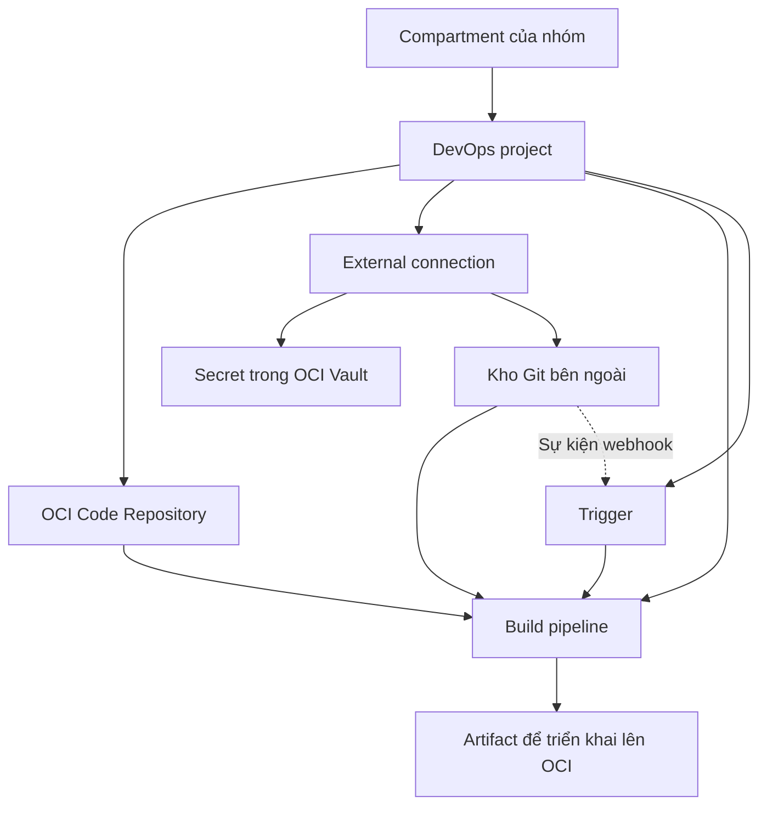

# OCI DevOps projects, repositories và kết nối kho mã nguồn

## 1. Vai trò của kho mã nguồn trong CI/CD trên OCI

Một quy trình triển khai lên Oracle Cloud Infrastructure cần xác định được mã nguồn đến từ đâu, ai được thay đổi mã và dịch vụ nào được phép lấy mã để thực thi. Nếu ba câu trả lời này không rõ ràng, pipeline có thể chạy thành công nhưng vẫn xây dựng nhầm nhánh, dùng token của người đã nghỉ việc hoặc lấy mã chưa được duyệt.

Trong chương **DevOps và CI/CD trên OCI**, bài học này thiết lập nền tảng quản lý mã nguồn: DevOps project, repository do OCI lưu trữ và external connection tới nhà cung cấp Git bên ngoài. Đây là bước chuẩn bị trước khi build, phát hành artifact và triển khai ứng dụng lên Compute, OKE hoặc Functions. OCI DevOps cung cấp kho Git riêng tư và tích hợp nguồn mã bên ngoài trong cùng dịch vụ CI/CD. [Oracle: DevOps Overview](https://docs.oracle.com/en-us/iaas/Content/devops/using/devops_overview.htm).

Sau bài học, người học có thể:

- Phân biệt compartment, DevOps project, code repository và external connection.
- Chọn nơi quản lý mã nguồn phù hợp với quy trình của nhóm.
- Tạo project và repository, sau đó clone, commit và push qua HTTPS.
- Lưu GitHub PAT trong OCI Vault và tạo connection bằng Secret OCID.
- Phân biệt việc kết nối, đồng bộ bản sao và nhận sự kiện để khởi động build.
- Xác định lớp lỗi khi không thấy repository hoặc không lấy được mã.

Ví dụ xuyên suốt là nhóm phát triển ứng dụng Java `orders-api`, sau này có thể kết nối cơ sở dữ liệu Oracle trên OCI. Nhóm cần lưu mã ứng dụng và mã hạ tầng có kiểm soát, đồng thời giữ mật khẩu cơ sở dữ liệu, wallet và token ngoài Git. Các tên tài nguyên trong bài là quy ước cho ví dụ, không phải yêu cầu đặt tên của OCI.

## 2. Mô hình tài nguyên và ranh giới trách nhiệm

### 2.1. DevOps project là đơn vị tổ chức quy trình

Một DevOps project tập hợp các tài nguyên phục vụ CI/CD: code repositories, external connections, build pipelines, triggers, artifact references, environments và deployment pipelines. Project giúp nhóm nhìn thấy các thành phần của một quy trình trong cùng ngữ cảnh. [Oracle: Managing DevOps Projects](https://docs.oracle.com/en-us/iaas/Content/devops/using/devops_projects.htm).

Cần phân biệt các khái niệm sau:

| Thành phần | Câu hỏi nó giải quyết | Ví dụ trong bài |
| --- | --- | --- |
| Tenancy | Hạ tầng thuộc tổ chức nào? | Tenancy của công ty |
| Compartment | Tài nguyên thuộc phạm vi quản trị nào? | `team-delivery` |
| Region | Đang thao tác với tài nguyên ở khu vực nào? | Region đã chọn của nhóm |
| DevOps project | Những thành phần nào cùng phục vụ việc giao phần mềm? | `orders-delivery` |
| Code repository | Mã nguồn và lịch sử Git được lưu ở đâu? | `orders-api` |
| External connection | OCI dùng thông tin xác thực nào để truy cập Git bên ngoài? | `github-orders-source` |
| Trigger | Sự kiện mã nguồn nào được phép khởi động build? | Push vào `main` |

Project không thay thế compartment hay IAM policy. Hai project trong cùng compartment có thể chịu chung policy ở cấp compartment. Muốn tách nhóm quản trị hoặc giới hạn ảnh hưởng của sự cố, cần thiết kế IAM và compartment tương ứng, thay vì chỉ đặt tên project khác nhau.

### 2.2. Sơ đồ quan hệ



Mũi tên từ kho Git ngoài tới build biểu diễn một lựa chọn nguồn mã. Nhóm có thể dùng trực tiếp nguồn ngoài hoặc tạo mirror trong OCI rồi dùng mirror đó. Không bắt buộc triển khai cả hai cách cho cùng một pipeline.

### 2.3. Repository mã nguồn và repository artifact

Trong OCI, từ *repository* có thể chỉ những đối tượng khác nhau:

| Loại | Nội dung phù hợp | Ví dụ |
| --- | --- | --- |
| DevOps Code Repository | Mã nguồn, nhánh, commit và cấu hình quản lý bằng Git | Java, Terraform, script SQL không chứa bí mật |
| Container Registry repository | Container image phục vụ phát hành | Image của `orders-api` |
| Artifact Registry repository | Gói phần mềm được phát hành | JAR hoặc gói cài đặt |

Một commit là đầu vào của build; JAR hoặc image là đầu ra. Tài liệu OCI DevOps sử dụng Container Registry hoặc Artifact Registry cho các artifact đã build. [Oracle: Getting Started with DevOps](https://docs.oracle.com/en-us/iaas/Content/devops/using/getting_started.htm).

Thiết kế cho ví dụ là giữ `pom.xml`, `src/` và mã Terraform trong Git; đưa sản phẩm build sang kho artifact. Việc tách này giúp lịch sử mã nguồn dễ kiểm tra và tránh làm Git phình to sau mỗi lần biên dịch.

## 3. Chọn OCI repository, nguồn ngoài hay mirror

### 3.1. Ba cách tổ chức nguồn mã

| Phương án | Nơi nhóm phát triển làm việc chính | Khi phù hợp | Điểm cần quản lý |
| --- | --- | --- | --- |
| OCI hosted repository | Kho Git trên OCI | Dự án mới muốn tập trung quản trị trong OCI | Danh tính OCI, IAM và quy trình review |
| Nguồn ngoài dùng trực tiếp | GitHub, GitLab hoặc nguồn được connector hỗ trợ | Nhóm đã có kho mã và quy trình cộng tác ổn định | Token, quyền ở nhà cung cấp, khả năng kết nối |
| Repository mirror trong OCI | Kho nguồn chính do nhóm quy định, kèm bản sao trên OCI | Cần bản sao Git trong OCI hoặc phục vụ chuyển đổi | Lịch đồng bộ, độ trễ và nguồn được phép ghi |

OCI hỗ trợ chọn nguồn ngoài ngay trong Managed Build stage. External connection không bắt buộc đi kèm mirror. Khi cấu hình nguồn, cần chọn đúng connection, repository và nhánh. [Oracle: Adding a Managed Build Stage](https://docs.oracle.com/en-us/iaas/Content/devops/using/add_buildstage.htm).

Với `orders-api`, nếu nhóm đang review pull request trên GitHub, có thể giữ GitHub làm nơi cộng tác và cho OCI đọc mã qua connection. Chỉ thêm mirror khi có nhu cầu rõ ràng, chẳng hạn giữ bản sao commit phục vụ một phương án chuyển đổi đã thiết kế.

### 3.2. Xác định nguồn mã chuẩn

Nhóm cần thống nhất:

- Kho nào là nơi nhận commit chính thức.
- Nhánh nào dùng để tích hợp; nhánh hoặc tag nào dùng để phát hành.
- Ai được ghi trực tiếp, ai duyệt thay đổi và ai được cập nhật connection.
- Pipeline lấy mã từ kho chính hay từ mirror.

Ví dụ: GitHub là nguồn chuẩn, mọi thay đổi vào `main` đi qua pull request, OCI chỉ đọc từ GitHub. Khi đó, không nên sửa riêng một commit trên bản sao OCI rồi xem nó như đã tồn tại trên GitHub.

Một mirror chứa Git objects không đồng nghĩa đã sao chép toàn bộ cấu hình vận hành. Không mặc định các quy tắc review, tài khoản, webhook và secret của nhà cung cấp ngoài cũng được chuyển sang OCI.

## 4. Phân biệt thông tin xác thực và quyền truy cập

### 4.1. Mỗi luồng dùng một loại credential

| Luồng | Cơ chế điển hình trong bài | Nơi sử dụng |
| --- | --- | --- |
| Quản trị bằng Console | Phiên đăng nhập OCI | Tạo và xem tài nguyên |
| OCI CLI gọi API | Profile xác thực OCI đã cấu hình | Lệnh `oci devops ...` |
| Git trên máy cá nhân truy cập OCI qua HTTPS | Username OCI và OCI auth token | `git clone`, `git fetch`, `git push` |
| OCI DevOps đọc GitHub | GitHub PAT lưu trong OCI Vault | External connection |
| GitHub gửi sự kiện tới OCI | Trigger URL và trigger secret theo cấu hình | Webhook |

API signing key và auth token của OCI phục vụ các giao thức khác nhau. Auth token là credential do Oracle sinh; người dùng quản lý token trong phần thông tin xác thực của mình. [Oracle: Managing User Credentials](https://docs.oracle.com/en-us/iaas/Content/Identity/Tasks/managingcredentials.htm).

Lỗi thường gặp là lấy mật khẩu Console điền vào ô password của Git, hoặc lấy GitHub PAT dùng thay OCI auth token. Cả hai trường hợp đều nhầm bên xác thực yêu cầu.

### 4.2. Xác thực thành công chưa đủ để được phép truy cập

Một lập trình viên có OCI auth token hợp lệ nhưng chưa được cấp quyền với repository `orders-api` vẫn có thể không đọc hoặc ghi được mã. Tương tự, PAT tồn tại trên GitHub chưa chắc truy cập được private repository của tổ chức.

Hãy tách hai bước khi chẩn đoán:

1. Bên nhận có nhận diện được danh tính hoặc token không?
2. Danh tính đó có quyền thực hiện thao tác trên đúng tài nguyên không?

Cất PAT trong Vault bảo vệ cách lưu giữ bí mật; việc đó không tự cấp quyền vào repository GitHub. Cấp quyền quản lý project cho con người cũng không tự cấp quyền đọc secret cho resource principal của DevOps.

## 5. Chuẩn bị IAM cho người thao tác và tài nguyên DevOps

### 5.1. Quyền dành cho con người

Quản trị viên chuẩn bị compartment, quyền tạo project, repository, connection, quyền sử dụng topic và quyền cấu hình log theo vai trò. Người tạo secret còn cần quyền phù hợp với Vault và key. Không cần biến mọi lập trình viên thành quản trị viên tenancy.

Policy OCI có dạng `Allow <subject> to <verb> <resource-type> in <location>`. Ví dụ dùng OCID để tránh nhập nhằng tên; thay mọi giá trị `<...>` bằng giá trị thực. [Oracle: Policy Syntax](https://docs.oracle.com/en-us/iaas/Content/Identity/Concepts/policysyntax.htm).

```text
Allow group id <SETUP_GROUP_OCID> to manage devops-project in compartment id <DEVOPS_COMPARTMENT_OCID>
Allow group id <SETUP_GROUP_OCID> to manage devops-repository in compartment id <DEVOPS_COMPARTMENT_OCID>
Allow group id <SETUP_GROUP_OCID> to manage devops-connection in compartment id <DEVOPS_COMPARTMENT_OCID>
```

Đây là phần quyền DevOps của nhóm thiết lập. Quyền đối với Notifications, Logging và Vault phải được chuẩn bị riêng theo vị trí tài nguyên thực tế.

### 5.2. Quyền dành cho resource principal

Một dynamic group cho connection có thể dùng matching rule:

```text
ALL {resource.type = 'devopsconnection', resource.compartment.id = '<DEVOPS_COMPARTMENT_OCID>'}
```

Policy cho dynamic group đọc secret:

```text
Allow dynamic-group id <CONNECTION_DYNAMIC_GROUP_OCID> to read secret-family in compartment id <SECRET_COMPARTMENT_OCID>
```

Để mirror đọc secret, chuẩn bị dynamic group cho `devopsrepository` cùng quyền đọc secret của nhóm đó. Khi bổ sung build, xét tiếp principal `devopsbuildpipeline`. Người validate cần quyền `use devops-connection` hoặc quyền cao hơn phù hợp. [Oracle: DevOps IAM Policies](https://docs.oracle.com/en-us/iaas/Content/devops/using/devops_iampolicies.htm).

Quyền secret phải trỏ vào compartment chứa secret, kể cả khi project nằm ở compartment khác. Đặt policy ở cấp bao quát các compartment liên quan; tài liệu Oracle hướng dẫn tạo policy tích hợp nguồn ngoài tại root compartment.

Một lựa chọn quản trị cho nhóm ví dụ là tách người sửa connection khỏi người phê duyệt mã phát hành. Người có thể đổi nguồn mã lẫn tự phát hành có khả năng thay đổi hệ thống ngoài đường review thông thường của Git.

## 6. Tạo DevOps project và chuẩn bị quan sát

### 6.1. Thông tin cần có

Chuẩn bị region làm việc, compartment được cấp quyền và Notifications topic. Nếu dùng email để nhận thông báo, subscription cần hoàn thành bước xác nhận theo cơ chế của Notifications.

Quy ước trong ví dụ:

| Thuộc tính | Giá trị minh họa |
| --- | --- |
| Compartment | `team-delivery` |
| Project | `orders-delivery` |
| Topic | `orders-devops-events` |
| Repository | `orders-api` |
| Nhánh mặc định | `main` |
| Connection GitHub | `github-orders-source` |
| Secret chứa PAT | `github-orders-source-pat` |

### 6.2. Thao tác trên Console

1. Chọn đúng region, mở **Developer Services → DevOps → Projects**.
2. Chọn compartment `team-delivery`.
3. Chọn **Create devops project**, nhập tên và mô tả.
4. Chọn Notifications topic đã chuẩn bị rồi tạo project.
5. Ghi nhận Project OCID và kiểm tra lại compartment.

Tên project không đổi được sau khi tạo; chọn tên bền vững và để thông tin có thể thay đổi trong mô tả hoặc tag. Topic là thành phần cần chuẩn bị khi tạo project. [Oracle: Creating a Project](https://docs.oracle.com/en-us/iaas/Content/devops/using/create_project.htm).

### 6.3. Bật logging

OCI yêu cầu bật logging cho project trước khi chạy build hoặc deployment pipeline. Tạo project thành công chưa chứng minh pipeline đã sẵn sàng chạy. [Oracle: Running a Build](https://docs.oracle.com/en-us/iaas/Content/devops/using/run_build.htm).

Trong project, mở **Logs** và bật log; nếu chưa có log, tạo log với log group phù hợp trước. OCI DevOps sử dụng OCI Logging để quản lý log. [Oracle: Managing Logs](https://docs.oracle.com/en-us/iaas/Content/devops/using/devops_logs.htm).

Nhóm ví dụ nên chỉ định người đọc thông báo, thời hạn lưu log và đầu mối xử lý connection bị lỗi. Topic tồn tại nhưng không có người nhận hoặc không ai theo dõi sẽ không giúp rút ngắn thời gian khắc phục.

## 7. Tạo OCI hosted repository và đưa mã vào Git

### 7.1. Tạo repository

Trong project `orders-delivery`, mở **Code Repositories → Create Repository**, nhập `orders-api` và chọn nhánh mặc định `main`. Repository mới là kho rỗng; việc tạo đối tượng repository chưa đưa mã ứng dụng lên OCI. [Oracle: Creating a Repository](https://docs.oracle.com/en-us/iaas/Content/devops/using/create_repo.htm).

Để tránh nhầm khi chuyển từ hệ thống cũ, ghi rõ nhánh mặc định thay vì dựa vào thói quen `master` hay `main` của từng nhóm.

### 7.2. Chuẩn bị HTTPS authentication

Tạo OCI auth token cho người dùng thực hiện Git rồi sao chép HTTPS clone URL từ trang repository. Khi Git hỏi mật khẩu, nhập auth token.

Username tùy mô hình danh tính:

| Kiểu danh tính | Dạng username |
| --- | --- |
| Direct sign-in, không có identity domain | `TenancyName/YourUserName` |
| Direct sign-in, có identity domain | `TenancyName/domainName/YourUserName` |
| Federated user | `TenancyName/Federation/UserName` |

Ví dụ domain mặc định: `Acme/Default/alice_jones`. Dùng tenancy name thực tế; không thay bằng Tenancy OCID. [Oracle: HTTPS Authorization](https://docs.oracle.com/en-us/iaas/Content/devops/using/https_auth.htm).

Nhập token qua prompt hoặc trình quản lý credential được tổ chức cho phép. Tránh nhúng token vào URL vì URL dễ xuất hiện trong lịch sử shell, cấu hình remote hoặc nội dung được sao chép khi hỗ trợ sự cố.

OCI còn hỗ trợ clone qua SSH; bài thực hành chọn HTTPS để làm rõ vai trò của auth token. [Oracle: Cloning a Repository](https://docs.oracle.com/en-us/iaas/Content/devops/using/clone_repo.htm).

### 7.3. Commit đầu tiên

Các lệnh sau chạy trong terminal có Git, tại một thư mục dành riêng cho thực hành. Thay URL giữ chỗ bằng URL vừa sao chép; không chạy nguyên giá trị `<...>`.

```bash
git clone '<HTTPS_CLONE_URL_FROM_OCI>' orders-api
cd orders-api
git switch -c main

printf '# orders-api\n' > README.md
printf 'target/\n*.log\n.env\n.env.*\n*.pem\nwallet/\n.terraform/\n*.tfstate\n*.tfstate.*\n' > .gitignore

git add README.md .gitignore
git diff --cached
git commit -m 'Initialize orders API repository'
git push -u origin main
```

Ví dụ giả định repository hoàn toàn rỗng. Nếu `main` đã có commit, chuyển sang nhánh hiện có thay vì tạo lại hoặc ghi đè lịch sử. Nếu máy chưa cấu hình danh tính Git, thiết lập `user.name` và `user.email` theo quy định của nhóm trước khi commit.

Mở lại trang repository để xác nhận commit, file và nhánh xuất hiện. Kiểm tra từ terminal:

```bash
git remote -v
git ls-remote --heads origin main
git log -1 --format='%H %s'
```

`ls-remote` kiểm tra việc đọc ref từ remote; nó không chứng minh người dùng có quyền push. Commit SHA trên OCI phải khớp với commit vừa đẩy lên.

### 7.4. Nếu ứng dụng đã có lịch sử Git

Với kho local đã tồn tại, thêm remote OCI giúp giữ nguyên remote nguồn:

```bash
git remote add oci '<HTTPS_CLONE_URL_FROM_OCI>'
git push oci main
git push oci --tags
```

Các lệnh chỉ đưa nhánh `main` và tag lên đích. Cần thêm nhánh nào thì chuyển nhánh đó theo kế hoạch. Nếu đích đã có lịch sử, kiểm tra quan hệ commit trước khi push; không dùng force push như cách xử lý mặc định.

Push thủ công là một lần chuyển mã. Nó không tạo external connection hoặc lịch mirror tự động.

## 8. Tạo external connection tới GitHub

### 8.1. Chuỗi truy cập cần hoàn chỉnh

```text
DevOps resource principal
  → được IAM cho phép đọc secret
  → lấy PAT từ OCI Vault
  → xác thực với GitHub
  → được GitHub cho phép đọc repository được chọn
```

Để phân biệt với hosted repository, thực hành tích hợp dùng một private repository GitHub riêng tên `orders-api-external`. Có thể đặt cùng mã mẫu trong đó, nhưng phải coi đây là nguồn ngoài độc lập trong lúc học.

### 8.2. Tạo PAT phù hợp

Tài liệu OCI mô tả GitHub PAT classic với scope `repo` cho private repository và `public_repo` cho public repository. Không mặc định fine-grained PAT thay thế trực tiếp được trong mọi connector. [Oracle: Generating a GitHub PAT](https://docs.oracle.com/en-us/iaas/Content/devops/using/getting_started.htm).

Trong tổ chức thực tế, chọn danh tính tích hợp được quản lý, thời hạn token và tập repository được tiếp cận theo chính sách của nhóm. Scope `repo` khá rộng, nên quyền repository của tài khoản phát hành PAT cũng cần được giới hạn. Nếu tổ chức bắt buộc loại token khác, xác minh tương thích trước khi sử dụng cho quy trình phát hành.

### 8.3. Lưu PAT trong OCI Vault

1. Chọn vault và key phù hợp trong region làm việc.
2. Tạo secret `github-orders-source-pat` với nội dung là PAT.
3. Ghi nhận **Secret OCID**.
4. Cấp quyền đọc secret cho resource principal thực sự cần sử dụng.

Connection tham chiếu secret; không đưa PAT vào mã nguồn, README, mô tả tài nguyên hoặc tham số CLI được ghi trong lịch sử. Ghi nhận chủ sở hữu và ngày cần thay token bằng thông tin quản trị không chứa giá trị bí mật.

### 8.4. Tạo connection trong project

Mở **External Connections → Create External Connection**, chọn GitHub, đặt tên `github-orders-source`, rồi chọn vault và secret chứa PAT. OCI còn có các loại connection cho GitLab, Bitbucket Cloud, Visual Builder Studio, Bitbucket Server và GitLab Server. Tham số phụ thuộc từng loại; server tự quản lý có thể cần Base URL và CA bundle. [Oracle: Creating an External Connection](https://docs.oracle.com/en-us/iaas/Content/devops/using/create_connection.htm).

Điểm dễ nhầm ở CLI là `--personal-access-token`. Với lệnh tạo GitHub connection, giá trị này là **OCID của secret chứa PAT**, không phải chuỗi PAT nguyên văn. [Oracle CLI: create-github-connection](https://docs.oracle.com/en-us/iaas/tools/oci-cli/latest/oci_cli_docs/cmdref/devops/connection/create-github-connection.html).

### 8.5. Validate và kiểm tra đúng repository

Chọn **Validate Connection**. Validate thành công không bảo đảm PAT có quyền với repository đích; OCI lưu ý build vẫn có thể lỗi vì quyền truy cập repository. Thao tác validate không áp dụng cho GitLab Server và Bitbucket Server. [Oracle: Validating an External Connection](https://docs.oracle.com/en-us/iaas/Content/devops/using/validate_connection.htm).

Bằng chứng tiếp theo có thể là chọn được `orders-api-external` khi thiết lập nguồn hoặc đồng bộ mirror thành công. Khi đã có build pipeline, dùng kết quả checkout của build run để xác nhận build principal lấy được mã. Không dùng việc clone thành công từ laptop thay cho phép kiểm tra đó.

## 9. Mirror repository và kiểm soát độ trễ

### 9.1. Khi nào tạo mirror

Mirror phù hợp khi cần bản sao Git trên OCI. Trong ví dụ, GitHub là nguồn chuẩn và OCI nhận bản sao. Đây là quy ước luồng ghi, không phải giả định mọi cấu hình mirror tự giải quyết xung đột hai chiều.

Chọn **Code Repositories → Mirror Repository**, chọn connection GitHub và `orders-api-external`, đặt tên bản sao `orders-api-mirror`, rồi chọn lịch đồng bộ. Oracle mô tả mirror cho GitHub, GitLab, Bitbucket Cloud và Visual Builder Studio. Có lựa chọn đồng bộ một lần, mặc định hoặc tùy chỉnh; lịch mặc định là 15 phút. [Oracle: Mirroring a Repository](https://docs.oracle.com/en-us/iaas/Content/devops/using/mirror_repo.htm).

Không suy ra một loại connection hỗ trợ mirror chỉ vì nó xuất hiện trong danh sách nguồn của Managed Build. Đó là hai khả năng cần kiểm tra riêng.

### 9.2. Xác nhận mirror nhận đúng commit

1. Push một commit vào nhánh thử nghiệm trên GitHub.
2. Trong mirror OCI, chọn **Synchronize now** nếu muốn kiểm tra ngay.
3. Theo dõi work request tới khi thao tác hoàn thành.
4. Đối chiếu commit SHA của đúng nhánh ở hai bên.

Yêu cầu đồng bộ được chấp nhận chưa đồng nghĩa quá trình đã hoàn tất. Có thể đồng bộ thủ công và điều chỉnh chu kỳ trong trang repository. [Oracle: Synchronizing a Mirrored Repository](https://docs.oracle.com/en-us/iaas/Content/devops/using/syncrepo.htm).

Giả sử lần đồng bộ gần nhất là 10:00, GitHub nhận commit lúc 10:04 và lần tiếp theo là 10:15. Pipeline đọc mirror lúc 10:06 có thể vẫn nhìn thấy commit cũ. Đây là ví dụ độ trễ, không phải cam kết thời gian của dịch vụ.

### 9.3. Mirror trong phương án dự phòng

Bản sao mã nguồn chỉ là một thành phần của khả năng phục hồi. Nhóm còn cần biết ai có thể ghi vào kho thay thế, cách chuyển nguồn cho pipeline, nơi lưu artifact đã phát hành và cách khôi phục secret.

Nghiệm thu bằng tiêu chí “checkout được commit SHA đã chỉ định từ kho dự phòng”, thay vì chỉ “có mirror trong Console”. Khi quay lại nguồn chính, phải xử lý các thay đổi phát sinh trong thời gian dùng kho dự phòng.

## 10. Kết nối nguồn mã không tự tạo trigger

External connection giải quyết thông tin xác thực để OCI truy cập nguồn ngoài. Mirror giải quyết việc có bản sao Git. Trigger giải quyết việc khởi động build khi sự kiện phù hợp xuất hiện.

Với GitHub, thiết lập trigger gồm cấu hình OCI và webhook GitHub. Cần dùng URL, secret và loại sự kiện tương ứng; OCI yêu cầu content type `application/json` cho webhook GitHub. Branch filter và điều kiện sự kiện quyết định thay đổi nào kích hoạt build. [Oracle: Triggering a Build Run](https://docs.oracle.com/en-us/iaas/Content/devops/using/trigger_build.htm).

Các phép kiểm tra trả lời những câu hỏi khác nhau:

| Phép kiểm tra | Điều đã xác minh | Điều còn phải xác minh |
| --- | --- | --- |
| Validate connection | Kiểm tra token theo khả năng connector | Quyền repository cụ thể và checkout |
| Đồng bộ mirror thành công | Bản sao nhận mã của lần đồng bộ đó | Webhook và việc tự khởi động build |
| Webhook được tiếp nhận | Đường sự kiện tới OCI hoạt động | Trigger có khớp và build có lấy mã được không |

Cấu hình nguồn có thể hoàn thành trước khi có trigger. Không cần tạo build pipeline chỉ để chứng minh đã tạo được project, repository và connection.

## 11. Minh họa tự động hóa bằng OCI CLI

Các lệnh dưới đây dành cho **Bash** như OCI Cloud Shell hoặc WSL có OCI CLI đã cấu hình, không phải PowerShell. Đây là phương án thay thao tác Console; không chạy lại lệnh tạo nếu tài nguyên tương ứng đã tồn tại.

Ví dụ chứa OCID giữ chỗ và tên tài nguyên, không đưa token nguyên văn vào shell.

### 11.1. Tạo project

```bash
REGION='<OCI_REGION>'
DEVOPS_COMPARTMENT_ID='<DEVOPS_COMPARTMENT_OCID>'
TOPIC_ID='<NOTIFICATIONS_TOPIC_OCID>'

oci devops project create \
  --region "$REGION" \
  --compartment-id "$DEVOPS_COMPARTMENT_ID" \
  --name 'orders-delivery' \
  --description 'Source management for orders delivery' \
  --notification-config "{\"topicId\":\"$TOPIC_ID\"}" \
  --wait-for-state SUCCEEDED
```

`--notification-config` nhận JSON hợp lệ. Tùy chọn chờ theo dõi work request; kiểm tra kết quả và ghi nhận Project OCID để dùng ở bước tiếp theo. [Oracle CLI: project create](https://docs.oracle.com/en-us/iaas/tools/oci-cli/latest/oci_cli_docs/cmdref/devops/project/create.html).

### 11.2. Tạo hosted repository

```bash
PROJECT_ID='<PROJECT_OCID>'

oci devops repository create \
  --region "$REGION" \
  --project-id "$PROJECT_ID" \
  --name 'orders-api' \
  --repository-type HOSTED \
  --default-branch main \
  --wait-for-state SUCCEEDED
```

`HOSTED` thể hiện kho được lưu trữ trên OCI. Khi tạo mirror, cần cấu hình mirror phù hợp với nguồn ngoài; chỉ đổi `HOSTED` sang `MIRRORED` là chưa đủ. [Oracle CLI: repository create](https://docs.oracle.com/en-us/iaas/tools/oci-cli/latest/oci_cli_docs/cmdref/devops/repository/create.html).

### 11.3. Tạo và kiểm tra GitHub connection

```bash
PAT_SECRET_ID='<SECRET_OCID_CONTAINING_GITHUB_PAT>'

oci devops connection create-github-connection \
  --region "$REGION" \
  --project-id "$PROJECT_ID" \
  --display-name 'github-orders-source' \
  --personal-access-token "$PAT_SECRET_ID" \
  --wait-for-state SUCCEEDED

CONNECTION_ID='<CONNECTION_OCID>'

oci devops connection validate \
  --region "$REGION" \
  --connection-id "$CONNECTION_ID"
```

Thay `CONNECTION_ID` bằng OCID từ thao tác tạo trước đó. Nếu validate lỗi, lưu mã lỗi và request ID để đối chiếu; không in secret vào log. Cập nhật connection cho phép thay tham chiếu secret khi cần luân chuyển credential. [Oracle: Editing an External Connection](https://docs.oracle.com/en-us/iaas/Content/devops/using/edit_connection.htm).

## 12. Nguồn Git tự quản lý và thay đổi của nhà cung cấp

### 12.1. GitLab Server hoặc Bitbucket Server

Với server tự quản lý, token hợp lệ mới giải quyết một phần yêu cầu. Cần kiểm tra Base URL, khả năng truy cập từ môi trường lấy mã, định tuyến, tường lửa và chuỗi chứng chỉ TLS.

Nếu dùng CA nội bộ, cấu hình CA bundle mà connector hỗ trợ. Quyền đối với CA bundle hoặc tài nguyên mạng phải cấp cho đúng principal sử dụng chúng. Không lấy việc tắt kiểm tra TLS làm giải pháp vận hành lâu dài.

Clone thành công từ laptop đang kết nối VPN không chứng minh build runner trên OCI truy cập được server. Phải kiểm tra từ đúng đường thực thi của bước lấy mã; cấu hình mạng riêng của Managed Build là một phần thiết kế khi triển khai pipeline.

### 12.2. Lưu ý với Bitbucket Cloud

Một số trang OCI vẫn mô tả app password cho Bitbucket Cloud. Atlassian đã chuyển sang API token và thông báo ngừng app password trong năm 2026. Khi triển khai mới, đối chiếu tài liệu hiện hành của hai bên và xác minh connector OCI hỗ trợ cơ chế thay thế; không tiếp tục hướng dẫn tạo app password cũ. [Oracle: Creating an External Connection](https://docs.oracle.com/en-us/iaas/Content/devops/using/create_connection.htm), [Atlassian: App password deprecation](https://www.atlassian.com/blog/bitbucket/bitbucket-cloud-transitions-to-api-tokens-enhancing-security-with-app-password-deprecation).

Không tự kết luận rằng đưa API token vào field `app-password` sẽ tương thích: connector có thể gọi cả Git và REST API với yêu cầu username khác nhau. Kiểm thử phải bao gồm liệt kê repository và lấy mã, không chỉ lưu được đối tượng connection.

## 13. Quản trị mã nguồn, chi phí và tính sẵn sàng

### 13.1. Quản lý thay đổi và bí mật

Quy trình đề xuất cho nhóm là phát triển trên feature branch, review trước khi nhập vào `main` và phát hành từ commit đã xác định. Bảo vệ nhánh và quyền review phải cấu hình tại hệ thống giữ nguồn mã chuẩn.

`.gitignore` trong ví dụ chỉ là điểm bắt đầu. Nó không loại bỏ file Git đã theo dõi, cũng không phát hiện mọi bí mật. Khi chuẩn bị mã hạ tầng hoặc tích hợp cơ sở dữ liệu Oracle, kiểm tra:

- File môi trường chứa mật khẩu hoặc chuỗi kết nối có credential.
- Wallet, private key và file cấu hình đăng nhập OCI.
- Terraform state có thể chứa dữ liệu nhạy cảm.
- File log hoặc gói nén sinh ra khi xử lý sự cố.

Nếu token xuất hiện trong commit, ưu tiên thu hồi hoặc thay token và đánh giá ảnh hưởng. Xóa file ở commit sau không làm bí mật biến mất khỏi lịch sử đã chia sẻ.

### 13.2. Luân chuyển credential có kiểm chứng

Một quy trình thay PAT có thể gồm:

1. Tạo PAT mới với quyền phù hợp, lưu vào secret mới hoặc phiên bản secret theo quy trình tổ chức.
2. Cập nhật tham chiếu connection nếu Secret OCID thay đổi.
3. Validate với connector có hỗ trợ.
4. Kiểm tra lấy mã của đúng repository qua mirror hoặc build đã có.
5. Thu hồi PAT cũ sau khi xác nhận luồng mới hoạt động.

Không coi việc ghi secret mới là bằng chứng connection đã sử dụng credential mới. Lưu thời điểm thay và kết quả kiểm tra mà không lưu giá trị token.

### 13.3. Chi phí và giới hạn

Phạm vi vận hành còn có Vault, Logging, Notifications, lưu trữ artifact và tài nguyên build hoặc triển khai. Không mặc định toàn bộ thực hành nằm trong Free Tier; kiểm tra lựa chọn tài nguyên và bảng giá áp dụng trước khi thực hiện.

Trước khi chuyển repository lớn, xem giới hạn dịch vụ, dung lượng lịch sử Git và kích thước dữ liệu đẩy lên. Dùng **Limits, Quotas and Usage** để kiểm tra giới hạn theo dịch vụ và region tại thời điểm triển khai. [Oracle: Limits by Service](https://docs.oracle.com/en-us/iaas/Content/General/service-limits/default.htm).

Nhóm có thể kiểm soát phát sinh bằng cách chọn log retention theo nhu cầu, không đưa binary build vào Git và tránh nhiều cơ chế build trùng nhau cho cùng một commit. Mirror và trigger cần được thiết kế cùng nhau để mỗi hành vi tự động có mục đích rõ ràng.

### 13.4. Khả năng tái lập

Mỗi phiên bản phát hành nên ghi được kho nguồn, commit SHA, cấu hình nguồn của pipeline và artifact tạo ra. Tên nhánh cho biết hướng phát triển; SHA xác định snapshot mã đã sử dụng.

Connection hoạt động hôm nay không bảo đảm hoạt động sau khi PAT hết hạn hoặc quyền của tài khoản tích hợp thay đổi. Đưa việc kiểm tra chủ sở hữu credential và phương án thay thế vào công việc vận hành định kỳ.

## 14. Chẩn đoán sự cố theo lớp

| Hiện tượng | Lớp cần kiểm tra trước | Hướng kiểm tra |
| --- | --- | --- |
| Không thấy project | Region, compartment, IAM người dùng | Kiểm tra phạm vi Console và Project OCID |
| Git clone OCI báo authentication failed | Username và OCI auth token | Dạng identity domain; credential manager có giữ token cũ không |
| Đọc được nhưng push bị từ chối | Quyền ghi hoặc quy tắc nhánh | Kiểm tra IAM, nhánh đích và chính sách bảo vệ nhánh |
| Connection lỗi khi đọc secret | Resource principal và Vault | Dynamic group có khớp; policy trỏ đúng compartment của secret |
| Validate thành công nhưng không thấy private repo | Quyền phía Git provider | Đúng tài khoản, tổ chức, repository và phạm vi token |
| Laptop clone được nhưng build không lấy mã | Principal hoặc mạng của build | Kiểm tra từ đường thực thi của runner |
| Mirror chưa có commit mới | Lịch đồng bộ và work request | Kiểm tra nguồn, nhánh, kết quả đồng bộ và SHA |
| Push thành công nhưng chưa có build | Trigger và webhook | Có sự kiện đến không, filter có khớp không |
| Lỗi TLS với server nội bộ | Chuỗi chứng chỉ và CA bundle | Kiểm tra certificate, tên máy chủ và cấu hình tin cậy |
| Connection ngừng hoạt động sau đổi nhân sự | Credential và quyền nhà cung cấp | Kiểm tra chủ sở hữu PAT, hạn dùng và quyền repository |

Thứ tự xử lý là xác định đúng region và tài nguyên, kiểm tra danh tính, quyền, mạng rồi cấu hình Git hoặc trigger. Tránh mở rộng policy trên toàn tenancy chỉ để thử xem lỗi có biến mất không.

Khi nhờ hỗ trợ, cung cấp thời điểm, region, OCID liên quan, request ID hoặc work request ID và thông báo lỗi đã loại bỏ dữ liệu nhạy cảm. Những dữ liệu này thường hữu ích hơn ảnh chụp chỉ báo “Failed”.

## 15. Thực hành tổng hợp và bằng chứng hoàn thành

Thực hiện trong compartment học tập với quyền đã chuẩn bị. Chọn một trong hai nhánh thực hành nguồn mã, hoặc làm cả hai bằng repository riêng để tránh trộn nguồn chuẩn.

**Phần chung:** tạo `orders-delivery`, gắn topic, bật logging và ghi nhận Project OCID, compartment, region. Xác định ai quản lý repository và ai quản lý credential.

**Nhánh A — OCI hosted repository:** tạo `orders-api`, clone qua HTTPS, commit hai file mẫu rồi push `main`. Đối chiếu SHA từ terminal và Console; thử clone vào thư mục khác để xác nhận remote có đủ mã đã đưa lên.

**Nhánh B — GitHub external connection:** chuẩn bị private repo `orders-api-external`, tạo PAT, lưu vào Vault và tạo `github-orders-source`. Validate connection và xác nhận truy cập repository đích. Nếu thực hành mirror, tạo `orders-api-mirror`, push commit mới lên GitHub và đối chiếu SHA sau khi đồng bộ thành công.

Bằng chứng nên giữ trong biên bản thực hành, không chứa token:

| Nội dung | Bằng chứng đạt yêu cầu |
| --- | --- |
| Đúng phạm vi quản trị | Project OCID, compartment và region nhất quán |
| Repository có mã | URL kho, tên nhánh và SHA của commit mẫu |
| Git HTTPS hoạt động | Clone hoặc push bằng danh tính đã cấp quyền |
| Connection dùng secret | Tham chiếu Secret OCID, không nhúng PAT trong mã |
| Truy cập nguồn ngoài | Đọc đúng repository qua luồng OCI đang kiểm tra |
| Mirror nếu có | Work request thành công và SHA nhánh nguồn khớp bản sao |
| Sẵn sàng cho bài build | Nguồn chuẩn, credential owner và trạng thái logging đã rõ |

Kết quả là nền tảng nguồn mã có thể truy cập, phân quyền và truy vết. Build pipeline, build specification và triển khai artifact sẽ sử dụng nền tảng này ở các bước tiếp theo; tạo project và connection chưa tự tạo ra quy trình phát hành ứng dụng hoàn chỉnh.
