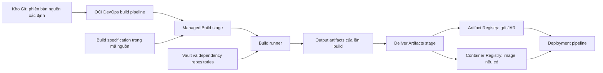

# Build pipelines, build specification và build runners

## 1. Vai trò của build trong quy trình DevOps trên OCI

Trong chương **DevOps và CI/CD trên OCI** của module **CLOUD_PROVIDERS_ORACLE**, build là quá trình chuyển một phiên bản mã nguồn xác định thành sản phẩm có thể kiểm thử, lưu trữ và triển khai. Sản phẩm đó có thể là một file JAR, một container image hoặc một gói cấu hình. OCI DevOps điều phối quá trình này, còn build specification mô tả công việc mà môi trường thực thi phải làm.

Ba khái niệm cần phân biệt ngay từ đầu:

| Khái niệm | Trách nhiệm chính | Ví dụ |
| --- | --- | --- |
| **Build pipeline** | Điều phối các stage và quan hệ phụ thuộc | Lấy mã nguồn, chạy Managed Build, chuyển artifact vào registry |
| **Build specification** | Khai báo lệnh, biến, thời hạn và đầu ra của một Managed Build stage | Chạy Maven, kiểm tra JAR, công bố tên output artifact |
| **Build runner** | Cung cấp môi trường tính toán để thực thi lệnh | CPU, RAM, hệ điều hành, công cụ và kết nối mạng cho Maven |

Một pipeline được cấu hình đúng vẫn có thể thất bại vì runner thiếu bộ nhớ. Một runner đủ mạnh vẫn có thể tạo sản phẩm sai nếu build specification lấy nhầm mã nguồn. Vì vậy, thiết kế build phải kết hợp điều phối, cấu hình thực thi, phân quyền và nguồn gốc artifact.

Bài học dùng ứng dụng Java xây dựng bằng Maven làm ví dụ. Các đoạn cấu hình là mẫu để điều chỉnh theo môi trường OCI được cấp quyền; chúng không phải kết quả đã thực thi trên một tenancy cụ thể. Trọng tâm là build và bàn giao artifact, còn các chiến lược triển khai Compute, OKE hoặc dịch vụ đích được thực hiện ở deployment pipeline.

## 2. Từ commit đến artifact: các thành phần phối hợp thế nào?



Managed Build stage lấy các nguồn đã cấu hình và thực thi build specification trên runner. Sau khi tạo đầu ra, Deliver Artifacts stage đưa những artifact đã khai báo đến nơi lưu trữ phù hợp. Deployment pipeline sau đó tiêu thụ một phiên bản artifact cụ thể.

Đây là ba ranh giới quan trọng:

1. **Lệnh build thành công chưa chứng minh artifact được xuất bản.** File có thể mới nằm trong filesystem của runner.
2. **Khai báo output artifact chưa thay thế cấu hình giao nhận artifact.** Pipeline vẫn cần ánh xạ đầu ra đến tài nguyên artifact và repository đích.
3. **Artifact đã xuất bản chưa có nghĩa ứng dụng đã được triển khai.** Deployment là một hoạt động riêng, có danh tính, quyền và chính sách kiểm soát riêng.

Không cần build lại cùng một commit cho từng môi trường chỉ để thay địa chỉ database hoặc tên compartment. Ưu tiên tạo một artifact có định danh rõ, sau đó truyền cấu hình môi trường bằng cơ chế triển khai thích hợp. Với Java, mật khẩu database hoặc private key không được đóng gói vào JAR hay container image.

## 3. Những gì được cấu hình trong pipeline

Build specification không chứa toàn bộ cấu hình OCI DevOps. Một phần thuộc tài nguyên pipeline và Managed Build stage:

| Cấu hình | Nằm ở đâu về mặt trách nhiệm | Ý nghĩa vận hành |
| --- | --- | --- |
| Project và compartment | OCI DevOps/IAM | Phạm vi tổ chức tài nguyên, quyền thao tác và quan sát |
| Kho nguồn, nhánh mặc định, source alias | Cấu hình nguồn của Managed Build | Xác định mã được lấy về và nguồn chính |
| Đường dẫn build specification | Managed Build stage | Chọn file lệnh trong nguồn, thường là `build_spec.yaml` |
| Runner configuration | Managed Build stage | Chọn cấu hình tính toán và khả năng kết nối phù hợp |
| Các stage trước/sau | Build pipeline | Quy định thứ tự và điều kiện bàn giao |
| Ánh xạ output đến artifact đích | Deliver Artifacts stage và DevOps artifact | Xác định sản phẩm nào được xuất bản ở đâu |
| Trigger | Cấu hình sự kiện chạy pipeline | Xác định sự kiện nguồn và bộ lọc kích hoạt |

Tên `build_spec.yaml` là quy ước phổ biến trong bài, không phải lý do để bỏ qua trường đường dẫn. Nếu file nằm ở `ci/build_spec.yaml`, stage phải trỏ đến đúng vị trí đó trong mã nguồn được lấy về.

Khi có nhiều nguồn, hãy xác định rõ nguồn chính và alias của từng nguồn. Không dùng đường dẫn tương đối dựa trên phỏng đoán runner đang đứng trong thư mục nào. Biến `OCI_PRIMARY_SOURCE_DIR` giúp chỉ đến thư mục nguồn chính trong Managed Build.

Trigger theo nhánh là một cơ chế kích hoạt. Hồ sơ của lần build vẫn cần commit thực tế đã được checkout, vì đầu nhánh có thể thay đổi sau khi sự kiện được tạo.

## 4. Cấu trúc build specification của OCI

Build specification là YAML được OCI DevOps diễn giải theo schema của dịch vụ, không phải một shell script thuần túy. Tên trường, kiểu dữ liệu, thụt lề và vị trí của từng phần đều có ý nghĩa.

Các trường được dùng trong bài:

| Trường | Công dụng | Điểm cần nhớ |
| --- | --- | --- |
| `version` | Phiên bản schema build specification | Ví dụ dùng `0.1`; đây không phải phiên bản ứng dụng |
| `component` | Loại component | Với Managed Build trong ví dụ là `build` |
| `timeoutInSeconds` | Thời hạn của công việc được mô tả | Không thay thế mọi giới hạn của stage hay dịch vụ |
| `shell` | Shell dùng cho các lệnh | Ví dụ chọn `bash` và dùng cú pháp Bash |
| `env.variables` | Biến cấu hình thông thường | Không đặt bí mật vào đây |
| `env.vaultVariables` | Ánh xạ biến môi trường đến OCI Vault secret | Cần quyền đọc secret phù hợp |
| `env.exportedVariables` | Các biến cần chuyển ra cho stage tiếp theo | Giá trị phải được thiết lập trong lần build |
| `steps` | Danh sách bước thực thi có thứ tự | Mỗi bước có loại, tên, lệnh và thời hạn phù hợp |
| `steps[].onFailure` | Công việc khi một bước thất bại | Dùng thu thập chẩn đoán, không biến build lỗi thành thành công giả |
| `outputArtifacts` | Tên, kiểu và vị trí sản phẩm đầu ra | Tên này được dùng khi cấu hình Deliver Artifacts |

Không sao chép nguyên cấu trúc của GitHub Actions, Jenkinsfile hoặc dịch vụ build khác vào file OCI. Các ý tưởng giống nhau nhưng schema, cách lấy nguồn, danh tính thực thi và cách truyền artifact khác nhau.

Bên trong `command: |` là một khối văn bản nhiều dòng. Những dòng đó được shell xử lý, còn phần YAML bên ngoài được OCI xử lý trước. Một lỗi YAML có thể ngăn runner chạy bất kỳ lệnh nào; một lỗi Maven xảy ra sau khi cấu hình đã được chấp nhận và lệnh đã bắt đầu.

## 5. Chuẩn bị ứng dụng Java cho ví dụ

Giả sử repository có cấu trúc:

```text
orders-service/
├── build_spec.yaml
├── pom.xml
├── mvnw
├── .mvn/
│   └── wrapper/
│       └── maven-wrapper.properties
└── src/
    ├── main/
    └── test/
```

Repository cần chứa các file Maven Wrapper phù hợp với kiểu wrapper mà dự án sử dụng; cây trên chỉ hiển thị các thành phần chính. Maven Wrapper giúp xác định bản Maven theo cấu hình dự án, nhưng vẫn cần Java và có thể cần tải bản phân phối hoặc dependency qua mạng.

Ví dụ yêu cầu:

- Runner có Bash, Git, Java, `sha256sum` và các tiện ích được dùng trong lệnh.
- Phiên bản Java phù hợp với `pom.xml`; dự án chọn Java 17 thì runner phải cung cấp JDK tương thích.
- Maven build tạo file `target/app.jar`.
- Dependency repositories mà dự án sử dụng có thể được phân giải DNS và truy cập từ runner.
- Các kiểm thử cần thiết được gắn vào Maven lifecycle đang chạy.

Để thống nhất tên file, phần `build` trong `pom.xml` có thể cấu hình:

```xml
<build>
    <finalName>app</finalName>
    <!-- Các plugin thực tế của dự án được đặt ở đây. -->
</build>
```

Đây là đoạn cần ghép vào POM hiện hữu, không phải một POM hoàn chỉnh. Với dự án nhiều module, phải thay đường dẫn artifact thành đầu ra của module cần đóng gói. Với Spring Boot hoặc công cụ tạo nhiều JAR, cần chọn đúng sản phẩm cuối cùng thay vì một file trung gian.

Một JAR thông thường cũng không mặc nhiên chạy được bằng `java -jar`. Cách khởi chạy phụ thuộc packaging, manifest và plugin của ứng dụng; việc xác nhận đó thuộc hợp đồng artifact của dự án.

## 6. Build specification mẫu: kiểm tra, build và tạo bằng chứng nguồn gốc

File `build_spec.yaml`:

```yaml
version: 0.1
component: build
timeoutInSeconds: 1800
shell: bash

env:
  exportedVariables:
    - BUILD_VERSION

steps:
  - type: Command
    name: "Kiem tra source va toolchain"
    timeoutInSeconds: 180
    command: |
      set -euo pipefail
      cd "${OCI_PRIMARY_SOURCE_DIR}"

      test -f pom.xml
      test -f mvnw
      test -f .mvn/wrapper/maven-wrapper.properties
      command -v git
      command -v sha256sum
      java -version
      bash ./mvnw --version

  - type: Command
    name: "Chay Maven verify va tao metadata"
    timeoutInSeconds: 1200
    command: |
      set -euo pipefail
      cd "${OCI_PRIMARY_SOURCE_DIR}"

      bash ./mvnw --batch-mode --no-transfer-progress clean verify
      test -s target/app.jar

      source_commit="$(git rev-parse --verify HEAD)"
      build_run="${OCI_BUILD_RUN_ID:?OCI_BUILD_RUN_ID is required}"
      run_suffix="$(printf '%s' "${build_run}" | sha256sum | cut -c 1-12)"
      export BUILD_VERSION="${source_commit:0:12}-${run_suffix}"

      mkdir -p target/build-metadata
      printf 'commit=%s\nbuild_run_id=%s\nartifact_version=%s\n' \
        "${source_commit}" "${build_run}" "${BUILD_VERSION}" \
        > target/build-metadata/provenance.txt
      sha256sum target/app.jar > target/build-metadata/app.jar.sha256

    onFailure:
      - type: Command
        name: "Liet ke bao cao kiem thu de chan doan"
        timeoutInSeconds: 60
        command: |
          cd "${OCI_PRIMARY_SOURCE_DIR}"
          printf '%s\n' "Build failed; inspect the original command error."
          if [ -d target/surefire-reports ]; then
            find target/surefire-reports -maxdepth 1 -type f -name '*.txt' -print
          fi

outputArtifacts:
  - name: application_jar
    type: BINARY
    location: ${OCI_PRIMARY_SOURCE_DIR}/target/app.jar

  - name: build_provenance
    type: BINARY
    location: ${OCI_PRIMARY_SOURCE_DIR}/target/build-metadata/provenance.txt

  - name: application_checksum
    type: BINARY
    location: ${OCI_PRIMARY_SOURCE_DIR}/target/build-metadata/app.jar.sha256
```

Các thời hạn `180`, `1200` và `1800` giây là lựa chọn cho ví dụ, không phải mặc định hay giới hạn cố định của OCI. Phải điều chỉnh theo dự án và các giới hạn đang áp dụng cho stage, runner và tenancy.

### 6.1. Vì sao tách hai bước?

Bước đầu xác nhận nguồn và toolchain. Nếu thiếu Java hoặc wrapper không tải được Maven, log thể hiện lỗi sớm trước phần đóng gói. Bước thứ hai thực hiện quy trình Maven và chỉ tạo metadata phiên bản khi file đầu ra thực sự tồn tại.

Mỗi bước chủ động `cd` đến thư mục nguồn. Đừng phụ thuộc vào thư mục làm việc hoặc trạng thái shell ngầm định từ bước trước. Dữ liệu cần bàn giao phải được thể hiện bằng file, output artifact hoặc cơ chế biến được OCI hỗ trợ.

### 6.2. Vì sao dùng `set -euo pipefail`?

Các tùy chọn Bash này giúp tránh những trường hợp phổ biến:

- Lệnh lỗi nhưng script vẫn chạy tiếp và xuất bản sản phẩm cũ.
- Dùng một biến bắt buộc chưa được thiết lập.
- Một lệnh ở đầu pipeline shell thất bại nhưng bị mã thoát của lệnh cuối che khuất.

Chúng không thay cho việc hiểu mã thoát của từng công cụ. Một số lệnh dùng mã khác 0 cho kết quả nghiệp vụ bình thường; những trường hợp đó cần xử lý rõ, không thêm `|| true` vào mọi dòng.

### 6.3. `verify` kiểm thử đến đâu?

`mvn verify` chạy các pha Maven đến `verify`. Kiểm thử đơn vị thường được chạy qua plugin tương ứng. Kiểm thử tích hợp chỉ chạy nếu dự án đã cấu hình plugin và binding thích hợp; tên lệnh không tự tạo kiểm thử tích hợp, kiểm thử bảo mật hay kiểm thử với Oracle Database.

Nếu kiểm thử cần kết nối database Oracle, phải chuẩn bị danh tính, dữ liệu thử, mạng và cơ chế dọn dữ liệu. Không dùng schema sản xuất làm môi trường kiểm thử chỉ vì runner truy cập được database đó.

### 6.4. Phiên bản artifact và provenance

`BUILD_VERSION` ghép phần đầu commit với giá trị rút gọn suy ra từ build run ID. Mục tiêu là phân biệt các lần build của cùng mã nguồn; đây không phải tuyên bố tái lập build hoàn toàn hay bằng chứng mật mã về chuỗi cung ứng.

File provenance lưu commit đầy đủ, build run ID và phiên bản artifact. File checksum giúp kiểm tra nội dung JAR sau khi bàn giao. Hai file này hỗ trợ truy vết, nhưng không tương đương chữ ký số hoặc một cơ chế chứng thực nguồn gốc đầy đủ.

Hash rút gọn có xác suất trùng khác 0. Nếu yêu cầu bảo đảm định danh cao hơn, dùng quy ước phiên bản và cơ chế chống ghi đè của repository đáp ứng chính sách tổ chức. Dù tên phiên bản ngắn, hồ sơ build vẫn phải lưu định danh đầy đủ.

### 6.5. `onFailure` phục vụ chẩn đoán

Nhánh thất bại liệt kê vị trí báo cáo để người vận hành biết tìm thông tin. Nó không bảo đảm báo cáo đã được lưu lâu dài ra ngoài runner. Nếu cần giữ báo cáo của build lỗi, phải thiết kế thêm việc thu thập và nơi lưu phù hợp với hành vi của pipeline khi stage thất bại.

Không tự động in toàn bộ biến môi trường, Maven settings hoặc file cấu hình khi chẩn đoán. Những file đó có thể chứa token, mật khẩu hoặc thông tin nội bộ.

## 7. Build runner: môi trường thực thi, không phải kho lưu trữ

Trong luồng Managed Build, OCI DevOps cung cấp môi trường runner để chạy công việc của stage. Runner không phải máy Compute của ứng dụng, database Oracle hay OCI Cloud Shell cá nhân.

Không thiết kế dựa trên giả định lần chạy tiếp theo sẽ dùng lại cùng máy hoặc còn giữ thư mục của lần trước. Chỉ coi dữ liệu là bền vững khi nó đã được chuyển đến một dịch vụ lưu trữ được chỉ định và có bằng chứng giao nhận thành công.

### 7.1. Toolchain phải được xác nhận

Runner có tập công cụ theo môi trường được dịch vụ hỗ trợ. Không suy luận rằng mọi runner đều có đúng JDK, Maven, Docker hoặc thư viện native mà laptop của người phát triển đang dùng.

Các việc nên làm ở đầu build:

- Ghi nhận phiên bản Java và công cụ đóng gói liên quan.
- Dùng wrapper hoặc cấu hình phiên bản công cụ có thể kiểm soát được.
- Kiểm tra lệnh cần thiết trước tác vụ dài.
- Nếu phải tải công cụ bổ sung, dùng nguồn đáng tin cậy và kiểm tra tính toàn vẹn theo quy trình của nhóm.

Maven Wrapper cố định được bản Maven theo cấu hình wrapper; nó không tự cố định JDK, nội dung dependency repository hoặc mọi plugin. Muốn cải thiện khả năng tái lập, cần quản lý cả phiên bản dependency, plugin, base image và các tài nguyên tải bên ngoài.

### 7.2. CPU, RAM, kiến trúc và dung lượng

Cấu hình runner phải phù hợp tải build:

| Yếu tố | Biểu hiện khi không phù hợp | Cách đánh giá |
| --- | --- | --- |
| CPU | Biên dịch và kiểm thử kéo dài | So sánh thời gian từng pha, mức song song và tài nguyên thực tế |
| RAM | JVM thiếu heap hoặc tiến trình bị kết thúc | Đọc lỗi JVM, dấu hiệu OOM và cấu hình số tiến trình kiểm thử |
| Kiến trúc CPU | Native library hoặc image không chạy đúng | Đối chiếu kiến trúc runner, sản phẩm build và môi trường đích |
| Dung lượng tạm | Giải nén dependency hoặc tạo image thất bại | Kiểm tra kích thước đầu ra và dữ liệu trung gian |
| Thời hạn | Stage bị kết thúc khi đang tải hoặc kiểm thử | Tìm nút thắt trước khi tăng timeout |

Thêm CPU không tự giảm thời gian chờ Maven repository. Tăng heap của một JVM có thể làm tổng mức sử dụng RAM tệ hơn nếu nhiều test fork chạy đồng thời. Các tham số Maven/JVM cần được điều chỉnh theo tổng tải của runner.

### 7.3. Cache là tối ưu hóa có điều kiện

Đừng dùng trạng thái local còn sót lại trên runner làm cache bắt buộc cho tính đúng. Nếu môi trường có cơ chế cache được hỗ trợ, hãy xác định khóa cache, quyền truy cập, cách vô hiệu hóa và phạm vi sử dụng.

Build phải tạo được sản phẩm từ checkout sạch khi cache trống. Với dependency Java nội bộ, một repository manager được quản lý có thể cung cấp nguồn tải ổn định hơn so với dựa vào thư mục `.m2` của một runner cụ thể.

### 7.4. Không đánh đồng runner của mọi hệ CI

Một máy Compute chạy Jenkins agent hoặc GitHub Actions runner là mô hình vận hành khác với OCI DevOps Managed Build. Nếu chọn hệ CI khác trên OCI, nhóm phải chịu trách nhiệm riêng về đăng ký agent, vá máy, credential, mở rộng và cô lập công việc.

Việc một pipeline chạy trên OCI không tự biến mọi agent thành OCI DevOps managed runner. Cần xác định rõ sản phẩm nào điều phối và bên nào sở hữu môi trường thực thi.

## 8. Kết nối mạng của runner và VCN

Build runner có thể cần truy cập nhiều nhóm endpoint:

| Đích truy cập | Ví dụ mục đích | Điều cần xác minh |
| --- | --- | --- |
| Kho mã nguồn | Lấy commit được build | Connector, quyền nguồn, DNS và kết nối |
| Dependency repository | Maven tải dependency/plugin | Internet egress hoặc đường đến repository nội bộ |
| OCI API và Vault | Đọc secret, gọi dịch vụ theo quyền | Endpoint, danh tính thực thi và IAM |
| Artifact/Container Registry | Xuất bản JAR hoặc image | Kết nối, xác thực và quyền ghi vào repository đích |
| Database dùng cho kiểm thử | Kiểm thử tích hợp | DNS riêng, route, NSG/security list và credential thử nghiệm |

Nếu dự án cần truy cập tài nguyên private, cấu hình khả năng truy cập mạng riêng của Managed Build theo những lựa chọn mà OCI hỗ trợ cho môi trường đó. Việc repository nằm trong tenancy hoặc database nằm trong VCN không làm runner tự có đường mạng đến chúng.

Đối với đường đi qua subnet/VCN, phải xem đồng thời route table, security list hoặc NSG, DNS và các gateway thích hợp. Không kết luận rằng có NAT Gateway là truy cập được mọi OCI service; một số đường đi có thể dùng Service Gateway hoặc endpoint riêng tùy dịch vụ và thiết kế.

Hai lớp thường bị nhầm:

- **Kết nối mạng** quyết định runner có tới được endpoint hay không.
- **IAM hoặc credential ứng dụng** quyết định endpoint có cho phép thao tác hay không.

Lỗi timeout hoặc DNS nên được điều tra khác lỗi xác thực hay từ chối quyền. Không sửa lỗi mạng bằng cách cấp quyền quản trị tenancy; cũng không mở rộng ingress vào database cho toàn Internet để giải quyết một kết nối CI bị thiếu route.

## 9. Biến thông thường, secret và danh tính OCI

### 9.1. Tách ba loại giá trị

| Loại | Ví dụ | Cách quản lý phù hợp |
| --- | --- | --- |
| Cấu hình thông thường | Tên ứng dụng, mức log, tên profile build | Biến của pipeline hoặc `env.variables` theo phạm vi sử dụng |
| Bí mật | Token repository nội bộ, mật khẩu kiểm thử | Vault/secret mechanism và quyền đọc giới hạn |
| Đầu ra của build | Phiên bản artifact, định danh image | `env.exportedVariables` khi cần chuyển đến stage sau |

Trong ví dụ, `BUILD_VERSION` không phải bí mật và được tạo trong lệnh bằng `export`. Khai báo nó trong `env.exportedVariables` cho OCI biết cần bàn giao biến đó; chỉ đặt `export` trong Bash không thay thế hợp đồng truyền biến giữa các stage.

Không dùng exported variable để truyền mật khẩu qua nhiều stage. Stage tiếp theo nên truy cập bí mật qua cơ chế được cấp quyền phù hợp với trách nhiệm của chính nó.

### 9.2. Ví dụ dùng Vault variable

Nếu build cần token truy cập Maven repository nội bộ, phần `env` có thể được mở rộng như sau:

```yaml
env:
  variables:
    APP_NAME: orders-service
  vaultVariables:
    INTERNAL_REPO_TOKEN: "<ocid-cua-vault-secret>"
  exportedVariables:
    - BUILD_VERSION
```

Đây là phần thay thế/mở rộng khối `env` hiện hữu, không thêm một khóa `env` thứ hai vào cùng file YAML. Giá trị dưới `vaultVariables` tham chiếu secret phù hợp, không phải nội dung token viết trực tiếp vào repository.

Dự án vẫn cần cấu hình Maven sử dụng biến đó đúng cách, chẳng hạn qua settings được chuẩn bị an toàn. Chỉ khai báo biến không khiến Maven tự biết token thuộc server nào.

Cần bảo vệ secret ở cả đầu vào, log và đầu ra:

- Không chạy `set -x`, `printenv` hoặc `env` trong luồng có secret mà chưa kiểm soát nội dung.
- Không chép secret vào thư mục build context hay artifact.
- Không dùng Docker build argument để giả định secret sẽ được giữ kín trong mọi lớp image.
- Không cung cấp secret phát hành cho build từ mã nguồn chưa được tin cậy.

### 9.3. IAM theo từng công việc

Người cấu hình pipeline và danh tính dịch vụ thực thi build có thể là hai chủ thể khác nhau. Việc người dùng xem được Vault trên Console không chứng minh runner đọc được secret khi chạy.

Tùy tài nguyên và cơ chế thực thi, cần cấu hình IAM, dynamic group/resource principal và quyền dịch vụ tương ứng. Phạm vi quyền phải theo compartment và tác vụ thực tế:

| Công việc | Quyền cần xem xét |
| --- | --- |
| Lấy mã từ kho được bảo vệ | Quyền đọc repository hoặc credential của connector |
| Đọc Vault secret | Quyền đọc secret bundle liên quan |
| Xuất bản generic artifact | Quyền cần thiết đối với artifact và repository đích |
| Xuất bản container image | Quyền với repository Container Registry đích |
| Dùng cấu hình mạng riêng | Quyền dịch vụ cần để sử dụng các tài nguyên mạng liên quan |
| Quan sát build | Quyền xem build run và log, với phạm vi người vận hành |

Bảng này là ma trận trách nhiệm, không phải một policy duy nhất để sao chép. Không thay nó bằng quyền quản trị rộng ở tenancy cho tiện thử nghiệm. Quyền triển khai ứng dụng cũng không nên được mặc nhiên gộp vào quyền build chỉ vì hai pipeline nằm cùng project.

## 10. Từ output artifact đến artifact được xuất bản

Trong mẫu, `application_jar` là tên logic mà build specification công bố. `target/app.jar` là đường dẫn file trên runner. Chúng không phải tên repository hoặc OCID của một artifact trên OCI.

Một cấu hình giao nhận cho JAR có thể được thiết kế như sau:

| Thành phần | Giá trị minh họa |
| --- | --- |
| Tên output trong build specification | `application_jar` |
| Kiểu đầu ra | `BINARY` |
| File nguồn | `${OCI_PRIMARY_SOURCE_DIR}/target/app.jar` |
| Repository đích | Generic artifact repository đã tạo trong OCI Artifact Registry |
| Artifact path | `orders/app.jar` |
| Version | Giá trị được thay thế từ `${BUILD_VERSION}` |
| Hồ sơ liên kết | Commit đầy đủ, build run ID và checksum |

Cách thực hiện về mặt trách nhiệm:

1. Tạo hoặc chọn repository đích và tài nguyên DevOps artifact phù hợp.
2. Cấu hình artifact path/version và cơ chế thay thế biến cần dùng.
3. Trong Deliver Artifacts stage, ánh xạ đúng tên output `application_jar` sang artifact đích.
4. Cấu hình thêm ánh xạ cho provenance và checksum nếu muốn lưu chúng bền vững.
5. Chạy pipeline và kiểm tra kết quả giao nhận ở repository, không chỉ trạng thái Managed Build.

Nếu dùng `${BUILD_VERSION}` trong trường artifact, phải bật/cấu hình việc thay thế biến theo khả năng của tài nguyên artifact tương ứng. Nếu để nó thành chuỗi literal, mọi lần build có thể nhắm cùng một tên sai hoặc không tìm được sản phẩm mong muốn.

Trong pipeline thực tế, các đầu ra provenance và checksum cũng cần nơi lưu và chính sách giữ dữ liệu. Việc khai báo chúng trong `outputArtifacts` mới xác định đầu ra của build, chưa chứng minh người vận hành sẽ truy cập được chúng sau khi môi trường tạm bị thu hồi.

Không dùng `latest` làm định danh duy nhất cho sản phẩm được phê duyệt. Khi triển khai lại hoặc rollback, cần chỉ được chính xác phiên bản đã dùng; với container, digest là một định danh nội dung hữu ích để ghi vào hồ sơ phát hành.

## 11. Biến thể: tạo container image từ cùng lần build

Nếu sản phẩm triển khai là container, runner và cấu hình Managed Build phải hỗ trợ công cụ xây dựng image được chọn. Cần kiểm tra khả năng chạy Docker hoặc công cụ tương ứng trước khi dùng lệnh; chỉ thêm một `Dockerfile` vào repository không bảo đảm runner có môi trường thực thi phù hợp.

Ví dụ dùng Docker: sau khi tạo `BUILD_VERSION` và JAR trong cùng khối lệnh ở bước Maven, có thể bổ sung:

```bash
docker version
docker build --tag "orders-app:${BUILD_VERSION}" .
```

Dockerfile phải chép đúng `target/app.jar` và chọn Java runtime/base image phù hợp. Nếu một base image có thể thay đổi dưới cùng một tag, sản phẩm cũng có thể thay đổi giữa hai lần build dù source commit giống nhau; chính sách pin digest cần được xem xét theo yêu cầu tái lập và cập nhật bảo mật.

Đầu ra image được mô tả thêm trong `outputArtifacts`:

```yaml
  - name: application_image
    type: DOCKER_IMAGE
    location: orders-app:${BUILD_VERSION}
```

Đoạn trên là một phần tử cần ghép vào danh sách hiện hữu. `location` ở đây nhận diện image đã build trong môi trường thực thi, khác với đường dẫn một file JAR.

Deliver Artifacts stage cần ánh xạ `application_image` đến DevOps artifact kiểu container image và repository đích. Một URI đích có dạng minh họa:

```text
<registry-domain>/<tenancy-namespace>/orders-app:${BUILD_VERSION}
```

Phải thay registry domain, namespace và cấu hình repository bằng giá trị thật của môi trường. Việc push đến registry private cần đúng cơ chế xác thực và quyền; không chèn mật khẩu dài hạn vào build specification để bỏ qua cấu hình IAM.

Không vừa dùng lệnh push riêng vừa thêm Deliver Artifacts cho cùng image mà không xác định rõ trách nhiệm xuất bản. Một cách giao nhận thống nhất giúp biết stage nào đã ghi artifact và lỗi xảy ra trước hay sau thời điểm phát hành.

## 12. Trình tự tạo một pipeline thực hành

### Bước 1: xác nhận đầu vào và quyền sở hữu

Chọn project/compartment, repository mã nguồn, branch dùng cho thực hành và repository artifact đích. Xác nhận ai được sửa build specification, ai được chạy pipeline và ai được đọc secret.

Ở lab đầu tiên, dùng một ứng dụng và một artifact chính. Không gắn quyền triển khai sản xuất vào pipeline chỉ để thử Managed Build.

### Bước 2: đưa build specification vào đúng commit

Commit file cùng các thay đổi wrapper/POM cần thiết. Xem build specification là mã có thể thực thi với quyền của CI, nên việc sửa file này cần được review như sửa mã ứng dụng có ảnh hưởng vận hành.

Nếu kho chứa nhiều ứng dụng, đường dẫn build specification và lệnh `cd` phải phản ánh ứng dụng được chọn. Ví dụ monorepo có `services/orders/pom.xml` thì không giữ nguyên lệnh build tại root nếu root không có POM tương ứng.

### Bước 3: cấu hình Managed Build stage

Chọn nguồn chính, đường dẫn specification, runner configuration và khả năng truy cập mạng cần thiết. Xác nhận toolchain với repository thay vì giả định mọi công cụ trên laptop cũng có sẵn trên runner.

Nếu cần nhiều nguồn, xác định alias và quan hệ phiên bản giữa chúng. Không lấy application ở commit cố định nhưng lại tải script phát hành từ đầu nhánh không được ghi nhận.

### Bước 4: cấu hình giao nhận artifact

Thêm Deliver Artifacts sau Managed Build và ánh xạ tên output chính xác. Cấu hình version lấy từ giá trị xuất ra, cùng quyền ghi repository và lưu các metadata cần thiết.

Trong ví dụ có ba output nhị phân. Nếu quy trình chỉ lưu JAR, phải chấp nhận rõ rằng provenance/checksum chưa được lưu ở nơi bền vững hoặc bổ sung cơ chế lưu khác.

### Bước 5: chạy thủ công và đọc kết quả

Theo dõi lần lượt log kiểm tra toolchain, kết quả Maven, việc tìm artifact và giao nhận. Ghi lại commit, build run ID, artifact path/version và checksum.

Một lần chạy đạt mục tiêu khi artifact có thể truy xuất ở đích và liên kết ngược đến nguồn, không chỉ khi lệnh Maven in `BUILD SUCCESS`.

### Bước 6: thêm trigger sau khi luồng thủ công rõ ràng

Chọn loại sự kiện và bộ lọc nhánh theo quy trình của nhóm. Phân biệt luồng kiểm tra pull request với luồng xuất bản artifact phát hành.

Mã từ pull request có thể thay build script để đọc secret hoặc gửi dữ liệu ra ngoài. Vì thế, mức tin cậy của nguồn phải được xem cùng bộ secret, quyền registry và danh tính thực thi mà lần build sẽ nhận.

## 13. Quan sát và phân loại lỗi

Bắt đầu từ stage thất bại đầu tiên và thông báo lỗi gốc. Lỗi ở cuối pipeline đôi khi chỉ là hệ quả của một artifact không được tạo ở đầu pipeline.

| Triệu chứng | Nhóm nguyên nhân cần kiểm tra | Hướng xử lý |
| --- | --- | --- |
| Specification bị từ chối trước khi chạy lệnh | YAML/schema hoặc đường dẫn file | Kiểm tra thụt lề, tên trường và specification trong commit thực tế |
| Không tìm thấy `pom.xml` | Nhầm nguồn chính hoặc thư mục dự án | Kiểm tra checkout và đường dẫn dưới `OCI_PRIMARY_SOURCE_DIR` |
| `java: command not found` | Toolchain runner | Chọn môi trường phù hợp hoặc chuẩn bị JDK theo cách kiểm soát được |
| Maven Wrapper không khởi động | Thiếu file wrapper, Java hoặc tải bản phân phối thất bại | Đọc lỗi wrapper và kiểm tra thành phần đã commit |
| Dependency download timeout | DNS, route, proxy hoặc repository chậm | Kiểm tra đường mạng và endpoint dependency |
| `401`/`403` từ repository | Credential, quyền hoặc cấu hình server | Kiểm tra danh tính và cách Maven sử dụng credential |
| Test thất bại | Mã, dữ liệu thử hoặc dịch vụ phụ thuộc | Đọc báo cáo kiểm thử và lỗi đầu tiên |
| Tiến trình bị kill hoặc mã thoát như `137` | Có thể thiếu RAM hoặc bị kết thúc từ bên ngoài | Đối chiếu log, tài nguyên và thời hạn trước khi kết luận |
| Build thành công nhưng thiếu JAR | Sai packaging, module hoặc tên file | Đối chiếu hợp đồng đầu ra, không lấy ngẫu nhiên file khác |
| Deliver Artifacts không tìm được output | Sai tên output, vị trí hoặc sản phẩm chưa tồn tại | Đối chiếu `outputArtifacts` và ánh xạ trong stage |
| Registry từ chối xuất bản | Sai đích, quyền hoặc quy tắc phiên bản | Kiểm tra repository, danh tính và chính sách ghi đè |
| Stage sau nhận sai version | Biến chưa export hoặc chưa được thay thế | Đối chiếu `exportedVariables`, lệnh thiết lập và trường artifact |

Nếu một lệnh tải dependency lỗi, không sửa bằng cách bỏ kiểm thử hoặc tắt kiểm tra chứng chỉ TLS. Nếu artifact đã xuất bản mà bước sau thất bại, kiểm tra trạng thái repository trước khi retry để tránh ghi đè hoặc tạo bản phát hành khó truy vết.

Thời gian nên được quan sát theo từng pha: lấy nguồn, chuẩn bị công cụ, tải dependency, compile, test, đóng gói và giao nhận. Số tổng cho cả pipeline thường không đủ để chọn đúng cách tối ưu.

## 14. Độ tin cậy, khả năng chạy lại và kiểm soát chi phí

### 14.1. Chạy lại cần có ý nghĩa rõ

Một lần retry có thể dùng commit cũ nhưng dependency bên ngoài đã thay đổi hoặc nguồn nhánh đã được giải quyết khác. Hãy xác định lần chạy lại thực sự dùng đầu vào nào và lưu chúng vào hồ sơ.

Không tự retry vô hạn mọi thất bại. Lỗi kết nối tạm thời có thể phù hợp với retry có giới hạn; lỗi kiểm thử, sai schema hoặc thiếu quyền thường cần sửa nguyên nhân.

Đối với bước xuất bản, cần biết repository xử lý phiên bản đã tồn tại ra sao. Phiên bản theo build run giúp phân biệt lần thử, nhưng chính sách phát hành vẫn phải quyết định artifact nào được chấp nhận để triển khai.

### 14.2. Build có thể tái lập cần nhiều hơn một commit

Các yếu tố có thể làm cùng một source commit cho kết quả khác nhau gồm:

- JDK hoặc compiler/plugin khác phiên bản.
- Dependency dạng snapshot hoặc dependency có nội dung thay đổi.
- Base image trôi theo tag.
- Dữ liệu tải bên ngoài không được xác định phiên bản.
- Timestamp, thứ tự đóng gói hoặc thông tin môi trường lọt vào sản phẩm.

Commit là đầu mối nguồn gốc quan trọng nhưng không phải toàn bộ đầu vào. Khi có yêu cầu tái lập mạnh, phải quản lý thêm dependency, toolchain và quy tắc đóng gói có thể lặp lại.

### 14.3. Tối ưu tài nguyên theo bằng chứng

Chi phí vận hành của build có thể liên quan đến thời gian runner, cấu hình tính toán, lưu trữ artifact, log, truyền dữ liệu và tài nguyên kiểm thử phụ trợ. Cách tính cụ thể phụ thuộc dịch vụ và chính sách đang áp dụng; không suy ra ngân sách chỉ từ thời gian Maven.

Một số quyết định hữu ích:

- Dừng sớm khi thiếu đầu vào hoặc toolchain.
- Chỉ tăng tài nguyên sau khi xác định build bị giới hạn bởi CPU/RAM.
- Tránh tải lại lượng dependency lớn khi có giải pháp repository/cache được hỗ trợ và an toàn.
- Đặt thời hạn theo pha để công việc treo không chiếm tài nguyên vô hạn.
- Giới hạn số lần chạy đồng thời phù hợp quota và khả năng chịu tải của dịch vụ phụ thuộc.
- Có chính sách giữ/xóa artifact và log, đồng thời giữ các bản cần cho rollback.

Nếu pipeline tạo Compute, database hoặc tài nguyên OCI khác để kiểm thử, chúng có vòng đời và chi phí riêng. Việc runner kết thúc không tự xóa các tài nguyên đã được tạo qua OCI API. Cần thiết kế dọn dẹp kể cả khi build bị hủy hoặc thất bại giữa chừng.

## 15. Tiêu chí hoàn tất bài thực hành

Một luồng build cơ bản có thể xem là được thiết lập khi người vận hành kiểm chứng được các điểm sau:

- Pipeline chạy đúng repository và commit đã xác định.
- Managed Build đọc đúng specification từ nguồn được chọn.
- Runner có toolchain, tài nguyên và kết nối mạng phù hợp.
- Kiểm thử bắt buộc thất bại thì quá trình phát hành artifact cũng không tiếp tục như một build hợp lệ.
- File hoặc image đầu ra đúng với hợp đồng đã khai báo.
- Deliver Artifacts chuyển đúng sản phẩm vào đúng repository và version.
- Có thể nối artifact về commit, build run và thông tin kiểm tra nội dung.
- Secret không bị đưa vào source, log, provenance hoặc artifact.
- Người vận hành phân biệt được lỗi nguồn, lệnh build, runner, mạng, quyền và giao nhận.
- Retry, lưu trữ kết quả và tài nguyên kiểm thử có quy tắc rõ ràng.

Trong OCI DevOps, build pipeline giữ luồng công việc, build specification mô tả cách tạo sản phẩm và build runner cung cấp điều kiện thực thi. Khi ba lớp này được thiết kế cùng IAM, VCN và nơi lưu artifact, nhóm có thể đưa mã nguồn vào một quy trình tự động hóa có kiểm soát, rồi bàn giao sản phẩm đáng tin cậy cho deployment pipeline.
