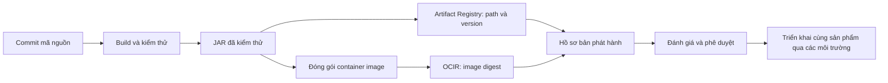

# Quản lý packages với Artifact Registry và container images với OCIR

## 1. Vai trò của kho artifact trong DevOps trên OCI

Trong chương **DevOps và CI/CD trên OCI** của module **CLOUD_PROVIDERS_ORACLE**, kho artifact là nơi bàn giao kết quả build cho các bước triển khai. Mã nguồn mô tả cách tạo phần mềm; artifact là sản phẩm cụ thể mà môi trường chạy sẽ sử dụng. Quy trình tốt phải trả lời được: bản nào đang chạy, được tạo từ commit nào, ai đã xuất bản và có thể lấy lại đúng nội dung đó hay không.

Bài học sử dụng một ứng dụng Java tên `orders-api`. Pipeline tạo JAR đã qua kiểm thử, lưu JAR trong Artifact Registry, đóng gói container image và đưa image vào OCIR. Đội triển khai chọn đúng artifact để chạy trên Compute hoặc nền tảng container; cấu hình truy cập cơ sở dữ liệu Oracle được cấp riêng theo môi trường.

Mục tiêu là quản lý artifact có định danh rõ ràng, có phân quyền IAM, có khả năng truy vết và phục hồi. Phần vận hành kết hợp kiểm tra kết quả publish, quan sát lỗi, kiểm soát dung lượng và giữ các phiên bản cần cho tính sẵn sàng.

## 2. Chọn đúng dịch vụ cho từng loại sản phẩm

**OCI Artifact Registry** lưu, chia sẻ và quản lý các gói phần mềm dưới dạng generic artifact hoặc blob. Dịch vụ hỗ trợ version, kiểm tra hash và repository bất biến. **Container Registry**, thường được gọi là **OCIR**, lưu và phân phối container image trong registry do Oracle quản lý. [Tổng quan Artifact Registry](https://docs.oracle.com/en-us/iaas/Content/artifacts/overview.htm), [Container Registry](https://docs.oracle.com/en-us/iaas/Content/Registry/home.htm).

| Sản phẩm cần quản lý | Nơi dùng trong bài | Cách định danh chính |
| --- | --- | --- |
| JAR, WAR, ZIP hoặc gói cài đặt đã build | Artifact Registry | Repository OCID + artifact path + version, kèm SHA-256 |
| Tệp mô tả bản phát hành hoặc báo cáo đóng gói | Artifact Registry | Path/version riêng và checksum tương ứng |
| Image chạy ứng dụng Java | OCIR | Registry host + namespace + image path + digest |
| Mã nguồn, Dockerfile, định nghĩa pipeline | Kho mã nguồn | Commit và nhánh theo quy trình dự án |
| Mật khẩu database, auth token, private key | Hệ thống quản lý secret được cấp quyền | Tham chiếu secret và phiên bản phù hợp |

OCIR tuân thủ đặc tả của **Open Container Initiative**, nên còn có thể chứa các artifact tương thích như Helm chart. Trong bài này, OCIR tập trung vào container image. Từ viết tắt OCI trong tên nền tảng Oracle và trong tiêu chuẩn Open Container Initiative có cùng chữ viết tắt nhưng chỉ hai khái niệm khác nhau. [Các khái niệm Container Registry](https://docs.oracle.com/en-us/iaas/Content/Registry/Concepts/registryconcepts.htm).

### 2.1. Lưu JAR khác với cung cấp giao thức Maven

Một JAR được upload bằng Generic Artifact API vẫn là một tệp được quản lý theo path/version. Quy trình này chưa tự thiết lập endpoint Maven, POM, metadata hay giải quyết dependency cho `mvn` và Gradle. Nếu nhu cầu là tải dependency bằng tọa độ `groupId:artifactId:version`, cần một giải pháp và endpoint tương thích giao thức công cụ đó.

Ví dụ trong bài chủ động sử dụng OCI CLI để upload/download JAR. Sau khi lấy đúng tệp và kiểm tra checksum, pipeline mới dùng nó làm đầu vào triển khai hoặc đóng gói image. Điều này giúp người học hiểu rõ thao tác nào đang diễn ra thay vì suy đoán từ tên dịch vụ.

### 2.2. Luồng bàn giao sản phẩm



Đối với ứng dụng chỉ chạy JAR trên Compute, pipeline có thể dùng nhánh Artifact Registry mà không tạo container. Với ứng dụng container, JAR và image là hai sản phẩm có checksum khác nhau; hồ sơ phát hành phải nối chúng với nhau.

## 3. Định danh, version và tính bất biến

### 3.1. Định danh generic artifact

Trong một repository, artifact được đặt tên theo dạng `artifact-path:version`. Dấu `/` trong path giúp tổ chức tên nhưng không tạo cấu trúc thư mục thật. Ví dụ:

```text
Repository OCID: định danh repository orders_releases
Artifact path:   java/orders-api/orders-api.jar
Version:         1.4.0-build.208
Tên artifact:    java/orders-api/orders-api.jar:1.4.0-build.208
SHA-256:         checksum nội dung JAR do lần build ghi nhận
```

Repository bất biến không cho ghi đè artifact. Artifact đã xóa khỏi repository bất biến cũng không được dùng lại cùng path/version; muốn xuất bản tiếp cần version mới. Vì vậy, bất biến không đồng nghĩa artifact được giữ vĩnh viễn hay không thể bị xóa. [Các khái niệm và tính bất biến trong Artifact Registry](https://docs.oracle.com/en-us/iaas/Content/artifacts/concepts.htm).

Đội dự án nên có quy ước version duy nhất cho mỗi sản phẩm build. Nếu chạy lại pipeline tạo nội dung khác, cấp version mới; không tái sử dụng version release cũ để che một thay đổi.

### 3.2. Định danh image trong OCIR

Một tham chiếu image đầy đủ có dạng:

```text
<registry-host>/<tenancy-namespace>/<image-path>:<tag>
<registry-host>/<tenancy-namespace>/<image-path>@sha256:<digest>
```

Ví dụ minh họa:

```text
iad.ocir.io/<tenancy-namespace>/orders-api:1.4.0-build.208-7ac92f1
iad.ocir.io/<tenancy-namespace>/orders-api@sha256:<64-ký-tự-hex>
```

Host phải thuộc đúng region/realm. `iad.ocir.io` là một endpoint được Oracle công bố cho Ashburn trong OC1. Khi dùng region khác, lấy endpoint tương ứng từ tài liệu hoặc Console; không tự ghép một region key theo phỏng đoán. [Điều kiện sử dụng và endpoint OCIR theo region](https://docs.oracle.com/en-us/iaas/Content/Registry/Concepts/registryprerequisites.htm).

Namespace trong image reference là tenancy namespace, không phải compartment OCID, tên project DevOps hay tên Kubernetes namespace. Compartment của repository được xác định trong cấu hình tài nguyên OCI; nó không xuất hiện thành một đoạn riêng trong đường dẫn Docker.

### 3.3. Tag phục vụ tra cứu, digest phục vụ chọn nội dung

Tag như `latest`, `staging` hoặc `1.4.0` dễ đọc nhưng có thể được trỏ sang nội dung khác trong quy trình cho phép cập nhật tag. Muốn xác nhận đúng sản phẩm đã kiểm thử, ghi nhận manifest digest trong bản phát hành và triển khai bằng tham chiếu digest.

Digest image không phải SHA-256 của JAR và cũng không được thay bằng local image ID. Với image đa kiến trúc, cần phân biệt digest của image index với manifest dành cho từng nền tảng; hồ sơ phát hành phải ghi rõ đối tượng đã được quét và triển khai. Docker hỗ trợ pull theo digest để chọn phiên bản nội dung xác định. [Tài liệu Docker image pull](https://docs.docker.com/reference/cli/docker/image/pull/).

Một tag chứa commit giúp truy vết thuận tiện, nhưng không tự chứng minh image được build từ commit đó. Cần lưu thêm định danh lần build, checksum, nguồn build và kết quả kiểm tra.

## 4. Thiết kế repository và quyền truy cập

### 4.1. Đặt repository vào đúng phạm vi quản lý

Trong ví dụ, dùng một compartment `AppDelivery` để quản lý sản phẩm của đội và hai repository:

| Repository | Dịch vụ | Mục đích |
| --- | --- | --- |
| `orders_releases` | Artifact Registry | JAR và hồ sơ phát hành có version |
| `orders-api` | OCIR | Image chạy ứng dụng Java |

Đây là tên minh họa; cần thay bằng tên và OCID của môi trường thực hành. Với nhiều đội, phân chia theo chủ sở hữu và mức độ tin cậy, đồng thời xác định ai có quyền tạo repository, ai được publish, ai được đọc và ai được xóa.

Tạo sẵn **standard repository** riêng tư trong OCIR, đúng compartment, rồi cấp quyền push. OCIR có trường hợp tự tạo repository ở root compartment khi push lần đầu nếu tùy chọn và quyền cho phép; không dựa vào hành vi đó cho một pipeline cần quản lý đúng phạm vi. Standard repository nhận push/pull; pull-through cache dùng để lấy từ upstream và không nhận push của client. [Tạo repository trong OCIR](https://docs.oracle.com/en-us/iaas/Content/Registry/Tasks/registrycreatingarepository.htm).

Để tránh nhầm cấu trúc tên, bài dùng image ở đường dẫn gốc `orders-api`. Nếu dùng tên có nhiều đoạn, cần đối chiếu thiết lập top-level của repository trước khi xác định ranh giới quản lý và quyền IAM.

### 4.2. Tách các vai trò

| Vai trò | Quyền cần thiết theo nhiệm vụ | Quyền cần xem xét riêng |
| --- | --- | --- |
| Quản trị repository | Tạo, đặt compartment, cấu hình và chính sách | Xóa repository, thay đổi phạm vi truy cập |
| Publisher của pipeline | Xuất bản sản phẩm mới, đọc lại để xác nhận | Ghi đè bản cũ, xóa, thay đổi visibility |
| Consumer triển khai | Đọc JAR hoặc pull image được duyệt | Publish hoặc xóa sản phẩm |
| Người quản lý vòng đời | Xem tham chiếu triển khai, lập danh sách thu hồi | Thực thi xóa ngoài danh sách đã kiểm tra |

Artifact Registry phân biệt resource type `artifact-repositories` và `generic-artifacts`. Đọc nội dung artifact dùng quyền thuộc nhóm `GENERIC_ARTIFACT_READ`; upload dùng `GENERIC_ARTIFACT_CREATE`. Quyền trên repository và quyền trên artifact cần được xét đúng thao tác. [Đối chiếu quyền và API của Artifact Registry](https://docs.oracle.com/en-us/iaas/Content/artifacts/iam-policies-verb-resource-type-combinations.htm).

Ví dụ cấp quyền đọc cho hai nhóm người dùng có sẵn:

```text
Allow group ReleaseReaders to read artifact-repositories in compartment AppDelivery
Allow group ReleaseReaders to read generic-artifacts in compartment AppDelivery
Allow group RuntimePullers to read repos in compartment AppDelivery
```

Với OCIR, resource type là `repos`; `read repos` cho phép pull. Publisher cần các quyền cho push, và quyền tạo repository là một nhu cầu riêng nếu repository chưa tồn tại. Có thể giới hạn thêm theo tên repository bằng điều kiện IAM phù hợp. [Policy kiểm soát truy cập OCIR](https://docs.oracle.com/en-us/iaas/Content/Registry/Concepts/registrypolicyrepoaccess.htm).

Các policy trên minh họa quyền của nhóm người dùng; chúng không cấp quyền trực tiếp cho build run hoặc dịch vụ triển khai. Khi dùng OCI DevOps managed build/deploy, thiết lập dynamic group, service/resource principal và policy theo đường thực thi cụ thể. Quyền đăng nhập Console của người tạo pipeline không tự chuyển thành quyền của job. [IAM policy cho OCI DevOps](https://docs.oracle.com/en-us/iaas/Content/devops/using/devops_iampolicies.htm).

## 5. Xuất bản và lấy lại JAR bằng Artifact Registry

Các ví dụ dưới dùng PowerShell và OCI CLI đã được cài đặt, xác thực và cấp quyền. Chúng là hướng dẫn thực hành, không yêu cầu chạy trên tài nguyên production. Giả định `./dist/orders-api.jar` là JAR thực thi đã qua kiểm thử của pipeline.

### 5.1. Chuẩn bị đích và tạo repository bất biến

Đặt `OCI_COMPARTMENT_OCID` từ cấu hình môi trường được kiểm soát. Ví dụ sử dụng region Ashburn cho nhất quán với phần OCIR phía sau:

```powershell
$compartmentId = $env:OCI_COMPARTMENT_OCID
$region = 'us-ashburn-1'
if ([string]::IsNullOrWhiteSpace($compartmentId)) {
    throw 'Thiếu OCID compartment thực hành'
}

# Chạy một lần bằng principal có quyền tạo repository.
$repositoryId = oci artifacts repository create --compartment-id $compartmentId --repository-type GENERIC --is-immutable true --display-name orders_releases --region $region --query 'data.id' --raw-output
if ($LASTEXITCODE -ne 0) { throw 'Không tạo được Artifact Registry repository' }
if ([string]::IsNullOrWhiteSpace($repositoryId)) { throw 'Không nhận được repository OCID' }
```

Lệnh tạo repository yêu cầu compartment, loại repository và lựa chọn bất biến. Những lần publish sau dùng lại OCID đã được quản lý trong cấu hình pipeline, không tạo repository mới cho mỗi version. [OCI CLI: artifacts repository create](https://docs.oracle.com/en-us/iaas/tools/oci-cli/latest/oci_cli_docs/cmdref/artifacts/repository/create.html).

### 5.2. Upload JAR và đối chiếu checksum

```powershell
$artifactPath = 'java/orders-api/orders-api.jar'
$releaseVersion = '1.4.0-build.208'
$jarPath = './dist/orders-api.jar'

if (-not (Test-Path -LiteralPath $jarPath -PathType Leaf)) {
    throw 'Không có JAR đã build để xuất bản'
}
$localJarSha256 = (Get-FileHash -LiteralPath $jarPath -Algorithm SHA256).Hash.ToLowerInvariant()

oci artifacts generic artifact upload-by-path --repository-id $repositoryId --artifact-path $artifactPath --artifact-version $releaseVersion --content-body $jarPath --region $region
if ($LASTEXITCODE -ne 0) { throw 'Upload JAR thất bại' }
```

`--content-body` nhận đường dẫn tệp cục bộ; `--artifact-path` là tên logic bên trong repository. Không đổi chỗ hai giá trị này. [OCI CLI: upload-by-path](https://docs.oracle.com/en-us/iaas/tools/oci-cli/latest/oci_cli_docs/cmdref/artifacts/generic/artifact/upload-by-path.html).

Đọc metadata để xác nhận artifact vừa publish:

```powershell
$publishedJarSha256 = oci artifacts generic artifact get-by-path --repository-id $repositoryId --artifact-path $artifactPath --artifact-version $releaseVersion --region $region --query 'data.sha256' --raw-output
if ($LASTEXITCODE -ne 0) { throw 'Không đọc được metadata của JAR' }
if ($publishedJarSha256 -ne $localJarSha256) {
    throw 'Checksum artifact trên registry không khớp JAR đã build'
}
```

Metadata artifact có path, version, trạng thái, kích thước và SHA-256; có thể dùng `get-by-path` để tra theo repository/path/version. [Xem thông tin artifact](https://docs.oracle.com/en-us/iaas/Content/artifacts/get-artifact.htm).

Nếu upload báo lỗi do path/version đã tồn tại trong repository bất biến, dừng để đối chiếu lần publish trước. Không tự xóa sản phẩm cũ rồi thử ghi lại cùng tên. Nếu đó là lần build mới, cấp version mới và cập nhật hồ sơ phát hành.

### 5.3. Consumer tải JAR theo version đã duyệt

Một máy triển khai hoặc job khác phải nhận repository OCID, path, version và checksum từ hồ sơ phát hành được bảo vệ. Ví dụ sau giả định ba biến định danh đã được cung cấp như ở phần trước; checksum được cấp riêng qua `APPROVED_JAR_SHA256`.

```powershell
$expectedJarSha256 = $env:APPROVED_JAR_SHA256
if ($expectedJarSha256 -notmatch '^[0-9a-fA-F]{64}$') {
    throw 'Thiếu SHA-256 hợp lệ từ bản phát hành đã duyệt'
}

$downloadPath = './orders-api-approved.jar'
if (Test-Path -LiteralPath $downloadPath) {
    throw 'Chọn đường dẫn tải mới để tránh dùng nhầm tệp có sẵn'
}

oci artifacts generic artifact download-by-path --repository-id $repositoryId --artifact-path $artifactPath --artifact-version $releaseVersion --file $downloadPath --region $region
if ($LASTEXITCODE -ne 0) { throw 'Download JAR thất bại' }

$downloadedSha256 = (Get-FileHash -LiteralPath $downloadPath -Algorithm SHA256).Hash
if ($downloadedSha256 -ne $expectedJarSha256) {
    throw 'JAR tải về không khớp nội dung đã phê duyệt'
}
```

`download-by-path` lấy nội dung qua repository/path/version và ghi vào tệp do `--file` chỉ định. Việc đọc metadata bằng `get-by-path` ở bước trước không thay thế thao tác tải nội dung này. [OCI CLI: download-by-path](https://docs.oracle.com/en-us/iaas/tools/oci-cli/latest/oci_cli_docs/cmdref/artifacts/generic/artifact/download-by-path.html).

So sánh checksum xác nhận cùng nội dung với giá trị tham chiếu. Nếu cả JAR và giá trị checksum tham chiếu đều bị thay đổi bởi cùng một chủ thể không tin cậy, phép so sánh đó chưa chứng minh nguồn xuất bản. Vì vậy, bảo vệ hồ sơ phát hành và quyền phê duyệt là một phần của quy trình.

## 6. Xác thực Docker với OCIR

### 6.1. Phân biệt credential của OCI CLI và Docker

OCI CLI dùng cơ chế xác thực được cấu hình cho các API OCI. Trong luồng Docker login minh họa, người dùng OCIR sử dụng **auth token** làm mật khẩu, không dùng mật khẩu Console hay nội dung API signing key.

Tên đăng nhập thường theo dạng `<tenancy-namespace>/<username>`; với danh tính liên kết, có thể cần thêm phần domain trong tên. Đối chiếu đúng định dạng Oracle cung cấp cho danh tính đang dùng thay vì cố định một tên domain cho mọi tenancy. [Hướng dẫn push image và đăng nhập OCIR](https://docs.oracle.com/en-us/iaas/Content/Registry/Tasks/registrypushingimagesusingthedockercli.htm).

Ví dụ dưới nhận thông tin từ cấu hình CI. `OCIR_AUTH_TOKEN` phải do hệ thống quản lý secret cung cấp và không được ghi vào mã nguồn hay in ra log.

```powershell
$registry = 'iad.ocir.io'
$tenancyNamespace = $env:OCI_TENANCY_NAMESPACE
$registryUser = $env:OCIR_USERNAME

if ([string]::IsNullOrWhiteSpace($tenancyNamespace)) {
    throw 'Thiếu tenancy namespace'
}
if ([string]::IsNullOrWhiteSpace($registryUser)) {
    throw 'Thiếu OCIR username đầy đủ, gồm namespace'
}
if ([string]::IsNullOrWhiteSpace($env:OCIR_AUTH_TOKEN)) {
    throw 'Thiếu OCIR auth token'
}

$env:OCIR_AUTH_TOKEN | docker login $registry --username $registryUser --password-stdin
if ($LASTEXITCODE -ne 0) { throw 'Đăng nhập OCIR thất bại' }
```

`--password-stdin` tránh đặt token trực tiếp trong tham số lệnh. Docker có thể lưu credential trong credential store hoặc cấu hình cục bộ; dữ liệu base64 trong cấu hình không phải mã hóa bảo mật. Với runner dùng chung, cần cách ly phiên làm việc và quản lý vòng đời credential. [Tài liệu Docker login](https://docs.docker.com/reference/cli/docker/login/).

### 6.2. Xác thực thành công chưa chứng minh đủ quyền publish

Login xác nhận danh tính với registry. Push còn cần quyền trên repository đích và các điều kiện khác như đúng region, namespace và loại repository. Một tài khoản có quyền pull không nên được cấp thêm quyền xóa chỉ để sửa lỗi push.

Đối với pipeline được quản lý bởi OCI DevOps, không suy ra rằng resource principal dùng cho OCI API có thể được thay trực tiếp vào ô mật khẩu Docker. Chọn cơ chế publish mà loại stage hỗ trợ, cấu hình IAM tương ứng và quản lý credential theo đúng đường chạy đó.

## 7. Đóng gói JAR và xuất bản image

### 7.1. Chuẩn bị build context nhỏ

Phần này minh họa với Docker và Buildx đã sẵn sàng, repository OCIR `orders-api` đã được tạo riêng tư, và base image Java đã được đội phê duyệt. Không cần build lại mã Java trong mỗi môi trường triển khai.

Cấu trúc đầu vào của người học:

```text
dist/
  orders-api.jar
  Dockerfile
  .dockerignore
```

JAR phải là đúng tệp vừa được kiểm tra checksum. Nếu các bước chạy trên runner khác nhau, tải lại artifact theo version và đối chiếu checksum trước khi đặt vào build context.

Ví dụ Dockerfile dùng runtime Java được truyền vào bằng digest:

```dockerfile
ARG JAVA_RUNTIME_IMAGE
FROM ${JAVA_RUNTIME_IMAGE}
WORKDIR /app
COPY --chown=10001:10001 orders-api.jar /app/app.jar
USER 10001:10001
EXPOSE 8080
ENTRYPOINT ["java", "-jar", "/app/app.jar"]
```

Base image cần có lệnh `java`, tương thích phiên bản bytecode, nền tảng và cách chạy dưới UID/GID đã chọn. Nếu ứng dụng cần ghi tệp, cấp thư mục hoặc volume có quyền cụ thể. `EXPOSE` chỉ mô tả cổng dự kiến; ứng dụng, ánh xạ cổng và mạng OCI vẫn cần cấu hình tương ứng.

Có thể giới hạn các tệp gửi cho builder bằng `.dockerignore`:

```text
*
!Dockerfile
!.dockerignore
!orders-api.jar
```

Không đưa auth token, tệp OCI config, private key, mật khẩu database hoặc ví Oracle chứa thông tin nhạy cảm vào image. Thông tin môi trường chạy được cấp riêng khi triển khai; cùng một image có thể dùng cấu hình khác nhau cho dev, staging và production.

### 7.2. Build và push trong cùng lần chạy

Ví dụ chọn `linux/amd64`. Nếu môi trường đích là ARM hoặc có thư viện native, phải xác nhận nền tảng và base image phù hợp trước khi đổi cấu hình build.

```powershell
$gitCommit = $env:GIT_COMMIT
$javaRuntimeImage = $env:JAVA_RUNTIME_IMAGE
if ([string]::IsNullOrWhiteSpace($gitCommit) -or $gitCommit.Length -lt 7) {
    throw 'Thiếu commit do CI cung cấp'
}
if ($javaRuntimeImage -notmatch '@sha256:[0-9a-fA-F]{64}$') {
    throw 'Base image Java phải được ghim bằng digest đã duyệt'
}

$shortCommit = $gitCommit.Substring(0, 7)
$imageRepository = "${registry}/${tenancyNamespace}/orders-api"
$imageTag = "${releaseVersion}-${shortCommit}"
$taggedImage = "${imageRepository}:${imageTag}"
$metadataPath = './image-build-metadata.json'

# Kiểm tra lại JAR ngay trước khi đưa vào build context.
$currentJarSha256 = (Get-FileHash -LiteralPath './dist/orders-api.jar' -Algorithm SHA256).Hash
if ($currentJarSha256 -ne $localJarSha256) {
    throw 'JAR đã thay đổi sau bước publish package'
}

docker buildx build --platform linux/amd64 --build-arg "JAVA_RUNTIME_IMAGE=$javaRuntimeImage" --label "org.opencontainers.image.revision=$gitCommit" --tag $taggedImage --push --metadata-file $metadataPath ./dist
if ($LASTEXITCODE -ne 0) { throw 'Build hoặc push container image thất bại' }

$buildMetadata = Get-Content -LiteralPath $metadataPath -Raw | ConvertFrom-Json
$imageDigest = $buildMetadata.'containerimage.digest'
if ($imageDigest -notmatch '^sha256:[0-9a-fA-F]{64}$') {
    throw 'Không nhận được digest hợp lệ của sản phẩm đã xuất bản'
}
$immutableImage = "${imageRepository}@${imageDigest}"
Write-Output $immutableImage
```

Buildx hỗ trợ `--push` và xuất metadata JSON qua `--metadata-file`; trường `containerimage.digest` ghi digest của kết quả build. Không thay nó bằng `containerimage.config.digest`. Thư mục nhận metadata phải tồn tại và cho phép ghi. [Tham chiếu Docker Buildx build](https://docs.docker.com/reference/cli/docker/buildx/build/).

Trong CI, dùng workspace riêng cho mỗi lần chạy và chỉ nhận metadata khi lệnh build/push thành công. Các biến ở ví dụ kế thừa phần chuẩn bị trước; nếu tách thành job độc lập, truyền chúng bằng đầu vào/đầu ra được kiểm soát của pipeline.

### 7.3. Xác nhận image đọc được bằng digest

```powershell
docker pull $immutableImage
if ($LASTEXITCODE -ne 0) { throw 'Không pull được image bằng digest vừa ghi nhận' }
```

Bước này kiểm tra đường phân phối từ registry. Để xác nhận principal triển khai có quyền đúng, cần lặp lại phép kiểm tra bằng danh tính consumer ở môi trường triển khai, không chỉ bằng tài khoản publisher.

Sau khi hoàn tất các thao tác Docker của job, đăng xuất trong bước dọn dẹp luôn chạy, kể cả khi một bước sau publish thất bại:

```powershell
docker logout $registry
```

Nếu image đã được publish nhưng bước kiểm tra sau đó thất bại, chưa đánh dấu bản phát hành sẵn sàng triển khai. Artifact có thể vẫn tồn tại trong registry; lần chạy tiếp theo cần đối chiếu trạng thái đó và dùng version mới khi tạo sản phẩm khác.

## 8. Hồ sơ phát hành nối package và image

Một hồ sơ phát hành nên ghi các dữ liệu sau:

| Nhóm thông tin | Trường đề xuất |
| --- | --- |
| Nguồn | Commit đầy đủ, nguồn mã, định danh build run |
| Package | Repository OCID, artifact path, version, SHA-256 JAR |
| Image | Registry, repository/image path, digest, nền tảng |
| Đầu vào build | Digest base image, Dockerfile hoặc commit chứa Dockerfile |
| Kiểm tra | Kết quả test, scan, SBOM và bằng chứng nguồn build theo yêu cầu |
| Phê duyệt | Ai duyệt, phạm vi môi trường và thời điểm |
| Vận hành | Bản thay thế, tham chiếu rollback và thời hạn cần giữ |

Ví dụ cấu trúc JSON minh họa, các giá trị trong dấu `<...>` phải được điền từ lần chạy thật:

```json
{
  "application": "orders-api",
  "release": "1.4.0-build.208",
  "sourceCommit": "<full-commit>",
  "buildRun": "<build-run-id>",
  "package": {
    "repositoryId": "<artifact-repository-ocid>",
    "path": "java/orders-api/orders-api.jar",
    "version": "1.4.0-build.208",
    "sha256": "<jar-sha256>"
  },
  "container": {
    "repository": "iad.ocir.io/<tenancy-namespace>/orders-api",
    "digest": "sha256:<image-digest>",
    "platform": "linux/amd64"
  }
}
```

Đây là schema minh họa do dự án thiết kế, không phải schema bắt buộc của OCI DevOps. Bảo vệ bản ghi để việc sửa tham chiếu image hoặc package phải đi qua review. Nếu lưu hồ sơ JSON trong Artifact Registry, dùng path riêng, ví dụ `releases/orders-api/release.json`, và version tương ứng.

Không tính checksum cho hồ sơ theo cách để nó phải chứa chính checksum cuối cùng của bản thân. Có thể lưu checksum hồ sơ trong bản ghi phê duyệt hoặc một cơ chế xác thực độc lập.

## 9. Kết nối vào pipeline OCI DevOps

OCI DevOps sử dụng artifact reference trong stage để xác định sản phẩm và version cần triển khai. Một resource tham chiếu artifact trong DevOps không tự thay thế nội dung package hay image nằm trong registry. [Quản lý artifact trong OCI DevOps](https://docs.oracle.com/en-us/iaas/Content/devops/using/artifacts.htm).

Có thể tổ chức pipeline theo các điểm bàn giao:

1. **Build và kiểm thử:** tạo JAR từ commit đã chọn; kiểm thử và ghi SHA-256.
2. **Publish:** xuất bản generic artifact và image; ghi định danh thực từ các thao tác thành công.
3. **Đánh giá:** đối chiếu checksum, kết quả scan, nguồn build và điều kiện phát hành.
4. **Phê duyệt:** chọn hồ sơ phát hành cụ thể cho môi trường đích.
5. **Triển khai:** consumer đọc đúng package hoặc pull đúng digest, nhận cấu hình môi trường riêng.
6. **Xác nhận:** kiểm tra ứng dụng Java, kết nối tới database Oracle và các chỉ số vận hành.

Khi dùng managed stage thay cho lệnh CLI, ánh xạ đúng output của build sang artifact đích và cấu hình IAM cho stage. Không coi tên output, tên file cục bộ và đường dẫn registry là cùng một định danh.

### 9.1. Chuyển bản phát hành qua các môi trường

Nếu staging đã kiểm thử image digest D, production nên nhận chính D cùng hồ sơ kiểm tra liên quan. Build lại từ cùng commit có thể tạo sản phẩm khác vì dependency, base image, timestamp hoặc công cụ đã thay đổi.

Nếu quy định yêu cầu repository riêng cho từng môi trường hoặc region, cần một bước chuyển sản phẩm đã kiểm soát và xác nhận nội dung ở đích. Không giả định thao tác copy luôn giữ nguyên digest hay chữ ký; ghi định danh tại đích, đối chiếu nội dung và kiểm tra lại các bằng chứng cần thiết.

### 9.2. Consumer trên OKE

Một cách cấp quyền pull image riêng tư trong OKE là dùng Docker registry secret và khai báo `imagePullSecrets` trong workload. Secret phải tồn tại trong namespace của Pod sử dụng nó và được quản lý theo quy trình bảo vệ credential. [Hướng dẫn pull OCIR khi triển khai trên OKE](https://docs.oracle.com/en-us/iaas/Content/ContEng/Tasks/contengpullingimagesfromocir.htm).

Đoạn sau chỉ minh họa phần cấu hình trong Pod template của Deployment đã có:

```yaml
spec:
  template:
    spec:
      imagePullSecrets:
        - name: ocir-readonly
      containers:
        - name: orders-api
          image: iad.ocir.io/<tenancy-namespace>/orders-api@sha256:<digest-da-duyet>
          ports:
            - containerPort: 8080
```

Đây là đoạn cấu hình có placeholder, chưa phải manifest hoàn chỉnh để apply. Credential push của CI không nên được đưa vào cluster làm credential đọc nếu có thể cấp riêng principal chỉ cần pull. Nếu sử dụng cách tích hợp danh tính khác, đối chiếu cơ chế được hỗ trợ của cụm và loại node đang chạy.

## 10. Kiểm tra tính toàn vẹn và nguồn xuất bản

Mỗi loại bằng chứng trả lời một câu hỏi khác nhau:

| Bằng chứng | Câu hỏi trả lời được | Điều còn phải kiểm tra |
| --- | --- | --- |
| SHA-256 của JAR | Tệp có cùng nội dung với checksum tham chiếu không? | Checksum tham chiếu có đáng tin không? |
| Manifest digest | Đang chọn đúng nội dung image/index nào? | Nội dung đó đến từ pipeline nào và đã được kiểm tra chưa? |
| Chữ ký image | Chữ ký có hợp lệ với khóa tin cậy không? | Khóa và người ký có được phép phát hành sản phẩm này không? |
| Báo cáo scan | Công cụ đã tìm thấy vấn đề nào tại thời điểm quét? | Phạm vi quét, độ mới và các lớp ứng dụng có được bao phủ không? |
| Kết quả chạy thử | Phiên bản có đáp ứng phép thử đã thiết kế không? | Các điều kiện chưa được thử và giới hạn vận hành là gì? |

### 10.1. Quét image và quản lý phát hiện

OCIR cho phép gắn image scanner vào repository để quét lỗ hổng đã công bố. Cần kiểm tra scanner thực sự đã được cấu hình và kết quả thuộc đúng image; không coi việc push thành công là đã có kết quả scan đạt yêu cầu. [Quét image trong OCIR](https://docs.oracle.com/en-us/iaas/Content/Registry/Tasks/registryscanningimagesforvulnerabilities.htm).

Đối với `orders-api`, một quy tắc của dự án có thể yêu cầu: bản release phải có kết quả quét phù hợp, lỗi vượt ngưỡng phải được sửa hoặc có ngoại lệ được phê duyệt và có hạn dùng. Đây là quy tắc dự án đề xuất, không phải ngưỡng mặc định của OCIR.

Kết quả quét lớp hệ điều hành không tự chứng minh toàn bộ dependency Java, logic ứng dụng và cấu hình runtime an toàn. Thực hiện phân tích dependency ứng dụng trong CI và lưu báo cáo/SBOM theo digest tương ứng. Nếu image chứa nhiều nền tảng, làm rõ nền tảng và manifest nào đã được kiểm tra.

Khi có lỗ hổng mới, cập nhật dependency hoặc base image, tạo bản build/version/digest mới, kiểm thử rồi phát hành. Giữ lịch sử đánh giá của bản cũ thay vì đổi nội dung phía sau một định danh release đang sử dụng.

### 10.2. Ký và xác minh image

OCIR hỗ trợ chữ ký image bằng khóa bất đối xứng RSA trong OCI Vault. Chữ ký gắn với image OCID cụ thể; quyền ký và quyền sử dụng khóa phải được cấp cho đúng principal. [Ký image trong Container Registry](https://docs.oracle.com/en-us/iaas/Content/Registry/Tasks/registrysigningimages_topic.htm).

Trong thiết kế phát hành, chỉ cho phép ký sau khi các kiểm tra bắt buộc đã hoàn thành. Consumer cần xác minh với tập khóa tin cậy và xử lý trường hợp thiếu hoặc sai chữ ký theo quy định; không suy ra mọi lệnh `docker pull` tự thực hiện chính sách xác minh của tổ chức.

Nếu chuyển image sang repository/region khác, đối chiếu image OCID tại đích và cơ chế mang theo hoặc tạo lại chữ ký. Nội dung tương đương không tự bảo đảm mọi metadata tin cậy ở nguồn đã xuất hiện ở đích.

### 10.3. Secret và cấu hình môi trường

JAR và image release không nên chứa mật khẩu Oracle Database, wallet nhạy cảm hoặc token OCIR. Trong ví dụ, các giá trị kết nối được cung cấp khi triển khai thông qua cơ chế quản lý cấu hình/secret của môi trường.

Một điều kiện vận hành hữu ích là chạy lại ứng dụng với cùng digest nhưng credential môi trường mới vẫn hoạt động đúng. Điều này giúp tách vòng đời phần mềm khỏi vòng đời credential và tránh phải phát hành image mới chỉ để đổi một mật khẩu.

## 11. Retention, thu hồi và kiểm soát chi phí

### 11.1. Xác định sản phẩm phải giữ trước khi xóa

Chi phí và khả năng phục hồi liên quan trực tiếp đến số version được giữ. Tuy nhiên, xóa theo tuổi tệp đơn thuần có thể làm mất bản còn phục vụ production hoặc bản cần rollback.

Một chính sách dự án có thể chia như sau:

| Loại sản phẩm | Gợi ý quản lý vòng đời |
| --- | --- |
| Bản đang triển khai | Giữ trong toàn bộ thời gian sử dụng và khoảng phục hồi đã định |
| Bản rollback được chọn | Giữ đủ cho cửa sổ phục hồi và tương thích dữ liệu |
| Bản release đã kết thúc | Giữ theo yêu cầu lưu vết của tổ chức rồi xem xét thu hồi |
| Build thử nghiệm không được chọn | Thu hồi sớm hơn sau khi xác nhận không còn pipeline tham chiếu |
| Báo cáo test, scan và SBOM | Giữ gắn với bản phát hành và thời hạn cần điều tra |

Các khoảng thời gian cụ thể do đội vận hành quy định theo mức độ quan trọng và ngân sách; không có một số ngày đúng cho mọi hệ thống. Khi lập dự toán, xem dung lượng, tần suất build, kích thước image, số bản sao và việc phân phối dữ liệu giữa các nơi triển khai. Dùng bảng giá và số liệu thực tế của tenancy thay cho giả định về một mức miễn phí cố định.

### 11.2. Retention policy của OCIR

OCIR có global image retention policy theo region và custom policy cho các repository cụ thể. Điều kiện có thể dựa trên thời gian chưa được pull, thời gian chưa có version identifier và các version được miễn xóa. Phải xem chính sách nào đang áp dụng cho repository trước khi thay đổi. [Retention policy của OCIR](https://docs.oracle.com/en-us/iaas/Content/Registry/Tasks/registrymanagingimageretention.htm).

Một image ít được pull có thể là bản rollback quan trọng. Cần đối chiếu danh sách digest đang triển khai, digest dự phòng và các ngoại lệ retention. Nếu dùng nhãn phiên bản để miễn xóa, kiểm tra nhãn đó đang gắn đúng nội dung và hiểu điều kiện nào thực sự áp dụng ngoại lệ.

Đừng dùng số lần pull làm bằng chứng duy nhất rằng không còn ai cần image. Một hệ thống đang chạy có thể ít phải tải lại, trong khi lần restart hoặc scale tiếp theo vẫn cần lấy sản phẩm từ registry.

### 11.3. Vòng đời của generic artifact

Với JAR trong Artifact Registry, đội nên có danh mục path/version đang dùng và danh sách được phép thu hồi. Đánh giá mỗi sản phẩm theo tham chiếu trong hồ sơ phát hành, thay vì chỉ theo tên tệp hoặc ngày upload.

Repository bất biến giúp bảo vệ nội dung version đã xuất bản; nó không thay thế quy trình cấp quyền xóa hoặc kế hoạch lưu giữ. Nếu thu hồi một version, các cấu hình triển khai và runbook còn tham chiếu version đó phải được xử lý trước.

### 11.4. Kiểm tra khả năng tải lại và phục hồi

Để kiểm chứng tính sẵn sàng của kho phân phối, định kỳ lấy một bản release cần giữ từ một consumer sạch với đúng quyền đọc. Kiểm tra checksum/digest, credential, DNS và đường mạng từ môi trường triển khai, thay vì chỉ chạy trên máy có cache.

Nếu cần phục hồi tại region khác, ghi rõ bản sao sản phẩm ở đâu, định danh tại đích, quyền truy cập, chữ ký và cách kiểm tra. Không coi việc biết tên repository ở region chính là đã có phương án phân phối dự phòng.

Rollback phần mềm cũng cần điều kiện về dữ liệu. Với ứng dụng Java dùng cơ sở dữ liệu Oracle, image cũ có thể không tương thích schema đã thay đổi; runbook phải xác định khả năng chạy phiên bản cũ và phương án phục hồi dữ liệu theo RTO/RPO.

## 12. Quan sát và xử lý lỗi trong đường phân phối

### 12.1. Những thông tin nên ghi nhận

Log của pipeline nên đủ để nối lần build với lần publish và lần deploy: commit, build run, repository OCID, artifact path/version, checksum JAR, image digest, môi trường và trạng thái kiểm tra. Với lỗi API OCI, giữ request ID và mã lỗi khi có.

Không ghi auth token hoặc nội dung secret. Tổ chức có thể tổng hợp tỉ lệ publish/pull lỗi, thời gian lấy artifact, thời gian kiểm tra và dung lượng sử dụng từ log, metadata và hệ thống giám sát sẵn có. Đây là các chỉ số cần thiết kế thu thập; không mặc định mọi chỉ số đều có sẵn dưới dạng metric gốc của registry.

Thời điểm cần chú ý gồm: publish xong nhưng consumer không đọc được, version được chọn không còn tồn tại, scan chưa hoàn thành, hoặc hệ thống triển khai đang lấy một digest khác với hồ sơ phát hành.

### 12.2. Bảng chẩn đoán theo triệu chứng

| Triệu chứng | Hướng kiểm tra đầu tiên | Cách xử lý phù hợp |
| --- | --- | --- |
| Docker login bị từ chối | Registry host, namespace, username/domain, auth token | Sửa danh tính hoặc token theo quy trình, không dùng mật khẩu Console thay token |
| Login được nhưng push bị từ chối | Quyền push, repository đích, compartment, loại repository | Đối chiếu IAM và tạo sẵn đúng standard repository |
| Push vào đích khác dự kiến | Host, namespace, image path và cơ chế tạo repository | Dừng phát hành, xác nhận vị trí sản phẩm và sửa cấu hình đích |
| Không tìm thấy image/tag | Region, repository, tag và trạng thái thu hồi | Tra bản ghi publish; dùng digest đã ghi nhận, không tự đổi sang `latest` |
| Generic artifact không upload được | Path/version, quyền tạo và tính bất biến | Đối chiếu version đã có; cấp version mới cho sản phẩm mới |
| Download được nhưng sai SHA-256 | Tệp nguồn, đích tải, checksum được duyệt và artifact version | Dừng triển khai, điều tra nguồn khác biệt và xuất bản bản hợp lệ |
| OKE báo lỗi pull | Secret, namespace, host, quyền principal và kết nối mạng | Kiểm tra đường đọc từ workload và credential đúng phạm vi |
| Không có manifest cho nền tảng | Nền tảng image/index và kiến trúc node | Build/phát hành nền tảng phù hợp, kiểm tra lại digest |
| Pull chậm hoặc timeout | DNS, proxy, đường egress/service endpoint được dùng, kích thước image | Xác định nút nghẽn từ consumer, giảm dữ liệu tải và điều chỉnh mạng theo thiết kế |
| Image tồn tại nhưng release chưa đạt | Kết quả test, scan, chữ ký và hồ sơ phê duyệt | Giữ trạng thái chưa được triển khai tới khi đủ điều kiện |

Đây là định hướng chẩn đoán, không phải ánh xạ tuyệt đối giữa một thông báo lỗi và một nguyên nhân. Luôn giữ nguyên thông báo lỗi gốc và kiểm tra cả danh tính thực thi lẫn tài nguyên đích.

## 13. Thực hành trọn luồng cho orders-api

Thực hành trong compartment thử nghiệm được cấp quyền, với JAR đã được chuẩn bị và giới hạn chi phí rõ ràng. Các đoạn mã trong bài là nội dung hướng dẫn; cần điền định danh, credential và đường dẫn của môi trường trước khi sử dụng.

1. Chuẩn bị generic repository bất biến và OCIR standard repository riêng tư; ghi region, compartment, repository OCID và tenancy namespace.
2. Tính SHA-256 JAR, upload theo path/version, đọc lại metadata và tải về một đường dẫn mới để đối chiếu nội dung.
3. Chuẩn bị base image Java đã duyệt bằng digest, Dockerfile và context chỉ chứa các tệp cần thiết; xác nhận phù hợp nền tảng đích.
4. Đăng nhập bằng principal publish được cấp quyền, build/push image và lấy `containerimage.digest` từ metadata của lần chạy thành công.
5. Tạo hồ sơ phát hành nối commit, build run, JAR và image; đợi các bước kiểm tra bắt buộc rồi mới phê duyệt.
6. Dùng một consumer chỉ có quyền đọc để lấy package hoặc pull image bằng digest. Xác nhận consumer không cần quyền publish/xóa cho nhiệm vụ này.
7. Nếu triển khai thử ứng dụng, cung cấp cấu hình database riêng và kiểm tra health, kết nối, log và độ trễ; xác nhận bản đang chạy khớp hồ sơ đã chọn.
8. Lập danh sách sản phẩm thử nghiệm cần thu hồi, loại trừ các bản còn tham chiếu hoặc cần phục hồi; thực hiện dọn dẹp theo đúng danh sách và quy trình của môi trường.

Một lần thực hành đạt mục tiêu khi người học chỉ ra được **JAR nào và image nào đã được xuất bản**, kiểm chứng consumer lấy đúng nội dung, giải thích được phạm vi quyền và xác định rõ các bản phải giữ cho vận hành. Các định danh trong hồ sơ phát hành là điểm nối giữa build, review, triển khai, giám sát và phục hồi trên OCI.
