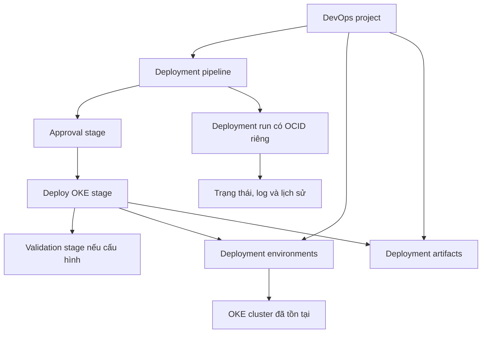
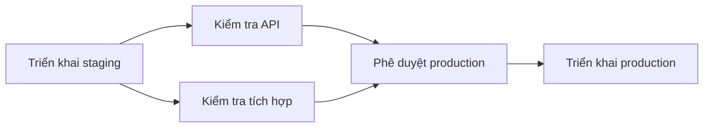
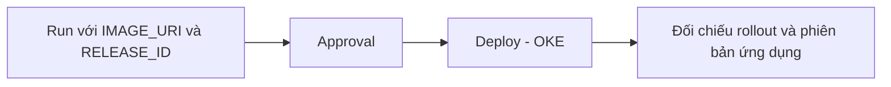

# Deploy pipelines và deployment environments

## 1. Vai trò trong CI/CD trên OCI

Trong chương **DevOps và CI/CD trên OCI**, deployment pipeline là thành phần điều phối việc đưa một phiên bản phần mềm đã đóng gói tới nơi chạy ứng dụng. Nó kết nối artifact với tài nguyên đích, thực hiện các bước triển khai và ghi lại kết quả của từng lần phát hành.

Ví dụ, ứng dụng Java `orders` đã được kiểm thử và đóng thành container image. Build pipeline đưa image vào OCI Container Registry; deployment pipeline lấy manifest, chọn OKE cluster, triển khai phiên bản đã chỉ định và thực hiện các điều kiện kiểm tra hoặc phê duyệt.

Trọng tâm của bài là cấu trúc triển khai trong OCI DevOps: **pipeline → stage → environment → deployment run**. Người học sẽ thiết kế đích triển khai, chọn kiểu stage, giới hạn IAM, chuẩn bị kết nối mạng và thực hành một luồng OKE có phê duyệt.

### 1.1. Phân biệt các khái niệm

| Khái niệm | Ý nghĩa | Ví dụ |
| --- | --- | --- |
| DevOps project | Nhóm các tài nguyên DevOps liên quan | Project `orders-delivery` |
| Deployment pipeline | Định nghĩa luồng và các điều kiện triển khai | `orders-staging-release` |
| Deployment stage | Một hành động hoặc điểm kiểm soát trong luồng | Approval, Deploy - OKE, Shell |
| Deployment environment | Tài nguyên DevOps tham chiếu tới nền tảng đích | Tham chiếu cluster `oke-staging` |
| Deployment artifact | Nội dung inline hoặc tham chiếu đến nội dung dùng khi triển khai | Kubernetes manifest, image, deployment spec |
| Deployment | Một lần chạy cụ thể của pipeline hoặc thao tác triển khai được hỗ trợ | Lần phát hành `orders-2026-11-21.1` |
| Tài nguyên runtime | Hạ tầng thực sự chạy phần mềm | Cluster OKE, Compute instance, function |

Oracle định nghĩa deployment pipeline là tập các yêu cầu cần thỏa mãn để đưa artifact tới môi trường đích. Các stage có thể nối tiếp hoặc song song. Tham khảo [Managing Deployment Pipelines](https://docs.oracle.com/en-us/iaas/Content/devops/using/deployment_pipelines.htm).

Pipeline là cấu hình có thể dùng nhiều lần. Một deployment có định danh và kết quả riêng; sửa tên pipeline không thay thế việc ghi nhận release nào đã chạy.

### 1.2. Quan hệ giữa các tài nguyên



Sơ đồ là một thiết kế minh họa. Validation chỉ trở thành điều kiện thành công của pipeline khi được thêm và cấu hình để phản ánh kết quả kiểm tra.

Build pipeline tạo và kiểm thử sản phẩm phần mềm; deployment pipeline điều phối việc phát hành sản phẩm đó. Khi dùng OCI DevOps cho cả hai, có thể thêm **Trigger Deployment** vào build pipeline để gọi deployment pipeline trong project. Xem [Adding a Trigger Deployment Stage](https://docs.oracle.com/en-us/iaas/Content/devops/using/triggerdeploy_stage.htm).

## 2. Deployment environment tham chiếu tới điều gì?

### 2.1. Environment là tham chiếu tới tài nguyên đã có

Trước khi tạo environment, phải có DevOps project và tài nguyên đích phù hợp. Các loại đích chính gồm OKE, Compute instance group và Functions. Tạo environment reference không phải thao tác cấp phát cluster, máy ảo hoặc function. Xem [Managing DevOps Environments](https://docs.oracle.com/en-us/iaas/Content/devops/using/environments.htm).

Một environment có tên `production` cũng không tự tạo:

- Compartment production.
- IAM policy hạn chế quyền.
- Secret hoặc cấu hình ứng dụng.
- Network route tới tài nguyên đích.
- Điều kiện phê duyệt trước triển khai.
- Quy tắc rollback hoặc giám sát chất lượng.

Những thành phần đó phải được thiết kế ở lớp thích hợp. Tên environment giúp nhận diện, còn OCID, tài nguyên được tham chiếu, IAM và cấu hình stage quyết định thao tác thực tế.

### 2.2. OKE cluster environment

OKE environment tham chiếu một Kubernetes cluster. Khi tạo, người dùng chọn cluster, region và compartment của đích. Với cluster private, cần chọn VCN và subnet có đường tới Kubernetes API endpoint, cùng NSG nếu sử dụng. Hướng dẫn chính thức nằm tại [Creating a Kubernetes Cluster Environment](https://docs.oracle.com/en-us/iaas/Content/devops/using/create_oke_environment.htm).

**Namespace của ứng dụng không phải một cluster mới.** Trong triển khai OKE, namespace còn phụ thuộc manifest và cấu hình stage. Hai environment reference trỏ cùng cluster không tự tạo cách ly phần cứng, quota hay bảo mật giữa staging và production.

Đề xuất lựa chọn:

| Cách tổ chức | Lợi ích | Điểm cần kiểm soát |
| --- | --- | --- |
| Một cluster, nhiều namespace | Tận dụng hạ tầng sẵn có | Quyền namespace, tài nguyên dùng chung và ảnh hưởng lẫn nhau |
| Cluster riêng cho staging và production | Ranh giới vận hành rõ hơn | Chi phí và công sức quản lý nhiều cluster |
| Pipeline riêng theo môi trường | Dễ kiểm soát quyền và lịch phát hành | Đồng bộ cấu hình và cùng một artifact đã duyệt |

Namespace là một ranh giới tổ chức Kubernetes; mức cách ly thực tế còn phụ thuộc RBAC, network policy, admission policy và các quyền được cấp.

### 2.3. Compute instance group environment

Environment kiểu instance group xác định tập Compute host sẽ nhận bản triển khai. OCI DevOps cho phép chọn instance cụ thể hoặc dùng query để tìm host ở thời điểm chạy. Các host trong một instance group thuộc một region; tài liệu dịch vụ hiện nêu hỗ trợ triển khai instance group cho Oracle Linux và CentOS. Xem [Creating a Compute Instance Group Environment](https://docs.oracle.com/en-us/iaas/Content/devops/using/create_instancegroup_environment.htm).

Cần phân biệt:

| Thuật ngữ | Mục đích |
| --- | --- |
| DevOps instance group environment | Chọn host làm đích triển khai |
| Compute instance pool | Tổ chức và quản lý một tập instance theo chức năng của Compute |
| IAM dynamic group | Xác định các principal tài nguyên để cấp quyền IAM |

Một query chọn instance theo tag không cấp quyền IAM cho các instance đó. Ngược lại, membership trong dynamic group không tự đưa máy vào danh sách đích triển khai.

Với query động, tập host có thể thay đổi giữa hai release. Đề xuất vận hành là kiểm soát quyền sửa tag/query, ghi nhận danh sách host thực tế của mỗi deployment và tránh bộ lọc quá rộng như chỉ chọn mọi instance ở trạng thái chạy.

Triển khai instance group còn phụ thuộc **Compute Instance Run Command plugin** của Oracle Cloud Agent và quyền chạy lệnh. Nó không chỉ là một script SSH tới các máy được chọn. Xem [Deploying to an Instance Group](https://docs.oracle.com/en-us/iaas/Content/devops/using/deploy_instancegroups.htm).

### 2.4. Functions environment

Khi tạo Functions environment, chọn application và function cụ thể được tham chiếu. CLI sử dụng `--function-id` cùng `--project-id`. Vì vậy, cần biết function nào được cập nhật hoặc gọi khi stage thực thi. Xem [Creating a Functions Environment](https://docs.oracle.com/en-us/iaas/Content/devops/using/create_function_environment.htm).

Hai thao tác có mục đích khác nhau:

- **Deploy - Function:** cập nhật phần mềm của function bằng image artifact.
- **Invoke Function:** gọi một function đã có để chạy logic, chẳng hạn xác minh một bản phát hành.

Xem [Deploying to Functions](https://docs.oracle.com/en-us/iaas/Content/devops/using/deploy_function.htm) và [Invoke Function](https://docs.oracle.com/en-us/iaas/Content/devops/using/invoke_function.htm). Một stage gọi function kiểm tra không mặc nhiên cập nhật image của function kiểm tra đó.

## 3. Stage và đồ thị phụ thuộc

### 3.1. Pipeline là một đồ thị có hướng không chu trình

Các stage được nối bằng quan hệ predecessor, tức stage nào phải hoàn tất trước khi stage sau đủ điều kiện chạy. Với một nhánh phát hành có hai kiểm tra độc lập, thiết kế có thể là:



Trong thiết kế này, điểm phê duyệt production phải phụ thuộc cả hai kiểm tra. Nếu chỉ nối từ một nhánh, nhánh còn lại không tạo ra cổng kiểm soát mong muốn.

OCI hiển thị đồ thị và snapshot của deployment trong quá trình chạy, đồng thời giữ lịch sử sau khi hoàn tất. Các stage cuối của đồ thị phải thành công để deployment thành công. Xem [Deployment Workflow](https://docs.oracle.com/en-us/iaas/Content/devops/using/deploy-workflow.htm).

Khi tạo stage qua API hoặc CLI, stage đầu tiên dùng pipeline OCID làm predecessor gốc; stage tiếp theo dùng OCID của stage trước. Cấu trúc có dạng:

```json
{
  "items": [
    {
      "id": "<PIPELINE_OCID_HOAC_PREDECESSOR_STAGE_OCID>"
    }
  ]
}
```

Quy tắc predecessor được mô tả trong [tham chiếu deploy stage của OCI](https://docs.oracle.com/en-us/iaas/tools/terraform-provider-oci/latest/docs/r/devops_deploy_stage.html). Tên hiển thị và thứ tự nhập tên không thay thế quan hệ phụ thuộc này.

### 3.2. Nhóm stage và công việc phù hợp

| Nhóm | Ví dụ | Câu hỏi cần trả lời |
| --- | --- | --- |
| Triển khai | Deploy - OKE, Instance Group, Function, Helm | Artifact nào được đưa tới đích nào? |
| Kiểm soát | Approval, Wait, Traffic Shift | Điều kiện nào cho phép bước tiếp theo chạy? |
| Tích hợp | Invoke Function, Shell | Logic tùy chỉnh chạy ở đâu và báo lỗi thế nào? |

Wait chỉ tạo khoảng dừng. Đề xuất thiết kế là dùng khoảng dừng khi cần chờ quan sát, rồi đọc tín hiệu sức khỏe; không coi hết thời gian chờ là bằng chứng ứng dụng hoạt động đúng.

Shell stage chạy command specification trên **Container Instance** được tạo theo cấu hình compartment và subnet. CLI trong môi trường này dùng pipeline resource principal; đây không phải shell trên máy cá nhân hay trực tiếp trên OKE worker node. Xem [Adding a Shell Stage](https://docs.oracle.com/en-us/iaas/Content/devops/using/shell_stage.htm).

### 3.3. Hợp đồng kết quả của stage tùy chỉnh

Một stage validation cần định nghĩa rõ:

- Đích kiểm tra và release ID mong đợi.
- Điều kiện thành công: mã trạng thái, nội dung phản hồi hoặc kết quả nghiệp vụ.
- Timeout và số lần thử.
- Cách trả lỗi cho hệ thống điều phối.
- Dữ liệu có thể ghi vào log.

Ví dụ, lệnh `curl` nhận HTTP 200 nhưng nội dung vẫn báo release cũ phải được xem là kiểm tra chưa đạt yêu cầu. Một script bỏ qua mọi lỗi bằng `|| true` sẽ làm mất ý nghĩa của cổng validation.

Với Invoke Function, chọn chế độ thực thi và cơ chế validation phù hợp. Nếu muốn kết quả function quyết định bước tiếp theo, phải cấu hình chờ và đánh giá kết quả tương ứng; không suy ra thành công của nghiệp vụ từ việc yêu cầu gọi bất đồng bộ đã được tiếp nhận.

## 4. Chọn chiến lược triển khai

### 4.1. So sánh theo mục tiêu vận hành

| Chiến lược | Cách đưa phiên bản mới vào sử dụng | Lợi ích | Đổi lại |
| --- | --- | --- | --- |
| Rolling | Cập nhật dần một tập replica hoặc host | Không cần hai bộ đích hoàn chỉnh cho toàn bộ thời gian | Hai phiên bản có thể cùng tồn tại trong quá trình cập nhật |
| Blue-green | Chuẩn bị bản mới ở đích standby rồi chuyển traffic | Có điểm chuyển traffic rõ ràng | Cần tài nguyên standby và xử lý trạng thái dùng chung |
| Canary | Cho một phần traffic trải nghiệm bản mới rồi mở rộng | Giới hạn phạm vi ảnh hưởng ban đầu | Cần metric đủ tốt và hạ tầng điều phối traffic |

OCI có các stage blue-green và canary cho OKE và instance group; Functions dùng stage triển khai tương ứng với dịch vụ. Không áp một kiểu stage cho mọi environment chỉ vì cùng gọi là “production”.

Với OKE rolling, cập nhật replica do Kubernetes Deployment điều khiển. Các giá trị như `maxSurge`, `maxUnavailable`, readiness và giới hạn tiến độ ảnh hưởng đến khả năng rollout; chúng không tự chứng minh ứng dụng không có lỗi nghiệp vụ. Xem [Kubernetes Deployments](https://kubernetes.io/docs/concepts/workloads/controllers/deployment/).

### 4.2. Chiến lược còn phụ thuộc cách biểu diễn đích

Blue-green trên OKE có thể dùng hai namespace trong một cluster environment; không bắt buộc hiểu thành hai cluster hoặc hai environment resource. Hướng dẫn OCI yêu cầu chuẩn bị namespace và cơ chế ingress phù hợp. Xem [Blue-Green OKE Deployment](https://docs.oracle.com/en-us/iaas/Content/devops/using/bgoke_deploy.htm).

Với instance group, thiết kế blue-green sử dụng các tập host và cấu hình load balancer tương ứng. Traffic Shift là bước chuyển lưu lượng sau khi standby đã được kiểm tra; chỉ triển khai xong bản mới chưa làm nó trở thành đích nhận production traffic. Tham khảo [Deploying Using Blue-Green Strategy](https://docs.oracle.com/en-us/iaas/Content/devops/using/deploy_bgstrategy.htm).

Đề xuất chọn rolling cho bài lab đầu tiên để quan sát pipeline và environment với ít thành phần hơn. Sau khi xác định được artifact, quyền và phép kiểm tra, mới bổ sung cơ chế chuyển traffic và đánh giá canary.

## 5. IAM và mạng: điều kiện để environment sử dụng được

### 5.1. Tách các chủ thể có quyền

Đề xuất phân quyền theo trách nhiệm:

| Chủ thể | Quyền cần đánh giá |
| --- | --- |
| Người cấu hình pipeline | Tạo hoặc sửa pipeline, stage, artifact và environment reference |
| Người khởi chạy | Tạo deployment và đọc trạng thái trong phạm vi được giao |
| Người phê duyệt | Xem thông tin release và approve/reject deployment phù hợp |
| Deployment pipeline principal | Đọc artifact và thao tác với tài nguyên đích |
| Compute instance principal | Nhận/thực thi Run Command và đọc đầu vào nếu kiến trúc yêu cầu |
| Pod hoặc ứng dụng sau triển khai | Quyền runtime tới database, Object Storage hoặc dịch vụ khác |

Quyền của người bấm **Run pipeline** không tự trở thành quyền runtime của pipeline hoặc ứng dụng. Một người được xem project cũng không có nghĩa là pipeline principal đã được phép cập nhật cluster.

### 5.2. Dynamic group cho deployment pipeline

Một matching rule minh họa để chỉ chọn pipeline được giao:

```text
ALL {
  resource.type = 'devopsdeploypipeline',
  resource.id = '<DEPLOY_PIPELINE_OCID>'
}
```

Sau khi pipeline có OCID, quản trị viên đưa principal đó vào dynamic group và cấp policy cần thiết. Với lab OKE có compartment đích riêng, các quyền đích được minh họa bằng:

```text
Allow dynamic-group id <DYNAMIC_GROUP_OCID> to read all-artifacts in compartment id <ARTIFACT_COMPARTMENT_OCID>
Allow dynamic-group id <DYNAMIC_GROUP_OCID> to manage cluster in compartment id <OKE_COMPARTMENT_OCID>
```

Đây là mẫu cho lớp truy cập artifact và cluster, dựa trên [DevOps IAM Policies](https://docs.oracle.com/en-us/iaas/Content/devops/using/devops_iampolicies.htm). Các quyền của người thao tác, logging hoặc private network phải được đánh giá riêng theo cấu hình sử dụng.

`manage cluster` là quyền đáng kể trên cluster trong phạm vi policy. Khi dùng cho lab, tách compartment đích giúp giới hạn ảnh hưởng. Với production, quản trị viên cần rà phạm vi quyền thực tế thay vì xem mẫu này là cấu hình ít quyền nhất cho mọi hệ thống.

IAM OKE và Kubernetes RBAC phối hợp để quyết định truy cập; chúng không đơn giản là hai hàng rào luôn lấy giao của quyền. Không giả định RoleBinding hẹp sẽ thu hẹp một quyền IAM đã đủ để cho phép thao tác. Xem [About Access Control and Kubernetes Engine](https://docs.oracle.com/en-us/iaas/Content/ContEng/Concepts/contengaboutaccesscontrol.htm).

### 5.3. Các đường mạng độc lập

Một thiết kế OKE có ít nhất ba đường cần kiểm tra:

```text
DevOps deployment component → Kubernetes API endpoint
OKE worker/pod runtime      → Container Registry để lấy image
Validation function/shell   → Endpoint ứng dụng cần kiểm tra
```

Ba đường này có thể dùng subnet, route và principal khác nhau. Việc Console chọn được cluster không chứng minh cả ba đường đều hoạt động.

Với private OKE environment, cấu hình network channel theo hướng dẫn tạo environment: subnet phải tới được Kubernetes API endpoint, NSG/security list phải cho phép lưu lượng cần thiết và tài khoản cấu hình phải đủ quyền mạng. Nếu dùng CLI, `--network-channel` là đầu vào JSON của lệnh [create-oke-cluster-environment](https://docs.oracle.com/en-us/iaas/tools/oci-cli/latest/oci_cli_docs/cmdref/devops/deploy-environment/create-oke-cluster-environment.html).

Không cần mở Kubernetes API cho mọi địa chỉ Internet để làm lab. Sử dụng đường kết nối được thiết kế cho DevOps và đường quản trị dành cho người học.

### 5.4. Quyền đọc manifest khác quyền kéo image

Pipeline có thể đọc Kubernetes manifest nhưng pod vẫn gặp `ImagePullBackOff` vì không kéo được private image. Bài lab sử dụng secret registry tên `ocir-pull` trong namespace ứng dụng, do quản trị viên chuẩn bị trước và được manifest tham chiếu.

Quy trình cấu hình registry secret và image location được Oracle mô tả tại [Pulling Images from Registry during Deployment](https://docs.oracle.com/en-us/iaas/Content/ContEng/Tasks/contengpullingimagesfromocir.htm). Không đặt auth token vào pipeline parameter hoặc ghi token trực tiếp trong manifest lưu ở repository.

## 6. Artifact, parameter và cấu hình theo môi trường

### 6.1. Artifact reference và nội dung thực tế

Một DevOps artifact có thể chứa nội dung inline hoặc tham chiếu tới nội dung ở registry. Vì thế, cần phân biệt:

- Artifact OCID: định danh resource DevOps sử dụng.
- Nội dung manifest/spec: chỉ dẫn triển khai.
- Image digest hoặc phiên bản gói: định danh phần mềm được phát hành.
- Parameter của một run: giá trị được áp dụng trong lần phát hành đó.

Đề xuất truy vết một release bằng bộ thông tin:

```text
commit SHA
+ image digest hoặc checksum gói
+ phiên bản manifest/spec
+ pipeline và environment OCID
+ argument của deployment
+ deployment OCID
```

Chỉ lưu một tên như `orders:latest` không đủ để tái tạo chính xác phần mềm đã chạy nếu tag bị cập nhật sau đó. Snapshot của pipeline cũng không làm một tham chiếu bên ngoài có thể thay đổi trở thành dữ liệu bất biến.

### 6.2. Parameter và argument

Parameter là tên giá trị pipeline sử dụng; argument là giá trị đưa vào một lần chạy. Nếu cung cấp argument thì nó thay giá trị default tương ứng. Muốn thay placeholder trong nội dung artifact, cần bật **Allow parameterization**. Xem [Parameters](https://docs.oracle.com/en-us/iaas/Content/devops/using/parameters.htm).

Ví dụ:

```yaml
image: "${IMAGE_URI}"
```

Ở đây `IMAGE_URI` có thể nhận giá trị dạng:

```text
<registry-host>/<tenancy-namespace>/orders@sha256:<digest-da-xac-minh>
```

Tên parameter phân biệt hoa thường. Cấu hình `image_uri` không khớp placeholder `IMAGE_URI`. Có thể khai báo parameter ở tab **Parameters** của pipeline theo [Configuring Parameters](https://docs.oracle.com/en-us/iaas/Content/devops/using/configuring_parameters.htm).

Nếu tạo file manifest từ shell bằng heredoc, dùng delimiter có dấu nháy để giữ placeholder cho OCI:

```bash
cat > deployment.yaml <<'EOF'
# Nội dung manifest có thể chứa ${IMAGE_URI}.
EOF
```

Nếu shell thay placeholder quá sớm bằng một biến rỗng, bật parameterization ở OCI sau đó không khôi phục được giá trị đã mất.

### 6.3. Bí mật và đầu vào được phép thay đổi

Đề xuất phân loại:

| Loại dữ liệu | Cách xử lý phù hợp |
| --- | --- |
| Release ID, image digest | Argument có thể truy vết trong deployment |
| Namespace và environment đích | Cấu hình được kiểm soát theo môi trường |
| Mật khẩu database, wallet, token | Cơ chế secret phù hợp với stage hoặc ứng dụng |
| Số replica, timeout | Cấu hình vận hành có giới hạn và người sở hữu |

Parameter không phải kho secret. Với Shell command spec hoặc deployment spec hỗ trợ Vault variables, sử dụng tham chiếu secret và IAM tương ứng; ứng dụng runtime vẫn cần cơ chế lấy secret riêng. Xem [Command Specification](https://docs.oracle.com/en-us/iaas/Content/devops/using/command_spec.htm) và [Deployment Configuration File](https://docs.oracle.com/en-us/iaas/Content/devops/using/deployment_specs.htm).

Cho phép người chạy thay image không nhất thiết có nghĩa là cho phép họ tùy chọn cluster production. Với pipeline production, đích và phạm vi argument nên được ràng buộc bằng quy trình phát hành, IAM và quyền sửa cấu hình.

## 7. Thực hành: pipeline triển khai ứng dụng Java lên OKE staging

### 7.1. Kết quả mong đợi và điều kiện chuẩn bị

Luồng thực hành:



Bước đối chiếu cuối được người học thực hiện sau deployment. Muốn nó quyết định trạng thái pipeline tự động, bổ sung stage validation như phần sau.

Chuẩn bị trước:

1. DevOps project dành cho lab và logging đã bật.
2. Một OKE cluster staging còn hoạt động, node có đủ tài nguyên.
3. Namespace `orders-staging`.
4. Container image của ứng dụng Java đã được kiểm thử và đẩy lên registry.
5. Image chạy HTTP trên cổng `8080`, có `/health/ready` và endpoint `/version` trả JSON chứa trường `release`.
6. Ứng dụng đọc biến `RELEASE_ID` để trả phiên bản; endpoint readiness trả thành công khi ứng dụng sẵn sàng nhận request.
7. Secret registry `ocir-pull` trong namespace, nếu dùng private image như ví dụ.
8. IAM và đường mạng cho người quản trị, pipeline principal và thao tác kiểm tra.

Bài này dùng image đã có, không thực hiện build hoặc tạo cluster. Nếu ứng dụng có endpoint khác, chỉnh manifest và lệnh kiểm tra cho khớp contract của ứng dụng trước khi chạy.

OCI yêu cầu bật logging cho project để chạy deployment pipeline. Xem [Deploying Applications](https://docs.oracle.com/en-us/iaas/Content/devops/using/run_pipeline.htm) và [Managing Logs](https://docs.oracle.com/en-us/iaas/Content/devops/using/devops_logs.htm).

### 7.2. Tạo environment reference

Trong Console, mở **Developer Services → DevOps → Projects**, chọn project rồi vào **Environments → Create environment**.

Cấu hình:

| Trường | Giá trị của lab |
| --- | --- |
| Loại environment | Oracle Kubernetes Engine |
| Tên | `orders-oke-staging` |
| Region và compartment đích | Nơi cluster staging đang tồn tại |
| Cluster | OKE cluster dành cho lab |
| Private network | VCN, subnet và NSG có kết nối phù hợp nếu endpoint private |

Lưu environment và ghi nhận environment OCID. Đối chiếu cluster OCID thực tế để tránh chọn nhầm một cluster có tên giống nhau.

CLI tương ứng của loại environment là:

```bash
oci devops deploy-environment create-oke-cluster-environment \
  --project-id "$PROJECT_ID" \
  --cluster-id "$CLUSTER_ID" \
  --display-name orders-oke-staging
```

Đây là lệnh thay thế thao tác tạo reference cơ bản bằng Console. Với cluster private, bổ sung network channel đã chuẩn bị; không chạy nguyên lệnh tối giản rồi mặc nhiên kỳ vọng kết nối private hoạt động. Không tạo thêm reference nếu đã hoàn tất cùng mục đích bằng Console.

### 7.3. Tạo pipeline và khai báo parameter

Trong project, tạo **Deployment pipeline**, đặt tên `orders-staging-release`.

Sau khi có pipeline OCID:

- Quản trị viên hoàn tất dynamic group và policy của pipeline.
- Khai báo hai parameter `IMAGE_URI` và `RELEASE_ID`.
- Chuẩn bị nhóm người phê duyệt và quyền approve/reject.
- Xác nhận người chạy có quyền tạo deployment và đọc log cần thiết.

Đối với lab, có thể để trống default và bắt buộc nhập giá trị khi chạy. Giá trị không có bí mật; `IMAGE_URI` phải chỉ rõ image digest đã kiểm thử.

### 7.4. Tạo Kubernetes manifest artifact

Tạo DevOps artifact với:

| Trường | Giá trị |
| --- | --- |
| Tên | `orders-oke-manifest` |
| Type | Kubernetes manifest |
| Source | Inline |
| Allow parameterization | Bật |

Nội dung minh họa:

```yaml
apiVersion: apps/v1
kind: Deployment
metadata:
  name: orders
  namespace: orders-staging
spec:
  replicas: 2
  revisionHistoryLimit: 3
  progressDeadlineSeconds: 180
  strategy:
    type: RollingUpdate
    rollingUpdate:
      maxSurge: 1
      maxUnavailable: 0
  selector:
    matchLabels:
      app: orders
  template:
    metadata:
      labels:
        app: orders
      annotations:
        learning.example/release-id: "${RELEASE_ID}"
    spec:
      imagePullSecrets:
        - name: ocir-pull
      containers:
        - name: orders
          image: "${IMAGE_URI}"
          imagePullPolicy: IfNotPresent
          ports:
            - name: http
              containerPort: 8080
              protocol: TCP
          env:
            - name: RELEASE_ID
              value: "${RELEASE_ID}"
          readinessProbe:
            httpGet:
              path: /health/ready
              port: http
            initialDelaySeconds: 10
            periodSeconds: 5
            timeoutSeconds: 2
          resources:
            requests:
              cpu: "100m"
              memory: "256Mi"
            limits:
              cpu: "500m"
              memory: "512Mi"
---
apiVersion: v1
kind: Service
metadata:
  name: orders
  namespace: orders-staging
spec:
  type: ClusterIP
  selector:
    app: orders
  ports:
    - name: http
      port: 80
      targetPort: http
      protocol: TCP
```

Các mức CPU, RAM và thời gian trong manifest chỉ là cấu hình lab; điều chỉnh cho JVM và ứng dụng thực tế. Với hai replica và `maxSurge: 1`, cần tính dung lượng cho replica bổ sung khi rolling update. Hai replica cũng chưa đảm bảo phân bố trên nhiều node nếu không có chính sách scheduling tương ứng.

Manifest đặt namespace rõ ràng. Nếu nhập namespace ở stage, dùng cùng `orders-staging`; không coi giá trị mặc định ở stage là cách thay mọi namespace đã ghi trong manifest.

Cách tạo inline artifact và bật parameterization được mô tả tại [Adding an Inline Artifact](https://docs.oracle.com/en-us/iaas/Content/devops/using/artifact_inlinesource.htm).

### 7.5. Thêm Approval rồi Deploy - OKE

Thêm stage **Control - Approval** ở đầu luồng, đặt tên `approve-staging-release` và yêu cầu một người phê duyệt cho bài lab. Sau stage này, thêm **Deploy - OKE**, cấu hình:

| Trường | Giá trị |
| --- | --- |
| Tên stage | `deploy-orders-staging` |
| Environment | `orders-oke-staging` |
| Artifact | `orders-oke-manifest` |
| Namespace nếu cấu hình | `orders-staging` |
| Automatic rollback | Bật để thực hành hành vi của stage được hỗ trợ |

Oracle thực hiện Kubernetes server-side apply đối với các manifest được chọn theo thứ tự cấu hình. Tham khảo [Deploying to a Kubernetes Cluster](https://docs.oracle.com/en-us/iaas/Content/devops/using/deploy_oke.htm).

Kiểm tra đồ thị: stage OKE phải nằm **sau** Approval, không phải một nhánh song song có thể triển khai trước khi được duyệt.

Approval có thể yêu cầu nhiều phê duyệt. Tài liệu hiện nêu timeout mặc định là bảy ngày, sau đó deployment thất bại nếu chưa được xử lý. Người phê duyệt vẫn cần quyền IAM thích hợp. Xem [Adding an Approval Stage](https://docs.oracle.com/en-us/iaas/Content/devops/using/approval_stage.htm).

### 7.6. Khởi chạy một deployment có release cụ thể

Trong Console, chọn **Run pipeline**, nhập image digest và release ID rồi bắt đầu. Hoặc sử dụng Bash với OCI CLI và jq đã được cấu hình danh tính phù hợp:

```bash
set -euo pipefail

export OCI_CLI_REGION='ap-singapore-1'
PIPELINE_ID='<OCID-cua-pipeline-lab>'
IMAGE_URI='<registry-host>/<tenancy-namespace>/orders@sha256:<digest>'
RELEASE_ID='orders-2026-11-21.1'

jq -n \
  --arg image "$IMAGE_URI" \
  --arg release "$RELEASE_ID" \
  '{
    items: [
      {name: "IMAGE_URI", value: $image},
      {name: "RELEASE_ID", value: $release}
    ]
  }' > release-arguments.json

DEPLOYMENT_ID="$(oci devops deployment create-pipeline-deployment \
  --pipeline-id "$PIPELINE_ID" \
  --deployment-arguments file://release-arguments.json \
  --display-name "$RELEASE_ID" \
  --query 'data.id' \
  --raw-output)"

printf 'Deployment ID: %s\n' "$DEPLOYMENT_ID"
```

Thay region và các placeholder bằng dữ liệu lab thực tế. Các lệnh trong bài là hướng dẫn để thực hành trên tài nguyên đã chuẩn bị, không phải kết quả đã triển khai sẵn.

`--display-name` giúp nhận diện lần chạy; argument mới cung cấp giá trị thay placeholder. API trả deployment ID mới chỉ chứng minh yêu cầu đã được tạo. Xem [OCI CLI create-pipeline-deployment](https://docs.oracle.com/en-us/iaas/tools/oci-cli/latest/oci_cli_docs/cmdref/devops/deployment/create-pipeline-deployment.html).

### 7.7. Phê duyệt và theo dõi kết quả

Người có quyền phê duyệt mở deployment, kiểm tra artifact và argument rồi approve hoặc reject, kèm lý do. Khi dùng CLI:

```bash
oci devops deployment approve \
  --deployment-id "$DEPLOYMENT_ID" \
  --stage-id "$APPROVAL_STAGE_ID" \
  --action APPROVE \
  --reason 'Da doi chieu image digest va release cua lab'
```

`APPROVAL_STAGE_ID` là OCID của stage Approval đã cấu hình. Lệnh phải dùng danh tính người được cấp quyền phê duyệt; đổi biến tên người không đổi principal của CLI. Tham khảo [OCI CLI approve](https://docs.oracle.com/en-us/iaas/tools/oci-cli/latest/oci_cli_docs/cmdref/devops/deployment/approve.html).

Theo dõi trong Console hoặc truy vấn:

```bash
oci devops deployment get \
  --deployment-id "$DEPLOYMENT_ID" \
  --query 'data."lifecycle-state"' \
  --raw-output
```

Đọc cả trạng thái stage và log. Một deployment đang chờ Approval không nên bị chẩn đoán thành lỗi kết nối cluster chỉ vì nó chưa kết thúc. Với automation, bổ sung polling có giới hạn thời gian và chỉ chấp nhận trạng thái cuối `SUCCEEDED`. Xem [OCI CLI deployment get](https://docs.oracle.com/en-us/iaas/tools/oci-cli/latest/oci_cli_docs/cmdref/devops/deployment/get.html).

### 7.8. Đối chiếu kết quả ở Kubernetes và ứng dụng

Từ máy đã có quyền và đường quản trị tới cluster:

```bash
kubectl -n orders-staging rollout status deployment/orders --timeout=180s
kubectl -n orders-staging get deployment orders
kubectl -n orders-staging get pods -l app=orders
kubectl -n orders-staging get deployment orders \
  -o jsonpath='{.spec.template.spec.containers[0].image}'
```

So image trong pod template với digest đã chọn; nếu cần kiểm tra runtime, đối chiếu thêm `imageID` của từng container và trạng thái các pod.

Để kiểm tra endpoint qua Service, mở terminal riêng:

```bash
kubectl -n orders-staging port-forward service/orders 18080:80
```

Trong terminal khác, đặt `RELEASE_ID` đúng với deployment rồi chạy:

```bash
curl --fail --silent --show-error http://127.0.0.1:18080/version |
  jq -e --arg expected "$RELEASE_ID" '.release == $expected'
```

Port-forward kiểm tra một đường truy cập qua Service tới pod được chọn. Với hệ thống thực tế, còn cần kiểm tra tất cả replica và đường ingress/load balancer mà người dùng sử dụng. Kết thúc port-forward sau khi kiểm tra.

Lab đạt yêu cầu khi Approval được xử lý đúng, deployment thành công, replica sẵn sàng và phiên bản quan sát khớp release được phát hành.

## 8. Đưa validation vào pipeline

### 8.1. Shell stage kiểm tra release

Sau khi lab hoạt động, có thể thêm Shell stage sau Deploy - OKE để kiểm tra endpoint ứng dụng. Chuẩn bị:

- Một endpoint staging mà Container Instance của Shell stage thực sự truy cập được.
- Subnet, DNS và NSG phù hợp.
- Quyền tạo/chạy hạ tầng Shell stage theo tài liệu IAM.
- Runtime của stage có `curl` và `jq`.
- Parameter `SMOKE_BASE_URL` chứa địa chỉ gốc của endpoint được phép kiểm tra.

Không mặc nhiên sử dụng địa chỉ `orders.orders-staging.svc.cluster.local` từ một host ngoài mạng DNS/service của cluster. Việc pod trong OKE phân giải được tên Service không chứng minh Shell stage cũng làm được.

Tạo artifact loại **Command specification**, bật parameterization, với nội dung minh họa:

```yaml
version: 0.1
component: command
timeoutInSeconds: 120
shell: bash
failImmediatelyOnError: true

env:
  variables:
    TARGET_URL: "${SMOKE_BASE_URL}"
    EXPECTED_RELEASE: "${RELEASE_ID}"

steps:
  - type: Command
    name: Verify the selected release
    timeoutInSeconds: 60
    failImmediatelyOnError: true
    command: |
      set -euo pipefail
      command -v curl > /dev/null
      command -v jq > /dev/null

      response="$(curl \
        --fail \
        --silent \
        --show-error \
        --connect-timeout 5 \
        --max-time 15 \
        "$TARGET_URL/version")"

      printf '%s' "$response" |
        jq -e --arg expected "$EXPECTED_RELEASE" \
          '.release == $expected' > /dev/null
```

Các trường version, component, timeout và xử lý lỗi tuân theo [Command Specification](https://docs.oracle.com/en-us/iaas/Content/devops/using/command_spec.htm). Timeout ngắn trong ví dụ phù hợp cho một phép kiểm tra đơn giản; điều chỉnh khi cần retry có giới hạn hoặc kiểm tra nhiều đích.

Ví dụ cố ý chỉ thay placeholder trong phần cấu hình đầu vào, rồi dùng biến shell trong lệnh. Không ghép argument tùy ý thành mã shell. Địa chỉ kiểm tra cũng cần được quản lý như một đầu vào có kiểm soát, tránh biến stage production thành nơi gửi credential hoặc request tới đích tùy chọn.

Stage này kiểm tra phiên bản qua một endpoint; chưa thay thế kiểm thử chức năng, kiểm tra mọi replica hoặc đánh giá độ trễ và tỷ lệ lỗi trên lưu lượng thật.

### 8.2. Invoke Function và tín hiệu chất lượng

Nếu nhóm đã có function kiểm tra, Invoke Function có thể phù hợp hơn việc chạy một Shell stage. Đề xuất thiết kế contract cho function:

```text
Đầu vào:
  release ID, môi trường đích, endpoint kiểm tra

Kết quả:
  kết luận pass/fail có thể được stage đánh giá
  thông tin kiểm tra không chứa secret

Giới hạn:
  timeout, quyền truy cập, số lần thử và ảnh hưởng khi gọi lại
```

Đảm bảo stage thực sự chờ kết quả cần đánh giá và cấu hình validation theo cơ chế của OCI. Hàm tự bắt lỗi rồi trả một phản hồi được coi là thành công có thể làm pipeline tiếp tục dù phép kiểm tra nghiệp vụ thất bại.

Với canary, đề xuất dùng thêm cửa sổ quan sát và ngưỡng chấp nhận cho lỗi, độ trễ hoặc chỉ số nghiệp vụ. Một lần gọi thành công không đủ đại diện cho chất lượng của phiên bản dưới tải thật.

### 8.3. Không dùng lẫn các file spec

| File hoặc artifact | Nơi sử dụng | Dấu hiệu nhận diện |
| --- | --- | --- |
| Kubernetes manifest | Deploy - OKE | `apiVersion`, `kind`, `metadata`, `spec` |
| Instance group deployment configuration | Triển khai lên Compute instance group | `version: 1.0` và `component: deployment` |
| Command specification | Shell stage | `version: 0.1` và `component: command` |

Một deployment spec trên instance group có thể mô tả tải gói và chạy lệnh trên host. Một command spec của Shell stage chạy ở môi trường thực thi khác. Copy nguyên một spec sang loại artifact còn lại sẽ không tạo ra hành vi tương đương.

Với ứng dụng Java trên Compute, đề xuất dùng thư mục staging để nhận artifact, kiểm tra checksum, cài vào thư mục release và chỉ chuyển bản đang phục vụ sau health check. Quyền hệ điều hành và `runAs` phải đủ cho thao tác cụ thể; không cấp sudo toàn bộ chỉ vì một lệnh cài đặt đang thiếu quyền.

## 9. Lần chạy, môi trường dùng chung và quản lý phát hành

### 9.1. Một pipeline và nhiều pipeline

Tài liệu OCI nêu chỉ một deployment chạy tại một thời điểm trên cùng pipeline. Khi các pipeline dùng chung environment, môi trường được khóa trong lúc stage triển khai và được mở khóa sau khi stage hoàn tất. Xem [Deploying Applications](https://docs.oracle.com/en-us/iaas/Content/devops/using/run_pipeline.htm) và [Deployment Workflow](https://docs.oracle.com/en-us/iaas/Content/devops/using/deploy-workflow.htm).

Đây là điểm cần đưa vào thiết kế, không phải giao dịch bao trùm mọi hoạt động của ứng dụng. Ví dụ:

1. Pipeline A triển khai release A vào staging.
2. Stage deploy hoàn tất và môi trường được mở khóa.
3. Pipeline B đưa release B vào cùng đích.
4. Stage validation của A kiểm tra endpoint và thấy release B.

Đề xuất xử lý: điều phối phát hành theo ứng dụng và môi trường, giới hạn số luồng có quyền thay đổi cùng đích, đồng thời kiểm tra release ID trong mọi phép validation.

Không suy ra hai environment reference khác nhau luôn bảo vệ được cùng một đối tượng Kubernetes, cùng thư mục Compute hoặc cùng schema database. Những thao tác ngoài OCI DevOps cũng cần được đưa vào quy trình điều phối.

### 9.2. Quảng bá từ staging sang production

Đề xuất quảng bá **cùng image digest hoặc cùng gói đã kiểm thử**, rồi thay cấu hình theo môi trường bằng dữ liệu được quản lý. Không build lại phần mềm sau khi staging đã duyệt rồi mặc nhiên xem đó là cùng release.

Một bảng phát hành có thể ghi:

| Trường | Ví dụ |
| --- | --- |
| Release ID | `orders-2026-11-21.1` |
| Commit | SHA đã dùng để build |
| Image | URI theo digest |
| Manifest/spec | Phiên bản đã được review |
| Staging deployment | OCID của lần chạy đã kiểm chứng |
| Production target | Environment OCID và tài nguyên đích |
| Quyết định phát hành | Người duyệt, thời điểm, điều kiện |
| Phương án phục hồi | Release trước và điều kiện áp dụng |

Pipeline production có thể tách riêng để giới hạn quyền và nhịp phát hành. Cấu hình production được kiểm soát riêng vẫn có thể sử dụng cùng phần mềm; không cần dùng cùng một manifest chứa nguyên địa chỉ và secret của staging.

### 9.3. Hủy, retry và rerun

Nếu cần hủy một deployment đang chạy, dùng Console hoặc:

```bash
oci devops deployment cancel \
  --deployment-id "$DEPLOYMENT_ID" \
  --reason 'Dung release de dieu tra loi rollout'
```

Tham khảo [OCI CLI cancel](https://docs.oracle.com/en-us/iaas/tools/oci-cli/latest/oci_cli_docs/cmdref/devops/deployment/cancel.html). Sau khi gửi yêu cầu, tiếp tục theo dõi trạng thái; một request hủy không chứng minh ngay rằng mọi thay đổi đã được đảo ngược.

Trước retry hoặc rerun, đề xuất kiểm tra:

- Deployment cũ đã kết thúc chưa và tài nguyên đích đang ở trạng thái nào.
- Artifact và argument có giữ nguyên phiên bản mong muốn không.
- Stage hoặc script đã tạo tác dụng phụ nào.
- Chạy lại có gửi trùng thông báo, chạy lại migration hoặc xử lý trùng dữ liệu không.

OCI có thao tác rerun và triển khai lại được hỗ trợ theo loại deployment. Với blue-green, tài liệu nêu các giới hạn riêng cho pipeline redeployment và rollback qua traffic-shift stage; không áp dụng một lệnh rerun chung cho mọi chiến lược. Xem [Deploying Using Blue-Green Strategy](https://docs.oracle.com/en-us/iaas/Content/devops/using/deploy_bgstrategy.htm).

Dry run cũng có phạm vi hỗ trợ cụ thể. Tùy chọn `--dry-run` của lệnh tạo deployment hiện được mô tả cho Helm deployment; nó không phải bảo đảm mô phỏng an toàn mọi lệnh Shell, migration hoặc manifest trong mọi pipeline.

## 10. Rollback và tính tương thích của ứng dụng

### 10.1. Automatic rollback có phạm vi của stage

Ở các stage cluster hoặc instance group được hỗ trợ, có thể cấu hình automatic rollback về release thành công trước khi validation của stage thất bại. Trong quá trình này, stage khác đang chạy có thể tiếp tục, stage mới không được chạy và deployment kết thúc ở trạng thái Failed. Xem [Rolling Back a Deployment](https://docs.oracle.com/en-us/iaas/Content/devops/using/deployment_rollback.htm).

Vì thế, rollback thành công không chuyển một lần phát hành lỗi thành deployment thành công. Cần xem cả kết quả phục hồi và trạng thái cuối của release đã thử.

Trong lần triển khai đầu tiên, chưa có lịch sử release thành công để mặc nhiên chọn làm đích phục hồi. Bài lab nên tạo một bản baseline tốt trước khi chủ động thực hành tình huống lỗi.

Bật rollback ở Deploy - OKE cũng không đủ để khẳng định một Shell stage thất bại ở phía sau sẽ tự động đảo ngược stage trước. Cần xác định rõ stage nào đánh giá validation và cơ chế phục hồi được áp dụng khi bước kiểm tra riêng thất bại.

### 10.2. Manual rollback và kiểm tra sau phục hồi

Manual rollback cho phép chọn lại một phiên bản deployment thành công được hỗ trợ cho stage. Đề xuất trước khi thực hiện:

1. Ghi nhận trạng thái và release đang phục vụ.
2. Chọn bản có artifact vẫn còn truy cập được.
3. Đối chiếu cấu hình, secret và schema mà bản đó yêu cầu.
4. Thực hiện rollback bằng cơ chế đúng với loại stage.
5. Kiểm tra lại readiness, phiên bản và hành vi nghiệp vụ.

Một số chiến lược phục hồi bằng chuyển traffic về đích cũ; một số triển khai lại bản phần mềm trước. Không giả định cả hai đều xử lý được cùng mọi loại tác dụng phụ.

### 10.3. Khi ứng dụng sử dụng cơ sở dữ liệu Oracle

Oracle Database, Autonomous Database hoặc dịch vụ dữ liệu khác thường là dependency của ứng dụng trong luồng này. Danh sách environment native ở bài học không có nghĩa là chỉ chọn một environment mới sẽ tạo và quản lý toàn bộ schema database.

Đề xuất cho một release có migration:

- Tách thông tin cấp hạ tầng database khỏi quyền SQL chạy migration.
- Chuẩn bị đường mạng, wallet hoặc cơ chế secret cho công cụ được chọn.
- Áp dụng thay đổi schema theo hướng tương thích với khoảng thời gian hai phiên bản ứng dụng cùng chạy.
- Xác định thao tác nào có thể bù trừ và thao tác nào cần kế hoạch phục hồi dữ liệu.
- Duyệt thay đổi dữ liệu theo mức ảnh hưởng.

Rollback image hoặc JAR không tự hoàn tác dữ liệu đã ghi hay phục hồi cột đã xóa. Pipeline cần biết điểm mà phục hồi ứng dụng thôi chưa đủ, trước khi phát hành tới điểm đó.

## 11. Log, kiểm tra vận hành và xử lý sự cố

### 11.1. Đọc đúng ba lớp tín hiệu

| Lớp tín hiệu | Câu hỏi trả lời được | Giới hạn |
| --- | --- | --- |
| Deployment và stage status | Hệ thống điều phối đã thực hiện bước nào? | Chỉ phản ánh điều kiện mà stage được cấu hình đánh giá |
| Log triển khai và sự kiện đích | Vì sao apply, tải artifact hoặc khởi động thất bại? | Cần đúng quyền đọc và thời gian đối chiếu |
| Metric và kiểm tra ứng dụng | Người dùng có nhận đúng phiên bản, đúng hành vi không? | Cần phép đo đủ đại diện cho tải và nghiệp vụ |

DevOps sử dụng OCI Logging để quản lý log project. Xem [Managing Logs](https://docs.oracle.com/en-us/iaas/Content/devops/using/devops_logs.htm).

Đề xuất mỗi release ghi lại project, pipeline, stage, environment và deployment OCID cùng commit, digest và argument không nhạy cảm. Với hệ thống có OCI Audit, dùng thêm sự kiện quản trị được hỗ trợ để đối chiếu ai đã thay đổi cấu hình hoặc khởi chạy; không xem log audit là bản thay thế log ứng dụng.

Không ghi private key, token, mật khẩu, nội dung wallet hoặc secret vào lý do phê duyệt, tên deployment hay output command.

### 11.2. Chẩn đoán theo điểm thất bại

| Biểu hiện | Hướng kiểm tra đầu tiên |
| --- | --- |
| Không tạo được environment reference | Quyền người cấu hình, region, OCID và trạng thái tài nguyên đích |
| Environment tồn tại nhưng OKE stage không truy cập được | Pipeline principal, dynamic group, policy, network channel và API endpoint |
| Manifest còn nguyên `${IMAGE_URI}` | Tên parameter, giá trị argument và Allow parameterization |
| Stage không nhắm namespace mong muốn | Namespace trong manifest và giá trị cấu hình ở stage |
| Pod `ImagePullBackOff` | URI/digest, secret registry, quyền đọc image và đường mạng kéo image |
| Pod chưa Ready hoặc rollout timeout | Log ứng dụng, probes, cổng, tài nguyên và sức chứa node |
| Apply báo xung đột field | Quyền sở hữu field khi server-side apply và công cụ khác cùng quản lý đối tượng |
| Stage đợi phê duyệt | Người duyệt, IAM approve/reject, số phê duyệt và timeout |
| Instance group không chạy lệnh | Host được chọn, Run Command plugin, IAM và quyền hệ điều hành |
| Query instance group chọn sai host | Phạm vi query, tag và tập kết quả ở thời điểm chạy |
| Shell stage không tới được ứng dụng | Subnet, DNS, route, NSG và endpoint thực sự được công bố |
| Pipeline thành công nhưng người dùng thấy bản cũ | Image thực tế, replica, cache, Service selector và đường ingress |
| Rollback không phục hồi dịch vụ | Artifact cũ, cấu hình hiện tại, dữ liệu và phạm vi rollback của stage |

Bảng là hướng chẩn đoán, không phải kết luận duy nhất cho mỗi lỗi. Chẳng hạn, một lỗi authorization có thể đi kèm OCID sai; cấp thêm quyền rộng không sửa được mọi trường hợp.

OCI có hướng dẫn riêng cho lỗi triển khai OKE, bao gồm lỗi manifest thiếu `protocol` ở khai báo port. Manifest của lab ghi rõ `TCP` để tránh sự mơ hồ đó. Xem [Troubleshooting DevOps](https://docs.oracle.com/en-us/iaas/Content/devops/using/troubleshooting.htm).

### 11.3. Tín hiệu sau khi release thành công

Đề xuất theo dõi ít nhất:

- Tỷ lệ lỗi và độ trễ theo cửa sổ thời gian.
- Số replica/host đang khỏe và phiên bản đang chạy.
- Restart, lỗi kết nối database và mức dùng tài nguyên.
- Các giao dịch hoặc request quan trọng của ứng dụng.
- Chênh lệch so với baseline trước release.

Một deployment kết thúc thành công là điểm bắt đầu quan sát bản mới trong môi trường thật. Cần giữ liên kết giữa cảnh báo và release ID để biết khi nào phải dừng mở rộng canary, rollback hoặc điều tra.

## 12. Vòng đời environment và kiểm soát chi phí

### 12.1. Quản lý thay đổi reference

Environment reference nên được quản lý cùng tài liệu vận hành hoặc cấu hình hạ tầng của nhóm. Ghi nhận:

| Thông tin | Mục đích |
| --- | --- |
| Environment OCID và target OCID | Xác định đúng reference và runtime |
| Region, compartment, namespace hoặc selector | Giới hạn phạm vi triển khai |
| Pipeline đang sử dụng | Đánh giá tác động trước khi sửa hoặc xóa |
| Principal và policy liên quan | Tránh reference còn tồn tại nhưng không dùng được |
| Network channel và endpoint | Duy trì đường kết nối hợp lệ |
| Chủ sở hữu và thời hạn sử dụng | Dọn môi trường thử nghiệm có trách nhiệm |

Thay một cluster, chỉnh query instance group hoặc sửa artifact đang được nhiều pipeline dùng chung là thay đổi có thể ảnh hưởng nhiều luồng phát hành. Đề xuất tạo và kiểm chứng cấu hình thay thế trước khi chuyển các stage phụ thuộc, đồng thời giữ thông tin đủ để phục hồi.

### 12.2. Tài nguyên phát sinh chi phí nằm ở đâu?

Tạo reference không đồng nghĩa hệ thống tự cấp một runtime mới, nhưng tài nguyên đã được tham chiếu vẫn có chi phí vận hành theo dịch vụ. Cần tính cluster/node, Compute, function, registry, lưu log và các thành phần mạng hoặc cân bằng tải sử dụng thực tế.

Shell stage còn chạy trên Container Instance và được tính phí theo cấu hình thực thi. Oracle nêu rõ phần này trong [Adding a Shell Stage](https://docs.oracle.com/en-us/iaas/Content/devops/using/shell_stage.htm).

Đề xuất cho lab:

- Dùng cluster staging đã được cho phép sử dụng và giới hạn namespace lab.
- Không tạo LoadBalancer Service nếu chỉ cần kiểm tra bằng port-forward.
- Chọn replica và timeout vừa đủ cho phép thử.
- Theo dõi tài nguyên Container Instance, artifact và log sau các lần thử thất bại.
- Dọn đúng workload, secret và reference do lab tạo khi không còn nhu cầu.
- Chỉ xóa cluster, node pool, host hoặc registry dùng chung khi người sở hữu đã xác định chúng hết nhu cầu.

Xóa một reference hoặc gỡ một instance khỏi danh sách đích không phải bằng chứng runtime đã dừng. Sau cleanup, kiểm tra riêng các tài nguyên còn chạy và giữ lại những artifact cần cho rollback theo chính sách.

## 13. Tiêu chí hoàn tất

Một deployment pipeline có thể vận hành được cần trả lời rõ:

| Câu hỏi | Bằng chứng mong đợi |
| --- | --- |
| Triển khai cái gì? | Image digest/checksum và manifest/spec xác định |
| Triển khai vào đâu? | Environment reference cùng target, region và phạm vi cụ thể |
| Ai được thay đổi? | IAM của người thao tác, pipeline và các thành phần runtime |
| Thứ tự và điều kiện là gì? | DAG đúng predecessor, approval và validation |
| Kết nối có đủ không? | Đường tới API đích, registry và endpoint kiểm tra |
| Release đã thực sự chạy chưa? | Deployment ID, trạng thái stage, rollout và phiên bản ứng dụng |
| Khi lỗi sẽ làm gì? | Timeout, hủy, retry và kế hoạch rollback theo loại stage |
| Ai quản lý vòng đời? | Chủ sở hữu, log, artifact retention và cleanup |

Với bài thực hành OKE, người học cần chứng minh một image đã chọn theo digest được đưa qua Approval tới đúng namespace, quan sát được release ID tương ứng và biết đọc log khi stage thất bại. Đây là nền tảng để mở rộng cùng thiết kế sang instance group, Functions hoặc chiến lược chuyển traffic phù hợp.
