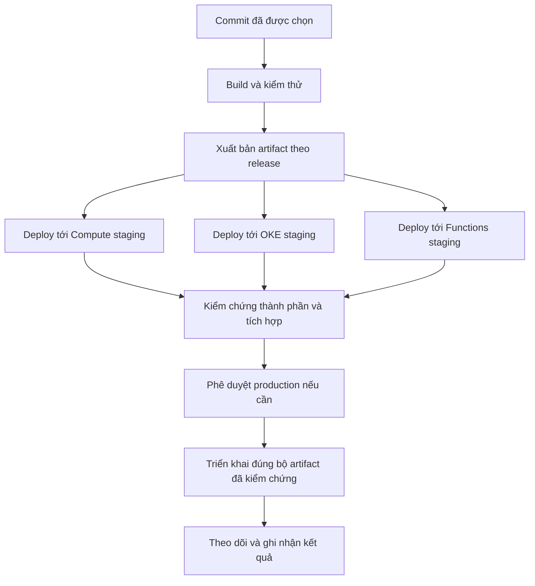

# Triển khai tự động đến Compute, OKE và Functions

## 1. Mục tiêu và phạm vi

Trong chương **DevOps và CI/CD trên OCI** của module **CLOUD_PROVIDERS_ORACLE**, triển khai tự động là quá trình đưa một phiên bản phần mềm đã xác định tới môi trường đích, kiểm chứng nó hoạt động và lưu đủ bằng chứng để phục hồi khi cần. Quá trình này gắn với tenancy, compartment, IAM, VCN, kho artifact và các dịch vụ vận hành của Oracle Cloud Infrastructure.

Bài học tập trung vào ba đích: ứng dụng chạy trên Compute instance group, workload chạy trên Oracle Kubernetes Engine (OKE), và function chạy trên OCI Functions. Hạ tầng đích được chuẩn bị trước bằng một quy trình riêng, chẳng hạn Terraform hoặc OCI Resource Manager. Tạo DevOps environment chỉ tạo tham chiếu tới đích triển khai; không đồng nghĩa DevOps tự tạo Compute, OKE cluster hay function cho mọi stage. [Quản lý DevOps environments](https://docs.oracle.com/en-us/iaas/Content/devops/using/environments.htm).

Sau bài học, người học có thể thiết kế luồng build–publish–deploy, chọn đúng artifact và environment, cấu hình các bước triển khai cho từng đích, kiểm tra health và phiên bản, đồng thời quản lý quyền truy cập, khả năng phục hồi và chi phí phát hành.

Ví dụ xuyên suốt là hệ thống xử lý đơn hàng gồm một dịch vụ Java trên Compute, một API container trên OKE và một function xử lý sự kiện. Đây là ba thành phần có cách đóng gói riêng. Không cần triển khai cả ba chỉ vì OCI hỗ trợ cả ba; chọn nền tảng theo nhu cầu workload.

Các đoạn YAML, Bash và lệnh CLI dưới đây là mẫu hướng dẫn để người học áp dụng sau khi chuẩn bị môi trường. Các OCID, image URI, digest và tên dịch vụ cần được thay bằng giá trị thực. Script Bash chạy trên Linux hoặc runner có Bash; không dán nguyên cú pháp Bash vào PowerShell.

## 2. Mô hình phát hành chung

### 2.1. Phân biệt các tài nguyên trong OCI DevOps

| Thành phần | Vai trò trong phát hành | Ví dụ |
|---|---|---|
| Project | Nhóm các tài nguyên DevOps liên quan | `orders-platform` |
| Build pipeline | Biên dịch, kiểm thử và xuất bản sản phẩm | Kiểm thử Java rồi xuất JAR hoặc image |
| Kho artifact | Lưu nội dung phần mềm | Artifact Registry cho file; Container Registry cho image |
| DevOps artifact | Tham chiếu tới nội dung cần triển khai | JAR theo version, manifest, image URI |
| Environment | Tham chiếu tới nền tảng đích | Instance group, OKE cluster, function |
| Deployment pipeline | Mô tả các stage và quan hệ phụ thuộc | Deploy staging, kiểm chứng, phê duyệt, deploy production |
| Deployment run | Một lần thực thi với bộ tham số cụ thể | Release `r-ab12cd3` tới staging |

Build pipeline có các stage Managed Build, Deliver Artifacts và Trigger Deployment. Trigger Deployment kết nối kết quả build với deployment pipeline; việc build thành công chưa tự chứng minh deployment đã chạy thành công. [Các stage của build pipeline](https://docs.oracle.com/en-us/iaas/Content/devops/using/managing_build_pipelines.htm).



Sơ đồ là thiết kế tham khảo. Các nhánh chỉ chạy song song khi độc lập; nếu function mới đòi hỏi API mới, phải thể hiện quan hệ triển khai tương ứng. Một pipeline có nhiều đích không tạo ra giao dịch nguyên tử: Compute có thể đã đổi phiên bản trong khi OKE hoặc Functions chưa hoàn tất.

### 2.2. Xác định một bộ artifact phát hành

Dùng một release ID liên hệ với commit, ví dụ `r-ab12cd3`, rồi ghi nhận đầy đủ commit SHA trong hồ sơ phát hành. Mỗi thành phần có sản phẩm riêng:

| Đích | Sản phẩm phần mềm | Cấu hình triển khai đi kèm | Định danh nên lưu |
|---|---|---|---|
| Compute | `orders.jar` và tài nguyên cần thiết | Deployment specification và script được kiểm soát | Artifact path/version và SHA-256 |
| OKE | Container image | Kubernetes manifest hoặc Helm chart | Image digest, manifest/chart version |
| Functions dạng image | Image đúng runtime/FDK của function | Tham chiếu function và cấu hình cần thiết | Image URI, digest và function OCID |

Không dùng một tag có thể ghi đè như `latest` làm định danh duy nhất của release. Với OKE, image theo digest giúp chọn đúng nội dung. Với các tích hợp dùng tag, áp dụng quy tắc không tái sử dụng tag release và lưu digest để đối chiếu. Không giả định chỉ có tên tag là đã bảo đảm bất biến.

Khuyến nghị thiết kế là **build một lần cho mỗi artifact, promote chính artifact đó** qua các môi trường. Một commit có thể sinh nhiều artifact khác nhau, nhưng artifact đã kiểm chứng ở staging không nên được build lại riêng cho production. Cấu hình môi trường và secrets được quản lý ngoài nội dung phần mềm khi có thể.

## 3. Chuẩn bị quyền truy cập và đường mạng

### 3.1. Tách danh tính theo nhiệm vụ

| Tác nhân | Nhu cầu chính | Điều cần tránh |
|---|---|---|
| Build pipeline | Đọc source, xuất bản artifact và kích hoạt deployment được phép | Mặc định có toàn quyền production |
| Deployment pipeline | Đọc artifact, thao tác đúng môi trường đích | Dùng quyền quản trị toàn tenancy |
| Compute instance hoặc workload | Tải hoặc chạy phần mềm, truy cập phụ thuộc lúc chạy | Dùng chung credential cá nhân của người phát hành |
| Người phê duyệt | Xem bằng chứng và duyệt release trong phạm vi trách nhiệm | Phê duyệt release không xác định artifact |

OCI dùng IAM policy và dynamic group để cấp quyền cho tài nguyên DevOps. Pipeline và Compute instance là các principal khác nhau; quyền của pipeline không tự trở thành quyền của instance. Tham khảo nhóm policy tương ứng cho OKE, Functions, instance group và artifact; thay compartment theo nơi tài nguyên thực sự nằm. [DevOps IAM policies](https://docs.oracle.com/en-us/iaas/Content/devops/using/devops_iampolicies.htm).

Không có một policy duy nhất trong bài áp dụng an toàn cho mọi tenancy. Hãy liệt kê API mà từng principal cần gọi, kho artifact phải đọc và phạm vi môi trường trước khi cấp quyền. Việc thu hẹp một policy cũng không loại bỏ quyền rộng đã được cấp từ policy khác.

Với OKE, tách quyền truy cập OCI cluster khỏi quyền thao tác đối tượng Kubernetes. Kiểm tra khả năng triển khai đúng namespace và loại resource theo cơ chế xác thực, phân quyền của cluster; không mặc định pipeline cần `cluster-admin` chỉ để cập nhật một Deployment.

### 3.2. Kiểm tra từng đường kết nối

Có ít nhất bốn luồng cần xác minh riêng:

1. Build runner tới source repository, kho dependency và kho artifact.
2. Dịch vụ triển khai tới API điều khiển hoặc agent của đích.
3. Compute, node/pod hoặc Functions tới artifact và dịch vụ phụ thuộc lúc chạy.
4. Thành phần smoke test tới endpoint ứng dụng mà người dùng thực tế sử dụng.

Một luồng thông không chứng minh các luồng khác thông. Ví dụ, DevOps ghi được manifest vào OKE nhưng node không kéo được image; hoặc function đã cập nhật nhưng không kết nối được cơ sở dữ liệu qua VCN.

Với OKE có API private, cấu hình environment với subnet có đường tới API endpoint, cùng routing, DNS và security rules phù hợp. Kiểm tra cả quyền thiết lập private endpoint của environment. Không mở API ra Internet chỉ để bỏ qua lỗi kết nối. [Tạo OKE environment](https://docs.oracle.com/en-us/iaas/Content/devops/using/create_oke_environment.htm).

## 4. Từ build output tới deployment run

Quy trình tham khảo trước khi đi vào từng nền tảng:

1. Chọn commit và release ID, chạy kiểm thử phù hợp với thành phần.
2. Tạo sản phẩm: JAR/package cho Compute, image cho OKE, image function cho luồng Functions được minh họa trong bài.
3. Xuất bản sản phẩm và cấu hình triển khai vào kho tương ứng; ghi checksum hoặc digest.
4. Khai báo DevOps artifact tham chiếu đúng path, version hoặc URI.
5. Tạo environment tham chiếu đúng tài nguyên đích.
6. Tạo deployment stage và tham số; kiểm tra thứ tự phụ thuộc, timeout và kiểm chứng.
7. Dùng Trigger Deployment stage để gọi deployment pipeline với bộ artifact/argument cần thiết.
8. Theo dõi deployment run đến kết quả cuối và kiểm chứng ứng dụng.

Trigger Deployment cần ánh xạ đúng artifact và tham số giữa build với deploy. Đặc biệt, nếu artifact URI có placeholder thì cấu hình parameterization và giá trị truyền vào phải khớp. [Thêm Trigger Deployment stage](https://docs.oracle.com/en-us/iaas/Content/devops/using/triggerdeploy_stage.htm).

Ví dụ một hồ sơ phát hành do nhóm tự thiết kế, không phải schema bắt buộc của OCI:

```yaml
releaseId: r-ab12cd3
sourceCommit: REPLACE_WITH_FULL_COMMIT_SHA
components:
  computeService:
    artifactPath: orders/compute/orders.jar
    artifactVersion: r-ab12cd3
    sha256: REPLACE_WITH_ARTIFACT_SHA256
  okeApi:
    image: REGION_KEY.ocir.io/TENANCY_NAMESPACE/orders-api:r-ab12cd3
    digest: sha256:REPLACE_WITH_IMAGE_DIGEST
    manifestVersion: r-ab12cd3
  eventFunction:
    image: REGION_KEY.ocir.io/TENANCY_NAMESPACE/orders-event:r-ab12cd3
    digest: sha256:REPLACE_WITH_FUNCTION_IMAGE_DIGEST
```

Các giá trị này giúp đối chiếu sau triển khai. Chúng không tự cấu hình artifact, ký image hay tạo pipeline. Nếu mỗi thành phần có lịch phát hành độc lập, ghi version riêng thay vì ép chúng luôn có cùng release ID.

## 5. Triển khai tới Compute instance group

### 5.1. Điều kiện trên máy đích

Luồng instance group của OCI DevOps cần environment trỏ tới các instance, artifact và **Compute Instance Run Command plugin** đang bật, hoạt động trên máy đích. Theo tài liệu dịch vụ, đích hỗ trợ của luồng này là Oracle Linux và CentOS; không suy rộng sang mọi hệ điều hành chỉ vì đều là Compute. Stage có rollout policy theo số lượng hoặc phần trăm host và failure policy. [Triển khai tới instance group](https://docs.oracle.com/en-us/iaas/Content/devops/using/deploy_instancegroups.htm).

Trong thiết kế mẫu, chuẩn bị sẵn Java runtime tương thích, systemd service, thư mục release, quyền chạy lệnh và các công cụ kiểm tra. Tránh cài JDK hoặc thay cấu hình hệ điều hành một cách tùy ý trong mỗi lần phát hành ứng dụng; những thay đổi nền tảng cần vòng đời và kiểm thử riêng.

Giả định cho ví dụ:

- Artifact chứa `orders.jar`, ứng dụng nghe cổng `8080`.
- `/health/ready` trả mã thành công khi sẵn sàng; `/version` trả đúng release ID dạng văn bản.
- User `ocarun` có quyền ghi staging và `/opt/orders/releases`.
- Có sẵn chương trình quản trị `/usr/local/sbin/orders-activate`, được kiểm soát bởi quản trị viên; nó xác minh release ID, chuyển phiên bản service và khởi động lại.
- Sudoers chỉ cho phép lời gọi quản trị cần thiết; không cấp quyền chạy mọi lệnh root.

`orders-activate` là thành phần **do nhóm tự xây dựng**, không phải công cụ sẵn có của OCI. Nó phải xử lý đường dẫn an toàn, trạng thái service và cách giữ lại bản đang chạy để phục hồi. Ví dụ này minh họa hợp đồng giữa pipeline với máy đích, không thay thế việc cài đặt và kiểm thử chương trình đó.

### 5.2. Deployment specification

```yaml
version: 1.0
component: deployment
runAs: ocarun
shell: bash
env:
  variables:
    RELEASE_ID: "${RELEASE_ID}"
files:
  - source: /
    destination: /var/ocarun_staging/orders
steps:
  - stepType: Command
    name: Prepare release directory
    timeoutInSeconds: 60
    command: |
      set -euo pipefail
      [[ "$RELEASE_ID" =~ ^r-[a-f0-9]{7,40}$ ]]
      test -s /var/ocarun_staging/orders/orders.jar
      release_dir="/opt/orders/releases/$RELEASE_ID"
      mkdir -p "$release_dir"
      install -m 0640 /var/ocarun_staging/orders/orders.jar "$release_dir/orders.jar"
  - stepType: Command
    name: Activate release
    timeoutInSeconds: 180
    command: |
      set -euo pipefail
      sudo -n /usr/local/sbin/orders-activate "$RELEASE_ID"
  - stepType: Command
    name: Verify readiness and version
    timeoutInSeconds: 120
    command: |
      set -euo pipefail
      curl --fail --silent --show-error --max-time 10 \
        --retry 10 --retry-delay 3 --retry-connrefused \
        http://127.0.0.1:8080/health/ready
      actual_release=$(curl --fail --silent --show-error --max-time 10 \
        http://127.0.0.1:8080/version)
      test "$actual_release" = "$RELEASE_ID"
```

`version` và `component` ở đây thuộc schema deployment specification. `files` tải nội dung vào thư mục staging; `steps` chạy tuần tự. Mỗi step là tiến trình riêng, nên không dựa vào `cd` hoặc biến cục bộ từ step trước. `set -euo pipefail` giúp lệnh Bash thất bại đúng lúc thay vì để một lệnh cuối thành công che lỗi trước đó. Placeholder `${RELEASE_ID}` cần tham số deployment và cấu hình parameterization phù hợp. [Deployment configuration file](https://docs.oracle.com/en-us/iaas/Content/devops/using/deployment_specs.htm).

Trong thực tế, bổ sung kiểm tra checksum trước activate, xác nhận quyền đọc JAR của user chạy service và cơ chế không ghi đè nội dung một release ID đã phát hành. Các endpoint trong ví dụ phải được ứng dụng cung cấp; chúng không tự xuất hiện khi tạo instance.

### 5.3. Cấu hình stage và tốc độ rollout

Tạo stage **Deploy - Instance Group**, chọn environment, deployment specification và application artifact. Nếu có load balancer, cấu hình listener/backend liên quan theo thiết kế. Chọn batch nhỏ phù hợp sức tải còn lại, đặt timeout và tiêu chí dừng khi có host lỗi.

Ví dụ một nhóm bốn instance đang phục vụ lưu lượng: triển khai một instance mỗi batch, xác minh health rồi mới chuyển tiếp. Phải bảo đảm ba instance còn lại chịu được tải. Batch nhỏ không giúp duy trì dịch vụ nếu chỉ có một instance hoặc cả nhóm cùng phụ thuộc một thành phần đang lỗi.

Health check tại localhost chỉ chứng minh một phần. Sau mỗi giai đoạn phù hợp, kiểm tra qua load balancer để phát hiện sai backend port, NSG, listener, TLS hoặc response không đúng phiên bản. Tránh để deployment thành công khi load balancer vẫn chỉ đưa lưu lượng tới bản cũ.

Thư mục staging có thể bị thay nội dung ở lần triển khai kế tiếp; giữ release đang dùng và bản phục hồi ở vị trí quản lý riêng. Không lưu file upload hay dữ liệu nghiệp vụ trong cây thư mục ứng dụng bị thay thế khi deploy.

## 6. Triển khai tới OKE

### 6.1. Phân biệt ghi manifest và chạy được workload

Với stage **Deploy - OKE**, chọn cluster environment, artifact manifest và namespace phù hợp. Dịch vụ thực hiện server-side apply các manifest theo thứ tự đã cấu hình. Helm là một lựa chọn stage khác cho chart, không phải đổi tên một file YAML thành chart. [Triển khai tới Kubernetes cluster](https://docs.oracle.com/en-us/iaas/Content/devops/using/deploy_oke.htm).

Đường triển khai có ba mốc cần kiểm chứng: manifest được chấp nhận, workload đạt trạng thái sẵn sàng, và yêu cầu nghiệp vụ đi qua đường truy cập thật thành công. Từng mốc có thể thất bại độc lập.

Image trong OCIR private cần cơ chế xác thực pull phù hợp. Ví dụ dưới đây dùng Secret `ocir-pull` đã được provision an toàn trong namespace `orders-lab`; chỉ ghi tên Secret vào manifest. Thông tin đăng nhập registry và đường mạng từ node tới registry phải hợp lệ. [Kéo image OCIR khi triển khai OKE](https://docs.oracle.com/en-us/iaas/Content/ContEng/Tasks/contengpullingimagesfromocir.htm).

### 6.2. Manifest mẫu có giới hạn tài nguyên và readiness

Namespace `orders-lab` và Secret `ocir-pull` phải có trước. Thay image URI bằng digest thực tế trước khi xuất bản manifest. Ứng dụng cần có hai endpoint probe như khai báo.

```yaml
apiVersion: apps/v1
kind: Deployment
metadata:
  name: orders-api
  namespace: orders-lab
  annotations:
    example.com/release: r-ab12cd3
spec:
  replicas: 3
  minReadySeconds: 10
  progressDeadlineSeconds: 300
  revisionHistoryLimit: 3
  strategy:
    type: RollingUpdate
    rollingUpdate:
      maxSurge: 1
      maxUnavailable: 0
  selector:
    matchLabels:
      app: orders-api
  template:
    metadata:
      labels:
        app: orders-api
    spec:
      automountServiceAccountToken: false
      imagePullSecrets:
        - name: ocir-pull
      containers:
        - name: api
          image: "REGION_KEY.ocir.io/TENANCY_NAMESPACE/orders-api@sha256:REPLACE_WITH_DIGEST"
          ports:
            - name: http
              containerPort: 8080
          resources:
            requests:
              cpu: 250m
              memory: 256Mi
            limits:
              cpu: "1"
              memory: 512Mi
          startupProbe:
            httpGet:
              path: /health/startup
              port: http
            periodSeconds: 5
            failureThreshold: 24
          readinessProbe:
            httpGet:
              path: /health/ready
              port: http
            periodSeconds: 5
            timeoutSeconds: 2
            failureThreshold: 3
---
apiVersion: v1
kind: Service
metadata:
  name: orders-api
  namespace: orders-lab
spec:
  type: ClusterIP
  selector:
    app: orders-api
  ports:
    - port: 80
      targetPort: http
```

`maxSurge: 1` cho phép thêm một Pod trong rollout; `maxUnavailable: 0` giữ mục tiêu không giảm số Pod available do chiến lược cập nhật. Điều này vẫn cần tài nguyên, quota và probe đúng; không phải bảo đảm tuyệt đối không gián đoạn. `progressDeadlineSeconds` giúp nhận diện rollout không tiến triển. [API Deployment](https://kubernetes.io/docs/reference/kubernetes-api/apps/deployment-v1/).

Mẫu không mount service account token vì ứng dụng minh họa không cần token đó. Nếu dùng cơ chế workload identity cần token hoặc truy cập Kubernetes API, phải thiết kế service account và quyền tương ứng. Resource requests/limits là giá trị minh họa, cần đo theo ứng dụng Java và bộ nhớ JVM thực tế.

Service dạng `ClusterIP` không tạo endpoint công khai. Muốn truy cập ngoài cluster, chuẩn bị ingress/load balancer hoặc tuyến truy cập phù hợp riêng. Không đổi sang `LoadBalancer` chỉ để kiểm tra mà chưa đánh giá quyền, mạng và chi phí.

### 6.3. Kiểm tra rollout và ứng dụng

Các lệnh quan sát sau dùng khi người thực hành đã có kubeconfig, quyền và context đúng cluster:

```bash
kubectl config current-context
kubectl -n orders-lab get deployment orders-api
kubectl -n orders-lab rollout status deployment/orders-api --timeout=5m
kubectl -n orders-lab get pods -l app=orders-api -o wide
kubectl -n orders-lab get events --sort-by=.metadata.creationTimestamp
```

`rollout status` theo dõi tiến trình; mã thoát khác 0 cần làm bước kiểm chứng thất bại. Mặc định nó theo dõi rollout mới nhất, vì vậy cần tránh hai release chồng nhau hoặc gắn việc kiểm tra với revision mong đợi. [Lệnh rollout status](https://kubernetes.io/docs/reference/kubectl/generated/kubectl_rollout/kubectl_rollout_status/).

Sau đó gọi endpoint phiên bản và smoke test qua đường truy cập thật, kiểm tra image đang chạy cùng tình trạng lỗi ứng dụng. Không dừng ở `kubectl apply` trả về thành công hoặc Pod có trạng thái `Running`.

Kubernetes có thể báo `ProgressDeadlineExceeded` mà không tự rollback workload. Nếu muốn OCI DevOps tự rollback ở stage hỗ trợ, phải cấu hình tính năng đó và hiểu điều kiện kích hoạt; một smoke test nằm ở stage khác không mặc định tạo cùng hiệu ứng. [Deployment bị dừng tiến trình](https://kubernetes.io/docs/concepts/workloads/controllers/deployment/).

### 6.4. Tránh xung đột bên quản lý manifest

Server-side apply ghi nhận bên quản lý trường dữ liệu. Nếu DevOps, người vận hành và một GitOps controller cùng cập nhật Deployment, có thể xung đột hoặc liên tục ghi đè nhau. Chọn nguồn cấu hình có thẩm quyền cho từng workload, quy định cách xử lý thay đổi khẩn cấp và đưa thay đổi trở lại nguồn chính thức.

Tương tự, nếu dùng Helm, theo dõi chart version, values và release tương ứng; đừng trộn thao tác `kubectl` tùy ý với kỳ vọng Helm tự hiểu toàn bộ lịch sử thay đổi.

## 7. Triển khai tới OCI Functions

### 7.1. Đường triển khai dùng container image

Với luồng **Deploy - Function** được minh họa ở đây, cần có deployment pipeline, Functions environment tham chiếu function đã tồn tại và artifact loại container image. Stage chọn function đích cùng image artifact để triển khai. Không nhầm stage này với thao tác tạo toàn bộ Functions application, VCN hoặc nguồn sự kiện. [Triển khai tới Functions](https://docs.oracle.com/en-us/iaas/Content/devops/using/deploy_function.htm).

Chuẩn bị function image theo runtime và FDK phù hợp; một web image chạy được trên OKE chưa chắc là function image hợp lệ. Ghi nhận kiến trúc image tương thích môi trường, cấu hình memory/timeout, application chứa function và đường truy cập phụ thuộc. Việc cập nhật code không tự sửa mọi cấu hình mạng hoặc giới hạn chạy của function.

Thiết lập tham khảo cho một stage:

| Thuộc tính cần xác định | Ví dụ minh họa |
|---|---|
| Environment | Function xử lý sự kiện của staging |
| Function OCID | OCID xác định duy nhất function đích |
| Image artifact | Tham chiếu image `orders-event:r-ab12cd3` đã xuất bản |
| Bằng chứng nội dung | Digest của image tương ứng với release |
| Kiểm chứng sau triển khai | Invocation với dữ liệu giả và xác nhận release |
| Phục hồi | Tái triển khai image của phiên bản ổn định với cấu hình tương thích |

Không lấy một lệnh `fn deploy` trong bước production làm bằng chứng rằng đã promote image kiểm thử ở staging: quy trình đó có thể bao gồm build và push. Nếu mục tiêu là promote, phải tách rõ việc tạo sản phẩm khỏi việc cập nhật function tới sản phẩm đã xác định. [Cách OCI Functions hoạt động](https://docs.oracle.com/en-us/iaas/Content/Functions/Concepts/functionshowitworks.htm).

### 7.2. Deploy Function khác với Invoke Function

**Deploy Function** đưa phiên bản mới tới đích. **Invoke Function** gọi một function để chạy logic, chẳng hạn kiểm tra ứng dụng. Có thể dùng một function kiểm thử riêng; không bắt buộc function nghiệp vụ phải biến thành bộ kiểm thử của chính nó.

Nếu dùng Invoke Function làm gate trong OCI DevOps, chọn chạy **đồng bộ** và bật validation. Dịch vụ đánh giá kết quả trả về theo chuỗi UTF-8 `true` hoặc `false` được quy định; một JSON object như `{"status":"ok"}` không tự tương đương kết quả validation `true`. Chạy bất đồng bộ chỉ xác nhận lời gọi đã được phát đi theo cơ chế của stage, không phải gate chờ kiểm thử xong. [Invoke Function stage](https://docs.oracle.com/en-us/iaas/Content/devops/using/invoke_function.htm).

### 7.3. Smoke test bằng CLI và kiểm tra hợp đồng phản hồi

Một phương án khác là dùng runner đã được cấp quyền invoke và có kết nối phù hợp. Giả định function minh họa có chế độ healthcheck không tạo giao dịch thật. File input `smoke-request.json`:

```json
{"operation":"healthcheck","testRunId":"smoke-001"}
```

Hợp đồng phản hồi ứng dụng do nhóm định nghĩa trong ví dụ:

```json
{"release":"r-ab12cd3","status":"ok"}
```

Script Bash minh họa, cần OCI CLI, `jq`, danh tính được cấp quyền và biến `FUNCTION_OCID`, `RELEASE_ID`:

```bash
set -euo pipefail
: "${FUNCTION_OCID:?Missing FUNCTION_OCID}"
: "${RELEASE_ID:?Missing RELEASE_ID}"
oci fn function invoke \
  --function-id "$FUNCTION_OCID" \
  --body file://smoke-request.json \
  --file smoke-response.json
jq -e --arg release "$RELEASE_ID" \
  '.release == $release and .status == "ok"' smoke-response.json >/dev/null
```

CLI invoke nhận function OCID, request body và file nhận response. Script trên kiểm tra thêm hợp đồng nghiệp vụ; chỉ thấy lệnh invoke thành công chưa xác nhận đã chạy đúng release. [Tham chiếu lệnh invoke](https://docs.oracle.com/en-us/iaas/tools/oci-cli/latest/oci_cli_docs/cmdref/fn/function/invoke.html).

Không dùng cùng một smoke payload có side effect để tạo đơn hàng hoặc gửi thông báo thật nhiều lần. Nếu test cần ghi dữ liệu, dùng dữ liệu riêng, định danh chống lặp và quy trình dọn rõ ràng. Kiểm tra thêm đường gọi thực tế qua API Gateway hoặc nguồn sự kiện nếu đó là cách người dùng sử dụng function; direct invocation không kiểm tra toàn bộ tích hợp đó.

### 7.4. Ghi nhận lựa chọn code-only

Từ ngày 24-09-2026, OCI Functions bổ sung code-only deployment cho các managed runtime được hỗ trợ, nhận archive code/dependency; một số trường hợp Java dùng uber JAR. Luồng container image vẫn được hỗ trợ. Bài này chọn luồng image vì đó là artifact của Deploy - Function được mô tả ở trên; không suy ra mọi function trên OCI đều cần người dùng tự build image. [Thông báo code-only Functions](https://docs.oracle.com/en-us/iaas/releasenotes/functions/functions-code-only-functions.htm).

Khi chọn code-only, thiết kế pipeline gọi cơ chế cập nhật archive mà Functions hỗ trợ, lưu version/checksum archive và kiểm chứng runtime, dependency, invocation tương ứng. Kiểm tra khả năng của đúng stage/API đang dùng; không đưa ZIP vào trường container image artifact và chờ hệ thống tự chuyển đổi.

## 8. Phối hợp phát hành qua nhiều đích

### 8.1. Lập quan hệ phụ thuộc theo tương thích

Một release có thể thay đổi Java service trên Compute, API trên OKE và function theo các lịch khác nhau. Trước triển khai, xác định những cặp phiên bản phải cùng hoạt động trong lúc chuyển tiếp.

Ví dụ phương án do nhóm tự thiết kế:

| Giai đoạn | Trạng thái mong muốn | Điều kiện tiếp tục |
|---|---|---|
| Chuẩn bị | Cơ sở dữ liệu và cấu hình hỗ trợ cả bản cũ lẫn bản mới | Kiểm tra tương thích và phương án dữ liệu |
| Cập nhật API OKE | API mới chấp nhận client cũ | Rollout và smoke test đạt |
| Cập nhật service Compute | Service chuyển sang khả năng API mới | Health qua load balancer và tích hợp đạt |
| Cập nhật function | Function dùng hợp đồng mới đã có | Invocation và kiểm tra sự kiện đạt |
| Hoàn tất | Các thành phần ở bộ phiên bản được chấp nhận | Theo dõi ổn định rồi mới loại bỏ khả năng cũ |

Thứ tự này chỉ minh họa. Nếu function cung cấp dữ liệu cho API thì có thể phải đảo thứ tự. Thay đổi schema cơ sở dữ liệu Oracle cần quy trình migration riêng; chiến lược mở rộng trước, thu hẹp sau thường giúp các phiên bản cùng tồn tại trong giai đoạn chuyển tiếp. Không để từng replica tự chạy migration không có cơ chế điều phối.

### 8.2. Ngăn release chồng nhau

Áp dụng kiểm soát đồng thời theo môi trường hoặc thành phần để hai release không cùng thay đổi một Deployment, một function hoặc một nhóm host. Gắn run với đúng bộ artifact và xử lý yêu cầu phát hành mới bằng hàng đợi hoặc quy tắc thay thế đã định nghĩa.

Không hủy tùy ý run đang sửa host rồi bắt đầu run mới mà chưa kiểm tra trạng thái. Một stage bị hủy không có nghĩa các thay đổi đã thực hiện đều được hoàn tác. Sau gián đoạn, ghi lại phiên bản thực tế trên từng đích trước khi quyết định retry.

## 9. Chọn chiến lược phát hành và phục hồi

### 9.1. So sánh theo hành vi

| Chiến lược | Cách đưa bản mới vào phục vụ | Phù hợp khi | Chi phí và giới hạn cần xét |
|---|---|---|---|
| Rolling | Thay dần host hoặc Pod | Có nhiều replica và các phiên bản cùng tồn tại được | Cần sức tải còn lại, quota và health check đúng |
| Blue-green | Chuẩn bị bản mới ở môi trường dự phòng rồi chuyển traffic | Cần tách kiểm chứng khỏi thời điểm chuyển người dùng | Cần thêm tài nguyên và kiểm soát session, dữ liệu, routing |
| Canary | Đưa một phần traffic tới bản mới trước | Có số đo đủ tin cậy để so sánh | Cần cơ chế traffic shift và ngưỡng tiếp tục/dừng |
| Cập nhật function theo release | Cập nhật function tới artifact đã chọn rồi xác nhận invocation | Workload Functions theo luồng ở phần 7 | Không tự có mọi đặc tính blue-green/canary của OKE |

OCI DevOps có các luồng blue-green cho instance group và OKE. Với OKE blue-green, môi trường được phân biệt bằng namespace và manifest cần tuân theo quy tắc namespace của stage; manifest ở phần 6 không dùng nguyên xi cho mọi chiến lược. [Blue-green OKE](https://docs.oracle.com/en-us/iaas/Content/devops/using/bgoke_deploy.htm), [blue-green instance group](https://docs.oracle.com/en-us/iaas/Content/devops/using/bginstance_deploy.htm).

Canary OKE của OCI DevOps có yêu cầu cụ thể về ingress và traffic shift. Không suy ra một Kubernetes Deployment có hai version tự tạo được canary theo tỷ lệ người dùng; số Pod và tỷ lệ traffic không phải luôn cùng một giá trị. [Canary OKE](https://docs.oracle.com/en-us/iaas/Content/devops/using/canaryoke_deploy.htm).

### 9.2. Xác định giới hạn rollback

OCI DevOps cho phép bật automatic rollback cho luồng cluster hoặc instance group được hỗ trợ. Khi điều kiện lỗi của stage kích hoạt, dịch vụ có thể triển khai lại release thành công trước đó; deployment lỗi vẫn được ghi nhận là lỗi. Phải kiểm tra cấu hình và phạm vi từng stage, không suy rộng sang toàn bộ các nhánh hay mọi loại đích. [Rollback deployment](https://docs.oracle.com/en-us/iaas/Content/devops/using/deployment_rollback.htm).

Khuyến nghị chuẩn bị riêng cho từng nền tảng:

- **Compute:** biết host nào đã đổi bản; giữ artifact, cấu hình và cơ chế activate bản trước; kiểm chứng lại qua load balancer.
- **OKE:** giữ manifest/chart và image ổn định; kiểm tra khả năng phục hồi đúng release cùng cấu hình liên quan.
- **Functions:** giữ image hoặc archive của bản ổn định; cập nhật lại đích theo quy trình có kiểm soát rồi invoke xác nhận.

Rollback ứng dụng không phục hồi những giao dịch cơ sở dữ liệu đã thay đổi. Nó cũng không tự quay về mật khẩu cũ, khôi phục file người dùng hay đảo một migration schema không tương thích. Nếu không thể rollback dữ liệu an toàn, phương án sửa tiếp để đạt trạng thái đúng có thể phù hợp hơn.

Không dọn ngay artifact và image bản trước khi vừa phát hành thành công. Chính sách retention cần giữ đủ nội dung cho khoảng thời gian phục hồi đã cam kết, bao gồm chart/manifest, tham số không bí mật và tham chiếu cấu hình.

## 10. Chẩn đoán lỗi theo điểm thất bại

| Triệu chứng | Bằng chứng nên xem | Hướng xác minh |
|---|---|---|
| Deployment không tải được artifact | DevOps stage log, path/version, policy kho | Artifact tồn tại đúng region, principal có quyền đọc |
| Compute không nhận hoặc chạy lệnh | Trạng thái Run Command plugin, agent và command result | Plugin hoạt động, quyền principal và mạng phù hợp |
| Compute chạy lệnh thành công nhưng dịch vụ lỗi | systemd log, port, JAR version, load balancer health | Đúng Java runtime, quyền file, cấu hình và đường traffic |
| OKE không kết nối API | Environment, DNS, NSG, routing tới API endpoint | Đường control plane và quyền truy cập đúng |
| OKE báo `ImagePullBackOff` | Pod events, image URI, Secret cùng namespace | Digest/tag tồn tại, credential pull hợp lệ, node tới registry được |
| OKE Pod `Pending` | Scheduler events, requests, node capacity và quota | Có đủ CPU/memory, điều kiện scheduling phù hợp |
| OKE rollout không sẵn sàng | Probe, startup log, port và config | Probe phản ánh đúng ứng dụng, không che lỗi bằng tăng timeout tùy ý |
| Function cập nhật được nhưng invoke lỗi | Invocation log, runtime/image, memory/timeout, kết nối phụ thuộc | Code và cấu hình tương thích, danh tính runtime có quyền cần thiết |
| Smoke test thành công nhưng sai bản | Version endpoint, image digest và artifact mapping | Test đúng target, đúng release, không chỉ gặp replica cũ |
| Một nhánh thành công, nhánh khác lỗi | Snapshot phiên bản từng đích và stage dependency | Chọn retry hoặc phục hồi theo ma trận tương thích |

Khi sự cố xảy ra, dừng promotion tới production, bảo toàn log và ghi lại run ID, stage, artifact cùng phiên bản thực tế. Sửa lỗi theo bằng chứng; không cấp quyền toàn tenancy, mở toàn bộ ingress hoặc bỏ readiness chỉ để làm trạng thái pipeline thành công.

Nếu retry, xác định bước nào có thể chạy lặp an toàn. Sao chép lại cùng artifact thường có thể thiết kế an toàn; gửi sự kiện, migration và thay đổi dữ liệu cần cơ chế chống lặp hoặc kế hoạch phục hồi riêng.

## 11. Giám sát, secrets và kiểm soát chi phí

### 11.1. Gắn bằng chứng với mỗi release

Cần bật Logging cho project để chạy deployment pipeline theo điều kiện của dịch vụ. [Chạy deployment pipeline](https://docs.oracle.com/en-us/iaas/Content/devops/using/run_pipeline.htm).

Hồ sơ phát hành nên liên kết commit, artifact digest/checksum, deployment run, environment OCID, thời điểm, người duyệt và kết quả smoke test. Dùng log ứng dụng, OCI Monitoring và kiểm tra từ phía người dùng để đánh giá tỷ lệ lỗi, độ trễ, mức sử dụng tài nguyên và ảnh hưởng nghiệp vụ sau deploy.

Health check đơn lẻ không chứng minh hệ thống ổn định lâu dài. Chọn khoảng theo dõi và ngưỡng theo tải thật; một canary gần như không nhận traffic sẽ không cung cấp đủ bằng chứng để so sánh.

### 11.2. Không đóng gói bí mật vào sản phẩm phát hành

Không đưa OCI private key, mật khẩu cơ sở dữ liệu, auth token OCIR hoặc wallet nhạy cảm vào JAR/image/manifest. Quản lý tham chiếu và quyền truy cập secrets theo môi trường; hạn chế phạm vi tồn tại của credential trên runner và máy đích.

Secret dùng để kéo image khác secret ứng dụng dùng để kết nối cơ sở dữ liệu. Tương tự, principal triển khai function khác danh tính function dùng khi chạy. Tách các luồng này để lỗi hoặc lộ một credential không kéo theo quyền không cần thiết ở mọi nơi.

Giới hạn quyền đọc log và artifact, không in biến bí mật hoặc response có dữ liệu khách hàng. Masking trong log chỉ là một lớp hỗ trợ; tránh phát ra nội dung bí mật ngay từ thiết kế.

### 11.3. Tính phần tài nguyên tăng thêm trong thời gian rollout

Compute blue-green giữ hai nhóm host; OKE rolling có thể cần Pod và node bổ sung; môi trường standby, registry, log và smoke test cũng tiêu thụ tài nguyên. Functions còn cần tính lượng invocation và cấu hình khả năng xử lý theo workload thực tế.

Đặt ngân sách, tag và thời điểm dọn cho tài nguyên lab hoặc standby. Với OKE, `replicas: 3` trong ví dụ là minh họa cho rollout nhiều replica, không phải yêu cầu tối thiểu cho mọi bài lab. Chọn số replica theo mục tiêu học, rồi nêu rõ giới hạn sẵn sàng khi giảm quy mô.

Xóa deployment run hoặc DevOps environment không phải quy trình thu hồi toàn bộ hạ tầng ứng dụng. Kiểm kê riêng instance, node, load balancer, volume, registry artifact và các thành phần giữ lại theo đúng chủ sở hữu.

## 12. Thực hành và tiêu chí hoàn thành

### 12.1. Chọn một đích để chạy trọn luồng

Trong compartment lab đã được phép sử dụng, chọn một ứng dụng không chứa dữ liệu thật và chuẩn bị hạ tầng đích. Không cần tạo đồng thời cả ba nền tảng chỉ để chứng minh đã hiểu bài.

1. Xác định source commit, release ID và hợp đồng kiểm tra phiên bản.
2. Build, kiểm thử và xuất bản artifact; ghi checksum hoặc digest.
3. Tạo artifact reference, environment và deployment stage đúng đích.
4. Chạy thủ công một lần để xác minh IAM, mạng và mapping artifact.
5. Nối build với deployment bằng Trigger Deployment và chạy release kế tiếp.
6. Kiểm tra phiên bản qua đường sử dụng thật, lưu kết quả và quan sát sau triển khai.
7. Tái triển khai một bản ổn định đã giữ lại để kiểm tra phương án phục hồi.

Với Compute, xác minh command exit code, service và load balancer. Với OKE, xác minh rollout, image và readiness. Với Functions, xác minh invocation và payload phản hồi đúng release. Các bằng chứng này bổ sung cho trạng thái thành công của pipeline.

### 12.2. Diễn tập một lỗi có phạm vi kiểm soát

Có thể dùng một manifest lab tham chiếu image không tồn tại hoặc một bản ứng dụng lab không vượt qua readiness. Ghi lại stage nào phát hiện lỗi, tài nguyên nào đã thay đổi và promotion có dừng đúng nơi hay không. Chỉ thực hiện khi lab tách biệt và đã có bản phục hồi.

Với bài diễn tập trên giấy, giả định Compute đã chạy bản mới, OKE chưa rollout xong và function còn bản cũ. Lập ma trận phiên bản, quyết định có thể tiếp tục phục vụ hay cần phục hồi thành phần nào, cùng bằng chứng phải thu thập trước khi retry.

### 12.3. Điều kiện chấp nhận kết quả

Một luồng triển khai đạt mục tiêu khi xác định được sản phẩm phát hành, chọn đúng đích, thực thi bằng danh tính được cấp quyền, phát hiện health/version sai và giữ được khả năng phục hồi. Run thành công phải đi kèm ứng dụng chạy đúng phiên bản mong đợi; run lỗi phải để lại trạng thái đủ rõ để quyết định bước tiếp theo.

Kết quả thực hành cần có artifact bất biến theo quy tắc của nhóm, bằng chứng kiểm tra từng nền tảng, hồ sơ phục hồi và danh sách tài nguyên còn tính phí cùng lịch xử lý. Không cần mở rộng sang các dịch vụ ngoài phạm vi ứng dụng đã chọn.
