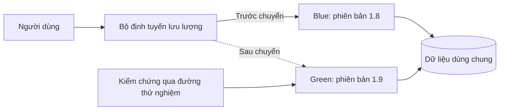
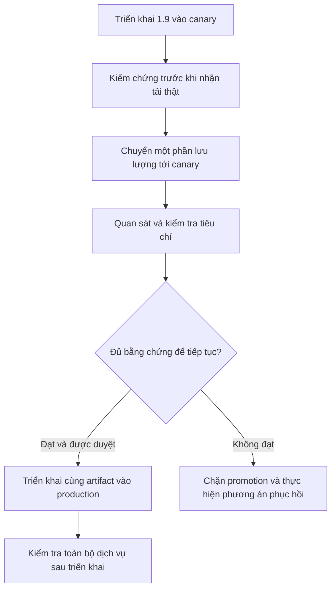

# Blue-green, canary và rollback ứng dụng

## 1. Mục tiêu và tình huống triển khai

Trong chương **DevOps và CI/CD trên OCI**, kiểm soát cách phiên bản mới tiếp nhận lưu lượng là bước nối giữa pipeline triển khai và tính sẵn sàng của ứng dụng. Build thành công, artifact tồn tại và tiến trình khởi động được chưa đủ để kết luận một phiên bản phục vụ người dùng an toàn.

Bài học sử dụng dịch vụ Java `orders-api` trên Oracle Cloud Infrastructure. Phiên bản `1.8` đang phục vụ ổn định; nhóm muốn phát hành `1.9` có thay đổi cách tính phí vận chuyển. Ứng dụng dùng cơ sở dữ liệu Oracle, có API tạo đơn và tác vụ xử lý nền. Mọi số liệu tải, ngưỡng và tên tài nguyên dưới đây là giả định thực hành, không phải mặc định hay cam kết của OCI.

Sau bài học, người học có thể:

- Chọn blue-green hoặc canary theo khả năng hạ tầng và rủi ro ứng dụng.
- Ánh xạ chiến lược sang các stage thực tế của OCI DevOps trên OKE hoặc Compute instance groups.
- Đặt tiêu chí kiểm chứng trước và sau khi chuyển lưu lượng.
- Thực hiện rollback theo phạm vi được hỗ trợ, đồng thời kiểm tra dữ liệu và tác động nền.
- Chuẩn bị tài nguyên, quyền, giám sát và chi phí cho một buổi diễn tập có thể truy vết.

OCI DevOps hỗ trợ blue-green và canary cho OKE và instance group deployments. Deploy tới Functions dùng cơ chế cập nhật riêng; không mặc định các lựa chọn của OKE hay Compute cũng áp dụng cho Functions. [Oracle: Managing Deployment Pipelines](https://docs.oracle.com/en-us/iaas/Content/devops/using/deployment_pipelines.htm).

## 2. Phân biệt triển khai, phát hành và phục hồi

| Khái niệm | Điều thay đổi | Ví dụ |
| --- | --- | --- |
| Deployment | Artifact hoặc cấu hình chạy tại môi trường đích | Đưa `1.9` lên nhóm máy dự phòng |
| Release | Người dùng hoặc nghiệp vụ bắt đầu sử dụng phiên bản/tính năng | Chuyển lưu lượng thật tới `1.9` |
| Traffic shift | Quy tắc định tuyến giữa các nhóm phục vụ | Phân một phần lưu lượng tới canary |
| Rollback | Đưa hệ thống về trạng thái phục vụ đã biết là phù hợp | Chuyển về nhóm chạy `1.8` |
| Roll forward | Sửa lỗi bằng phiên bản tiếp theo | Phát hành `1.9.1` tương thích dữ liệu mới |

Deployment và release có thể tách nhau: bản mới chạy trong standby nhưng chưa nhận người dùng thật. Feature flag còn cho phép bật một chức năng sau khi đã triển khai mã, nhưng flag cũng cần quyền quản lý và phương án tắt rõ ràng.

Rollback không phải một nút hoàn tác cho toàn hệ thống. Có ít nhất bốn lớp cần xét:

1. **Lưu lượng:** yêu cầu mới đi tới phiên bản nào.
2. **Ứng dụng:** binary, image, manifest và cấu hình nào đang chạy.
3. **Dữ liệu:** schema và dữ liệu đã được ghi có còn tương thích hay không.
4. **Tác động ngoài:** message đã phát, email đã gửi hoặc giao dịch đã gọi tới dịch vụ khác.

Chuyển lưu lượng về `1.8` chỉ giải quyết được yêu cầu mới nếu phiên bản đó còn hoạt động và đọc được trạng thái hiện tại. Nó không tự thu hồi email hoặc đảo một đơn hàng đã ghi thành công.

## 3. Blue-green: kiểm tra trên standby rồi chuyển lưu lượng

### 3.1. Cơ chế

Blue-green duy trì hai môi trường ứng dụng tương đương về khả năng phục vụ. Một bên active nhận lưu lượng sản xuất, bên còn lại standby để triển khai và kiểm chứng phiên bản mới.

Tên màu không gắn vĩnh viễn với “cũ” và “mới”. Sau khi chuyển thành công, bên vừa nhận phiên bản mới trở thành active; ở lần phát hành tiếp theo vai trò có thể đảo lại.

| Thời điểm | Blue | Green | Đường phục vụ chính |
| --- | --- | --- | --- |
| Trước triển khai | `1.8`, active | Standby | Blue |
| Chuẩn bị | Giữ nguyên `1.8` | Đang cài và kiểm tra `1.9` | Blue |
| Sau chuyển | Giữ `1.8` để dự phòng | `1.9`, active | Green |
| Nếu quay lại | `1.8`, active | Cô lập `1.9` để điều tra | Blue |



Trong OCI DevOps, chuỗi blue-green gồm deployment vào standby, tùy chọn Invoke Function để kiểm chứng, tùy chọn manual approval, rồi blue-green traffic shift chuyển toàn bộ lưu lượng sản xuất sang bên đã kiểm chứng. [Oracle: Deploying Using Blue-Green Strategy](https://docs.oracle.com/en-us/iaas/Content/devops/using/deploy_bgstrategy.htm).

### 3.2. Điểm mạnh và điều kiện thực tế

Blue-green phù hợp khi cần chuẩn bị đầy đủ một môi trường mới và có đường quay lại rõ ràng. Thời gian cài đặt trên standby không trực tiếp làm mất năng lực của active.

Tuy nhiên, “chuyển toàn bộ lưu lượng” mô tả đích định tuyến, không bảo đảm mọi kết nối cũ đổi phiên bản cùng một thời điểm. Session, kết nối lâu dài, hàng đợi và request đang xử lý cần được tính riêng.

Các điều kiện cho ví dụ `orders-api`:

- Green phải đủ CPU, bộ nhớ và số kết nối cơ sở dữ liệu để nhận tải dự kiến.
- Blue được giữ lại trong cửa sổ rollback; không ghi đè ngay bằng một bản mới khác.
- Kiểm thử đi đúng green, có thể xác minh bằng release ID trong phản hồi.
- Background worker trên standby không được xử lý trùng công việc đang chạy ở active.
- Schema, cache và định dạng message phải cho phép `1.8` và `1.9` cùng tồn tại.

Hai namespace trong cùng OKE cluster chỉ tách đối tượng ở mức namespace. Nếu cùng dùng node pool, ingress, mạng hoặc cơ sở dữ liệu, chúng vẫn có thể chịu chung một sự cố. Blue-green cho ứng dụng không tự tạo khả năng dự phòng giữa các region.

## 4. Canary: giới hạn phạm vi tiếp xúc rồi mở rộng

### 4.1. Cơ chế và khác biệt với rolling update

Canary đưa phiên bản mới tới một phần lưu lượng thật để quan sát trước khi triển khai rộng. Mục tiêu là học từ hành vi sản xuất trong khi giới hạn phạm vi người dùng chịu rủi ro.

Rolling update thay từng nhóm instance hoặc pod. Tỷ lệ pod mới không mặc nhiên bằng tỷ lệ request tới bản mới: kết nối, chính sách cân bằng tải và năng lực từng backend ảnh hưởng phân phối thực tế.

| Cách làm | Đối tượng điều khiển chính | Điều cần quan sát |
| --- | --- | --- |
| Rolling update | Nhịp thay pod hoặc host | Tình trạng rollout và khả năng phục vụ còn lại |
| Blue-green | Môi trường active và standby | Môi trường đích sẵn sàng trước khi chuyển |
| Canary | Phạm vi lưu lượng hoặc đối tượng dùng bản mới | Chất lượng riêng của bản mới dưới tải thật |

Một kế hoạch canary tổng quát có thể có nhiều mức tải. Tuy nhiên, không nên lấy sơ đồ chung “5% → 25% → 50% → 100%” rồi coi đó là cấu hình mặc định của OCI DevOps.

### 4.2. Chuỗi canary thực tế của OCI DevOps

OCI tổ chức canary thành các stage: deployment vào canary, tùy chọn Invoke Function, shift traffic, manual approval và production deployment. Bản đã kiểm chứng ở canary được triển khai vào production ở stage cuối; không chỉ đơn giản tăng trọng số canary lên 100%. [Oracle: Deploying Using Canary Strategy](https://docs.oracle.com/en-us/iaas/Content/devops/using/deploy_canarystrategy.htm).



Trong wizard canary OKE và instance group, **Ramp Limit** của bước shift traffic nằm trong khoảng 1–25%. Không nhầm giới hạn này với Control - Traffic Shift tổng quát, vốn có cấu hình ramp và batch riêng. [Oracle: Canary OKE Deployment](https://docs.oracle.com/en-us/iaas/Content/devops/using/canaryoke_deploy.htm), [Oracle: Adding a Traffic Shift Stage](https://docs.oracle.com/en-us/iaas/Content/devops/using/traffic_stage.htm).

Kế hoạch ví dụ chọn 5% canary, quan sát, phê duyệt rồi triển khai production bằng cùng artifact. Đây là một lựa chọn cho buổi thực hành; việc tăng thành nhiều bậc đòi hỏi thiết kế orchestration phù hợp với stage và API thực tế.

### 4.3. Tỷ lệ lưu lượng không đồng nghĩa tỷ lệ người dùng

Trọng số định tuyến thường cho phân phối xấp xỉ trên nhiều lần chọn backend. Không suy ra rằng đúng 5 trong mỗi 100 request, hoặc đúng 5% người dùng, luôn tới canary.

Một người dùng có thể gửi nhiều request, session có thể được giữ trên cùng backend và request có thể được retry. Nếu yêu cầu nghiệp vụ là giữ một nhóm người dùng cố định ở bản mới, cần thiết kế phân nhóm có chủ đích ở lớp hỗ trợ điều đó; không coi weighted routing ngẫu nhiên là phân nhóm người dùng.

Với `orders-api`, nên theo dõi cả endpoint, release ID và kết quả nghiệp vụ để biết canary đã thực sự xử lý đường tạo đơn, thay vì chỉ nhận nhiều yêu cầu health check.

## 5. Chuẩn bị tài nguyên OCI và quyền thực thi

### 5.1. Thành phần chung

Trước khi chọn chiến lược, cần có:

- DevOps project, deployment pipeline và logging đã hoạt động.
- Environment đại diện đúng cluster hoặc nhóm Compute.
- Artifact phiên bản cũ và mới, cùng cấu hình triển khai tương ứng.
- Đường định tuyến production và đường kiểm thử môi trường ứng viên.
- Metric, log, alarm và người chịu trách nhiệm quyết định.
- Quyền của pipeline, quyền đọc artifact, quyền truy cập đích và quyền phê duyệt.

Phân biệt quyền của người sửa pipeline với quyền resource principal thực thi deployment. Một người xem được cluster trên Console không chứng minh pipeline có thể triển khai vào cluster đó.

Với mạng riêng, function kiểm chứng cũng phải truy cập được endpoint kiểm thử. Function được gọi thành công nhưng không tới được dịch vụ đích không phải là kiểm chứng ứng dụng thành công.

### 5.2. Blue-green trên Compute instance groups

OCI yêu cầu hai instance group environments, load balancer và listener. Artifact triển khai nằm trong Artifact Registry; deployment configuration quy định cách tải gói và chạy các bước trên máy. Compute Instance Run Command plugin phải được bật và đang chạy, kèm quyền chạy lệnh phù hợp. [Oracle: Blue-Green Instance Group Deployment](https://docs.oracle.com/en-us/iaas/Content/devops/using/bginstance_deploy.htm).

Ví dụ tổ chức:

| Thành phần | Giá trị minh họa | Trách nhiệm |
| --- | --- | --- |
| Environment A | `orders-blue` | Giữ `1.8` khi đang active |
| Environment B | `orders-green` | Nhận `1.9` khi standby |
| Production listener | HTTPS của ứng dụng | Định tuyến người dùng |
| Backend port | `8080` | Cổng ứng dụng trên instance |
| Đường kiểm thử | Test listener hoặc test load balancer | Kiểm tra standby trước khi chuyển |

**Rollout policy** điều khiển số host được triển khai đồng thời; **traffic shift** điều khiển lưu lượng. Giới hạn 25% host đang cập nhật không có nghĩa là chỉ 25% người dùng chịu ảnh hưởng.

### 5.3. Canary trên Compute instance groups

Canary và production phải là hai instance group environments không có instance chung. Nhóm canary cần đủ công suất cho phần tải được giao; nhóm production tiếp tục phục vụ phần còn lại. [Oracle: Canary Instance Group Deployment](https://docs.oracle.com/en-us/iaas/Content/devops/using/canaryinstance_deploy.htm).

Nếu một host nằm trong cả hai nhóm, triển khai lên “canary” có thể thay đổi chính host đang phục vụ production, làm mất ý nghĩa cô lập.

Trong thực hành, dùng hai pipeline riêng cho hai chiến lược giúp tránh nhầm trạng thái active, artifact và đường định tuyến. Không để hai pipeline cùng sửa một listener trong cùng thời điểm.

### 5.4. Blue-green và canary trên OKE

Blue-green OKE dùng hai namespace có sẵn. Tài liệu OCI yêu cầu không ghi namespace vào manifest dùng cho luồng này, vì namespace được cung cấp trong cấu hình stage. Sau triển khai, nếu giảm standby, tài liệu yêu cầu giữ ít nhất một replica. OCI sửa annotation của ingress ứng dụng để thực hiện chiến lược. [Oracle: Blue-Green OKE Deployment](https://docs.oracle.com/en-us/iaas/Content/devops/using/bgoke_deploy.htm).

Canary OKE dùng cấu hình canary namespace và production namespace cùng ingress phù hợp. Tên ingress trong stage là tên tài nguyên ingress của ứng dụng, không phải tự động là tên Deployment của ingress controller.

**Tương thích ingress cần được kiểm tra tại thời điểm triển khai.** Tài liệu chiến lược OKE của OCI mô tả tích hợp với NGINX ingress. Trong khi đó, dự án cộng đồng **ingress-nginx** đã ngừng duy trì từ ngày 24/03/2026. Không mặc định controller khác, kể cả một sản phẩm mang tên NGINX, là bản thay thế tương thích trực tiếp cho các annotation OCI đang điều khiển. Khi triển khai mới, xác minh lựa chọn được hỗ trợ và vòng đời của controller; phần thực hành chính của bài sử dụng Compute instance groups để không phụ thuộc việc cài controller cũ. [Kubernetes: Ingress NGINX retirement](https://kubernetes.io/blog/2026/04/22/kubernetes-v1-36-release/).

## 6. Xác định đúng artifact và cấu hình cần phát hành

### 6.1. Chốt một phiên bản có thể tái lập

Một release cần ghi được:

```text
release_id: orders-1.9
source_commit: <COMMIT_SHA>
application_artifact: <IMAGE_DIGEST_OR_IMMUTABLE_PACKAGE_VERSION>
deployment_config_version: <CONFIG_VERSION>
previous_release: orders-1.8
deployment_id: <OCI_DEPLOYMENT_OCID>
```

Đây là mẫu thông tin để ghi vào biên bản phát hành, không phải schema nhập trực tiếp vào OCI CLI.

Không rebuild riêng bản canary và bản production từ cùng tên nhánh rồi cho rằng hai sản phẩm giống nhau. Dùng cùng artifact đã kiểm chứng, kết hợp cấu hình môi trường đã được kiểm soát. Tránh dùng `latest` làm định danh duy nhất cho cả phiên bản hiện tại và mục tiêu rollback.

Artifact cũ còn tồn tại nhưng cấu hình đã đổi secret reference, feature flag hoặc tham số JVM vẫn có thể không tạo lại được hành vi cũ. Vì vậy, phải lưu cả phần cấu hình liên quan.

### 6.2. Giữ mục tiêu rollback còn khả dụng

Trước lần phát hành, kiểm tra:

- Artifact cũ còn đọc được và chưa bị retention policy xóa.
- Secret, chứng chỉ và quyền mà bản cũ cần vẫn hợp lệ.
- Môi trường dự phòng hoặc năng lực triển khai lại còn đủ.
- Có một phiên bản thành công đã được xác nhận để làm mốc.
- Không có pipeline khác ghi đè nhóm standby trong cửa sổ phục hồi.

Đối với lần triển khai đầu tiên, chưa có bản thành công trước đó để quay về. Phương án khi đó có thể là đưa dịch vụ về trang bảo trì hoặc một baseline đã chuẩn bị riêng; không dựa vào việc bật tùy chọn auto rollback để tạo ra lịch sử vốn chưa tồn tại.

## 7. Thiết kế health check và phép kiểm chứng ứng dụng

### 7.1. Ba lớp kiểm tra

| Lớp | Câu hỏi | Ví dụ |
| --- | --- | --- |
| Tiến trình | Ứng dụng có sống và khởi động xong không? | Startup/liveness probe |
| Khả năng phục vụ | Backend có sẵn sàng nhận request không? | Readiness hoặc HTTP health check |
| Nghiệp vụ | Phiên bản có xử lý đúng tình huống quan trọng không? | Đọc đơn mẫu, kiểm tra phí vận chuyển |

OCI Load Balancer hỗ trợ TCP và HTTP health check. TCP chủ yếu xác minh kết nối; HTTP có thể kiểm tra URI, status code hoặc nội dung phản hồi. Một cổng mở không chứng minh nghiệp vụ tạo đơn hoạt động. [Oracle: Health Check Policies for Load Balancers](https://docs.oracle.com/en-us/iaas/Content/Balance/Tasks/load_balancer_health_management.htm).

Trong OKE, startup probe bảo vệ giai đoạn khởi động, readiness điều khiển trạng thái sẵn sàng nhận lưu lượng qua Service, còn liveness phục vụ phát hiện tình trạng cần khởi động lại container. Không biến mọi lỗi phụ thuộc bên ngoài thành liveness failure, vì có thể gây vòng lặp restart khi cơ sở dữ liệu chậm. [Kubernetes: Pod probes](https://kubernetes.io/docs/concepts/workloads/pods/probes/).

### 7.2. Đường kiểm thử phải tới đúng phiên bản

Giả sử ứng dụng của bài cung cấp các endpoint riêng:

- `GET /health/ready`: kiểm tra khả năng phục vụ.
- `GET /version`: trả `{"version":"1.9"}` ở bản ứng viên.
- `GET /api/orders/lab-order-001`: trả đơn mẫu có phí vận chuyển đã biết.

Đây là hợp đồng do ứng dụng ví dụ cung cấp, không phải endpoint có sẵn của OCI. Test endpoint cần đi qua cấu hình bảo mật và đường truy cập được tổ chức cho phép.

Đoạn Bash sau giả định có `curl`, `jq`, endpoint TLS hợp lệ và đơn mẫu đã tạo trong dữ liệu thực hành:

```bash
set -euo pipefail

CANDIDATE_BASE_URL='https://candidate.orders.example.com'
EXPECTED_VERSION='1.9'

curl -fsS --connect-timeout 3 --max-time 10 \
  "$CANDIDATE_BASE_URL/health/ready" >/dev/null

curl -fsS --connect-timeout 3 --max-time 10 \
  "$CANDIDATE_BASE_URL/version" |
  jq -e --arg version "$EXPECTED_VERSION" \
    '.version == $version' >/dev/null

curl -fsS --connect-timeout 3 --max-time 10 \
  "$CANDIDATE_BASE_URL/api/orders/lab-order-001" |
  jq -e '.id == "lab-order-001" and .shippingFee == 30000' >/dev/null

printf 'Candidate checks passed\n'
```

Tên miền và dữ liệu là ví dụ, phải thay bằng môi trường thực hành. Một phép kiểm thử chỉ vào URL production có thể vô tình kiểm tra blue rồi báo green đạt. Kiểm tra version giúp phát hiện lỗi này.

Nếu cần thử thao tác ghi, dùng tenant hoặc dữ liệu thử được cô lập, kèm idempotency key và kế hoạch dọn dữ liệu. Không dùng một đơn hàng thật để kiểm tra đường mới rồi dựa vào rollback ứng dụng để xóa tác động.

### 7.3. Tích hợp Invoke Function đúng chế độ

Với stage **Invoke Function** làm cổng kiểm chứng, chọn chạy đồng bộ và bật validation. OCI kiểm tra giá trị trả về là chuỗi UTF-8 `true` hoặc `false`; validation chỉ diễn ra khi chạy đồng bộ. Chạy bất đồng bộ chỉ cho biết lời gọi được thực hiện, không đợi kết quả kiểm chứng. [Oracle: Invoke Function](https://docs.oracle.com/en-us/iaas/Content/devops/using/invoke_function.htm).

Hàm kiểm chứng cần coi timeout, không đọc được dữ liệu, sai release ID và thiếu điều kiện tiên quyết là chưa đạt. Không trả `true` trong nhánh bắt lỗi chỉ để pipeline tiếp tục.

Nếu cần quan sát nhiều phút, thiết kế nhiều phép kiểm tra ngắn hoặc bộ đánh giá ngoài phù hợp. Không giả định một function đồng bộ có thể chờ không giới hạn cho toàn bộ cửa sổ canary.

## 8. Tiêu chí tiếp tục hoặc dừng phải dựa trên dữ liệu

### 8.1. Theo dõi riêng bản ổn định và canary

Các tín hiệu cần cho `orders-api`:

| Tín hiệu | Cách phân tách đề xuất | Lỗi có thể phát hiện |
| --- | --- | --- |
| Request count | Release, endpoint, môi trường | Canary không nhận tải hoặc mẫu quá ít |
| Tỷ lệ lỗi | Release và mã lỗi nghiệp vụ | Bản mới lỗi dù tổng dịch vụ còn tốt |
| Latency p95/p99 | Release, endpoint | Một đường xử lý bị chậm |
| Tài nguyên | Nhóm máy hoặc workload | Thiếu CPU, bộ nhớ, thread |
| Kết nối Oracle Database | Release/nhóm ứng dụng nếu đo được | Cạn connection pool hoặc tăng kết nối toàn cục |
| Nghiệp vụ | Đơn hợp lệ, phí tính đúng, lỗi trùng lặp | HTTP 200 nhưng kết quả sai |

OCI Monitoring nhận metric từ tài nguyên và custom metrics, kèm dimensions, rồi dùng alarm để phát hiện điều kiện đã cấu hình. Nếu cần dimension như `release_id`, phải bảo đảm ứng dụng hoặc hệ thống thu thập thực sự phát metric đó; OCI không tự gắn mọi dimension mong muốn vào metric dịch vụ. [Oracle: Overview of Monitoring](https://docs.oracle.com/en-us/iaas/Content/Monitoring/Concepts/monitoringoverview.htm).

Đối với log, gắn release ID, request ID và môi trường giúp đối chiếu lỗi sau một lần chuyển. Tránh dùng request ID làm dimension của metric tổng hợp vì số lượng giá trị có thể rất lớn.

### 8.2. Không dùng metric tổng để che lỗi canary

Giả sử bản ổn định nhận 95% request và có tỷ lệ lỗi 0,1%; canary nhận 5% nhưng lỗi 10%.

```text
error_rate_total
  = 0,95 × 0,1% + 0,05 × 10%
  = 0,595%
```

Nếu chỉ báo động khi toàn hệ thống vượt 1%, canary đang lỗi nặng vẫn có thể bị bỏ qua. Cần kiểm tra riêng phiên bản mới và so sánh với baseline trong cửa sổ tương ứng.

Không lấy trung bình p95 của hai nhóm để suy ra p95 toàn hệ thống. Percentile cần được tính từ phân phối hoặc histogram thích hợp của dữ liệu cần đánh giá.

### 8.3. Thời gian chờ và cỡ mẫu

Với tải đều, ước tính số request tới canary:

```text
n_canary ≈ request_rate_total × canary_fraction × observation_seconds
```

Nếu tổng tải là 2 request/giây, canary 5% và quan sát 300 giây, số request kỳ vọng chỉ khoảng 30. “Không thấy lỗi trong 5 phút” khi đó có rất ít bằng chứng.

Nếu tổng tải là 2.000 request/giây, cùng cấu hình cho khoảng 30.000 request. Tuy nhiên, nhiều request lặp một endpoint vẫn không thay thế việc kiểm tra đủ nghiệp vụ quan trọng.

Tiêu chí ví dụ cho buổi thực hành:

| Điều kiện | Giá trị minh họa |
| --- | --- |
| Thời gian tối thiểu sau khi nhận tải | 5 phút |
| Số request canary tối thiểu | 1.000 |
| Tỷ lệ lỗi canary | Không quá 0,5% |
| Mức tăng lỗi so với baseline | Không quá 0,2 điểm phần trăm |
| Latency p95 canary | Không quá 1,2 lần baseline và không quá 450 ms |
| Đúng dữ liệu nghiệp vụ | Các đơn mẫu và quy tắc phí đều đạt |
| Thiếu metric hoặc endpoint cần thiết | Giữ nguyên, chưa promotion |

Các ngưỡng phải được điều chỉnh theo SLO và tải thực tế. Đây là ví dụ thiết kế cổng kiểm soát, không phải cấu hình mặc định của OCI.

### 8.4. Wait, approval và alarm có vai trò khác nhau

Wait stage chỉ thêm khoảng dừng trong pipeline. Nó không tự đọc metric hay quyết định bản mới an toàn. [Oracle: Adding a Wait Stage](https://docs.oracle.com/en-us/iaas/Content/devops/using/deploywait_stage.htm).

Approval stage cho người có quyền phê duyệt hoặc từ chối. Số người duyệt có thể cấu hình, nhưng người duyệt vẫn cần bằng chứng về metric, artifact và dữ liệu. [Oracle: Adding an Approval Stage](https://docs.oracle.com/en-us/iaas/Content/devops/using/approval_stage.htm).

Một alarm ở trạng thái firing cũng không tự biến thành lệnh rollback nếu chưa có tích hợp thực thi tương ứng. Thiết kế cần nêu rõ ai hoặc thành phần nào đọc alarm, chặn promotion và gọi cơ chế phục hồi. Tách bước phát hiện khỏi bước hành động giúp tránh hiểu sai rằng mọi lỗi production đều được pipeline tự xử lý.

## 9. Rollback của OCI DevOps: phân biệt từng loại stage

### 9.1. Phạm vi hỗ trợ

| Trường hợp | Cơ chế cần thiết kế | Điểm cần nhớ |
| --- | --- | --- |
| Blue-green sau khi đổi active | Manual rollback tại traffic shift stage | Không dùng pipeline redeployment như cơ chế quay lại mặc định |
| Canary production stage thất bại | Có thể bật auto rollback về bản thành công trước | Cấu hình ở production stage được hỗ trợ |
| Canary deployment/traffic shift/approval stage | Theo phương án phục hồi của toàn chiến lược | Không hỗ trợ single-stage redeployment cho các stage này |
| Lỗi nghiệp vụ xuất hiện sau pipeline thành công | Phát hiện và kích hoạt runbook | Pipeline thành công không có nghĩa đang tự giám sát mọi lỗi ứng dụng |
| Schema hoặc dữ liệu không tương thích | Phương án dữ liệu riêng | Rollback ứng dụng không tự rollback database |

Oracle nêu blue-green không hỗ trợ pipeline redeployment cho cả instance group và OKE; single-stage redeployment qua manual rollback chỉ áp dụng cho blue-green traffic shift stage. Canary hỗ trợ pipeline redeployment, và có thể tự rollback khi production stage thất bại nếu đã chọn cấu hình tương ứng. [Oracle: Blue-Green Deployment Rollback](https://docs.oracle.com/en-us/iaas/Content/devops/using/deploy_bgstrategy.htm), [Oracle: Canary Deployment Rollback](https://docs.oracle.com/en-us/iaas/Content/devops/using/deploy_canarystrategy.htm).

Từ “rerun” hoặc “redeployment” không tự có nghĩa “trở về bản ổn định”. Phải kiểm tra deployment được chọn, artifact, tham số và snapshot mục tiêu trước khi thực hiện.

### 9.2. Auto rollback không phải một giao dịch bao trùm pipeline

Theo tài liệu OCI, khi auto rollback diễn ra, stage đang chạy khác vẫn tiếp tục; stage mới không được chạy và deployment kết thúc ở trạng thái `Failed`. Rollback cũng có thể thất bại tùy tình trạng host và rollout policy. [Oracle: Rolling Back a Deployment](https://docs.oracle.com/en-us/iaas/Content/devops/using/deployment_rollback.htm).

Vì vậy, đặt migration dữ liệu hoặc tác vụ không đảo ngược song song với deployment cần được cân nhắc. Một stage được phục hồi không tự hoàn tác side effect từ stage khác.

Trạng thái cuối cần đọc cùng hai kết quả: hệ thống đang phục vụ thế nào và quá trình phát hành có thành công không. Deployment `Failed` sau rollback thành công vẫn là lần phát hành thất bại, dù dịch vụ đã trở lại ổn định.

### 9.3. Dừng triển khai và phục hồi là hai việc khác nhau

Reject approval hoặc cancel deployment nhằm ngăn quy trình tiến tiếp theo cơ chế của thao tác đó. Không coi chúng là bằng chứng lưu lượng đã trở về bản cũ.

Khi canary bị từ chối sau traffic shift, cần kiểm tra canary còn nhận tải không và thực hiện phương án định tuyến đã chuẩn bị. Không cố rerun riêng traffic shift stage canary bằng một khả năng mà chiến lược không hỗ trợ.

Nếu phải thay định tuyến qua một pipeline phục hồi hoặc quy trình điều khiển load balancer đã kiểm chứng, trước hết bảo đảm không có pipeline khác tiếp tục sửa cùng tài nguyên. Sau đó đối chiếu trạng thái thực tế với cấu hình quản lý để tránh lần triển khai sau ghi đè thao tác phục hồi.

## 10. Runbook phục hồi ứng dụng

### 10.1. Trước khi chuyển

Ghi sẵn release ổn định, deployment OCID, artifact version, listener/ingress đang phục vụ và người có quyền phục hồi. Với blue-green, xác nhận bên cũ còn đủ khả năng nhận tải, không chỉ còn một tiến trình ở trạng thái running.

Ngân sách thời gian phục hồi có thể phân tích thành:

```text
T_phuc_hoi
  = T_phat_hien
  + T_quyet_dinh
  + T_thuc_hien
  + T_xac_minh
```

Đây là cách phân tích runbook, không phải công thức SLA. “Đổi route mất vài giây” không đủ để khẳng định thời gian khôi phục ngắn nếu mất nhiều phút mới phát hiện lỗi.

### 10.2. Khi phát hiện bản mới không đạt

1. Dừng promotion, ghi thời điểm và release ID; giữ log cần thiết.
2. Xác định lỗi thuộc định tuyến, ứng dụng, cấu hình hay dữ liệu.
3. Kiểm tra bản cũ còn tương thích dữ liệu hiện tại.
4. Chọn hành động đúng stage và chiến lược được hỗ trợ.
5. Thực hiện bằng danh tính có quyền, tránh nhiều người cùng sửa route.
6. Xác minh lưu lượng, metric và nghiệp vụ sau phục hồi.
7. Cô lập bản lỗi để điều tra; chỉ dọn tài nguyên sau khi hết nhu cầu phục hồi.

Với blue-green instance group đã hoàn tất chuyển, mở deployment trong **Deployment Pipelines → Deployments**, tìm blue-green traffic shift stage và dùng **Revert traffic shift** theo chức năng manual rollback. Không chọn một deployment cũ chỉ dựa vào thời gian; đối chiếu đúng release và trạng thái môi trường.

### 10.3. Xác minh sau rollback

Cần trả lời được:

- Request mới đang tới phiên bản ổn định nào?
- Số lỗi và latency đã trở về mức chấp nhận chưa?
- Có request đang xử lý ở bản lỗi hoặc kết nối lâu dài chưa kết thúc không?
- Đơn phát sinh trong thời gian lỗi có cần đối soát không?
- Background worker và hàng đợi có còn chạy bản lỗi không?
- Cấu hình định tuyến đã đồng bộ với hệ thống quản lý chưa?

Health check xanh là điều kiện cần, nhưng phải thử đường người dùng thực và kiểm tra dữ liệu liên quan. Nếu bản cũ không đọc được dữ liệu mới, tiếp tục đổi qua lại hai nhóm máy có thể làm tình hình khó kiểm soát hơn; lúc đó cân nhắc cô lập chức năng, feature flag hoặc roll forward theo kế hoạch đã chuẩn bị.

### 10.4. Quan sát OKE mà không nhầm phạm vi rollback

Ví dụ lệnh chỉ đọc, giả định kubeconfig đã được cấp quyền và tên namespace đã tồn tại:

```bash
kubectl --context '<OKE_CONTEXT>' -n orders-blue \
  get deployment,pods,service,ingress

kubectl --context '<OKE_CONTEXT>' -n orders-green \
  get deployment,pods,service,ingress

kubectl --context '<OKE_CONTEXT>' -n orders-green \
  rollout status deployment/orders-api --timeout=120s

kubectl --context '<OKE_CONTEXT>' -n orders-green \
  rollout history deployment/orders-api
```

Rollout status đạt không kiểm tra đầy đủ nghiệp vụ. Lịch sử revision của Kubernetes Deployment chủ yếu phục vụ thay đổi Pod template; rollback Deployment không tự phục hồi Service, ingress, dữ liệu hoặc mọi cấu hình bên ngoài. Nếu dùng công cụ Kubernetes để xử lý khẩn cấp, phải đối chiếu lại với artifact và trạng thái OCI DevOps sau đó. [Kubernetes: Deployments](https://kubernetes.io/docs/concepts/workloads/controllers/deployment/).

## 11. Database, session và xử lý nền quyết định khả năng quay lại

### 11.1. Schema dùng chung cần tương thích trong giai đoạn chuyển

Giả sử `1.8` đọc trường phí cũ, còn `1.9` cần thêm dữ liệu chi tiết phí. Xóa trường cũ ngay khi triển khai `1.9` có thể làm `1.8` không hoạt động sau rollback.

Một kế hoạch **expand–migrate–contract** cho ví dụ:

| Giai đoạn | Thay đổi | Điều kiện quay lại ứng dụng |
| --- | --- | --- |
| Expand | Thêm cấu trúc mới và giữ cấu trúc cũ | `1.8` vẫn hoạt động |
| Deploy tương thích | `1.9` đọc/ghi theo kế hoạch hỗ trợ cả hai | `1.8` vẫn hiểu trạng thái cần thiết |
| Migrate/backfill | Bổ sung dữ liệu cũ theo từng phần có kiểm soát | Có đối soát và xử lý ghi đồng thời |
| Contract | Bỏ cấu trúc cũ sau cửa sổ hỗ trợ | Không còn mặc định quay lại `1.8` |

Đây là kế hoạch thiết kế ứng dụng, không phải tính năng tự động của OCI DevOps. Dual write cần xử lý giao dịch, retry và đối soát; chỉ ghi hai nơi bằng hai lệnh rời nhau chưa bảo đảm dữ liệu đồng nhất.

Không đặt việc khôi phục toàn bộ database làm phản xạ đầu tiên cho lỗi ứng dụng, vì có thể ảnh hưởng các giao dịch hợp lệ phát sinh sau mốc khôi phục. Phục hồi dữ liệu Oracle Database cần được thiết kế cùng chủ sở hữu dữ liệu, yêu cầu mất dữ liệu cho phép và quy trình khôi phục riêng.

### 11.2. Cache và session

Hai phiên bản cùng dùng Redis hoặc cache khác cần tương thích key và định dạng value. Bản mới đổi cách serialize session có thể khiến người dùng lỗi sau khi chuyển về bản cũ.

Phương án có thể là giữ format tương thích, đánh version cho dữ liệu cache hoặc dùng cơ chế session được thiết kế để chia sẻ giữa phiên bản. Việc xóa toàn bộ cache để “cho sạch” còn có thể làm tăng tải đột biến lên database.

### 11.3. Background worker không tuân theo tỷ lệ HTTP

Chuyển 0% lưu lượng HTTP tới green không ngăn scheduler hoặc consumer trên green hoạt động. Một canary nhỏ vẫn có thể ghi dữ liệu dùng chung hoặc phát message ảnh hưởng toàn hệ thống.

Với `orders-api`, cần quyết định rõ worker nào chạy ở active, cơ chế tránh chạy trùng, idempotency của xử lý đơn và tương thích message. Nếu cần giảm rủi ro, tách phát hành worker khỏi API hoặc dùng quyền/feature flag phù hợp với thiết kế.

Tỷ lệ canary giới hạn đường tiếp xúc được điều khiển; nó không phải giới hạn tuyệt đối của mọi side effect.

## 12. Năng lực phục vụ, chi phí và cửa sổ giữ bản cũ

### 12.1. Ước lượng công suất

Giả sử tải tổng là 2.000 request/giây, một instance ở cấu hình đã kiểm thử xử lý ổn định 200 request/giây và nhóm chọn dự phòng công suất 30%.

```text
So_instance_can_cho_toan_bo_tai
  = ceil(2000 × 1,30 / 200)
  = 13
```

Đây là ước lượng từ tải và kết quả kiểm thử giả định, không phải thông số hiệu năng của shape OCI. Blue-green nhận toàn tải cần chuẩn bị đủ công suất ở phía mới trước khi chuyển.

Với canary 5%, tải kỳ vọng là 100 request/giây, nhưng vẫn phải xét lỗi một host, burst, request nặng và kết nối nền. Không giảm số máy xuống dưới yêu cầu sẵn sàng chỉ vì số request trung bình thấp.

### 12.2. Tính cả tài nguyên dùng chung

Hai môi trường ứng dụng cùng khởi động có thể mở hai tập connection pool tới Oracle Database. Nếu mỗi môi trường mở 500 kết nối, database phải chịu tác động của cả hai, kể cả khi standby chưa nhận nhiều HTTP request.

Tương tự, tăng pod trong cùng node pool có thể tranh CPU hoặc bộ nhớ với active. Canary ít lưu lượng nhưng dùng nhiều bộ nhớ khi khởi động vẫn có thể ảnh hưởng môi trường ổn định.

### 12.3. Giữ bản cũ đủ lâu nhưng có thời hạn

Chi phí tăng không chỉ nằm ở instance: còn có OKE nodes, load balancer thử nghiệm, lưu trữ artifact, log và tài nguyên giám sát. Dùng bảng giá, giới hạn và ngân sách của tenancy tại thời điểm thực hành; không mặc định các cấu hình nằm trong Free Tier.

Thống nhất cửa sổ rollback theo thời gian cần phát hiện lỗi và khả năng giữ dữ liệu tương thích. Hết cửa sổ, giảm tài nguyên theo kế hoạch nhưng vẫn giữ artifact và bằng chứng cần thiết. Với blue-green OKE, phải tuân theo yêu cầu replica standby của tích hợp đang dùng, không áp dụng cách scale-to-zero tùy ý.

## 13. Thực hành theo một luồng có thể kiểm chứng

Phần này hướng dẫn thao tác trong môi trường học tập, không tạo thêm một pipeline production thật. Chuẩn bị hai bản ứng dụng và dữ liệu thử; chỉ đưa lưu lượng thử vào các endpoint đã dành cho buổi thực hành.

### 13.1. Thiết lập baseline

1. Chuẩn bị `orders-api 1.8` đang chạy ổn định trên môi trường ban đầu.
2. Ghi artifact version, release ID và kết quả nghiệp vụ mẫu.
3. Thu thập baseline của lỗi, latency và công suất.
4. Xác định listener, health check, quyền pipeline và người duyệt.
5. Kiểm tra môi trường standby hoặc canary độc lập với nhóm ổn định.
6. Chuẩn bị đường truy cập phục hồi trước khi chạy release mới.

### 13.2. Diễn tập blue-green trên Compute

Trong project, tạo deployment pipeline dành riêng cho bài thực hành. Thêm **Blue/Green Strategy → Instance group**, chọn Environment A/B, artifact, load balancer, listener, backend port và rollout policy.

Bật bước kiểm chứng đồng bộ, thêm approval trước traffic shift nếu muốn người học quan sát trạng thái standby. Trong bài, nên giữ approval để kiểm tra rằng active vẫn phục vụ `1.8` còn test endpoint đã phục vụ `1.9`.

Sau khi duyệt, xác minh production đi tới `1.9`. Ghi thời điểm chuyển, trạng thái backend, kết quả kiểm tra và release ID. Tiếp đó diễn tập **Revert traffic shift** và chứng minh production phục vụ lại `1.8` với dữ liệu còn đọc được.

Không mô phỏng lỗi bằng cách xóa database hoặc tắt đồng thời cả hai nhóm máy. Có thể dùng bản ứng dụng thử trả sai kết quả cho một đơn mẫu để quan sát việc cổng kiểm chứng chặn chuyển.

### 13.3. Diễn tập canary trên Compute

Dùng pipeline và nhóm môi trường riêng:

1. Chọn **Canary Strategy → Instance group**, khai báo canary và production không có host chung.
2. Chọn cùng artifact `1.9` cho luồng kiểm chứng và promotion.
3. Thiết lập test endpoint và kiểm chứng ứng dụng.
4. Đặt Ramp Limit 5% cho bước canary traffic shift.
5. Gửi tải thử, thu metric theo release và chờ đủ thời gian lẫn cỡ mẫu.
6. Phê duyệt khi đạt; production stage triển khai artifact đã kiểm chứng.
7. Xác minh cả đường HTTP, dữ liệu và worker sau triển khai.

Với một bản thử có lỗi, thực hiện nhánh không duyệt, kiểm tra canary còn nhận tải không và chạy phương án phục hồi đã chuẩn bị. Đây là phép kiểm tra quan trọng vì việc chặn promotion chưa chứng minh đã loại bản lỗi khỏi đường phục vụ.

### 13.4. Bằng chứng hoàn thành

| Nội dung | Bằng chứng cần giữ |
| --- | --- |
| Artifact nhất quán | Release ID, commit, digest hoặc phiên bản gói |
| Đúng môi trường | OCID môi trường, listener hoặc namespace |
| Blue-green hoạt động | Standby được kiểm tra trước; release ID đổi sau traffic shift |
| Canary hoạt động | Metric thực tế cho thấy bản mới nhận một phần tải |
| Cổng kiểm chứng có tác dụng | Bản lỗi bị chặn và có lý do cụ thể |
| Rollback có tác dụng | Dịch vụ về bản mục tiêu, metric và nghiệp vụ đạt lại |
| Dữ liệu được bảo toàn | Đơn mẫu và dữ liệu tạo trong thử nghiệm được đối chiếu |
| Không còn trạng thái bỏ quên | Worker, route, môi trường và chi phí được kiểm tra sau buổi học |

Lưu deployment OCID, thời điểm và kết quả; không lưu token, mật khẩu hoặc dữ liệu người dùng thật vào biên bản.

## 14. Các lỗi thiết kế thường gặp

| Nhận định sai | Hệ quả | Cách thiết kế lại |
| --- | --- | --- |
| “Pod Ready là release thành công” | Bỏ sót lỗi nghiệp vụ | Kiểm tra dữ liệu và đường người dùng |
| “5% pod mới là 5% traffic” | Ước lượng sai phạm vi ảnh hưởng | Đo lưu lượng thực theo release |
| “Canary chỉ ảnh hưởng 5% hệ thống” | Bỏ qua dữ liệu và worker dùng chung | Xét mọi đường tạo side effect |
| “Wait 5 phút là đủ” | Promotion với mẫu rất nhỏ | Yêu cầu cả thời gian, cỡ mẫu và độ phủ |
| “Approval bị reject thì đã rollback” | Canary lỗi vẫn có thể nhận tải | Kiểm tra route và thực hiện runbook |
| “Auto rollback xử lý mọi stage” | Migration hoặc stage song song vẫn có tác động | Xác định phạm vi phục hồi từng stage |
| “Đổi về image cũ là đủ” | Config hoặc schema không còn tương thích | Lưu cấu hình và kế hoạch dữ liệu |
| “Giữ namespace cũ là có HA” | Cùng lỗi node, ingress hoặc database | Phân tích miền lỗi dùng chung |
| “Người có Console access thì pipeline cũng có quyền” | Deployment lỗi do principal khác | Cấp quyền theo đúng danh tính thực thi |
| “Xanh ở backend thì route đã đúng” | Listener, TLS hoặc security rule vẫn sai | Kiểm tra end-to-end từ phía người dùng |

OCI ghi nhận trường hợp health check backend tốt nhưng traffic vẫn lỗi do listener hoặc security rule, cũng như trường hợp backend không tới được vì mạng và firewall. Đối chiếu log ứng dụng với log và cấu hình load balancer thay vì chỉ nhìn màu trạng thái tổng. [Oracle: Understanding Load Balancer Health Issues](https://docs.oracle.com/en-us/iaas/Content/Balance/Tasks/understanding_health_issues.htm).

Một chiến lược phát hành đạt yêu cầu khi nhóm chứng minh được ba việc: phiên bản nào đang phục vụ, dựa vào dữ liệu nào để tiếp tục hoặc dừng, và bằng cách nào khôi phục dịch vụ khi ứng viên không đạt. Blue-green, canary và rollback trở nên hữu ích khi những câu trả lời đó được gắn với artifact, quyền, định tuyến và dữ liệu thực tế của ứng dụng trên OCI.
