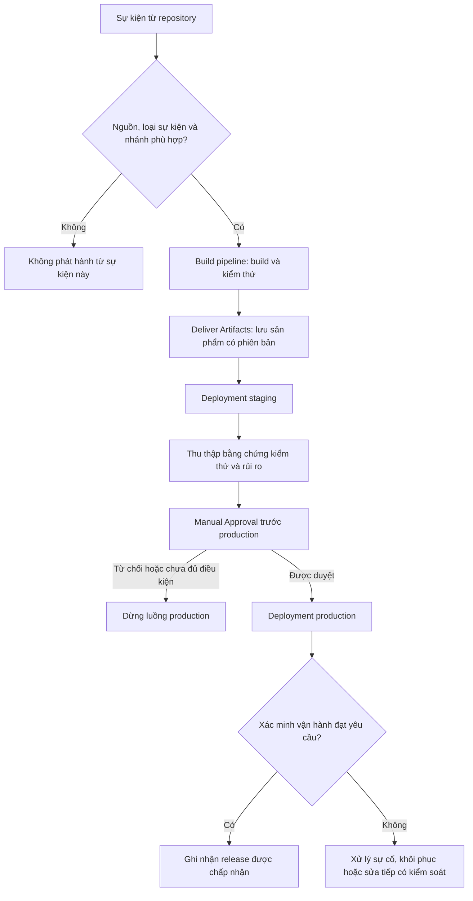

# Triggers, approvals và quản lý bản phát hành

## 1. Mục tiêu: tự động khởi chạy nhưng vẫn kiểm soát được việc phát hành

Trong chương **DevOps và CI/CD trên OCI** của module **CLOUD_PROVIDERS_ORACLE**, một pipeline không chỉ cần build thành công. Nhóm vận hành còn phải biết vì sao pipeline được chạy, ai cho phép triển khai, sản phẩm nào đã được đưa lên môi trường và có thể quay lại phiên bản nào khi xảy ra lỗi.

Ba cơ chế phối hợp để giải quyết bài toán đó:

- **Trigger** tiếp nhận một sự kiện và quyết định có khởi chạy pipeline hay không.
- **Approval** đặt một điểm quyết định trước hành động có ảnh hưởng, thường là triển khai lên môi trường được bảo vệ.
- **Quản lý bản phát hành** gắn mã nguồn, artifact, cấu hình, bằng chứng kiểm thử, quyết định phê duyệt và kết quả triển khai thành một hồ sơ có thể truy vết.

Bối cảnh xuyên suốt là dịch vụ Java `orders-service` chạy trên hạ tầng OCI. Ứng dụng được build thành JAR hoặc container image, kiểm thử ở staging và chỉ được triển khai production sau khi đáp ứng điều kiện phát hành. Production có thể là Compute, OKE hoặc đích được deployment pipeline hỗ trợ; cách cấu hình từng chiến lược triển khai phụ thuộc loại đích.

Các cấu hình và hồ sơ trong bài là ví dụ học tập, chưa được thực thi trên tenancy của người học. Không có yêu cầu tạo một hệ thống phát hành thật chỉ để đọc hoặc áp dụng kiến thức này.

## 2. Phân biệt sự kiện, build, deployment và release

| Khái niệm | Trả lời câu hỏi nào? | Ví dụ |
| --- | --- | --- |
| Sự kiện nguồn | Chuyện gì vừa xảy ra? | Có commit được push vào nhánh chính |
| Build run | Mã nguồn đã được chuyển thành sản phẩm thế nào? | Biên dịch, kiểm thử và xuất bản JAR phiên bản xác định |
| Deployment | Sản phẩm được đưa vào môi trường nào, bằng cách nào? | Triển khai artifact đó lên nhóm Compute staging |
| Approval | Quyết định cho phép bước nào tiếp tục? | Duyệt một deployment production đang chờ |
| Release | Thay đổi nào được chấp nhận đưa vào sử dụng, với hồ sơ nào? | Bản `orders-2026.11.21.1` cùng artifact, cấu hình và kết quả xác minh |

Một release có thể liên quan đến nhiều deployment, chẳng hạn staging, production và một lần khôi phục. Một build run cũng có thể được dùng cho nhiều môi trường nếu cùng artifact được bàn giao qua các bước.

Trong bài, **release** là khái niệm quản trị của nhóm, không phải khẳng định OCI DevOps luôn cung cấp một đối tượng native bao trùm mọi trường trong hồ sơ release. Nhóm có thể lưu hồ sơ ở hệ thống thay đổi, kho metadata hoặc công cụ được chọn, đồng thời liên kết đến các build run và deployment trên OCI.

Không đồng nhất ba kết quả sau:

- Build thành công: công việc tạo sản phẩm đã đạt điều kiện của build pipeline.
- Deployment thành công: công việc triển khai đã đạt điều kiện được cấu hình cho deployment đó.
- Release được chấp nhận: sản phẩm đã được xác minh về vận hành và thỏa các điều kiện phát hành của nhóm.

Ví dụ, tiến trình Java khởi động được chưa chứng minh kết nối Oracle Database, quyền IAM hoặc luồng đặt hàng hoạt động đúng. Các điều kiện chấp nhận phải phản ánh hành vi của dịch vụ.

## 3. Luồng phối hợp trong OCI DevOps



OCI DevOps có trigger gắn với nguồn mã và build pipeline. Trong build pipeline, các stage như Managed Build, Deliver Artifacts và Trigger Deployment đảm nhiệm các vai trò khác nhau. Manual Approval là một loại stage trong deployment pipeline; nó không phải một trường tùy ý thêm vào `build_spec.yaml`.

Sơ đồ thể hiện quan hệ trách nhiệm. Nó không yêu cầu mọi nhóm phải triển khai staging và production trong cùng một deployment pipeline. Có thể chọn:

1. Một deployment pipeline có các bước staging, kiểm tra, approval rồi production.
2. Pipeline staging và production riêng, với một cơ chế bàn giao release candidate đã được xác nhận.

Phương án thứ hai cần bảo đảm production nhận đúng artifact và cấu hình đã được kiểm thử. Nếu chỉ truyền tên nhánh hoặc tag thay đổi được, liên kết giữa hai pipeline chưa đủ chặt.

Ở cả hai phương án, approval phải nằm trên mọi đường thực thi dẫn tới deployment production cần bảo vệ. Một nhánh song song triển khai production trực tiếp vẫn có thể làm vô hiệu ý nghĩa của approval đặt ở nhánh khác.

## 4. Thiết kế trigger theo ý nghĩa sự kiện

### 4.1. Trigger là điều kiện khởi chạy, không phải quyết định phát hành

Một trigger phù hợp cần xác định ít nhất:

- Repository hoặc nguồn kết nối được phép phát sinh sự kiện.
- Loại sự kiện mà connector và OCI DevOps hỗ trợ.
- Điều kiện nhánh hoặc bộ lọc được hỗ trợ.
- Build pipeline đích.
- Cách xác định phiên bản mã nguồn của lần chạy.
- Quyền và credential cần để dịch vụ tiếp nhận sự kiện, đọc nguồn.

Khả năng sự kiện và bộ lọc khác nhau giữa OCI Code Repositories và các nhà cung cấp Git bên ngoài. Không suy luận rằng một tùy chọn có ở GitHub cũng có cùng tên hoặc cùng ngữ nghĩa ở mọi connector.

Đặc biệt, không giả định mọi nguồn đều có sẵn trigger theo tag, lịch, đường dẫn thay đổi hoặc mọi trạng thái pull request. Nếu dịch vụ không cung cấp bộ lọc cần thiết, phải thiết kế thêm kiểm tra hoặc điều phối phù hợp, thay vì nhập một cấu hình không thuộc schema.

### 4.2. Ma trận chính sách kích hoạt

Bảng sau mô tả **chính sách của nhóm**, không phải cú pháp bộ lọc để sao chép trực tiếp vào OCI:

| Sự kiện theo chính sách | Công việc nên khởi chạy | Có xuất bản để phát hành production không? |
| --- | --- | --- |
| Thay đổi trên nhánh tính năng | Biên dịch và kiểm thử nhanh nếu cần | Không mặc nhiên |
| Pull request được tạo hoặc cập nhật | Kiểm tra chất lượng nguồn được đề xuất | Không cấp quyền phát hành chỉ vì có PR |
| Commit hợp lệ vào nhánh chính được bảo vệ | Build ứng viên, lưu artifact và kiểm thử staging | Chỉ tạo ứng viên cho quy trình phát hành |
| Nhóm chọn một phiên bản để phát hành | Luồng production với artifact đã xác định | Có, sau các kiểm tra và approval bắt buộc |
| Cần triển khai lại hoặc khôi phục | Luồng vận hành được cấp quyền | Dùng artifact đã biết, không tự build lại từ đầu nhánh |

Nếu chính sách dùng tag phát hành, cần kiểm tra nguồn sự kiện có hỗ trợ cách kích hoạt đó không. Tag cũng cần được bảo vệ và giải quyết thành commit/artifact cụ thể. Chỉ đặt tên tag giống phiên bản không tạo ra quyền phát hành hay tính bất biến.

### 4.3. Phân biệt push, pull request và merge

Một commit trên nhánh tính năng có thể gây cả sự kiện push và cập nhật PR. Một merge có thể dẫn đến sự kiện liên quan PR và một push lên nhánh đích. Nếu cấu hình hai trigger không phân biệt mục tiêu, cùng thay đổi có thể bị build hoặc triển khai nhiều lần.

Sự kiện PR đóng cũng không nhất thiết có nghĩa PR đã được merge. Phải đọc đúng ngữ nghĩa sự kiện mà nguồn cung cấp, rồi đối chiếu với chính sách của nhóm.

Với PR, cần xác định pipeline kiểm thử commit nguồn hay một phiên bản hợp nhất thử. Hai trường hợp cho bằng chứng khác nhau. Hồ sơ build phải ghi commit thực tế được dùng, không chỉ tên PR hoặc tên nhánh.

### 4.4. Nhánh được bảo vệ vẫn cần kiểm tra quyền sửa pipeline

Bảo vệ nhánh chính giúp kiểm soát mã được đưa vào luồng phát hành, nhưng build specification và script triển khai cũng là mã có thể chạy với quyền CI/CD. Người sửa những file đó có thể thay hành vi phát hành dù không sửa mã Java.

Cần review thay đổi đối với specification, Dockerfile, script, Terraform và tài nguyên cấu hình pipeline. Giới hạn quyền cập nhật pipeline trên OCI cùng với quyền sửa repository; hai lớp này không thay thế nhau.

## 5. Nguồn tin cậy, sự kiện trùng và quan hệ nhân quả

### 5.1. Không tin payload chỉ vì nó chứa tên repository quen thuộc

Nếu dùng connector native, thiết lập kết nối và credential theo cơ chế của dịch vụ, đồng thời giới hạn phạm vi truy cập repository. Nếu nhóm tự xây webhook receiver, phải xác thực sự kiện theo cơ chế của nhà cung cấp, bảo vệ secret và kiểm tra nguồn đích trước khi gọi OCI DevOps.

Không nhận tùy ý một URL repository, pipeline OCID hoặc artifact version từ payload bên ngoài rồi dùng danh tính có quyền production để chạy chúng. Các giá trị đó phải được kiểm tra hoặc ánh xạ theo một tập cấu hình được tin cậy.

Mã nguồn PR từ bên ngoài có thể chứa lệnh đọc biến môi trường hoặc gửi dữ liệu ra mạng. Luồng kiểm thử nguồn chưa tin cậy phải có bộ quyền và secret phù hợp với mức tin cậy ấy. Approval sau build không thu hồi được một secret đã bị lộ trong lúc build.

### 5.2. Sự kiện có thể được gửi lại

Hãy thiết kế để xử lý trường hợp hệ thống nguồn gửi lại sự kiện, một thao tác bị retry hoặc người vận hành bấm chạy lại. Không giả định trigger tạo đúng một build và đúng một deployment trong mọi tình huống.

Nếu có lớp điều phối riêng, khóa chống trùng có thể gồm:

```text
source_provider + repository_id + event_id + pipeline_id
```

Đó là khóa minh họa ở lớp tích hợp, không phải tên một trường native bắt buộc của OCI trigger. Để nhận diện hai sự kiện khác nhau nhưng cùng chỉ một thay đổi, có thể cần thêm chính sách dựa trên commit, mục đích chạy và môi trường đích.

Không chống trùng chỉ bằng commit cho mọi hoạt động: cùng commit có thể cần build lại có chủ đích hoặc triển khai sang một môi trường khác. Ngược lại, cùng release được yêu cầu hai lần vào production không nên tự tạo hai thao tác thay đổi không kiểm soát.

### 5.3. Giữ chuỗi định danh xuyên suốt

Một chuỗi truy vết hữu ích là:

```text
event → repository + commit → build run → artifact identity
      → release candidate → deployment → approval → verification
```

Giữ định danh đầy đủ của OCI build run và deployment, cùng repository/commit, artifact version hoặc digest và release ID của nhóm. Không dùng riêng display name vì tên có thể trùng hoặc thay đổi.

Đối với sự kiện tới chậm, cần biết bản phát hành mới hơn đã được chấp nhận chưa. Một pipeline cũ vừa hết chờ approval không được tự ghi đè production mà không kiểm tra trạng thái hiện tại và chính sách thứ tự phát hành.

## 6. Chuẩn bị release candidate trước khi xin duyệt

### 6.1. Chọn artifact có định danh đủ chặt

Để phê duyệt có ý nghĩa, người duyệt phải biết chính xác sản phẩm sẽ được triển khai:

| Sản phẩm | Định danh cần giữ | Rủi ro khi chỉ dùng tên chung |
| --- | --- | --- |
| JAR trong Artifact Registry | Repository, artifact path, version và checksum | Cùng tên file có thể trỏ đến nhiều nội dung |
| Container image trong Container Registry | Repository và digest; tag có thể được ghi kèm | Một tag có thể thay đổi nội dung được trỏ tới |
| Gói cấu hình triển khai | Phiên bản hoặc revision, cùng nội dung cần kiểm soát | Cấu hình mới có thể khác bản đã kiểm thử |
| Mã hạ tầng liên quan | Commit/revision và kế hoạch thay đổi tương ứng | Deploy ứng dụng có thể đi kèm thay đổi mạng hoặc quyền chưa được duyệt |

Build một lần rồi dùng cùng artifact qua các môi trường giúp bảo toàn liên kết giữa kiểm thử và phát hành. Nếu cần build lại, hãy coi đó là một sản phẩm mới cần được xác minh theo chính sách, dù source commit không đổi.

Không đặt tag `latest` hoặc tên nhánh làm định danh duy nhất của một release được duyệt. Với container, ghi nhận digest nội dung giúp tránh việc tag bị chuyển sau thời điểm kiểm thử. Với JAR, checksum giúp phát hiện nội dung khác với bản được chấp nhận; nó không thay thế kiểm soát quyền ghi repository.

Ví dụ kiểm tra JAR trong một thư mục bàn giao dùng Bash:

```bash
set -euo pipefail
# app.jar.sha256 chứa checksum và tên file app.jar trong thư mục này.
sha256sum --check app.jar.sha256
```

Lệnh chỉ kiểm tra sự khớp giữa file và checksum đã nhận. Nếu cả hai bị thay bằng một bộ khác, phép kiểm tra vẫn có thể thành công. Nguồn hồ sơ checksum và quyền thay đổi artifact phải được bảo vệ.

### 6.2. Bàn giao dữ liệu giữa build và deployment

Trong OCI DevOps, giá trị tạo ra ở build có thể được xuất qua cơ chế exported variables, rồi được ánh xạ vào cấu hình artifact hoặc đầu vào của stage theo khả năng tương ứng. Cần cấu hình việc thay thế/tham chiếu biến rõ ràng; chỉ tạo một biến trong shell không làm mọi deployment tự nhận nó.

Ở điểm bàn giao phải kiểm tra:

- Artifact đã được xuất bản thành công trước khi deployment dùng nó.
- Artifact path/version hoặc digest được giải quyết đúng, không còn placeholder.
- Các giá trị được truyền đúng tên và đúng phạm vi.
- Deployment không tự lấy đầu nhánh hoặc build lại thay cho dùng sản phẩm đã chọn.
- Môi trường đích và danh tính triển khai thuộc phạm vi được phép.

Một release ID của nhóm có thể xuất hiện trong log và metadata để nối các bản ghi. Tuy nhiên, chỉ truyền `release_id` là chưa đủ nếu hệ thống vẫn giải quyết nó đến một artifact có thể thay đổi mà không kiểm soát.

### 6.3. Hồ sơ release minh họa

Mẫu YAML dưới đây là **schema nội bộ minh họa**, không phải build specification, deployment specification hay payload OCI API:

```yaml
schema_version: 1
release_id: orders-2026.11.21.1
service: orders-service

source:
  repository: "<repository-duoc-phe-duyet>"
  commit: "<full-git-commit>"

build:
  run_ocid: "<oci-build-run-ocid>"

artifact:
  kind: container_image
  uri: "<registry-domain>/<tenancy-namespace>/orders-service@sha256:<digest>"
  digest: "sha256:<64-hex-characters>"

configuration:
  revision: "<configuration-revision>"
  database_change_id: "<change-id-hoac-none>"

staging:
  deployment_ocid: "<staging-deployment-ocid>"
  verification_evidence: "<tham-chieu-bang-chung-kiem-thu>"

production:
  target_compartment_ocid: "<production-compartment-ocid>"
  deployment_ocid: "<production-deployment-ocid>"

recovery:
  previous_release_id: "<previous-accepted-release>"
  procedure_revision: "<recovery-runbook-revision>"
```

Thay toàn bộ placeholder trước khi sử dụng. Với JAR, thay phần artifact bằng repository/path/version/checksum tương ứng; không dùng nguyên URI image cho một pipeline triển khai binary.

Hồ sơ phải có cơ chế quản lý thay đổi và quyền đọc/ghi phù hợp. Không lưu mật khẩu Oracle Database, private key, token hay nội dung secret vào manifest. Tham chiếu cấu hình không có nghĩa là ghi mọi giá trị nhạy cảm thành văn bản công khai.

## 7. Manual Approval trong deployment pipeline

### 7.1. Approval được đặt ở đâu?

OCI DevOps hỗ trợ Manual Approval stage để yêu cầu quyết định trước khi các stage phụ thuộc được tiếp tục. Có thể cấu hình chính sách số lượng phê duyệt theo khả năng của stage và phân quyền người được thao tác thông qua IAM.

Một bố trí hợp lý cho ví dụ:

```text
Deploy staging
    → Verify staging
    → Manual Approval
    → Deploy production
    → Verify production
```

Đây là thứ tự logic. Nếu bước xác minh dùng công cụ ngoài hoặc stage thực thi riêng, phải bảo đảm kết quả của nó thực sự chặn luồng khi không đạt; một đường dẫn đến báo cáo nhưng luôn trả thành công không tạo ra quality gate.

Không đặt approval sau khi production đã được thay đổi rồi gọi đó là kiểm soát trước triển khai. Một quyết định chấp nhận sau triển khai có vai trò khác và có thể vẫn cần thiết, nhưng không ngăn được tác động đã xảy ra.

### 7.2. Người duyệt cần nhìn thấy gì?

Mỗi yêu cầu phê duyệt nên đưa ra một tập thông tin cụ thể:

| Nội dung | Mục đích |
| --- | --- |
| Release ID và deployment OCID | Xác định đúng lần thực thi cần duyệt |
| Commit và build run | Truy vết nguồn và quá trình tạo sản phẩm |
| Artifact version/digest/checksum | Biết chính xác nội dung sẽ được triển khai |
| Môi trường, region, compartment và đích | Tránh duyệt nhầm staging với production |
| Kết quả kiểm thử và kiểm tra bảo mật bắt buộc | Đối chiếu điều kiện phát hành |
| Thay đổi cấu hình và dependency | Nhận biết tác động ngoài mã ứng dụng |
| Rủi ro, kế hoạch khôi phục và chủ thể trực | Biết cách xử lý nếu xác minh thất bại |
| Thời hạn hoặc cửa sổ triển khai theo quy trình | Tránh áp dụng quyết định trong ngữ cảnh đã hết hiệu lực |

Người duyệt không cần tự chạy lại toàn bộ pipeline. Họ cần đủ bằng chứng để đánh giá phạm vi tác động, sự đáp ứng điều kiện và khả năng khôi phục. Không dùng một liên kết báo cáo thay đổi được mà không gắn với lần build tương ứng.

### 7.3. Số phiếu không tự tạo ra phân tách trách nhiệm

Nếu chính sách yêu cầu hai người duyệt, phải kiểm tra cả số quyết định và danh tính có thẩm quyền. Cấu hình số lượng approvals không tự chứng minh rằng người sửa mã, người sửa pipeline và người duyệt là các chủ thể độc lập theo chính sách của nhóm.

Các yêu cầu như “tác giả không tự duyệt”, “phải có đại diện vận hành” hoặc “một người thuộc nhóm quản trị dữ liệu” cần được đối chiếu với khả năng enforcement thực tế. Nếu native stage và IAM không biểu diễn đầy đủ, phải bổ sung một quy trình hoặc cơ chế kiểm tra có thể thực thi yêu cầu đó; không mặc định chúng đã được bảo đảm.

Đồng thời, người có quyền sửa pipeline hoặc tăng quyền IAM có thể thay đổi chính hàng rào phê duyệt. Vì vậy cần kiểm soát và ghi nhận thay đổi cấu hình kiểm soát, không chỉ thao tác bấm Approve.

### 7.4. Thực hiện quyết định trên đúng deployment

Người có quyền sử dụng giao diện hoặc API/CLI được hỗ trợ để xử lý approval của stage đang chờ. Trước khi thao tác, đối chiếu deployment OCID, stage và artifact đang gắn với yêu cầu.

Một thông báo qua email hoặc hệ thống chat có thể giúp người duyệt đến đúng màn hình. Nội dung “đồng ý” trong một kênh khác không mặc nhiên là quyết định native mà OCI DevOps đã tiếp nhận.

Nếu xây tích hợp nhận quyết định từ hệ thống ngoài, cần xác thực người duyệt, quyền, deployment/stage đích và trạng thái hiện tại. Không để một liên kết chung có thể phê duyệt bất kỳ deployment nào hoặc cho phép một callback cũ tác động vào lần chạy mới.

### 7.5. Từ chối, hủy và yêu cầu hết hiệu lực

Khi bị từ chối, luồng production được bảo vệ phải không tiếp tục. Ghi lý do và xác định cần sửa mã, bổ sung bằng chứng hay tạo ứng viên mới. Không bỏ stage approval để chạy lại cho tới khi trạng thái xanh.

Phân biệt các trường hợp:

- **Từ chối:** người có thẩm quyền chủ động không chấp nhận ứng viên trong ngữ cảnh hiện tại.
- **Hủy:** lần chạy không còn cần tiếp tục, chẳng hạn được thay bởi ứng viên mới hơn.
- **Chờ quá lâu:** chưa có quyết định đúng thời điểm; không có nghĩa là mặc nhiên được duyệt.

Nếu chính sách yêu cầu approval hết hạn sau một khoảng thời gian, phải có cơ chế thực thi. Chỉ ghi `expires_at` trong hồ sơ nội bộ không khiến OCI tự dừng stage. Dùng cấu hình thời hạn được hỗ trợ nếu phù hợp, hoặc một cơ chế điều phối/quy trình kiểm tra rõ ràng.

Sau thời gian chờ dài, cần kiểm tra lại trạng thái production, bằng chứng và điều kiện triển khai. Nếu artifact, cấu hình hoặc phạm vi triển khai đã đổi, không tái sử dụng quyết định cũ như thể người duyệt đã chấp nhận nội dung mới.

### 7.6. Approval gắn với ngữ cảnh, không chỉ một cái tên

Một quyết định nên được hiểu là chấp nhận tổ hợp:

```text
release + artifact identity + configuration revision
        + target environment + deployment context
```

Ví dụ, người duyệt chấp nhận image digest A với cấu hình C ở production. Nếu tag được chuyển sang digest B hoặc một tham số deployment bị đổi sang cấu hình D, đó là ngữ cảnh khác cần xử lý theo chính sách phê duyệt.

Native approval không nên bị diễn giải thành một chữ ký độc lập xác nhận mọi file trong hệ thống quản lý release. Hệ thống phải bảo đảm các đầu vào được duyệt không bị thay đổi ngoài kiểm soát trước khi sử dụng. Khi cần đổi đầu vào, ưu tiên tạo hoặc cập nhật luồng có thể review lại rõ ràng, thay vì giả định quyết định cũ bao phủ mọi thay đổi.

## 8. IAM và phân tách trách nhiệm

Trong OCI, project và pipeline nằm trong một phạm vi compartment, còn artifact, Vault, Compute, OKE hoặc database có thể nằm ở các compartment khác. Quyền xem pipeline không tự kéo theo quyền triển khai hay quyền đọc secret.

Một ma trận vai trò có thể thiết kế như sau:

| Chủ thể | Trách nhiệm | Phạm vi cần giới hạn |
| --- | --- | --- |
| Người phát triển | Đề xuất mã và theo dõi build | Repository, log được phép xem; không tự có quyền production |
| Danh tính thực thi build | Đọc nguồn, tạo và xuất bản artifact | Secret và repository cần cho build |
| Người vận hành release | Chọn ứng viên, khởi chạy luồng được phép | Pipeline và môi trường được giao |
| Người duyệt production | Xem bằng chứng, approve/reject đúng lần chạy | Quyền approval theo IAM, cùng phạm vi đọc thông tin cần thiết |
| Danh tính thực thi deployment | Thực hiện thay đổi lên đích | Compute/OKE và tài nguyên liên quan của môi trường đích |
| Người quản trị pipeline/IAM | Sửa cơ chế điều phối hoặc quyền | Quyền được kiểm soát và có lịch sử thay đổi |

Đây là mô hình trách nhiệm để thiết kế policy, không phải danh sách tên role có sẵn cần tạo nguyên xi. Cần đối chiếu quyền IAM thực tế với từng thao tác và cơ chế resource principal/dynamic group phù hợp của dịch vụ.

Một tham số `environment=production` hoặc một tag trên pipeline không phải ranh giới phân quyền. Danh tính thực thi phải thực sự chỉ có quyền lên tài nguyên thuộc phạm vi được giao. Khi staging và production cần mức kiểm soát khác nhau, có thể tách pipeline, compartment và danh tính theo thiết kế.

Bảo vệ cả quyền sửa trigger: đổi repository nguồn, pipeline đích hoặc bộ lọc có thể làm mã ngoài dự kiến đi vào luồng có quyền cao. Các thay đổi này cần được quản lý như thay đổi cấu hình phát hành.

Nếu cần cơ chế khẩn cấp, xác định trước ai được dùng, phạm vi được tác động và bằng chứng phải bổ sung. Ngoại lệ có kiểm soát phải để lại lịch sử; không biến một tài khoản quản trị dùng chung thành cách thường xuyên vượt approval.

## 9. Phát hành đồng thời, thứ tự và kiểm tra trước khi triển khai

Giả sử release A chờ duyệt, sau đó release B đã được phát hành thành công. Nếu A được duyệt muộn, production có thể bị đưa về nội dung cũ ngoài ý định. Approval không tự giải quyết mọi tranh chấp giữa nhiều deployment hoặc nhiều pipeline.

Nhóm cần một chính sách cho mỗi môi trường:

- Cho phép tối đa bao nhiêu deployment thay đổi môi trường cùng lúc?
- Ứng viên cũ có được tiếp tục sau khi ứng viên mới được chấp nhận không?
- Khóa điều phối được lấy và giải phóng thế nào khi tiến trình lỗi?
- Ai có thể yêu cầu rollback có chủ đích về phiên bản cũ?

Một thiết kế dùng lớp điều phối riêng có thể có logic sau:

```text
nhận release candidate đã có bằng chứng
→ chờ quyết định phê duyệt cho đúng ngữ cảnh
→ lấy quyền điều phối độc quyền trên môi trường
→ kiểm tra lại approval, artifact, cấu hình và release hiện hành
→ triển khai nếu chính sách thứ tự cho phép
→ xác minh và ghi kết quả
→ giải phóng quyền điều phối
```

Đây là mã giả về trách nhiệm, không phải các từ khóa stage native của OCI. Nếu yêu cầu khóa bền vững, phải chọn một cơ chế lưu trạng thái và kiểm soát đồng thời thật; một biến trong shell hoặc file local của build runner không khóa được nhiều pipeline.

Không giả định khóa sẽ được nhả chỉ khi luồng thành công. Cần xử lý hủy, timeout, tiến trình mất kết nối và chủ sở hữu khóa không còn hoạt động. Đồng thời, tránh lấy một khóa dài hạn trước approval rồi chặn mọi release khác nhiều giờ nếu đó không phải chính sách đã thiết kế.

Điểm kiểm tra ngay trước hành động phải xác nhận ứng viên chưa bị thay thế hoặc thay đổi phạm vi. Nếu cần phát hành phiên bản cũ có chủ đích, ghi rõ đó là rollback/redeployment được cấp quyền, thay vì giả mạo nó thành bản mới nhất.

## 10. Vòng đời bản phát hành và bằng chứng cần giữ

Nhóm nên có một mô hình trạng thái để biết ứng viên đang ở đâu. Bảng dưới là **mô hình nội bộ minh họa**, không phải danh sách trạng thái API của OCI DevOps:

| Trạng thái của release | Điều kiện để ghi nhận | Bằng chứng chính |
| --- | --- | --- |
| Candidate | Có sản phẩm đã xuất bản và định danh nguồn | Commit, build run, artifact identity |
| Verified in staging | Kiểm tra bắt buộc ở staging đạt yêu cầu | Deployment staging và kết quả kiểm thử |
| Waiting for approval | Hồ sơ đủ để xin quyết định | Ngữ cảnh và yêu cầu phê duyệt cụ thể |
| Authorized | Quyết định đúng thẩm quyền, còn hiệu lực | Người duyệt, thời gian, deployment và phạm vi |
| Deploying | Bắt đầu tác động môi trường đích | Deployment OCID và trạng thái thực thi |
| Accepted | Xác minh production đạt tiêu chí | Kết quả kiểm tra chức năng và vận hành |
| Rejected | Ứng viên bị từ chối | Lý do và quyết định |
| Failed | Build/deploy/verification không đáp ứng điều kiện | Lỗi, mức ảnh hưởng và hành động tiếp theo |
| Superseded | Ứng viên được thay bởi lựa chọn khác | Release thay thế và quyết định hủy/chặn |
| Rolled back | Đã thực hiện khôi phục và xác minh | Release đích khôi phục, deployment và kết quả |

Đồng bộ hồ sơ nội bộ với kết quả OCI bằng định danh và thông tin thực tế, không chỉ bằng tên hiển thị. Nếu lấy trạng thái tự động qua API hoặc sự kiện, phải xử lý việc gửi lại và cập nhật đến không đúng thứ tự.

Ví dụ, một thông báo “deployment bắt đầu” đến muộn không được ghi đè hồ sơ “đã xác minh thành công”. Trạng thái không rõ sau lỗi kết nối cũng không nên bị đổi thành “chưa triển khai”; trước khi chạy lại, cần truy vấn và xác định thực tế đã bị tác động đến đâu.

Giữ riêng hai câu hỏi khi vận hành:

1. Release nào gần nhất đã được chấp nhận?
2. Hạ tầng hiện tại đang thực sự chạy artifact/cấu hình nào?

Hai câu trả lời có thể khác trong lúc triển khai từng phần hoặc xử lý sự cố. Một cơ sở dữ liệu metadata chỉ ghi “last successful” chưa đủ mô tả trạng thái đang triển khai dở.

## 11. Khôi phục bản phát hành và thay đổi Oracle Database

### 11.1. Chuẩn bị phương án trước khi duyệt

Hồ sơ release cần xác định phiên bản trước có thể sử dụng, artifact còn truy xuất được, cấu hình tương ứng và cách xác minh sau khôi phục. Nếu repository đã xóa artifact cũ, thông tin “rollback về bản trước” chưa phải một kế hoạch có thể thực hiện.

Một chuỗi khôi phục ứng dụng có thể gồm:

1. Xác định mức ảnh hưởng và ngăn các phát hành mới xung đột.
2. Chọn artifact/cấu hình đã biết tương thích.
3. Xin quyết định theo quy trình thường hoặc ngoại lệ khẩn cấp được cấp quyền.
4. Thực hiện deployment khôi phục.
5. Xác minh chức năng, lỗi và kết nối dịch vụ phụ thuộc.
6. Ghi lại phiên bản thực tế và kết quả xử lý sự cố.

Không rebuild artifact cũ từ đầu nhánh rồi giả định đó là đúng binary từng chạy. Nếu cần build lại, phải nhận diện và xác minh sản phẩm mới theo mức rủi ro phù hợp.

Khả năng rollback tự động hay chuyển traffic phụ thuộc chiến lược và loại đích được pipeline hỗ trợ. Không giả định mọi deployment Compute hoặc OKE đều có sẵn cùng cơ chế canary, blue-green hay tự khôi phục.

### 11.2. Rollback ứng dụng không tự rollback dữ liệu

Với ứng dụng Java dùng Oracle Database, phiên bản cũ có thể không chạy được sau một thay đổi schema không tương thích. Việc đưa image cũ trở lại không tự hoàn tác dữ liệu đã ghi hoặc migration đã thực hiện.

Ví dụ, release mới xóa một cột mà phiên bản cũ vẫn truy vấn. App rollback có thể làm lỗi tăng dù deployment artifact thành công. Cần xem xét đồng thời:

- Tương thích giữa schema hiện tại và ứng dụng cũ/mới.
- Trường hợp hai phiên bản ứng dụng cùng chạy trong một giai đoạn chuyển tiếp.
- Migration có khả năng chạy lại an toàn hay không.
- Cách kiểm tra migration đã chạy một phần hoặc đã hoàn tất.
- Nhu cầu sao lưu/khôi phục dữ liệu và tác động lên giao dịch đã phát sinh.

Thiết kế **expand–migrate–contract** có thể giảm rủi ro: bổ sung cấu trúc tương thích trước, chuyển dần việc đọc/ghi, chỉ loại bỏ cấu trúc cũ khi không còn cần. Đây là nguyên tắc thiết kế migration, không bảo đảm mọi thay đổi đều đảo ngược được.

Phương án khôi phục dữ liệu phải được đánh giá riêng theo dịch vụ database, yêu cầu thời gian khôi phục và mức mất dữ liệu có thể chấp nhận. Không tự restore database production chỉ vì deployment ứng dụng bị lỗi; cần đánh giá ảnh hưởng và quyền thực hiện của quy trình đó.

### 11.3. Hủy pipeline không hoàn tác mọi thay đổi

Hủy một deployment đang chạy không chứng minh các máy đã được cập nhật trở lại như cũ, secret đã được thu hồi hay migration đã được đảo ngược. Cần kiểm kê phần việc đã thực hiện và xác minh trạng thái thật trước khi quyết định tiếp tục, rollback hay sửa tiếp.

Nếu một stage đã tạo Compute hoặc tài nguyên kiểm thử, việc pipeline kết thúc không mặc nhiên xóa chúng. Trách nhiệm dọn dẹp phải được thiết kế cho cả nhánh thành công, thất bại và hủy.

## 12. Quan sát trigger, approval và release

### 12.1. Ghép log thực thi với lịch sử kiểm soát

Dùng thông tin build run/deployment và log được cấu hình trên OCI để theo dõi lệnh, stage, thời điểm và lỗi. OCI Audit hỗ trợ truy vết các lời gọi OCI API được dịch vụ ghi nhận; nó không thay thế log shell, báo cáo kiểm thử hoặc lịch sử review trong Git.

Khi điều tra, có thể cần ghép:

- Sự kiện và lịch sử giao nhận ở hệ thống Git/connector.
- Cấu hình trigger và pipeline tại thời điểm liên quan.
- Build run, commit thực tế và kết quả giao nhận artifact.
- Deployment, stage approval và chủ thể thực hiện quyết định.
- Artifact identity, cấu hình và đối tượng đích.
- Log ứng dụng, metric và kết quả xác minh sau triển khai.

Chỉ cấp quyền xem log và metadata theo nhu cầu. Payload, đường dẫn nội bộ hoặc thông báo lỗi có thể chứa thông tin nhạy cảm; không dùng việc ghi log toàn bộ secret để “đủ bằng chứng”.

### 12.2. Thông báo hỗ trợ phản ứng, không thay quyền phê duyệt

Có thể tích hợp cảnh báo/thông báo với các cơ chế OCI và hệ thống vận hành được phép sử dụng. Cần đối chiếu những sự kiện mà dịch vụ thực sự cung cấp, thay vì giả định mọi trạng thái tùy ý của release nội bộ đều phát ra một OCI event native.

Nội dung hữu ích gồm môi trường, release ID, build/deployment OCID, kết quả và liên kết đến hồ sơ được bảo vệ. Không đưa token, mật khẩu hoặc liên kết bí mật có quyền phê duyệt không giới hạn vào thông báo.

Không để thiếu một thông báo khiến quy trình mặc nhiên được chấp nhận. Trạng thái nguồn vẫn là kết quả đã xác thực trong hệ thống tương ứng.

### 12.3. Chỉ số giúp tìm điểm nghẽn

| Chỉ số | Điều có thể học được |
| --- | --- |
| Số lần chạy từ cùng thay đổi nguồn | Phát hiện trigger chồng chéo hoặc retry không kiểm soát |
| Thời gian từ commit đến artifact | Hiệu quả build và kiểm thử |
| Thời gian chờ approval | Khả năng đáp ứng của quy trình và chất lượng hồ sơ |
| Tỷ lệ approval bị từ chối | Vấn đề ở chuẩn bị ứng viên hoặc mức rủi ro |
| Tỷ lệ deployment/xác minh thất bại | Độ tin cậy của phát hành |
| Thời gian khôi phục | Khả năng thực hiện phương án phục hồi |
| Số ứng viên cũ bị chặn | Mức độ cạnh tranh và thứ tự phát hành |

Các chỉ số là tín hiệu để cải thiện quy trình, không phải lý do bỏ approval hoặc giảm kiểm thử chỉ để rút ngắn một con số. Thời gian chờ dài có thể do người duyệt thiếu bằng chứng, chứ không nhất thiết do thiếu tự động hóa.

Về chi phí, tránh dùng một lệnh build chạy vòng lặp chờ người duyệt. Dùng Manual Approval ở deployment pipeline và tổ chức các tác vụ tiêu thụ tài nguyên theo đúng vòng đời. Đồng thời, có chính sách giữ artifact/log và dọn tài nguyên tạm; giữ mọi ứng viên vô hạn làm tăng chi phí, còn xóa quá sớm có thể làm mất khả năng khôi phục.

## 13. Các lỗi thường gặp và cách phân biệt

| Hiện tượng | Nguyên nhân cần kiểm tra | Hướng xử lý |
| --- | --- | --- |
| Push nhưng không có build | Sai nguồn, kết nối, loại sự kiện, bộ lọc hoặc pipeline đích | Đối chiếu sự kiện thực tế và cấu hình trigger |
| Một thay đổi chạy nhiều pipeline giống nhau | Chồng trigger push/PR hoặc sự kiện được gửi lại | Tách mục tiêu chạy và thiết kế chống trùng theo ngữ cảnh |
| PR bên ngoài đọc được secret phát hành | Không tách nguồn chưa tin cậy với danh tính có quyền | Giảm quyền, tách luồng và xử lý secret đã lộ theo quy trình |
| Build thành công nhưng deployment lấy sai bản | Dùng tag trôi, tham số sai hoặc artifact chưa được giao nhận | Kiểm tra định danh artifact và ánh xạ giữa các stage |
| Pipeline không chờ approval | Quan hệ phụ thuộc sai hoặc có đường đi khác vào production | Kiểm tra mọi nhánh dẫn đến bước tác động production |
| Người được giao không duyệt được | IAM, danh tính, stage hoặc deployment không đúng trạng thái | Kiểm tra quyền và đúng lần chạy; không cấp rộng toàn tenancy |
| Đã đồng ý trong chat nhưng pipeline vẫn chờ | Quyết định chưa được ghi nhận qua cơ chế có hiệu lực | Thực hiện trên đúng stage hoặc tích hợp được xác thực |
| Release cũ được duyệt sau release mới | Thiếu chính sách thứ tự và kiểm tra trước triển khai | Chặn ứng viên đã bị thay thế hoặc xử lý như rollback được cấp quyền |
| Deployment báo thành công nhưng dịch vụ lỗi | Điều kiện thành công chưa kiểm tra hành vi cần thiết | Bổ sung xác minh chức năng, metric và dependency |
| Rollback app nhưng vẫn lỗi database | Schema/dữ liệu không tương thích | Đánh giá migration và phương án dữ liệu riêng |
| Hủy pipeline nhưng production thay đổi một phần | Một số hành động đã hoàn tất trước lúc hủy | Kiểm kê trạng thái thật rồi chọn hướng xử lý |

Khi điều tra, đừng tạo một ứng viên mới liên tục để che kết quả cũ. Giữ mối liên kết giữa thất bại, thay đổi sửa lỗi và lần chạy tiếp theo để người vận hành hiểu vì sao release hiện tại đủ điều kiện hơn.

## 14. Trình tự thực hành trong môi trường được cấp quyền

### Bước 1: chọn phạm vi thử nghiệm

Dùng repository, OCI DevOps project và môi trường không phục vụ production. Xác định region, compartment, danh tính build/deployment, repository artifact và người có quyền approval.

Chuẩn bị một artifact đã có hợp đồng đầu ra rõ. Không cần tạo database hoặc hạ tầng mới nếu mục tiêu thực hành chỉ là trigger và điểm duyệt.

### Bước 2: xác định chính sách sự kiện

Chọn một loại sự kiện được connector hỗ trợ, cùng điều kiện nhánh phù hợp. Viết rõ sự kiện nào chỉ kiểm tra mã và sự kiện nào được tạo release candidate.

Thực hiện một thay đổi nhỏ trong phạm vi đã chọn, rồi đối chiếu sự kiện với build run. Kiểm tra commit thực tế của lần build, không chỉ tên nhánh trong màn hình trigger.

### Bước 3: lưu artifact và hồ sơ nguồn gốc

Build, kiểm thử và giao nhận artifact vào repository đích. Ghi commit, build run, path/version hoặc digest và checksum phù hợp.

Nếu dùng một release manifest nội bộ, lưu nó ở nơi có quản lý quyền và lịch sử thay đổi. Các ví dụ YAML trong bài không tự tạo ra nơi lưu đó.

### Bước 4: dựng đường đi qua approval

Tạo luồng triển khai thử có bước xác minh rồi Manual Approval trước hành động đại diện cho production. Trong lab, hành động được bảo vệ có thể vẫn nhắm một môi trường thử riêng.

Cấu hình số approvals và IAM theo mục tiêu. Xác nhận mọi đường đi đến bước được bảo vệ đều phụ thuộc vào approval.

### Bước 5: thử cho phép và từ chối

Với một lần chạy, cung cấp đủ bằng chứng rồi duyệt bằng danh tính có quyền. Đối chiếu đúng artifact và đích sau khi bước tiếp theo được thực hiện.

Với một lần chạy khác, từ chối và xác nhận hành động được bảo vệ không tiếp tục. Không dùng production để thử xem một approval bị từ chối có thật sự chặn luồng hay không.

### Bước 6: thử ngữ cảnh bị thay thế

Tạo hai ứng viên trong phạm vi lab. Cho một ứng viên trở thành bản được chấp nhận, rồi xem quy trình xử lý ứng viên cũ còn chờ như thế nào.

Nếu chưa có enforcement tự động, ghi nhận điểm còn phải kiểm tra bằng quy trình vận hành. Không tuyên bố đã chống phát hành ngược thứ tự chỉ vì cả hai pipeline riêng lẻ đều thành công.

### Bước 7: hoàn thiện hồ sơ và trách nhiệm vận hành

Ghi lại liên kết sự kiện, build, artifact, deployment, người duyệt và xác minh. Xác định ai xử lý lỗi trigger, ai được thay đổi pipeline, ai quyết định khôi phục và ai dọn tài nguyên thử nghiệm.

Chỉ dọn tài nguyên thuộc phạm vi lab được tạo cho thực hành. Không xóa repository, artifact cũ hoặc tài nguyên hiện hữu đang phục vụ hệ thống khi chưa có chính sách giữ dữ liệu và quyền sở hữu rõ ràng.

## 15. Điều kiện để một luồng phát hành có thể vận hành

Trước khi dùng cho một môi trường quan trọng, cần có câu trả lời cụ thể cho những điểm sau:

- Trigger nhận đúng nguồn, loại sự kiện và phiên bản mã.
- Build từ nguồn chưa tin cậy không được hưởng quyền phát hành ngoài phạm vi.
- Artifact đã kiểm thử được nhận diện và giữ nguyên qua bước phê duyệt, triển khai.
- Người duyệt nhìn thấy artifact, cấu hình, môi trường, bằng chứng và phương án khôi phục.
- Approval được ghi nhận trên đúng deployment, với quyền và số quyết định phù hợp.
- Không có nhánh thực thi khác vượt qua điểm duyệt bắt buộc.
- Hai lần phát hành đồng thời và ứng viên cũ được xử lý theo chính sách rõ ràng.
- Kết quả triển khai được xác minh ở mức dịch vụ, không chỉ ở mức lệnh chạy.
- Có cách xác định trạng thái thật sau lỗi, hủy hoặc mất kết nối.
- Phương án khôi phục ứng dụng đã xét đến dữ liệu Oracle Database và tài nguyên liên quan.
- Log, artifact và hồ sơ phát hành có quyền truy cập, lịch sử và thời gian lưu thích hợp.

Trigger đưa thay đổi vào luồng tự động hóa; approval đặt trách nhiệm quyết định trước hành động cần kiểm soát; quản lý bản phát hành giữ liên kết giữa quyết định đó với sản phẩm và kết quả thật trên OCI. Khi các liên kết này rõ ràng, nhóm có thể phát hành có phân quyền, giám sát được tác động, kiểm soát chi phí và chuẩn bị tốt hơn cho việc duy trì tính sẵn sàng.
