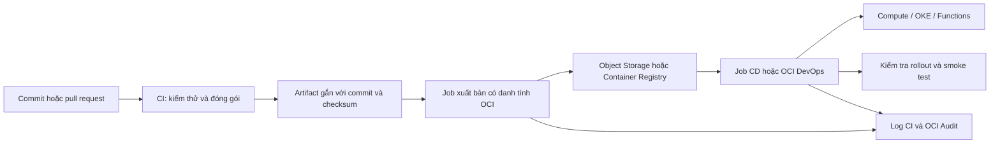
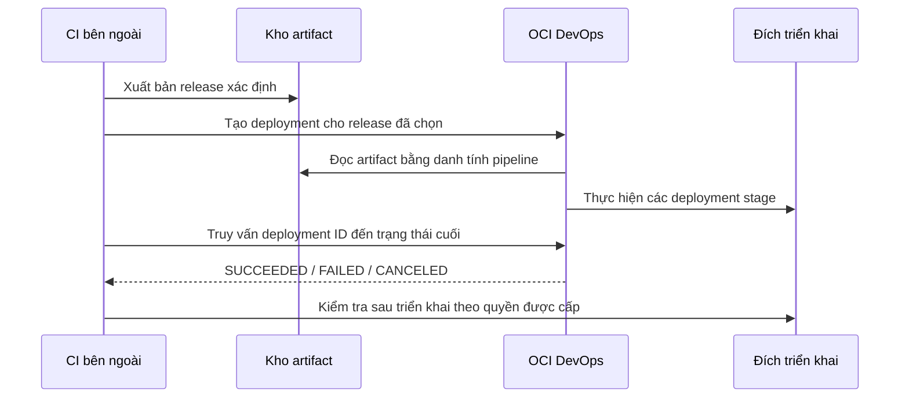

# Tích hợp GitHub Actions hoặc công cụ CI bên ngoài với OCI

## 1. Mục tiêu và phạm vi

Trong chương **DevOps và CI/CD trên OCI**, tích hợp công cụ CI bên ngoài giúp nhóm phát triển giữ quy trình kiểm thử ở GitHub Actions, GitLab CI hoặc Jenkins, đồng thời sử dụng Oracle Cloud Infrastructure làm nơi lưu artifact và vận hành ứng dụng.

Bài học tập trung vào đường nối giữa hệ thống CI và OCI: danh tính của job, quyền IAM, kết nối mạng, cách chuyển artifact và cách xác nhận kết quả. Từ đường nối này, nhóm có thể tiếp tục triển khai lên Compute, Oracle Kubernetes Engine (OKE), Functions hoặc gọi một deployment pipeline của OCI DevOps.

Sau bài học, người học có thể:

- Chọn cách xác thực phù hợp với vị trí runner và yêu cầu quản lý khóa.
- Giới hạn một pipeline vào đúng compartment, bucket và thao tác cần thiết.
- Thiết lập workflow GitHub Actions xuất bản artifact lên Object Storage.
- Phân biệt xuất bản artifact, gửi yêu cầu triển khai và triển khai thành công.
- Áp dụng cùng nguyên tắc cho một công cụ CI khác, có truy vết và kiểm soát chi phí.

Bài thực hành dùng một gói manifest nhỏ để quan sát toàn bộ luồng tích hợp mà chưa cần tạo Compute hay OKE. Với ứng dụng Java, thay bước đóng gói manifest bằng quá trình kiểm thử và đóng gói JAR của dự án; giữ nguyên cách chuyển và xác minh artifact.

## 2. Kiến trúc tích hợp và ranh giới trách nhiệm

### 2.1. Ba mô hình thường dùng

| Mô hình | Công cụ CI bên ngoài thực hiện | Thành phần thực hiện CD | Điểm cần quyết định |
| --- | --- | --- | --- |
| CI gọi trực tiếp dịch vụ OCI | Kiểm thử, đóng gói, xác thực, gọi CLI/SDK | Chính job CI | Job cần quyền và kết nối tới đích |
| CI bàn giao cho OCI DevOps | Kiểm thử, xuất bản artifact, tạo deployment | Deployment pipeline OCI DevOps | Tách danh tính bên gọi và danh tính pipeline |
| CI chạy trên runner tự quản trong OCI | Thực thi job trên Compute hoặc hạ tầng runner riêng | Job hoặc OCI DevOps | Cô lập runner, bảo vệ danh tính máy và kiểm soát mạng |

Đây là các lựa chọn thiết kế. Nhóm có thể kết hợp chúng, chẳng hạn GitHub Actions tạo artifact nhưng chỉ cấp cho job quyền yêu cầu OCI DevOps triển khai phiên bản đã được duyệt.



Trong sơ đồ, artifact là đầu ra cụ thể của một lần build. Một lệnh upload thành công mới chứng minh artifact đã tới kho lưu trữ; nó chưa chứng minh ứng dụng đang phục vụ lưu lượng bằng phiên bản đó.

### 2.2. Bốn điều kiện để một lời gọi hoạt động

Một job gọi OCI thành công cần đồng thời:

1. **Danh tính hợp lệ:** OCI xác định được chủ thể ký yêu cầu.
2. **Quyền phù hợp:** IAM cho chủ thể thực hiện thao tác trên tài nguyên đích.
3. **Kết nối mạng:** runner phân giải được DNS và kết nối tới endpoint.
4. **Đầu vào đúng:** region, namespace, OCID, tên tài nguyên và artifact khớp với môi trường.

Đề xuất khi thiết kế: ghi rõ bốn điều kiện này trong cấu hình triển khai. Ví dụ, bucket thuộc môi trường staging phải đi cùng danh tính staging và region chứa bucket; không chỉ đổi một biến `ENVIRONMENT` rồi mặc nhiên dùng lại mọi thông tin production.

## 3. Chọn danh tính cho job CI

### 3.1. So sánh các lựa chọn

| Cách xác thực | Khi phù hợp | Trách nhiệm chính |
| --- | --- | --- |
| IAM user riêng cho automation và API signing key | Runner bên ngoài OCI, cần cấu hình CLI dễ quan sát | Giữ private key, thu hồi và luân chuyển khóa |
| Instance principal | Runner chạy trên OCI Compute | Dynamic group, IAM policy và cô lập máy runner |
| Workload Identity Federation | CI có OIDC và tenancy đã cấu hình luồng trao đổi token | Trust, điều kiện claims, client gọi token exchange và quyền của principal |
| Session token của người dùng | Thử nghiệm ngắn hoặc thao tác có người tham gia | Thời hạn token và quy trình cấp lại |

Với API signing key, OCI sử dụng cặp RSA PEM, fingerprint, user OCID và tenancy OCID. Public key được đăng ký với IAM user; private key ở phía gọi API. Đây là loại khóa khác với SSH key đăng nhập Compute. Tham khảo [Required Keys and OCIDs của Oracle](https://docs.oracle.com/en-us/iaas/Content/API/Concepts/apisigningkey.htm).

Một user dành cho automation vẫn là **IAM user**. Tên gọi “tài khoản CI” không tự tạo ra cơ chế service account hay tự giới hạn quyền.

Với instance principal, danh tính thuộc Compute instance và OCI quản lý các chứng thư xác thực của instance. CLI hỗ trợ `--auth instance_principal`. Xem [Calling Services from an Instance](https://docs.oracle.com/en-us/iaas/Content/Identity/Tasks/callingservicesfrominstances.htm) và [Using the CLI](https://docs.oracle.com/en-us/iaas/Content/API/SDKDocs/cliusing.htm).

### 3.2. OIDC và Workload Identity Federation

Oracle đã công bố luồng JWT-to-RPST cho workload bên ngoài, bao gồm GitHub Actions. Luồng này trao đổi JWT từ nguồn được tin cậy lấy Resource Principal Session Token để gọi API OCI; không nên kết luận rằng CI bên ngoài luôn bắt buộc dùng API key. Xem [thông báo JWT-to-RPST Token Exchange](https://docs.oracle.com/en-us/iaas/releasenotes/identity/jwt_to_rpst_token_exchange_for_workload_identity_federation.htm).

Luồng cần cấu hình trust, kiểm tra claims, quyền tài nguyên và cặp khóa của workload để ký yêu cầu với RPST. Endpoint token exchange cũng yêu cầu xác thực phía gọi; tài liệu Oracle mô tả OAuth client hoặc yêu cầu ký bằng principal được hỗ trợ. Nếu chọn OAuth client có client secret, vẫn phải bảo vệ secret đó. Chỉ bật `id-token: write` chưa hoàn thành tích hợp. Xem [hướng dẫn token exchange của OCI](https://docs.oracle.com/en-us/iaas/Content/Identity/api-getstarted/token_exchange_grant_type_workload_id-federation.htm).

Ở GitHub, job cần quyền yêu cầu OIDC token:

```yaml
permissions:
  contents: read
  id-token: write
```

Quyền này cho phép lấy OIDC token, không trực tiếp cấp quyền ghi tài nguyên OCI. Thiết kế trust nên kiểm tra issuer, audience và các claims xác định repository, môi trường hoặc workflow. Không chép cứng một mẫu `sub` từ ví dụ cũ: GitHub có nhiều định dạng subject tùy cấu hình và thời điểm tạo repository. Xem [OpenID Connect](https://docs.github.com/en/actions/concepts/security/openid-connect) và [OIDC reference](https://docs.github.com/en/actions/reference/security/oidc).

Đề xuất triển khai: xác minh luồng federation trên một tài nguyên thử nghiệm trước, sau đó thay riêng bước thiết lập danh tính trong pipeline. Các bước chọn artifact, giới hạn quyền, xác minh checksum và kiểm tra CD vẫn cần thiết.

### 3.3. Không trộn các loại credential

| Credential | Mục đích trong tích hợp |
| --- | --- |
| `GITHUB_TOKEN` | Thao tác với repository và API GitHub theo quyền của job |
| OCI API signing key | Ký yêu cầu OCI API theo IAM user |
| OCI auth token dùng cho OCIR | Xác thực Docker client theo phương thức đăng nhập registry tương ứng |
| RPST | Tham gia cơ chế xác thực resource principal của OCI |
| SSH private key | Đăng nhập hệ điều hành khi kiến trúc thực sự cần SSH |

OCI Container Registry hỗ trợ đăng nhập Docker bằng OCI auth token theo hướng dẫn của dịch vụ. Không lấy nội dung API private key làm mật khẩu Docker. Xem [Container Registry FAQ](https://www.oracle.com/cloud/cloud-native/container-registry/faq/).

## 4. Thiết kế quyền IAM cho bài thực hành

### 4.1. Tài nguyên và danh tính

Quản trị viên chuẩn bị:

- Một compartment dành cho artifact của bài lab.
- Một bucket **private**, tên `ci-release-artifacts`, trong region được chọn.
- Một IAM user riêng cho automation, chỉ thuộc nhóm cần thiết.
- Một nhóm IAM chứa user này.
- API public key đăng ký cho user; private key được lưu bằng GitHub environment secret.

Pipeline chỉ cần xuất bản và tải lại object để kiểm tra. Pipeline không có nhiệm vụ tạo bucket, sửa VCN, tạo user hay quản lý toàn bộ tenancy.

### 4.2. Policy giới hạn theo bucket và thao tác

Thay `<GROUP_OCID>` và `<COMPARTMENT_OCID>` bằng OCID thật trước khi tạo policy:

```text
Allow group id <GROUP_OCID> to manage objects in compartment id <COMPARTMENT_OCID> where all {
  target.bucket.name = 'ci-release-artifacts',
  any {
    request.permission = 'OBJECT_CREATE',
    request.permission = 'OBJECT_INSPECT',
    request.permission = 'OBJECT_READ'
  }
}
```

OCI cho phép khai báo group và compartment bằng OCID trong policy. Tham khảo [Policy Syntax](https://docs.oracle.com/en-us/iaas/Content/Identity/Concepts/policysyntax.htm).

Ở đây, `manage objects` được lọc còn ba permission: tạo object, kiểm tra metadata và đọc nội dung. Bài lab không cấp quyền overwrite hoặc delete. Tên bucket là điều kiện policy; việc đối chiếu tên trong điều kiện IAM không phân biệt hoa thường, nên tránh các bucket chỉ khác nhau ở chữ hoa. Bảng quyền chi tiết nằm trong [Object Storage policy reference](https://docs.oracle.com/en-us/iaas/Content/Identity/Reference/objectstoragepolicyreference.htm).

Policy này có chủ đích dành cho upload **single-part**, kiểm tra và tải lại. Workflow truyền sẵn namespace nên không cần tra cứu namespace bằng một lệnh riêng. Khi chuyển sang artifact lớn cần multipart hoặc mã hóa bằng khóa do khách hàng quản lý, phải xác định thêm các quyền tương ứng.

Policy được đặt ở compartment hoặc cấp cha có phạm vi quản trị phù hợp. Người tạo policy là quản trị viên được ủy quyền; pipeline xuất bản không cần được trao quyền sửa chính policy của mình.

Lưu ý: IAM cộng dồn các quyền được cấp. Policy hẹp ở trên không loại bỏ quyền rộng mà user đã có từ nhóm khác hoặc policy khác.

## 5. Chuẩn bị GitHub cho workflow

### 5.1. Tạo environment

Tạo environment tên `oci-staging` trong repository. Cấu hình giới hạn nhánh triển khai; nếu cần phê duyệt, thêm reviewer theo tính năng mà gói GitHub và loại repository hỗ trợ. Environment secret chỉ được cấp cho job sau khi các điều kiện bảo vệ được đáp ứng. Xem [Deployments and environments](https://docs.github.com/en/actions/reference/workflows-and-actions/deployments-and-environments).

Khai báo các **environment variables** sau:

| Tên | Nội dung |
| --- | --- |
| `OCI_TENANCY_OCID` | OCID của tenancy |
| `OCI_USER_OCID` | OCID của IAM user dành cho automation |
| `OCI_KEY_FINGERPRINT` | Fingerprint của API public key đã đăng ký |
| `OCI_REGION` | Region chứa bucket, ví dụ `ap-singapore-1` nếu đó là region đã chuẩn bị |
| `OCI_NAMESPACE` | Object Storage namespace của tenancy |
| `OCI_BUCKET` | `ci-release-artifacts` |

Khai báo **environment secret**:

| Tên | Nội dung |
| --- | --- |
| `OCI_API_PRIVATE_KEY` | Toàn bộ private key PEM, giữ đúng xuống dòng |

OCID và fingerprint không thay thế private key. Nếu tổ chức xem các giá trị nhận diện hạ tầng là dữ liệu nhạy cảm, có thể chuyển chúng sang secrets và sửa tham chiếu trong workflow cho thống nhất.

Ví dụ dùng private key không có passphrase cho automation. Nếu chính sách yêu cầu key có passphrase, bổ sung cơ chế cung cấp passphrase an toàn mà CLI hỗ trợ; không đưa passphrase vào repository.

### 5.2. Công cụ và giới hạn của ví dụ

Workflow bên dưới dành cho **GitHub.com**, sử dụng runner `ubuntu-24.04`. Image này có Bash, jq và pipx theo [danh sách phần mềm runner chính thức](https://github.com/actions/runner-images/blob/main/images/ubuntu/Ubuntu2404-Readme.md). Job cài OCI CLI với phiên bản cố định để giảm thay đổi bất ngờ.

Các tham chiếu `@v4` và `@v5` trong ví dụ là major tag giúp dễ đọc. Với pipeline thực tế, thay bằng full commit SHA đã kiểm tra, đồng thời có quy trình cập nhật dependency. GitHub khuyến nghị pin action bằng full commit SHA và giới hạn `GITHUB_TOKEN`; xem [Secure use reference](https://docs.github.com/en/actions/reference/security/secure-use).

Không chạy workflow triển khai trên mã pull request chưa tin cậy. Job đóng gói không nhận OCI credential; job xuất bản chỉ chạy cho nhánh `main` khi sự kiện không phải pull request.

## 6. Workflow GitHub Actions: xuất bản và xác minh artifact

Tạo workflow sau trong repository ứng dụng, chẳng hạn `.github/workflows/oci-artifact.yml`. Đây là cấu hình minh họa để người học áp dụng vào repository CI của mình.

```yaml
name: Publish release artifact to OCI

on:
  push:
    branches: [main]
  pull_request:
    branches: [main]
  workflow_dispatch:

permissions:
  contents: read

defaults:
  run:
    shell: bash

jobs:
  package:
    runs-on: ubuntu-24.04
    timeout-minutes: 10
    steps:
      - name: Checkout source
        uses: actions/checkout@v4
        with:
          persist-credentials: false

      - name: Package a release manifest
        run: |
          set -euo pipefail
          mkdir -p payload

          commit="$(git rev-parse HEAD)"
          jq -n \
            --arg repository "$GITHUB_REPOSITORY" \
            --arg commit "$commit" \
            --arg run_id "$GITHUB_RUN_ID" \
            --arg run_attempt "$GITHUB_RUN_ATTEMPT" \
            '{
              repository: $repository,
              commit: $commit,
              run_id: $run_id,
              run_attempt: $run_attempt
            }' > payload/release.json

          tar -czf release.tgz -C payload .
          sha256sum release.tgz > release.tgz.sha256

      - name: Preserve this build output
        uses: actions/upload-artifact@v4
        with:
          name: release-bundle
          path: |
            release.tgz
            release.tgz.sha256
          if-no-files-found: error
          retention-days: 7

  publish:
    needs: package
    if: github.ref == 'refs/heads/main' && github.event_name != 'pull_request'
    runs-on: ubuntu-24.04
    timeout-minutes: 15
    environment: oci-staging

    concurrency:
      group: oci-staging-publish
      cancel-in-progress: false

    env:
      OCI_CLI_VERSION: "3.96.3"
      OCI_CLI_AUTH: api_key
      OCI_CLI_CONFIG_FILE: ${{ runner.temp }}/oci-release-config
      OCI_KEY_FILE: ${{ runner.temp }}/oci-release-key.pem
      OCI_TENANCY_OCID: ${{ vars.OCI_TENANCY_OCID }}
      OCI_USER_OCID: ${{ vars.OCI_USER_OCID }}
      OCI_KEY_FINGERPRINT: ${{ vars.OCI_KEY_FINGERPRINT }}
      OCI_REGION: ${{ vars.OCI_REGION }}
      OCI_NAMESPACE: ${{ vars.OCI_NAMESPACE }}
      OCI_BUCKET: ${{ vars.OCI_BUCKET }}

    steps:
      - name: Download output from the package job
        uses: actions/download-artifact@v5
        with:
          name: release-bundle
          path: bundle

      - name: Install the selected OCI CLI version
        run: |
          set -euo pipefail
          pipx install "oci-cli==${OCI_CLI_VERSION}"
          echo "$HOME/.local/bin" >> "$GITHUB_PATH"

      - name: Create temporary OCI configuration
        env:
          OCI_API_PRIVATE_KEY: ${{ secrets.OCI_API_PRIVATE_KEY }}
        run: |
          set -euo pipefail
          for name in OCI_TENANCY_OCID OCI_USER_OCID OCI_KEY_FINGERPRINT \
                      OCI_REGION OCI_NAMESPACE OCI_BUCKET OCI_API_PRIVATE_KEY; do
            if [[ -z "${!name:-}" ]]; then
              printf 'Missing configuration: %s\n' "$name" >&2
              exit 1
            fi
          done

          umask 077
          printf '%s\n' "$OCI_API_PRIVATE_KEY" > "$OCI_KEY_FILE"
          printf '%s\n' \
            '[DEFAULT]' \
            "user=$OCI_USER_OCID" \
            "fingerprint=$OCI_KEY_FINGERPRINT" \
            "tenancy=$OCI_TENANCY_OCID" \
            "region=$OCI_REGION" \
            "key_file=$OCI_KEY_FILE" \
            > "$OCI_CLI_CONFIG_FILE"

          chmod 600 "$OCI_KEY_FILE" "$OCI_CLI_CONFIG_FILE"
          oci --version

      - name: Upload and verify the same bytes
        run: |
          set -euo pipefail
          cd bundle
          sha256sum --check release.tgz.sha256

          object_name="${GITHUB_REPOSITORY}/${GITHUB_SHA}/${GITHUB_RUN_ID}-${GITHUB_RUN_ATTEMPT}/release.tgz"
          metadata="$(jq -nc \
            --arg commit "$GITHUB_SHA" \
            --arg run_id "$GITHUB_RUN_ID" \
            --arg run_attempt "$GITHUB_RUN_ATTEMPT" \
            '{commit: $commit, run_id: $run_id, run_attempt: $run_attempt}')"

          oci os object put \
            --namespace-name "$OCI_NAMESPACE" \
            --bucket-name "$OCI_BUCKET" \
            --name "$object_name" \
            --file release.tgz \
            --metadata "$metadata" \
            --no-multipart \
            --no-overwrite \
            --output json > /dev/null

          oci os object get \
            --namespace-name "$OCI_NAMESPACE" \
            --bucket-name "$OCI_BUCKET" \
            --name "$object_name" \
            --file "$RUNNER_TEMP/release-downloaded.tgz" \
            > /dev/null

          expected="$(awk '{print $1}' release.tgz.sha256)"
          actual="$(sha256sum "$RUNNER_TEMP/release-downloaded.tgz" | awk '{print $1}')"
          if [[ "$expected" != "$actual" ]]; then
            printf 'Artifact checksum mismatch\n' >&2
            exit 1
          fi

          {
            printf 'Commit: %s\n\n' "$GITHUB_SHA"
            printf 'Object: %s\n\n' "$object_name"
            printf 'Verified SHA-256: %s\n' "$actual"
          } >> "$GITHUB_STEP_SUMMARY"

      - name: Remove temporary credential files
        if: always()
        run: |
          rm -f -- "$OCI_KEY_FILE" "$OCI_CLI_CONFIG_FILE" \
            "$RUNNER_TEMP/release-downloaded.tgz"
```

### 6.1. Cách workflow vận hành

Job `package` tạo một manifest rồi lưu gói nén cùng SHA-256 thành GitHub artifact. Job `publish` tải artifact của chính workflow run đó, không tự tạo lại bản release. Cơ chế chia sẻ dữ liệu giữa các job và ý nghĩa của `needs` được mô tả trong [Store and share data with workflow artifacts](https://docs.github.com/en/actions/tutorials/store-and-share-data).

Đối với repository Java, hãy thêm bước thiết lập JDK đúng phiên bản và chạy lệnh kiểm thử của dự án trước khi tạo gói. Đưa JAR đã kiểm thử vào thư mục payload cùng manifest; không build lại một JAR khác ở job publish hoặc khi đưa từ staging lên production.

Private key chỉ được đưa vào environment của bước tạo cấu hình. Các bước sau dùng file tạm có quyền đọc hạn chế. Tệp cấu hình và key không nằm trong thư mục được upload thành artifact. Bước cleanup chạy khi job còn có thể thực thi các bước kết thúc; runner bị mất hoặc bị dừng cưỡng bức vẫn cần cơ chế hủy môi trường riêng.

### 6.2. Tên object và quyền ghi

Tên object chứa repository, commit SHA, run ID và run attempt. Hai repository có cùng commit SHA hoặc một workflow được chạy lại vẫn có đường dẫn phân biệt.

`--no-overwrite` tránh việc CLI ghi đè một object có sẵn; `--no-multipart` giữ bài lab ở chế độ upload một phần. Tài liệu CLI mô tả riêng hai tùy chọn này và hành vi multipart mặc định tại [oci os object put](https://docs.oracle.com/en-us/iaas/tools/oci-cli/latest/oci_cli_docs/cmdref/os/object/put.html).

Điều kiện IAM cũng không cấp `OBJECT_OVERWRITE`, nên việc bỏ cờ trong một thay đổi workflow không tự cấp thêm quyền ghi đè. Tuy vậy, thiết kế này chưa phải cơ chế lưu trữ WORM: quản trị viên hoặc principal khác có quyền rộng vẫn có thể sửa dữ liệu.

Khi xảy ra trùng tên, không chỉ dựa vào mã thoát của thao tác upload. Workflow tải object về và so SHA-256 với gói từ job package. Nếu object có cùng tên nhưng khác nội dung, bước xác minh thất bại.

SHA-256 trong cùng bundle giúp phát hiện sai khác byte trong quá trình truyền. Nó không chứng minh artifact đáng tin cậy nếu chính job build hoặc cả gói và checksum đã bị thay thế. Khi cần kiểm chứng nguồn gốc release, bổ sung chữ ký hoặc provenance có gốc tin cậy độc lập.

### 6.3. Điều kiện nghiệm thu bài lab

Sau một push hợp lệ lên `main`:

1. Job package kết thúc thành công.
2. Job publish chạy sau các điều kiện bảo vệ environment.
3. Bucket chứa object theo đường dẫn release được ghi trong job summary.
4. Gói tải lại có SHA-256 trùng gói đã đóng.
5. Log không chứa private key hoặc cấu hình nhạy cảm.
6. Không có tài nguyên Compute hay OKE nào được tạo bởi workflow này.

Một pull request vào `main` chỉ chạy phần package. Đó là đường kiểm tra thay đổi workflow mà chưa cấp credential OCI cho mã đang chờ xem xét.

## 7. Chuyển sang runner tự quản trên OCI

Runner trên OCI Compute có thể dùng instance principal thay cho API key của user. Quản trị viên tạo dynamic group với điều kiện thành viên đủ hẹp, chẳng hạn chỉ một instance runner:

```text
ALL {instance.id = '<RUNNER_INSTANCE_OCID>'}
```

Sau đó tạo policy cho dynamic group với cùng phạm vi bucket và permission của bài lab; thay phần subject `group id <GROUP_OCID>` bằng `dynamic-group id <DYNAMIC_GROUP_OCID>`.

Đây là danh tính khác với IAM user ở ví dụ trước. Nó cần policy riêng; thêm instance vào dynamic group không tự tạo quyền truy cập bucket.

Trên runner đã cài OCI CLI, một bước kiểm tra kết nối có thể là:

```bash
export OCI_CLI_AUTH=instance_principal

oci os object head \
  --namespace-name "$OCI_NAMESPACE" \
  --bucket-name "$OCI_BUCKET" \
  --name "$KNOWN_OBJECT_NAME"
```

Trong lệnh trên, `KNOWN_OBJECT_NAME` phải là object đã tồn tại mà runner được phép kiểm tra. Việc chỉ định namespace tránh phải thêm một lời gọi tra cứu ngoài nhu cầu của bước kiểm tra.

Dynamic group và các rủi ro của instance principal được Oracle trình bày trong [Calling Services from an Instance](https://docs.oracle.com/en-us/iaas/Content/Identity/Tasks/callingservicesfrominstances.htm).

**Danh tính instance không cô lập theo từng job.** Mã chạy trên cùng máy có thể sử dụng quyền mà instance được cấp. Vì vậy, đề xuất thiết kế runner là:

- Dành runner deployment cho repository và workflow tin cậy.
- Tách runner xử lý pull request từ bên ngoài khỏi runner có quyền cloud.
- Ưu tiên runner dùng một lần hoặc môi trường được tái tạo giữa các job.
- Tách nhóm runner staging và production.
- Giới hạn người có thể thay đổi điều kiện dynamic group, tag và cấu hình máy.

Không đặt runner deployment lên một máy dùng chung chỉ vì máy đó đã có kết nối mạng đến production.

## 8. Kết nối mạng: tới API OCI và tới đích triển khai

Có hai đường mạng cần xem riêng:

| Đường kết nối | Ví dụ | Câu hỏi cần trả lời |
| --- | --- | --- |
| Runner → API dịch vụ OCI | Upload Object Storage, tạo deployment | DNS, HTTPS, proxy, endpoint và region có đúng không? |
| Runner hoặc pipeline CD → đích ứng dụng | Kubernetes API, SSH Compute, database endpoint | Đích private được truy cập qua mạng nào và ai được phép kết nối? |

Upload được một object vào bucket private không đồng nghĩa runner đã có đường đến private subnet. “Private bucket” là cấu hình truy cập dữ liệu; nó không tự tạo một đường mạng riêng từ GitHub tới VCN.

Với OKE có Kubernetes API endpoint private, cần đường kết nối phù hợp tới VCN hoặc cơ chế truy cập được thiết kế cho endpoint đó. OCI phân biệt việc thiết lập kubeconfig và khả năng tiếp cận endpoint trong [Setting Up Cluster Access](https://docs.oracle.com/en-us/iaas/Content/ContEng/Tasks/contengdownloadkubeconfigfile.htm).

Các lựa chọn kiến trúc có thể gồm runner trong VCN, kết nối mạng giữa môi trường CI và OCI, hoặc bàn giao cho một pipeline CD có kết nối thích hợp. Không mở SSH hay Kubernetes API cho toàn bộ Internet chỉ để một hosted runner truy cập được.

Với runner trong private subnet, cũng phải thiết kế chiều đi ra để lấy job, tải dependency và gửi log. Việc có route tới một dịch vụ OCI không mặc nhiên bảo đảm runner kết nối được GitHub hoặc kho package công cộng.

## 9. Áp dụng sang GitLab CI, Jenkins hoặc công cụ khác

Phần phải thay đổi chủ yếu là cơ chế cấp credential, truyền artifact và giới hạn job. Phần gọi OCI CLI có thể giữ cùng một contract:

```text
Đầu vào:
  artifact đã build và checksum
  release ID, commit SHA
  region, namespace, bucket hoặc deployment pipeline OCID
  danh tính chỉ được cấp trong phạm vi job cần dùng

Đầu ra:
  định danh artifact đã xuất bản
  checksum đã xác minh
  deployment ID nếu có
  kết quả cuối cùng và thông tin chẩn đoán đã loại bỏ secret
```

| Trách nhiệm | GitHub Actions | GitLab CI | Jenkins |
| --- | --- | --- | --- |
| Truyền artifact giữa các giai đoạn | Upload/download workflow artifact | Job artifacts và phụ thuộc job | Archive hoặc stash/unstash theo thiết kế pipeline |
| Cấp credential | Environment secrets hoặc bước federation | Biến CI/CD có phạm vi phù hợp hoặc ID token | Credentials Binding hoặc danh tính của agent |
| Hạn chế ai được triển khai | Nhánh, environment protection, quyền sửa workflow | Protected refs, môi trường và quy tắc job | Quyền sửa job/Jenkinsfile, agent và quy trình duyệt |
| Truy vết | Repository, SHA, run ID, attempt | Project, SHA, pipeline/job ID | Repository, SHA, build number và job |
| Tránh đụng trạng thái | Concurrency theo môi trường | Cơ chế tuần tự hóa job theo môi trường | Khóa hoặc hàng đợi theo kiến trúc Jenkins |

GitLab cung cấp ID token cho job để tích hợp OIDC với dịch vụ bên ngoài. Tuy nhiên, vẫn phải thiết lập phía OCI để tin cậy đúng issuer, audience và claims; cấu hình OIDC cho một cloud khác không tự dùng được với OCI. Tham khảo [Connect to cloud services của GitLab](https://docs.gitlab.com/ci/cloud_services/).

Nếu sử dụng private key nhiều dòng trong GitLab, chọn kiểu biến phù hợp thay vì cố bật mọi tùy chọn masking. Với biến kiểu file, giá trị nhận trong job là đường dẫn tới file; cần đưa đường dẫn đó vào `key_file`. Kiểm tra các giới hạn và phạm vi biến trong [CI/CD variables](https://docs.gitlab.com/ci/variables/).

Trong Jenkins, Credentials Binding có thể cấp secret file và biến chứa đường dẫn trong phạm vi `withCredentials`. Các process hoặc build khác dùng chung agent có thể ảnh hưởng đến tính bí mật; không coi masking log là cách cô lập job. Xem [Credentials Binding](https://www.jenkins.io/doc/pipeline/steps/credentials-binding/).

Một lựa chọn khác là action chuyên dụng. Chẳng hạn `oracle-actions/run-oci-cli-command` cài OCI CLI và chạy lệnh được truyền vào. Khi dùng action này, đọc rõ các biến credential, hành vi cài công cụ và phiên bản action thay vì mặc nhiên áp dụng các biến trong workflow tự cài CLI của bài lab. Xem [repository action của Oracle](https://github.com/oracle-actions/run-oci-cli-command).

Đề xuất để tránh phụ thuộc quá chặt vào một nền tảng CI: lưu các thao tác đóng gói và xuất bản trong script có đầu vào rõ ràng, còn file pipeline quản lý thời điểm chạy, danh tính và điều kiện duyệt. Script đó không được tự nâng quyền hoặc tự đọc credential production khi một biến môi trường bị thiếu.

## 10. Bàn giao từ CI bên ngoài sang OCI DevOps

### 10.1. Phân chia quyền giữa hai bên

Với mô hình này, danh tính của job bên ngoài chỉ cần đủ quyền xuất bản artifact và khởi chạy, xem deployment theo thiết kế. Danh tính của deployment pipeline OCI DevOps có quyền riêng để đọc artifact và thao tác với đích.



Đề xuất thiết kế: nhóm quản lý nền tảng chuẩn bị project, pipeline, stage, deployment environment và IAM của OCI DevOps. Nhóm phát triển cung cấp artifact cùng release ID. Nhờ vậy, quyền tạo Compute hoặc thay đổi cluster có thể nằm ở pipeline được kiểm soát thay vì nằm trực tiếp trong mọi job build.

### 10.2. Khởi chạy phải đi cùng chờ kết quả

Ví dụ dưới giả định:

- `OCI_DEPLOY_PIPELINE_OCID` là deployment pipeline đã tồn tại.
- `RELEASE_ID` là mã release đã được hệ thống phát hành chọn.
- Pipeline đã được cấu hình chọn đúng artifact bất biến của release đó.
- CLI có danh tính và quyền tạo, xem deployment cần thiết.

```bash
set -euo pipefail

deployment_id="$(oci devops deployment create-pipeline-deployment \
  --pipeline-id "$OCI_DEPLOY_PIPELINE_OCID" \
  --display-name "$RELEASE_ID" \
  --query 'data.id' \
  --raw-output)"

printf 'Deployment ID: %s\n' "$deployment_id"

for attempt in $(seq 1 120); do
  state="$(oci devops deployment get \
    --deployment-id "$deployment_id" \
    --query 'data."lifecycle-state"' \
    --raw-output)"

  case "$state" in
    SUCCEEDED)
      printf 'OCI deployment succeeded\n'
      exit 0
      ;;
    FAILED|CANCELED)
      printf 'OCI deployment ended in state: %s\n' "$state" >&2
      exit 1
      ;;
    *)
      sleep 5
      ;;
  esac
done

printf 'Timed out; check deployment %s before retrying\n' "$deployment_id" >&2
exit 1
```

Các lệnh và trạng thái được mô tả trong [create-pipeline-deployment](https://docs.oracle.com/en-us/iaas/tools/oci-cli/latest/oci_cli_docs/cmdref/devops/deployment/create-pipeline-deployment.html) và [deployment get](https://docs.oracle.com/en-us/iaas/tools/oci-cli/latest/oci_cli_docs/cmdref/devops/deployment/get.html).

`--display-name` chỉ đặt tên hiển thị, không lựa chọn artifact. Nếu pipeline nhận release qua parameter hoặc artifact override, phải cấu hình và truyền dữ liệu đó theo contract của pipeline. Có thể sinh mẫu đầu vào bằng tùy chọn `--generate-param-json-input` được tài liệu CLI nêu; không giả định tên object tự động trở thành tham số triển khai.

Nếu dùng waiter thay vì vòng lặp, vẫn phải kiểm tra trạng thái cuối. “Đã đến một trạng thái được chờ” không nhất thiết mang nghĩa `SUCCEEDED`.

Job CI timeout hoặc bị hủy cũng không bảo đảm deployment phía OCI đã dừng. Trước khi tạo deployment mới, đối chiếu deployment ID đã ghi nhận để tránh hai lần triển khai chồng nhau.

## 11. Mở rộng sang các đích triển khai

### 11.1. Container Registry và OKE

Một luồng container thường là:

1. CI kiểm thử và build image.
2. CI đẩy image vào OCI Container Registry.
3. Hệ thống phát hành ghi nhận image digest.
4. Job CD hoặc OCI DevOps triển khai digest đã chọn.
5. Kiểm tra rollout, readiness và hành vi ứng dụng.

Endpoint registry, namespace và định dạng username phụ thuộc cấu hình tenancy và identity domain. Khi dùng Docker CLI với auth token, truyền token qua stdin:

```bash
printf '%s' "$OCIR_AUTH_TOKEN" |
  docker login "$OCIR_ENDPOINT" \
    --username "$OCIR_USERNAME" \
    --password-stdin
```

Ở đây `OCIR_ENDPOINT` là hostname registry, không phải URL có đường dẫn repository. Username phải được chuẩn bị theo hướng dẫn tenancy đang dùng; không suy ra từ tenancy OCID. Oracle có ví dụ phân biệt user thuộc default domain và domain khác trong [Deploy Sign-In Application to OKE](https://docs.oracle.com/en/solutions/enhance-ux-custom-signin-app-oke/deploy-sign-application-oke1.html).

Lưu Docker config trong thư mục tạm riêng của job và dọn sau khi dùng. Sau khi push, ưu tiên triển khai theo digest để release không thay đổi chỉ vì một tag được cập nhật.

Trên OKE, việc gọi được OCI API hoặc tạo được kubeconfig chưa chứng minh job có quyền thay đổi workload. Phải xét thêm quyền truy cập Kubernetes, namespace đích, Role/RoleBinding và đường mạng. Không dùng `cluster-admin` chỉ để cập nhật một Deployment.

Nếu có sẵn manifest và quyền phù hợp, bước CD cần theo dõi kết quả thực tế, chẳng hạn:

```bash
kubectl -n app-staging apply -f deployment.yaml
kubectl -n app-staging rollout status deployment/orders --timeout=180s
```

Tên namespace, Deployment và manifest ở đây là ví dụ. Đối với production, chọn image digest và phương án rollback trước khi thực hiện bước apply.

### 11.2. Compute

Nếu triển khai ứng dụng lên Compute, cần xác định cách máy nhận bản release: pipeline agent, cơ chế tải artifact, hoặc SSH theo kiến trúc đã chọn. Quyền OCI để quản lý instance và quyền đăng nhập hệ điều hành là hai lớp khác nhau.

Đề xuất triển khai: máy tải gói từ đường dẫn release đã xác minh, kiểm tra checksum, cài vào thư mục phiên bản mới rồi chuyển phiên bản phục vụ sau health check. Giữ bản trước để rollback; tránh tải đè tùy ý lên file JAR đang chạy.

### 11.3. Hạ tầng bằng Terraform

Đối với pipeline quản lý hạ tầng, contract artifact cần bổ sung commit cấu hình, phiên bản provider, backend state và plan đã duyệt.

Đề xuất thiết kế:

- Dùng danh tính và phạm vi quyền riêng cho từng môi trường.
- Không đưa state hoặc plan có dữ liệu nhạy cảm vào artifact công khai.
- Bảo đảm chỉ một luồng cập nhật cùng state tại một thời điểm bằng cơ chế backend và điều phối phù hợp.
- Áp dụng chính plan đã được duyệt, trong điều kiện state và biến đầu vào tương ứng còn hợp lệ.
- Xem lại plan khi có drift hoặc thay đổi đầu vào; không tự động áp dụng một plan khác với bản được duyệt.

Quyền xuất bản vào bucket của bài lab không đủ để tạo VCN, Compute hoặc database. Cấp các quyền đó cần một thiết kế IAM riêng cho hạ tầng, không mở rộng mặc định user xuất bản artifact.

### 11.4. Cơ sở dữ liệu Oracle

Nếu pipeline còn chạy schema migration, bổ sung danh tính database, kết nối tới endpoint, cơ chế giữ wallet hoặc secret và phương án phục hồi dữ liệu.

Quyền OCI để quản lý một Autonomous Database không mặc nhiên là quyền SQL trong database. Hãy tách bước cấp hạ tầng khỏi bước migration, kiểm tra khả năng tương thích giữa phiên bản ứng dụng cũ và schema mới. Rollback ứng dụng có thể đơn giản hơn rollback một migration đã làm thay đổi dữ liệu.

## 12. Quan sát và xử lý sự cố

### 12.1. Chuỗi bằng chứng cần lưu

Một release nên có liên kết giữa:

```text
Repository + commit SHA
        ↓
CI run ID + attempt + kết quả kiểm thử
        ↓
Tên object / image digest + checksum
        ↓
Deployment ID + môi trường + người hoặc quy tắc phê duyệt
        ↓
Kết quả rollout + smoke test + phiên bản đang phục vụ
```

Log chỉ nên ghi nhận metadata cần chẩn đoán. Không in private key, OIDC JWT, RPST, auth token, nội dung wallet hoặc toàn bộ biến môi trường để “debug nhanh”.

Trong OCI Audit, Object Storage được ghi nhận ở mức sự kiện bucket, không phải mọi thao tác object. Muốn theo dõi upload/download của bài lab, cấu hình service logs đọc/ghi của bucket trong OCI Logging. Tham khảo [Overview of Audit](https://docs.oracle.com/en-us/iaas/Content/Audit/Concepts/auditoverview.htm) và [Details for Object Storage logs](https://docs.oracle.com/en-us/iaas/Content/Logging/Reference/details_for_object_storage.htm).

Service logs có đặc tính cung cấp theo best effort; không dùng thời điểm log xuất hiện làm điều kiện duy nhất để kết luận upload đã hoàn tất. Workflow dùng phản hồi API và bước tải lại để kiểm tra dữ liệu.

### 12.2. Bảng chẩn đoán

| Biểu hiện | Khả năng cần kiểm tra | Hành động đầu tiên |
| --- | --- | --- |
| CLI không đọc được private key | PEM mất xuống dòng, sai file hoặc passphrase chưa được cấp | Kiểm tra cách cấp secret và đường dẫn, không in nội dung key |
| `NotAuthenticated` | User, key, fingerprint hoặc token không khớp; thời gian máy lệch | Đối chiếu cấu hình danh tính và đồng hồ runner |
| `NotAuthorizedOrNotFound` | Thiếu quyền hoặc tài nguyên không tồn tại trong phạm vi gọi | Đối chiếu region, namespace, bucket, OCID và membership |
| Namespace lookup bị từ chối | Công cụ tự gọi tra cứu ngoài nhu cầu | Truyền namespace đúng hoặc đánh giá quyền tra cứu cần thiết |
| Upload nhỏ được, upload lớn lỗi | Công cụ chuyển sang multipart | Kiểm tra chế độ upload và quyền multipart |
| Object đã tồn tại | Tên release bị dùng lại | So checksum; không giải quyết bằng cách cấp overwrite ngay |
| OIDC token exchange bị từ chối | Sai audience, issuer, claims, trust hoặc xác thực phía gọi | Đối chiếu cấu hình trust với claims thực, không đưa JWT vào log |
| Gọi OCI API được nhưng kết nối OKE timeout | Thiếu đường mạng tới Kubernetes endpoint | Kiểm tra DNS, route, NSG và security list liên quan |
| kubectl trả `Forbidden` | Thiếu quyền Kubernetes cho thao tác đó | Kiểm tra principal và Role/RoleBinding ở namespace |
| CI thành công nhưng ứng dụng vẫn cũ | Job chỉ upload hoặc chỉ tạo deployment | Kiểm tra deployment ID, rollout và phiên bản đang phục vụ |
| Chạy trên runner tự quản mới thất bại | Credential hoặc workspace tồn dư; khác phiên bản công cụ | Đối chiếu môi trường runner và dùng thư mục tạm riêng |

Bảng là trình tự chẩn đoán đề xuất, không phải ánh xạ tuyệt đối giữa một lỗi và một nguyên nhân. Đặc biệt, không diễn giải `NotAuthorizedOrNotFound` thành bằng chứng chắc chắn rằng tài nguyên đã bị xóa.

Khi cần dùng chế độ debug của CLI, thực hiện trong môi trường kiểm soát, rà soát dữ liệu trước khi chia sẻ và chỉ giữ log cần thiết. Việc bật debug không thay thế bước kiểm tra IAM theo thao tác cụ thể.

## 13. Độ tin cậy, chi phí và vòng đời credential

### 13.1. Độ tin cậy của phát hành

Thiết kế release nên trả lời được: **đang triển khai byte nào, từ commit nào, vào môi trường nào?**

Đề xuất áp dụng:

- Build một lần, quảng bá cùng artifact qua các môi trường.
- Tránh dùng duy nhất tag `latest` hoặc object cố định như `app.jar` làm định danh release.
- Tuần tự hóa thao tác làm thay đổi cùng một môi trường.
- Không coi concurrency là bảo đảm mọi commit sẽ được phát hành đúng thứ tự; duy trì bản ghi release được chọn.
- Retry có giới hạn đối với lỗi tạm thời; xác minh trạng thái khi yêu cầu tạo tài nguyên có kết quả chưa rõ.
- Có timeout cho API, rollout và smoke test.
- Ghi nhận bản đang chạy tốt trước khi thay đổi để phục vụ rollback.

Một smoke test hữu ích phải quan sát được môi trường đã cập nhật, chẳng hạn endpoint trả về commit hoặc release ID đã chọn. Một HTTP 200 từ health endpoint không cho biết chắc phiên bản mới đang phục vụ.

### 13.2. Kiểm soát chi phí

Bài lab tạo object nhỏ và dùng thời gian runner, không cấp phát máy chủ ứng dụng. Khi mở rộng, cần tính cả runner tự quản, lưu artifact và log, truyền dữ liệu, tài nguyên môi trường kiểm thử và các tài nguyên phụ trợ.

Đề xuất cho môi trường học:

- Đặt thời hạn giữ GitHub artifact và vòng đời object phù hợp.
- Giữ đủ bản release phục vụ rollback trước khi xóa bản cũ.
- Dọn tài nguyên thử nghiệm bằng một danh tính cleanup riêng có phạm vi hẹp.
- Gắn thông tin owner, môi trường và release cho tài nguyên được pipeline tạo.
- Dùng cảnh báo chi phí cùng quota hoặc kiểm soát cấp phát phù hợp; không coi cảnh báo là cơ chế tự chặn mọi khoản phát sinh.
- Tránh để runner tự quản chạy liên tục nếu không có nhu cầu.
- Đặt thời hạn lưu log và tránh upload cùng một gói nhiều lần khi retry.

User của bài lab không có quyền xóa object. Khi kết thúc thực hành, quản trị viên hoặc tác vụ cleanup được cấp quyền riêng sẽ xóa đúng các object của bài lab; không mở rộng quyền của job publish chỉ để dọn dữ liệu.

### 13.3. Luân chuyển và thu hồi

Với API key, một quy trình thay khóa có thể gồm: tạo cặp mới, đăng ký public key, cập nhật fingerprint và secret ở CI, xác minh một lần chạy bằng khóa mới rồi thu hồi public key cũ. Thực hiện trong cửa sổ thay đổi để tránh một run đang dùng cấu hình nửa cũ nửa mới.

Nếu credential lộ, ưu tiên thu hồi quyền sử dụng và điều tra các lần chạy liên quan. Chỉ xóa một dòng log không vô hiệu hóa khóa đã bị sao chép.

Với token ngắn hạn, ngoài thời gian hết hạn vẫn cần quản lý trust, quyền và khả năng gọi token exchange. Thu hồi một secret cũ không đủ nếu workflow hoặc runner vẫn có con đường khác để lấy credential mới.

## 14. Tiêu chí hoàn tất tích hợp

Một tích hợp sẵn sàng để đưa vào quy trình phát hành cần có các bằng chứng sau:

| Tiêu chí | Bằng chứng cần có |
| --- | --- |
| Phạm vi danh tính rõ ràng | Biết job dùng IAM user, instance principal hay federation |
| Quyền được giới hạn | Có policy khớp thao tác, compartment và tài nguyên đích |
| Artifact được nhận diện | Có commit, release ID và checksum hoặc image digest |
| Credential được bảo vệ | Không nằm trong repository, cache hoặc artifact build |
| Đường mạng được kiểm chứng | Runner và thành phần CD đến được đúng endpoint cần dùng |
| Kết quả được xác nhận | Phân biệt upload, deployment request và deployment hoàn tất |
| Khả năng vận hành | Có log thích hợp, timeout, cách xử lý retry và rollback |
| Vòng đời được quản lý | Có chủ sở hữu, cơ chế thu hồi credential và dọn tài nguyên |

Với bài lab, kết quả đạt yêu cầu là artifact của một workflow run được xuất bản vào bucket private và tải lại với checksum trùng khớp. Khi bổ sung triển khai ứng dụng, mở rộng tiêu chí hoàn tất bằng trạng thái deployment, rollout và kiểm tra đúng phiên bản đang phục vụ.
