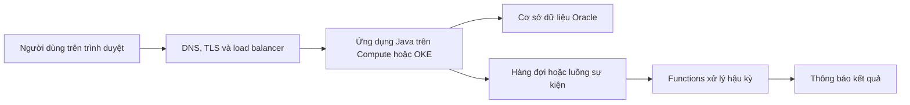
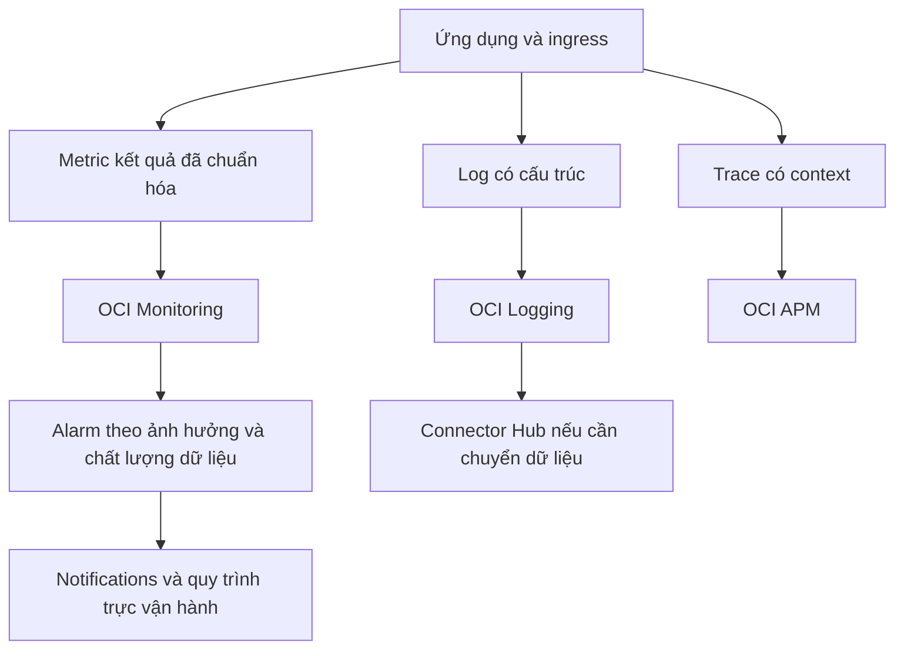

# Thiết kế observability theo SLI, SLO và hành trình người dùng

## 1. Bắt đầu từ trải nghiệm cần bảo vệ

Trong chương **Logs, metrics và tracing** của module **CLOUD_PROVIDERS_ORACLE**, observability giúp đội vận hành hiểu điều gì đang xảy ra với ứng dụng trên Oracle Cloud Infrastructure và lựa chọn hành động dựa trên bằng chứng. Thiết kế này liên hệ trải nghiệm người dùng với IAM, VCN, Compute, OKE, lưu trữ, Functions và cơ sở dữ liệu Oracle, đồng thời đặt việc thu thập dữ liệu trong giới hạn quyền truy cập và chi phí phù hợp.

Một Compute instance có CPU thấp không chứng minh người dùng đặt được hàng. Cơ sở dữ liệu còn kết nối không chứng minh giao dịch được lưu đúng. Ngược lại, một máy có CPU cao chưa chắc đã gây suy giảm trải nghiệm. Do đó, điểm xuất phát là **người dùng muốn đạt kết quả gì**, sau đó mới xác định cách đo, nguồn dữ liệu và dashboard.

Sau bài này, người học có thể:

- Chuyển một hành trình quan trọng thành các chỉ báo SLI có định nghĩa rõ ràng.
- Đặt SLO cùng cửa sổ đánh giá và tính error budget.
- Kết hợp metrics, logs và traces để phát hiện, khoanh vùng và giải thích sự cố.
- Ánh xạ thiết kế sang OCI Monitoring, Logging và Application Performance Monitoring (APM).
- Xác định cảnh báo có người xử lý, kiểm tra chất lượng telemetry và kiểm soát khối lượng dữ liệu.

Ví dụ xuyên suốt là hệ thống đặt hàng có ứng dụng Java chạy trên Compute hoặc OKE, lưu giao dịch trong cơ sở dữ liệu Oracle và xử lý một số tác vụ bất đồng bộ bằng Functions. Những mục tiêu, tên metric và schema minh họa trong bài là thiết kế của ứng dụng giả định, không phải cấu hình mặc định do OCI tự cung cấp.

## 2. Phân biệt SLI, SLO, SLA và chỉ số hạ tầng

| Khái niệm | Ý nghĩa | Ví dụ |
|---|---|---|
| SLI — Service Level Indicator | Đại lượng thể hiện chất lượng dịch vụ được đo | Tỷ lệ lần gọi tạo đơn hợp lệ nhận được xác nhận đúng hạn |
| SLO — Service Level Objective | Mục tiêu cho SLI trong một khoảng thời gian | Ít nhất 99,9% lần gọi đạt tiêu chí trong 30 ngày trượt |
| SLA — Service Level Agreement | Thỏa thuận dịch vụ với điều kiện và hệ quả được quy định | Cam kết với khách hàng theo phạm vi thỏa thuận |
| Chỉ số hạ tầng | Đại lượng về tài nguyên hoặc thành phần | CPU, bộ nhớ, số kết nối, độ trễ I/O |

SLI trả lời “đang đo điều gì”; SLO trả lời “chấp nhận chất lượng đến mức nào”. Một chỉ số trở thành SLI hữu ích khi liên hệ được với điều người dùng cần và có định nghĩa đo đáng tin cậy. SLA của một dịch vụ OCI thành phần không tự trở thành SLO đầu cuối của ứng dụng. [Khái niệm service level objectives](https://sre.google/sre-book/service-level-objectives/).

Ví dụ, `CpuUtilization` thường phục vụ chẩn đoán và quản lý capacity. Tỷ lệ tạo đơn thành công mới trực tiếp phản ánh khả năng thực hiện hành động đó. Cả hai đều cần thiết, nhưng phục vụ những quyết định khác nhau.

Không mặc định chọn 100% cho mọi SLO. Mục tiêu cần cân bằng nhu cầu người dùng, ảnh hưởng nghiệp vụ, lịch sử chất lượng, kiến trúc và chi phí cải thiện. Một mục tiêu cao không có cách đo hoặc phương án đáp ứng chỉ tạo cảm giác kiểm soát.

## 3. Vẽ hành trình và xác định ranh giới đo

### 3.1. Phân rã hành trình đặt hàng



Hành trình “đặt hàng” có nhiều mốc: mở trang, gửi yêu cầu, nhận xác nhận đơn đã lưu và nhận thông báo sau đó. Không gom mọi mốc vào một phép đo mơ hồ mang tên “hệ thống hoạt động”.

| Hành động người dùng | Kết quả cần bảo vệ | Ranh giới đo có thể chọn |
|---|---|---|
| Mở trang đặt hàng | Trang có thể tương tác | Từ bắt đầu điều hướng tới mốc giao diện sẵn sàng |
| Gửi yêu cầu tạo đơn | Đơn được lưu và có xác nhận hợp lệ | Từ API ingress tới phản hồi xác nhận |
| Hoàn thành quy trình xử lý | Tác vụ nghiệp vụ đạt trạng thái cuối | Từ sự kiện được chấp nhận tới kết quả hoàn tất |
| Xem trạng thái đơn | Nhìn thấy dữ liệu đúng và đủ mới | Từ yêu cầu xem tới dữ liệu hiển thị theo hợp đồng |

Chọn một vài hành trình quan trọng trước. Với mỗi hành trình, ghi chủ sở hữu, đối tượng sử dụng, các phụ thuộc, mốc bắt đầu, mốc kết thúc và loại lỗi cần tính. [Thiết lập SLO theo nhu cầu dịch vụ](https://sre.google/workbook/implementing-slos/).

### 3.2. Đo ở đâu sẽ nhìn thấy lỗi ở đó

Đo thời gian trong Java handler không bao gồm DNS, TLS, đợi trước handler hoặc render trình duyệt. Đo tại API ingress vẫn không thấy người dùng không thể kết nối tới ingress. Đo ở trình duyệt gần trải nghiệm hơn nhưng có thể thiếu dữ liệu do mất mạng, trình chặn hoặc script đo không chạy.

Vì vậy, thiết kế thường kết hợp:

- Phép đo phía dịch vụ để đếm request và kết quả có kiểm soát.
- Real User Monitoring (RUM) để quan sát phiên và thao tác trình duyệt.
- Kiểm tra chủ động từ các vị trí phù hợp để phát hiện đường truy cập hỏng ngay cả khi ít người dùng.

Không cộng các phép đo này thành một tỷ lệ chung nếu chúng không cùng quần thể và ranh giới. Dashboard cần nói rõ một SLI là chất lượng API, chất lượng trình duyệt hay kiểm tra chủ động.

### 3.3. Retry và bất đồng bộ phải có quy ước riêng

Một người bấm một lần nhưng client retry ba lần có thể tạo ba HTTP attempts. Nếu SLI đo request, đếm theo attempts; nếu SLI đo giao dịch logic, cần định danh và cơ chế khử trùng lặp thích hợp. Không dùng tổng request làm mẫu số nhưng số đơn duy nhất làm tử số.

Tương tự, phản hồi `202 Accepted` chỉ xác nhận được tiếp nhận theo hợp đồng API, chưa chứng minh tác vụ đã hoàn tất. Luồng bất đồng bộ cần theo dõi trạng thái cuối, deadline và các tác vụ chưa có kết quả; việc chỉ đếm những tác vụ đã kết thúc sẽ bỏ sót tác vụ bị treo.

## 4. Viết hợp đồng đo SLI

### 4.1. Mẫu số, tử số và quy tắc phân loại

Với SLI theo sự kiện:

```text
N = số sự kiện hợp lệ trong cửa sổ đánh giá
G = số sự kiện hợp lệ đạt tiêu chí tốt
B = N - G
SLI = G / N, với N > 0
```

“Hợp lệ” xác định quần thể cần đo. “Tốt” xác định kết quả chấp nhận được trong quần thể đó. Mọi sự kiện hợp lệ phải được phân loại đúng một lần theo hợp đồng, hoặc có trạng thái chờ/không xác định được quản lý rõ ràng.

Hợp đồng đo nên ghi tối thiểu:

| Trường | Nội dung cần quyết định |
|---|---|
| Tên và chủ sở hữu | Hành trình nào, đội nào chịu trách nhiệm |
| Ranh giới | Điểm bắt đầu và kết thúc phép đo |
| Sự kiện hợp lệ | Đường gọi, loại người dùng, môi trường và điều kiện đầu vào |
| Sự kiện tốt | Kết quả đúng, deadline và điều kiện dữ liệu |
| Ngoại lệ | Loại trừ nào có lý do và được kiểm soát |
| Đơn vị đếm | HTTP attempt, giao dịch logic, job hoặc khoảng thời gian |
| Cửa sổ | Trượt hoặc theo lịch, timezone và cách chốt dữ liệu |
| Nguồn dữ liệu | Counter, log kết quả, sự kiện nghiệp vụ hoặc hệ thống khác |
| Chất lượng dữ liệu | Trễ, mất, trùng, sampling, reset và trường hợp không có lưu lượng |

Một định nghĩa đủ tốt giúp hai người độc lập tính ra cùng kết quả từ cùng tập dữ liệu.

### 4.2. Hai SLI cho API tạo đơn

Trong ví dụ, quần thể là các **HTTP attempts hợp lệ** tới API tạo đơn trong production, được ghi nhận tại ranh giới ingress đã chọn. Bài không gọi phép đo này là toàn bộ trải nghiệm từ trình duyệt.

| Nội dung | Quy ước minh họa |
|---|---|
| Sự kiện hợp lệ | Request đúng route, xác thực và cấu trúc đầu vào hợp lệ theo hợp đồng |
| Availability tốt | Có xác nhận đơn đã được lưu bền vững, phản hồi đúng trong tối đa 10 giây |
| Latency tốt | Đồng thời đạt availability tốt và thời gian không quá 2 giây |
| Timeout hoặc lỗi hệ thống | Tính là sự kiện xấu |
| Từ chối do thiếu capacity | Vẫn tính xấu nếu request thuộc quần thể hợp lệ |
| Request sai cấu trúc hoặc không có quyền theo quy tắc đã định | Có thể loại khỏi quần thể này, nhưng theo dõi riêng |
| Retry | Đếm mỗi HTTP attempt; giao dịch logic là phép đo khác |

Không phân loại máy móc mọi `4xx` là lỗi người dùng và mọi `2xx` là tốt. Ví dụ, `429` do thiếu capacity có thể phản ánh chất lượng dịch vụ; một `200` chứa kết quả nghiệp vụ lỗi vẫn có thể là sự kiện xấu. Cần phân loại theo ngữ nghĩa đã thống nhất, không sửa quy tắc sau sự cố chỉ để nâng tỷ lệ.

Hệ thống phải có cách nhận biết request thuộc quần thể dù lỗi xảy ra trước Java handler. Nếu chỉ ứng dụng tự tăng counter khi đã xử lý xong, những request rơi ở lớp trước có thể biến mất khỏi mẫu số. Dùng dữ liệu ingress hoặc phép đo bổ sung để kiểm tra độ bao phủ.

### 4.3. Tính đúng trên một bộ số liệu

Giả sử trong 30 ngày có dữ liệu đã đối chiếu đầy đủ:

| Phân loại | Số HTTP attempts |
|---|---:|
| Xác nhận đúng, không quá 2 giây | 987.000 |
| Xác nhận đúng, trên 2 giây và không quá 10 giây | 12.350 |
| Lỗi, timeout hoặc không đạt tiêu chí availability | 650 |
| Tổng hợp lệ | 1.000.000 |

Khi đó:

```text
Availability SLI = (987.000 + 12.350) / 1.000.000 = 99,935%
Latency SLI      = 987.000 / 1.000.000            = 98,7%
```

Availability cao không có nghĩa latency đạt yêu cầu. Hai SLI dùng cùng mẫu số nhưng khác tiêu chí tốt, giúp nhìn thấy một hệ thống vẫn trả kết quả đúng nhưng quá chậm đối với nhiều người dùng.

Đối với luồng hậu kỳ, định nghĩa một SLI khác, chẳng hạn tỷ lệ sự kiện hợp lệ hoàn tất trong 60 giây. Phải giữ các sự kiện đang chờ cho tới khi đủ thông tin phân loại hoặc quá deadline; không chỉ nhìn vào các Functions invocation đã thành công.

## 5. Đặt SLO và sử dụng error budget

### 5.1. Mục tiêu phải gắn với cửa sổ và phạm vi

Với hợp đồng ở phần 4, nhóm có thể chọn các SLO minh họa:

- Availability: ít nhất **99,9%** HTTP attempts hợp lệ đạt tiêu chí availability tốt trong **30 ngày trượt**.
- Latency: ít nhất **99%** HTTP attempts hợp lệ đạt tiêu chí latency tốt trong cùng cửa sổ.

Đây là mục tiêu do ứng dụng giả định lựa chọn, không phải mức cam kết mặc định của OCI. Phải ghi rõ môi trường production, hành trình, quần thể request và nguồn dữ liệu đi kèm. Một số dashboard nhìn 5 phút để xử lý sự cố, nhưng cửa sổ đó không thay thế cửa sổ đánh giá SLO 30 ngày.

Cửa sổ trượt phản ánh liên tục giai đoạn gần nhất; cửa sổ theo tháng lịch thuận tiện cho một số quy trình báo cáo. Hai lựa chọn tạo hành vi đánh giá khác nhau. Với cửa sổ theo lịch, quy định timezone; với mọi lựa chọn, ghi cách xử lý dữ liệu đến muộn và khoảng thời gian chưa đủ dữ liệu.

### 5.2. Tính ngân sách lỗi theo đúng đơn vị

Với mục tiêu tỷ lệ `S`, số sự kiện hợp lệ `N` và số xấu `B`:

```text
Ngân sách lỗi cho phép = N × (1 - S)
Ngân sách đã dùng      = B
Ngân sách còn lại      = N × (1 - S) - B
Tỷ lệ ngân sách đã dùng = B / [N × (1 - S)]
```

Áp dụng cho bộ số liệu một triệu attempts ở phần 4:

| SLO | Mục tiêu | Sự kiện xấu thực tế | Ngân sách cho phép | Kết quả |
|---|---:|---:|---:|---|
| Availability | 99,9% | 650 | 1.000 | Dùng 65%, còn 350 sự kiện |
| Latency | 99% | 13.000 | 10.000 | Dùng 130%, vượt 3.000 sự kiện |

Hai ngân sách được theo dõi độc lập. Availability còn ngân sách không bù được việc latency đã vượt mục tiêu.

Đây là SLO theo sự kiện, không chuyển trực tiếp ngân sách thành số phút downtime. Chỉ số theo thời gian có định nghĩa và mẫu số khác. Trong cửa sổ trượt, ngân sách hiện tại thay đổi khi sự kiện mới đi vào và sự kiện cũ rời cửa sổ; không coi số còn lại là một khoản cố định được cấp đầu tháng.

### 5.3. Định trước quyết định khi tiêu thụ ngân sách

Một chính sách vận hành do nhóm thống nhất có thể quy định:

| Tình trạng | Quyết định tham khảo |
|---|---|
| Đạt mục tiêu và tốc độ lỗi ổn định | Tiếp tục phát hành trong quy trình thông thường |
| Ngân sách bị tiêu thụ nhanh | Kiểm tra thay đổi gần đây, hạn chế tăng phạm vi rollout |
| Đã vượt mục tiêu | Ưu tiên phục hồi và cải thiện nguyên nhân gây ảnh hưởng |
| Thiếu dữ liệu đo | Xác định chất lượng chưa rõ, sửa telemetry và kiểm tra bằng nguồn độc lập |

Quyết định cần người sở hữu và ngoại lệ rõ ràng. Không tự động chặn mọi bản vá khi lỗi đang xảy ra: bản sửa lỗi hoặc thay đổi khẩn cấp có thể chính là điều cần để phục hồi. Error budget giúp cân nhắc rủi ro, không thay thế phán đoán vận hành.

## 6. Phân vai metrics, logs và traces

| Tín hiệu | Câu hỏi chính | Ví dụ trong hành trình đặt hàng |
|---|---|---|
| Metrics | Mức độ và xu hướng ảnh hưởng là bao nhiêu? | Số attempts, số tốt/xấu, phân bố thời gian xử lý |
| Logs | Sự kiện cụ thể diễn ra thế nào? | Request timeout ở bước lấy kết nối DB, mã lỗi đã chuẩn hóa |
| Traces | Thời gian và quan hệ phụ thuộc nằm ở đâu? | Request đi qua service, connection pool và SQL call |

Ba tín hiệu bổ sung cho nhau. OpenTelemetry cung cấp các mô hình và cơ chế thu thập tín hiệu; ứng dụng vẫn cần instrumentation và quy tắc ngữ nghĩa phù hợp. Cài một agent không tự định nghĩa “đơn được lưu đúng” cho doanh nghiệp. [Các tín hiệu OpenTelemetry](https://opentelemetry.io/docs/concepts/signals/).

### 6.1. Metrics để tính SLI và điều hướng điều tra

Thiết kế metric có số lượng dimension kiểm soát được, chẳng hạn `journey`, `environment`, `region`, `outcome_class`. Dùng tên route đã chuẩn hóa như `/orders/{id}` thay vì URL chứa từng mã đơn.

Không đưa `trace_id`, email, user ID hoặc mã đơn duy nhất vào mọi metric dimension. Mỗi tổ hợp dimension có thể tạo stream riêng; cardinality lớn làm tăng khối lượng và khó truy vấn. Định danh chi tiết thích hợp hơn cho log hoặc trace đã kiểm soát quyền.

Theo dõi phân bố latency bằng histogram hoặc loại đo phù hợp với backend. Một số ít request rất chậm có thể bị che bởi thời gian trung bình. Tuy nhiên, trung bình các giá trị p99 từ nhiều instance không tạo ra p99 toàn dịch vụ. Để tính tỷ lệ dưới 2 giây, nên đếm trực tiếp sự kiện đạt ngưỡng hoặc tổng hợp phân bố theo cách được hệ thống đo hỗ trợ. [Mô hình metrics](https://opentelemetry.io/docs/concepts/signals/metrics/).

### 6.2. Logs có cấu trúc và ngữ nghĩa kết quả

Ví dụ bản ghi kết quả ứng dụng giả định, không phải schema bắt buộc của OCI Logging:

```json
{
  "schema_version": "1",
  "event_id": "evt-lab-0001",
  "event_time": "2026-11-21T03:00:00Z",
  "service": "orders-api",
  "environment": "prod",
  "journey": "submit-order-api",
  "route": "POST /orders",
  "release": "r-ab12cd3",
  "trace_id": "0123456789abcdef0123456789abcdef",
  "span_id": "0123456789abcdef",
  "http_status": 201,
  "duration_ms": 2700,
  "outcome": "success",
  "availability_good": true,
  "latency_good": false
}
```

Bản ghi này thể hiện thành công trong 2,7 giây: tốt cho availability của ví dụ nhưng xấu cho latency. Quy tắc sinh trường phân loại phải cùng phiên bản với hợp đồng SLI; không để mỗi service tự hiểu một cách.

Chuẩn hóa timestamp, đơn vị, tên service và release. Phân biệt thời điểm sự kiện với thời điểm tiếp nhận log. Dùng `event_id` hoặc khóa phù hợp nếu pipeline cần phát hiện trùng; một dòng log được gửi lại không tự trở thành một request mới. Không lưu password, token, wallet hoặc toàn bộ payload khách hàng chỉ để dễ tìm lỗi.

### 6.3. Traces để giải thích một trải nghiệm cụ thể

Trace gồm các span có quan hệ nhân quả. Cần truyền context qua HTTP, thư viện client, thread hoặc message phù hợp để không tách một giao dịch thành nhiều mảnh không liên hệ. Có thể gắn trace/span ID vào log để điều tra từ cùng một request. [Context propagation](https://opentelemetry.io/docs/concepts/context-propagation/).

Ví dụ điều tra request 2,7 giây phát hiện chờ connection pool chiếm phần lớn đường xử lý, trong khi SQL thực thi tương đối nhanh. Khi đó, việc chỉ tối ưu câu SQL hoặc thêm Compute CPU có thể chưa đúng nguyên nhân. Đây là giả thuyết dựa trên trace và cần đối chiếu pool metrics, tải và thay đổi cấu hình.

Không cộng mọi span duration để suy ra thời gian đầu cuối: span lồng nhau hoặc chạy song song có thể chồng lấp. Phải đọc quan hệ parent/child và đường xử lý thực tế. Phạm vi trace cũng phụ thuộc thư viện được instrument; không có span DB không chứng minh ứng dụng không truy cập DB.

### 6.4. Sampling không được làm sai mẫu số

Sampling giúp giới hạn khối lượng trace. Nhưng trace đã chọn mẫu, đặc biệt ưu tiên lỗi hoặc request chậm, không mặc định đại diện cho toàn bộ lưu lượng. Không lấy tỷ lệ lỗi trong tập trace được giữ làm SLI chính nếu chưa chứng minh phương pháp ước lượng phù hợp. [Sampling trong OpenTelemetry](https://opentelemetry.io/docs/concepts/sampling/).

Nên giữ nguồn đếm SLI độc lập, có độ bao phủ đã kiểm chứng; dùng trace để chẩn đoán. Log kết quả được dùng làm nguồn SLI cũng cần chính sách đầy đủ riêng: giảm log bằng sampling có thể làm sai tử số hoặc mẫu số.

## 7. Ánh xạ sang các dịch vụ OCI

### 7.1. Chọn dịch vụ theo công việc cần làm

| Công việc | Dịch vụ OCI liên quan | Ranh giới cần hiểu |
|---|---|---|
| Xem metric dịch vụ và metric ứng dụng | Monitoring | Metric hạ tầng có sẵn không thay thế SLI nghiệp vụ |
| Đặt điều kiện cảnh báo và phát thông báo | Monitoring Alarms và Notifications | Cần query, người nhận, severity và runbook đúng |
| Thu thập và tìm log | Logging | Service log và custom log cần được cấu hình theo nguồn |
| Điều tra giao dịch phân tán | Application Performance Monitoring | Cần instrumentation, context và dữ liệu đủ dùng |
| Quan sát trải nghiệm trình duyệt | APM Real User Monitoring | Phạm vi bị ảnh hưởng bởi việc thu thập phía client |
| Kiểm tra ứng dụng chủ động | APM Availability Monitoring | Vị trí kiểm tra và kịch bản quyết định điều gì được quan sát |
| Chuyển dữ liệu giữa dịch vụ | Connector Hub | Cần cấu hình nguồn/đích và theo dõi chất lượng chuyển dữ liệu |

Monitoring cung cấp metrics và alarms, có thể truy cập qua Console, CLI hoặc API. Khi thiết kế SLI ứng dụng, xác định metric namespace và dimension của mình thay vì giả định metric mặc định đã chứa kết quả hành trình. [Tổng quan Monitoring](https://docs.oracle.com/en-us/iaas/Content/Monitoring/Concepts/monitoringoverview.htm).

Logging phân biệt service logs, custom logs và Audit logs; log group là đơn vị tổ chức giúp quản lý và phân quyền. Audit hỗ trợ điều tra các thao tác API quản lý OCI được ghi nhận, không thay thế nhật ký giao dịch nghiệp vụ của ứng dụng. [Tổng quan Logging](https://docs.oracle.com/en-us/iaas/Content/Logging/Concepts/loggingoverview.htm).

APM có distributed tracing, RUM và Availability Monitoring, tên trước đây là Synthetic Monitoring. Chọn loại dữ liệu tương ứng với ranh giới cần đo; một synthetic check gọi `/health` không mặc định kiểm tra được toàn bộ thao tác đặt hàng. [Các khả năng của APM](https://docs.oracle.com/en-us/iaas/application-performance-monitoring/doc/application-performance-monitoring.html).

### 7.2. Một luồng dữ liệu tham khảo



Đây là kiến trúc tham khảo, không phải pipeline được tạo sẵn khi mở tenancy. Với Java, chọn APM agent hoặc OpenTelemetry instrumentation theo môi trường và hỗ trợ tương ứng, cấu hình endpoint và quyền cần thiết, rồi xác minh tín hiệu thực sự tới đích.

Có thể dùng Connector Hub để chuyển dữ liệu từ Logging sang Monitoring hoặc dịch vụ đích được hỗ trợ. Connector Hub là tên hiện tại của dịch vụ trước đây gọi là Service Connector Hub. Nếu tạo metric từ log, cần kiểm tra logic chọn bản ghi và cách tổng hợp. [Tổng quan Connector Hub](https://docs.oracle.com/en-us/iaas/Content/connector-hub/overview.htm).

## 8. Thiết kế metric SLI có thể tổng hợp đúng

### 8.1. Khai báo ngữ nghĩa trước khi viết query

Giả sử ứng dụng hoặc bộ tổng hợp phát vào custom namespace `app_journeys` các metric sau, theo từng khoảng báo cáo không chồng lấp:

| Metric ứng dụng tự định nghĩa | Giá trị của mỗi điểm dữ liệu |
|---|---|
| `JourneyValid` | Số attempts hợp lệ của khoảng đó |
| `JourneyAvailabilityGood` | Số attempts đạt availability tốt trong cùng khoảng |
| `JourneyLatencyGood` | Số attempts đạt latency tốt trong cùng khoảng |
| `TelemetryHeartbeat` | Tín hiệu bộ phát còn hoạt động theo lịch |

Đây là **delta counts theo khoảng**, không phải counter lũy kế từ lúc process khởi động. Mọi exporter phải thống nhất đơn vị và quy tắc. Nếu nguồn là cumulative counter, cần phép chuyển đổi hoặc truy vấn phù hợp trước khi dùng logic minh họa ở đây.

Với các điểm delta, `sum()` cộng số sự kiện. `count()` đếm số quan sát nhận được trong khoảng, không tự biết mỗi điểm đại diện bao nhiêu request. Đây là khác biệt quan trọng khi một điểm chứa kết quả của hàng nghìn attempts. [Tham chiếu Monitoring Query Language](https://docs.oracle.com/en-us/iaas/Content/Monitoring/Reference/mql.htm).

### 8.2. Ví dụ MQL cho một hành trình

Sau khi metric đã được phát vào Monitoring và chọn đúng compartment, region, namespace, có thể xem tổng theo phút bằng các query riêng:

```text
JourneyValid[1m]{journey="submit-order-api",environment="prod"}.grouping().sum()

JourneyAvailabilityGood[1m]{journey="submit-order-api",environment="prod"}.grouping().sum()

JourneyLatencyGood[1m]{journey="submit-order-api",environment="prod"}.grouping().sum()
```

`grouping()` tổng hợp các stream còn lại cho truy vấn này. Nếu cần phân vùng theo region hoặc nhóm người dùng được kiểm soát, dùng chiến lược grouping tương ứng thay vì xóa mất lát cắt cần theo dõi. [Tổng hợp metric streams](https://docs.oracle.com/en-us/iaas/Content/Monitoring/Tasks/query-metric-grouping.htm).

Ba dòng trên chỉ lấy số đếm theo khoảng, chưa tự tạo SLO 30 ngày. Bộ tính SLI phải cộng đúng các số đếm trong cùng cửa sổ, xử lý chất lượng dữ liệu và lấy tổng tốt chia tổng hợp lệ. Không lấy trung bình các tỷ lệ theo phút nếu các phút có lưu lượng khác nhau.

Tương tự, metric mặc định ở region này không tự đại diện cho mọi region của ứng dụng. Nếu hợp nhất dữ liệu nhiều vùng, cần bước thu thập và đối chiếu rõ ràng, đồng thời giữ dashboard từng vùng để phát hiện khác biệt.

## 9. Xem chất lượng telemetry như một phần của thiết kế

### 9.1. Không có dữ liệu khác với không có lỗi

Cần phân biệt ít nhất ba trạng thái:

| Trạng thái | Ví dụ | Cách biểu diễn |
|---|---|---|
| Có dữ liệu, có lưu lượng, không lỗi | Nhận đủ tổng số và mọi attempt đều tốt | Tỷ lệ tốt theo dữ liệu nhận được |
| Có dữ liệu, không có attempts | Bộ phát gửi heartbeat và số đếm bằng 0 | Không đủ sự kiện để tính tỷ lệ trong khoảng |
| Không nhận được dữ liệu | Agent, collector, mạng hoặc quyền bị lỗi | Chất lượng chưa xác định, cần kiểm tra telemetry |

Khi `N = 0`, phép chia SLI không xác định theo công thức đã chọn. Không biến mọi giá trị thiếu thành 0 lỗi hoặc 100% tốt. Ngược lại, không tự coi mất một nguồn telemetry là tất cả người dùng thất bại; cần cảnh báo độ tin cậy phép đo và kiểm chứng bằng nguồn độc lập.

Có thể dùng absence alarm để phát hiện metric không phát dữ liệu theo điều kiện Monitoring. Với heartbeat, xác định lịch phát, phạm vi publisher và thử nghiệm thời điểm phát hiện, reset và khôi phục. [Tạo absence alarm](https://docs.oracle.com/en-us/iaas/Content/Monitoring/Tasks/create-alarm-absence.htm).

### 9.2. Kiểm soát các sai lệch thường gặp

| Vấn đề | Sai lệch có thể tạo ra | Thiết kế cần có |
|---|---|---|
| Log được gửi lại | Đếm một request nhiều lần | Định danh sự kiện và quy tắc khử trùng lặp khi cần |
| Sự kiện đến muộn | Cửa sổ gần nhất tạm thiếu kết quả | Event time, ingestion time và quy tắc cập nhật báo cáo |
| Counter reset | Tăng/giảm giả hoặc số âm khi tính chênh lệch | Hiểu temporality và restart của exporter |
| Sampling | Tử số và mẫu số không đại diện cùng quần thể | Nguồn SLI đủ bao phủ hoặc phương pháp ước lượng rõ ràng |
| Đồng hồ không đồng bộ | Sai thứ tự hoặc thời gian âm | Đồng bộ clock; đo duration cục bộ bằng clock phù hợp |
| Mất request trước ứng dụng | Mẫu số chỉ chứa request đã xử lý được | Đo tại ranh giới thích hợp và đối chiếu nguồn ingress |
| Job không bao giờ kết thúc | Chỉ đếm job hoàn tất khiến tỷ lệ quá đẹp | Deadline, theo dõi pending và phân loại overdue |
| Nhiều collector cùng đếm | Tổng sự kiện bị nhân lên | Phân định quyền sở hữu stream và quy trình tổng hợp |

Đặc biệt, cần quy định sự kiện thuộc cửa sổ nào. Nếu gán theo thời điểm request bắt đầu, cửa sổ chỉ chốt sau khi đủ deadline và độ trễ tiếp nhận đã thống nhất. Không lấy tổng request bắt đầu trong một phút chia cho số thành công kết thúc trong phút đó: hai nhóm có thể khác nhau và tạo tỷ lệ vượt 100% hoặc thấp giả.

Đối với pipeline qua Connector Hub, theo dõi lỗi và độ mới dữ liệu của connector. Dữ liệu đã xuất hiện ở Logging không chứng minh metric suy ra đã cập nhật ở Monitoring. [Theo dõi và xử lý lỗi connector](https://docs.oracle.com/en-us/iaas/Content/connector-hub/troubleshooting.htm).

### 9.3. Tổng thể đạt mục tiêu vẫn có thể che một nhóm bị lỗi

Ví dụ giả định:

| Nhóm | Số hợp lệ | Số tốt | Tỷ lệ tốt |
|---|---:|---:|---:|
| Region A | 999.000 | 998.950 | Khoảng 99,995% |
| Region B | 1.000 | 900 | 90% |
| Toàn bộ | 1.000.000 | 999.850 | 99,985% |

SLO tổng thể 99,9% đạt trong ví dụ, nhưng người dùng ở Region B gặp vấn đề rõ rệt. Theo dõi các lát cắt quan trọng như region, kênh hoặc nhóm chức năng có giới hạn cardinality. Có thể đặt mục tiêu riêng khi nhóm đó có yêu cầu độc lập; không suy ra mọi dimension đều cần một SLO khác.

Tỷ lệ toàn bộ phải là tổng tốt chia tổng hợp lệ, không phải trung bình đơn giản tỷ lệ của hai region. Đồng thời, giữ góc nhìn từng nhóm để tỷ trọng lưu lượng lớn không che trải nghiệm của nhóm nhỏ.

## 10. Cảnh báo theo ảnh hưởng và tốc độ tiêu thụ ngân sách

### 10.1. Burn rate cho biết lỗi đang tăng nhanh đến đâu

Với SLO mục tiêu `S` và tỷ lệ sự kiện xấu `e` trong cửa sổ quan sát:

```text
Burn rate = e / (1 - S)
```

Ví dụ SLO availability 99,9% có tỷ lệ xấu cho phép là 0,1%. Nếu tỷ lệ xấu hiện tại là 1,5%, burn rate bằng 15. Đây là tốc độ lỗi tương đối so với mục tiêu, không phải “đã dùng 15% ngân sách tháng”.

Phải dùng đúng tiêu chí xấu của từng SLO. Với latency mục tiêu 99%, tỷ lệ xấu 1,3% tạo burn rate 1,3; không dùng mức cho phép 0,1% của availability để tính cho latency.

### 10.2. Kết hợp cửa sổ dài và ngắn

Một mẫu tham khảo cho SLO 30 ngày là cảnh báo khẩn khi đồng thời vượt ngưỡng ở một cửa sổ dài và một cửa sổ ngắn:

```text
fast_burn = BR(1 giờ) > 14,4 VÀ BR(5 phút) > 14,4
slow_burn = BR(6 giờ) > 6 VÀ BR(30 phút) > 6
cảnh_báo_khẩn = fast_burn HOẶC slow_burn
```

Cửa sổ dài xác nhận tác động đủ kéo dài; cửa sổ ngắn xác nhận lỗi còn tiếp diễn. Đây là mẫu khởi đầu cần điều chỉnh theo lưu lượng và khả năng phản ứng. Với lưu lượng phân bố đều, burn rate 14,4 trong một giờ xấp xỉ 2% ngân sách của 30 ngày; tỷ trọng lưu lượng khác sẽ thay đổi lượng ngân sách thực tế bị dùng. [Cảnh báo SLO theo burn rate](https://sre.google/workbook/alerting-on-slos/).

Trong ví dụ 99,9%, nếu cửa sổ một giờ có 1,5% attempts xấu và năm phút có 2% xấu, burn rate tương ứng là 15 và 20, vượt cặp ngưỡng nhanh. Không cần chờ SLO 30 ngày đã trượt mới bắt đầu điều tra.

Các biểu thức trên là giả mã, không phải MQL có thể dán trực tiếp vào OCI Console. Khi triển khai trên OCI, lựa chọn query được hỗ trợ hoặc bộ tính phát metric burn rate đã tính đúng. Phải kiểm tra việc ghép điều kiện theo cùng journey, môi trường và lát cắt; tránh ghép lỗi của journey này với cửa sổ của journey khác.

Nếu dùng bộ tính bên ngoài, giám sát chính bộ tính, tính đầy đủ của cửa sổ và độ mới dữ liệu. Không phát burn rate bằng 0 khi dữ liệu đầu vào chưa có hoặc không đủ tin cậy.

### 10.3. Ít lưu lượng cần thiết kế khác

Một lỗi trong hai requests tạo tỷ lệ 50%, nhưng hai requests không cung cấp cùng lượng bằng chứng như hàng triệu requests. Có thể cân nhắc số sự kiện tối thiểu, cửa sổ dài hơn và kiểm tra chủ động. Tuy nhiên, không đặt ngưỡng lưu lượng cao đến mức một outage của dịch vụ ít dùng không bao giờ được phát hiện.

Khi traffic bất ngờ về 0, xác minh cả hai khả năng: thực sự không có nhu cầu, hoặc đường truy cập đã hỏng khiến requests không tới được điểm đo. Một synthetic check từ vị trí phù hợp có thể cung cấp bằng chứng bổ sung.

### 10.4. Mỗi cảnh báo phải dẫn tới hành động

| Loại tín hiệu | Cách xử lý tham khảo |
|---|---|
| Burn rate cao, người dùng đang chịu ảnh hưởng | Gọi đội trực theo quy trình phản ứng sự cố |
| Suy giảm chậm nhưng có nguy cơ kéo dài | Tạo việc điều tra có thời hạn và chủ sở hữu |
| Capacity tiến gần giới hạn | Lập kế hoạch hoặc cảnh báo sớm theo tốc độ tăng |
| Telemetry mất hoặc sai | Kiểm tra pipeline đo, đánh giá dịch vụ bằng nguồn khác |
| Sự kiện chẩn đoán riêng lẻ | Ghi nhận để điều tra, chưa nhất thiết gọi trực |

Nội dung alarm nên có journey, SLO bị ảnh hưởng, cửa sổ, mức burn, phạm vi, timestamp, link dashboard và runbook. Kiểm tra Notifications và luồng tiếp nhận theo đúng quy trình của tổ chức. Cảnh báo “CPU cao” chỉ có ích khi người nhận hiểu ảnh hưởng có thể xảy ra và việc cần làm.

## 11. Dashboard và quy trình điều tra theo hành trình

### 11.1. Sắp xếp thông tin theo thứ tự quyết định

Một dashboard phù hợp nên giúp trả lời lần lượt:

1. Hành trình nào đang suy giảm, bao nhiêu requests hoặc người dùng thuộc phạm vi bị ảnh hưởng?
2. SLI hiện tại, SLO, ngân sách còn lại và burn rate là bao nhiêu?
3. Ảnh hưởng nằm ở region, route hoặc release nào?
4. Có thay đổi triển khai, cấu hình hoặc lưu lượng gần thời điểm đó không?
5. Những log và trace nào giải thích hiện tượng, phụ thuộc nào có dấu hiệu bất thường?
6. Telemetry có đầy đủ và mới đủ để tin kết luận không?

Nhóm đầu tiên nên hiển thị lưu lượng, tỷ lệ tốt/xấu, latency và chất lượng dữ liệu. Các chỉ số Compute, OKE, network, connection pool và cơ sở dữ liệu hỗ trợ đào sâu phía sau. Tránh bắt người trực đi qua hàng chục biểu đồ CPU trước khi biết người dùng có bị ảnh hưởng hay không.

Ghi đơn vị, timezone, cách tổng hợp và cửa sổ trên biểu đồ. Nếu số liệu SLO còn tạm tính do chờ sự kiện đến muộn, hiển thị trạng thái đó.

### 11.2. Ví dụ điều tra suy giảm latency

Giả sử cảnh báo báo latency burn tăng sau một lần đổi release, nhưng availability gần như giữ nguyên. Trình tự điều tra có thể là:

- Kiểm tra mẫu số và nguồn đo để loại trừ metric ngừng phát hoặc đổi schema.
- Xác định route và region đóng góp phần lớn sự kiện chậm; đối chiếu release timeline.
- Tìm trace đại diện trong khoảng ảnh hưởng, rồi xem log tương ứng bằng trace ID.
- Nếu trace cho thấy chờ connection pool dài, đối chiếu số kết nối, hàng chờ, transaction duration và DB metrics.
- Chọn biện pháp phù hợp, chẳng hạn phục hồi bản ổn định hoặc sửa quản lý kết nối sau khi có bằng chứng.
- Theo dõi SLI ngắn hạn, burn rate và dữ liệu kiểm tra người dùng để xác nhận phục hồi.

Tương quan thời gian với release là manh mối, không tự chứng minh nguyên nhân. Tăng connection pool thiếu kiểm soát có thể chuyển áp lực sang cơ sở dữ liệu; chỉ thêm replica ứng dụng cũng có thể làm số kết nối tăng. Hành động cần dựa vào giới hạn phụ thuộc và kết quả kiểm chứng.

### 11.3. Xác nhận phục hồi khác với xóa dấu vết sự cố

Sau khi khắc phục, cửa sổ ngắn có thể hồi phục nhanh hơn SLO 30 ngày. Những sự kiện xấu đã xảy ra vẫn thuộc báo cáo cho tới khi rời cửa sổ hoặc được chỉnh sửa có căn cứ do lỗi dữ liệu. Không xóa chúng để làm dashboard đạt mục tiêu.

Hồ sơ sự cố cần ghi hành trình bị ảnh hưởng, khoảng thời gian, ước lượng phạm vi, nguồn bằng chứng, nguyên nhân đã xác minh và thay đổi ngăn tái diễn. Nếu phép đo có lỗ hổng, ghi rõ giới hạn của con số báo cáo.

## 12. Phân quyền, chi phí và trách nhiệm vận hành

### 12.1. Tổ chức theo phạm vi cần quản lý

Trong OCI, xác định region và compartment của tài nguyên, metric, log group và APM domain liên quan. Người có quyền xem một phần telemetry không mặc định có đủ quyền xem tất cả. Tách quyền phát dữ liệu, đọc điều tra và thay đổi cấu hình theo nhiệm vụ.

Log và trace có thể chứa thông tin nhạy cảm dù không có mật khẩu. Thiết kế lọc hoặc giảm dữ liệu ngay tại nguồn, kiểm soát quyền đọc, retention và cách chia sẻ bằng chứng. Đối với nội dung SQL, không mặc định thu thập toàn bộ bind values hoặc payload sản xuất.

Các lỗi `NotAuthorizedOrNotFound`, chọn sai compartment, region hoặc khoảng thời gian có thể làm biểu đồ trống. Xác minh cấu hình truy vấn và quyền trước khi kết luận dịch vụ không có hoạt động. [Xử lý metric hoặc tài nguyên không xuất hiện](https://docs.oracle.com/en-us/iaas/Content/Monitoring/troubleshooting-queries.htm).

### 12.2. Phân bổ khối lượng theo giá trị sử dụng

Giữ số đếm SLI đủ tin cậy, nhưng cân nhắc sampling trace, mức log chi tiết, số dimension và tần suất synthetic checks. Đặt retention theo mục đích điều tra, báo cáo và yêu cầu tổ chức; dữ liệu tồn tại ít hơn cửa sổ SLO cần có nguồn tổng hợp bền vững tương ứng.

Theo dõi khối lượng ingest, stream cardinality, dữ liệu lưu giữ và chi phí quan sát theo thời gian. Tăng log debug toàn hệ thống có thể tạo thêm chi phí và làm khó tìm thông tin. Khi cần debug, giới hạn phạm vi và thời gian, rồi trở lại mức vận hành đã định.

Tối ưu chi phí không có nghĩa lấy mẫu tùy ý những sự kiện duy nhất dùng để tính ngân sách lỗi. Trước khi giảm dữ liệu, xác định phép đo và khả năng điều tra nào sẽ bị ảnh hưởng.

### 12.3. Có chủ sở hữu cho cả dịch vụ và phép đo

Mỗi SLO cần người chịu trách nhiệm về định nghĩa, nguồn dữ liệu, dashboard, cảnh báo và quyết định khi vượt ngân sách. Khi đổi route, schema sự kiện, release pipeline hoặc kiến trúc bất đồng bộ, phải đánh giá ảnh hưởng tới phép đo.

Nếu thay ngưỡng latency từ 2 giây sang mức khác, cần phiên bản và thời điểm hiệu lực rõ ràng. Không nối hai định nghĩa khác nhau thành một chuỗi lịch sử mà không chú thích.

## 13. Thực hành thiết kế một hành trình trên OCI

### 13.1. Viết một hợp đồng trước khi cấu hình công cụ

Chọn một hành trình nhỏ của ứng dụng lab, chẳng hạn tạo đơn hoặc tra cứu trạng thái. Mẫu dưới đây do nhóm tự thiết kế để ghi quyết định, **không phải schema cấu hình OCI hay OpenTelemetry**:

```yaml
name: submit-order-api
owner: orders-team
environment: prod
measurement:
  unit: http_attempt
  start: selected_api_ingress
  finish: durable_confirmation_or_timeout
  maxCompletionMs: 10000
  fastThresholdMs: 2000
  source: reconciled_unsampled_outcomes
objectives:
  window: rolling_30_days
  availabilityTarget: 0.999
  fastSuccessfulAttemptTarget: 0.99
telemetry:
  metricNamespace: app_journeys
  dimensions:
    - journey
    - environment
    - region
  correlateLogsAndTraces: true
  missingDataPolicy: report_unknown_and_investigate
```

Bổ sung mô tả sự kiện hợp lệ, ngoại lệ, retry, cửa sổ chốt dữ liệu và người phản ứng cảnh báo bằng văn bản. Một YAML ngắn không thay thế các quy tắc đó.

### 13.2. Kiểm tra bằng dữ liệu giả có kết quả biết trước

Tạo một tập sự kiện lab gồm thành công nhanh, thành công chậm, timeout, từ chối capacity và request ngoài quần thể. Tính tay tử số, mẫu số và ngân sách kỳ vọng trước khi nối với Monitoring.

Sau đó chủ động kiểm tra các tình huống:

- Một record gửi hai lần có bị đếm trùng không?
- Một kết quả đến muộn có được gán vào đúng cửa sổ không?
- Khi không có requests nhưng heartbeat vẫn phát, dashboard hiển thị gì?
- Khi bộ phát dừng, có cảnh báo chất lượng dữ liệu không?
- Khi request chậm nhưng vẫn thành công, availability và latency có phân loại khác nhau đúng hợp đồng không?
- Khi một region có lỗi nặng nhưng ít lưu lượng, lát cắt đó có nhìn thấy được không?

Đây là thực hành kiểm chứng thiết kế của người học; không cần gây sự cố môi trường production hoặc phát sinh giao dịch thật.

### 13.3. Hoàn thiện một luồng điều tra

Với ứng dụng lab đã instrument, xác minh số đếm tới Monitoring, log tới Logging và trace tới APM theo cấu hình được hỗ trợ. Dùng một request giả có định danh tương quan, tìm lại bằng chứng và giải thích nó tốt hay xấu đối với từng SLI.

Kết quả đạt khi người học chỉ ra được ranh giới đo, tính đúng SLI/SLO/error budget, nhận biết giới hạn telemetry, có cảnh báo dẫn tới người xử lý và đi từ triệu chứng người dùng tới bằng chứng thành phần. Dashboard nhiều biểu đồ chỉ có giá trị khi phục vụ được những quyết định đó.
