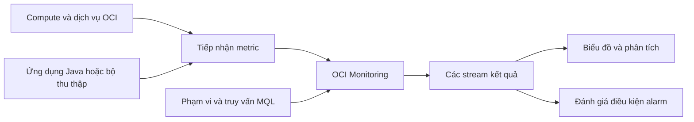
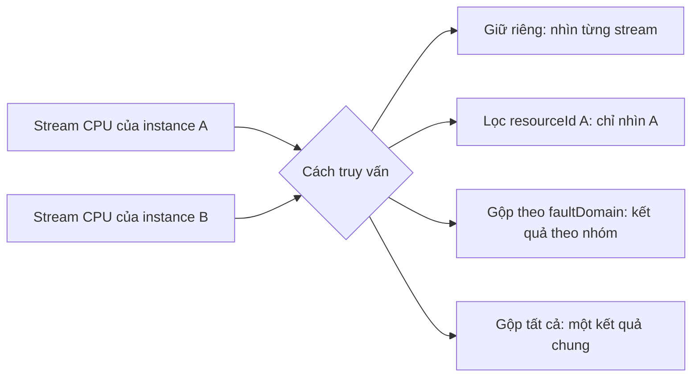

# OCI Monitoring, namespaces, dimensions và metric streams

## 1. Mục tiêu và bối cảnh vận hành

Trong chương **Logs, metrics và tracing** của module **CLOUD_PROVIDERS_ORACLE**, OCI Monitoring giúp quan sát sức khỏe, mức sử dụng và hiệu năng của hạ tầng, dịch vụ và ứng dụng. Để đọc đúng biểu đồ, người vận hành cần hiểu dữ liệu đến từ đâu, đại diện cho đối tượng nào và đã được tổng hợp như thế nào.

Tình huống xuyên suốt: ứng dụng Java `orders-api` chạy trên nhiều Compute instance trong một compartment ứng dụng, giao tiếp qua VCN và sử dụng cơ sở dữ liệu Oracle. Sau một lần triển khai, độ trễ tăng nhưng CPU trung bình của cụm vẫn thấp. Đội vận hành cần kiểm tra từng instance, đối chiếu nhóm tài nguyên và xác nhận dữ liệu giám sát có đầy đủ trước khi quyết định tăng cấu hình hay số lượng máy.

Sau bài này, người học có thể:

- Phân biệt namespace, tên metric, dimensions, metadata và resource group.
- Giải thích metric stream và số đường xuất hiện trên biểu đồ.
- Dùng MQL để lọc, nhóm và tổng hợp dữ liệu phù hợp với câu hỏi vận hành.
- Khám phá định nghĩa metric, truy vấn dữ liệu và thử xuất bản custom metric.
- Nhận ra dữ liệu thiếu, lỗi chọn phạm vi và rủi ro số lượng stream tăng quá nhanh.

Bài tập trung vào mô hình metric và cách truy vấn. Alarm được nhắc tới để giải thích tác động của việc chọn stream; một truy vấn phù hợp vẫn cần quy trình nhận thông báo và xử lý sự cố riêng.

## 2. Monitoring nhận và trả về dữ liệu gì?

Nguồn phát gửi các điểm dữ liệu gồm timestamp, giá trị và thông tin mô tả tới Monitoring. Nguồn có thể là dịch vụ OCI hoặc custom metric do ứng dụng xuất bản. Khi truy vấn, Monitoring trả dữ liệu tổng hợp theo phạm vi thời gian và biểu thức đã chọn; Metrics Explorer hiển thị kết quả để phân tích. [Tổng quan OCI Monitoring](https://docs.oracle.com/en-us/iaas/Content/Monitoring/Concepts/monitoringoverview.htm).



Trong tình huống `orders-api`, có ít nhất hai loại câu hỏi khác nhau:

| Câu hỏi | Dữ liệu phù hợp |
| --- | --- |
| Máy nào dùng CPU cao? | Metric hạ tầng của từng Compute instance |
| Ứng dụng xử lý bao nhiêu request? | Metric ứng dụng có quy ước đếm rõ ràng |
| Vì sao một request chậm? | Kết hợp metric với log và trace của khoảng thời gian liên quan |
| Cơ sở dữ liệu có dấu hiệu nghẽn không? | Metric của đúng dịch vụ database và metric phía ứng dụng |

CPU thấp không tự chứng minh dịch vụ khỏe: ứng dụng có thể đang chờ kết nối database hoặc một phụ thuộc khác. Ngược lại, CPU cao cần được đọc cùng lưu lượng, độ trễ và khả năng đáp ứng, thay vì xem như lý do tự động tăng chi phí hạ tầng.

## 3. Các thành phần của một metric

### 3.1. Namespace xác định nguồn metric

Metric namespace cho biết nhóm nguồn phát, chẳng hạn `oci_computeagent` cho metric do Compute Instance Monitoring plugin gửi. Namespace là một phần bối cảnh truy vấn; cùng tên metric trong hai namespace không được coi là cùng một phép đo.

Một số phạm vi thường gặp trên OCI:

| Namespace | Đối tượng hoặc nguồn cần đối chiếu |
| --- | --- |
| `oci_computeagent` | Metric đo trên Compute instance |
| `oci_blockstore` | Metric của boot volume hoặc block volume |
| `oci_vcn` | Metric mạng ở cấp VNIC trong các metric liên quan |
| `acme_orders` | Namespace custom do bài học tự thiết kế cho ứng dụng |

Trong ba namespace dịch vụ đầu, `resourceId` có thể lần lượt chỉ instance, volume hoặc VNIC. Không dùng OCID instance để lọc một metric yêu cầu OCID VNIC chỉ vì hai đối tượng cùng thuộc một máy. [Metric Compute và các tài nguyên liên quan](https://docs.oracle.com/en-us/iaas/Content/Compute/References/computemetrics.htm).

`acme_orders` là tên minh họa của bài, không phải namespace OCI tích hợp sẵn. Khi thiết kế namespace custom, không dùng tiền tố dành riêng `oci_` hoặc `oracle_`. [Hướng dẫn xuất bản custom metric](https://docs.oracle.com/en-us/iaas/Content/Monitoring/Tasks/publishingcustommetrics.htm).

### 3.2. Tên metric xác định phép đo

Trong namespace `oci_computeagent`, `CpuUtilization` đo mức sử dụng CPU với đơn vị phần trăm. Các tên khác có thể đo byte, số thao tác hoặc tỉ lệ; phải đọc định nghĩa của metric thay vì suy luận từ biểu đồ.

Trước khi dùng metric, ghi lại tối thiểu:

| Thuộc tính cần biết | Ví dụ hoặc câu hỏi |
| --- | --- |
| Namespace và tên | `oci_computeagent` / `CpuUtilization` |
| Đơn vị | Phần trăm, byte, mili giây hay số lượng? |
| Ý nghĩa điểm dữ liệu | Giá trị tức thời, số lượng trong khoảng hay bộ đếm tích lũy? |
| Chu kỳ phát | Bao lâu có dữ liệu mới, nguồn có thể gửi theo lô không? |
| Dimensions hỗ trợ | Có `resourceId`, `faultDomain`, `instancePoolId` hay khóa khác? |
| Điều kiện thu thập | Plugin, cấu hình dịch vụ, quyền hoặc kết nối nào phải có? |

Không áp dụng cùng một phép `sum()` cho tất cả metric. Tổng các mẫu CPU phần trăm thường không trả lời câu hỏi mức sử dụng trung bình; tổng một metric đếm số request theo từng khoảng có thể lại phù hợp.

### 3.3. Dimensions mô tả đối tượng và ngữ cảnh

Dimension là cặp khóa–giá trị đi kèm metric. Ví dụ rút gọn của một tập dimensions:

```json
{
  "resourceId": "<instance-ocid-A>",
  "faultDomain": "FAULT-DOMAIN-1",
  "shape": "<shape-thuc-te>"
}
```

Metric thực tế có thể có thêm nhiều dimensions. Các dimension được phép dùng phụ thuộc định nghĩa của nguồn phát; không tự thêm một khóa vào MQL rồi mong Monitoring suy ra từ tên tài nguyên hoặc tag.

Một dimension có hai vai trò trong phân tích:

- **Lọc:** chỉ lấy dữ liệu có khóa–giá trị phù hợp.
- **Phân nhóm:** kết hợp dữ liệu theo một hoặc một số khóa được chọn.

Ví dụ `resourceId` giúp tìm đúng một instance, còn `faultDomain` giúp xem xu hướng theo nhóm vị trí. Tên hiển thị hữu ích khi đọc nhanh nhưng có thể trùng hoặc thay đổi; khi điều tra một tài nguyên cụ thể, đối chiếu định danh thực.

### 3.4. Metadata khác dimensions

Metadata chứa thông tin bổ sung như đơn vị. Nó không tự trở thành khóa lọc trong biểu thức dimension và không nên được dùng để thay thế một dimension mà câu hỏi phân tích thực sự cần.

Ví dụ custom metric:

```json
{
  "namespace": "acme_orders",
  "name": "RequestCount",
  "dimensions": {
    "application": "orders-api",
    "environment": "prod",
    "resourceId": "demo-node-a"
  },
  "metadata": {
    "unit": "count"
  }
}
```

Đây là phần mô tả rút gọn, chưa có compartment hoặc datapoint để gửi. Trong thiết kế này, `environment` có thể dùng làm điều kiện lọc; `unit` chỉ mô tả ý nghĩa giá trị. Đổi từ mili giây sang giây phải được xử lý bằng dữ liệu hoặc truy vấn thích hợp, không chỉ sửa nhãn metadata.

### 3.5. Resource group là trường riêng

Resource group là chuỗi tùy chọn có thể đi kèm custom metric, chẳng hạn `orders-api`. Khi truy vấn, có thể chỉ định resource group cần khớp. Giá trị null chỉ trả dữ liệu không có resource group; nó không phải yêu cầu gộp tất cả group. [Tham số truy vấn resource group](https://docs.oracle.com/en-us/iaas/tools/oci-cli/latest/oci_cli_docs/cmdref/monitoring/metric-data/summarize-metrics-data.html).

Đừng nhầm trường `resourceGroup` của metric với hàm MQL `groupBy(...)`. Cũng không mặc định `resourceGroup` là một dimension của mọi metric dịch vụ: muốn nhóm theo một khóa, khóa đó phải tồn tại trong định nghĩa dimension tương ứng.

### 3.6. Phạm vi region và compartment

Một truy vấn cần đúng region, compartment, namespace và những điều kiện lọc liên quan. Namespace không phải compartment và không thay thế ranh giới IAM. Hai truy vấn có cùng chuỗi MQL nhưng khác phạm vi có thể trả các tập tài nguyên khác nhau.

Với custom metric, compartment được chỉ định trong dữ liệu gửi. Với metric dịch vụ, đối chiếu tài liệu và tài nguyên được giám sát để chọn compartment. Không coi việc người dùng đang mở đúng tenancy trong Console là bằng chứng đã chọn đúng region và compartment của dữ liệu.

## 4. Metric stream: một metric có thể có nhiều chuỗi dữ liệu

### 4.1. Điểm dữ liệu mới không nhất thiết tạo stream mới

Có thể hình dung mỗi stream là một chuỗi giá trị theo thời gian cho một metric với tổ hợp dimensions cụ thể trong bối cảnh đã chọn. Oracle mô tả metric stream là một tập dữ liệu tổng hợp của metric với không hoặc nhiều giá trị dimension; trên biểu đồ, mỗi đường thường đại diện cho một stream kết quả.

Ví dụ dưới cố định namespace, compartment, region và metric `CpuUtilization`. Các dimension chỉ được chiếu rút gọn để dễ đọc:

| Thời điểm | resourceId | faultDomain | Giá trị CPU |
| --- | --- | --- | --- |
| 10:00 UTC | instance-A | FD-1 | 20% |
| 10:01 UTC | instance-A | FD-1 | 30% |
| 10:00 UTC | instance-B | FD-1 | 70% |
| 10:01 UTC | instance-B | FD-1 | 90% |

Nếu các dimensions còn lại cũng ổn định, đây là hai chuỗi nguồn theo instance, mỗi chuỗi có hai thời điểm. Bốn hàng không đồng nghĩa bốn stream. Nếu phát sinh một tổ hợp dimensions khác, dữ liệu có thể xuất hiện thành chuỗi riêng.

Với custom metric, nên xét cả namespace, tên metric, resource group nếu có và tập dimensions khi đối chiếu các chuỗi. Không dùng riêng `resourceId` như một định danh đầy đủ cho mọi metric của tài nguyên.

### 4.2. Stream kết quả phụ thuộc cách truy vấn

Hai stream nguồn theo instance có thể được giữ riêng, lọc còn một hoặc gộp thành một kết quả chung. Vì vậy, số đường trên chart còn phụ thuộc hàm nhóm và tập dữ liệu khớp truy vấn.



Metric stream ở đây là khái niệm chuỗi metric trong Monitoring. Nó không phải một stream tài nguyên của dịch vụ OCI Streaming. Một alarm có thể gửi thông báo tới Streaming, nhưng điều đó không làm hai khái niệm trở thành một.

### 4.3. Một đường đẹp có thể che một nút quá tải

Giả sử bốn instance có cùng số lượng quan sát hợp lệ và CPU lần lượt là 90%, 10%, 10%, 10% trong một khoảng. Trung bình chung là 30%. Người chỉ xem đường trung bình có thể bỏ qua instance đầu đang chịu tải cao.

Đây là dữ liệu minh họa, không phải kết quả đo của một tenancy thật. Nó cho thấy cần kết hợp:

| Góc nhìn | Câu hỏi trả lời |
| --- | --- |
| Từng resource | Máy nào đang bất thường? |
| Theo nhóm | Fault domain hoặc pool nào chịu áp lực? |
| Toàn bộ tập đã chọn | Xu hướng chung có thay đổi không? |
| Mức cao nhất | Có quan sát nào vượt giới hạn cần điều tra không? |

Một trung bình qua các mẫu CPU cũng không tự là trung bình có trọng số theo số OCPU của các shape khác nhau. Muốn đánh giá capacity, phải xét cấu hình và cách tính phù hợp của cả cụm.

## 5. Đọc và viết truy vấn MQL

MQL là ngôn ngữ truy vấn metric của Monitoring. Một biểu thức cơ bản chỉ định tên metric, interval và statistic; namespace và compartment được chọn ở bối cảnh truy vấn hoặc tham số API/CLI. [Tham chiếu MQL](https://docs.oracle.com/en-us/iaas/Content/Monitoring/Reference/mql.htm).

### 5.1. Giữ riêng các stream và lọc theo dimension

```text
CpuUtilization[1m].mean()
```

Biểu thức tính trung bình trong từng cửa sổ một phút của các stream phù hợp phạm vi truy vấn. Nó không mặc định trả một trung bình duy nhất cho tất cả instance.

Để chọn một instance:

```text
CpuUtilization[1m]{resourceId = "<instance-ocid>"}.mean()
```

Để chọn thêm một fault domain, cần khóa và giá trị thực tế tồn tại trong dữ liệu:

```text
CpuUtilization[1m]{resourceId = "<instance-ocid>", faultDomain = "FAULT-DOMAIN-1"}.mean()
```

Các điều kiện dimension thu hẹp tập dữ liệu. Một điều kiện sai có thể làm kết quả rỗng; không nên chữa bằng cách đổi statistic trước khi xác minh filter.

Các OCID trong dấu `<...>` là placeholder. Lấy định danh đúng từ môi trường của người học trước khi sử dụng truy vấn.

### 5.2. groupBy tạo kết quả theo nhóm

```text
CpuUtilization[1m].groupBy(faultDomain).mean()
```

Truy vấn kết hợp các stream theo giá trị `faultDomain`, rồi áp dụng statistic. Nếu dữ liệu khớp có ba giá trị fault domain, có thể thấy ba đường kết quả thay vì nhiều đường theo instance. `groupBy()` hữu ích khi muốn quan sát xu hướng của nhóm. [Dùng groupBy trong truy vấn](https://docs.oracle.com/en-us/iaas/Content/Monitoring/Tasks/query-metric-groupby.htm).

Với instance pool, có thể dùng dimension được metric hỗ trợ:

```text
CpuUtilization[1m]{instancePoolId = "<instance-pool-ocid>"}.groupBy(resourceId).mean()
```

Truy vấn này lọc về pool nhưng giữ góc nhìn theo instance. Khóa `instancePoolId` cần được kiểm tra trong định nghĩa metric thực tế; không thay bằng một tên khóa gần giống trong ví dụ khác.

Giữ `resourceId` khi muốn biết máy nào gặp vấn đề. Nhóm chỉ theo fault domain khi muốn biết nhóm nào có xu hướng bất thường, rồi quay lại các instance của nhóm để điều tra.

### 5.3. grouping gộp tất cả stream đã chọn

```text
CpuUtilization[1m].grouping().mean()
```

`grouping()` kết hợp các stream phù hợp thành một kết quả theo statistic. Có thể xem mức quan sát cao nhất trong toàn bộ tập đã lọc:

```text
CpuUtilization[1m].grouping().max()
```

Trong Console, tùy chọn **Aggregate metric streams** tương ứng với `grouping()`. Khi đã gộp thành một stream kết quả, không còn một đường riêng cho từng instance trong kết quả đó. [Gộp metric streams trong truy vấn](https://docs.oracle.com/en-us/iaas/Content/Monitoring/Tasks/query-metric-grouping.htm).

Với ví dụ bốn máy 90%, 10%, 10%, 10%, `grouping().mean()` và `grouping().max()` trả lời hai câu hỏi khác nhau. Giá trị max chỉ ra có một quan sát cao, nhưng để tìm đúng máy vẫn cần truy vấn theo resource.

### 5.4. Chọn statistic theo ngữ nghĩa dữ liệu

| Statistic | Ý nghĩa cơ bản | Điểm cần chú ý |
| --- | --- | --- |
| `mean()` | Tổng giá trị chia số quan sát trong interval | Trung bình có thể che đỉnh ngắn hoặc máy bất thường |
| `max()` | Giá trị quan sát lớn nhất trong interval | Một đỉnh đơn lẻ khác với tải kéo dài |
| `sum()` | Tổng các giá trị trong interval | Phải biết giá trị gửi lên là số lượng theo khoảng hay bộ đếm tích lũy |
| `count()` | Số quan sát nhận được trong interval | Không tự là tổng số nghiệp vụ chứa trong giá trị metric |

Ví dụ ứng dụng gửi một điểm `RequestCount` có `value = 42`, `count = 1`, nghĩa là một quan sát báo 42 request trong khoảng đo được quy định. Với một điểm như vậy, tổng giá trị là 42 còn số quan sát là 1. Nếu muốn đếm request, phải dùng quy ước phát dữ liệu và phép tổng hợp tương thích.

Ngược lại, nếu ứng dụng phát bộ đếm tích lũy từ lúc khởi động, cộng các giá trị liên tiếp sẽ đếm lặp. Cần xử lý chênh lệch, reset và thời gian đo đúng với thiết kế bộ đếm. Không chọn `sum()` chỉ vì tên metric có chữ `Count`.

Với độ trễ, percentile có ý nghĩa khi dữ liệu đầu vào giữ được phân phối phù hợp. Nếu mỗi điểm chỉ là trung bình của một phút, percentile của các điểm trung bình không tự trở thành percentile của từng request gốc.

### 5.5. Predicate thêm điều kiện cho kết quả

Ví dụ truy vấn điều kiện trên CPU trung bình của một instance:

```text
CpuUtilization[5m]{resourceId = "<instance-ocid>"}.mean() > 80
```

Ngưỡng 80 là ví dụ học tập, chưa phải khuyến nghị cho workload. Cửa sổ năm phút dùng để tổng hợp dữ liệu; nó không tự biểu thị yêu cầu vượt ngưỡng liên tục năm phút của một cấu hình alarm. Thời gian chờ kích hoạt phải được xét riêng khi thiết kế alarm.

Trước khi thêm predicate, xem truy vấn không có điều kiện để hiểu baseline và những stream sẽ được đánh giá. Nếu chart vốn đã gộp toàn cụm, điều kiện trên đó không thay thế việc giám sát từng instance quan trọng.

## 6. Thời gian: time range, interval và resolution

Ba tham số cùng liên quan đến thời gian nhưng có vai trò khác nhau:

| Thành phần | Vai trò | Ví dụ |
| --- | --- | --- |
| Time range | Giới hạn khoảng thời gian muốn xem | Từ 09:00 đến 10:00 UTC |
| Interval | Độ dài cửa sổ tổng hợp | `[5m]` tính trên cửa sổ năm phút |
| Resolution | Bước dịch giữa các cửa sổ kết quả | `1m` tạo các cửa sổ cách nhau một phút |

Interval quyết định chiều dài cửa sổ dùng để áp dụng statistic. Timestamp của điểm tổng hợp cần được đọc theo quy tắc cửa sổ của Monitoring; không coi đó là thời điểm xảy ra duy nhất của mọi giá trị bên trong. [Chọn interval cho truy vấn](https://docs.oracle.com/en-us/iaas/Content/Monitoring/Tasks/query-metric-interval.htm).

### 6.1. Cửa sổ có thể chồng lấn

Với interval năm phút và resolution một phút, các cửa sổ kế tiếp dịch một phút và có dữ liệu chồng lấn. Ví dụ khái niệm:

```text
Cửa sổ A: 10:00 ───────── 10:05
Cửa sổ B:   10:01 ───────── 10:06
Cửa sổ C:     10:02 ───────── 10:07
```

Đây không phải ba tập sự kiện rời nhau. Nếu các điểm là tổng request trong cửa sổ chồng lấn, cộng tiếp những điểm kết quả đó để tính tổng cả giờ có thể đếm lặp. [Chọn resolution cho truy vấn](https://docs.oracle.com/en-us/iaas/Content/Monitoring/Tasks/query-metric-resolution.htm).

Để kết quả dễ tái lập, trong ví dụ CLI của bài sẽ chỉ định resolution tường minh. Chọn interval/resolution dựa vào câu hỏi và chu kỳ phát dữ liệu, không chỉ để đường biểu đồ trông mượt hơn.

### 6.2. Không nhầm giới hạn truy vấn với thời gian lưu dữ liệu

Độ phân giải yêu cầu ảnh hưởng giới hạn khoảng thời gian có thể trả về. Truy vấn chi tiết trong thời gian dài có thể bị giới hạn dù vẫn có dữ liệu ở mức phù hợp khác. Xem giới hạn hiện hành trước khi thiết kế báo cáo hoặc xuất dữ liệu lịch sử.

Khi so sánh hai biểu đồ, giữ nhất quán time range, interval, resolution, filter và statistic. Một chart năm phút với `max()` và một chart một phút với `mean()` không thể được so sánh như hai cách hiển thị tương đương.

### 6.3. Cửa sổ chưa đầy và dữ liệu đến trễ

Điểm mới nhất có thể thuộc khoảng đo chưa hoàn tất hoặc chưa nhận đủ dữ liệu từ nguồn. Đội vận hành nên biết chu kỳ thu thập, chu kỳ gửi và độ trễ quan sát được của đường giám sát.

Sử dụng UTC hoặc ghi rõ múi giờ khi đối chiếu metric với log, trace và lần triển khai. Với custom metric, đồng hồ nguồn phát phải hợp lý; timestamp sai có thể làm dữ liệu bị từ chối hoặc không xuất hiện trong khoảng đang xem.

## 7. Quyền đọc và quyền xuất bản metric

Ví dụ nhóm người đọc metric và dynamic group của workload trong compartment `AppRuntime`:

```text
Allow group MetricReaders to read metrics in compartment AppRuntime
Allow dynamic-group OrdersMetricPublishers to use metrics in compartment AppRuntime where target.metrics.namespace = 'acme_orders'
```

Tên nhóm, dynamic group và compartment phải khớp môi trường. Cần cấu hình thành viên/matching rule phù hợp trước khi workload có thể dùng quyền được cấp. Có thể giới hạn quyền đọc theo namespace nếu nhiệm vụ yêu cầu. [Policy thường dùng cho Monitoring](https://docs.oracle.com/en-us/iaas/Content/Identity/Concepts/commonpolicies.htm).

Quyền metric không tự cấp quyền thay đổi Compute hoặc quản lý alarm, Notifications topic và các tài nguyên khác. Tài khoản đăng nhập CLI cũng không tự trở thành danh tính của ứng dụng Java. Với workload trên OCI, chọn cơ chế xác thực được hỗ trợ và cấp quyền cho đúng principal thực sự gọi API.

Namespace giúp tổ chức nguồn đo nhưng không phải một vùng riêng tư tự có bảo vệ. Nếu dùng namespace để giới hạn quyền, thể hiện giới hạn đó trong IAM policy và kiểm chứng bằng danh tính tương ứng.

## 8. Khám phá metric bằng Console và CLI

### 8.1. Bắt đầu từ Metrics Explorer

Một trình tự thực hành hữu ích:

1. Chọn đúng region và compartment của tài nguyên thử nghiệm.
2. Mở Metrics Explorer hoặc đi từ Service Metrics tới truy vấn liên quan.
3. Chọn namespace `oci_computeagent`, rồi chọn `CpuUtilization` nếu có dữ liệu.
4. Xem interval, statistic, khoảng thời gian và tùy chọn gộp stream.
5. Bổ sung dimension `resourceId` của một instance, xác nhận biểu đồ thay đổi đúng phạm vi.
6. Chuyển sang MQL để xem biểu thức, sau đó thử `groupBy(faultDomain)` và `grouping()` riêng biệt.
7. Ghi lại phạm vi và truy vấn khi chia sẻ kết luận với người khác.

Không thấy namespace hoặc metric chưa đủ để kết luận tài nguyên không hoạt động. Kiểm tra nguồn phát, quyền, region, compartment và khoảng thời gian trước.

### 8.2. Liệt kê định nghĩa metric

Các lệnh dưới là ví dụ cho người học chạy trong môi trường đã chuẩn bị OCI CLI và quyền đọc. Chúng không yêu cầu thay đổi hạ tầng đang vận hành.

```powershell
$compartmentId = $env:OCI_COMPARTMENT_OCID
$region = $env:OCI_REGION
if ([string]::IsNullOrWhiteSpace($compartmentId) -or [string]::IsNullOrWhiteSpace($region)) {
    throw 'Thiếu compartment OCID hoặc region'
}

oci monitoring metric list --compartment-id $compartmentId --namespace oci_computeagent --name CpuUtilization --all --region $region
if ($LASTEXITCODE -ne 0) { throw 'Không liệt kê được định nghĩa metric' }
```

`metric list` trả định nghĩa phù hợp, giúp kiểm tra namespace, tên và dimensions; nó không trả chuỗi giá trị theo thời gian để vẽ chart. `--all` lấy đủ trang kết quả trong phạm vi đã chọn. [OCI CLI: monitoring metric list](https://docs.oracle.com/en-us/iaas/tools/oci-cli/latest/oci_cli_docs/cmdref/monitoring/metric/list.html).

Tham số `--group-by` của thao tác list dùng nhóm các định nghĩa trong phản hồi. Nó khác hàm MQL `groupBy()` xử lý dữ liệu truy vấn; không hoán đổi hai cơ chế chỉ vì tên gần giống nhau.

### 8.3. Truy vấn dữ liệu một instance

```powershell
$instanceId = $env:OCI_INSTANCE_OCID
if ([string]::IsNullOrWhiteSpace($instanceId)) { throw 'Thiếu instance OCID' }

$queryEnd = [DateTime]::UtcNow
$queryStart = $queryEnd.AddMinutes(-30)
$startTime = $queryStart.ToString('yyyy-MM-ddTHH:mm:ssZ')
$endTime = $queryEnd.ToString('yyyy-MM-ddTHH:mm:ssZ')
$mql = 'CpuUtilization[1m]{resourceId = "' + $instanceId + '"}.mean()'

oci monitoring metric-data summarize-metrics-data --compartment-id $compartmentId --namespace oci_computeagent --query-text $mql --start-time $startTime --end-time $endTime --resolution 1m --region $region
if ($LASTEXITCODE -ne 0) { throw 'Truy vấn metric thất bại' }
```

`SummarizeMetricsData` trả dữ liệu tổng hợp, không phải mọi mẫu thô đã được nguồn phát gửi. Trong phản hồi, kiểm tra dimensions và các điểm tổng hợp của từng phần tử, thay vì chỉ đếm số phần tử JSON rồi gọi đó là số máy. [OCI CLI: summarize-metrics-data](https://docs.oracle.com/en-us/iaas/tools/oci-cli/latest/oci_cli_docs/cmdref/monitoring/metric-data/summarize-metrics-data.html).

Nếu muốn xem toàn nhóm, đổi biểu thức MQL rồi giữ các tham số còn lại ổn định để so sánh. Với compartment con, kiểm tra phạm vi truy vấn thực sự được hỗ trợ; không mặc định chọn một compartment sẽ quét toàn bộ cây con.

## 9. Thử xuất bản custom metric với hai stream

Phần này dùng dữ liệu giả lập để kiểm tra mô hình, không đại diện lưu lượng production. Giả định CLI đã có quyền publish namespace `acme_orders` trong compartment thử nghiệm và có quyền đọc dữ liệu đó.

Quy ước của metric trong bài:

| Thành phần | Giá trị hoặc ý nghĩa |
| --- | --- |
| Namespace | `acme_orders` |
| Metric | `RequestCount` |
| Resource group | `orders-api` |
| Dimensions | `application`, `environment`, `resourceId` |
| Giá trị | Số request trong khoảng đo do ứng dụng quy định |
| Count của một datapoint | `1`, tức một quan sát báo số lượng |
| Metadata unit | `count` |

Các giá trị `demo-node-a` và `demo-node-b` là nhãn custom minh họa. Đặt khóa tên `resourceId` không tự liên kết các nhãn đó với Compute instance thật.

### 9.1. Tạo payload với timestamp hiện tại

Đoạn PowerShell sau là hướng dẫn cho người học. Nó tạo tệp JSON đầu vào trong thư mục thực hành của người chạy:

```powershell
$samplePath = './monitoring-demo.json'
if (Test-Path -LiteralPath $samplePath) {
    throw 'Chọn tệp thực hành mới để tránh ghi đè payload có sẵn'
}

$sampleTimestamp = [DateTime]::UtcNow.ToString('yyyy-MM-ddTHH:mm:ss.fffZ')
$samples = @(
    @{ node = 'demo-node-a'; requests = 42 },
    @{ node = 'demo-node-b'; requests = 9 }
)

$metricData = @(
    foreach ($sample in $samples) {
        [ordered]@{
            compartmentId = $compartmentId
            namespace = 'acme_orders'
            resourceGroup = 'orders-api'
            name = 'RequestCount'
            dimensions = @{
                application = 'orders-api'
                environment = 'lab'
                resourceId = $sample.node
            }
            metadata = @{ unit = 'count' }
            datapoints = @(
                @{
                    timestamp = $sampleTimestamp
                    value = $sample.requests
                    count = 1
                }
            )
        }
    }
)

$payloadJson = ConvertTo-Json -InputObject $metricData -Depth 8
$payloadFullPath = [System.IO.Path]::GetFullPath($samplePath)
[System.IO.File]::WriteAllText($payloadFullPath, $payloadJson, [System.Text.UTF8Encoding]::new($false))
```

`$compartmentId` và `$region` lấy từ phần chuẩn bị CLI. Khi tách các đoạn thành phiên chạy riêng, phải cung cấp lại và xác nhận chúng. Timestamp được tạo lúc thực hành để tránh dùng một thời điểm cũ đã hết phạm vi tiếp nhận.

### 9.2. Gửi tới endpoint ingestion

PostMetricData dùng endpoint `telemetry-ingestion`, khác endpoint `telemetry` dùng cho các thao tác Monitoring còn lại. Payload phải đáp ứng giới hạn timestamp, số dimensions, số stream và giới hạn của từng request. [OCI CLI: monitoring metric-data post](https://docs.oracle.com/en-us/iaas/tools/oci-cli/latest/oci_cli_docs/cmdref/monitoring/metric-data/post.html).

Ví dụ endpoint dưới dành cho region OC1 có tên miền tương ứng. Với realm khác, lấy đúng endpoint được Oracle công bố cho môi trường:

```powershell
$ingestionEndpoint = "https://telemetry-ingestion.${region}.oraclecloud.com"

$postJson = oci monitoring metric-data post --metric-data 'file://monitoring-demo.json' --batch-atomicity ATOMIC --endpoint $ingestionEndpoint --region $region
if ($LASTEXITCODE -ne 0) { throw 'Gửi custom metric thất bại' }

$postResponse = ($postJson -join "`n") | ConvertFrom-Json
if ($postResponse.data.'failed-metrics-count' -ne 0) {
    throw 'Có metric bị từ chối; cần đọc chi tiết phản hồi trước khi tiếp tục'
}
```

`ATOMIC` yêu cầu toàn bộ metric object trong request vượt qua bước kiểm tra đầu vào. Với chế độ không atomic, một request có thể trả kết quả kèm các object thất bại; vì vậy cần đọc phần tổng hợp lỗi, không chỉ nhìn mã thoát của CLI. Sau khi gửi thành công vẫn cần truy vấn để xác nhận đúng phạm vi và nội dung đã tới được đường đọc.

### 9.3. Đọc lại đúng resource group

```powershell
$customStart = [DateTime]::UtcNow.AddMinutes(-10).ToString('yyyy-MM-ddTHH:mm:ss.fffZ')
$customEnd = [DateTime]::UtcNow.ToString('yyyy-MM-ddTHH:mm:ss.fffZ')
$customMql = 'RequestCount[1m]{environment = "lab"}.groupBy(resourceId).sum()'

oci monitoring metric-data summarize-metrics-data --compartment-id $compartmentId --namespace acme_orders --resource-group orders-api --query-text $customMql --start-time $customStart --end-time $customEnd --resolution 1m --region $region
if ($LASTEXITCODE -ne 0) { throw 'Không đọc lại được custom metric' }
```

Nếu chỉ có hai mẫu trên trong cùng cửa sổ đã chọn và dữ liệu đã sẵn sàng, kỳ vọng có kết quả theo `demo-node-a` với tổng 42 và `demo-node-b` với tổng 9. Bỏ `--resource-group orders-api` có thể khiến truy vấn không khớp tập đã gửi; đây là một nguyên nhân cần kiểm tra khi thấy rỗng.

Có thể đổi riêng biểu thức để so sánh:

```text
RequestCount[1m]{environment = "lab"}.grouping().sum()
RequestCount[1m]{environment = "lab"}.grouping().count()
```

Trong điều kiện chỉ có hai quan sát trên, tổng giá trị là 51 còn số quan sát là 2. Nếu đã gửi thêm dữ liệu hoặc gửi lại payload, kết quả phải được giải thích theo dữ liệu thực nhận, không cố ép về con số minh họa.

Nếu truy vấn ngay chưa có điểm, kiểm tra phản hồi post, thời gian và phạm vi; sau đó chờ dữ liệu có thể được đọc rồi truy vấn lại với khoảng thời gian cập nhật. Không gửi thêm nhiều bản mẫu liên tiếp chỉ để làm chart xuất hiện.

### 9.4. Triển khai lâu dài cho ứng dụng Java

Bản thực hành dùng CLI để nhìn rõ payload. Trong ứng dụng thật, cần một bộ thu thập hoặc client được quản lý, có xác thực phù hợp, batching, xử lý lỗi, giới hạn tốc độ và giám sát chính đường gửi metric. Có thể sử dụng SDK hoặc cách tích hợp agent phù hợp thay vì gọi CLI cho từng request ứng dụng.

Các quyết định phải được ghi rõ gồm: ai sở hữu namespace, metric đo cái gì, thời điểm chốt số liệu, có gửi giá trị zero khi không có request hay không, xử lý restart thế nào và những dimension nào được phép dùng. Thay đổi quy ước đo có thể làm mất khả năng so sánh lịch sử dù tên metric giữ nguyên.

## 10. Cardinality: số tổ hợp dimensions có thể tăng rất nhanh

### 10.1. Ước lượng số stream trước khi xuất bản

Cardinality trong bài chỉ số tổ hợp giá trị dimension phân biệt cần theo dõi cho một metric trong phạm vi xác định. Ví dụ thiết kế thêm:

- 20 instance.
- 4 route đã chuẩn hóa, chẳng hạn `/orders/{id}` thay vì từng URL cụ thể.
- 3 nhóm trạng thái phản hồi.
- Một môi trường cố định.

Nếu mọi tổ hợp đều xuất hiện, có thể có `20 × 4 × 3 = 240` stream cho một metric. Đây là phép tính minh họa theo giả định; số thực tế phụ thuộc những tổ hợp thật sự được phát và các trường phân chia bổ sung.

Nếu thêm `requestId` gần như duy nhất cho từng request, số stream có thể tăng theo lưu lượng thay vì theo số tài nguyên. `groupBy()` làm giảm số đường trong kết quả truy vấn nhưng không sửa việc nguồn đang gửi quá nhiều tổ hợp.

### 10.2. Chọn dimension theo câu hỏi cần trả lời

| Giá trị dự định dùng | Cách cân nhắc |
| --- | --- |
| Môi trường, ứng dụng | Tập giá trị thường được kiểm soát, hữu ích cho phân chia |
| Instance hoặc pool | Hữu ích cho vận hành nhưng thay đổi theo vòng đời hạ tầng |
| Route chuẩn hóa | Hữu ích nếu số route được giới hạn và quy ước ổn định |
| Nhóm mã trạng thái | Giúp phân tích kết quả mà không tách quá chi tiết |
| URL đầy đủ có query string | Dễ tạo nhiều giá trị và chứa dữ liệu không cần đưa vào metric |
| Request ID, trace ID, user ID | Thường phù hợp hơn với log hoặc trace phục vụ điều tra từng sự kiện |
| Phiên bản build rất thường xuyên | Cần cân nhắc số giá trị lịch sử và nhu cầu phân tích thực tế |

Một `traceId` có thể rất hữu ích khi truy tìm request trong log/trace, nhưng không nhất thiết phải là dimension của metric tổng hợp. Liên kết điều tra bằng thời gian, tài nguyên và ngữ cảnh ứng dụng trước, rồi dùng công cụ phù hợp để tìm sự kiện chi tiết.

### 10.3. Giới hạn kỹ thuật và chi phí

Phân biệt giới hạn của một request, giới hạn tốc độ API, giới hạn stream của truy vấn và phạm vi dữ liệu của tenancy. Không lấy số stream tối đa của một lần post rồi diễn giải thành số stream tối đa cho toàn hệ thống.

Với custom metric, đội nên theo dõi số stream đang phát, tần suất gửi, dung lượng dữ liệu quan sát và số lượng truy vấn. Dựa vào mức sử dụng và chính sách giá hiện hành của tenancy để dự toán chi phí; không mặc định mọi metric custom có cùng điều kiện với metric dịch vụ.

Nếu số stream tăng bất ngờ, kiểm tra thay đổi dimension ở nguồn phát trước. Giảm interval trên chart không làm giảm số điểm đã gửi vào hệ thống.

## 11. Dữ liệu thiếu, zero và sự cố nguồn phát

### 11.1. Zero là một giá trị, thiếu là chưa có quan sát phù hợp

Metric trả zero có thể biểu thị nguồn đã đo và gửi giá trị bằng không. Không có điểm có thể do không có dữ liệu, filter sai, quyền thiếu, sai region, sai resource group hoặc đường gửi bị lỗi. Vì vậy, không chuyển kết quả rỗng thành zero một cách tùy tiện.

Trong metric `RequestCount` theo khoảng, nếu ứng dụng chỉ gửi khi có request, khoảng yên lặng sẽ khác với thiết kế gửi zero định kỳ. Hai quy ước đó dẫn đến cách đọc chart và điều kiện theo dõi nguồn phát khác nhau.

Nếu cần biết ứng dụng còn khả năng gửi telemetry, có thể thiết kế heartbeat định kỳ với quy ước rõ. Heartbeat chứng minh một phần đường quan sát còn hoạt động, không tự chứng minh toàn bộ luồng nghiệp vụ hoặc truy cập database khỏe.

### 11.2. Điều kiện để có metric Compute

Metric `oci_computeagent` phụ thuộc Compute Instance Monitoring plugin được bật, chạy và có kết nối cần thiết tới Monitoring. Một VM tồn tại hoặc ứng dụng Java vẫn trả request không đủ để chứng minh plugin đang gửi metric thành công. [Điều kiện sử dụng metric Compute](https://docs.oracle.com/en-us/iaas/Content/Compute/References/computemetrics.htm).

Khi nhiều metric của một instance cùng ngừng xuất hiện, kiểm tra plugin, agent, đồng hồ và đường mạng theo cấu hình của môi trường. Với workload trong subnet riêng, xác nhận đường tới endpoint dịch vụ, DNS và các chính sách egress tương ứng thay vì chỉ kiểm tra NSG cho cổng ứng dụng.

### 11.3. Tác động lên alarm và tính sẵn sàng

Một điều kiện CPU vượt ngưỡng không thay thế điều kiện phát hiện mất dữ liệu. Một đường trung bình toàn cụm cũng không có cùng phạm vi đánh giá với các stream theo instance.

Trước khi dùng query cho alarm, kiểm chứng tập stream được chọn, ý nghĩa của dữ liệu thiếu, tần suất phát, thời gian chờ kích hoạt và số lượng thông báo có thể tạo ra. Nếu cần phát hiện mọi tài nguyên đáng lẽ phải được giám sát, đối chiếu thêm danh mục tài nguyên dự kiến thay vì chỉ nhìn những đường đang có dữ liệu.

Không tự động scale hoặc tái tạo tài nguyên chỉ vì metric rỗng. Đầu tiên cần phân biệt sự cố workload với sự cố quan sát để tránh vừa tăng chi phí vừa làm điều tra khó hơn.

## 12. Chẩn đoán truy vấn không như mong đợi

### 12.1. Kiểm tra theo thứ tự từ phạm vi tới phép tính

Một trình tự hữu ích:

1. Xác nhận tenancy, region, compartment và principal đang dùng.
2. Kiểm tra nguồn có phát metric trong khoảng cần xem và có quyền đọc phù hợp.
3. Liệt kê định nghĩa để đối chiếu namespace, tên, resource group và dimensions.
4. Bắt đầu bằng truy vấn rộng trong phạm vi được phép, rồi thêm từng filter.
5. Kiểm tra interval, resolution, thời gian UTC và giới hạn trả dữ liệu.
6. So sánh kết quả giữ riêng stream với kết quả nhóm/gộp.
7. Đọc định nghĩa phép đo trước khi kết luận statistic nào là đúng.

Không mở rộng quyền lên toàn tenancy chỉ để thử làm một chart xuất hiện. Tìm xem truy vấn đang nhắm vào tài nguyên nào và cấp đúng quyền theo nhiệm vụ.

### 12.2. Bảng triệu chứng và hướng kiểm tra

| Triệu chứng | Những điểm cần kiểm tra |
| --- | --- |
| Không thấy namespace | Region, compartment, quyền, nguồn và thời gian phát dữ liệu |
| Metric list có kết quả nhưng chart rỗng | Khoảng thời gian, filter, resource group, dữ liệu nguồn còn mới không |
| Chỉ có một đường dù có nhiều instance | Có bật aggregate hoặc dùng `grouping()` không; filter có quá hẹp không |
| Có nhiều đường hơn số máy | Các dimensions khác nhau, nhiều resource group hoặc nhiều đối tượng trong phạm vi |
| Tên instance đúng nhưng không khớp | Tên hiển thị có trùng/đổi không; có dùng đúng resource OCID không |
| CPU chart khác giữa hai người | Statistic, interval, resolution, time range, scope và query có giống nhau không |
| RequestCount ra số nhỏ hơn dự kiến | Đang dùng `count()` thay cho tổng giá trị hay chưa tính đủ các stream? |
| Tổng request lớn bất thường | Có cộng bộ đếm tích lũy hoặc cộng cửa sổ chồng lấn không? |
| Gửi custom metric có object lỗi | Payload, timestamp, quyền publish, endpoint ingestion và giới hạn từng request |
| Truy vấn dài bị giới hạn | Độ phân giải, khoảng thời gian, số stream và số điểm trả về |
| Metric dừng sau thay đổi mạng | DNS, endpoint, route, egress và cấu hình agent/client |

Đây là hướng điều tra, không phải ánh xạ tuyệt đối từ một triệu chứng sang một nguyên nhân. Giữ lại query, tham số, thời điểm và phản hồi lỗi gốc để tái lập vấn đề.

## 13. Thực hành đọc metric có kiểm soát

Thực hành trong môi trường được cấp quyền; các lệnh và payload của bài là ví dụ cho người học, không phải yêu cầu chạy trên production.

1. Chọn một Compute instance đã có metric Monitoring. Ghi region, compartment, namespace, metric và dimensions thực tế.
2. Đọc CPU theo instance trong khoảng 30 phút; giải thích interval, statistic và resolution đang dùng.
3. So sánh truy vấn giữ riêng stream, truy vấn theo fault domain và truy vấn gộp toàn bộ. Chỉ ra dữ liệu nào không còn phân biệt được sau mỗi lần gộp.
4. Với số liệu giả lập bốn máy 90%, 10%, 10%, 10%, giải thích vì sao trung bình 30% không thể dùng để loại trừ tình trạng một máy đang quá tải.
5. Nếu có quyền publish, gửi hai custom stream của phần thực hành, kiểm tra phản hồi và đọc lại đúng resource group. Giải thích sự khác nhau giữa tổng 51 và số quan sát 2 trong điều kiện của ví dụ.
6. Thử một filter không khớp hoặc một resource group khác chỉ trên thao tác đọc. Xác nhận kết quả rỗng không mang cùng ý nghĩa với điểm zero.
7. Ước lượng số stream nếu thêm route, nhóm trạng thái hoặc request ID; chọn lại dimensions theo câu hỏi vận hành và giới hạn chi phí.
8. Lưu query cùng phạm vi, đơn vị và cách diễn giải để người khác có thể tái lập kết quả; kết thúc chương trình gửi dữ liệu thử nếu đã bật một nguồn phát định kỳ.

Kết quả học tập cần đạt là một giải thích có đủ bối cảnh: **nguồn nào phát metric, tổ hợp nào xác định stream, tập nào được chọn và phép tổng hợp nào tạo ra giá trị đang đọc**. Cơ sở đó giúp quyết định đúng khi điều tra ứng dụng Java, kết nối cơ sở dữ liệu Oracle, năng lực hạ tầng và mức sử dụng tài nguyên trên OCI.
