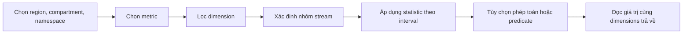

# Viết MQL để truy vấn và tổng hợp metrics

## 1. Mục tiêu và phạm vi

Trong chương **Logs, metrics và tracing**, metrics giúp trả lời các câu hỏi có thể đo bằng số: instance nào dùng CPU cao, tải tập trung ở fault domain nào, tỷ lệ lỗi ứng dụng thay đổi ra sao hoặc một nguồn telemetry có ngừng phát dữ liệu không.

Trên Oracle Cloud Infrastructure, **Monitoring Query Language — MQL** là ngôn ngữ truy vấn dữ liệu trong dịch vụ Monitoring. Một biểu thức MQL chọn metric, cửa sổ thời gian, phép thống kê và có thể thêm lọc dimension, gom nhóm hoặc điều kiện. Nó không phải câu lệnh SQL để đọc bảng Oracle Database, cũng không phải ngôn ngữ tìm kiếm log hay truy vấn trace. [Oracle: Monitoring Query Language Reference](https://docs.oracle.com/en-us/iaas/Content/Monitoring/Reference/mql.htm).

Sau bài học, người học có thể:

- Viết truy vấn từ metric đơn giản tới lọc, gom nhóm và tổng hợp nhiều stream.
- Phân biệt `mean()`, `sum()`, `count()`, percentile và rate theo ý nghĩa dữ liệu.
- Chọn interval, resolution và khoảng thời gian truy vấn phù hợp.
- Dùng predicate, truy vấn lồng và điều kiện kết hợp.
- Thực hiện truy vấn trên Metrics Explorer hoặc OCI CLI.
- Phát hiện các truy vấn đúng cú pháp nhưng trả lời sai câu hỏi vận hành.

Ví dụ xuyên suốt là ứng dụng Java `orders-api` chạy trên một nhóm Compute và sử dụng cơ sở dữ liệu Oracle. Phần hạ tầng dùng metric thật `CpuUtilization` trong namespace `oci_computeagent`. Phần ứng dụng dùng custom metrics giả định được mô tả rõ hợp đồng dữ liệu; chúng không tự tồn tại trong tenancy.

## 2. Hiểu metric trước khi viết câu truy vấn

### 2.1. Metric không chỉ có tên và giá trị

Một metric nằm trong một ngữ cảnh gồm nguồn phát, compartment, namespace, tên, dimensions và dữ liệu theo thời gian. Các tổ hợp dimension khác nhau tạo những metric stream khác nhau.

| Thành phần | Ý nghĩa | Ví dụ |
| --- | --- | --- |
| Region | Khu vực đang truy vấn | Region chứa các instance |
| Compartment | Phạm vi tài nguyên/metric được đọc | Compartment của nhóm vận hành |
| Namespace | Nguồn dịch vụ hoặc ứng dụng | `oci_computeagent` |
| Metric name | Đại lượng cần đọc | `CpuUtilization` |
| Dimensions | Thuộc tính dùng để chọn và nhóm stream | `resourceId`, `faultDomain` |
| Timestamp | Thời điểm của quan sát | Thời gian UTC |
| Value, unit | Giá trị và đơn vị | CPU 65%, latency 180 ms |
| Resource group, nếu có | Nhóm nguồn được định nghĩa khi phát metric | Một nhóm custom metrics của ứng dụng |

OCI Monitoring nhận metrics từ dịch vụ, ứng dụng và các nguồn được hỗ trợ; kết quả truy vấn là dữ liệu đã tổng hợp theo tham số được chọn. Không coi mỗi điểm trên biểu đồ là một request hay một quan sát thô. [Oracle: Overview of Monitoring](https://docs.oracle.com/en-us/iaas/Content/Monitoring/Concepts/monitoringoverview.htm).

### 2.2. Ngữ cảnh truy vấn nằm ngoài biểu thức MQL

Biểu thức:

```text
CpuUtilization[1m].mean()
```

không tự chứa tenancy, region, compartment, namespace hay toàn bộ khoảng thời gian cần lấy dữ liệu. Các giá trị đó do Metrics Explorer hoặc request CLI/API cung cấp.

Cùng biểu thức nhưng đổi compartment hoặc namespace có thể trả về tập dữ liệu khác. Khi chia sẻ một truy vấn để điều tra sự cố, cần chia sẻ cả ngữ cảnh thay vì chỉ gửi chuỗi MQL.

Không dùng một dimension tự bịa như `compartmentId` để thay thế phạm vi compartment của request. Chỉ lọc theo dimension đó nếu định nghĩa metric thực sự có nó.

### 2.3. Phân biệt dữ liệu tức thời, số lượng và bộ đếm

| Hợp đồng dữ liệu | Ví dụ | Phép thống kê thường phù hợp |
| --- | --- | --- |
| Mức sử dụng tại thời điểm lấy mẫu | CPU %, số kết nối đang mở | `mean()`, `max()`, `min()` |
| Số sự kiện trong từng khoảng phát | Số đơn xử lý trong mỗi phút | `sum()` để cộng các khoảng không trùng |
| Bộ đếm tích lũy | Tổng byte hoặc request từ lúc tiến trình chạy | `rate()`/`increment()` sau khi xét hợp đồng và reset |
| Quan sát từng sự kiện | Latency của từng request | `mean()`, `percentile()` |
| Cờ 0/1 cho mỗi sự kiện | Request thành công 0, thất bại 1 | `sum()` là số lỗi; `mean()` là tỷ lệ lỗi |

Tên có chữ `Count` không quyết định phải dùng `count()`. Phải biết giá trị được gửi lên đại diện cho điều gì.

Nếu ứng dụng đã gửi “120 request trong phút này”, đó là một quan sát có giá trị 120. `count()` đếm số quan sát nhận được, không tự biến giá trị đó thành 120 request.

## 3. Cấu trúc một biểu thức MQL

Dạng học tập:

```text
MetricName[interval]{dimensionName = "dimensionValue"}.groupBy(dimensionName).statistic()
```

Không phải thành phần nào cũng bắt buộc. Tên metric, interval và statistic là nền tảng của truy vấn số liệu; phần lọc và grouping được thêm theo câu hỏi cần trả lời.

Ví dụ:

```text
CpuUtilization[5m]{resourceId = "<INSTANCE_OCID>"}.mean()
```

Đọc từ trái sang phải: chọn `CpuUtilization`, dùng cửa sổ năm phút, giới hạn vào instance xác định rồi lấy trung bình trong cửa sổ.



Thứ tự đặt grouping và statistic có ý nghĩa. Không sao chép cú pháp SQL như `SELECT` hoặc `GROUP BY` vào MQL.

## 4. Xác minh metric và quyền truy vấn

### 4.1. Đọc định nghĩa và dimensions có thật

Trước khi lọc, xác định:

1. Metric có tồn tại trong đúng namespace không.
2. Đơn vị và ý nghĩa của từng quan sát.
3. Dimensions được công bố và giá trị thực tế.
4. Tần suất phát, tình trạng thiếu dữ liệu và khả năng reset.
5. Resource group có được dùng không.

Metrics Explorer cho phép liệt kê namespace, metric name và dimensions theo compartment đã chọn; API/CLI có thao tác ListMetrics để đọc định nghĩa. [Oracle: Listing Metric Definitions](https://docs.oracle.com/en-us/iaas/Content/Monitoring/Tasks/list-metric.htm).

**Một điểm quan trọng của OCI:** dimension không tồn tại có thể được chấp nhận nhưng không lọc dữ liệu. Vì vậy, truy vấn trả kết quả không chứng minh filter đã có tác dụng. Phải đối chiếu tên dimension và dimensions trong kết quả. [Oracle: Selecting Dimensions for a Query](https://docs.oracle.com/en-us/iaas/Content/Monitoring/Tasks/query-metric-dimension.htm).

Ví dụ, thêm `environment = "production"` vào metric Compute không tự lọc theo tag môi trường của instance. Tag OCI không tự trở thành dimension của mọi metric.

### 4.2. Quyền tối thiểu cho bài thực hành

Một policy minh họa để đọc metrics:

```text
Allow group id <METRIC_READERS_GROUP_OCID> to read metrics in compartment id <METRIC_COMPARTMENT_OCID>
```

Thay các OCID giữ chỗ và đặt policy ở cấp phù hợp với phạm vi quản trị. Quyền `inspect metrics` phục vụ liệt kê; `read metrics` bao gồm quyền truy vấn dữ liệu bằng SummarizeMetricsData. Không cần quyền quản lý Compute chỉ để làm bài đọc metrics này. [Oracle: Details for Monitoring](https://docs.oracle.com/en-us/iaas/Content/Identity/Reference/monitoringpolicyreference.htm).

Với `oci_computeagent`, instance cần phát metrics qua cơ chế monitoring phù hợp. Tài liệu Compute mô tả Compute Instance Monitoring plugin và các dimensions như `resourceId`, `resourceDisplayName`, `faultDomain`, `availabilityDomain`, `instancePoolId` và `shape`. [Oracle: Compute Instance Metrics](https://docs.oracle.com/en-us/iaas/Content/Compute/References/computemetrics.htm).

### 4.3. Khám phá bằng OCI CLI trên PowerShell

Các ví dụ CLI trong bài dùng **PowerShell** với OCI CLI đã được cấu hình. Chúng là các thao tác đọc; thay các giá trị giữ chỗ trước khi chạy.

```powershell
$ociRegion = '<OCI_REGION>'
$metricCompartmentId = '<METRIC_COMPARTMENT_OCID>'

$metricListArgs = @(
    'monitoring', 'metric', 'list',
    '--region', $ociRegion,
    '--compartment-id', $metricCompartmentId,
    '--namespace', 'oci_computeagent',
    '--name', 'CpuUtilization',
    '--all'
)

oci @metricListArgs
```

Kết quả là định nghĩa metric và dimensions, không phải chuỗi giá trị CPU theo thời gian. Không nhầm tùy chọn `--group-by` của thao tác liệt kê metadata với `groupBy()` trong biểu thức MQL truy vấn số liệu. [Oracle CLI: monitoring metric list](https://docs.oracle.com/en-us/iaas/tools/oci-cli/latest/oci_cli_docs/cmdref/monitoring/metric/list.html).

## 5. Lọc metric stream theo dimension

### 5.1. Chọn đúng một tài nguyên

```text
CpuUtilization[1m]{resourceId = "<INSTANCE_OCID>"}.mean()
```

`resourceId` thích hợp để xác định một instance cụ thể. Display name có thể đổi hoặc trùng, nên không luôn là định danh tốt cho câu hỏi cần độ chính xác cao.

### 5.2. Kết hợp nhiều điều kiện

```text
CpuUtilization[5m]{faultDomain = "FAULT-DOMAIN-1", resourceDisplayName =~ "orders-*"}.mean()
```

Các cặp dimension cách nhau bằng dấu phẩy được kết hợp theo AND: instance phải thuộc fault domain 1 **và** tên khớp mẫu.

Fuzzy matching dùng `=~`. Dấu `*` đại diện chuỗi ký tự và `|` biểu diễn các giá trị lựa chọn trong mẫu:

```text
CpuUtilization[5m]{faultDomain =~ "FAULT-DOMAIN-1|FAULT-DOMAIN-2"}.mean()
```

Đây là cú pháp fuzzy matching của MQL; không mặc định mọi biểu thức regular expression đều được hỗ trợ.

### 5.3. Loại trừ giá trị

```text
CpuUtilization[5m]{faultDomain != "FAULT-DOMAIN-3"}.mean()
```

Loại nhiều tên khớp mẫu:

```text
CpuUtilization[5m]{resourceDisplayName !~ "test-*|sandbox-*"}.mean()
```

Filter loại trừ vẫn đòi hỏi dimension tồn tại. Nếu mục tiêu là chỉ lấy production, một danh sách loại test không thay thế được việc xác định tập production đầy đủ.

Sau mỗi lần thêm filter, kiểm tra số stream và dimensions còn lại. Một filter sai tên có thể rộng hơn dự kiến; một filter đúng tên nhưng sai giá trị có thể không còn dữ liệu.

## 6. Interval, resolution, time range và tần suất phát

### 6.1. Bốn khái niệm khác nhau

| Khái niệm | Câu hỏi nó trả lời | Ví dụ |
| --- | --- | --- |
| Emission frequency | Nguồn gửi dữ liệu thường xuyên thế nào? | Mỗi phút |
| Interval | Mỗi phép tổng hợp nhìn vào cửa sổ dài bao lâu? | `[5m]` |
| Resolution | Các cửa sổ tổng hợp kế tiếp cách nhau bao lâu? | `1m` |
| Time range | Lấy kết quả trong giai đoạn nào? | 60 phút gần nhất |

Interval không phải khoảng thời gian toàn bộ truy vấn. `CpuUtilization[5m].mean()` có thể dùng để xem nhiều giờ dữ liệu, mỗi điểm biểu diễn phép tổng hợp của cửa sổ năm phút.

Timestamp của điểm tổng hợp tương ứng cuối cửa sổ được đánh giá. Khi đối chiếu log lúc 10:04 với điểm metric 10:05, cần xét cửa sổ mà điểm đó đại diện. [Oracle: Selecting the Interval for a Query](https://docs.oracle.com/en-us/iaas/Content/Monitoring/Tasks/query-metric-interval.htm).

### 6.2. Ví dụ cửa sổ chồng lấp

Giữ interval năm phút:

| Resolution | Các cửa sổ minh họa | Ý nghĩa |
| --- | --- | --- |
| `5m` | 10:00–10:05, 10:05–10:10 | Cửa sổ nối tiếp |
| `1m` | 10:00–10:05, 10:01–10:06 | Cửa sổ chồng lấp |

Resolution nhỏ hơn giúp quan sát thay đổi đều hơn nhưng không biến dữ liệu nguồn thành chi tiết hơn tần suất phát thực tế.

Khi dùng CLI/API, đặt rõ `--resolution` để tránh phụ thuộc giá trị mặc định giữa các giao diện. Resolution không lớn hơn interval; với alarm query, resolution được dịch vụ cố định ở một phút. [Oracle: Selecting a Nondefault Resolution](https://docs.oracle.com/en-us/iaas/Content/Monitoring/Tasks/query-metric-resolution.htm).

### 6.3. Không cộng các tổng chồng lấp

Giả sử `CompletedOrders[5m].sum()` chạy với resolution `1m`. Một đơn có thể nằm trong nhiều cửa sổ kết quả. Cộng mọi điểm năm phút này để tính số đơn cả giờ sẽ đếm lặp.

Muốn tính tổng theo các khoảng không trùng, chọn cửa sổ và resolution tương ứng, xác định rõ biên thời gian rồi mới tổng hợp. Đặc biệt cẩn thận khi xuất kết quả MQL sang bảng tính hoặc chương trình báo cáo.

### 6.4. Độ mịn và phạm vi lịch sử

Khoảng lịch sử có thể truy xuất phụ thuộc resolution. Không mặc định dữ liệu chi tiết một phút luôn còn truy vấn được cho mọi giai đoạn cũ. Khi đổi time range lớn, cần đối chiếu lựa chọn interval/resolution mà dịch vụ hỗ trợ.

Với câu hỏi “CPU đã tăng thế nào trong 30 phút gần nhất”, bắt đầu bằng `1m` hoặc `5m`. Với xu hướng nhiều tuần, dùng độ tổng hợp lớn hơn và giữ tên statistic trong ghi chú biểu đồ để người đọc không nhầm mức trung bình với đỉnh tải.

## 7. Chọn statistic để trả lời đúng câu hỏi

### 7.1. Các phép cơ bản

| Statistic | Diễn giải | Ví dụ phù hợp |
| --- | --- | --- |
| `mean()` hoặc `avg()` | Trung bình các quan sát | Mức CPU trung bình |
| `min()` | Quan sát thấp nhất | Mức dự trữ thấp nhất |
| `max()` | Quan sát cao nhất | Đỉnh CPU |
| `sum()` | Cộng các giá trị | Số sự kiện khi giá trị là số lượng cộng được |
| `count()` | Đếm quan sát nhận được | Kiểm tra số mẫu |
| `first()`, `last()` | Giá trị theo timestamp đầu/cuối cửa sổ | Quan sát biên cửa sổ |

Oracle định nghĩa statistic trên các quan sát trong interval. Tên hàm không thay đổi đơn vị một cách tùy ý: `max()` của CPU vẫn là phần trăm, còn `sum()` của nhiều giá trị CPU không trở thành số core đang sử dụng. [Oracle: Selecting the Statistic for a Query](https://docs.oracle.com/en-us/iaas/Content/Monitoring/Tasks/query-metric-statistic.htm).

### 7.2. Trung bình không phản ánh đỉnh ngắn

Giả sử một host có sáu giá trị CPU trong cửa sổ: `10, 10, 10, 10, 10, 100`.

```text
mean = 25%
max = 100%
count = 6
sum = 150
```

Nếu câu hỏi là “có lúc nào CPU chạm 100% không”, `mean()` không đủ. Nếu câu hỏi là “CPU thường sử dụng bao nhiêu trong cửa sổ”, `max()` một mình cũng dễ gây cảm giác tải cao kéo dài.

### 7.3. Percentile phải dựa trên đúng loại quan sát

```text
RequestLatencyMs[5m]{service = "orders-api", environment = "production"}.groupBy(releaseId).percentile(0.95)
```

Truy vấn dùng custom metric có hợp đồng: mỗi quan sát là latency một request, đơn vị ms, dimensions có `service`, `environment` và `releaseId`. `percentile(0.95)` là ước lượng p95, không phải `percentile(95)`.

Nếu nguồn chỉ gửi latency trung bình mỗi phút, p95 trên những giá trị đó là p95 của **các mức trung bình**, không phải p95 request. Tương tự, không lấy trung bình p95 của nhiều host để gọi là p95 toàn dịch vụ.

Cần đọc cả số mẫu. P95 từ vài request không cung cấp cùng độ tin cậy với p95 từ một tập lớn và có độ phủ nghiệp vụ phù hợp.

## 8. Gom nhóm: giữ chi tiết nào và bỏ chi tiết nào

### 8.1. Không grouping: giữ các stream riêng

```text
CpuUtilization[1m]{resourceDisplayName =~ "orders-*"}.mean()
```

Truy vấn trả về thống kê theo các stream còn lại sau filter. Một biểu đồ có nhiều đường không nhất thiết có nhiều instance như số đường: một tài nguyên có thể phát nhiều stream nếu dimensions còn phân biệt chúng.

Để có một nhóm theo instance, viết rõ:

```text
CpuUtilization[1m]{resourceDisplayName =~ "orders-*"}.groupBy(resourceId).mean()
```

### 8.2. groupBy(): một kết quả cho mỗi nhóm

```text
CpuUtilization[5m]{resourceDisplayName =~ "orders-*"}.groupBy(faultDomain).mean()
```

Các stream có cùng `faultDomain` được kết hợp cho phép thống kê. Dimensions không giữ trong khóa nhóm không còn là mức phân biệt chính của kết quả.

Có thể nhóm theo nhiều dimension:

```text
CpuUtilization[5m].groupBy(availabilityDomain, faultDomain).max()
```

Khi đó, mỗi tổ hợp availability domain và fault domain là một nhóm. Không suy ra mọi fault domain trong toàn region được gộp chỉ theo tên giống nhau. [Oracle: Using groupBy(x) in a Query](https://docs.oracle.com/en-us/iaas/Content/Monitoring/Tasks/query-metric-groupby.htm).

### 8.3. grouping(): kết hợp toàn bộ stream đã chọn

```text
CpuUtilization[5m]{resourceDisplayName =~ "orders-*"}.grouping().mean()
```

`grouping()` tương đương lựa chọn **Aggregate metric streams** trong Console. Nó kết hợp các stream đã chọn thành một stream cho statistic tương ứng. [Oracle: Aggregating Metric Streams in a Query](https://docs.oracle.com/en-us/iaas/Content/Monitoring/Tasks/query-metric-grouping.htm).

So sánh:

| Truy vấn | Đầu ra mong đợi |
| --- | --- |
| `.groupBy(resourceId).mean()` | Một đường trung bình cho mỗi instance |
| `.groupBy(faultDomain).mean()` | Một đường trung bình cho mỗi fault domain |
| `.grouping().mean()` | Một đường trung bình cho cả tập đã chọn |
| `.grouping().max()` | Một đường đỉnh quan sát của cả tập đã chọn |

Một đường tổng hợp dễ nhìn hơn nhưng có thể che host lỗi. Khi điều tra sự cố, nên giữ truy vấn theo resource cạnh truy vấn toàn nhóm.

### 8.4. Ví dụ số để kiểm tra cách hiểu

Giả sử mỗi instance có sáu quan sát trong cùng một phút; cả sáu đều bằng giá trị của dòng tương ứng:

| Instance | Fault domain | CPU của từng quan sát |
| --- | --- | --- |
| A | `FAULT-DOMAIN-1` | 95% |
| B | `FAULT-DOMAIN-1` | 15% |
| C | `FAULT-DOMAIN-2` | 20% |
| D | `FAULT-DOMAIN-2` | 30% |

Kết quả dự kiến của ví dụ:

- `groupBy(resourceId).mean()`: 95, 15, 20, 30.
- `groupBy(faultDomain).mean()`: 55 cho domain 1; 25 cho domain 2.
- `grouping().mean()`: 40.
- `grouping().max()`: 95.
- `count()` theo từng stream: 6; `grouping().count()`: 24.

Vì thế, “CPU nhóm trung bình 40%” không loại trừ instance A đang ở 95%. Và “count bằng 24” không có nghĩa có 24 instance.

### 8.5. Trung bình quan sát không tự là trung bình theo năng lực

Giả sử một máy một vCPU dùng 90%, một máy chín vCPU dùng 10%, và hai máy có cùng số mẫu. Trung bình hai mức phần trăm là 50%; nhưng mức sử dụng có trọng số theo số vCPU trong ví dụ là:

```text
(1 × 90% + 9 × 10%) / (1 + 9) = 18%
```

Hai kết quả trả lời hai câu hỏi khác nhau. `grouping().mean()` không tự biết cách quy đổi theo chi phí hoặc công suất mà người vận hành mong muốn.

Tương tự, nguồn phát nhiều mẫu hơn có thể đóng góp nhiều quan sát hơn. Trước khi dùng một mức trung bình toàn nhóm để quyết định giảm máy hoặc thay shape, cần xác định cách lấy mẫu, công suất và các ràng buộc hiệu năng.

## 9. rate(), increment() và lỗi cộng bộ đếm tích lũy

### 9.1. Chọn theo ý nghĩa dữ liệu

`rate()` trả tốc độ thay đổi trung bình theo giây; `increment()` trả thay đổi theo interval. Không gọi chúng là “tỷ lệ lỗi”: tốc độ thay đổi và tỷ lệ lỗi là hai phép đo khác nhau.

Ví dụ custom metric `ProcessedRequestsTotal` là bộ đếm tăng dần theo tiến trình, có dimension `instanceId`:

```text
ProcessedRequestsTotal[5m]{service = "orders-api"}.groupBy(instanceId).rate()
```

Ý nghĩa mong muốn là request/giây cho từng nguồn bộ đếm, trong các đoạn phát dữ liệu phù hợp với hợp đồng đã định nghĩa.

Không gộp nhiều bộ đếm độc lập thành một bộ đếm tổng trước khi suy ra tốc độ mà chưa xét reset và việc instance gia nhập/rời nhóm. Hãy kiểm tra riêng kết quả tại thời điểm restart, mất mẫu và thay phiên bản; không mặc định MQL có mọi quy tắc xử lý counter giống một hệ thống monitoring khác.

### 9.2. Vì sao sum() trên bộ đếm có thể sai

Giả sử ba giá trị tích lũy là `1000, 1100, 1200`. Tổng các giá trị bằng 3300 không phải số request mới; mức tăng giữa mốc đầu và cuối là 200.

Ngược lại, nếu nguồn gửi các delta không trùng `40, 60, 50` cho ba khoảng, tổng 150 có thể là số sự kiện của ba khoảng đó. Cùng một hàm `sum()` nhưng ý nghĩa phụ thuộc hợp đồng nguồn phát.

### 9.3. Số lượng trong một phút khác tốc độ thay đổi của số lượng đó

Custom metric `RequestsPerMinute` giả định gửi một giá trị cho mỗi phút hoàn chỉnh, đại diện số request trong phút, không phải tổng từ lúc khởi động.

```text
RequestsPerMinute[1m]{service = "orders-api"}.grouping().sum() / 60
```

Với cửa sổ và biên dữ liệu phù hợp, kết quả đổi số request trong phút sang request/giây trung bình. Điều kiện là các giá trị đại diện những tập request không đếm trùng và cửa sổ đủ dữ liệu.

Dùng `RequestsPerMinute.rate()` sẽ hỏi tốc độ thay đổi của số request theo phút, không trực tiếp hỏi throughput. Trước khi đặt hàm, viết đơn vị đầu vào và đơn vị cần nhận bên cạnh câu truy vấn.

## 10. Phép toán, tỷ lệ và điều kiện kết hợp

### 10.1. Phép toán với hằng số

MQL hỗ trợ phép toán số học. Hai ví dụ trên custom metric đã xác định đơn vị:

```text
RequestLatencyMs[5m]{service = "orders-api"}.grouping().mean() / 1000
```

Kết quả là giây thay vì mili giây.

```text
100 - CpuUtilization[5m]{resourceId = "<INSTANCE_OCID>"}.mean()
```

Kết quả là phần trăm thời gian CPU còn lại theo phép đo, không phải lượng công suất bảo đảm cho một workload mới.

Không dùng phép chia đơn vị để che khác biệt cách đo. Bytes và bits khác nhau hệ số 8, còn MB và MiB có mẫu số khác; ghi rõ đơn vị của biểu đồ sau biến đổi.

### 10.2. Tỷ lệ lỗi từ một metric 0/1

Trong namespace custom `orders_app`, giả sử `RequestFailed` có hợp đồng:

- Mỗi request hoàn tất đóng góp một quan sát.
- Giá trị 0 nếu thành công, 1 nếu thất bại.
- Mọi kết quả đều được phát, không chỉ phát khi lỗi.
- Có dimensions `service`, `environment`, `releaseId` và `instanceId`.

Khi đó:

```text
RequestFailed[5m]{service = "orders-api", environment = "production"}.groupBy(releaseId).mean() * 100
```

cho tỷ lệ lỗi phần trăm theo release trong tập request được quan sát.

Ví dụ 1.000 request có 8 lỗi: `sum() = 8`, `count() = 1000`, `mean() = 0.008` và tỷ lệ là 0,8%. Nếu nguồn chỉ gửi tám điểm khi lỗi, `mean()` sẽ là 1; phép tính không còn mô tả tỷ lệ lỗi trên toàn bộ request.

Hợp đồng một quan sát cho mỗi request chỉ dùng để minh họa ý nghĩa. Khi thiết kế thu thập ở tải lớn, cần chọn cách batch hoặc tổng hợp hỗ trợ đúng mẫu số và yêu cầu độ chính xác, đồng thời kiểm soát chi phí telemetry.

### 10.3. Không lấy trung bình các tỷ lệ không cùng trọng số

Host A xử lý 100 request và có 10 lỗi; host B xử lý 900 request và không có lỗi.

```text
Trung bình hai tỷ lệ host = (10% + 0%) / 2 = 5%
Tỷ lệ của toàn bộ request = 10 / 1000 × 100 = 1%
```

Nếu muốn tỷ lệ toàn dịch vụ, phải bảo toàn số request làm mẫu số. Không lấy trung bình tỷ lệ từng host rồi đổi tên thành tỷ lệ chung.

Nếu dùng hai metric riêng cho lỗi và tổng request, cần bảo đảm cùng phạm vi, interval, dimensions, timestamp và xử lý mẫu số bằng 0. Không coi việc đặt hai biểu đồ cạnh nhau là đã thực hiện được phép ghép dữ liệu.

### 10.4. Predicate và join có vị trí riêng

Một predicate:

```text
CpuUtilization[5m]{resourceId = "<INSTANCE_OCID>"}.mean() > 80
```

đánh giá CPU trung bình của cửa sổ có vượt 80% hay không.

Kết hợp đủ cỡ mẫu và tỷ lệ lỗi trên cùng tập request:

```text
RequestFailed[5m]{service = "orders-api", releaseId = "1.9"}.grouping().count() >= 1000 && RequestFailed[5m]{service = "orders-api", releaseId = "1.9"}.grouping().mean() > 0.01
```

Hai vế dùng cùng phạm vi và đều được tổng hợp thành một stream để câu hỏi không nhập nhằng giữa các instance.

`&&` và `||` kết hợp các **query**, không đặt giữa các cặp dimension trong `{...}`. Trong phần lọc dimensions, dùng các cặp cách bằng dấu phẩy hoặc mẫu fuzzy đúng cú pháp. [Oracle: Specifying a Predicate in a Query](https://docs.oracle.com/en-us/iaas/Content/Monitoring/Tasks/query-metric-predicate.htm).

Có thể dùng các phép so sánh như `>`, `>=`, `<`, `<=`, `==` và `!=`. Dấu `=` trong một cặp dimension và dấu `==` trong predicate không có cùng vai trò.

## 11. Truy vấn lồng để đếm tài nguyên vi phạm

Câu hỏi: “Có bao nhiêu instance có CPU trung bình một phút trên 80%?”

```text
(CpuUtilization[1m]{resourceDisplayName =~ "orders-*"}.groupBy(resourceId).mean() > 80).grouping().sum()
```

Diễn giải:

1. Chọn các stream CPU của tập instance cần xem.
2. Gom theo `resourceId` và tính trung bình từng instance.
3. Đánh giá điều kiện trên từng nhóm.
4. Tổng hợp kết quả điều kiện để có số nhóm vi phạm.

MQL hỗ trợ dạng truy vấn lồng đặt phần đánh giá trong ngoặc, sau đó thêm grouping và statistic. [Oracle: Nesting Queries in an MQL Expression](https://docs.oracle.com/en-us/iaas/Content/Monitoring/Tasks/query-metric-nested.htm).

Với dữ liệu A/B/C/D ở phần trước, kết quả mong đợi là 1. Đây là kết quả sau khi đã giảm về mức từng instance; khác với dùng `count()` trực tiếp trên mẫu CPU.

Câu truy vấn vẫn chỉ nhìn thấy tập telemetry phù hợp. Nếu A ngừng phát dữ liệu, số instance vượt ngưỡng có thể giảm dù hệ thống không tốt lên. Kết hợp góc nhìn vi phạm với kiểm tra nguồn còn phát và danh sách tài nguyên kỳ vọng.

## 12. Dữ liệu thiếu và absent()

### 12.1. Phân biệt 0, không có điểm và không có stream

| Trạng thái | Có thể có ý nghĩa gì? |
| --- | --- |
| Giá trị bằng 0 | Nguồn đã phát quan sát 0 |
| Một khoảng không có điểm | Trễ gửi, mất mạng, nguồn dừng hoặc phát không đều |
| Không thấy stream mong đợi | Sai phạm vi, filter sai, quyền, nguồn chưa phát hoặc tài nguyên bị thay |

Không có điểm CPU không đồng nghĩa CPU bằng 0. Không có metric lỗi cũng không chứng minh không có lỗi nếu pipeline thu thập đã ngừng.

### 12.2. Truy vấn absence cho đúng nguồn

```text
CpuUtilization[5m]{resourceId = "<INSTANCE_OCID>"}.absent()
```

`absent()` đánh giá việc thiếu metric trong interval. Đối với tập nhiều instance, kiểm tra theo `resourceId` để tránh một nguồn còn phát che việc nguồn khác đã mất.

Không dùng `grouping().absent()` nếu câu hỏi thực sự là “bất kỳ instance nào có mất telemetry không”: gộp tất cả có thể chỉ phản ánh việc toàn tập không còn dữ liệu.

### 12.3. Absence detection period không phải trigger delay

Ví dụ tùy chỉnh thời gian theo dõi absence:

```text
CpuUtilization[5m]{resourceId = "<INSTANCE_OCID>"}.absent(2h)
```

Tham số `2h` không có nghĩa “chờ đủ hai giờ mới bắt đầu báo thiếu dữ liệu”. Nó liên quan thời gian theo dõi absence trước khi stream bị bỏ qua trong cơ chế tương ứng. Trigger delay của alarm là cấu hình khác. Tài liệu OCI nêu absence detection period mặc định hai giờ và cho phép tùy chỉnh. [Oracle: Customizing the Absence Detection Period](https://docs.oracle.com/en-us/iaas/Content/Monitoring/Tasks/create-edit-alarm-query-absence-detection-period.htm).

Một query có predicate chưa phải một hệ thống cảnh báo hoàn chỉnh. Muốn gửi thông báo cần cấu hình alarm, thời gian duy trì điều kiện, đích nhận và quyền tương ứng; phần bài này tập trung viết và đọc đúng query.

## 13. Chạy trên Metrics Explorer và CLI

### 13.1. Metrics Explorer

1. Chọn region có tài nguyên.
2. Mở **Observability & Management → Monitoring → Metrics Explorer**.
3. Chọn compartment và namespace `oci_computeagent`.
4. Chọn time range gần đây có dữ liệu.
5. Bắt đầu từ truy vấn `CpuUtilization[1m].mean()`.
6. Chuyển **Advanced mode**, sửa MQL rồi chọn **Update Chart**.
7. Kiểm tra legend, dimensions, đơn vị và số stream trước khi diễn giải.

Advanced mode cho phép sửa trực tiếp MQL; thông tin phạm vi vẫn được chọn ở các thành phần của query. [Oracle: Editing the MQL Expression for a Query](https://docs.oracle.com/en-us/iaas/Content/Monitoring/Tasks/query-metric-mql.htm).

Để điều tra, nên thay từng thành phần: lọc một instance trước, đổi statistic sau, rồi mới nhóm nhiều instance. Đổi đồng thời namespace, filter và interval sẽ khó xác định nguyên nhân khi kết quả thay đổi.

### 13.2. Truy vấn trên PowerShell 7

Ví dụ tiếp tục dùng `$ociRegion` và `$metricCompartmentId` từ phần khám phá. Đặt cả interval lẫn resolution rõ ràng, đồng thời chừa hai phút trước thời điểm hiện tại làm khoảng đệm minh họa cho dữ liệu mới gửi:

```powershell
$queryEnd = [DateTimeOffset]::UtcNow.AddMinutes(-2)
$queryStart = $queryEnd.AddMinutes(-30)
$mqlText = 'CpuUtilization[5m].groupBy(resourceId).mean()'

$metricQueryArgs = @(
    'monitoring', 'metric-data', 'summarize-metrics-data',
    '--region', $ociRegion,
    '--compartment-id', $metricCompartmentId,
    '--namespace', 'oci_computeagent',
    '--query-text', $mqlText,
    '--resolution', '1m',
    '--start-time', $queryStart.ToString('yyyy-MM-ddTHH:mm:ssZ'),
    '--end-time', $queryEnd.ToString('yyyy-MM-ddTHH:mm:ssZ')
)

oci @metricQueryArgs
if ($LASTEXITCODE -ne 0) {
    throw 'Metric query failed; inspect the OCI CLI error.'
}
```

Khoảng đệm hai phút là lựa chọn thực hành, không phải cam kết độ trễ của Monitoring. Nếu dữ liệu phát chậm hơn, điều chỉnh theo hợp đồng nguồn.

SummarizeMetricsData nhận namespace và query riêng; thời gian dùng định dạng RFC3339. Kết quả gồm metric, dimensions và các điểm đã tổng hợp. Với thao tác này, mốc start được bao gồm và mốc end bị loại trừ. [Oracle CLI: summarize-metrics-data](https://docs.oracle.com/en-us/iaas/tools/oci-cli/latest/oci_cli_docs/cmdref/monitoring/metric-data/summarize-metrics-data.html).

### 13.3. Đọc JSON thay vì chỉ nhìn đường biểu đồ

Đối với mỗi phần tử kết quả, kiểm tra:

- `name` và `namespace` có đúng không.
- `dimensions` còn giữ khóa nhóm mong muốn không.
- `aggregated-datapoints` có timestamp và giá trị trong giai đoạn cần đọc không.
- Có bao nhiêu stream, bao nhiêu điểm và khoảng trống nào.
- Giá trị sau phép toán đang dùng đơn vị gì.

`--query-text` là MQL được gửi tới Monitoring. Tùy chọn chung `--query` của OCI CLI dùng JMESPath để xử lý JSON đầu ra; nó không thay thế MQL và không đổi cách Monitoring tổng hợp dữ liệu.

Nếu dùng resource group khi phát custom metrics, cung cấp ngữ cảnh resource group phù hợp trong request. Đừng sửa filter hoặc mở rộng quyền chỉ vì quên tham số đó.

### 13.4. UTC và thời gian địa phương

Dữ liệu ví dụ CLI dùng UTC với hậu tố `Z`. Khi đối chiếu log hiển thị giờ Việt Nam, quy đổi múi giờ trước khi kết luận hai tín hiệu không trùng nhau.

Ghi rõ biên thời gian và resolution khi chia sẻ báo cáo. Hai biểu đồ cùng tên metric nhưng một bên dùng max một phút, bên kia mean một giờ có thể khác mạnh mà đều đúng với cấu hình của chúng.

## 14. Mẫu áp dụng cho vận hành OCI

| Câu hỏi | Mẫu truy vấn | Điều kiện diễn giải |
| --- | --- | --- |
| CPU từng instance | `CpuUtilization[5m].groupBy(resourceId).mean()` | Namespace Compute và instance đang phát |
| Đỉnh CPU theo fault domain | `CpuUtilization[5m].groupBy(faultDomain).max()` | Không coi đỉnh là tải trung bình |
| CPU trung bình cả tập | `CpuUtilization[5m].grouping().mean()` | Không tự có trọng số theo shape |
| Số instance có CPU trung bình cao | `(CpuUtilization[1m].groupBy(resourceId).mean() > 80).grouping().sum()` | Chỉ xét các nhóm có dữ liệu phù hợp |
| Latency ứng dụng theo release | `RequestLatencyMs[5m].groupBy(releaseId).percentile(0.95)` | Custom metric chứa đúng quan sát latency |
| Số đơn hoàn tất | `CompletedOrders[5m].grouping().sum()` | Nguồn phát các delta không trùng |
| Kết nối DB đang dùng | `DbConnectionsInUse[1m].groupBy(instanceId).max()` | Custom metric gauge từ pool của ứng dụng |

Hai dòng custom metric về đơn và kết nối là hợp đồng ví dụ trong namespace ứng dụng, không phải tên metric mặc định của Autonomous Database hoặc một dịch vụ cơ sở dữ liệu Oracle khác.

Khi chuyển sang metric database, storage hay load balancer thật, tra lại namespace, đơn vị, dimensions và tần suất của dịch vụ đó. Không chỉ thay tên metric vào query Compute rồi giữ mọi dimension cũ.

Metrics có thể giúp quyết định tăng máy, tìm bottleneck hoặc kiểm tra phát hành mới. Để giải thích nguyên nhân, đối chiếu log và trace theo cùng tài nguyên, release và giai đoạn; CPU cao một mình không chứng minh câu SQL nào chậm.

## 15. Lỗi thường gặp và cách thu hẹp vấn đề

| Hiện tượng | Khả năng cần kiểm tra | Hướng xử lý |
| --- | --- | --- |
| Không thấy namespace | Sai region/compartment, quyền hoặc nguồn chưa phát | Kiểm tra phạm vi và định nghĩa metric |
| Query có dữ liệu nhưng filter dường như không đổi | Sai tên dimension | Đọc dimensions thực tế; không tin chỉ vào cú pháp |
| Không thấy tài nguyên dự kiến | Sai thời gian, filter hoặc monitoring agent | Mở rộng thời gian hợp lý, bỏ từng filter |
| Count lớn hơn số host | Đang đếm quan sát | Gom về resource trước khi đánh giá số nhóm |
| Trung bình thấp nhưng người dùng vẫn chậm | Có host/endpoint bị che trong tổng hợp | Tách theo resource hoặc endpoint |
| CPU sum vượt 100 | Cộng các mẫu phần trăm | Đổi statistic theo câu hỏi |
| Tổng sự kiện quá lớn sau xuất dữ liệu | Cộng các cửa sổ chồng lấp hoặc bộ đếm tích lũy | Kiểm tra interval/resolution và hợp đồng nguồn |
| P95 không giống số liệu ứng dụng | Đang tính percentile trên dữ liệu đã trung bình | Xác minh dữ liệu đầu vào |
| Rate âm hoặc nhảy sau restart | Reset, thiếu mẫu hoặc nhiều nguồn bị trộn | Kiểm tra từng counter stream và giai đoạn reset |
| Kết quả quá nhiều stream | Filter rộng hoặc cardinality cao | Thu hẹp phạm vi, nhóm đúng nhu cầu |
| CLI và Console khác nhau | Khác time range, resolution, grouping hoặc namespace | So sánh toàn bộ ngữ cảnh |
| Mất điểm mới nhất | Dữ liệu trễ hoặc cửa sổ chưa hoàn chỉnh | Kiểm tra timestamp nguồn và khoảng đệm |

OCI có các giới hạn truy vấn và số metric streams; filter rộng hoặc một tổ hợp dimensions lớn có thể vượt giới hạn. Khi thiếu tài nguyên trong kết quả, tài liệu Oracle hướng dẫn kiểm tra time range, compartment và việc Compute có được bật monitoring không. [Oracle: Troubleshooting Queries](https://docs.oracle.com/en-us/iaas/Content/Monitoring/troubleshooting-queries.htm).

Không biến `requestId`, email hay mã đơn duy nhất thành dimensions chỉ để phục vụ mọi cách lọc. Các giá trị tăng không giới hạn làm tăng số stream và chi phí thu thập/xử lý. Giữ dimensions có mục đích tổng hợp; chi tiết từng giao dịch phù hợp hơn với log hoặc trace được quản lý tương ứng.

Chỉ giảm số dòng hiển thị sau khi đã truy vấn không giải quyết việc một query quá rộng ở phía dịch vụ. Thu hẹp từ compartment, namespace và filter nguồn trước.

## 16. Thực hành và bằng chứng hoàn thành

Dùng compartment học tập hoặc phạm vi được cấp quyền đọc. Không cần tạo máy mới chỉ để thử query nếu đã có Compute đang phát dữ liệu phù hợp.

### 16.1. Thực hành với metric Compute có sẵn

1. Liệt kê `CpuUtilization` trong `oci_computeagent` và ghi nhận dimensions.
2. Chọn một instance, chạy query một phút với `mean()`, `max()` và `count()`.
3. Giữ time range, đổi interval thành năm phút và quan sát khác biệt.
4. Chạy theo `resourceId`, theo `faultDomain` rồi `grouping()`.
5. Đối chiếu số stream và giá trị với tập instance thực tế.
6. Chạy query lồng đếm instance vượt ngưỡng minh họa.
7. Thực hiện lại một query bằng CLI với start/end/resolution ghi rõ.

Không cố tình gây CPU cao trên hệ thống đang phục vụ chỉ để tạo một điểm vượt ngưỡng. Có thể dùng ngưỡng phù hợp với dữ liệu đã có hoặc dữ liệu tổng hợp trên giấy để kiểm tra cách hiểu.

### 16.2. Thực hành với custom metrics nếu đã được chuẩn bị

Trước tiên xác nhận hợp đồng `RequestFailed` và `RequestLatencyMs` của môi trường học tập. Nếu chưa có nguồn này, các truy vấn tương ứng chỉ là ví dụ thiết kế; không kết luận Monitoring lỗi khi không có dữ liệu.

Với một tập nhỏ đã biết số request và số lỗi, kiểm tra `sum()`, `count()` và `mean()` có đúng như tính tay không. Sau đó nhóm theo release và giải thích khác biệt giữa tỷ lệ riêng từng nhóm và tỷ lệ toàn bộ request.

### 16.3. Bằng chứng cần lưu

| Nội dung | Bằng chứng |
| --- | --- |
| Đúng phạm vi | Region, compartment, namespace, resource group nếu có |
| Đúng nguồn | Metric name, unit và hợp đồng giá trị |
| Filter có tác dụng | Dimensions trả về khớp tài nguyên cần đọc |
| Gom nhóm đúng | Số stream và khóa nhóm được giải thích |
| Tổng hợp đúng | Statistic trả lời được câu hỏi ban đầu |
| Thời gian rõ ràng | Start/end, timezone, interval và resolution |
| Kết quả có thể tái lập | MQL đầy đủ và cách chạy trên Console hoặc CLI |
| Thiếu dữ liệu được phân biệt | Không quy đổi absence thành giá trị 0 tùy tiện |

Một truy vấn MQL tốt không chỉ chạy được. Nó cần giữ đúng phạm vi, đúng đơn vị, đúng mẫu số và đúng mức gom nhóm để người vận hành có thể dùng kết quả cho quyết định về hiệu năng, chi phí và tính sẵn sàng của ứng dụng trên OCI.
