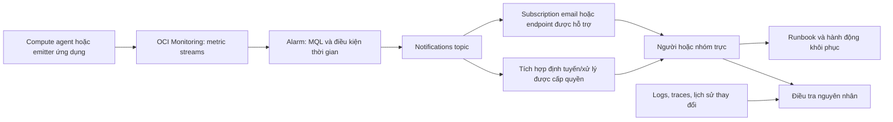

# Alarms, Notifications và thiết kế cảnh báo có thể xử lý

## 1. Cảnh báo phải dẫn đến một hành động vận hành

Trong chương **Logs, metrics và tracing** của module **CLOUD_PROVIDERS_ORACLE**, alarm không chỉ là một ngưỡng trên biểu đồ. Một hệ thống cảnh báo hữu ích phải phát hiện điều kiện đáng quan tâm, gửi thông tin đến đúng người hoặc hệ thống và giúp họ quyết định hành động tiếp theo.

Bài học dùng dịch vụ Java `orders-service` chạy trên OCI Compute, kết nối đến Oracle Database làm bối cảnh. Nhóm cần theo dõi sức khỏe ứng dụng, tài nguyên máy, kết nối database và chính luồng thu thập telemetry. Các nguyên tắc tương tự có thể áp dụng cho những đích khác trên OCI, nhưng namespace, dimension và metric cụ thể phải được kiểm tra theo dịch vụ đang dùng.

Ba thành phần có trách nhiệm khác nhau:

| Thành phần | Trách nhiệm | Không tự bảo đảm điều gì? |
| --- | --- | --- |
| **OCI Monitoring** | Nhận, lưu và truy vấn metric; đánh giá alarm | Không tự biết ngưỡng nào phù hợp nghiệp vụ |
| **Alarm** | Mô tả điều kiện cần quan sát và hành vi thông báo | Không tự chọn người trực hay cách xử lý sự cố |
| **OCI Notifications** | Phân phối thông điệp từ topic đến subscription | Không tự xác nhận người nhận đã đọc và xử lý |

Một alarm chuyển sang trạng thái cần chú ý nhưng topic không có subscription hoạt động vẫn là một luồng vận hành chưa hoàn chỉnh. Ngược lại, email đã tới cũng chưa chứng minh sự cố đã được xử lý hoặc hệ thống đã phục hồi.

Các ngưỡng, khoảng thời gian và đoạn cấu hình trong bài là ví dụ học tập, chưa được thực thi trên một tenancy cụ thể. Chúng cần được điều chỉnh bằng dữ liệu thực tế, khả năng dịch vụ và quyền của môi trường được cấp.

## 2. Luồng từ metric đến người xử lý



Metric cung cấp tín hiệu định lượng để đánh giá alarm. Logs và traces thường giúp giải thích nguyên nhân sau khi có tín hiệu. Không phải mọi log trong OCI Logging tự động trở thành metric dùng được trong Monitoring; nếu muốn cảnh báo dựa trên nội dung log, cần một cơ chế truy vấn/chuyển đổi/phát metric được thiết kế phù hợp.

Topic là điểm phân phối thông điệp, không phải danh sách người trực đầy đủ. Subscription xác định endpoint nhận tin. Nếu cần lịch trực, escalation, xác nhận tiếp nhận hoặc gộp nhiều alarm thành một incident, cần chọn và cấu hình cơ chế có những khả năng đó.

Một hệ thống có thể có nhiều topic theo trách nhiệm, chẳng hạn cảnh báo vận hành production và thông tin lab. Tuy nhiên, tên topic có chữ `production` không tạo ra phân quyền: IAM, quyền subscription và endpoint mới quyết định ai có thể xem hoặc nhận thông tin.

## 3. Thế nào là cảnh báo có thể xử lý?

Trước khi tạo alarm, trả lời năm câu hỏi:

1. **Điều gì đang bị ảnh hưởng?** Người dùng, độ trễ, tỉ lệ lỗi, khả năng kết nối hay dung lượng còn lại?
2. **Ai chịu trách nhiệm?** Nhóm nào trực và ai là đầu mối khi không có phản hồi?
3. **Cần làm gì trước?** Có bước kiểm tra an toàn và runbook cụ thể không?
4. **Khi nào cần phản ứng?** Ngay lập tức, trong giờ làm việc hay chỉ cần theo dõi xu hướng?
5. **Làm sao biết đã phục hồi?** Dựa vào tín hiệu nào và cần quan sát bao lâu?

Một cảnh báo chỉ có nội dung “CPU cao” thường thiếu phạm vi và bước xử lý. Bản tóm tắt hữu ích hơn có thể chứa:

```text
Dịch vụ: orders-service / production / region đã xác định
Tín hiệu: CPU trung bình của instance được chỉ định vượt 85%
Điều kiện: theo query 1 phút và pending duration 5 phút của alarm
Ảnh hưởng cần kiểm tra: latency, tỉ lệ lỗi, hàng đợi xử lý
Owner: nhóm vận hành orders
Bước đầu: kiểm tra lưu lượng, JVM và thay đổi triển khai gần nhất
Runbook: tham chiếu đến hướng dẫn đã được nhóm quản lý
Ngữ cảnh: alarm OCID, resource OCID, thời điểm và trạng thái thông báo
```

Đây là mẫu nội dung vận hành, không phải cấu trúc JSON native mà OCI luôn gửi. Một số dữ liệu đến từ payload alarm, một số nằm trong body cấu hình, dashboard hoặc lớp tích hợp.

Không tự động kết luận CPU cao cần tăng shape. Nó có thể do tăng lưu lượng hợp lệ, một vòng lặp lỗi, garbage collection, xử lý batch hoặc tài nguyên chưa đủ. Hành động phải dựa trên tín hiệu người dùng và chẩn đoán, không chỉ một số phần trăm.

### Phân loại theo phản ứng mong muốn

| Mục đích | Tình huống minh họa | Kênh/quy trình cần thiết |
| --- | --- | --- |
| Cần đánh thức người trực | Dịch vụ production lỗi kéo dài, ảnh hưởng giao dịch | Cơ chế trực có escalation và phản hồi |
| Cần lên kế hoạch xử lý | Dung lượng tăng đều nhưng còn thời gian ứng phó | Ticket hoặc quy trình công việc phù hợp |
| Cần theo dõi | CPU tăng ngắn trong tác vụ batch đã biết | Dashboard hoặc thông tin ít khẩn cấp |

Severity của OCI là metadata mức độ nghiêm trọng, với các lựa chọn như `CRITICAL`, `ERROR`, `WARNING`, `INFO`. Nó không tự chuyển một email thành cuộc gọi hay tạo lịch trực. Mối liên kết từ severity đến kênh và thời gian phản ứng là phần thiết kế của hệ thống vận hành.

## 4. Các thành phần quyết định một alarm OCI

| Thành phần | Ý nghĩa | Rủi ro nếu chọn sai |
| --- | --- | --- |
| Region | Nơi chứa dữ liệu và tài nguyên cần truy vấn | Nhìn nhầm phạm vi hoặc không thấy metric |
| Alarm compartment | Nơi quản lý tài nguyên alarm | Người vận hành thiếu quyền sửa/xem alarm |
| Metric compartment | Phạm vi tài nguyên phát metric | Query trống hoặc quan sát nhầm hệ thống |
| Namespace | Nhóm metric do dịch vụ hoặc ứng dụng phát | Trùng tên metric nhưng khác nguồn/ý nghĩa |
| Metric name | Tín hiệu định lượng | Dùng tín hiệu không biểu diễn vấn đề cần phát hiện |
| Dimension filters | Chọn stream theo tài nguyên hoặc thuộc tính | Gộp sai instance, môi trường hoặc đích |
| Interval và hàm thống kê | Cách tổng hợp dữ liệu trong query | Che spike hoặc làm tín hiệu quá nhạy |
| Predicate | Điều kiện cần phát hiện | Ngưỡng sai đơn vị hoặc sai hướng so sánh |
| Pending duration | Điều kiện thời gian trước khi alarm kích hoạt | Phản ứng quá sớm hoặc quá muộn |
| Destination | Topic hoặc đích được hỗ trợ | Thông điệp đến sai nhóm hoặc không có người nhận |
| Repeat/suppression | Hành vi nhắc lại và hạn chế thông báo | Spam hoặc mất tín hiệu cần thiết |

Alarm compartment và metric compartment có thể khác nhau. Ví dụ nhóm quan sát quản lý alarm trong một compartment chung nhưng metric đến từ Compute ở compartment ứng dụng. Quyền đối với cả hai phạm vi phải được xem xét.

Namespace và dimension không được suy ra từ display name của máy. Hãy xem metric stream thực tế trước khi viết query. Tên metric giống nhau không có nghĩa chúng cùng đơn vị hoặc cùng ý nghĩa ở mọi namespace.

## 5. MQL: tách cửa sổ tổng hợp và thời gian chờ

### 5.1. Ví dụ CPU của một Compute instance

Giả sử instance đang phát `CpuUtilization` trong namespace `oci_computeagent`. Query minh họa:

```text
CpuUtilization[1m]{resourceId = "<compute-instance-ocid>"}.mean() > 85
```

Các thành phần:

- `CpuUtilization`: metric cần quan sát.
- `[1m]`: interval tổng hợp được chỉ định trong query.
- `{resourceId = "..."}`: lọc stream của instance được chọn.
- `.mean()`: lấy giá trị trung bình theo cách tổng hợp của MQL.
- `> 85`: predicate trên giá trị CPU theo đơn vị phần trăm của metric này.

Namespace và metric compartment được cấu hình ngoài chuỗi query. Chỉ thay placeholder bằng OCID thật sau khi xác nhận stream có dimension tương ứng.

Việc Compute tồn tại hoặc ở trạng thái running không bảo đảm metric này có dữ liệu. Cần kiểm tra plugin giám sát liên quan của Oracle Cloud Agent, trạng thái agent, kết nối và điều kiện hỗ trợ của môi trường.

### 5.2. Interval không phải pending duration

Nếu query trên kết hợp `pending_duration = "PT5M"`, ý định là không kích hoạt chỉ vì một điểm cao ngắn hạn; điều kiện cần đáp ứng trong khoảng chờ theo cơ chế đánh giá của alarm.

So sánh với query:

```text
CpuUtilization[5m]{resourceId = "<compute-instance-ocid>"}.mean() > 85
```

Query thứ hai thay đổi cửa sổ tổng hợp thành 5 phút. Nó không tự đồng nghĩa “CPU của từng phút đều vượt ngưỡng suốt 5 phút”. Một mức trung bình có thể che những giai đoạn thấp/cao bên trong cửa sổ.

Pending duration, cadence phát metric, độ trễ ingestion và lịch đánh giá cùng ảnh hưởng thời điểm thông báo. Không hứa rằng email luôn đến chính xác 5 phút sau thời điểm CPU thực tế bắt đầu tăng.

Một diễn biến minh họa:

```text
CPU cao ngắn rồi giảm trước khi đủ điều kiện chờ
    → chưa nên phát cảnh báo kéo dài theo thiết kế này
CPU tiếp tục cao và đáp ứng điều kiện chờ
    → alarm có thể chuyển sang FIRING theo kết quả đánh giá
```

Các mốc phải được kiểm tra với dữ liệu thật; ví dụ không thay thế việc hiểu cách Monitoring đánh giá query cụ thể.

### 5.3. Một alarm có thể quan sát nhiều metric streams

Bỏ bộ lọc `resourceId` có thể làm query nhìn thấy nhiều stream. Cách grouping và aggregation quyết định có đang giữ riêng từng tài nguyên hay gộp chúng.

CPU trung bình của cả fleet có thể bình thường trong khi một instance phục vụ phần lớn người dùng đã quá tải. Ngược lại, gửi riêng mọi stream có thể tạo hàng trăm thông báo cho cùng một sự cố chung.

Hãy quyết định rõ đơn vị cần hành động: một instance, một node pool, một dịch vụ hay một dependency dùng chung. Nếu dùng tùy chọn thông báo theo metric dimension, kiểm tra payload và lượng thông báo của lựa chọn đó. Đừng coi một alarm OCID luôn tương đương một incident duy nhất.

## 6. Thiếu dữ liệu không đồng nghĩa dịch vụ khỏe

### 6.1. Phân biệt số 0 với không có mẫu

Một metric lỗi có giá trị 0 có thể nghĩa là không ghi nhận lỗi trong một khoảng. Không có datapoint có thể là ứng dụng không chạy, emitter hỏng, đường mạng bị đứt, sai namespace hoặc hệ thống không phát metric khi không có lưu lượng.

Đây là hai tình huống khác nhau. Không biến mọi khoảng trống thành 0 rồi kết luận hệ thống khỏe.

Với OCI Monitoring, có thể thiết kế alarm phát hiện vắng dữ liệu bằng chức năng MQL như `absent()`. Ví dụ hình thức query cho stream CPU đã xác định:

```text
CpuUtilization[1m]{resourceId = "<compute-instance-ocid>"}.absent()
```

Cần đối chiếu cơ chế absence detection của MQL và alarm trong môi trường đang dùng, bao gồm khoảng phát hiện vắng dữ liệu, pending duration và dữ liệu đã từng được quan sát. Không diễn giải `[1m]` trong ví dụ thành cam kết thông báo sau đúng 1 phút không có mẫu.

Alarm thiếu dữ liệu cũng không tự kiểm kê mọi máy trong tenancy. Tài nguyên mới chưa từng phát metric, stream đổi dimension hoặc instance được thay thế cần được xử lý bằng kiểm kê và quản lý vòng đời cấu hình giám sát.

### 6.2. Thiết kế tín hiệu sống theo kỳ vọng

| Tình huống | Kỳ vọng dữ liệu | Cách diễn giải khoảng trống |
| --- | --- | --- |
| Compute production chạy liên tục | Metric hạ tầng phát theo cadence dự kiến | Cần kiểm tra agent, instance và kết nối |
| Ứng dụng phát heartbeat | Có mẫu dù không có request | Mất heartbeat là tín hiệu riêng cần điều tra |
| Metric chỉ phát khi có giao dịch | Có thể không có mẫu lúc ít tải | Chưa đủ kết luận ứng dụng ngừng hoạt động |
| Batch chạy theo lịch | Có dữ liệu trong cửa sổ công việc | Cần so với lịch và thời điểm hoàn thành kỳ vọng |
| Instance đã được hủy hợp lệ | Không còn kỳ vọng stream đó | Cập nhật cấu hình/kiểm kê để tránh alarm mồ côi |

Heartbeat chứng minh một phần đường đi hoặc tiến trình còn hoạt động, không thay thế kiểm tra chức năng đầu cuối. Một vòng lặp heartbeat vẫn có thể chạy trong khi ứng dụng không kết nối được Oracle Database.

Có thể bổ sung synthetic check phù hợp để kiểm tra luồng quan trọng. Nếu check chạy ngoài hệ thống, cần ghi nhận vị trí, quyền và phụ thuộc của chính check; lỗi nơi phát check không được tự động quy thành lỗi toàn bộ ứng dụng.

## 7. Chọn tín hiệu theo tác động, không chỉ tài nguyên

### 7.1. Phối hợp triệu chứng và nguyên nhân khả dĩ

| Nhóm tín hiệu | Điều cần biết | Vai trò cảnh báo |
| --- | --- | --- |
| Tỉ lệ request lỗi | Người dùng có đang thất bại không? | Tín hiệu tác động trực tiếp nếu đo đúng |
| Độ trễ request | Người dùng có phải chờ quá lâu không? | Tín hiệu suy giảm trải nghiệm |
| Hàng đợi/backlog | Công việc có tích tụ và trễ xử lý không? | Phát hiện năng lực xử lý không đáp ứng |
| CPU/RAM/dung lượng | Tài nguyên có bị bão hòa hoặc sắp cạn không? | Chẩn đoán và cảnh báo dự báo |
| JDBC connection pool | Ứng dụng có chờ hoặc không lấy được kết nối không? | Chỉ ra điểm nghẽn ứng dụng/database cần kiểm tra |
| Sức khỏe database | Dịch vụ dữ liệu có bất thường không? | Đối chiếu metric đúng loại dịch vụ Oracle Database |
| Thiếu telemetry | Có còn quan sát được hệ thống không? | Bảo vệ khả năng phát hiện sự cố |

Không phải metric JVM/JDBC đều có sẵn trong `oci_computeagent`. Các tín hiệu ứng dụng có thể cần instrumentation và một đường phát custom metric phù hợp. Cũng không coi mọi dịch vụ database Oracle đều phát cùng namespace hoặc dimension.

Một thiết kế thực tế có thể dùng CPU cao để tạo cảnh báo mức ít khẩn cấp, còn tỉ lệ lỗi/latency production để quyết định gọi người trực. Đây là lựa chọn theo tác động; một workload đặc thù vẫn có thể cần phản ứng sớm với bão hòa tài nguyên trước khi người dùng bị ảnh hưởng.

### 7.2. Tỉ lệ phải có mẫu số đúng

Công thức nghiệp vụ minh họa:

```text
error_rate = số request lỗi hợp lệ / tổng request thuộc phạm vi đo
```

Đây không phải cú pháp ghép nhiều metric trong MQL. Muốn hiện thực trên OCI, phải chọn metric/model phát dữ liệu và query được dịch vụ hỗ trợ.

Khi tổng hợp nhiều instance, cần tránh lấy trung bình đơn giản của những phần trăm có mẫu số rất khác nhau. Ví dụ:

- Instance A: 1 request lỗi trên 1 request, tỉ lệ 100%.
- Instance B: 0 request lỗi trên 999 request, tỉ lệ 0%.
- Trung bình hai tỉ lệ là 50%, nhưng tỉ lệ chung là 1/1000, tức 0,1%.

Nếu alert nhắm trải nghiệm toàn dịch vụ, cách tổng hợp phải phản ánh đúng mục tiêu đó. Nếu alert nhắm một partition hoặc nhóm khách hàng riêng, gộp toàn dịch vụ cũng có thể che vấn đề.

Khi lưu lượng thấp, cân nhắc đồng thời tỉ lệ, số lỗi tuyệt đối và giá trị của giao dịch. Một lỗi trên một giao dịch có thể rất quan trọng với luồng hiếm nhưng thiết yếu; không dùng điều kiện lưu lượng tối thiểu để vô tình che mất tình huống này.

### 7.3. Kết nối với mục tiêu dịch vụ

Nếu nhóm có mục tiêu độ tin cậy, cảnh báo nên ưu tiên khả năng vi phạm mục tiêu đó. Một spike ngắn và một lỗi kéo dài tiêu thụ mức rủi ro khác nhau.

Có thể thiết kế nhiều cửa sổ quan sát để phân biệt vấn đề nhanh/nghiêm trọng với suy giảm chậm. Các quy tắc kết hợp cần được triển khai bằng khả năng thật của hệ thống metric/alarm hoặc một lớp xử lý được chọn; không viết một biểu thức MQL giả chỉ vì công thức toán học trông hợp lý.

Không đặt cùng một ngưỡng CPU, latency hoặc lỗi cho mọi ứng dụng. Cần baseline theo tải, giờ vận hành, loại tài nguyên và khả năng khôi phục.

## 8. Notifications: từ topic đến endpoint hoạt động

### 8.1. Tạo topic và subscription là hai công việc khác nhau

Một Notifications topic có thể có nhiều subscription. Endpoint có thể là email, HTTPS hoặc loại tích hợp được dịch vụ hỗ trợ trong môi trường đó. Hãy chọn protocol theo nhu cầu tiếp nhận và khả năng vận hành của nhóm.

Đối với endpoint yêu cầu xác nhận, người quản lý endpoint phải hoàn tất quy trình confirmation. Subscription được tạo nhưng còn chờ xác nhận chưa phải một đường nhận tin đã sẵn sàng.

Trình tự cơ bản:

1. Chọn đúng region, compartment và topic cho nhóm chịu trách nhiệm.
2. Tạo subscription đến endpoint được phép nhận dữ liệu.
3. Hoàn tất xác nhận khi protocol yêu cầu.
4. Kiểm tra trạng thái subscription.
5. Gửi một thông điệp thử có nội dung không nhạy cảm.
6. Kiểm tra endpoint thực tế nhận và xử lý được thông điệp.
7. Gắn topic làm destination của alarm.
8. Kiểm tra tiếp bằng một lần chuyển trạng thái alarm có kiểm soát.

Thông điệp thử topic xác nhận một phần đường phân phối. Nó chưa kiểm tra query, nguồn metric, pending duration hoặc việc alarm gửi đúng thông điệp đến topic.

### 8.2. Email phù hợp với mục đích nào?

Email có thể hữu ích cho lab hoặc thông tin không cần phản ứng tức thì. Tuy nhiên, hộp thư đầy, bộ lọc spam, người vắng mặt và việc không có escalation đều có thể làm cảnh báo bị bỏ qua.

Nếu yêu cầu phản ứng nghiêm ngặt, cần một cơ chế trực có thể xác nhận tiếp nhận và chuyển cấp. Việc thêm nhiều địa chỉ email không tự tạo ra lịch trực hay trách nhiệm rõ ràng.

### 8.3. HTTPS và tích hợp tự động

Endpoint HTTPS phải xử lý được kiểu thông điệp và luồng xác nhận mà Notifications sử dụng. Cần bảo vệ endpoint, xác thực nguồn theo cơ chế được hỗ trợ và quản lý việc xử lý thông điệp có lỗi.

Thiết kế consumer chịu được gửi lặp, retry, đến muộn và sai thứ tự. Không dựa trên giả định mỗi thay đổi trạng thái luôn tạo đúng một HTTP request được xử lý thành công ngay lần đầu.

Nếu consumer ghi incident hoặc kích hoạt thao tác tiếp theo, cần kiểm soát idempotency. Phản hồi thành công cho việc tiếp nhận không có nghĩa hành động khôi phục phía sau đã hoàn tất; hãy lưu trạng thái và quan sát kết quả của công việc đó.

Không để một payload có nội dung `resourceId` bất kỳ được dùng trực tiếp để chạy hành động quản trị. Phải đối chiếu nguồn alarm, phạm vi tài nguyên, loại hành động và quyền của danh tính thực thi.

### 8.4. Thông điệp thật phải được xem trước khi thiết kế parser

OCI hỗ trợ các định dạng thông báo theo cấu hình và đích tương ứng. Hãy xem payload của alarm thực tế để biết cấu trúc, trạng thái, timestamps và thông tin metric streams được gửi.

Không coi bản tóm tắt văn bản trong bài là schema của dịch vụ. Khi viết parser, xử lý trường không có, trường mới và nhiều metric streams theo hợp đồng thực tế; tránh phụ thuộc vào cách thụt lề hoặc thứ tự khóa JSON.

## 9. Phân quyền và bảo vệ nội dung cảnh báo

Có ít nhất bốn nhóm trách nhiệm:

| Chủ thể | Nhu cầu quyền |
| --- | --- |
| Người quản lý alarm | Xem metric và tạo/sửa alarm trong phạm vi được giao |
| Người quản lý Notifications | Quản lý topic/subscription và kiểm tra phân phối |
| Agent/emitter ứng dụng | Gửi telemetry qua cơ chế danh tính được cấu hình |
| Consumer/người nhận | Nhận thông tin; chỉ có quyền hành động bổ sung khi được cấp riêng |

Với custom metrics, emitter có thể dùng resource principal/instance principal hoặc phương thức xác thực phù hợp. Phải cấp quyền theo đúng danh tính và namespace/phạm vi cần thiết. Không vì metric chưa xuất hiện mà cấp quyền quản trị tenancy cho máy ứng dụng.

Khi alarm và metric ở các compartment khác nhau, người cấu hình cần đủ quyền trên các phạm vi liên quan. Nếu đích Notifications khác compartment, cũng phải kiểm tra quyền sử dụng/quản lý tài nguyên đúng lớp. Không suy luận từ việc nhìn thấy biểu đồ rằng mọi cấu hình topic đều đã hợp lệ.

Body cảnh báo và payload có thể được gửi ra endpoint ngoài OCI. Không đưa mật khẩu database, private key, token, dữ liệu khách hàng hoặc toàn bộ câu SQL chứa giá trị nhạy cảm vào thông báo.

Một runbook nên liên kết đến nơi chứa thông tin được bảo vệ thay vì nhúng secret. Người có email cảnh báo cũng không mặc nhiên có quyền xem dashboard hoặc log: cần cấp quyền đọc cần thiết cho người trực, đồng thời giữ các dữ liệu nhạy cảm trong phạm vi phù hợp.

## 10. Ví dụ Terraform: CPU alarm gửi đến email vận hành

Ví dụ sau mô tả một alarm cho một Compute instance đã có metric, một Notifications topic và một subscription email. Nó dùng profile OCI đã được cấu hình trên môi trường thực thi; không đưa API private key hoặc mật khẩu vào HCL.

Chọn, kiểm soát và khóa phiên bản provider theo quy trình của môi trường trước khi vận hành. Đoạn mã không dùng một số phiên bản giả định là mới nhất.

```hcl
terraform {
  required_providers {
    oci = {
      source = "oracle/oci"
    }
  }
}

variable "region" {
  type = string
}

variable "oci_config_profile" {
  type    = string
  default = "DEFAULT"
}

variable "alarm_compartment_id" {
  type = string
}

variable "metric_compartment_id" {
  type = string
}

variable "instance_ocid" {
  type = string
}

variable "oncall_email" {
  type = string
}

provider "oci" {
  region              = var.region
  config_file_profile = var.oci_config_profile
}

resource "oci_ons_notification_topic" "orders_ops" {
  compartment_id = var.alarm_compartment_id
  name           = "orders-prod-observability"
  description    = "Thong bao van hanh orders-service"
}

resource "oci_ons_subscription" "orders_email" {
  compartment_id = var.alarm_compartment_id
  topic_id       = oci_ons_notification_topic.orders_ops.id
  protocol       = "EMAIL"
  endpoint       = var.oncall_email
}

resource "oci_monitoring_alarm" "orders_cpu_high" {
  compartment_id        = var.alarm_compartment_id
  metric_compartment_id = var.metric_compartment_id
  display_name          = "orders-prod-instance-cpu-high"
  namespace             = "oci_computeagent"

  query = "CpuUtilization[1m]{resourceId = \"${var.instance_ocid}\"}.mean() > 85"

  severity                     = "WARNING"
  is_enabled                   = true
  pending_duration             = "PT5M"
  repeat_notification_duration = "PT1H"

  destinations = [
    oci_ons_notification_topic.orders_ops.id
  ]

  body = "Owner: orders-ops. Kiem tra latency, loi request, JVM va thay doi gan nhat. Doi chieu alarm/resource OCID. Runbook: ORD-CPU-01 trong kho runbook noi bo."
}
```

Ý nghĩa các lựa chọn:

- Alarm được quản lý trong `alarm_compartment_id`, nhưng đọc metric theo `metric_compartment_id`.
- Topic ở cùng compartment quản lý alarm trong mẫu; đây là lựa chọn tổ chức, không phải quy tắc mọi hệ thống phải theo.
- Ngưỡng CPU là một ví dụ mức `WARNING`, cần đối chiếu với tác động ứng dụng.
- `PT5M` là thời lượng ISO 8601 cho pending duration trong ví dụ.
- `PT1H` là thời lượng nhắc lại được chọn, không phải chu kỳ lấy mẫu hay thời gian chờ trước cảnh báo đầu tiên.
- Body chỉ đưa thông tin vận hành không nhạy cảm. Mã runbook `ORD-CPU-01` phải được thay bằng tham chiếu thực sự có nội dung và người quản lý.

### Hoàn thiện đường nhận cảnh báo

Sau khi review cấu hình và áp dụng trong môi trường được cấp quyền, hoàn tất confirmation của subscription email. Terraform tạo được tài nguyên subscription không thay cho thao tác xác nhận của người quản lý endpoint.

Kiểm tra stream CPU đúng instance trước khi chờ alarm. Sau đó kiểm tra topic, subscription và một lần chuyển trạng thái có kiểm soát. Nếu cần page người trực, bổ sung tích hợp và quy tắc escalation tương ứng thay vì chỉ đổi severity sang `CRITICAL`.

Bảo vệ Terraform state và file biến vì chúng có thể chứa địa chỉ endpoint cùng thông tin nội bộ. Khi đổi instance hoặc thay deployment bằng một nhóm máy mới, cập nhật phạm vi quan sát để alarm không tiếp tục trỏ vào tài nguyên cũ.

Không sao chép các trường thuộc schema của hệ thống cảnh báo khác vào resource này. Chẳng hạn, điều kiện ngưỡng của ví dụ nằm trong query MQL; không tự thêm một thuộc tính so sánh vì đã thấy nó ở dịch vụ cloud khác.

## 11. Pending, repeat, suppression và trạng thái phục hồi

### 11.1. Những cơ chế này giải quyết các bài toán khác nhau

| Cơ chế | Bài toán chính | Điều cần kiểm tra |
| --- | --- | --- |
| Cửa sổ tổng hợp | Đặc điểm dữ liệu được đem so sánh | Có che spike hoặc làm chậm tín hiệu không? |
| Pending duration | Hạn chế phản ứng với bất thường quá ngắn | Có làm phản ứng trễ hơn khả năng chịu lỗi không? |
| Repeat notification | Nhắc về điều kiện vẫn cần chú ý | Chu kỳ có gây spam hay bỏ quên sự cố không? |
| Suppression | Hạn chế thông báo trong khoảng được chủ động kiểm soát | Ai đặt, vì sao, khi nào hết và kiểm tra sau đó thế nào? |
| Disable alarm | Ngừng hoạt động alarm theo cấu hình | Có mất khả năng phát hiện sự cố ngoài dự kiến không? |
| Grouping/routing ở lớp tiếp nhận | Gom và đưa thông tin đến đúng owner | Có gộp nhầm hai sự cố độc lập không? |

Tăng pending không thay thế repeat. Suppression không phải cách sửa nguyên nhân. Tắt alarm lâu dài chỉ vì có nhiều thông báo có thể làm mất tín hiệu quan trọng.

### 11.2. Hiểu `OK` và `FIRING` trong phạm vi query

Khi xem trạng thái alarm, `FIRING` cho biết điều kiện đã kích hoạt theo cơ chế đánh giá. `OK` biểu thị không còn ở điều kiện kích hoạt theo đánh giá tương ứng; nó không phải chứng nhận toàn bộ dịch vụ hoạt động tốt.

Một alarm CPU có thể về `OK` vì CPU giảm sau khi ứng dụng ngừng nhận request. Nếu metric còn được phát nhưng dịch vụ chết chức năng, CPU thấp vẫn không chứng minh phục hồi. Cần kiểm tra tín hiệu tác động và dữ liệu thực tế.

Hành vi khi thiếu dữ liệu cần được xác minh riêng với query đã chọn. Không đồng nhất sự im lặng, trạng thái alarm, trạng thái subscription và sức khỏe ứng dụng.

### 11.3. Flapping và hysteresis

Một tín hiệu liên tục đi qua ngưỡng có thể khiến alarm đổi trạng thái nhiều lần. Trước khi chỉnh ngưỡng, xem mức nhiễu, cadence, phép tổng hợp và tác động thực tế.

Hysteresis là ý tưởng dùng điều kiện kích hoạt và phục hồi khác nhau để giảm dao động. Tuy nhiên, không tự thêm hai ngưỡng vào một alarm rồi cho rằng OCI có cùng ngữ nghĩa với một hệ thống khác. Nếu cần cơ chế đó, phải dùng khả năng được hỗ trợ hoặc triển khai một lớp quản lý trạng thái có thiết kế rõ ràng.

Trong nhiều tình huống, chọn đúng metric và pending hợp lý đã giảm nhiễu đáng kể. Với lỗi production nghiêm trọng, làm trơn quá nhiều lại có thể trì hoãn phản ứng cần thiết.

### 11.4. Bảo trì và suppression có thời hạn

Một cửa sổ bảo trì nên có owner, lý do, thời điểm bắt đầu/kết thúc và phạm vi được phép hạn chế thông báo. Dùng suppression được dịch vụ hỗ trợ khi phù hợp với mục tiêu đó.

Trước bảo trì, xác định cảnh báo nào vẫn phải hoạt động: mất dữ liệu, tác động ngoài phạm vi hoặc lỗi bảo mật có thể không thuộc phần được mute. Tránh áp dụng một cửa sổ im lặng quá rộng cho toàn bộ production.

Sau bảo trì, kiểm tra suppression đã hết, alarm còn được bật và luồng Notifications còn hoạt động. Không giả định tất cả thông điệp trong thời gian suppression sẽ được phát lại sau khi hết hạn; phải dựa vào hành vi dịch vụ và trạng thái hiện tại.

Nếu cần tắt alarm, ghi rõ quyết định và thời điểm phục hồi cấu hình. Một ghi chú trong ticket không tự bật lại tài nguyên đã bị disable.

## 12. Chống thông báo trùng và gom đúng incident

Có hai bài toán riêng:

1. Cùng một thông điệp được giao nhận nhiều lần.
2. Nhiều thông điệp hợp lệ cùng phản ánh một sự cố.

Với bài toán thứ nhất, consumer có thể dùng định danh giao nhận/sự kiện mà payload thực tế cung cấp và một kho trạng thái bền vững để xử lý idempotency. Với bài toán thứ hai, cần một khóa incident theo ngữ nghĩa vận hành.

Một khóa incident nội bộ minh họa:

```text
alarm_ocid + environment + normalized_resource_or_service_dimensions
```

Đó không phải tên một trường native bắt buộc của OCI. Cần chọn dimension ổn định và đúng đơn vị cần xử lý. Nếu query theo từng stream, chỉ dùng alarm OCID có thể vô tình gộp nhiều tài nguyên độc lập.

Không dùng request ID, trace ID hoặc timestamp làm phần chính của khóa gom sự cố: những giá trị thay đổi liên tục sẽ khiến mỗi thông điệp thành một incident mới. Cũng không bỏ hết dimension nếu những tài nguyên đó có owner khác nhau.

Một thông báo nhắc lại hợp lệ có thể cập nhật incident đang mở và thực hiện escalation, thay vì mở ticket mới. Thông báo phục hồi phải được đối chiếu với cùng phạm vi và thời điểm, tránh đóng một incident mới do một thông điệp cũ đến muộn.

Khi Oracle Database dùng chung gặp vấn đề, nhiều ứng dụng có thể báo lỗi kết nối cùng lúc. Lớp tiếp nhận có thể gom theo dependency để giảm bão thông báo, nhưng vẫn phải giữ bằng chứng và nhận diện ảnh hưởng riêng từng dịch vụ. Không tự động bỏ mọi alarm ứng dụng chỉ vì đã có một alarm database.

## 13. Runbook tối thiểu cho một cảnh báo

Runbook nên đủ ngắn để dùng khi đang có sự cố, nhưng phải có bước an toàn, quyền cần thiết và điều kiện xác minh. Với `ORD-CPU-01`, có thể tổ chức như sau:

### A. Xác nhận phạm vi và tác động

- Đối chiếu alarm OCID, instance OCID, region, compartment và khoảng thời gian.
- Xem latency, request lỗi, backlog và lưu lượng cùng thời điểm.
- Kiểm tra có triển khai, batch hoặc thay đổi shape gần đây không.
- Ghi nhận đã có người tiếp nhận và kênh phối hợp theo quy trình.

### B. Thu thập chẩn đoán cần thiết

- Xem CPU theo stream để biết một máy hay cả nhóm bị ảnh hưởng.
- Đối chiếu JVM, garbage collection, thread pool và kết nối JDBC nếu có telemetry.
- Xem log/traces trong cùng cửa sổ thời gian, gắn với phiên bản triển khai.
- Kiểm tra dependency Oracle Database và kết nối mạng khi triệu chứng phù hợp.

Không dùng một câu lệnh restart toàn fleet làm bước đầu mặc định. Nếu cần thread dump, truy cập máy hoặc thao tác database, phải biết quyền, chi phí và dữ liệu nhạy cảm có thể xuất hiện trong kết quả.

### C. Chọn hành động đã được cấp quyền

Tùy nguyên nhân, có thể hạn chế tác vụ batch, khôi phục phiên bản ứng dụng, tăng năng lực hoặc sửa một dependency. Mỗi hành động phải có phạm vi, điều kiện dừng và người có quyền quyết định.

Nếu dùng tự động hóa, bắt đầu bằng những hành động có giới hạn và kiểm chứng đầu vào. Một alarm CPU không tự cấp quyền để hệ thống xóa máy, đổi chính sách IAM hoặc tăng tài nguyên không có giới hạn.

### D. Xác minh và kết thúc

Kiểm tra tín hiệu người dùng phục hồi, metric có dữ liệu mới và thay đổi không gây tác động khác. Theo dõi trong cửa sổ phù hợp trước khi đóng incident.

Ghi nguyên nhân, hành động, thời gian và thay đổi cần làm với cảnh báo. Nếu alert không dẫn đến một hành động hữu ích, xem lại metric, phạm vi hoặc ngưỡng; không chỉ tăng ngưỡng để giảm số thông báo.

## 14. Kiểm thử cảnh báo theo từng lớp

### 14.1. Kiểm tra query trước khi kiểm tra email

Trước hết, xem dữ liệu trong đúng region, metric compartment, namespace và khoảng thời gian. Đối chiếu dimension, đơn vị và hàm thống kê với mục tiêu.

Nếu query không có dữ liệu, một email không tới chưa nói được điều gì về Notifications. Nếu query trả nhiều stream ngoài dự kiến, cần sửa phạm vi trước khi tạo alarm có thể phát hàng loạt thông báo.

Sau đó kiểm tra topic/subscription độc lập bằng một thông điệp thử. Khi hai phần riêng lẻ đã rõ, mới kiểm tra luồng đầy đủ từ metric đến chuyển trạng thái và người nhận.

### 14.2. Dùng metric lab thay vì gây tải production

Có thể tạo một custom metric trong phạm vi thử nghiệm, chẳng hạn:

| Thuộc tính lab | Giá trị minh họa |
| --- | --- |
| Namespace | `orders_alert_lab` |
| Metric name | `QueueDepth` |
| Ý nghĩa | Độ dài hàng đợi giả lập, dạng gauge |
| Đơn vị | Số công việc |
| Dimension | `environment=lab`, `service=orders-service` |
| Điều kiện thử | Vượt 20 trong điều kiện chờ được chọn |

Query minh họa:

```text
QueueDepth[1m]{environment = "lab"}.max() > 20
```

Cần một emitter được cấp quyền gửi custom metric vào compartment thử nghiệm. Dùng timestamp hợp lệ, cadence phù hợp và cùng bộ dimension qua các mẫu. Chỉ đặt tên giống bảng không tự tạo ra dữ liệu trong Monitoring.

Một chuỗi thử có thể là:

1. Phát các mẫu giá trị 10 để quan sát baseline.
2. Phát giá trị 30 trong thời gian ngắn hơn điều kiện chờ dự kiến.
3. Trở lại 10 và xem có tránh được cảnh báo kéo dài không.
4. Phát 30 đủ lâu để điều kiện alarm được đáp ứng.
5. Xác nhận trạng thái, nội dung thông điệp và người nhận.
6. Trở lại 10, rồi xác nhận hành vi phục hồi.

Số 10, 20 và 30 chỉ để điều khiển thử nghiệm. Không dùng chúng như ngưỡng khuyến nghị cho hàng đợi thật.

Khi muốn thử thiếu dữ liệu, cần một alarm absence được thiết kế riêng và một kỳ vọng thời gian theo cấu hình thực tế. Dừng emitter rồi chờ tùy ý vài phút không đủ chứng minh cơ chế thiếu dữ liệu đã hoạt động hoặc bị hỏng.

### 14.3. Các ca vận hành cần kiểm chứng

| Kiểm tra | Kết quả cần quan sát |
| --- | --- |
| Giá trị bình thường | Không tạo sự cố vượt ngưỡng không có thật |
| Spike ngắn | Hành vi phù hợp interval và pending đã chọn |
| Vi phạm kéo dài | Alarm kích hoạt và đúng endpoint nhận thông báo |
| Điều kiện vẫn kéo dài | Repeat/escalation theo chính sách, không mở incident trùng vô hạn |
| Phục hồi | Trạng thái và thông báo được xử lý đúng phạm vi |
| Subscription chưa xác nhận hoặc endpoint lỗi | Phát hiện luồng phân phối chưa sẵn sàng |
| Suppression trong cửa sổ lab | Hành vi thông báo phù hợp và được khôi phục sau đó |
| Một sự kiện được consumer nhận lại | Không thực hiện lặp hành động nguy hiểm |
| Thay đổi resource/dimension | Không mất quan sát hoặc giữ alarm mồ côi ngoài ý định |

Các phép thử phải dùng endpoint và tài nguyên được phép. Không thử bằng cách làm đầy disk, làm cạn connection pool hoặc ngắt database production nếu chưa có một kế hoạch thử nghiệm và quyền riêng cho việc đó.

Bằng chứng nên gồm query, cấu hình alarm, thời điểm phát mẫu, alarm OCID, kết quả chuyển trạng thái, thời điểm nhận và quyết định của consumer. Ghi rõ kết quả quan sát được thay vì chỉ đánh dấu “đã tạo alarm”.

## 15. Chẩn đoán khi không có thông báo hoặc có quá nhiều thông báo

### 15.1. Không có thông báo

Đi theo thứ tự các lớp để tránh sửa nhầm:

| Lớp | Câu hỏi cần kiểm tra |
| --- | --- |
| Nguồn dữ liệu | Metric còn được phát không? Agent/emitter có hoạt động và đủ quyền không? |
| Phạm vi truy vấn | Đúng region, compartment, namespace, tên và dimension chưa? |
| Thời gian | Timestamp, khoảng xem, interval, ingestion delay và pending có phù hợp không? |
| Alarm | Còn bật không? Query có đáp ứng điều kiện không? Có suppression không? |
| Destination | Alarm đang dùng đúng topic/đích không? |
| Subscription | Đã xác nhận và đang hoạt động chưa? Endpoint có thay đổi không? |
| Consumer | Có lỗi parser, xác thực, hàng đợi hoặc xử lý sau tiếp nhận không? |
| Người xử lý | Có lịch trực, escalation và cách xác nhận tiếp nhận không? |

Đối chiếu logs và lịch sử alarm/notification có sẵn theo cấu hình. Việc một endpoint trả phản hồi thành công không chứng minh người trực đã thấy; việc người trực đã thấy cũng chưa chứng minh hành động khôi phục đã thành công.

Nên giữ riêng các trạng thái sau trong quy trình vận hành:

```text
metric đã được quan sát
→ alarm đã kích hoạt
→ thông điệp đã được tiếp nhận
→ người hoặc hệ thống đã nhận trách nhiệm
→ hành động đã thực hiện
→ dịch vụ đã được xác minh phục hồi
```

Không rút ngắn chuỗi này thành một cờ duy nhất `sent=true`.

### 15.2. Quá nhiều thông báo

Trước khi tắt alarm, kiểm tra:

- Một sự cố có đang tạo alarm ở nhiều tầng nhưng không được gom không?
- Query có vô tình nhìn thấy tài nguyên lab hoặc môi trường khác không?
- Đang gửi riêng từng dimension khi owner chỉ cần một incident dịch vụ không?
- Repeat có ngắn hơn thời gian người trực thực hiện bước chẩn đoán không?
- Tín hiệu có flapping quanh ngưỡng không?
- Consumer có mở incident mới cho mọi retry không?
- Tài nguyên đã hết vòng đời có còn nằm trong cấu hình giám sát không?

Có thể xử lý bằng metric tốt hơn, grouping, pending, routing và quản lý vòng đời. Mọi chỉnh sửa cần giữ khả năng phát hiện các tình huống mà alarm ban đầu được tạo để bảo vệ.

Một cảnh báo gây nhiễu thường xuyên cần có owner và một công việc cải thiện cụ thể. Không để mute vô thời hạn trở thành cấu hình vận hành mặc định.

## 16. Kiểm soát chi phí, cardinality và vòng đời

### 16.1. Dimension phải có mục đích

Mỗi tổ hợp dimension có thể tạo một metric stream riêng. Nếu đưa request ID, user ID hoặc timestamp vào dimension, số stream có thể tăng rất nhanh, làm truy vấn, giới hạn dịch vụ và chi phí khó kiểm soát.

Dùng dimension ổn định có ý nghĩa tổng hợp, như dịch vụ, môi trường hoặc nhóm tài nguyên trong phạm vi cần thiết. Chi tiết từng request phù hợp hơn với log/trace được quản lý quyền và retention thích hợp.

Ngược lại, bỏ mọi dimension có thể làm mất khả năng tìm owner và tài nguyên bị ảnh hưởng. Mục tiêu là đủ thông tin để hành động với số lượng stream có thể quản lý được.

### 16.2. Lưu trữ và luồng thông báo

Khối lượng metric, custom telemetry, log/traces, số thông điệp, endpoint tích hợp và tài nguyên xử lý có thể đóng góp vào chi phí theo dịch vụ đang sử dụng. Đối chiếu mức sử dụng và giới hạn của môi trường; không suy ra rằng một alarm ít thông báo thì toàn bộ hệ thống quan sát có chi phí thấp.

Quy định thời gian lưu phù hợp với nhu cầu điều tra và lịch sử vận hành. Giữ đầy đủ bằng chứng quan trọng, đồng thời tránh sao chép payload nhạy cảm vào nhiều nơi chỉ để tiện tìm kiếm.

Cảnh báo về chi phí/ngân sách có thể cần cơ chế riêng phù hợp với dữ liệu chi phí. Một alarm CPU không phải phép đo tiền đã tiêu, và metric không đổi không chứng minh ngân sách không tăng.

### 16.3. Alarm cũng có vòng đời cấu hình

Khi ứng dụng chuyển region, đổi compartment, thay instance hoặc chuyển sang OKE, cần kiểm tra lại alarm, dimension, topic và owner. Khi hủy dịch vụ, phải xử lý những alarm và subscription liên quan theo quyền sở hữu.

Quản lý cấu hình bằng mã giúp review và truy vết thay đổi, nhưng không tự xác nhận query còn đúng với metric mới. Ghi lại lý do chọn ngưỡng, lần kiểm thử gần nhất và người quản lý runbook để việc bảo trì có cơ sở.

## 17. Hồ sơ tối thiểu để đưa alarm vào vận hành

Một alarm có thể bàn giao khi có các thông tin và bằng chứng sau:

- Mục tiêu phát hiện và tác động cần bảo vệ.
- Owner, kênh nhận và cách chuyển cấp.
- Region, alarm compartment, metric compartment, namespace và phạm vi dimension.
- Query, đơn vị, hàm thống kê, interval và lý do chọn ngưỡng.
- Pending, repeat, hành vi thiếu dữ liệu và quy tắc suppression.
- Topic/subscription hoạt động, cùng kết quả kiểm tra đường phân phối.
- Runbook có bước xác nhận, chẩn đoán, hành động được cấp quyền và xác minh phục hồi.
- Cách xử lý thông báo trùng, nhiều stream và sự kiện đến muộn nếu có consumer.
- Kết quả thử kích hoạt/phục hồi trong phạm vi an toàn.
- Chính sách quản lý thay đổi, retention và cập nhật khi tài nguyên hết vòng đời.

Alarms cung cấp quyết định dựa trên metric; Notifications đưa quyết định đó đến nơi tiếp nhận. Cảnh báo chỉ có giá trị vận hành khi người nhận hiểu phạm vi, có quyền và có cách xử lý. Thiết kế đồng thời tín hiệu, phân quyền, đường phân phối và runbook giúp hệ thống OCI được giám sát có trách nhiệm, giữ khả năng phục hồi và tránh tiêu tốn nguồn lực vào những thông báo không dẫn đến hành động.
