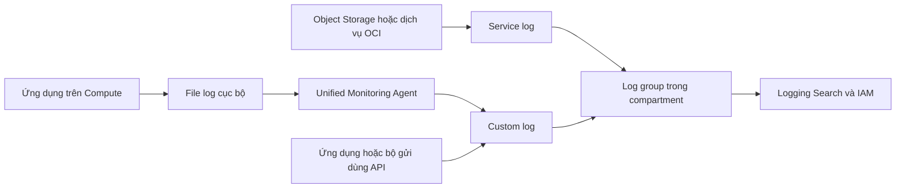

# OCI Logging, log groups, service logs và custom logs

## Mục tiêu và tình huống sử dụng

Trong chương **Logs, metrics và tracing** của lộ trình Oracle Cloud Infrastructure (OCI), bài này tập trung vào việc đưa log hạ tầng và log ứng dụng về một nơi để điều tra sự cố có kiểm soát truy cập. Bạn sẽ học cách chọn nguồn log, tổ chức log groups, cấp quyền cho người đọc và máy gửi log, rồi kiểm chứng dữ liệu thực sự đi đến đích.

Giả sử một ứng dụng Java `orders-api` chạy trên Compute, đọc tài liệu từ Object Storage và gọi cơ sở dữ liệu Oracle. Khi khách hàng báo lỗi, nhóm vận hành cần biết yêu cầu đã đi qua đâu, dịch vụ nào từ chối truy cập và ứng dụng ghi nhận điều gì. Một biểu đồ lỗi tăng cao giúp phát hiện vấn đề; log cung cấp các sự kiện cụ thể để lần theo nguyên nhân.

Sau bài học, bạn có thể:

- Phân biệt log group, log object và log entry.
- Chọn service logs hoặc custom logs theo nguồn phát sinh.
- Bật một service log và cấu hình thu log ứng dụng từ Compute.
- Dùng OCI CLI gửi một bản ghi thử, tìm kiếm và xác nhận quyền truy cập.
- Đặt retention, giảm dữ liệu dư thừa và phát hiện đường truyền log bị gián đoạn.

## 1. OCI Logging giải quyết việc gì?

OCI Logging cung cấp khả năng tiếp nhận, quản lý và tìm kiếm log tập trung. Với dịch vụ OCI được hỗ trợ, bạn bật các category log của tài nguyên. Với ứng dụng tự phát triển, bạn có thể dùng Unified Monitoring Agent hoặc gửi trực tiếp qua Logging Ingestion API. Nội dung log dùng mã hóa văn bản UTF-8. [Oracle: Logging Overview](https://docs.oracle.com/en-us/iaas/Content/Logging/Concepts/loggingoverview.htm).

Việc tập trung log giúp giảm phụ thuộc vào SSH đến từng máy khi xảy ra sự cố. Tuy nhiên, chất lượng điều tra vẫn phụ thuộc vào dữ liệu đầu vào: một dòng `request failed` thiếu thời gian, tên dịch vụ và mã tương quan thường không đủ để giải thích lỗi.

Trong thiết kế ứng dụng, nên liên kết ba dạng tín hiệu:

| Tín hiệu | Câu hỏi điển hình | Ví dụ trong ứng dụng đơn hàng |
| --- | --- | --- |
| Metric | Vấn đề xảy ra nhiều đến mức nào? | Tỷ lệ HTTP 5xx trong khoảng thời gian vừa qua |
| Log | Sự kiện cụ thể nào đã xảy ra? | Một lần đọc object thất bại kèm mã lỗi và correlation ID |
| Trace | Một yêu cầu đi qua những bước nào? | Thời gian ở API, lời gọi lưu trữ và truy vấn cơ sở dữ liệu |

Trong phạm vi bài này, log là dữ liệu chính. Thêm một `traceId` vào log giúp tra cứu theo ID khi đã có instrumentation phù hợp; việc này tự nó chưa tạo ra distributed tracing.

## 2. Mô hình tài nguyên: compartment → log group → log → entry

Phân biệt ba khái niệm thường cùng được gọi ngắn là “log”:

| Khái niệm | Ý nghĩa | Ví dụ |
| --- | --- | --- |
| Log group | Tài nguyên chứa các log, phục vụ tổ chức và phân quyền | `orders-dev` |
| Log object | Tài nguyên log có OCID, loại log, trạng thái và cấu hình | `orders-app`, `orders-bucket-read` |
| Log entry | Một sự kiện được tiếp nhận vào log object | Dòng lỗi đọc tài liệu của một request |

Log group nằm trong compartment; log object phải thuộc một log group. Có thể dùng IAM để hạn chế truy cập theo log group, thay vì chỉ dựa vào cách chia compartment. [Oracle: Logs and Log Groups](https://docs.oracle.com/en-us/iaas/Content/Logging/Task/managinglogs.htm).



Sơ đồ thể hiện quan hệ tổ chức và luồng dữ liệu; log group không phải một tiến trình trung gian phải tự triển khai.

Ví dụ thiết kế cho nhóm phát triển:

```text
Compartment: ObservabilityLab
└── Log group: orders-dev
    ├── orders-bucket-read   [SERVICE]
    ├── orders-bucket-write  [SERVICE, nếu cần thu thao tác ghi]
    └── orders-app           [CUSTOM]
```

Nên tách log chứa dữ liệu nhạy cảm khỏi log vận hành thông thường khi hai loại có người được phép đọc khác nhau. Chỉ đặt tên khác nhau chưa tạo ra ranh giới bảo mật; phải có policy tương ứng.

Khi cấu hình Console hoặc CLI, luôn kiểm tra region, compartment và OCID của đích. Tên dễ đọc phục vụ con người; OCID giúp tránh nhầm hai tài nguyên trùng cách đặt tên ở những môi trường khác nhau.

## 3. Service logs, custom logs và Audit logs

| Loại | Nguồn dữ liệu | Cách bắt đầu | Khi nào sử dụng |
| --- | --- | --- | --- |
| Service logs | Dịch vụ OCI hỗ trợ tích hợp Logging | Bật category trên tài nguyên được hỗ trợ | Điều tra truy cập bucket, hoạt động load balancer hoặc luồng mạng |
| Custom logs | Ứng dụng, hệ điều hành hoặc nguồn do bạn quản lý | Tạo custom log rồi cấu hình agent hoặc gọi API | Theo dõi lỗi Java, nghiệp vụ và tác vụ nền |
| Audit logs | Sự kiện của OCI Audit về các API được hỗ trợ | Tra cứu dữ liệu Audit theo quyền hiện có | Điều tra thao tác quản trị tài nguyên |

Oracle phân biệt ba loại này trong tổng quan Logging. Audit có thể được tìm kiếm cùng các log khác, nhưng không phải một custom log mà bạn tự tạo cho ứng dụng. [Oracle: Logging Overview — log types](https://docs.oracle.com/en-us/iaas/Content/Logging/Concepts/loggingoverview.htm).

Với service logs, mỗi dịch vụ có category và schema riêng. Chẳng hạn, Object Storage có log truy cập đọc và ghi; Load Balancer có các thông tin log riêng cho dịch vụ của nó. Hãy chọn category theo câu hỏi điều tra, rồi xem cấu trúc bản ghi thực tế trước khi viết bộ lọc. Không giả định tất cả dịch vụ đều có cùng trường `message`, `status` hoặc cùng giá trị `type`. [Oracle: Service Log Reference](https://docs.oracle.com/en-us/iaas/Content/Logging/Reference/service_log_reference.htm).

Trong tình huống `orders-api`, có thể kết hợp:

- Service log của Object Storage để xem thao tác truy cập dữ liệu.
- Custom log của ứng dụng để biết bước nghiệp vụ và lỗi mà Java xử lý.
- Audit để điều tra một thay đổi quản trị có liên quan.

Log ứng dụng về lỗi gọi cơ sở dữ liệu không có nghĩa toàn bộ log chẩn đoán hay audit của cơ sở dữ liệu Oracle đã được chuyển vào OCI Logging. Cần kiểm tra cơ chế thu thập của đúng sản phẩm cơ sở dữ liệu đang dùng.

## 4. Thiết kế nơi lưu và quyền sở hữu

Trước khi tạo log, nhóm vận hành nên thống nhất một bảng thiết kế ngắn:

| Quyết định | Gợi ý cho phòng thực hành | Lý do |
| --- | --- | --- |
| Compartment | `ObservabilityLab` | Giữ phạm vi lab dễ kiểm tra |
| Log group | `orders-dev` | Gom log cùng ứng dụng và môi trường |
| Chủ sở hữu | Nhóm vận hành `orders-api` | Có người chịu trách nhiệm khi log ngừng đến |
| Người đọc | Nhóm hỗ trợ của môi trường dev | Hạn chế truy cập dữ liệu ngoài nhu cầu |
| Custom log | `orders-app` | Tách sự kiện ứng dụng khỏi service logs |
| Retention ban đầu | 30 ngày | Một lựa chọn minh họa để thực hành có giới hạn |
| Nhãn quản lý | `application`, `environment`, `owner` | Hỗ trợ nhận diện và rà soát tài nguyên |

Đây là phương án thiết kế mẫu, không phải quy định bắt buộc về cấu trúc OCI. Trong production, bạn có thể đặt nơi lưu log trong compartment quan sát riêng; khi đó phải thiết kế quyền cho cả nguồn dữ liệu, agent configuration và đích.

Tránh gom log của mọi môi trường vào một nhóm chỉ vì tiện tìm kiếm. Ví dụ, nhóm phát triển có thể cần đọc log dev nhưng không được đọc thông tin giao dịch production. Cũng không nên tạo một log group cho mỗi request: cách này làm việc quản lý tài nguyên phức tạp mà không hỗ trợ mục tiêu phân quyền.

## 5. IAM: tách quản lý tài nguyên, đọc nội dung và gửi log

Ba resource type cần nhớ là `log-groups`, `log-content` và `unified-configuration`. Quyền quản lý đối tượng log thuộc `log-groups`; quyền đọc hoặc đẩy nội dung thuộc `log-content`; agent configurations dùng `unified-configuration`. Các verb có tính tích lũy: `use log-content` bao gồm cả quyền đọc nội dung. [Oracle: Details for Logging](https://docs.oracle.com/en-us/iaas/Content/Identity/policyreference/loggingpolicyreference.htm).

### 5.1. Policy mẫu cho một compartment lab

Giả sử các nhóm người dùng `LogAdmins`, `LogReaders` và dynamic group `AppLogSenders` đã được quản trị viên tạo. Ví dụ dùng tên group ngắn; tenancy có identity domains cần tham chiếu group theo domain phù hợp.

```text
Allow group LogAdmins to manage log-groups in compartment ObservabilityLab
Allow group LogAdmins to manage unified-configuration in compartment ObservabilityLab
Allow group LogAdmins to inspect dynamic-groups in tenancy

Allow group LogReaders to read log-groups in compartment ObservabilityLab
Allow group LogReaders to read log-content in compartment ObservabilityLab

Allow dynamic-group AppLogSenders to use log-content in compartment ObservabilityLab
```

Người quản trị tạo agent configuration cần quyền thao tác cấu hình, log đích và xem nhóm host được chọn. Instance principal trong dynamic group dùng quyền `log-content` để nhận cấu hình và đẩy log. Người tìm kiếm cần quyền đọc nội dung. [Oracle: Required Permissions for Working with Logs and Log Groups](https://docs.oracle.com/en-us/iaas/Content/Logging/Task/managinglogs.htm#Required_Permissions_for_Working_with_Logs_and_Log_Groups).

Để chọn đúng một Compute instance cho lab, dynamic group có thể dùng rule:

```text
ALL {instance.id = '<COMPUTE_INSTANCE_OCID>'}
```

Thay placeholder bằng OCID thật. Với nhiều instance, chọn phạm vi nhóm có chủ đích; tránh đưa cả đội máy không liên quan vào cùng nhóm gửi log. Dynamic group xác định **instance nào**, còn policy xác định **instance được làm gì**.

Để bật log trên tài nguyên dịch vụ, người cấu hình còn cần quyền thích hợp trên tài nguyên nguồn. Ví dụ với bucket cùng compartment:

```text
Allow group LogAdmins to use buckets in compartment ObservabilityLab
```

Quyền nguồn thay đổi theo dịch vụ; quản lý log group không tự cấp quyền cập nhật mọi tài nguyên OCI. [Oracle: IAM Policy Requirements for Resources](https://docs.oracle.com/en-us/iaas/Content/Logging/Task/managinglogs.htm#IAM_Policy_Requirements_for_Resources).

### 5.2. Thu hẹp quyền sau khi hoàn thành lab

Trong một compartment chứa nhiều ứng dụng, có thể thêm điều kiện theo log group:

```text
Allow group LogReaders to read log-content in compartment ObservabilityLab where target.loggroup.id = '<LOG_GROUP_OCID>'
```

`target.loggroup.id` được hỗ trợ cho `log-groups` và `log-content`. Điều kiện này cần xét cùng các policy khác đang cấp cho principal; một policy rộng đã tồn tại vẫn có thể cho phép đọc thêm. [Oracle: Logging policy variables](https://docs.oracle.com/en-us/iaas/Content/Identity/policyreference/loggingpolicyreference.htm).

Policy `use log-content` trong lab không phải quyền chỉ ghi. Nếu production yêu cầu principal gửi log tuyệt đối không được đọc, cần thiết kế tập permission riêng theo bảng IAM, thay vì gọi nguyên policy mẫu là “write-only”.

## 6. Bật service log: ví dụ Object Storage

Service logs được bật theo tài nguyên và category. Việc bật log tạo một đích ghi nhận sự kiện cho cấu hình đã chọn; không nên kỳ vọng tìm được mọi hoạt động lịch sử diễn ra trước thời điểm bật.

Với Object Storage, category đọc và ghi phục vụ các nhóm thao tác truy cập khác nhau. Trường hợp cần xem tải tài liệu xuống hãy chọn category đọc; khi điều tra thay đổi object hãy cân nhắc category ghi. Đọc schema của Object Storage khi cần biết ý nghĩa trường, loại thao tác và giới hạn dữ liệu được ghi nhận. [Oracle: Details for Object Storage](https://docs.oracle.com/en-us/iaas/Content/Logging/Reference/details_for_object_storage.htm).

### Các bước thực hiện

1. Chọn một bucket thử nghiệm trong region đang dùng và tạo log group `orders-dev` trong `ObservabilityLab`.
2. Mở trang bucket hoặc trang **Logging → Logs**, chọn chức năng bật service log.
3. Chọn tài nguyên bucket và category đọc. Kiểm tra lại nguồn đang cấu hình.
4. Chọn log group `orders-dev`, đặt tên log `orders-bucket-read` và chọn retention.
5. Bật log, sau đó mở trang chi tiết để xem trạng thái và cấu hình.
6. Dùng tài khoản có quyền phù hợp thực hiện một thao tác đọc object được category hỗ trợ. Ghi lại thời điểm, tên object thử nghiệm và request ID nếu công cụ cung cấp.
7. Mở Logging Search từ log vừa tạo, chọn khoảng thời gian bao quanh thao tác và kiểm tra bản ghi.

Quy trình bật log trên Console cho phép chọn log group, tên và thời gian giữ dữ liệu. **Disable** dừng ghi dữ liệu mới nhưng vẫn giữ log object; **Delete** xóa tài nguyên log. [Oracle: Enabling Logging for a Resource](https://docs.oracle.com/en-us/iaas/Content/Logging/Task/enabling_logging.htm).

Nếu tìm kiếm chưa có dữ liệu, kiểm tra xem hoạt động vừa tạo có thuộc category đã bật không. Một thao tác quản trị bucket và một thao tác đọc object có thể phục vụ các mục đích log khác nhau; không dùng sự xuất hiện trong Audit để kết luận service log đã hoạt động.

## 7. Custom logs qua Unified Monitoring Agent

Custom logs dùng cho dữ liệu do ứng dụng hoặc nguồn bạn quản lý tạo ra. Có hai đường tiếp nhận chính: Unified Monitoring Agent và API `PutLogs`. Trong Oracle Cloud Agent, thành phần thu custom log được gọi là plugin **Custom Logs Monitoring**. [Oracle: Custom Logs](https://docs.oracle.com/en-us/iaas/Content/Logging/Concepts/custom_logs.htm).

### 7.1. Chuẩn bị Compute instance

Chọn một image và hệ điều hành được agent hỗ trợ. Trên Compute instance phù hợp, kiểm tra **Oracle Cloud Agent → Custom Logs Monitoring** đã bật và đang chạy; không chỉ kiểm tra trạng thái instance. Việc bật plugin trên image được hỗ trợ có thể cung cấp agent theo cơ chế của Oracle. Với image tùy chỉnh, đối chiếu hướng dẫn cài đặt và hỗ trợ tương ứng. [Oracle: Installing the Agent](https://docs.oracle.com/en-us/iaas/Content/Logging/Task/installing_the_agent.htm).

Agent là thành phần được quản lý. Nên điều khiển nguồn thu qua **Agent Configurations** thay vì sửa tay cấu hình Fluentd rồi kỳ vọng các thay đổi đó được Oracle hỗ trợ hoặc duy trì lâu dài. [Oracle: Agent Management Overview](https://docs.oracle.com/en-us/iaas/Content/Logging/Concepts/agent_management.htm).

Ở phía mạng, cần có đường đi đến endpoint OCI cần thiết. Với private subnet, xem xét Service Gateway cho dịch vụ trong Oracle Services Network hoặc đường egress đã được thiết kế. Service Gateway hỗ trợ truy cập riêng đến những dịch vụ OCI được hỗ trợ, gồm Logging. [Oracle: VCN FAQ — private access to services](https://www.oracle.com/anz/cloud/networking/virtual-cloud-network/faq/).

Khi chẩn đoán kết nối, kiểm tra DNS, route table, NSG/security list, proxy và HTTPS outbound. Không mở cổng inbound ứng dụng chỉ để xử lý lỗi agent không gửi được log.

### 7.2. Tạo custom log và agent configuration

Tạo custom log `orders-app` trong `orders-dev`, sau đó tạo agent configuration với các giá trị sau:

| Thuộc tính | Giá trị minh họa |
| --- | --- |
| Compartment của configuration | `ObservabilityLab` |
| Tên configuration | `orders-dev-agent` |
| Host group | Dynamic group `AppLogSenders` |
| Input | Log path trên Compute instance |
| Đường dẫn | `/var/log/orders-api/application.jsonl` |
| Parser | JSON nếu mỗi dòng là một JSON object |
| Đích | `orders-dev` → `orders-app` |

Agent configuration xác định host, đường dẫn, parser và log đích. Đích phải là custom log đã tồn tại. [Oracle: Creating an Agent Configuration](https://docs.oracle.com/en-us/iaas/Content/Logging/Task/create-logging-agent-configuration.htm).

Trong lab, đặt configuration và đích cùng compartment giúp tránh nhầm phạm vi quyền. Đường dẫn trong bảng là **đường dẫn trên VM nguồn**, không phải một file nằm trong OCI Logging.

Trên VM, ứng dụng cần quyền ghi file và tài khoản chạy agent cần quyền đọc file cùng quyền đi qua các thư mục cha. Hãy cấp quyền hoặc ACL vừa đủ theo hệ điều hành; không dùng `chmod 777` làm cách sửa mặc định.

### 7.3. Chuẩn hóa log ứng dụng trước khi thu thập

Ví dụ một dòng log do `orders-api` phát sinh:

```json
{"timestamp":"2026-11-21T03:20:15.123Z","level":"ERROR","service":"orders-api","environment":"dev","correlationId":"lab-order-001","event":"document_read_failed","errorCode":"STORAGE_ACCESS_DENIED","message":"Unable to read order attachment"}
```

Đây là schema minh họa của ứng dụng, không phải schema bắt buộc của OCI. Khi thử trên hệ thống thật, tạo sự kiện với thời điểm hiện tại.

Nên giữ các nguyên tắc sau:

- Mỗi sự kiện là một JSON object trên một dòng; ký tự xuống dòng trong stack trace cần được escape nếu dùng JSON Lines.
- Giữ `level`, `service`, `environment` và `correlationId` nhất quán giữa các phiên bản ứng dụng.
- Chọn timestamp có múi giờ rõ ràng, đồng bộ đồng hồ máy và cấu hình parser khớp trường thời gian.
- Chỉ thêm `traceId` khi có ID thực từ hệ thống tracing hoặc cơ chế tương quan đã định nghĩa.
- Loại bỏ mật khẩu, access token, khóa API, cookie phiên và dữ liệu cá nhân không cần thiết trước khi gửi.

Logging hỗ trợ nhiều parser, gồm JSON, regexp và multiline. Chọn JSON khi đầu vào là JSON; chọn multiline có chủ đích cho định dạng sự kiện trải trên nhiều dòng. Nếu không cần phân tích cấu trúc, vẫn cấu hình parser `NONE` phù hợp. [Oracle: Log Inputs and Parsers](https://docs.oracle.com/en-us/iaas/Content/Logging/Concepts/log_inputs_and_parsers.htm).

Sau khi configuration được áp dụng, phát sinh một dòng mới có marker riêng, ví dụ `oci-log-lab-agent-001`. Kiểm tra marker này ở cả file nguồn và Logging Search. Cách thử này tránh nhầm các dòng cũ đã từng được thu với dữ liệu mới.

Không giả định agent sẽ tự nhập lại toàn bộ file lịch sử. Khi kiểm tra log rotation, hãy tạo sự kiện trước và sau lúc xoay file, rồi xác nhận cả hai xuất hiện theo cấu hình thực tế.

## 8. Tạo tài nguyên và gửi custom log bằng OCI CLI

Phần này dùng **Bash trong OCI Cloud Shell**, với OCI CLI đã xác thực đúng tenancy. Các lệnh là ví dụ để người học chạy trong môi trường lab; thay placeholder bằng giá trị thật. Nếu `orders-dev` hoặc `orders-app` đã được tạo ở phần trước, dùng OCID của tài nguyên đó và bỏ qua lệnh tạo tương ứng.

### 8.1. Tạo log group

```bash
OCI_REGION='<REGION_ID>'
COMPARTMENT_OCID='<COMPARTMENT_OCID>'

oci --region "$OCI_REGION" logging log-group create \
  --compartment-id "$COMPARTMENT_OCID" \
  --display-name orders-dev \
  --description 'Logs for the orders development environment' \
  --wait-for-state SUCCEEDED

oci --region "$OCI_REGION" logging log-group list \
  --compartment-id "$COMPARTMENT_OCID" \
  --all
```

Lấy OCID của group từ kết quả liệt kê rồi gán cho `LOG_GROUP_OCID` ở bước kế tiếp. Tên group cần duy nhất trong compartment theo API tạo tài nguyên; nên kiểm tra tài nguyên hiện có trước khi chạy lại. [Oracle CLI: logging log-group create](https://docs.oracle.com/en-us/iaas/tools/oci-cli/latest/oci_cli_docs/cmdref/logging/log-group/create.html).

### 8.2. Tạo custom log

```bash
LOG_GROUP_OCID='<LOG_GROUP_OCID>'

oci --region "$OCI_REGION" logging log create \
  --log-group-id "$LOG_GROUP_OCID" \
  --display-name orders-app \
  --log-type CUSTOM \
  --is-enabled true \
  --retention-duration 30 \
  --wait-for-state SUCCEEDED

oci --region "$OCI_REGION" logging log list \
  --log-group-id "$LOG_GROUP_OCID" \
  --all
```

Đặt `LOG_OCID` theo OCID của `orders-app` trong kết quả. API tạo log có thể dùng work request bất đồng bộ; đợi thao tác thành công rồi liệt kê log để lấy tài nguyên, thay vì mặc định response tạo luôn có `data.id` của log. Tham số `--log-type` nhận `CUSTOM` hoặc `SERVICE`; ví dụ này tạo `CUSTOM`. [Oracle CLI: logging log create](https://docs.oracle.com/en-us/iaas/tools/oci-cli/latest/oci_cli_docs/cmdref/logging/log/create.html).

### 8.3. Gửi một bản ghi thử qua PutLogs

Principal đang chạy CLI cần quyền gửi vào custom log. Nếu dùng tài khoản người dùng ở Cloud Shell, quyền của dynamic group gắn với VM không tự chuyển sang tài khoản đó. Quản trị viên lab có thể cấp quyền tương ứng cho nhóm người gửi thử trong phạm vi compartment.

```bash
LOG_OCID='<CUSTOM_LOG_OCID>'
ENTRY_TIME=$(date -u +%Y-%m-%dT%H:%M:%SZ)
ENTRY_ID="oci-log-lab-$(date -u +%s)-${RANDOM}"

LOG_BATCH=$(cat <<JSON
[
  {
    "source": "manual-lab",
    "type": "example.orders.log",
    "subject": "smoke-test",
    "entries": [
      {
        "id": "${ENTRY_ID}",
        "time": "${ENTRY_TIME}",
        "data": "INFO oci-log-lab direct ingestion test"
      }
    ]
  }
]
JSON
)

oci --region "$OCI_REGION" logging-ingestion put-logs \
  --log-id "$LOG_OCID" \
  --specversion 1.0 \
  --log-entry-batches "$LOG_BATCH"
```

`log-entry-batches` là danh sách batch; mỗi batch có thông tin nguồn và danh sách entry. Payload của `PutLogs` dùng trường `data` dạng chuỗi cho từng entry, cùng ID và thời gian. [Oracle: Ingesting Custom Logs](https://docs.oracle.com/en-us/iaas/Content/Logging/Concepts/using_the_api_customlogs.htm).

Lệnh thành công cho biết dữ liệu đã được chấp nhận, chưa đủ để kết luận bạn đã tìm kiếm thấy sự kiện. Mở đúng log và tìm marker `oci-log-lab`. Có thể dùng `--generate-param-json-input log-entry-batches` để xem mẫu tham số theo CLI đang sử dụng khi cần xây dựng payload khác. [Oracle CLI: logging-ingestion put-logs](https://docs.oracle.com/en-us/iaas/tools/oci-cli/latest/oci_cli_docs/cmdref/logging-ingestion/put-logs.html).

Ví dụ gửi text đơn giản nhằm tách việc thử API khỏi parser JSON của agent. Agent configuration không tự phân tích lại mọi payload do ứng dụng gửi trực tiếp qua API.

Khi triển khai bộ gửi trong ứng dụng Java, nên dùng OCI SDK với cơ chế xác thực thích hợp, gom batch có giới hạn và retry có backoff. Tránh để đường gửi log đồng bộ trở thành điều kiện khiến request nghiệp vụ phải chờ vô thời hạn.

## 9. Đọc bản ghi và tìm kiếm đúng phạm vi

OCI chuẩn hóa log theo một envelope dựa trên CloudEvents, kèm metadata Oracle và phần `data`. Các trường như nguồn, loại sự kiện, thời gian, log ID và payload giúp nhận diện bản ghi. Payload khác nhau giữa các nguồn, nên cần mở một bản ghi đầy đủ trước khi chọn trường lọc. [Oracle: Logging Format Overview](https://docs.oracle.com/en-us/iaas/Content/Logging/Reference/top_level_logging_format.htm).

Trong Logging Search, chọn region, phạm vi và khoảng thời gian chứa sự kiện vừa tạo. Bắt đầu từ một log cụ thể sẽ giúp dễ phân biệt lỗi đường truyền với lỗi truy vấn.

Ví dụ truy vấn ở chế độ Advanced; thay toàn bộ placeholder bằng OCID:

```text
search "<COMPARTMENT_OCID>/<LOG_GROUP_OCID>/<LOG_OCID>"
| sort by datetime desc
```

Tìm marker mà không phụ thuộc schema ứng dụng:

```text
search "<COMPARTMENT_OCID>/<LOG_GROUP_OCID>/<LOG_OCID>"
| where logContent = '*oci-log-lab*'
| sort by datetime desc
```

Khi đã xác nhận bản ghi từ JSON parser có `level` và `correlationId` trực tiếp trong `data`, có thể lọc theo trường:

```text
search "<COMPARTMENT_OCID>/<LOG_GROUP_OCID>/<LOG_OCID>"
| where data.level = 'ERROR' and data.correlationId = 'lab-order-001'
| select datetime, data.service, data.correlationId, data.message
```

Logging query language hỗ trợ scope theo compartment/group/log, `where`, `select`, `sort` và tìm nội dung qua `logContent`. Đây là cú pháp riêng của Logging. [Oracle: Logging Query Language Specification](https://docs.oracle.com/en-us/iaas/Content/Logging/Reference/query_language_specification.htm).

Nếu event đang nằm trong một chuỗi như `data.message` thay vì các trường JSON đã được tách, truy vấn `data.level` sẽ không cho kết quả như mong đợi. Quay lại kiểm tra cấu trúc thực tế và parser; không vội kết luận sự kiện chưa được gửi.

Để điều tra lỗi của `orders-api`, dùng correlation ID nối các dòng ứng dụng với nhau. Với service logs, chỉ liên kết theo request ID khi hai nguồn thực sự cung cấp cùng ID; nếu không, kết hợp thời gian, tài nguyên và thông tin thao tác để xây dựng giả thuyết.

## 10. Kiểm chứng đường truyền log và xử lý lỗi

Một log object ở trạng thái hoạt động mới xác nhận phần cấu hình tài nguyên. Để kiểm chứng toàn bộ đường truyền, hãy tạo một sự kiện đã biết, ghi lại thời điểm và tìm thấy đúng sự kiện đó ở đích.

| Hiện tượng | Kiểm tra trước | Bằng chứng cần thu thập |
| --- | --- | --- |
| Không thấy log group | Region, compartment và quyền xem metadata | Region đang chọn, OCID compartment, principal hiện tại |
| Thấy log object nhưng không đọc được nội dung | Quyền `log-content` | Policy áp dụng và thông báo từ thao tác tìm kiếm |
| Service log trống | Category, trạng thái bật và thao tác nguồn | Thời điểm thao tác, tài nguyên, loại API được gọi |
| Custom log trống | Plugin, host group và đường dẫn | Trạng thái plugin, rule dynamic group, marker trong file |
| Agent báo lỗi truy cập | Principal và phạm vi policy | Compartment configuration, compartment đích và lỗi agent |
| Có dòng nhưng không lọc được trường | Parser và hình dạng payload | Một bản ghi đầy đủ trong Logging Search |
| Có dữ liệu trễ hoặc thiếu sau rotation | Kết nối, buffer, quyền file mới | Marker trước/sau rotation và chẩn đoán agent |
| Log tăng mạnh bất thường | Mức log và vòng lặp retry ứng dụng | Thời điểm tăng, release liên quan, loại event lặp lại |

Agent configuration có tùy chọn operational metrics để quan sát hoạt động như heartbeat, retry và dung lượng buffer còn lại. Khi bật, cần cấu hình đích metric và quyền Monitoring phù hợp. [Oracle: Agent configuration — operational metrics](https://docs.oracle.com/en-us/iaas/Content/Logging/Task/create-logging-agent-configuration.htm).

Nên quan sát cả **dữ liệu nghiệp vụ** lẫn **sức khỏe bộ thu**. Một ứng dụng ít hoạt động có thể không sinh nhiều log; ngược lại, agent chết cũng có thể khiến log ngừng đến. Dùng sự kiện kiểm tra có chủ đích hoặc heartbeat phù hợp để phân biệt hai tình huống.

Trong production, hãy thử gián đoạn có kiểm soát ở môi trường thử nghiệm: chặn đường gửi trong thời gian ngắn, khôi phục rồi kiểm tra kết quả. Không mặc định buffer trên máy là nơi lưu trữ vô hạn hoặc mọi retry đều bảo đảm không mất, không trùng dữ liệu.

## 11. Retention, chi phí và lưu trữ dài hạn

Retention của log có thể đặt theo bước 30 ngày, tối đa 180 ngày. Giảm retention làm dữ liệu cũ hơn khoảng mới không còn truy cập hoặc tìm kiếm được; tăng lại retention không khôi phục phần dữ liệu đã không còn được giữ. Hãy xác nhận nhu cầu điều tra trước khi giảm. [Oracle: Getting a Log's Details](https://docs.oracle.com/en-us/iaas/Content/Logging/Task/get-logging-log.htm).

Để lập kế hoạch dung lượng, có thể bắt đầu bằng một phép ước lượng:

```text
Dung lượng payload được giữ ≈ lượng payload mỗi ngày × số ngày giữ

Ví dụ giả định:
3 GiB/ngày × 30 ngày ≈ 90 GiB payload
```

Đây là phép tính sơ bộ, không phải hóa đơn OCI. Khối lượng thực tế còn phụ thuộc metadata và đặc điểm dữ liệu; custom logs được bổ sung metadata khi tiếp nhận. Theo dõi số liệu sử dụng thực tế thay vì chỉ lấy kích thước file nguồn. [Oracle: Custom Log Metadata and Storage Charging](https://docs.oracle.com/en-us/iaas/Content/Logging/Concepts/custom_logs.htm).

Các lựa chọn nên rà soát theo từng nguồn:

- Giữ log lỗi và sự kiện cần điều tra, giảm debug chi tiết chạy lâu dài.
- Hạn chế ghi nguyên request/response body khi chỉ cần mã lỗi, kích thước và ID tương quan.
- Tránh cấu hình nhiều input cùng thu một file ngoài ý muốn.
- Chọn retention theo ứng dụng và nhu cầu vận hành; đánh giá lại sau khi đo lưu lượng.
- Kiểm tra báo cáo sử dụng, chi phí hiện hành và chính sách của tenancy khi dự toán ngân sách.

Nếu cần giữ lâu hơn, có thể thiết kế đường chuyển từ Logging qua **Connector Hub** đến Object Storage. Connector có source, tùy chọn xử lý/lọc và target; phải cấp quyền cho luồng chuyển dữ liệu và kiểm tra object thực sự đến bucket. [Oracle: Overview of Connector Hub](https://docs.oracle.com/en-us/iaas/Content/connector-hub/overview.htm).

Cửa sổ nguồn Logging của Connector Hub là 24 giờ, khác retention tìm kiếm của log. Luồng mới không mặc định xuất ngược toàn bộ lịch sử; sự cố kéo dài có thể để lại khoảng dữ liệu không được chuyển. Connector dùng cơ chế giao ít nhất một lần, nên bên xử lý cần chấp nhận khả năng trùng. [Oracle: Connector Hub — Logging source and delivery](https://docs.oracle.com/en-us/iaas/Content/connector-hub/overview.htm#logging-source).

Việc có bản sao trong bucket cũng cần quy định người được đọc, lifecycle, thời hạn giữ và cách truy xuất. Với yêu cầu phục hồi sau sự cố region, thiết kế nơi lưu và phương án phục hồi riêng; tên log group không tự tạo một bản sao độc lập.

## 12. Hoàn thành bài thực hành và dọn môi trường

Một lần thực hành đạt mục tiêu khi có đủ các bằng chứng sau:

1. Một log group trong đúng compartment, cùng OCID của service log và custom log đã chọn.
2. Một sự kiện dịch vụ được tạo sau khi bật category và tìm thấy trong service log.
3. Một marker ứng dụng mới được agent đưa từ file nguồn đến custom log.
4. Một marker gửi qua API, nếu thực hiện nhánh OCI CLI, xuất hiện trong đúng log đích.
5. Người đọc được phép tìm log trong phạm vi đã cấp; một tài khoản thử ngoài phạm vi không đọc được dữ liệu tương ứng.
6. Retention, người chịu trách nhiệm và phương án theo dõi tình trạng bộ thu đã được ghi nhận trong kế hoạch vận hành của lab.

Đây là bằng chứng cần kiểm tra trên môi trường người học, không phải kết quả đã được thực thi sẵn bởi tài liệu.

Khi dọn lab, dừng nguồn phát sinh thử, tắt hoặc xóa agent configuration không còn dùng, rồi kiểm tra các log và luồng chuyển dữ liệu liên quan. Chỉ xóa tài nguyên sau khi đã quyết định dữ liệu nào cần giữ; log group có thể đang được nhiều nguồn hoặc người đọc sử dụng. Rà soát cả policy và dynamic group tạo riêng cho lab để tránh giữ quyền thừa.

Thiết kế có thể vận hành được phải trả lời rõ: **ai tạo log, log đến đâu, ai đọc được, dữ liệu được giữ bao lâu và bằng chứng nào cho thấy đường thu thập vẫn hoạt động**. Những câu trả lời đó giúp OCI Logging phục vụ điều tra sự cố, phân quyền và kiểm soát chi phí cho hạ tầng Oracle Cloud.
