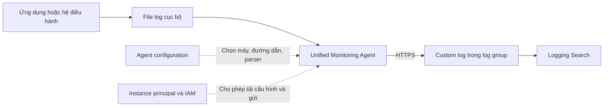

# Thu thập logs từ Compute và ứng dụng

Trong chương **Logs, metrics và tracing** của module **CLOUD_PROVIDERS_ORACLE**, bài học này xây dựng đường thu thập log từ hệ điều hành và ứng dụng trên OCI Compute vào OCI Logging. Tình huống xuyên suốt là một máy Oracle Linux chạy dịch vụ `orders-api`: người vận hành cần tìm được lỗi của một yêu cầu mà không phải SSH lần lượt vào từng máy.

Đường thu thập kết nối kiến thức về compartment, IAM, VCN và Compute với việc vận hành hạ tầng OCI. Một cấu hình hoàn chỉnh cần xác định máy nào được thu thập, file nào được đọc, danh tính nào được phép gửi, dữ liệu đến log nào và cách phát hiện đường truyền bị gián đoạn. Bài học cũng đề cập đến vòng đời file, tự động hóa cấu hình và giới hạn chi phí; triển khai tracing và quản trị log chuyên sâu của Oracle Database nằm ngoài bài thực hành này.

## 1. Kết quả cần đạt

Sau bài học, người học có thể:

- Phân biệt log do dịch vụ OCI phát sinh với log trong hệ điều hành và ứng dụng trên Compute.
- Thiết lập custom log, dynamic group, IAM policy và agent configuration cho một instance.
- Thu thập log JSON có thời gian UTC và mã tương quan của yêu cầu.
- Chứng minh một bản ghi đã đi từ file nguồn đến kết quả tìm kiếm trong OCI Logging.
- Xử lý tình huống sai quyền đọc file, sai parser, mất kết nối hoặc xoay vòng log.

Các lệnh Bash trong bài dành cho **máy Compute Oracle Linux của bài lab**. Các khối policy được cấu hình trong OCI IAM; truy vấn được chạy trong OCI Logging Search. Không dùng các lệnh Linux này trong PowerShell trên máy cá nhân.

## 2. Chọn đúng loại log và đường thu thập

### 2.1. Log trên máy không tự xuất hiện trong OCI Logging

| Nguồn | Ví dụ | Cách tiếp cận trong bài |
| --- | --- | --- |
| Ứng dụng trên Compute | File JSON của `orders-api`, access log của web server | Thu thập vào custom log |
| Hệ điều hành Compute | File syslog, thông báo đăng nhập hoặc Windows Event Logs | Chọn nguồn phù hợp rồi thu thập vào custom log |
| Dịch vụ OCI hỗ trợ Logging | VCN Flow Logs, access log của một dịch vụ được hỗ trợ | Bật service log trên tài nguyên tương ứng |
| Hoạt động API OCI | Lệnh tạo instance hoặc thay đổi tài nguyên qua API | Tra cứu Audit để điều tra thao tác quản trị |

Audit ghi nhận hoạt động API, còn nội dung như `NullPointerException` trong ứng dụng phải được đưa qua đường thu thập của ứng dụng. Service logs, custom logs và Audit logs là các khái niệm riêng trong OCI Logging. [Nguồn: Logging Overview](https://docs.oracle.com/en-us/iaas/Content/Logging/Concepts/loggingoverview.htm).

Một ứng dụng ghi vào `stdout` dưới systemd chưa chắc tạo ra file `/var/log/orders/application.log`. Trước khi cấu hình agent, phải tìm nơi dữ liệu thực sự được lưu. Với ứng dụng chỉ ghi vào journal, có thể cấu hình hệ thống logging để xuất ra file được quản lý, hoặc chọn đường thu thập khác phù hợp. Không nhập một đường dẫn chưa tồn tại rồi coi việc tạo cấu hình là đã thu thập thành công.

### 2.2. Hai đường đưa custom logs vào OCI

| Đường thu thập | Phù hợp khi | Công việc cần quản lý |
| --- | --- | --- |
| Unified Monitoring Agent đọc file tại máy | Ứng dụng đã ghi file; nhiều máy cần cùng cấu hình | File nguồn, quyền đọc, parser và cấu hình chọn máy |
| Logging Ingestion API với `PutLogs` | Ứng dụng hoặc hệ thống chuyển tiếp chủ động gửi sự kiện | Xác thực, đóng lô, giới hạn tải, retry và xử lý lỗi gửi |

OCI hỗ trợ cả hai đường. Trong giao diện plugin của Oracle Cloud Agent, Unified Monitoring Agent được gọi là **Custom Logs Monitoring**. Bài lab chọn agent để ứng dụng tiếp tục ghi file mà không cần tích hợp API gửi log. [Nguồn: Custom Logs](https://docs.oracle.com/en-us/iaas/Content/Logging/Concepts/custom_logs.htm).

### 2.3. Đường đi của một bản ghi



**Log group** tổ chức các log. **Custom log** là tài nguyên đích nhận dữ liệu. **Agent configuration** mô tả máy nguồn, đầu vào và đích nhận; nó không chứa các bản ghi của ứng dụng.

Ví dụ, nhiều instance của `orders-api` có thể gửi vào cùng một custom log. Vì vậy, cần giữ thông tin nhận diện nguồn và mã yêu cầu trong sự kiện để tìm đúng máy và đúng giao dịch khi điều tra.

## 3. Chuẩn bị lab và quyền truy cập

### 3.1. Các tài nguyên sẽ dùng

Để giảm nhầm lẫn về phạm vi quyền, lab đặt Compute, log group và agent configuration trong cùng compartment `ObservabilityLab`, tại cùng một region.

| Thành phần | Giá trị dùng trong lab |
| --- | --- |
| Hệ điều hành | Oracle Linux 8 hoặc 9, image có Oracle Cloud Agent |
| Tài khoản SSH | `opc`, có quyền `sudo` |
| Compute instance | Một máy lab đã có kết nối quản trị |
| Dynamic group | `dg-orders-logging` |
| Log group | `lg-orders-lab` |
| Custom log | `orders-app` |
| Agent configuration | `ac-orders-app` |
| File nguồn | `/var/log/oci-orders-lab/application.json.log` |
| Parser | JSON, mỗi dòng một đối tượng |

Chuẩn bị OCID của instance và compartment. Thay các giá trị trong dấu `<...>` bằng giá trị thực trước khi dùng. Nếu image, kiến trúc hoặc chế độ FIPS khác lab, kiểm tra ma trận hệ điều hành hỗ trợ trong [Agent Management Overview](https://docs.oracle.com/en-us/iaas/Content/Logging/Concepts/agent_management.htm).

### 3.2. Phân biệt người cấu hình, máy gửi và người đọc

- **Người cấu hình** tạo log group, custom log và agent configuration.
- **Instance** dùng instance principal để lấy cấu hình và gửi log.
- **Người điều tra** đọc nội dung log, có thể không được sửa cấu hình.

Trên OCI Compute, instance principal giúp tránh đặt private key của một người dùng trong ứng dụng chỉ để chuyển log. Quyền của tài khoản SSH trong Linux và quyền IAM của instance là hai lớp độc lập: có quyền đọc file chưa đồng nghĩa với có quyền gửi vào OCI.

Một quản trị viên IAM tạo dynamic group `dg-orders-logging` với matching rule giới hạn vào đúng máy lab:

```text
instance.id = '<INSTANCE_OCID>'
```

Dynamic group xác định thành viên; policy mới cấp quyền cho thành viên. Khi thay đổi rule, cần tính đến thời gian lan truyền của IAM, không kết luận sai cấu hình ngay sau khi lưu. [Nguồn: Managing Dynamic Groups](https://docs.oracle.com/en-us/iaas/Content/Identity/Tasks/managingdynamicgroups.htm).

Policy minh họa cho instance và người chỉ đọc:

```text
Allow dynamic-group dg-orders-logging to use log-content in compartment ObservabilityLab

Allow group LoggingReaders to read log-groups in compartment ObservabilityLab
Allow group LoggingReaders to read log-content in compartment ObservabilityLab
```

`LoggingReaders` là user group có sẵn hoặc được quản trị viên tạo. Điều chỉnh cách ghi tên group/dynamic group theo identity domain của tenancy. Quyền trên log metadata và quyền trên nội dung log được quản lý riêng. [Nguồn: Required Permissions for Working with Logs and Log Groups](https://docs.oracle.com/en-us/iaas/Content/Logging/Task/managinglogs.htm).

Nếu một nhóm vận hành cần tạo các tài nguyên Logging của lab, quản trị viên có thể cấp:

```text
Allow group LoggingOperators to manage log-groups in compartment ObservabilityLab
Allow group LoggingOperators to manage unified-configuration in compartment ObservabilityLab
Allow group LoggingOperators to inspect dynamic-groups in tenancy
```

Các dòng trên giả định dynamic group và các user group đã được tạo. Quyền tạo hoặc sửa dynamic group, policy và bật plugin Compute phải được cấp riêng cho người thực hiện tương ứng.

Đối với tài nguyên Logging, `manage` cần thiết cho thao tác tạo; `use` không thay thế quyền tạo log hoặc tạo agent configuration. Ngoài ra, `use log-content` bao gồm quyền đọc nội dung, quyền gửi và quyền sinh cấu hình cho agent. Vì vậy, policy mẫu cho instance không phải một quyền chỉ ghi. Trong hệ thống thật, cần xem phạm vi compartment và các permission thành phần trước khi thu hẹp thêm. [Nguồn: Details for Logging](https://docs.oracle.com/en-us/iaas/Content/Identity/policyreference/loggingpolicyreference.htm).

### 3.3. Chuẩn bị mạng ra ngoài

Agent cần phân giải DNS và kết nối HTTPS tới các endpoint cần thiết. Với endpoint thông thường của commercial realm, tài liệu custom logs liệt kê:

```text
https://auth.<REGION>.oraclecloud.com
https://ingestion.logging.<REGION>.oci.oraclecloud.com
```

Kiểm tra region, realm và endpoint áp dụng cho môi trường thực tế. Firewall trên máy, NSG, security list, route table và proxy đều có thể làm gián đoạn đường gửi. Agent chủ động mở kết nối ra ngoài; không cần mở cổng inbound công khai chỉ để nhận log từ agent. [Nguồn: Custom Logs — endpoint requirements](https://docs.oracle.com/en-us/iaas/Content/Logging/Concepts/custom_logs.htm).

Với private subnet, dùng đường ra phù hợp như NAT gateway, hoặc service gateway cho các dịch vụ Oracle được hỗ trợ trong cùng region. Khi dùng service gateway, cấu hình đúng service CIDR label và route; chỉ tạo gateway chưa đủ. Việc tải gói hoặc cập nhật từ nguồn ngoài Oracle Services Network có thể cần đường internet riêng. [Nguồn: Access to Oracle Services: Service Gateway](https://docs.oracle.com/en-us/iaas/Content/Network/Tasks/servicegateway.htm).

## 4. Chuẩn hóa log ứng dụng trước khi thu thập

### 4.1. Một sự kiện trên một dòng JSON

Một log có thể đọc được bằng mắt nhưng vẫn khó truy vấn nếu tất cả dữ liệu nằm trong chuỗi thông báo. Nên giữ các thuộc tính phục vụ điều tra thành trường riêng:

```json
{"time":"2026-11-21T03:15:00Z","level":"ERROR","service":"orders-api","environment":"lab","event_id":"evt-demo-001","request_id":"req-demo-001","message":"Database call timed out","latency_ms":1500,"error_type":"SQLTimeoutException"}
```

Timestamp trên chỉ minh họa định dạng. Khi kiểm thử, phát sinh sự kiện với thời gian hiện tại để nó nằm trong cửa sổ tìm kiếm.

| Trường | Mục đích | Quy ước gợi ý |
| --- | --- | --- |
| `time` | Thời điểm sự kiện | UTC, định dạng thống nhất với parser |
| `level` | Mức độ | Dùng nhất quán `INFO`, `WARN`, `ERROR` |
| `service`, `environment` | Phân biệt ứng dụng và môi trường | Giá trị ổn định, không chứa bí mật |
| `event_id` | Nhận diện một sự kiện | Khác nhau giữa các sự kiện |
| `request_id` | Gom sự kiện thuộc một yêu cầu | Được truyền xuyên các lớp xử lý |
| `message` | Mô tả điều đã xảy ra | Ngắn, đủ ý và không chứa credential |
| `latency_ms` | Thời gian xử lý | Giữ kiểu số để lọc bằng toán tử số |

JSON parser của Fluentd đọc một JSON map trên mỗi dòng. Với trường thời gian dạng chuỗi, cần cấu hình kiểu thời gian và format tương ứng thay vì dựa vào mặc định dành cho số. [Nguồn: Fluentd JSON parser](https://docs.fluentd.org/parser/json).

`request_id` giúp liên kết log nhưng chưa tạo ra distributed tracing. Nếu ứng dụng đã có instrumentation tracing, có thể thêm `trace_id` và `span_id` để nối quá trình điều tra với trace tương ứng.

### 4.2. Stack trace và dữ liệu nhạy cảm

Ứng dụng Java thường phát sinh stack trace nhiều dòng. Nếu mỗi dòng được gửi thành một sự kiện, phần thông báo lỗi và các frame có thể bị tách rời. Hai cách xử lý là ghi stack trace dưới dạng chuỗi JSON được escape, hoặc dùng parser multiline với quy tắc nhận biết điểm bắt đầu bản ghi.

Ví dụ dưới đây vẫn là **một dòng vật lý** trong file:

```json
{"time":"2026-11-21T03:15:00Z","level":"ERROR","service":"orders-api","request_id":"req-demo-002","message":"Request failed","stack_trace":"java.lang.IllegalStateException: demo\n\tat example.OrderService.create(OrderService.java:42)"}
```

Dùng JSON encoder của thư viện logging để escape dữ liệu; không nối chuỗi JSON thủ công từ nội dung do người dùng cung cấp. Với multiline, thử cả hai lỗi liên tiếp và một lỗi nằm ngay trước lúc rotate để kiểm tra ranh giới sự kiện. OCI cung cấp các parser như JSON, Syslog, Regexp và Multiline trong agent configuration. [Nguồn: Log Inputs and Parsers](https://docs.oracle.com/en-us/iaas/Content/Logging/Concepts/log_inputs_and_parsers.htm).

Thiết kế schema theo danh sách trường được phép ghi. Loại bỏ password, bearer token, private key, cookie phiên và toàn bộ header xác thực ngay tại ứng dụng. Nếu lỗi liên quan Oracle Database, ghi loại lỗi, mã lỗi phù hợp và thời gian chờ; tránh ghi mật khẩu JDBC hoặc SQL bind chứa dữ liệu cá nhân. Quyền đọc log cần được xem như quyền tiếp cận dữ liệu của ứng dụng.

## 5. Thực hành thu thập log từ Compute

### Bước 1 — Bật agent và xác nhận khả năng chạy

Trong trang chi tiết Compute instance, mở phần **Oracle Cloud Agent**, bật plugin **Custom Logs Monitoring** và kiểm tra trạng thái hoạt động. Với image hỗ trợ, plugin có thể thực hiện việc cài agent; không cần tự cài thêm một bộ chuyển tiếp thứ hai cho cùng file. Tham khảo [Installing the Agent](https://docs.oracle.com/en-us/iaas/Content/Logging/Task/installing_the_agent.htm) nếu dùng custom image hoặc cần cài thủ công.

Trên Oracle Linux, kiểm tra:

```bash
sudo systemctl status unified-monitoring-agent.service --no-pager
sudo systemctl status unified-monitoring-agent_config_downloader.timer --no-pager
```

Sau khi agent đã được cài và khởi động, mong đợi service chính chạy và timer chờ hoặc hoạt động. Nếu báo không có unit, quay lại trạng thái plugin và quá trình cài đặt. Bật plugin, service chạy và dữ liệu được nhận là các mốc kiểm tra khác nhau.

### Bước 2 — Tạo file nguồn dành riêng cho lab

Dùng thư mục riêng để không thay đổi file của ứng dụng thật:

```bash
sudo install -d -o opc -g opc -m 0750 /var/log/oci-orders-lab
LOG_FILE='/var/log/oci-orders-lab/application.json.log'
touch "$LOG_FILE"
chmod 0640 "$LOG_FILE"
ls -ld /var/log/oci-orders-lab
ls -l "$LOG_FILE"
```

Các lệnh này giả định đang đăng nhập bằng `opc` như điều kiện đầu vào. Chưa cần phát sinh log; bài sẽ ghi bản tin sau khi cấu hình được tải.

Tiến trình thu thập cần quyền đi qua từng thư mục cha và đọc file. Kiểm tra danh tính tiến trình thực tế trước khi cấp quyền; không giả định tên tài khoản service giống nhau trên mọi hệ điều hành. Nếu cần, dùng group hoặc ACL giới hạn cho danh tính đó. Không mở quyền ghi cho mọi người chỉ để giải quyết lỗi đọc file. Kiểm tra thêm SELinux hoặc cơ chế kiểm soát truy cập của máy khi quyền Unix có vẻ đúng mà vẫn bị từ chối.

### Bước 3 — Tạo log group và custom log

Trong Console, vào **Observability & Management → Logging**:

1. Chọn đúng region và compartment `ObservabilityLab`.
2. Tạo log group `lg-orders-lab`.
3. Trong **Logs**, chọn **Create custom log**, đặt tên `orders-app` và chọn log group vừa tạo.
4. Chọn retention phù hợp với lab, chẳng hạn 30 ngày.
5. Nếu muốn làm từng bước tách biệt, chọn thêm agent configuration sau.

Sau bước này, log đích có thể tồn tại nhưng chưa có dữ liệu. Ghi lại OCID của log group và custom log. Việc tạo log đích và cấu hình nguồn là hai công việc cần hoàn tất. [Nguồn: Creating a Log](https://docs.oracle.com/en-us/iaas/Content/Logging/Task/create-logging-log.htm).

### Bước 4 — Tạo agent configuration

Vào **Logging → Agent Configurations**, tạo `ac-orders-app` với các giá trị sau:

| Thuộc tính | Giá trị |
| --- | --- |
| Compartment của configuration | `ObservabilityLab` |
| Host group type | Dynamic group |
| Host group | `dg-orders-logging` |
| Input type | Log path |
| Input name | `orders-json-input` |
| Path | `/var/log/oci-orders-lab/application.json.log` |
| Parser | JSON |
| Destination compartment | `ObservabilityLab` |
| Destination log group | `lg-orders-lab` |
| Destination log | `orders-app` |

Đích của cấu hình phải là custom log đã tồn tại. Host group chọn tập máy áp dụng cấu hình; path chọn dữ liệu tại mỗi máy. Trong lab, dùng đúng một file để dễ kiểm chứng, sau đó mới mở rộng. [Nguồn: Creating an Agent Configuration](https://docs.oracle.com/en-us/iaas/Content/Logging/Task/create-logging-agent-configuration.htm).

Trong phần parser JSON, thiết lập các khái niệm sau; tên nhãn có thể thay đổi theo giao diện:

| Thiết lập thời gian | Giá trị cho dữ liệu lab |
| --- | --- |
| Trường chứa event time | `time` |
| Kiểu thời gian | Chuỗi, tức string |
| Time format | `%Y-%m-%dT%H:%M:%SZ` |
| Giữ trường thời gian trong dữ liệu, nếu dùng | Bật để thuận tiện đối chiếu |

Format này phù hợp với UTC có hậu tố `Z`, độ chính xác đến giây mà script bên dưới tạo ra. Nếu ứng dụng phát milliseconds hoặc offset dạng `+07:00`, cần điều chỉnh parser theo dữ liệu thực. Các thuộc tính time field, time type và time format được mô tả trong [UnifiedJSONParser](https://docs.oracle.com/en-us/iaas/tools/python/latest/api/logging/models/oci.logging.models.UnifiedJSONParser.html).

Lưu configuration và cho phép agent tải cấu hình. Không chỉnh trực tiếp file cấu hình do agent quản lý như một cách triển khai thường xuyên: OCI quản lý và phân phối cấu hình này từ dịch vụ. [Nguồn: Agent Management Overview](https://docs.oracle.com/en-us/iaas/Content/Logging/Concepts/agent_management.htm).

### Bước 5 — Phát sinh ba sự kiện sau khi agent sẵn sàng

Trong cùng phiên Bash trên Compute:

```bash
LOG_FILE='/var/log/oci-orders-lab/application.json.log'
RUN_ID="oci-orders-lab-$(date -u +%Y%m%dT%H%M%SZ)-$$"
REQUEST_ID="req-${RUN_ID}"

for LEVEL in INFO WARN ERROR; do
  EVENT_TIME="$(date -u +%Y-%m-%dT%H:%M:%SZ)"
  case "$LEVEL" in
    INFO) LATENCY_MS=25 ;;
    WARN) LATENCY_MS=350 ;;
    ERROR) LATENCY_MS=1500 ;;
  esac

  printf '{"time":"%s","level":"%s","service":"orders-api","environment":"lab","run_id":"%s","event_id":"%s-%s","request_id":"%s","message":"OCI logging lab event","latency_ms":%s}\n' \
    "$EVENT_TIME" "$LEVEL" "$RUN_ID" "$RUN_ID" "$LEVEL" \
    "$REQUEST_ID" "$LATENCY_MS" >> "$LOG_FILE"
done

printf 'RUN_ID=%s\nREQUEST_ID=%s\n' "$RUN_ID" "$REQUEST_ID"
tail -n 3 "$LOG_FILE"
```

Script chỉ nối thêm dữ liệu. `RUN_ID` tách lần thử hiện tại khỏi các lần trước; ba `event_id` khác nhau giúp so sánh bản ghi nguồn với bản ghi nhận được. Lưu hai giá trị in ra để dùng khi tìm kiếm. Những chuỗi trong script là dữ liệu lab cố định; ứng dụng thật vẫn cần JSON encoder.

Nếu cấu hình chưa tải xong lúc phát sinh sự kiện, hãy xác nhận agent sẵn sàng rồi chạy lại để có `RUN_ID` mới. Không dùng khả năng đọc lại file cũ như một giả định mặc định của phép thử đầu tiên.

### Bước 6 — Tìm và kiểm tra payload nhận được

Mở **Logging → Search**, chọn log `orders-app` và khoảng thời gian bao phủ lúc chạy script, chẳng hạn một giờ gần nhất. Mở rộng một sự kiện và xem JSON để xác định trường ứng dụng nằm ở đâu trong envelope của log. Console có thể hiển thị timestamp theo múi giờ khác UTC; đối chiếu với timestamp trong sự kiện khi điều tra. [Nguồn: Viewing and Working with Search Results](https://docs.oracle.com/en-us/iaas/Content/Logging/Concepts/work_with_search_results.htm).

Trong Advanced mode, thay toàn bộ placeholder, gồm cả dấu `<` và `>`:

```text
search "<COMPARTMENT_OCID>/<LOG_GROUP_OCID>/<LOG_OCID>"
| where data.run_id = '<RUN_ID>'
| sort by datetime desc
```

Truy vấn này giả định JSON đã được parse và `run_id` xuất hiện dưới `data`. Nếu payload thực tế khác, dùng đường dẫn trường nhìn thấy trong JSON; đừng sửa schema ứng dụng chỉ để khớp một giả định của truy vấn.

Để tìm riêng sự kiện lỗi có độ trễ lớn:

```text
search "<COMPARTMENT_OCID>/<LOG_GROUP_OCID>/<LOG_OCID>"
| where data.run_id = '<RUN_ID>' and data.level = 'ERROR' and data.latency_ms >= 1000
| sort by datetime desc
```

Nếu đang kiểm tra một input dùng parser `NONE`, có thể tìm mã lần chạy trong toàn bộ nội dung:

```text
search "<COMPARTMENT_OCID>/<LOG_GROUP_OCID>/<LOG_OCID>"
| where logContent = '*<RUN_ID>*'
| sort by datetime desc
```

`NONE` hữu ích để cô lập vấn đề parse, nhưng không tự tạo các trường JSON có cấu trúc. Cú pháp scope, `where`, so sánh số và tìm trên `logContent` thuộc OCI Logging Query Language. [Nguồn: Logging Query Language Specification](https://docs.oracle.com/en-us/iaas/Content/Logging/Reference/query_language_specification.htm).

### Bước 7 — Ghi nhận bằng chứng thành công

Chỉ kết luận đường thu thập hoạt động khi kiểm chứng được:

- File nguồn có đủ ba `event_id` của lần chạy mới.
- Search tại đúng log đích tìm được các `event_id` tương ứng.
- Trường `level`, `request_id` và `latency_ms` có giá trị đúng; phép lọc số trả về sự kiện `ERROR` mong đợi.
- Timestamp phù hợp với lúc phát sinh và nguồn gửi được nhận diện đúng trong payload/metadata.

Ba sự kiện khác nhau là mục tiêu của phép thử. Nếu thấy nhiều hơn ba bản ghi cùng `RUN_ID`, hãy đối chiếu `event_id` để kiểm tra trùng lặp; số dòng tìm thấy không tự chứng minh có thêm sự kiện nghiệp vụ. Một service đang `running` chỉ chứng minh tiến trình còn sống, chưa chứng minh toàn bộ đường thu thập tốt.

## 6. Mở rộng sang log hệ điều hành và nguồn khác

Sau khi log ứng dụng đã hoạt động, có thể tạo custom log `orders-os` và cấu hình `ac-orders-os` dùng cùng dynamic group nhưng đọc file hệ điều hành có thật trên máy. Việc tách đích giúp áp dụng quyền đọc và thời gian lưu phù hợp cho từng nhóm dữ liệu.

| Nguồn | Điểm cần kiểm tra trước khi chọn input |
| --- | --- |
| Oracle Linux với rsyslog | File như `/var/log/messages` có tồn tại và tăng dữ liệu không |
| Bản phân phối Linux khác | Tên file có thể là `/var/log/syslog`, hoặc dữ liệu chỉ nằm trong journal |
| Log đăng nhập | Quyền truy cập, thông tin nhận diện người dùng và nhu cầu điều tra |
| Windows Server | Chọn Windows Event Log và channel cần thiết, như System hoặc Application |
| Web server | Chọn đúng access/error file và parser phù hợp với format đã cấu hình |

Agent hỗ trợ đầu vào Windows Event Logs và Log Directory/Tail. Không áp dụng đường dẫn Linux cho Windows hoặc suy ra mọi hệ điều hành đều có cùng tập file. [Nguồn: Log Inputs and Parsers](https://docs.oracle.com/en-us/iaas/Content/Logging/Concepts/log_inputs_and_parsers.htm).

Với container, cần xác định log nằm trong container, trên host hay trong hệ thống thu thập của nền tảng. Một agent trên host không tự nhìn thấy mọi đường dẫn bên trong container. Nếu có collector riêng của nền tảng, xác định rõ collector nào chịu trách nhiệm từng nguồn để tránh gửi lặp.

Nếu chọn `PutLogs`, mỗi lần gửi phải nhắm đúng custom log, có xác thực và payload hợp lệ. Ứng dụng cần xử lý timeout, retry có backoff và khả năng đệm; tránh làm yêu cầu nghiệp vụ chờ vô hạn vì đường log bị gián đoạn. Dùng SDK được hỗ trợ để ký request, không tự ghép request không có chữ ký rồi coi HTTP endpoint là đủ. [Nguồn: Ingesting Custom Logs](https://docs.oracle.com/en-us/iaas/Content/Logging/Concepts/using_the_api_customlogs.htm).

## 7. Vận hành khi rotate, restart và mất mạng

### 7.1. Rotation phải đi cùng quyền và cách mở lại file

Ứng dụng không thể để file tăng mãi. Khi xoay vòng, cần phối hợp giữa cơ chế rotate, logger mở lại file và agent tiếp tục theo dõi dữ liệu.

Điểm cần kiểm tra trong môi trường thử:

1. File mới có owner, group và quyền cho phép ứng dụng ghi, agent đọc.
2. Phát sinh sự kiện có ID riêng trước và sau rotation, rồi tìm cả hai trên Logging.
3. Nếu dùng rename rồi tạo file mới, bảo đảm ứng dụng đã chuyển sang file mới.
4. Không dùng glob quá rộng gom cả file hiện tại, bản sao và file nén khi chưa hiểu cơ chế theo dõi.
5. Kiểm tra cách agent xử lý khi restart; giữ nguyên trạng thái vị trí đọc trừ khi đang thực hiện quy trình khôi phục có chủ đích.

Fluentd tail input có cơ chế theo dõi vị trí đọc và xử lý rotation; hành vi phụ thuộc cấu hình, trạng thái vị trí và file được theo dõi. Không mặc định rằng thêm glob sẽ vừa đọc lại toàn bộ lịch sử vừa không sinh trùng. [Nguồn: Fluentd tail input](https://docs.fluentd.org/input/tail).

Thao tác `copytruncate` có thể tạo khoảng thời gian phát sinh dữ liệu trong lúc sao chép và cắt file. Cần thử phương án rotation thực tế với tải đại diện thay vì suy ra độ tin cậy từ một lần `tail` thành công. Với dữ liệu quan trọng, duy trì `event_id` để hỗ trợ kiểm tra khoảng thiếu và bản ghi trùng.

### 7.2. Đệm cục bộ có giới hạn

Cần phân biệt file log của ứng dụng, dữ liệu đang được agent đệm và dữ liệu đã có thể tìm kiếm trên OCI. Ba nơi này có vòng đời khác nhau. Xóa file nguồn sớm hoặc mất máy khi còn dữ liệu chưa gửi có thể làm mất bằng chứng điều tra.

Một phép ước lượng dung lượng tạm giữ để lập kế hoạch:

```text
Dung lượng tối thiểu ≈ tốc độ phát sinh dữ liệu × thời gian gián đoạn dự kiến
```

Ví dụ giả định phát sinh 100 KB/giây trong một giờ mất kết nối: lượng dữ liệu mới khoảng 360 MB theo đơn vị thập phân. Đây chỉ là dữ liệu thô; còn cần dự phòng cho overhead, biến động tải, file rotate và phần dung lượng đã dùng. Phép tính không có nghĩa agent tự có buffer bằng dung lượng đó hoặc sẽ lưu an toàn trong đúng một giờ.

Đặt ngưỡng đĩa còn trống và xác định hành động khi đầy: giảm log ít giá trị, xử lý lỗi đường ra và bảo vệ khả năng ghi của ứng dụng. Việc tăng retention trên dịch vụ không làm tăng sức chứa đĩa hay buffer tại máy.

### 7.3. Giám sát chính đường thu thập

Khi bật operational metrics của agent, có thể theo dõi các tín hiệu như `Heartbeat`, `EmitRecords`, `BufferSpaceAvailable` và `RetryCount`. Dùng chúng để nhận biết agent không còn báo trạng thái, lượng gửi giảm bất thường, buffer cạn hoặc retry tăng. Chọn đúng compartment, namespace và quyền cho đường gửi metric; quyền gửi log không thay thế quyền gửi custom metrics. [Nguồn: Operational Metrics for OCI Logging's Unified Monitoring Agent](https://blogs.oracle.com/cloud-infrastructure/operational-metrics-unified-monitoring-agent).

Không kỳ vọng một agent mất kết nối vẫn luôn gửi được giá trị heartbeat bằng 0. Cần theo dõi cả tình trạng **không có datapoint mới**, kết hợp với bằng chứng log đầu cuối.

Một phép kiểm tra vận hành hữu ích là phát sinh sự kiện tổng hợp ở tần suất thấp, có dấu hiệu nhận diện riêng, rồi kiểm tra độ trễ xuất hiện. Tần suất và cảnh báo phải phù hợp tải thực tế; ứng dụng ít hoạt động có thể không phát log dù hoàn toàn bình thường.

## 8. Chẩn đoán theo từng chặng

Bắt đầu từ nguồn rồi đi dần tới đích. Thay đổi một nguyên nhân tại một thời điểm để còn xác định được điều gì đã khôi phục đường truyền.

| Biểu hiện | Điểm kiểm tra đầu tiên | Hướng xử lý |
| --- | --- | --- |
| File không có bản ghi mới | Nơi logger thực sự ghi, mức log, flush | Tạo sự kiện lab và xác nhận trực tiếp tại nguồn |
| File có dữ liệu, agent không đọc được | Đường dẫn, danh tính tiến trình, quyền thư mục/file | Cấp đúng quyền đọc và kiểm tra kiểm soát truy cập của OS |
| Agent chạy nhưng chưa nhận cấu hình | Matching rule, Host Groups, IAM, downloader | Sửa phạm vi máy/quyền rồi kiểm tra quá trình tải cấu hình |
| Lỗi xác thực hoặc authorization | Instance principal, policy và compartment | Xác định thao tác bị từ chối trước khi mở rộng quyền |
| Lỗi kết nối hoặc TLS | DNS, route, egress, proxy, đồng hồ và chứng thư | Kiểm tra đường tới endpoint đúng region |
| Không có trường JSON mong đợi | Parser và payload thực nhận | Đối chiếu dòng nguồn với cấu hình parse |
| Không thấy log trong Search | Region, log OCID, quyền đọc, bộ lọc thời gian | Mở rộng thời gian có kiểm soát và bỏ bớt bộ lọc |
| Log bị lặp hoặc tăng đột biến | Nguồn trùng, glob và nhiều cấu hình cùng đọc | Quy định một đường thu thập cho mỗi nguồn |
| Chỉ mất log sau rotation | Quyền file mới và logger mở lại file | Thử rotation bằng event ID trước/sau |

Trên Oracle Linux, các lệnh đọc trạng thái và log sau hỗ trợ tìm lỗi agent:

```bash
sudo journalctl -u unified-monitoring-agent.service --since '30 minutes ago' --no-pager
sudo journalctl -u unified-monitoring-agent_config_downloader.service --since '30 minutes ago' --no-pager
sudo tail -n 100 /var/log/unified-monitoring-agent/unified-monitoring-agent.log
```

Downloader có thể ở trạng thái `inactive (dead)` sau một lần chạy thành công; xem exit status và hoạt động timer trước khi kết luận lỗi. Cập nhật cấu hình có thể cần thời gian để tới agent. Khi cần tải lại trong lab, tài liệu Oracle hướng dẫn:

```bash
sudo systemctl restart unified-monitoring-agent_config_downloader.service
```

Thao tác này yêu cầu agent tải cấu hình, không sửa được policy sai hoặc đường mạng đang bị chặn. Đường dẫn log, các unit và cách tải lại được mô tả trong [Troubleshooting Logging](https://docs.oracle.com/en-us/iaas/Content/Logging/troubleshooting.htm).

Ví dụ điều tra: file có ba dòng nhưng Search không có kết quả. Nếu agent log có lỗi authorization, ưu tiên kiểm tra dynamic group và policy. Nếu không có lỗi gửi nhưng timestamp nhận được nằm ngoài cửa sổ tìm kiếm, kiểm tra parser thời gian và đồng hồ. Không dùng cùng một cách khắc phục cho cả hai tình huống.

## 9. Kiểm soát chi phí và quản lý cấu hình

### 9.1. Giới hạn dữ liệu từ nguồn

Thiết lập mức log theo môi trường. Chỉ bật `DEBUG` trong khoảng thời gian có chủ đích và có thời điểm quay lại mức bình thường. Loại bỏ payload lớn, dữ liệu trùng và heartbeat quá dày trước khi gửi. Sampling log thông thường cần có quy tắc để vẫn giữ bằng chứng lỗi cần thiết.

Ước lượng dữ liệu thô theo ngày:

```text
Số bản ghi/giây × kích thước trung bình mỗi bản ghi × 86.400
```

Ví dụ giả định 50 bản ghi/giây, trung bình 800 byte tạo khoảng 3,456 GB/ngày theo đơn vị thập phân, trước overhead. Đây là ước lượng dung lượng để so sánh phương án; tính tiền phải dùng mức sử dụng thực tế và bảng giá hiện hành, gồm cả dịch vụ phụ trợ nếu có.

Retention của custom/service log được cấu hình theo bước 30 ngày, tối đa 180 ngày theo tài liệu hiện hành. Tăng retention không khôi phục dữ liệu đã hết thời gian lưu; giảm retention làm dữ liệu cũ ngoài phạm vi mới không còn truy cập được. [Nguồn: Editing a Log](https://docs.oracle.com/en-us/iaas/Content/Logging/Task/update-logging-log.htm).

Nếu cần lưu dài hơn, có thể thiết kế đường chuyển dữ liệu bằng Connector Hub sang Object Storage. Kiểm tra quyền, khả năng đọc lại dữ liệu và vòng đời bucket; bản lưu trữ không tự có cùng trải nghiệm tìm kiếm với log đang được index. [Nguồn: Logging Overview — Connector Hub](https://docs.oracle.com/en-us/iaas/Content/Logging/Concepts/loggingoverview.htm).

### 9.2. Mở rộng từ một instance sang nhiều instance

Sau khi lab một máy thành công, quản lý cấu hình bằng công cụ hạ tầng hoặc OCI CLI/API để tái tạo được. Các giá trị cần tham số hóa gồm compartment, log group/log OCID, dynamic group, đường dẫn, parser và retention. Không đưa OCID môi trường thử vào cấu hình production theo cách cố định.

Một cách khám phá schema CLI trước khi tự động hóa là sinh mẫu tham số:

```bash
oci logging agent-configuration create \
  --generate-param-json-input service-configuration
```

Lệnh trên dùng để xem cấu trúc JSON tham số, không phải lệnh triển khai hoàn chỉnh. Khi tạo cấu hình thật cần cung cấp các tham số bắt buộc và association với nhóm máy theo command reference. [Nguồn: OCI CLI — agent-configuration create](https://docs.oracle.com/en-us/iaas/tools/oci-cli/latest/oci_cli_docs/cmdref/logging/agent-configuration/create.html).

Triển khai thay đổi parser lên một máy thử trước, phát sinh sự kiện có ID riêng và kiểm tra cấu trúc nhận được. Sau đó mới mở rộng nhóm máy. Theo dõi các cấu hình có đầu vào chồng nhau để tránh hai agent configuration cùng thu một file và gửi trùng vào đích.

Khi thay thế instance, xác nhận máy mới khớp dynamic group, có plugin cần thiết và có file đúng quyền trước khi nhận tải. Đường log cần được chuẩn bị ngay trong quy trình cấp phát máy để dữ liệu điều tra xuất hiện từ đầu vòng đời instance.

## 10. Hoàn tất lab

Kết quả cần giữ lại để tự kiểm tra là `RUN_ID`, ba `event_id`, tên/OCID log đích và một truy vấn tìm đúng sự kiện lỗi. Các thông tin này cho phép phân biệt cấu hình đã được tạo với đường thu thập đã được chứng minh hoạt động.

Khi kết thúc, ngừng phát sinh log lab. Nếu không cần giữ tài nguyên thử, tắt hoặc xóa đúng agent configuration, custom log và log group của lab sau khi đã giữ bằng chứng cần thiết. Chỉ thu hồi dynamic group/policy và xóa file lab khi chúng không phục vụ nguồn khác; áp dụng quy trình lưu dữ liệu của môi trường trước mọi thao tác xóa.

Một đường thu thập có thể vận hành được cần bốn điều kiện cùng đúng: nguồn phát sinh dữ liệu có cấu trúc phù hợp, agent đọc được nguồn, IAM và mạng cho phép gửi, và người có quyền tìm được đúng sự kiện tại đích. Kiểm chứng bốn điều kiện đó sau mỗi thay đổi quan trọng của ứng dụng hoặc hạ tầng.
