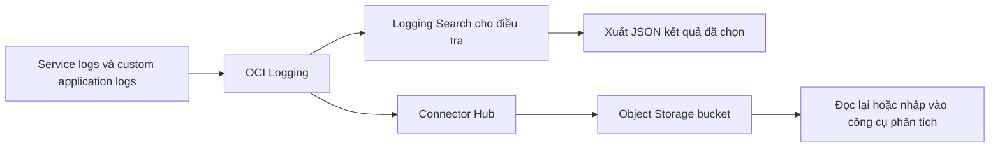

# Tìm kiếm, lưu giữ và xuất logs sang Object Storage

## 1. Mục tiêu và bối cảnh

Trong chương **Logs, metrics và tracing** của module **CLOUD_PROVIDERS_ORACLE**, log cần phục vụ cả điều tra nhanh lẫn khả năng đọc lại sau nhiều tháng. Bài học đặt OCI Logging và Object Storage trong cùng một thiết kế, gắn với tenancy, compartment, IAM và các ứng dụng chạy trên Compute, OKE, Functions hoặc kết nối dịch vụ cơ sở dữ liệu Oracle.

Ví dụ xuyên suốt là ứng dụng Java xử lý đơn hàng. Đội vận hành cần tìm lỗi theo khoảng thời gian và trace ID, giữ log gần để xử lý sự cố, đồng thời xuất dữ liệu được chọn sang bucket riêng để lưu lâu hơn. Các tên tài nguyên, schema ứng dụng và lịch lưu giữ trong bài là ví dụ, không phải cấu hình được OCI tự tạo sẵn.

Sau bài học, người học có thể:

- Chọn đúng phạm vi, thời gian và trường dữ liệu khi tìm kiếm trong OCI Logging.
- Viết truy vấn lọc, chọn trường và tổng hợp có thể giải thích được.
- Phân biệt xuất kết quả điều tra với pipeline xuất log liên tục.
- Thiết kế retention của Logging, lưu trữ Object Storage và lifecycle phù hợp.
- Cấu hình luồng Logging → Connector Hub → Object Storage với quyền và kiểm chứng cần thiết.
- Nhận diện khoảng trống, bản ghi trùng và dữ liệu chưa đủ bằng chứng để kết luận đã xuất đầy đủ.

Các lệnh và cấu hình trong bài dành cho người học áp dụng trong môi trường đã chuẩn bị. Không có thao tác nào tự tạo tài nguyên trên tenancy chỉ vì ví dụ được trình bày. Khi thực hành, thay OCID, namespace, region và bucket bằng giá trị của mình; các đoạn Bash cần shell tương ứng.

## 2. Phân biệt nơi tìm kiếm và nơi lưu giữ

### 2.1. Ba công việc khác nhau

| Công việc | Cách thực hiện phù hợp | Kết quả nhận được |
|---|---|---|
| Điều tra log gần đây | Logging Search với phạm vi và thời gian cụ thể | Các sự kiện hoặc kết quả tổng hợp phục vụ phân tích |
| Giữ bằng chứng của một lần điều tra | Xuất kết quả search, ghi query và metadata đi kèm | Một snapshot theo truy vấn, không mặc định là toàn bộ nguồn |
| Lưu log liên tục ở kho khác | Connector Hub từ Logging tới Object Storage | Các batch được ghi thành object theo cấu hình |

Log trong bucket không tự trở thành dữ liệu tìm kiếm của Logging Search. Ngược lại, một saved search chỉ lưu cách truy vấn, không phải bản sao độc lập của mọi log mà truy vấn có thể trả về.



Để sử dụng sơ đồ này, vẫn phải bật hoặc cấu hình ingest tại nguồn. Log chưa được thu thập không thể được tìm lại bằng cách tăng retention sau đó.

### 2.2. Hiểu log, log group và định danh

Trong OCI Logging, log group tổ chức các log; mỗi log phải thuộc một log group. Ghi lại OCID của compartment, log group và log để xác định chính xác phạm vi. Tên hiển thị thuận tiện cho con người, còn OCID giúp tránh nhầm hai tài nguyên cùng tên. [Logs và log groups](https://docs.oracle.com/en-us/iaas/Content/Logging/Task/managinglogs.htm).

Phân biệt service log do dịch vụ OCI được hỗ trợ phát ra với custom log do ứng dụng cung cấp. Audit là một nguồn có cơ chế và phạm vi riêng; không suy ra mọi sự kiện nghiệp vụ trong Java đều có mặt trong Audit chỉ vì ứng dụng chạy trên OCI.

Trước khi tìm kiếm, trả lời bốn câu hỏi: đang ở region nào, nguồn nằm trong compartment nào, chọn log nào, và tài khoản có quyền đọc nội dung hay chưa. Kết quả trống có thể bắt nguồn từ bất kỳ điều kiện nào trong số đó.

## 3. Chuẩn hóa trường dữ liệu để tìm kiếm chính xác

### 3.1. Dùng JSON có cấu trúc

Ví dụ nội dung một log ứng dụng đã đưa các thuộc tính vào trường `data` của log record:

```json
{
  "id": "evt-lab-0001",
  "time": "2026-11-21T03:05:00Z",
  "source": "orders-api",
  "type": "com.example.orders.request",
  "data": {
    "service": "orders-api",
    "environment": "prod",
    "level": "ERROR",
    "event_id": "evt-lab-0001",
    "trace_id": "0123456789abcdef0123456789abcdef",
    "release": "r-ab12cd3",
    "duration_ms": 2700,
    "error_code": "DB_POOL_TIMEOUT",
    "message": "Timed out while acquiring a database connection"
  }
}
```

Đây là bản minh họa rút gọn để giải thích trường truy vấn, không phải toàn bộ envelope bắt buộc của mọi nguồn OCI. Mở JSON thực tế trong Console để xác định đường dẫn. Nếu agent chỉ gửi nguyên chuỗi JSON vào `data.message`, trường `data.error_code` chưa chắc tồn tại như một trường riêng.

Chuẩn hóa kiểu số cho `duration_ms`, quy ước level và tên trường giữa các phiên bản ứng dụng. Một chuỗi `"2700"` không nên bị dùng như thể luôn tương đương số `2700` trong mọi phép lọc hoặc tổng hợp.

### 3.2. Phân biệt thời gian và khóa liên hệ

| Dữ liệu | Mục đích | Lưu ý |
|---|---|---|
| Thời gian sự kiện | Biết nghiệp vụ diễn ra khi nào | Có thể khác thời gian tiếp nhận do buffering hoặc retry |
| Thời gian tiếp nhận/xuất | Đánh giá độ trễ pipeline | Không thay thế thời gian xảy ra sự kiện |
| `trace_id` | Liên kết các sự kiện của một request phân tán | Một trace có thể chứa nhiều log records |
| Event ID | Nhận diện một sự kiện | Cần phạm vi duy nhất rõ ràng để khử trùng lặp |
| Resource OCID | Biết tài nguyên nào phát hoặc liên quan | Không dùng tên hiển thị làm định danh duy nhất |
| Release | Liên hệ lỗi với lần triển khai | Tương quan thời gian chưa tự chứng minh nguyên nhân |

Với timestamp UTC `2026-11-21T03:05:00Z`, thời gian ở Việt Nam là 10:05 cùng ngày. Ghi rõ timezone khi trao đổi sự cố và khi xuất dữ liệu. Một khoảng 10:00–10:15 không có timezone có thể khiến nhóm tìm sai hoàn toàn.

Không ghi password, token, private key, wallet hoặc toàn bộ payload nhạy cảm chỉ để dễ tìm. Khi đã xuất sang bucket, bản sao đó có vòng đời và quyền truy cập riêng; chỉnh sửa nguồn không tự làm sạch các bản đã xuất.

## 4. Tìm kiếm trong OCI Logging

### 4.1. Quy trình điều tra từ hẹp tới rộng

1. Chọn region, compartment, log group và log liên quan.
2. Chọn khoảng thời gian đủ bao phủ sự cố, kèm độ lệch hoặc độ trễ tiếp nhận có thể có.
3. Chạy truy vấn đơn giản để xác nhận nguồn có dữ liệu.
4. Mở một record JSON, xác định đúng đường dẫn và kiểu trường.
5. Lọc theo service, environment, trace hoặc mã lỗi.
6. Xem bối cảnh trước/sau rồi mới tổng hợp hoặc đưa ra kết luận.

Logging Search hỗ trợ Basic và Advanced mode, tìm trong log đã ingest và có thể xuất kết quả search ra JSON. Quyền tìm kiếm cần quyền đọc nội dung log cùng quyền đọc log group tương ứng. [Logging Search](https://docs.oracle.com/en-us/iaas/Content/Logging/Concepts/searchinglogs.htm).

Trong các ví dụ dưới đây, thay `COMPARTMENT_OCID/LOG_GROUP_OCID/LOG_OCID` bằng phạm vi thật. Khoảng thời gian được chọn ở Console, ví dụ 03:00–03:15 UTC ngày 21-11-2026. Cú pháp là **Logging Query Language**, không phải MQL của Monitoring hoặc ngôn ngữ tìm tài nguyên OCI Search.

### 4.2. Xác nhận phạm vi có dữ liệu

```text
search "COMPARTMENT_OCID/LOG_GROUP_OCID/LOG_OCID"
| sort by datetime desc
```

Phạm vi có thể là compartment, log group hoặc log cụ thể theo cú pháp được hỗ trợ. Dùng phạm vi hẹp giúp giảm nhầm nguồn. Trường truy vấn và đường dẫn JSON cần đúng chữ hoa/thường. [Đặc tả Logging Query Language](https://docs.oracle.com/en-us/iaas/Content/Logging/Reference/query_language_specification.htm).

### 4.3. Lọc lỗi có cấu trúc

```text
search "COMPARTMENT_OCID/LOG_GROUP_OCID/LOG_OCID"
| where data.service = 'orders-api'
  and data.environment = 'prod'
  and data.level = 'ERROR'
| sort by datetime desc
```

Điều kiện level chỉ phù hợp nếu nguồn đã cung cấp trường và quy ước đó. Service log của Load Balancer, Functions hay một dịch vụ khác có thể dùng schema khác; không sao chép `data.level` vào mọi nguồn rồi kết luận không có lỗi.

### 4.4. Theo một trace và chọn trường cần đọc

```text
search "COMPARTMENT_OCID/LOG_GROUP_OCID/LOG_OCID"
| where data.trace_id = '0123456789abcdef0123456789abcdef'
| select datetime, data.service, data.level, data.error_code, data.message
| sort by datetime asc
```

Một trace có thể đi qua nhiều nguồn. Khi cần, mở rộng search tới đúng các log được cấp quyền và giữ cùng trace ID. Thiếu record ở một service có thể do instrumentation, mất context, sampling hoặc ingest; chưa đủ để kết luận request không đi qua service đó.

### 4.5. Tìm sự kiện chậm và tổng hợp mã lỗi

Với trường duration dạng số:

```text
search "COMPARTMENT_OCID/LOG_GROUP_OCID/LOG_OCID"
| where data.service = 'orders-api' and data.duration_ms >= 2000
| select datetime, data.trace_id, data.duration_ms, data.error_code
| sort by data.duration_ms desc
```

Đếm lỗi theo nhóm trong khoảng đang chọn:

```text
search "COMPARTMENT_OCID/LOG_GROUP_OCID/LOG_OCID"
| where data.level = 'ERROR'
| summarize count() as error_count by data.error_code
| sort by error_count desc
```

Query tổng hợp tạo bảng kết quả, không giữ nguyên từng log event. Không dùng bảng số đếm này làm bản lưu thô rồi kỳ vọng sau đó đọc lại đầy đủ message của từng sự kiện.

### 4.6. Tìm toàn văn và hiểu giới hạn kết quả

Khi chưa biết field, có thể dùng tìm toàn văn như bước dò ban đầu:

```text
search "COMPARTMENT_OCID/LOG_GROUP_OCID/LOG_OCID"
| where logContent = '*DB_POOL_TIMEOUT*'
| sort by datetime desc
```

Sau khi tìm được record, quay lại trường có cấu trúc để giảm kết quả không liên quan. Mở rộng JSON và dùng Before & After để đọc bối cảnh khi phù hợp. Console có giới hạn số kết quả hiển thị; không dùng số dòng nhìn thấy để chứng minh đã đọc hoặc xuất toàn bộ nguồn. [Làm việc với kết quả search](https://docs.oracle.com/en-us/iaas/Content/Logging/Concepts/work_with_search_results.htm).
