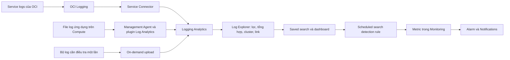

# Logging Analytics và phân tích nhật ký tập trung

## Mục tiêu bài học

Trong Oracle Cloud Infrastructure (OCI), một yêu cầu có thể đi qua Load Balancer, ứng dụng trên Compute và cơ sở dữ liệu Oracle. Khi người dùng báo lỗi, nhật ký liên quan thường nằm ở nhiều tài nguyên, có định dạng và quyền truy cập khác nhau. Gom các file về một nơi mới giải quyết việc tìm dữ liệu; muốn điều tra hiệu quả còn phải hiểu thời gian, nguồn phát sinh và các trường liên kết giữa những sự kiện.

Bài học thuộc chương **Logs, metrics và tracing** của module **CLOUD_PROVIDERS_ORACLE**, tập trung vào cách sử dụng Logging Analytics để phân tích nhật ký tập trung trong bối cảnh hạ tầng OCI có phân quyền, giám sát và kiểm soát chi phí.

Sau bài học, bạn có thể:

- Phân biệt vai trò của OCI Logging và Logging Analytics trong đường đi của log.
- Giải thích quan hệ giữa log group, entity, source, parser và field.
- Chọn đường thu thập cho service logs và log ứng dụng trên Compute.
- Chuẩn hóa log, truy vấn lỗi và liên kết các bản ghi của cùng một request.
- Thiết kế quyền truy cập, theo dõi pipeline thu thập và quản lý vòng đời dữ liệu.

Tài liệu Oracle hiện sử dụng tên **Oracle Log Analytics** ở nhiều trang. Bài viết dùng tên **Logging Analytics** theo đề bài; hai cách gọi ở đây cùng chỉ dịch vụ phân tích log của OCI.

## 1. Từ log phân tán đến quy trình điều tra

Giả sử hệ thống đặt hàng có hai dịch vụ Java là Orders và Payments. Orders trả HTTP 504, Payments ghi nhận một dependency timeout, còn hệ điều hành trên Compute ghi một lần khởi động lại tiến trình.

Nếu mở riêng từng file, người vận hành phải tự ghép các mốc thời gian và tên máy. Khi có nhiều instance hoặc instance đã bị thay thế, công việc này trở nên khó lặp lại.

Một thiết kế tập trung cần trả lời được ba nhóm câu hỏi:

| Nhóm câu hỏi | Ví dụ cần trả lời |
| --- | --- |
| Dữ liệu xuất phát từ đâu? | Dịch vụ, môi trường, instance và nguồn thu thập nào tạo bản ghi? |
| Điều gì đang xảy ra? | Mẫu lỗi nào tăng, request nào chậm, host nào có hành vi khác thường? |
| Bằng chứng có đáng tin không? | Có thiếu log, lệch thời gian, lỗi parser hoặc thu thập trùng không? |

Mục tiêu thực tế là xây dựng chuỗi **thu thập → diễn giải → tìm kiếm → đối chiếu → hành động**. Một dashboard đẹp nhưng thiếu log của Payments vẫn có thể dẫn đến kết luận sai.

## 2. Vị trí của Logging Analytics trong hệ thống quan sát

Có thể phân chia trách nhiệm khi thiết kế hệ thống như sau:

| Thành phần | Trách nhiệm trong thiết kế |
| --- | --- |
| OCI Logging | Điểm thu nhận service logs hoặc custom logs và tra cứu log thuộc dịch vụ Logging |
| Service Connector | Chuyển dữ liệu từ nguồn đã cấu hình, chẳng hạn Logging, đến đích Logging Analytics |
| Logging Analytics | Phân tích log theo trường, tổng hợp, khám phá mẫu và liên kết bản ghi |
| OCI Monitoring | Theo dõi chuỗi số đo và đánh giá điều kiện alarm |
| Hệ thống APM/tracing | Theo dõi các span và quan hệ thực thi của request khi ứng dụng đã được instrument |

Oracle cung cấp luồng dùng Service Connector đưa log từ OCI Logging sang Log Analytics. Việc chọn nguồn, đích và quyền của connector là bước cấu hình riêng. Xem [luồng nhập OCI service logs](https://docs.oracle.com/en-us/iaas/log-analytics/doc/ingest-logs-from-other-oci-services-using-service-connector.html).

Trong thiết kế, nên xem log là bằng chứng chi tiết cho sự kiện, metric là số đo để theo dõi xu hướng, và trace là cấu trúc mô tả đường thực thi. Chẳng hạn:

- Metric cho biết tỷ lệ lỗi Orders tăng lúc 10:00.
- Trace giúp xác định request bị chậm ở lần gọi Payments.
- Log của Payments giải thích dependency nào hết thời gian chờ.

Một trường `trace_id` trong log giúp tìm các bản ghi liên quan. Để có cây span và thời gian thực thi từng bước, ứng dụng vẫn cần cơ chế tạo và truyền trace context phù hợp.

## 3. Các khái niệm cần phân biệt

### 3.1. Log group và compartment

Log group của Logging Analytics tổ chức dữ liệu log để quản lý quyền truy cập. Nó nằm trong compartment. Hãy chọn ranh giới dữ liệu trước khi chọn tên group. Oracle mô tả quan hệ này trong [Manage Log Groups](https://docs.oracle.com/en-us/iaas/log-analytics/doc/manage-log-groups.html).

Một phương án cho hệ thống đặt hàng:

| Compartment | Log group | Mục đích |
| --- | --- | --- |
| Observability-Lab | la-orders-lab | Dữ liệu thực hành và thử parser |
| Observability-Prod | la-orders-prod | Log vận hành của Orders và Payments |
| Security-Prod | la-security-prod | Log cần phạm vi truy cập riêng của nhóm an ninh |

Các tên trong bảng là ví dụ thiết kế, không phải tên tài nguyên bắt buộc của OCI.

OCI Logging cũng có tài nguyên gọi là log group. Hãy lưu riêng OCID của **group nguồn trong Logging** và **group đích trong Logging Analytics**. Khi cấu hình connector, một tên hiển thị giống nhau không làm chúng trở thành cùng tài nguyên.

### 3.2. Entity, source, parser và field

| Khái niệm | Câu hỏi nó trả lời | Ví dụ trong hệ thống đặt hàng |
| --- | --- | --- |
| Entity | Tài nguyên thực tế nào phát sinh dữ liệu? | Host Compute `orders-host-01` |
| Entity type | Entity thuộc loại tài nguyên nào? | Loại host tương thích với source đã chọn |
| Source | Loại log nào và cấu hình xử lý, thu thập nào được áp dụng? | `Orders Application JSON` |
| Parser | Bản ghi được tách thành trường như thế nào? | Parser JSON cho log của ứng dụng |
| Field | Giá trị nào có thể lọc hoặc tính toán? | Service, Request ID, Duration ms |
| Association | Source nào được gắn với entity nào để thu thập liên tục? | Source ứng dụng gắn với host Orders |

Source có thể tham chiếu parser và các thiết lập bổ sung. Khi thu thập bằng Management Agent, cần kiểm tra entity type tương thích và liên kết source với entity. Xem [Create a Source](https://docs.oracle.com/en-us/iaas/log-analytics/doc/create-log-source.html) và [thiết lập thu thập liên tục](https://docs.oracle.com/en-us/iaas/log-analytics/doc/continuous-log-collection-form-your-hosts.html).

Một parser dùng chung có thể phục vụ log từ nhiều host nếu cấu trúc bản ghi giống nhau. Ngược lại, hai file trên cùng host có thể cần hai source khi định dạng và cách xử lý khác nhau.

Đừng nhầm **entity đại diện tài nguyên** với field **Log Entity** có thể mô tả file hoặc vị trí log gốc. Khi điều tra, cần biết cả host phát sinh và file nào trên host chứa bản ghi.

## 4. Thiết kế đường đi của log



Sơ đồ thể hiện các lựa chọn thiết kế. Một bộ log ứng dụng nên có đường thu thập chính rõ ràng để thuận tiện kiểm soát độ đầy đủ và phát hiện bản sao.

Oracle mô tả lựa chọn đường nhập dựa trên vị trí dữ liệu và nhu cầu thu thập liên tục hay phân tích một bộ dữ liệu theo đợt trong [Architecture of Log Analytics](https://docs.oracle.com/en-us/iaas/log-analytics/doc/architecture-logging-analytics.html).

### 4.1. Khi log đã ở OCI Logging

Với service logs, trước tiên bật loại log cần dùng cho tài nguyên nguồn và xác nhận nó đã xuất hiện trong Logging. Sau đó cấu hình connector với nguồn Logging và đích Logging Analytics.

Hồ sơ cấu hình nên ghi rõ:

- Region đang thao tác.
- Compartment, log group và log nguồn trong Logging.
- Compartment và OCID log group đích trong Logging Analytics.
- Bộ lọc của connector.
- Quyền đọc nguồn, quyền ghi đích và người phụ trách vận hành.

Để xác minh đường đi, tạo sự kiện có dấu hiệu nhận biết, tìm nó ở nguồn, rồi tìm lại ở đích. Cách kiểm tra này phân biệt được “nguồn chưa phát sinh log” với “connector chưa chuyển log”.

### 4.2. Khi ứng dụng ghi file trên Compute

Một phương án là dùng Management Agent cùng plugin Log Analytics. Trong luồng hướng dẫn cho Compute, Oracle Cloud Agent, Management Agent plugin và Log Analytics plugin có những vai trò liên quan nhưng riêng biệt. Luồng hướng dẫn có thể triển khai các thành phần cần thiết; sự tồn tại của Oracle Cloud Agent chưa chứng minh ứng dụng đang được thu thập. Xem [Ingest Logs from OCI Compute Instance](https://docs.oracle.com/en-us/iaas/log-analytics/doc/ingest-logs-from-oci-compute-instance.html).

Với ứng dụng Orders, hồ sơ thu thập nên có:

1. Host/entity cần lấy log.
2. Đường dẫn và pattern file, ví dụ `/var/log/orders/application*.log`.
3. Tài khoản chạy agent và quyền đọc file, đi qua các thư mục cha.
4. Source, parser và association tương ứng.
5. Log group đích.
6. Chính sách rotation và thời gian giữ file tại host.

Pattern cần bao phủ đúng file đang ghi và cách đặt tên sau rotation. Tránh thu thập thêm một thư mục chứa bản sao của chính các file đó.

Nếu host nằm trong private subnet, hãy xác minh DNS và đường ra đến endpoint OCI cần thiết, cùng route, proxy và chính sách mạng đang áp dụng. Thiết kế đường mạng theo vị trí triển khai; không giải quyết lỗi kết nối bằng cách mở rộng toàn bộ quyền mạng.

### 4.3. Khi chỉ cần nhập một bộ log

On-demand upload phù hợp để thử parser hoặc điều tra dữ liệu đã xuất ra file. Chuẩn bị log source, log group và bộ dữ liệu; có thể gắn entity khi phù hợp. Đây là lựa chọn cho bài thực hành ở phần sau. Xem [Upload Logs on Demand](https://docs.oracle.com/en-us/iaas/log-analytics/doc/upload-logs-demand.html).

## 5. IAM: phân quyền cho dữ liệu và pipeline

Một thiết kế phân quyền phải xét riêng ba chủ thể:

| Chủ thể | Nhu cầu | Phạm vi thiết kế |
| --- | --- | --- |
| Người phân tích | Chạy truy vấn và đọc log được giao | Các group chứa dữ liệu của nhóm |
| Người quản trị nền tảng | Quản lý source, parser, association và cấu hình liên quan | Phạm vi được giao quản trị |
| Principal thu thập | Nạp dữ liệu bằng agent hoặc connector | Nguồn và đích của pipeline |

Logging Analytics có hai nhóm resource type đáng chú ý:

- `loganalytics-features-family`: bao gồm các cấu hình như source, parser và field; policy tương ứng cần đặt theo phạm vi tenancy/root được dịch vụ quy định.
- `loganalytics-resources-family`: bao gồm tài nguyên như log group và entity; có thể phân quyền theo compartment khi phù hợp.

Xem [IAM Policies Catalog](https://docs.oracle.com/en-us/iaas/log-analytics/doc/iam-policies-catalog-logging-analytics.html) để chọn phạm vi và mẫu policy tương ứng.

Khi triển khai, lập bảng quyền theo thao tác:

| Thao tác | Những quyền cần xem xét |
| --- | --- |
| Truy vấn log | Quyền query của dịch vụ và quyền đọc log group chứa dữ liệu |
| Tạo parser/source | Quyền quản trị từng loại cấu hình tương ứng |
| Thu thập bằng agent | Dynamic group nhận diện management agent, quyền nạp log và phát metric cần thiết |
| Chuyển log bằng connector | Quyền nguồn và quyền ghi group đích của connector |
| Chạy truy vấn định kỳ | Quyền cho tiến trình nền, cùng quyền phát metric |
| Xóa hoặc purge log | Quyền quản lý dữ liệu riêng, giới hạn cho người chịu trách nhiệm |

Quyền của người đã tạo connector không tự động thay thế quyền mà principal của connector cần lúc chạy. Tương tự, việc người vận hành đọc được file trên máy chưa chứng minh tài khoản agent đọc được file đó.

Với Management Agent, dynamic group cần khớp tài nguyên agent theo quy tắc phù hợp, thay vì mặc định lấy instance Compute làm cùng một principal. Xem [quyền cho thu thập bằng Management Agent](https://docs.oracle.com/en-us/iaas/log-analytics/doc/allow-continuous-log-collection-using-management-agents.html).

Một lần nghiệm thu quyền nên có hai tài khoản đại diện:

- Analyst của Orders tìm được log của Orders trong phạm vi được giao.
- Tài khoản chỉ có quyền môi trường lab không đọc được dữ liệu production.

Ẩn một widget trên dashboard không tạo ra ranh giới bảo vệ dữ liệu. Hãy kiểm tra quyền ở tài nguyên chứa log.

## 6. Chuẩn hóa bản ghi trước khi phân tích

### 6.1. Quy ước dữ liệu cho ứng dụng Java

Với Orders và Payments, chọn JSON mỗi sự kiện một dòng. Một bộ trường dùng chung giúp các đội truy vấn mà không phải đoán định dạng từng ứng dụng:

| Khóa JSON | Ý nghĩa | Quy ước của ví dụ |
| --- | --- | --- |
| `timestamp` | Thời điểm sự kiện | ISO 8601, có múi giờ |
| `severity` | Mức độ sự kiện | `INFO`, `WARN`, `ERROR` |
| `service` | Dịch vụ phát sinh | `orders`, `payments` |
| `environment` | Môi trường | `lab`, `prod` |
| `event` | Loại sự kiện | `request_complete`, `dependency_error` |
| `request_id` | Khóa liên kết theo request | Truyền qua các lời gọi liên quan |
| `host` | Tên host trong dữ liệu mẫu | `orders-host-01` |
| `status` | Mã HTTP trong ngữ cảnh sự kiện | Số nguyên |
| `duration_ms` | Thời lượng của thao tác được ghi | Số, đơn vị mili giây |
| `error_code` | Mã lỗi ổn định | Chuỗi rỗng nếu không có lỗi |
| `message` | Diễn giải cho người đọc | Không chứa bí mật hoặc payload nhạy cảm |

Ở ứng dụng Java, request ID thường được đặt vào logging context của request. Với thread pool và xử lý bất đồng bộ, cần truyền context có chủ đích và dọn context khi kết thúc để tránh gán nhầm ID sang request khác.

Thiết kế thông điệp để mã lỗi và loại sự kiện có thể thống kê độc lập với câu văn. Chẳng hạn, đổi nội dung `message` để dễ đọc không nên làm mất khả năng đếm `DB_POOL_TIMEOUT`.

### 6.2. Ánh xạ parser

Các khóa JSON không tự bảo đảm rằng mọi field truy vấn đã có tên, kiểu dữ liệu và ý nghĩa đúng. Khi tạo parser, ánh xạ chúng rõ ràng:

| Khóa JSON | Field trong bài thực hành | Kiểu dữ liệu |
| --- | --- | --- |
| `timestamp` | `Time` | Timestamp |
| `severity` | `Severity` | String |
| `service` | `Service` | String |
| `environment` | `Environment` | String |
| `event` | `Event` | String |
| `request_id` | `Request ID` | String |
| `host` | `App Host` | String |
| `status` | `HTTP Status` | Long |
| `duration_ms` | `Duration ms` | Kiểu số phù hợp |
| `error_code` | `Error Code` | String |
| `message` | `Message` | String |

`Service`, `Environment`, `Event`, `Request ID`, `App Host`, `HTTP Status`, `Duration ms` và `Error Code` là tên được chọn cho ví dụ. Kiểm tra các field hiện có trước; tạo field tùy chỉnh khi cần và giữ đúng tên trong truy vấn.

Chọn `timestamp` làm thời gian sự kiện. Nếu thời gian không được diễn giải đúng, dữ liệu có thể được gán thời điểm nhập, làm sai cửa sổ điều tra. Oracle trình bày việc ánh xạ timestamp, kiểm tra parser và xử lý log có lớp bọc trong [Create a Parser](https://docs.oracle.com/en-us/iaas/log-analytics/doc/create-parser.html).

Khi log đi qua Logging và Service Connector, bản ghi đầu vào có thể có thêm envelope. Hãy lấy mẫu thực tế ở đường nhập đó để xác định vị trí thông điệp gốc. Parser kiểm tra thành công trên JSON trực tiếp chưa bảo đảm xử lý được cùng dữ liệu khi nó nằm trong một chuỗi JSON bên trong envelope.

### 6.3. Chất lượng thời gian và dữ liệu

Trong ví dụ, `2026-11-21T03:00:00Z` tương ứng `10:00:00` tại Việt Nam. Lúc tìm dữ liệu, ghi rõ múi giờ của time picker và khoảng thời gian đã chọn.

Ngoài timestamp, hãy kiểm tra:

- Dòng có `ERROR` nhưng không có trường tùy chọn.
- Bản ghi có ký tự Unicode hoặc dấu nháy.
- Stack trace nhiều dòng nếu ứng dụng dùng log văn bản.
- Sự kiện đến muộn sau khoảng gián đoạn mạng.
- Đơn vị thời gian: `3000 ms` phải được hiểu là 3 giây.

Lỗi parser có thể làm giảm chất lượng thống kê mà vẫn để lại một phần nội dung tìm kiếm được. Tìm được chuỗi `timeout` chưa chứng minh các trường số đã sử dụng được.

## 7. Bài thực hành: từ JSON đến truy vấn tập trung

Đây là hướng dẫn thực hành trên tenancy của người học. Các tài nguyên và truy vấn dưới đây cần được tạo hoặc chạy trong môi trường lab có quyền phù hợp.

### 7.1. Chuẩn bị tài nguyên

Chuẩn bị:

- Logging Analytics đã được onboarding ở region lựa chọn.
- Compartment lab và log group `la-orders-lab`.
- Parser JSON và source kiểu File tên `Orders Application JSON`.
- Những field được ánh xạ như bảng ở phần 6.
- Quyền tạo cấu hình, nhập dữ liệu và truy vấn theo nhiệm vụ của từng tài khoản.

Onboarding có thể tạo sẵn một số policy. Kiểm tra cấu hình hiện có trước khi bổ sung quyền; Oracle phân biệt service policies, user policies và resource policies trong [Prerequisite IAM Policies](https://docs.oracle.com/en-us/iaas/log-analytics/doc/prerequisite-iam-policies.html).

### 7.2. Bộ dữ liệu mẫu

Tạo một file văn bản UTF-8 cho bài thực hành, mỗi dòng là một JSON hoàn chỉnh. File mẫu gồm sáu sự kiện:

```json
{"timestamp":"2026-11-21T03:00:00Z","severity":"INFO","service":"orders","environment":"lab","event":"request_complete","request_id":"r-001","host":"orders-host-01","status":200,"duration_ms":84,"error_code":"","message":"Order request completed"}
{"timestamp":"2026-11-21T03:01:03Z","severity":"ERROR","service":"orders","environment":"lab","event":"request_complete","request_id":"r-002","host":"orders-host-01","status":503,"duration_ms":3000,"error_code":"DB_POOL_TIMEOUT","message":"Order request failed while waiting for a database connection"}
{"timestamp":"2026-11-21T03:01:02Z","severity":"ERROR","service":"payments","environment":"lab","event":"dependency_error","request_id":"r-002","host":"payments-host-01","status":503,"duration_ms":2950,"error_code":"DB_POOL_TIMEOUT","message":"Payment operation could not acquire a database connection"}
{"timestamp":"2026-11-21T03:02:00Z","severity":"INFO","service":"orders","environment":"lab","event":"request_complete","request_id":"r-003","host":"orders-host-02","status":200,"duration_ms":92,"error_code":"","message":"Order request completed"}
{"timestamp":"2026-11-21T03:03:05Z","severity":"ERROR","service":"orders","environment":"lab","event":"request_complete","request_id":"r-004","host":"orders-host-02","status":504,"duration_ms":5000,"error_code":"DEPENDENCY_TIMEOUT","message":"Order request exceeded the payment dependency timeout"}
{"timestamp":"2026-11-21T03:03:04Z","severity":"ERROR","service":"payments","environment":"lab","event":"dependency_error","request_id":"r-004","host":"payments-host-01","status":504,"duration_ms":4850,"error_code":"GATEWAY_TIMEOUT","message":"Payment gateway did not respond before the deadline"}
```

Hai lưu ý khi diễn giải:

- Thứ tự dòng trong file không phải thứ tự thời gian. Sắp xếp theo `Time` khi ghép diễn biến.
- Các mã lỗi là nhãn minh họa của ứng dụng; chúng chưa khẳng định một lỗi cụ thể của Oracle Database hay OCI.

### 7.3. Kiểm tra parser và nhập dữ liệu

1. Dùng một bản ghi mẫu trong màn hình kiểm tra parser JSON.
2. Kiểm tra giá trị `Time`, `Request ID`, `HTTP Status` và `Duration ms`.
3. Thử thêm bản ghi lỗi và bản ghi thành công để xác minh trường rỗng.
4. Lưu parser và gắn parser vào source `Orders Application JSON`.
5. Mở chức năng upload của Logging Analytics, đặt tên upload dễ nhận biết.
6. Chọn log group `la-orders-lab`, bộ dữ liệu và source đã chuẩn bị.
7. Theo dõi trạng thái xử lý, xem warning nếu có.
8. Mở Log Explorer, chọn group và khoảng thời gian bao phủ `03:00–03:04 UTC` ngày 21/11/2026.

Các truy vấn sau giả định bạn đã giới hạn đúng log group và nhập bộ mẫu đúng một lần. Bắt đầu với:

```text
'Log Source' = 'Orders Application JSON' | stats count as 'Record Count'
```

Kỳ vọng là **6** bản ghi. Nếu thời điểm thực hành khác ngày của dữ liệu, chọn khoảng thời gian tuyệt đối tương ứng, thay vì mặc định “15 phút gần nhất”.

## 8. Truy vấn theo câu hỏi điều tra

Query language của Logging Analytics sử dụng phần tìm kiếm đầu vào và các lệnh phân tách bằng dấu `|`. Tên field có khoảng trắng cần được trích dẫn theo cú pháp dịch vụ. Các lệnh ở đây dùng ngôn ngữ của Logging Analytics; tra cứu tại [Query Language Command Reference](https://docs.oracle.com/en-us/iaas/log-analytics/doc/command-reference.html).

### 8.1. Dịch vụ nào đang ghi lỗi?

```text
'Log Source' = 'Orders Application JSON' and Severity = 'ERROR'
| stats count as 'Error Records' by Service
```

Kỳ vọng:

| Service | Error Records |
| --- | ---: |
| orders | 2 |
| payments | 2 |

Kết quả đếm **bản ghi lỗi**. Nó chưa đếm số lần đặt hàng bị lỗi, vì một request có thể tạo nhiều sự kiện.

Để xem mã lỗi của Orders:

```text
'Log Source' = 'Orders Application JSON' and Service = 'orders' and Severity = 'ERROR'
| stats count as 'Error Records' by 'Error Code'
```

Với mẫu đã cho, `DB_POOL_TIMEOUT` và `DEPENDENCY_TIMEOUT` xuất hiện một lần mỗi mã trong Orders.

### 8.2. Bao nhiêu request của Orders thất bại?

Đếm sự kiện hoàn tất request của Orders theo mã HTTP:

```text
'Log Source' = 'Orders Application JSON' and Service = 'orders' and Event = 'request_complete'
| stats count as 'Requests' by 'HTTP Status'
```

| HTTP Status | Requests |
| --- | ---: |
| 200 | 2 |
| 503 | 1 |
| 504 | 1 |

Trong bộ mẫu:

```text
Tổng request hoàn tất của Orders = 4
Request có HTTP 5xx = 2
Tỷ lệ request lỗi = 2 / 4 × 100% = 50%
```

Nếu lấy bốn dòng `ERROR` chia cho sáu dòng log, bạn nhận khoảng 66,7%. Con số đó mô tả tỷ lệ bản ghi có severity lỗi trong bộ dữ liệu, không phải tỷ lệ request Orders thất bại.

Trong production, cần xác định sự kiện đại diện cho một request, quy tắc retry và trường hợp thiếu sự kiện hoàn tất. Nếu hợp đồng log chưa bảo đảm điều này, hãy sử dụng metric request phù hợp để đánh giá tỷ lệ lỗi.

### 8.3. Request mất bao lâu?

Chỉ lấy sự kiện hoàn tất của Orders:

```text
'Log Source' = 'Orders Application JSON' and Service = 'orders' and Event = 'request_complete'
| stats avg('Duration ms') as 'Average ms', max('Duration ms') as 'Maximum ms'
```

Kỳ vọng:

- Trung bình: `(84 + 3000 + 92 + 5000) / 4 = 2044 ms`.
- Lớn nhất: `5000 ms`.

Hàm tổng hợp số cần field kiểu số. Tài liệu [stats](https://docs.oracle.com/en-us/iaas/log-analytics/doc/stats.html) mô tả `count`, `avg`, `max` và các hàm thống kê khác.

Đừng cộng toàn bộ `duration_ms` của Orders và Payments để suy ra độ trễ người dùng. Các thao tác có thể lồng nhau hoặc chạy song song; mỗi field phải có phạm vi đo được định nghĩa.

### 8.4. Lỗi tập trung ở phút nào?

```text
'Log Source' = 'Orders Application JSON' and Severity = 'ERROR'
| timestats span=1min count as 'Error Records' by Service
```

Trên bộ mẫu, các sự kiện lỗi nằm ở phút `03:01` và `03:03 UTC`. Hãy chọn biểu đồ theo thời gian phù hợp để so sánh Orders với Payments.

Lệnh `timestats` tạo thống kê theo bucket thời gian. Độ rộng bucket ảnh hưởng cách nhìn đợt tăng lỗi; tham khảo [timestats](https://docs.oracle.com/en-us/iaas/log-analytics/doc/timestats.html).

Trong ca điều tra thực tế, giữ cùng time range khi so sánh hai biểu đồ. Hai dịch vụ ở hai cửa sổ khác nhau dễ tạo cảm giác chúng cùng tăng lỗi dù dữ liệu không tương ứng.

### 8.5. Những gì đã xảy ra với request r-004?

```text
'Log Source' = 'Orders Application JSON' and 'Request ID' = 'r-004'
```

Hiển thị các cột `Time`, `Service`, `App Host`, `Event`, `Error Code`, `Duration ms` và `Message`, rồi sắp xếp thời gian tăng dần.

Kỳ vọng có hai dòng:

1. Payments ghi `GATEWAY_TIMEOUT` lúc `03:03:04 UTC`.
2. Orders ghi `DEPENDENCY_TIMEOUT` lúc `03:03:05 UTC`.

Kết luận được dữ liệu hỗ trợ là: cả hai sự kiện mang cùng request ID, Payments báo timeout trước khi Orders ghi kết quả thất bại. Muốn kết luận gateway bị lỗi mạng, quá tải hay xử lý chậm, cần thêm bằng chứng từ phía gateway, đường mạng hoặc trace.

### 8.6. Có nhiều thông điệp lỗi giống nhau không?

```text
'Log Source' = 'Orders Application JSON' and Severity = 'ERROR'
| cluster
```

`cluster` nhóm các thông điệp tương tự để giảm số mẫu người phân tích phải xem. Nó hữu ích khi nhiều bản ghi chỉ khác ID hoặc giá trị động. Xem [cluster](https://docs.oracle.com/en-us/iaas/log-analytics/doc/cluster.html).

Với sáu dòng mẫu, lợi ích còn nhỏ. Trong thực tế, hãy đọc vài bản ghi đại diện của từng nhóm và kiểm tra những nhóm ít xuất hiện. Một mẫu mới có số lượng thấp vẫn có thể là dấu hiệu đáng điều tra.

### 8.7. Gom toàn bộ sự kiện theo request

```text
'Log Source' = 'Orders Application JSON'
| link 'Request ID'
```

Trên bộ mẫu, kỳ vọng bốn nhóm request; `r-002` và `r-004` có hai bản ghi mỗi nhóm.

`link` tạo nhóm theo khóa liên kết, đồng thời cung cấp số bản ghi và khoảng thời gian của nhóm. Xem [link](https://docs.oracle.com/en-us/iaas/log-analytics/doc/link.html).

Khoảng thời gian giữa bản ghi sớm nhất và muộn nhất chỉ là khoảng quan sát được trong log. Nó có thể ngắn hơn thời lượng request nếu thiếu sự kiện bắt đầu hoặc các mốc trung gian.

Trong production, hãy bảo đảm request ID đủ phân biệt trong phạm vi tìm kiếm. Có thể cần kết hợp môi trường hoặc tenant ứng dụng khi những hệ thống khác nhau dùng lại cùng một ID.

## 9. Từ truy vấn điều tra đến dashboard và cảnh báo

### 9.1. Lưu những truy vấn có ý nghĩa ổn định

Với Orders, chọn các truy vấn đã có định nghĩa rõ ràng:

| Truy vấn | Mục đích | Điều kiện để diễn giải đúng |
| --- | --- | --- |
| Request hoàn tất theo HTTP status | Theo dõi kết quả xử lý | Một sự kiện đại diện cho mỗi lần xử lý theo quy ước |
| Duration của request hoàn tất | Theo dõi độ trễ ứng dụng | Đơn vị và phạm vi đo thống nhất |
| Error records theo service | Định hướng điều tra | Không diễn giải thành request error rate |
| Nhóm lỗi theo error code | Tìm mẫu lỗi đang tăng | Mã lỗi ổn định qua các phiên bản |
| Tra cứu theo request ID | Xem bằng chứng chi tiết | ID được truyền và ghi ở các dịch vụ liên quan |

Lưu query, time range mặc định và mô tả cách đọc. Khi đưa lên dashboard, giữ đường dẫn để người trực có thể mở log gốc. Oracle mô tả cơ chế lưu truy vấn tại [Save and Share Log Searches](https://docs.oracle.com/en-us/iaas/log-analytics/doc/save-share-log-searches.html).

### 9.2. Chuyển saved search thành tín hiệu giám sát

Một luồng hỗ trợ là chạy saved search theo lịch và đưa kết quả sang Monitoring, sau đó cấu hình alarm cho metric đó. Xem [Create a Schedule to Automatically Run a Saved Search Query](https://docs.oracle.com/en-us/iaas/log-analytics/doc/create-schedule-run-saved-search.html) và [Manage Alarms in Log Analytics](https://docs.oracle.com/en-us/iaas/log-analytics/doc/manage-alarms-logging-analytics.html).

Ví dụ thiết kế cho Orders:

1. Chọn query đếm `DB_POOL_TIMEOUT` trong các sự kiện `request_complete` của Orders production.
2. Chọn cửa sổ nhìn lại và chu kỳ chạy phù hợp với độ trễ log đo được.
3. Chọn namespace, tên metric và các dimension cần thiết theo cấu hình được hỗ trợ.
4. Đặt ngưỡng alarm dựa trên lưu lượng và mức ảnh hưởng.
5. Gắn Notifications topic và hướng dẫn điều tra cho người trực.
6. Tạo sự kiện thử có kiểm soát để xác minh toàn bộ đường cảnh báo.

Đây là thiết kế minh họa; ngưỡng và chu kỳ phải được chọn từ yêu cầu vận hành của hệ thống.

Cửa sổ nhìn lại quá ngắn có thể bỏ qua sự kiện đến muộn. Nếu dùng cửa sổ chồng lấn, một sự kiện có thể xuất hiện trong nhiều lần tính. Hãy định nghĩa metric là “số sự kiện trong cửa sổ” và tránh cộng các điểm cửa sổ chồng lấn như những tổng độc lập.

Không đưa `request_id` vào dimension của metric tổng hợp theo thói quen. Trường đó phù hợp để tìm bằng chứng; nó tạo quá nhiều giá trị phân biệt nếu mỗi request sinh một dimension mới.

### 9.3. Phân biệt không lỗi với không có dữ liệu

Đối với từng tín hiệu, quy định rõ:

- Có log và số lỗi bằng 0.
- Không có request mới nên không có log tương ứng.
- Ứng dụng có hoạt động nhưng pipeline ngừng gửi log.
- Scheduled search không chạy hoặc không phát metric thành công.

Bốn tình huống này cần cách xử lý khác nhau. Một dashboard toàn số 0 chỉ có ý nghĩa khi pipeline và nguồn phát sinh đã được xác nhận khỏe.

## 10. Theo dõi sức khỏe pipeline thu thập

Xây dựng bản ghi kiểm tra định kỳ có mã nhận biết, chẳng hạn `LOG_PIPELINE_CHECK`, rồi đo thời gian từ lúc ứng dụng ghi đến khi tra cứu được ở đích. Đây là phép thử thiết kế của hệ thống; nó cần được triển khai để tạo dữ liệu thực tế.

Theo dõi các điểm sau:

| Điểm kiểm tra | Bằng chứng mong muốn |
| --- | --- |
| Ứng dụng | Có sự kiện mới và file đang được ghi |
| Hệ điều hành | Agent đọc được file sau khi rotation |
| Agent | Plugin, association và trạng thái upload phù hợp |
| Connector | Nguồn chọn đúng, connector hoạt động và quyền hợp lệ |
| Parser | Các field bắt buộc có giá trị và kiểu dữ liệu đúng |
| Log Explorer | Tìm được sự kiện ở đúng group và thời gian |
| Cảnh báo | Scheduled task, metric và alarm phản ánh sự kiện thử |

Management Agent cung cấp metric về kích thước dữ liệu upload và số lỗi upload theo nguồn. Có thể dùng chúng để theo dõi collector, theo [Monitor Your Continuous Log Collection](https://docs.oracle.com/en-us/iaas/log-analytics/doc/monitor-your-continuous-log-collection.html).

Đối với pipeline quan trọng, hãy kiểm thử tình huống mất kết nối rồi khôi phục, file rotation trong lúc gián đoạn và host bị thay thế. Ghi lại dữ liệu nào khôi phục được, mất bao lâu và có bản sao hay không. Dựa trên kết quả đó để chọn thời gian giữ log tại host và mức chịu gián đoạn.

Log group đích không thay thế phương án khôi phục đã kiểm thử. Với yêu cầu tính sẵn sàng cao hoặc khôi phục giữa các region, cần thiết kế riêng đường thu thập, lưu bản gốc và quy trình khôi phục; xác minh giới hạn dịch vụ tương ứng trước khi cam kết thời gian phục hồi.

## 11. Lưu trữ, bảo mật và chi phí

### 11.1. Quản lý vòng đời

Dữ liệu nhập vào Logging Analytics nằm ở active storage để phân tích. Dịch vụ có cơ chế archive, recall và purge; dữ liệu được recall tính vào active storage cho đến khi release. Việc bật archive còn có điều kiện về dung lượng và thời gian active tối thiểu, nên cần kiểm tra eligibility trên tenancy trước khi lập kế hoạch. Xem [Manage Storage](https://docs.oracle.com/en-us/iaas/log-analytics/doc/manage-storage.html).

Với hệ thống đặt hàng, nên ghi thành yêu cầu nghiệp vụ:

| Loại dữ liệu | Câu hỏi để quyết định vòng đời |
| --- | --- |
| Log request vận hành | Nhóm trực thường điều tra sự cố lùi lại bao lâu? |
| Log lỗi hiếm | Có cần đối chiếu qua nhiều lần phát hành không? |
| Log an ninh | Ai chịu trách nhiệm thời hạn giữ và quyền truy cập? |
| Log debug tạm thời | Khi nào kết thúc đợt thu thập tăng cường? |
| Log lab | Khi nào hoàn thành thực hành và được phép dọn dữ liệu? |

Phân biệt thời hạn ở file nguồn, Logging và Logging Analytics. Thay đổi một nơi không tự bảo đảm những nơi còn lại có cùng vòng đời.

### 11.2. Ước lượng dung lượng từ giả định có thể kiểm chứng

Giả sử riêng Orders ghi:

```text
500 request/giây
2 sự kiện/request
800 byte/sự kiện

Dung lượng log thô mỗi ngày
= 500 × 2 × 800 × 86.400
= 69.120.000.000 byte
≈ 69,12 GB theo đơn vị thập phân
```

Đây là ước lượng log thô từ giả định của ví dụ, chưa bao gồm các dịch vụ khác, envelope, bản sao, cách nén hoặc cách tính dung lượng của dịch vụ.

Để lập ngân sách, đo dung lượng thực tế trong khoảng đại diện, kiểm tra cách tính usage và bảng giá áp dụng cho tài khoản. Cần xem toàn bộ đường thu thập, lưu trữ nguồn, lưu trữ phân tích và những lần recall; phép tính byte thô không đủ để dự đoán hóa đơn.

Những quyết định thường có tác động lớn:

- Giảm log debug sau khi điều tra xong.
- Loại bỏ payload dài không giúp trả lời câu hỏi vận hành.
- Phát hiện đường nhập trùng cho cùng bộ dữ liệu.
- Giữ metadata đủ để lọc trước khi truy vấn rộng.
- Chọn thời hạn lưu theo nhu cầu và điều kiện tính năng thực tế.

### 11.3. Dữ liệu nhạy cảm

Với Orders và Payments, quy ước logging nên loại bỏ token, mật khẩu, khóa riêng và thông tin thanh toán nhạy cảm ngay tại nơi phát sinh. Nếu cần nhận diện khách hàng để điều tra, hãy chọn định danh phù hợp với chính sách dữ liệu của hệ thống.

Ẩn field khỏi bảng kết quả không có nghĩa là nội dung đó đã bị loại khỏi bản ghi gốc. Trước khi nhập log thật, kiểm tra cả thông điệp, stack trace và envelope.

Dữ liệu bảo mật là một phần của thiết kế schema và quyền truy cập, không chỉ là bước trang trí dashboard.

## 12. Xử lý những lỗi triển khai thường gặp

| Hiện tượng | Hướng kiểm tra đầu tiên | Cách khoanh vùng |
| --- | --- | --- |
| Không có kết quả | Region, group, time range và quyền đọc | Tìm sự kiện mẫu ở từng chặng |
| Có nội dung nhưng thiếu field | Source/parser hoặc envelope | Lấy mẫu thực tế đầu vào và kiểm tra ánh xạ |
| Thời gian hiển thị sai | Timestamp, timezone, đồng hồ host | So sánh thời điểm gốc với `Time` |
| Upload thành công nhưng đếm sai | Bộ lọc, parsing, nhập lặp | Đếm từng upload hoặc từng nguồn riêng |
| Sau rotation không còn log | Pattern file và quyền mới | Kiểm tra file mới dưới tài khoản agent |
| Metric lỗi bằng 0 bất thường | Nguồn ngừng phát hoặc pipeline đứt | Kiểm tra hoạt động ứng dụng và collector |
| Dữ liệu tăng gần gấp đôi | Có nhiều đường thu thập | Đối chiếu request, nội dung và nguồn nhập |
| Một account đọc được quá nhiều log | Policy hoặc group đích quá rộng | Kiểm tra tài khoản đại diện và compartment |
| Dashboard chậm khi mở khoảng dài | Query rộng, nhóm quá nhiều giá trị | Thu hẹp thời gian và trường phân nhóm |
| Kết luận nguyên nhân không chắc chắn | Chỉ có các sự kiện cùng thời điểm | Đối chiếu request ID, trace và tín hiệu độc lập |

Nếu dùng agent và đã bật auto-association, việc dừng thu thập cần xem cả auto-association lẫn những association hiện có. Oracle hướng dẫn tại [Stop Agent-based Log Collection](https://docs.oracle.com/en-us/iaas/log-analytics/doc/stop-agent-based-log-collection.html).

Với connector, quản lý vòng đời riêng của connector và log nguồn. Dừng đường chuyển không đồng nghĩa dữ liệu đã nhập ở đích được dọn; dọn dữ liệu cũng không bảo đảm đường thu thập đã dừng.

## 13. Kết quả cần lưu sau bài thực hành

Người học hoàn tất bài thực hành khi có những bằng chứng sau:

- Mô tả được đường đi của bản ghi từ nguồn đến group đích.
- Parser trích xuất đúng timestamp, request ID và các trường số của bộ mẫu.
- Tìm được sáu bản ghi sau một lần nhập và phân nhóm thành bốn request.
- Tính được tỷ lệ request Orders lỗi là 50%, đồng thời giải thích được vì sao tỷ lệ dòng `ERROR` khác con số đó.
- Truy ra hai sự kiện của `r-004` và phân biệt bằng chứng quan sát được với giả thuyết nguyên nhân.
- Có thiết kế quyền cho người phân tích, quản trị và principal thu thập.
- Nêu được cách phát hiện pipeline ngừng gửi, thời hạn lưu dự kiến và người chịu trách nhiệm chi phí.

Trong môi trường lab, ghi lại group, source, parser, upload và query đã tạo để có thể lặp lại thực hành. Sau khi kết thúc, dừng các luồng thu thập thử còn hoạt động và dọn đúng tài nguyên lab theo chính sách của môi trường. Nếu agent hoặc cấu hình đang được dùng chung, chỉ tháo liên kết phục vụ bài thực hành.
