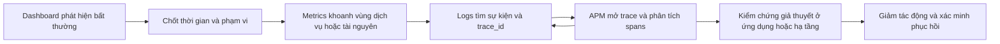

# Dashboards và liên kết logs, metrics, traces khi điều tra lỗi

Một dashboard báo tỷ lệ lỗi tăng cho biết cần chú ý vào đâu. Một log ghi `Connection acquisition timeout` cho biết ứng dụng đã gặp điều gì. Một trace cho thấy yêu cầu dành phần lớn thời gian chờ lấy kết nối cơ sở dữ liệu giúp khoanh vùng bước xử lý cần kiểm tra. Khi ba nguồn bằng chứng dùng chung thời gian, định danh dịch vụ và ngữ cảnh yêu cầu, người vận hành có thể chuyển từ phát hiện triệu chứng sang kiểm chứng nguyên nhân.

Trong Oracle Cloud Infrastructure (OCI), luồng điều tra này thường đi qua Monitoring, Logging và Application Performance Monitoring (APM), rồi mở rộng đến Compute, Load Balancer hoặc Oracle Database tùy bằng chứng. Bài học thuộc chương **Logs, metrics và tracing**, tập trung vào cách tổ chức dashboard và nối các tín hiệu trong một cuộc điều tra; đồng thời xét đến compartment, IAM, chi phí thu thập dữ liệu và khả năng quan sát khi hệ thống gặp sự cố.

## 1. Mục tiêu và mô hình điều tra

Sau bài học, bạn có thể:

- Thiết kế dashboard trả lời được dịch vụ nào bị ảnh hưởng, ảnh hưởng từ khi nào và nên điều tra tiếp ở đâu.
- Xác định các trường chung để đối chiếu metric, log và trace trong OCI.
- Chuyển từ một khoảng thời gian bất thường đến log liên quan, rồi mở trace của một yêu cầu cụ thể.
- Nhận biết giới hạn của dữ liệu tổng hợp, trace sampling, độ trễ ingest và phân quyền.
- Ghi lại bằng chứng và xác minh hiệu quả sau khi xử lý sự cố.

Một trình tự hữu ích là:



Đây là đường đi tham khảo. Nếu người dùng cung cấp request ID, có thể bắt đầu bằng log. Nếu APM đã phát hiện giao dịch chậm, có thể bắt đầu bằng trace. Điều quan trọng là mỗi bước phải giữ được ngữ cảnh và tạo ra câu hỏi cụ thể cho bước kế tiếp.

## 2. Ba loại tín hiệu trả lời ba nhóm câu hỏi

| Tín hiệu | Câu hỏi chính | Ví dụ trong một hệ thống trên OCI | Giới hạn cần nhớ |
| --- | --- | --- | --- |
| Metrics | Bất thường có quy mô và xu hướng như thế nào? | Lưu lượng, tỷ lệ HTTP 5xx, độ trễ, CPU Compute, số kết nối đang dùng | Dữ liệu tổng hợp thường không chỉ ra một yêu cầu cụ thể |
| Logs | Thành phần đã ghi nhận sự kiện gì? | Timeout, exception, thay đổi cấu hình, kết quả xử lý yêu cầu | Một dòng log chỉ thể hiện góc nhìn tại nơi phát sinh |
| Traces | Một yêu cầu đi qua đâu và mất thời gian ở bước nào? | API → service → lời gọi Oracle Database hoặc dịch vụ khác | Có thể thiếu trace hoặc span do sampling, instrumentation hay lỗi xuất dữ liệu |

Ví dụ, CPU thấp trong lúc API chậm vẫn phù hợp với tình huống các luồng đang chờ connection pool. Ngược lại, nhiều log timeout không đủ để kết luận Oracle Database bị quá tải: thời gian có thể mất trước khi truy vấn được gửi đến database.

OCI Monitoring phục vụ truy vấn metrics và alarms; Logging cung cấp tìm kiếm log; APM hỗ trợ quan sát hiệu năng và distributed tracing. Các vai trò này là nền tảng để chọn điểm mở đầu cho cuộc điều tra. [Tài liệu Monitoring và Observability của Oracle](https://docs.oracle.com/en-us/iaas/Content/cloud-adoption-framework/monitoring-and-observability.htm).

### 2.1. Phân biệt liên hệ thống kê với quan hệ của một yêu cầu

Có hai mức liên kết khác nhau:

1. **Theo phạm vi và thời gian:** metric CPU của một instance và log lỗi của ứng dụng trên instance đó cùng tăng trong một cửa sổ thời gian. Đây là căn cứ khoanh vùng.
2. **Theo ngữ cảnh yêu cầu:** log và span cùng mang một trace ID. Đây là căn cứ gắn sự kiện với một giao dịch đã được instrument.

Hai đường biểu diễn cùng tăng không tự chứng minh quan hệ nhân quả. Một trace cũng chỉ đại diện cho giao dịch đó; cần so sánh nhiều mẫu và số liệu toàn hệ thống trước khi suy rộng mức ảnh hưởng.

## 3. Chọn đúng bề mặt dashboard trong OCI

Trong OCI có những bề mặt dashboard với chức năng và nguồn dữ liệu khác nhau. Khi thực hành, cần nhận diện đúng nơi đang cấu hình.

| Bề mặt | Vai trò phù hợp trong bài học | Cách dùng để điều tra |
| --- | --- | --- |
| Console Dashboards | Tập hợp góc nhìn vận hành từ các widget hỗ trợ Monitoring, Logging và Markdown | Xem metrics, biểu đồ hoặc bảng log, kèm liên kết đến truy vấn và runbook |
| Management Dashboards | Xây dựng dashboard cho các dịch vụ Observability & Management được hỗ trợ | Sử dụng widget APM, Database Management, Log Analytics và các widget metrics phù hợp |
| Metrics Explorer | Phân tích metric chi tiết | Đổi statistic, interval, dimension và so sánh các tài nguyên |
| Logging Search | Đọc và tìm kiếm log | Lọc compartment, log group, log, thời gian và trường của sự kiện |
| APM Trace Explorer | Phân tích traces và spans | Tìm trace, xem cây span, thời lượng, lỗi và thuộc tính được thu thập |

Console Dashboards có các loại Monitoring widget, Logging Chart, Logging Data Table và Markdown widget. Chúng có thể tạo một điểm bắt đầu thuận tiện cho đội vận hành. [Các loại widget của Console Dashboards](https://docs.oracle.com/en-us/iaas/Content/Dashboards/Concepts/dashboardsoverview.htm).

Management Dashboards phục vụ các dịch vụ như APM, Database Management, Log Analytics, Management Agent, Ops Insights và Stack Monitoring. Framework này cũng có widget hiển thị dữ liệu OCI Monitoring. [Tổng quan Management Dashboards](https://docs.oracle.com/en-us/iaas/management-dashboard/doc/management-dashboard.html), [quản lý widgets](https://docs.oracle.com/en-us/iaas/management-dashboard/doc/manage-widgets.html).

**Logging và Log Analytics là hai dịch vụ riêng.** Có log trong OCI Logging không đồng nghĩa log đó đã xuất hiện trong Log Analytics. Nếu chọn dùng Log Analytics để tạo widget hoặc phân tích sâu, phải cấu hình đường ingest tương ứng và kiểm tra quyền truy cập, dữ liệu thực nhận cùng chi phí phát sinh.

Một thiết kế thực tế có thể dùng Console Dashboard cho metrics và Logging, rồi mở APM bằng liên kết đã lưu. Đội đã sử dụng nhiều dịch vụ Observability & Management có thể chọn Management Dashboard làm điểm bắt đầu. Không cần ép mọi tín hiệu vào một màn hình nếu việc chuyển sang công cụ chuyên dụng giúp đọc bằng chứng rõ hơn.

## 4. Chuẩn hóa dữ liệu để nối được các tín hiệu

### 4.1. Thiết lập các trục đối chiếu chung

Trước khi thêm biểu đồ, thống nhất cách biểu diễn các trường sau:

| Trường hoặc trục | Ví dụ | Cách sử dụng |
| --- | --- | --- |
| Thời gian sự kiện | `2026-11-21T09:12:24.183Z` | Đối chiếu theo UTC; ghi rõ múi giờ khi hiển thị |
| Tenancy và region | Tenancy phòng lab, `ap-singapore-1` | Tránh tìm đúng loại tài nguyên nhưng sai nơi |
| Compartment | OCID compartment chứa dữ liệu hoặc tài nguyên | Xác định phạm vi truy vấn và quyền đọc |
| Dịch vụ và môi trường | `checkout-api`, `lab` | Giới hạn đúng ứng dụng, tránh trộn lab với production |
| Định danh tài nguyên | OCID instance hoặc định danh workload | Đối chiếu log của ứng dụng với metric hạ tầng |
| Phiên bản triển khai | `2026.11.21-2` | So sánh nhóm chạy bản mới và bản cũ |
| Route hoặc operation | `/checkout`, `acquire-db-connection` | Khoanh vùng hành vi cụ thể |
| Trace ID và span ID | ID lấy từ tracing context đang hoạt động | Nối log với trace hoặc span |
| Request ID | `req-lab-83c41` | Theo dõi yêu cầu ở các lớp có ghi lại ID này |

Đây là **quy ước thiết kế dữ liệu**, không phải danh sách dimension được mọi dịch vụ OCI cung cấp sẵn. Ví dụ, custom metric có thể có `service` và `environment`, trong khi metric Compute dùng dimension theo định nghĩa của Compute. Cần lập ánh xạ giữa các nguồn thay vì thêm một tên dimension tùy ý rồi mặc định rằng truy vấn đã lọc đúng.

Compartment lưu dashboard có thể khác compartment chứa metric, log hoặc APM domain. Một bộ lọc duy nhất không nhất thiết đại diện chính xác cho cả bốn nơi.

### 4.2. Một bản ghi log có cấu trúc

Ví dụ sau là JSON do ứng dụng phát ra trong phòng lab. Các OCID chứa `example` là giá trị minh họa, cần thay bằng định danh thực nếu dùng trong hệ thống của bạn.

```json
{
  "timestamp": "2026-11-21T09:12:24.183Z",
  "level": "ERROR",
  "service": "checkout-api",
  "environment": "lab",
  "region": "ap-singapore-1",
  "resource_id": "ocid1.instance.oc1.ap-singapore-1.example",
  "deployment_version": "2026.11.21-2",
  "route": "/checkout",
  "request_id": "req-lab-83c41",
  "trace_id": "7c02f3e3ea6c4e41a6d3d7e1c3d901ab",
  "span_id": "9f12c15a2b6714ee",
  "http_status": 503,
  "duration_ms": 2104,
  "error_type": "db_connection_acquisition_timeout",
  "message": "Timed out waiting for a connection from the application pool"
}
```

OpenTelemetry mô tả cách ghi `trace_id` và `span_id` trong các định dạng log, bao gồm JSON. Khi ứng dụng dùng định dạng này, các ID phải được lấy từ ngữ cảnh tracing tương ứng của sự kiện. [Trace context trong các định dạng log](https://opentelemetry.io/docs/specs/otel/compatibility/logging_trace_context/).

Trong bài học, giả sử pipeline thu thập đã phân tích JSON này thành các thuộc tính bên trong `data` của bản ghi OCI Logging. Khi đó có thể tìm theo `data.trace_id`, `data.service` và `data.http_status`.

Nếu dữ liệu thực tế chỉ chứa cả chuỗi JSON trong `data.message`, các truy vấn theo trường ở phần sau sẽ chưa dùng được. Hãy mở một bản ghi thực, xem cấu trúc và cấu hình parser hoặc ánh xạ ingest trước. Trường `timestamp` của ứng dụng cũng cần được ánh xạ đúng vào thời gian sự kiện mà công cụ tìm kiếm sử dụng; chỉ thêm chuỗi thời gian vào nội dung log chưa đảm bảo bộ lọc thời gian sẽ dùng nó.

### 4.3. Giữ trace context qua các ranh giới xử lý

Tracing cần truyền context qua các lời gọi và tác vụ liên quan để tập hợp spans thành một trace. Cùng trace ID giúp nhận diện một trace; span ID và quan hệ cha con giúp đọc cấu trúc các thao tác bên trong. [Mô hình traces và spans của OpenTelemetry](https://opentelemetry.io/docs/concepts/signals/traces/).

Với ứng dụng Java, cần kiểm tra việc giữ context khi chuyển qua HTTP client, executor, tác vụ bất đồng bộ hoặc message consumer. Khi log được ghi trong tác vụ khác luồng, framework logging cũng phải nhận được context phù hợp. MDC hoặc cơ chế tương đương cần được quản lý theo vòng đời yêu cầu để tránh gắn nhầm ID của yêu cầu trước vào log mới.

Request ID tự định nghĩa, trace ID và `opc-request-id` của lời gọi API OCI có thể cùng tồn tại nhưng không mặc định là cùng một giá trị. Chỉ nối chúng khi ứng dụng hoặc lớp tích hợp đã ghi lại mối liên hệ. Không tự tạo một trace ID ngẫu nhiên cho từng dòng log, vì các dòng đó sẽ không trỏ đến trace thực.

### 4.4. Không biến định danh yêu cầu thành metric dimension

`trace_id`, `span_id`, request ID và mã đơn hàng thường có số lượng giá trị rất lớn. Đưa chúng vào dimension của metric có thể tạo ra quá nhiều time series, tăng chi phí và làm truy vấn khó sử dụng.

Nên dùng metric dimension có tập giá trị được kiểm soát như môi trường, dịch vụ, route chuẩn hóa hoặc nhóm mã trạng thái. Lưu định danh yêu cầu trong logs và traces. Một metric tổng hợp có thể dẫn bạn đến **nhóm yêu cầu** cần tìm; để chọn **một yêu cầu**, hãy tiếp tục bằng log hoặc trace. Chỉ dựa vào liên kết exemplar nếu pipeline và công cụ đang dùng thực sự hỗ trợ và đã được kiểm chứng.

## 5. Thiết kế dashboard phục vụ quyết định

### 5.1. Bắt đầu bằng câu hỏi vận hành

Dashboard nên giúp người trực trả lời theo thứ tự:

1. Người dùng có đang bị ảnh hưởng không?
2. Ảnh hưởng bắt đầu lúc nào và tập trung ở route, phiên bản hoặc nhóm tài nguyên nào?
3. Nút thắt có dấu hiệu ở ứng dụng, phụ thuộc hay tài nguyên hạ tầng?
4. Có thể mở bằng chứng chi tiết từ đâu?

Một bố cục cho `checkout-api` có thể gồm:

| Vùng | Nội dung | Quyết định được hỗ trợ |
| --- | --- | --- |
| Phạm vi | Region, môi trường, dịch vụ, compartment dữ liệu, khoảng thời gian | Xác nhận đang nhìn đúng hệ thống |
| Trải nghiệm | Số yêu cầu, tỷ lệ lỗi, p95 hoặc p99 latency | Xác định mức ảnh hưởng |
| Phân bố | Lỗi và latency theo route, instance hoặc phiên bản | Xác định nhóm cần điều tra trước |
| Năng lực | CPU, memory; connection pool và queue nếu ứng dụng có phát số liệu | Kiểm tra giả thuyết về tải và chờ đợi |
| Phụ thuộc | Thời gian gọi database hoặc dịch vụ downstream | Xác định bước có khả năng gây chậm |
| Sự kiện | Log lỗi tiêu biểu, mốc triển khai đã được ghi nhận | Lấy trace ID và đối chiếu thay đổi |
| Điều hướng | Truy vấn Logging, APM domain, Trace Explorer và runbook | Chuyển sang phân tích chi tiết |

Các chỉ số như connection pool, queue hoặc tỷ lệ lỗi theo phiên bản cần instrumentation hay nguồn dữ liệu phù hợp. Compute không tự biết số kết nối còn trống của pool trong JVM.

### 5.2. Định nghĩa phép tính trước khi đặt tiêu đề biểu đồ

Với cửa sổ quan sát `W`, một định nghĩa minh họa là:

```text
error_rate(W) = 100 × số HTTP 5xx trong W / tổng số HTTP request trong W
```

Cần nêu rõ nguồn, route được tính và cách xử lý khi mẫu số bằng 0. Không thay dữ liệu thiếu thành 0% lỗi. Nếu không có request, nên thể hiện trạng thái không có lưu lượng; nếu pipeline mất dữ liệu, cần thể hiện tình trạng thiếu telemetry.

Khi tổng hợp nhiều instance, lấy tổng số lỗi chia tổng số yêu cầu trong cùng phạm vi. Trung bình cộng các phần trăm lỗi của từng instance có thể sai khi lưu lượng giữa chúng khác nhau.

Tương tự, p95 của toàn hệ thống không phải trung bình các p95 trên từng instance. Muốn tính đúng cần dữ liệu phân bố có thể tổng hợp hoặc truy vấn phù hợp với nguồn quan sát. Không dùng percentile của các điểm latency trung bình rồi đặt tên là p95 của request.

### 5.3. Giữ ý nghĩa của thời gian và trạng thái dữ liệu

- Dùng một cửa sổ chung khi đối chiếu, chẳng hạn 15 phút quanh thời điểm lỗi.
- Khi điều tra một sự kiện đã xảy ra, chuyển sang thời gian tuyệt đối để cửa sổ không trượt theo mỗi lần refresh.
- Ghi rõ timezone, đơn vị latency, statistic và interval.
- Phân biệt thời gian sự kiện, thời gian dữ liệu đến hệ thống và thời điểm dashboard refresh.
- Đánh dấu các mốc triển khai hoặc cấu hình nếu có nguồn ghi nhận đáng tin cậy.

Ví dụ, `09:10–09:20 UTC` tương ứng `16:10–16:20` tại Việt Nam. Nếu một công cụ dùng UTC và công cụ khác hiển thị giờ máy, hãy quy đổi trước khi kết luận chúng đang thể hiện hai sự kiện khác nhau.

Một widget “No data” cần được phân biệt với số 0 và với lỗi không có quyền đọc. Dashboard có thể hiển thị bình thường trong khi một nguồn phía dưới đang ngừng gửi dữ liệu.

## 6. Thực hành tạo điểm bắt đầu điều tra trên OCI

### 6.1. Chuẩn bị trước khi cấu hình widget

Đối với môi trường lab, chuẩn bị:

- Một compartment cho workload thử nghiệm và quyền truy cập vào các nguồn telemetry liên quan.
- Ứng dụng đã gửi log vào đúng log group, đồng thời có metric ứng dụng hoặc metric hạ tầng cần quan sát.
- APM domain và cơ chế gửi traces đã cấu hình; kiểm tra được ít nhất một trace mới.
- Một yêu cầu thử có thể đối chiếu từ ứng dụng đến log và trace.
- Ngân sách và thời gian chạy lab đã giới hạn; các thay đổi cấu hình có cách hoàn nguyên.

APM nhận dữ liệu từ các nguồn được hỗ trợ như agent, tracer và API. Việc tạo dashboard không tự instrument ứng dụng hoặc tạo spans còn thiếu. [Các nguồn dữ liệu của APM](https://docs.oracle.com/en-us/iaas/application-performance-monitoring/doc/application-performance-monitoring-data-sources.html).

### 6.2. Phương án A: Console Dashboard cho Monitoring và Logging

1. Mở **Dashboards** trong khu vực Home của OCI Console và tạo dashboard cho môi trường lab.
2. Thêm **Monitoring widget**; chọn region, compartment, namespace, metric và các dimension thực sự có trong nguồn dữ liệu.
3. Thêm **Logging Chart** để nhận biết thời điểm lỗi tăng và **Logging Data Table** để đọc các sự kiện liên quan.
4. Cấu hình từng widget với cùng phạm vi thời gian, môi trường và dịch vụ; kiểm tra kết quả sau khi lưu.
5. Thêm **Markdown widget** chứa cách mở APM domain, truy vấn mẫu và runbook. Dùng liên kết lấy từ Console thực tế; mô tả rõ các bộ lọc cần kiểm tra lại khi mở.

Các widget có cấu hình region, thời gian và bộ lọc riêng. Vì vậy, cần kiểm tra từng widget thay vì mặc định một thay đổi ở nơi khác đã được áp dụng cho toàn bộ dashboard. [Hướng dẫn cấu hình Console Dashboard widgets](https://docs.oracle.com/en-us/iaas/Content/Dashboards/Tasks/widgetmanagement.htm).

### 6.3. Phương án B: Management Dashboard cho góc nhìn APM và phụ thuộc

1. Mở khu vực **Management Dashboards** trong Observability & Management.
2. Chọn dashboard có sẵn hoặc tạo custom dashboard.
3. Thêm widget APM phù hợp với giao dịch cần quan sát, rồi cấu hình compartment và APM domain.
4. Thêm widget metrics hoặc widget của dịch vụ quản lý database khi nguồn tương ứng đã được cấu hình và người xem có quyền.
5. Ràng buộc các đầu vào widget với dashboard filter phù hợp; thử thay đổi filter để xác nhận dữ liệu thực sự đổi theo.

Một custom dashboard có thể dùng các widget và bộ lọc của những dịch vụ được hỗ trợ, nhưng dữ liệu của chúng có thể thuộc các compartment khác nhau. Widget cũng có thể có bộ lọc cục bộ. [Tạo custom Management Dashboard](https://docs.oracle.com/en-us/iaas/management-dashboard/doc/create-custom-dashboard.html).

### 6.4. Kiểm tra đường chuyển ngữ cảnh

Đối với mỗi liên kết từ dashboard đến công cụ chi tiết, xác minh những giá trị sau còn đúng sau khi mở:

```text
region
compartment của nguồn dữ liệu
APM domain hoặc log group/log
thời điểm bắt đầu và kết thúc
dịch vụ, môi trường, resource hoặc trace ID cần lọc
```

Không giả định một cú nhấp từ mọi metric sẽ mở ngay trace tương ứng. Metric tổng hợp thường không chứa định danh giao dịch. Nếu UI không chuyển đầy đủ tham số, runbook cần chỉ ra cách nhập lại thủ công. Tránh tự ghép URL nội bộ của Console bằng một cấu trúc chưa được kiểm chứng.

## 7. Truy vấn để đi từ tổng quan đến yêu cầu cụ thể

Các ví dụ dưới đây chạy ở ba công cụ khác nhau. Không dùng cú pháp Logging trong Metrics Explorer hoặc cú pháp Trace Explorer trong Logging Search.

### 7.1. Metrics Explorer: kiểm tra CPU của đúng Compute instance

Trong Metrics Explorer, chọn compartment chứa instance và namespace `oci_computeagent`, sau đó dùng MQL:

```text
CpuUtilization[1m]{resourceId = "<INSTANCE_OCID>"}.mean()
```

Truy vấn lấy giá trị CPU trung bình theo interval một phút cho instance được chọn. Thay `<INSTANCE_OCID>` bằng OCID thực. Namespace, compartment, region và cửa sổ thời gian được chọn ở ngoài biểu thức này.

Có thể đổi sang:

```text
CpuUtilization[1m]{resourceId = "<INSTANCE_OCID>"}.max()
```

`max()` giúp quan sát giá trị lớn nhất trong từng interval; nó không biến metric CPU thành phép đo latency của request. MQL định nghĩa interval, statistic và bộ lọc dimension riêng cho metric query. [Tham chiếu MQL](https://docs.oracle.com/en-us/iaas/Content/Monitoring/Reference/mql.htm).

Dữ liệu `oci_computeagent` phụ thuộc vào cơ chế monitoring của instance được cấu hình và hoạt động. Nếu không có dữ liệu, kiểm tra nguồn phát trước khi kết luận CPU bằng 0. [Compute instance metrics](https://docs.oracle.com/en-us/iaas/Content/Compute/References/computemetrics.htm).

### 7.2. Logging Search: tìm lỗi trong đúng phạm vi

Chọn region và thời gian sự cố trong Logging Search. Với giả định parser ở phần 4, truy vấn Advanced sau tìm log lỗi của ứng dụng:

```text
search "<COMPARTMENT_OCID>/<LOG_GROUP_OCID>/<LOG_OCID>"
| where data.service = 'checkout-api'
    and data.environment = 'lab'
    and data.http_status >= 500
| sort by datetime desc
```

Thay các placeholder bằng OCID thật của log nguồn. `http_status` trong ví dụ là số; nếu pipeline lưu nó thành chuỗi, cần sửa ánh xạ hoặc điều chỉnh điều kiện theo kiểu dữ liệu thực tế.

Khi lấy được trace ID, tìm mọi sự kiện của trace trong phạm vi log group:

```text
search "<COMPARTMENT_OCID>/<LOG_GROUP_OCID>"
| where data.trace_id = '7c02f3e3ea6c4e41a6d3d7e1c3d901ab'
| sort by datetime asc
```

Truy vấn thứ hai bỏ giới hạn một log object để có thể tìm trong nhiều log cùng group. Nếu các service gửi đến những group hoặc compartment khác nhau, phải bổ sung phạm vi tương ứng và có quyền đọc. Thứ tự thời gian giúp đọc sự kiện, nhưng sai lệch đồng hồ có thể khiến nó khác thứ tự xử lý thực tế.

Logging query language cho phép chọn log stream theo compartment/log group/log rồi dùng các toán tử như `where` và `sort`. Các field phân biệt chữ hoa, chữ thường. [Đặc tả Logging query language](https://docs.oracle.com/en-us/iaas/Content/Logging/Reference/query_language_specification.htm).

Logging Search hỗ trợ kiểm tra raw payload. Khi không thấy kết quả, hãy mở một bản ghi gần nhất và đối chiếu trường thực tế; log chỉ tìm được cho giai đoạn đã bật thu thập và bắt đầu ingest. [Hướng dẫn Logging Search](https://docs.oracle.com/en-us/iaas/Content/Logging/Concepts/searchinglogs.htm).

### 7.3. APM Trace Explorer: mở trace lấy từ log

Trong APM, chọn đúng region, compartment, APM domain và thời gian. Có thể tìm trace bằng truy vấn:

```text
show traces traceId
where traceId = '7c02f3e3ea6c4e41a6d3d7e1c3d901ab'
```

`traceId` là tên dimension trong truy vấn APM; `data.trace_id` là đường dẫn trường log theo schema ví dụ. Giá trị ID là cầu nối giữa hai nơi, không phải tên trường giống nhau. Cú pháp Trace Explorer dùng `show traces` hoặc `show spans` cùng các điều kiện lọc. [Truy vấn trong Trace Explorer](https://docs.oracle.com/en-us/iaas/application-performance-monitoring/doc/work-queries-trace-explorer.html).

Sau khi tìm được trace, mở chi tiết và xem:

- Root span và tổng thời gian của yêu cầu.
- Các service, operation và lời gọi phụ thuộc xuất hiện trong trace.
- Span lỗi, exception hoặc thuộc tính giúp nhận diện bước thất bại.
- Khoảng thời gian chờ trước khi lời gọi database bắt đầu.
- Các lần retry hoặc lời gọi đồng thời làm thay đổi diễn giải tổng thời gian.

Trace Explorer hiển thị dữ liệu trace/span cùng những dimension đã được thu thập. Một thuộc tính không xuất hiện có thể đơn giản là chưa được instrument, không phải bằng chứng thao tác đó không xảy ra. [Sử dụng Trace Explorer](https://docs.oracle.com/en-us/iaas/application-performance-monitoring/doc/use-trace-explorer.html).

### 7.4. Đọc waterfall đúng cách

Giả sử root span dài 2.200 ms, một span lấy kết nối dài 1.850 ms và span chạy SQL dài 90 ms. Mẫu này gợi ý kiểm tra việc chờ pool trước khi tối ưu SQL.

Không cộng toàn bộ duration của mọi span để tính tổng latency: span có thể lồng nhau hoặc chạy song song. Đồng thời, thời gian của một parent span trừ các child span chưa chắc là CPU time; phần còn lại có thể chứa chờ đợi hoặc thao tác chưa được instrument.

Nếu instrumentation hiện tại chỉ tạo span JDBC khi thực thi SQL, bạn sẽ không tự thấy thời gian chờ pool. Cần metric pool, log thời gian lấy kết nối hoặc span tùy chỉnh để phân biệt hai giai đoạn.

## 8. Quy trình điều tra minh họa: HTTP 503 sau triển khai

Các số liệu và mốc thời gian sau là dữ liệu giả định để thực hành suy luận. Hệ thống gồm OCI Load Balancer, ứng dụng Java trên Compute và Oracle Database. Ứng dụng có log cấu trúc, tracing và metric connection pool.

### Bước 1: Chốt phạm vi và mức ảnh hưởng

Dashboard cho thấy từ `09:10 UTC`, tỷ lệ lỗi của `/checkout` tăng từ 0,2% lên 8%, p95 tăng từ khoảng 300 ms lên 2.200 ms. Tổng lưu lượng không tăng đáng kể.

Người trực ghi lại region, môi trường, các instance, cửa sổ `09:05–09:20 UTC` và nguồn đo tỷ lệ lỗi. Nếu số liệu lấy ở Load Balancer, cần xác định lỗi do frontend hay backend trả về theo dữ liệu thực có; không tự xem mọi HTTP 503 là lỗi ứng dụng.

### Bước 2: Phân tách nhóm bị ảnh hưởng

So sánh cùng route giữa các instance và phiên bản. Nhóm chạy bản `2026.11.21-2` có nhiều lỗi hơn nhóm cũ. CPU ở mức trung bình, trong khi metric pool cho thấy số kết nối đang dùng chạm giới hạn và có nhiều luồng chờ.

Điều này củng cố giả thuyết liên quan bản triển khai hoặc cấu hình pool. Nó chưa chứng minh pool quá nhỏ: database chậm, transaction kéo dài hoặc rò rỉ kết nối cũng có thể làm pool cạn.

### Bước 3: Từ log lỗi lấy trace ID

Logging Search trả về sự kiện `db_connection_acquisition_timeout` gắn với phiên bản mới và trace ID trong ví dụ. Tìm tiếp theo ID đó để xem những log trước và sau lỗi.

Kiểm tra thời gian timeout, route, instance và request ID. Không dừng ở việc đếm chuỗi `ERROR`; cần phân biệt lỗi gốc với các thông báo phát sinh sau đó như request bị hủy hoặc retry thất bại.

### Bước 4: Đọc trace và kiểm tra các giả thuyết

Trong một số trace đã thu thập, phần chờ lấy kết nối chiếm gần toàn bộ latency, còn SQL thực thi nhanh. Dữ liệu database cùng thời gian chưa cho thấy tăng tải hoặc chờ đợi tương ứng. Đội vận hành đối chiếu cấu hình và phát hiện giới hạn pool của nhóm mới bị giảm ngoài dự kiến.

| Giả thuyết | Bằng chứng cần đối chiếu | Khi nào nên đổi hướng |
| --- | --- | --- |
| Compute thiếu CPU | CPU, luồng chạy, phân bố lỗi theo instance | CPU không cao và thời gian chủ yếu là chờ |
| Database thực thi chậm | Span SQL, session/wait hoặc dữ liệu quản lý database phù hợp | SQL nhanh nhưng thời gian lấy kết nối dài |
| Pool ứng dụng bị giới hạn | Active/idle/pending connections, timeout, cấu hình triển khai | Pool chưa đầy hoặc không có người chờ |
| Lỗi mạng đến database | Log kết nối, timeout mạng, bằng chứng đường truyền phù hợp | Lỗi xảy ra trước khi mở hoặc dùng kết nối mạng |
| Thay đổi ở bản mới | Mốc triển khai, cấu hình, khác biệt nhóm cũ/mới | Cả hai nhóm lỗi như nhau hoặc lỗi đã có từ trước |

Không có metric bất thường ở database cũng chưa đủ loại trừ mọi vấn đề database. Độ phân giải, phạm vi, dữ liệu thiếu và giao dịch kéo dài đều có thể che khuất bằng chứng.

### Bước 5: Giảm tác động và xác minh phục hồi

Trong môi trường có quy trình thay đổi phù hợp, có thể khôi phục cấu hình pool đã biết hoạt động tốt hoặc rollback bản triển khai. Việc tăng pool cần tính đến tổng số instance và giới hạn kết nối phía database; tăng đồng loạt có thể chuyển sự cố xuống database.

Sau xử lý, quan sát cùng route và phạm vi đã dùng lúc phát hiện:

- Tỷ lệ lỗi và latency trở về mức kỳ vọng trong nhiều interval liên tiếp.
- Số luồng chờ kết nối giảm và pool còn năng lực phục vụ.
- Yêu cầu thử mới thành công; trace mới không còn thời gian chờ bất thường.
- Database và các phụ thuộc không xuất hiện dấu hiệu quá tải mới.
- Lưu lượng vẫn tồn tại và telemetry vẫn được gửi, để tránh nhầm mất dữ liệu với phục hồi.

Kết luận cần tách rõ bằng chứng đã quan sát và suy luận. Trong ví dụ, sự khác biệt cấu hình, phân bố lỗi theo nhóm, trace chờ pool và sự phục hồi sau khi khôi phục cùng hỗ trợ kết luận về thay đổi pool. Việc chỉ thấy lỗi xuất hiện sau deployment sẽ là bằng chứng yếu hơn nhiều.

## 9. Khi không nối được dữ liệu

| Hiện tượng | Nguyên nhân cần xem xét | Hướng kiểm tra |
| --- | --- | --- |
| Dashboard có metrics nhưng không thấy log | Chưa bật log, ingest lỗi, sai scope hoặc không có quyền | Mở log nguồn, kiểm tra thời gian nhận dữ liệu và IAM |
| Truy vấn `data.trace_id` không có kết quả | JSON nằm trong chuỗi, tên trường khác, sự kiện không có tracing context | Xem raw payload và đối chiếu schema thực |
| Có trace ID trong log nhưng APM không tìm thấy | Sai APM domain/region, ngoài thời gian lưu, sampling hoặc lỗi export | Kiểm tra scope, cửa sổ rộng hơn, chính sách sampling và pipeline |
| Một yêu cầu thành nhiều trace rời | Không truyền hoặc khôi phục context qua ranh giới service/tác vụ | Kiểm tra instrumentation và propagation ở từng hop |
| Log có ID của yêu cầu khác | Context logging không được quản lý đúng khi tái sử dụng luồng | Kiểm tra phạm vi MDC và các tác vụ bất đồng bộ |
| Biểu đồ tổng thể bình thường nhưng một nhóm vẫn lỗi | Tổng hợp che khuất route, instance hoặc phiên bản lỗi | Chia theo dimension sẵn có và giữ cùng mẫu số |
| Người tạo dashboard thấy dữ liệu, đồng nghiệp không thấy | Quyền dashboard và quyền nguồn dữ liệu khác nhau | Kiểm tra tài khoản người xem với từng nguồn |
| Trace không cho thấy thời gian chờ pool | Instrumentation chỉ bao phủ lời gọi SQL | Đối chiếu pool metrics, log thời gian chờ hoặc thêm span phù hợp |

Trace sampling có thể khiến log chứa ID của trace không được lưu. Không tìm thấy trace không chứng minh yêu cầu chưa xảy ra. Ngược lại, số trace lỗi đã lưu cũng không mặc định là tổng số lỗi của hệ thống. Tính tỷ lệ lỗi toàn hệ thống cần nguồn đếm đầy đủ hoặc phương pháp ước lượng có hiểu biết về sampling.

Khi nghi ngờ ingest chậm, dùng cả thời gian sự kiện và thời gian dữ liệu đến để đánh giá. Mở rộng cửa sổ có chủ đích, nhưng vẫn giữ bộ lọc dịch vụ, môi trường và phạm vi tài nguyên để tránh tìm kiếm quá rộng.

## 10. IAM, chi phí và khả năng quan sát khi có sự cố

### 10.1. Quyền xem dashboard không thay thế quyền đọc dữ liệu

Nên phân tách ba nhu cầu:

| Nhu cầu | Phạm vi quyền cần thiết kế |
| --- | --- |
| Người trực xem dashboard và điều tra | Đọc dashboard cùng metrics, logs và dữ liệu APM cần cho dịch vụ phụ trách |
| Người xây dựng dashboard | Tạo hoặc sửa dashboard/widget trong compartment quản lý phù hợp |
| Agent hoặc workload gửi telemetry | Quyền ghi dữ liệu cần thiết cho đúng nguồn và compartment |

Không cấp quyền quản trị toàn tenancy chỉ để sửa một widget trống. Xác định nguồn bị thiếu quyền và điều chỉnh theo phạm vi tối thiểu. Khi một dashboard dùng dữ liệu từ nhiều compartment, cần kiểm tra quyền ở từng nguồn thay vì chỉ ở compartment chứa dashboard.

Trace, log và thuộc tính truy vấn có thể chứa dữ liệu nhạy cảm. Loại bỏ token, mật khẩu, thông tin thanh toán, chuỗi kết nối có bí mật và payload cá nhân không cần thiết. Nếu thu thập SQL hoặc exception chi tiết, kiểm tra cả giá trị tham số và nội dung thông báo lỗi. Không đưa thông tin nhạy cảm vào tên widget hoặc URL chia sẻ.

### 10.2. Kiểm soát chi phí theo đường dữ liệu

Đội vận hành cần biết dữ liệu nào đang được phát, gửi, lưu và truy vấn:

- Giữ số lượng metric dimension trong giới hạn có chủ đích; chuẩn hóa route để tránh một time series cho mỗi URL chứa ID.
- Chọn mức log phù hợp; chỉ tăng debug có thời hạn và cho phạm vi cần điều tra.
- Chọn sampling traces theo mục tiêu điều tra, kiểm tra khả năng hỗ trợ của pipeline và ghi lại giới hạn quan sát.
- Lọc truy vấn theo thời gian, service và nguồn log trước khi mở rộng.
- Cân đối thời gian lưu của metrics, logs và traces với nhu cầu đối chiếu sự cố.
- Kiểm tra đường gửi dữ liệu để tránh nhân bản ngoài ý muốn sang nhiều nơi lưu, đặc biệt khi bổ sung Log Analytics hoặc kho lưu trữ khác.

Không dùng các con số giá hoặc quota cố định làm giả định lâu dài cho dashboard. Trước khi mở rộng thu thập, đối chiếu cấu hình, hạn mức và chi phí hiện hành của những dịch vụ thực sự sử dụng.

### 10.3. Thiết kế cho lúc telemetry cũng gặp lỗi

Dashboard và alarm có vai trò khác nhau. Dashboard giúp phân tích; alarm và kênh thông báo giúp phát hiện khi không có người mở màn hình. Với tín hiệu quan trọng, cần thiết kế thêm phát hiện thiếu dữ liệu và kiểm tra tình trạng agent/exporter.

Nếu workload có nhiều region, mỗi liên kết điều tra cần xác định region đích. Dashboard ở một region không tự chứng minh workload ở region khác đang khỏe. Duy trì đường kiểm tra độc lập phù hợp, chẳng hạn yêu cầu kiểm thử từ bên ngoài, để tránh phụ thuộc hoàn toàn vào telemetry phát từ chính ứng dụng đang lỗi.

Lưu các truy vấn, dashboard definition và runbook theo quy trình quản lý thay đổi của đội. Khi tự động hóa, nên dùng cơ chế được bề mặt dashboard tương ứng hỗ trợ và giữ bí mật ngoài định nghĩa chia sẻ. Cần có người sở hữu để cập nhật liên kết, schema và bộ lọc sau khi thay đổi kiến trúc.

## 11. Bài thực hành có kiểm soát

Thực hiện trong môi trường lab; các bước sau là bài tập xây dựng và sử dụng đường điều tra, không yêu cầu gây lỗi trên production.

1. **Xác nhận baseline:** gửi lưu lượng thử nhỏ, ghi lại tỷ lệ thành công, latency và ít nhất một yêu cầu có log cùng trace ID đối chiếu được.
2. **Tạo dashboard:** thêm góc nhìn trải nghiệm, metric hạ tầng, log lỗi và liên kết đến đúng APM domain. Ghi rõ region, scope và timezone.
3. **Kiểm tra hai chiều:** lấy trace ID từ log để mở APM; lấy trace ID từ APM để tìm các log liên quan.
4. **Tạo bất thường ở cấp ứng dụng:** dùng fault injection có kiểm soát để thêm độ trễ vào một thao tác đã instrument, hoặc dùng chức năng mô phỏng lỗi của ứng dụng thử nghiệm. Giới hạn thời lượng, số request và chuẩn bị thao tác tắt.
5. **Điều tra:** dùng cùng cửa sổ tuyệt đối, xác định nhóm bị ảnh hưởng, tìm một log lỗi/chậm rồi mở trace. Ghi lại phần nào là quan sát, phần nào là giả thuyết.
6. **Hoàn nguyên:** tắt cơ chế gây chậm/lỗi, trả cấu hình về baseline và xác nhận phục hồi bằng cả lưu lượng thử lẫn telemetry mới.
7. **Kết thúc lab:** dừng load generator, bỏ debug hoặc sampling tăng tạm thời, rà lại tài nguyên và chính sách lưu dữ liệu không còn cần thiết.

Nếu bài thử chỉ thêm latency mà không tạo lỗi, widget tỷ lệ lỗi có thể vẫn bình thường. Kết quả đúng là thấy latency và span được tác động thay đổi, không phải ép mọi widget đều chuyển sang trạng thái lỗi.

Một lần thực hành đạt mục tiêu khi người khác có thể dùng các liên kết và tham số đã ghi để tìm lại sự kiện, nhận diện cùng log/trace, hiểu lập luận và xác nhận việc hoàn nguyên. Nếu trace không được lưu do sampling, cần ghi rõ giới hạn đó và dùng mẫu đã được pipeline thu nhận để kiểm tra đường liên kết.

## 12. Mẫu ghi chú điều tra để tái hiện bằng chứng

```text
Dịch vụ / môi trường:
Region / compartment dữ liệu:
Thời gian bắt đầu và kết thúc, kèm timezone:
Triệu chứng và mức ảnh hưởng:
Nguồn metric, statistic, interval và dimension:
Log group / log / truy vấn và thời gian tìm kiếm:
APM domain / trace ID / span hoặc operation liên quan:
Tài nguyên và phiên bản triển khai bị ảnh hưởng:
Bằng chứng đã quan sát:
Giả thuyết và bằng chứng còn thiếu:
Thay đổi để giảm tác động:
Kết quả xác minh sau thay đổi:
Giới hạn do sampling, ingest, retention hoặc quyền truy cập:
Việc cần cải thiện và người phụ trách:
```

Dashboard hữu ích khi rút ngắn được đường đi từ triệu chứng đến bằng chứng. Trong OCI, điều đó đòi hỏi chọn đúng nguồn dữ liệu, giữ thống nhất phạm vi và thời gian, ghi lại ngữ cảnh yêu cầu, rồi kiểm chứng kết luận bằng nhiều tín hiệu. Một log có trace ID đúng và một truy vấn giữ đủ ngữ cảnh thường giúp điều tra hiệu quả hơn việc thêm nhiều biểu đồ thiếu mục đích.
