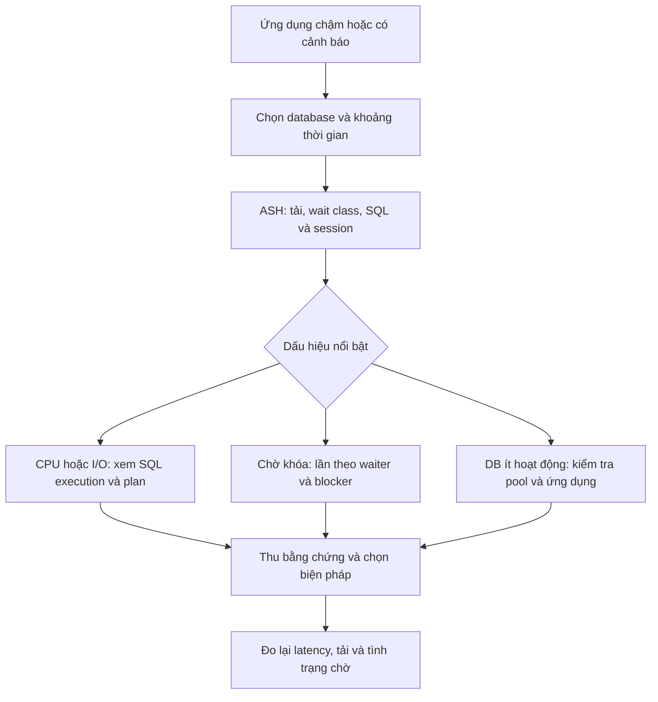

# Performance Hub và điều tra phiên làm việc bất thường

## Mục tiêu bài học

Trong chương **Quản lý và tối ưu cơ sở dữ liệu** của lộ trình Oracle Cloud Infrastructure (OCI), Performance Hub giúp nối triệu chứng ứng dụng chậm với hoạt động bên trong Oracle Database. Mục tiêu của bài này là tìm được phiên, SQL và tài nguyên liên quan, xây dựng giả thuyết có bằng chứng, rồi chọn biện pháp xử lý phù hợp với tính sẵn sàng và chi phí vận hành.

Giả sử `orders-api` chạy trên OCI Compute và kết nối đến một cơ sở dữ liệu Oracle. Sau một đợt triển khai, thời gian xử lý đơn hàng tăng nhưng CPU database không tăng tương ứng. Người vận hành cần phân biệt: câu SQL đang dùng nhiều CPU, chờ I/O, bị một transaction khác giữ khóa hay request còn đang chờ lấy connection ở ứng dụng.

Sau bài học, bạn có thể:

- Chọn đúng database và khoảng thời gian trong Performance Hub.
- Đọc Average Active Sessions, phân nhóm theo wait class, SQL và session.
- Phân biệt ASH Analytics, SQL Monitoring và Blocking Sessions.
- Xác định waiter, blocker và transaction chưa kết thúc bằng các truy vấn quan sát.
- Tái hiện một tình huống chờ khóa trong môi trường thử nghiệm và chứng minh nguyên nhân.
- Kiểm tra hiệu quả xử lý bằng số liệu trước và sau, thay vì chỉ nhìn trạng thái phiên.

## 1. Performance Hub nằm ở đâu trong quá trình điều tra?

Performance Hub là giao diện tập trung để phân tích hoạt động Oracle Database theo thời gian, SQL và phiên làm việc. Các khu vực thường dùng trong bài này gồm:

| Khu vực | Dữ liệu cần xem | Câu hỏi điều tra |
| --- | --- | --- |
| ASH Analytics | Mẫu hoạt động của các phiên trong khoảng thời gian | Tải tăng ở đâu, do nhóm SQL hay session nào? |
| SQL Monitoring | Những lần thực thi SQL được theo dõi | Lần chạy cụ thể dành thời gian ở bước nào? |
| Blocking Sessions | Quan hệ chặn và chờ hiện tại | Phiên nào đang giữ tài nguyên khiến phiên khác chờ? |

Các tab hiển thị phụ thuộc loại database và cấu hình quản lý. Với những dịch vụ được tài liệu Performance Hub mô tả, Basic Management cung cấp ASH Analytics và SQL Monitoring; Full Management bổ sung các khả năng khác. Không nên giả định một giao diện luôn có đủ mọi tab trên mọi loại triển khai. [Oracle: Performance Hub Features](https://docs.oracle.com/en-us/iaas/performance-hub/doc/perf-hub-features.html).

Performance Hub cung cấp bằng chứng về hoạt động database, nhưng không bao phủ toàn bộ thời gian của một HTTP request. Request còn có thể chờ trong connection pool, hàng đợi ứng dụng, một dịch vụ bên ngoài hoặc đường mạng. Vì vậy, hãy đặt số liệu database cạnh latency ứng dụng, log và trace khi có.



## 2. Chuẩn bị đúng phạm vi và quyền truy cập

### 2.1. Chọn đúng dịch vụ Oracle Database

Bài này áp dụng cho **Oracle Database có Performance Hub được hỗ trợ trên OCI**. Không áp dụng nguyên các tab, view và truy vấn dưới đây cho MySQL hoặc PostgreSQL chỉ vì chúng cũng được triển khai trên OCI.

Với Autonomous Database, mở trang chi tiết database trong đúng compartment rồi chọn **Performance Hub**. Với Base Database Service hoặc Exadata, đi đến database trong DB system hoặc VM cluster tương ứng. Tài liệu truy cập dành cho Base Database Service và Exadata nêu điều kiện Database Management được bật và database thuộc Enterprise Edition từ phiên bản được hỗ trợ. [Oracle: Access Performance Hub for Autonomous Database](https://docs.oracle.com/en-us/iaas/performance-hub/doc/access-perf-hub-adb.html), [Oracle: Access Performance Hub for Base Database Service and Exadata](https://docs.oracle.com/en-us/iaas/performance-hub/doc/access-perf-hub-base-db-and-exadata.html).

Cần phân biệt database/CDB, PDB và instance. Tài liệu Performance Hub còn nêu hạn chế về PDB của Base Database Service; việc một tính năng Database Management hỗ trợ PDB không có nghĩa mọi biến thể giao diện Performance Hub đều hỗ trợ giống nhau. Trong lab, mở Performance Hub tại tài nguyên được hỗ trợ và ghi lại container của kết nối SQL. [Oracle: Performance Hub Features — support notes](https://docs.oracle.com/en-us/iaas/performance-hub/doc/perf-hub-features.html).

### 2.2. Kiểm tra hai lớp quyền

| Lớp quyền | Phục vụ việc gì? | Điểm cần kiểm tra |
| --- | --- | --- |
| OCI IAM | Truy cập tài nguyên và tính năng quản lý trên Console | Principal, compartment và quyền quản lý/quan sát được cấp |
| Quyền trong database | Đọc view chẩn đoán và thực hiện thao tác SQL | Tài khoản, container và tập quyền thực tế |

Quyền mở tài nguyên trên OCI không tự biến tài khoản SQL thành DBA. Ngược lại, một tài khoản có quyền đọc view trong database không tự có quyền mở Performance Hub trên Console.

Khi Database Management cần được cấu hình, hoàn thành các điều kiện về IAM, kết nối và database theo dịch vụ đang dùng. Full Management có chi phí dịch vụ bổ sung; lựa chọn quản lý cần dựa trên khả năng cần sử dụng. [Oracle: Enable Diagnostics & Management for Oracle Cloud Databases](https://docs.oracle.com/en-us/iaas/database-management/doc/enable-database-management-oracle-cloud-databases.html).

Các truy vấn minh họa cần quyền đọc những view được tham chiếu. Hãy yêu cầu quyền quan sát theo phạm vi công việc; không cấp `DBA` cho tài khoản ứng dụng chỉ để chạy một truy vấn điều tra. Với Autonomous Database, dùng khả năng và quyền được dịch vụ cung cấp, không giả định được truy cập hệ điều hành hay mọi view giống một database tự quản lý.

### 2.3. Ghi nhận bối cảnh trước khi phân tích

Chuẩn bị một bản ghi ngắn:

```text
Database / OCID: ...
Region / compartment: ...
Service / CDB / PDB / instance liên quan: ...
Thời gian lỗi và múi giờ: ...
Triệu chứng: latency, timeout, throughput hoặc hàng đợi ...
Module / endpoint / job bị ảnh hưởng: ...
Thay đổi gần nhất: release, batch, cấu hình pool, dữ liệu ...
```

Ví dụ, `10:00–10:10 Asia/Ho_Chi_Minh` tương ứng `03:00–03:10 UTC`. Dùng cùng khoảng thời gian khi đối chiếu Console, log Java và báo cáo SQL để tránh kết nối nhầm các sự kiện khác nhau.

## 3. Hiểu các chỉ số trước khi kết luận

### 3.1. Average Active Sessions không phải tổng số connection

Database time, hay DB time, cộng thời gian xử lý CPU và thời gian chờ không thuộc nhóm idle của các phiên foreground. Average Active Sessions (AAS) trong một khoảng được hiểu theo quan hệ:

```text
AAS = tổng DB time trong khoảng / độ dài khoảng thời gian

Ví dụ giả định:
180 giây DB time / 60 giây quan sát = 3 AAS
```

DB time cộng trên nhiều phiên nên có thể lớn hơn thời gian thực đã trôi qua. AAS cũng có thể là số thập phân. [Oracle: Monitoring Real-Time Database Performance](https://docs.oracle.com/en/database/oracle/oracle-database/21/tdppt/monitoring-real-time-database-performance.html).

Một pool có 100 connection nhưng chỉ vài connection đang làm việc có thể có AAS thấp. Ngược lại, nhiều phiên cùng bị chặn có thể làm phần chờ của AAS tăng dù CPU chưa bận.

Khi so với khả năng CPU, hãy xem **phần CPU của tải**, mức sử dụng CPU thực tế và giới hạn tài nguyên đang được cấp. Tổng AAS gồm cả các loại chờ; chỉ thấy tổng AAS cao hơn số CPU chưa đủ để kết luận thiếu CPU hay quyết định tăng tài nguyên.

### 3.2. ASH là dữ liệu lấy mẫu

Active Session History (ASH) lấy mẫu hoạt động của các phiên active. Dữ liệu này hỗ trợ khoanh vùng theo thời gian, session, module, action và SQL ID; nó không phải nhật ký đầy đủ của từng câu SQL hoặc từng request ứng dụng. [Oracle: Concepts for Database Administrators — Active Session History](https://docs.oracle.com/en/database/oracle/oracle-database/19/cncpt/concepts-for-database-administrators.html).

Hệ quả khi đọc biểu đồ:

- Một tác vụ rất ngắn có thể không xuất hiện rõ trong mẫu.
- Một đợt nghẽn ngắn có thể bị làm mờ nếu xem khoảng quá rộng.
- Một phiên đang idle nhưng giữ transaction chưa kết thúc có thể ít nổi bật trong ASH, trong khi các waiter của nó xuất hiện nhiều.
- Mức đóng góp ASH lớn cho thấy nơi dành nhiều thời gian, chưa tự chứng minh ai là nguyên nhân gốc.

ASH Analytics cho phép đổi chiều phân tích và độ phân giải. Mức phân giải cao hơn cho chi tiết tốt hơn nhưng có thể làm tăng độ trễ và tác động của việc truy xuất dữ liệu. [Oracle: ASH Analytics](https://docs.oracle.com/en-us/iaas/performance-hub/doc/ash-analytics-tab.html).

### 3.3. Tách session, SQL và SQL execution

| Đối tượng | Định danh cần ghi lại | Ý nghĩa khi điều tra |
| --- | --- | --- |
| Session | Instance, SID, SERIAL# | Một phiên kết nối cụ thể |
| SQL | SQL_ID, cùng child cursor hoặc plan khi cần | Câu lệnh được chia sẻ và các biến thể thực thi |
| SQL execution | SQL_ID, SQL_EXEC_START, SQL_EXEC_ID và instance liên quan | Một lần chạy cụ thể của câu SQL |
| Transaction | Phiên sở hữu và thông tin transaction | Đơn vị thay đổi dữ liệu chưa kết thúc |

SQL Monitoring lưu thông tin theo lần thực thi, khác các số liệu tích lũy qua nhiều lần chạy. Một câu SQL có thể có nhiều execution cùng thời gian; với parallel SQL còn có coordinator và worker. Vì thế cần chọn đúng execution trước khi đọc mức sử dụng tài nguyên. [Oracle: V$SQL_MONITOR](https://docs.oracle.com/en/database/oracle/oracle-database/19/refrn/V-SQL_MONITOR.html).

## 4. Quy trình điều tra trên Performance Hub

### Bước 1: khoanh khoảng thời gian có triệu chứng

Mở đúng database, chọn khoảng bao quanh thời điểm lỗi và giữ thêm một đoạn bình thường để so sánh. Ví dụ bắt đầu từ 15 phút trước đến 15 phút sau báo cáo của ứng dụng, rồi thu hẹp về vài phút có biến động.

Đây là cách chọn cửa sổ điều tra minh họa, không phải ngưỡng cố định. Với batch chạy hàng giờ hoặc lỗi chỉ kéo dài vài giây, phải điều chỉnh theo thực tế.

Kiểm tra lại:

- Database đang xem có đúng nơi ứng dụng kết nối không?
- Biểu đồ đang ở thời gian hiện tại hay lịch sử?
- Bộ lọc cũ có đang che một user, instance hoặc SQL cần xem không?
- Thời gian ứng dụng chậm có trùng biến động database không?

### Bước 2: đọc thành phần tải trong ASH Analytics

Bắt đầu theo **Wait Class**, sau đó đổi sang **SQL ID**, **User Session**, **User Name**, **Module** hoặc chiều khác mà giao diện cung cấp. Hai bảng hoạt động bên dưới biểu đồ giúp tìm các SQL và session đóng góp lớn trong vùng thời gian đã chọn. [Oracle: ASH Analytics — activity tables](https://docs.oracle.com/en-us/iaas/performance-hub/doc/ash-analytics-tab.html).

Thay vì dừng ở nhận xét “database chậm”, hãy viết giả thuyết có thể kiểm tra:

```text
Trong 03:04–03:07 UTC, phần chờ của workload orders-api tăng.
Một nhóm session cùng chạy UPDATE xuất hiện nhiều.
Giả thuyết cần kiểm tra: các request đang chờ transaction giữ khóa.
```

Một báo cáo nặng có thể chạy hợp lệ theo lịch, trong khi một số ít phiên OLTP bị chặn mới là nguyên nhân người dùng không tạo được đơn. Cần đối chiếu đóng góp tải với phạm vi nghiệp vụ bị ảnh hưởng.

### Bước 3: mở SQL Monitoring khi cần phân tích một lần chạy

Chọn execution tương ứng khoảng lỗi, xem trạng thái, thời điểm bắt đầu, duration, CPU, I/O, các loại chờ và execution plan. Tập trung vào bước có dấu hiệu tiêu tốn tài nguyên hoặc tạo nhiều dữ liệu trung gian.

SQL Monitoring hiển thị các execution đang chạy và những execution được theo dõi đã kết thúc. Có thể mở báo cáo từ SQL ID tương ứng để xem thêm chi tiết. [Oracle: SQL Monitoring](https://docs.oracle.com/en-us/iaas/performance-hub/doc/sql-monitoring-tab.html), [Oracle: SQL Monitoring Report](https://docs.oracle.com/en-us/iaas/performance-hub/doc/view-sql-monitoring-report.html).

Không phải mọi SQL đều xuất hiện. Ở cơ chế tự động của Oracle Database, những điều kiện điển hình gồm chạy parallel hoặc tiêu thụ ít nhất 5 giây CPU hay I/O trong một execution; việc ép theo dõi còn có cơ chế riêng. Một SQL chờ khóa lâu theo thời gian đồng hồ chưa chắc đạt điều kiện tự động này. [Oracle: Monitoring Database Operations](https://docs.oracle.com/en/database/oracle/oracle-database/21/tgsql/monitoring-database-operations.html).

Vì vậy, **không có dòng SQL Monitoring không chứng minh không có phiên bất thường**. Quay lại ASH, dữ liệu phiên hiện tại hoặc bằng chứng của ứng dụng khi cần.

Khi so sánh plan, kiểm tra cùng loại đầu vào, lượng dữ liệu và mức đồng thời. Một thay đổi plan hash là tín hiệu điều tra; tác động thực tế còn phải được chứng minh bằng hành vi execution và latency.

### Bước 4: nếu chờ khóa, chuyển sang quan hệ chặn

Mở **Blocking Sessions** nếu tính năng có sẵn. Kiểm tra phiên chờ, phiên giữ khóa, SQL, object và thời gian chờ. Bộ lọc minimum wait time có thể làm một chờ ngắn không hiện ra.

Tab này dành cho quan hệ chặn **hiện tại**, không hỗ trợ phân tích đầy đủ phiên chặn trong lịch sử. Kéo time slider về một sự cố đã kết thúc không biến danh sách hiện tại thành chuỗi chặn ở quá khứ. [Oracle: Blocking and Waiting Sessions](https://docs.oracle.com/en-us/iaas/performance-hub/doc/view-blocking-and-waiting-sessions.html).

Cần phân biệt:

- **Waiter**: phiên đang đợi tài nguyên.
- **Immediate blocker**: phiên trực tiếp chặn waiter.
- **Final blocker**: phần tử cuối của chuỗi chờ mà dữ liệu hiện có xác định được.

Ví dụ `S3 → S2 → S1`: S3 chờ S2, còn S2 chờ S1. Xử lý S3 trước có thể chỉ loại một triệu chứng; phải tìm hiểu S1 đang giữ gì và vì sao.

## 5. Diễn giải wait event theo bằng chứng

| Dấu hiệu | Hướng kiểm tra tiếp | Tránh kết luận vội |
| --- | --- | --- |
| Phần CPU chiếm ưu thế | SQL, plan, concurrency và CPU thực tế | Mọi AAS cao đều cần tăng CPU |
| `db file sequential read` hoặc `db file scattered read` | Lượng đọc, plan và độ trễ I/O | Cứ có chờ đọc là storage bị lỗi |
| `log file sync` | Hành vi commit và đường xử lý redo | Chỉ cần đổi storage là hết vấn đề |
| `enq: TX - row lock contention` | Transaction giữ khóa, SQL và đối tượng tranh chấp | Chỉ waiter mới cần xử lý |
| Chờ tài nguyên do Resource Manager | Consumer group, hàng đợi và giới hạn cấu hình | Đây luôn là thiếu tài nguyên vật lý |
| `SQL*Net message from client` | Ứng dụng đang làm gì giữa các lời gọi DB? | Tên có chữ Net nghĩa là mạng đang hỏng |

Các event phản ánh điểm đang chờ; cần xem thời gian, tần suất và bối cảnh thay vì chỉ tên. `SQL*Net message from client` thường phản ánh database đợi lời gọi tiếp theo từ client. [Oracle: Descriptions of Wait Events](https://docs.oracle.com/en/database/oracle/oracle-database/19/refrn/descriptions-of-wait-events.html).

Với TX row lock contention, nguyên nhân có thể liên quan các phiên sửa cùng dữ liệu, tranh chấp khóa duy nhất hoặc các trường hợp khóa khác. Hãy xác định holder và thao tác liên quan thay vì suy luận một loại index hay một câu SQL luôn là nguyên nhân. [Oracle: Instance Tuning Using Performance Views — enqueue waits](https://docs.oracle.com/en/database/oracle/oracle-database/19/tgdba/instance-tuning-using-performance-views.html).

## 6. Truy vấn bổ sung để quan sát phiên

Các truy vấn dưới đây là công cụ quan sát cho người học có quyền thích hợp. Kết quả chỉ phản ánh thời điểm chạy; cần thu lại sau một khoảng hợp lý nếu muốn thấy diễn biến. Không chạy vòng lặp truy vấn toàn bộ hệ thống với tần suất quá cao.

### 6.1. Xem các phiên user đang active trên instance hiện tại

```sql
SELECT
    s.sid,
    s.serial#,
    s.con_id,
    s.username,
    s.service_name,
    s.module,
    s.action,
    s.client_identifier,
    s.sql_id,
    s.sql_exec_start,
    s.last_call_et AS active_call_seconds,
    s.state,
    CASE WHEN s.state = 'WAITING' THEN s.wait_class END AS current_wait_class,
    CASE WHEN s.state = 'WAITING' THEN s.event END AS current_wait_event
FROM v$session s
WHERE s.type = 'USER'
  AND s.username IS NOT NULL
  AND s.status = 'ACTIVE'
ORDER BY s.last_call_et DESC;
```

`LAST_CALL_ET` của phiên active là thời gian từ lúc phiên chuyển sang active; không dùng nó như CPU time hay thời gian chính xác của một SQL. `SQL_EXEC_START` và thông tin execution phục vụ việc khác. Phiên observer cũng có thể xuất hiện trong kết quả. [Oracle: V$SESSION](https://docs.oracle.com/en/database/oracle/oracle-database/19/refrn/V-SESSION.html).

`EVENT` có thể là event chờ gần nhất nếu phiên hiện không chờ. Truy vấn dùng `STATE = 'WAITING'` để chỉ hiện event đang chờ, tránh gán một wait cũ cho hiện trạng. [Oracle: V$SESSION_WAIT](https://docs.oracle.com/en/database/oracle/oracle-database/19/refrn/V-SESSION_WAIT.html).

### 6.2. Tìm cặp waiter–blocker trên RAC

Khi có nhiều instance, SID riêng lẻ chưa đủ. Truy vấn sau kết nối bằng cả instance và SID của blocker:

```sql
SELECT
    w.inst_id AS waiter_inst,
    w.sid AS waiter_sid,
    w.serial# AS waiter_serial,
    w.con_id,
    w.sql_id AS waiter_sql,
    w.event AS waiter_event,
    b.inst_id AS blocker_inst,
    b.sid AS blocker_sid,
    b.serial# AS blocker_serial,
    b.status AS blocker_status,
    b.module AS blocker_module,
    b.sql_id AS blocker_sql,
    b.prev_sql_id AS blocker_prev_sql
FROM gv$session w
LEFT JOIN gv$session b
  ON b.inst_id = w.blocking_instance
 AND b.sid = w.blocking_session
WHERE w.type = 'USER'
  AND w.state = 'WAITING'
  AND w.blocking_session_status = 'VALID'
ORDER BY w.inst_id, w.sid;
```

`BLOCKING_SESSION` và `BLOCKING_INSTANCE` chỉ được diễn giải khi trạng thái blocker hợp lệ. Với single instance, có thể dùng `V$SESSION` và nối theo SID trên instance đó. Ghi cả `SERIAL#` trước bất kỳ thao tác can thiệp nào. [Oracle: V$SESSION — blocking session columns](https://docs.oracle.com/en/database/oracle/oracle-database/19/refrn/V-SESSION.html).

Đây là danh sách cặp chặn trực tiếp, chưa phải thuật toán dựng toàn bộ cây chờ. Nếu blocker cũng là waiter, tiếp tục lần theo nó hoặc dùng chuỗi hiển thị trên giao diện. Một hàng không tìm thấy holder qua phép nối cũng cần kiểm tra lại vì trạng thái phiên có thể thay đổi giữa lúc quan sát.

### 6.3. Xem transaction của các phiên trong một module

Trên instance hiện tại:

```sql
SELECT
    s.sid,
    s.serial#,
    s.status,
    s.module,
    s.action,
    s.sql_id,
    s.prev_sql_id,
    t.start_date AS transaction_start,
    t.used_ublk,
    t.used_urec
FROM v$session s
LEFT JOIN v$transaction t
  ON t.addr = s.taddr
WHERE s.type = 'USER'
  AND s.module = 'ph-session-lab'
ORDER BY s.sid;
```

`V$TRANSACTION` cung cấp transaction đang hoạt động, thời điểm bắt đầu và lượng undo sử dụng. `USED_UBLK` và `USED_UREC` giúp bổ sung bối cảnh; chúng không phải đồng hồ đếm ngược cho thời gian rollback. Với các view `GV$` trên RAC, thêm điều kiện instance khi nối transaction và session. [Oracle: V$TRANSACTION](https://docs.oracle.com/en/database/oracle/oracle-database/19/refrn/V-TRANSACTION.html).

### 6.4. Xem text và các child cursor của một SQL

Trong SQLcl hoặc công cụ có hỗ trợ bind variable:

```sql
VARIABLE target_sql_id VARCHAR2(13)
EXEC :target_sql_id := '<SQL_ID_THAT>';

SELECT
    sql_id,
    child_number,
    plan_hash_value,
    executions,
    buffer_gets,
    disk_reads,
    ROUND(cpu_time / 1000000, 3) AS cpu_seconds,
    ROUND(elapsed_time / 1000000, 3) AS elapsed_seconds,
    sql_text
FROM v$sql
WHERE sql_id = :target_sql_id
ORDER BY child_number;
```

Thay `<SQL_ID_THAT>` bằng SQL ID thực thu được. Số liệu trong `V$SQL` tích lũy theo child cursor đang có trong cache, không tự giới hạn về đúng vài phút sự cố. Không dùng một tổng lớn làm bằng chứng SQL vừa phát sinh toàn bộ tải đó; cần execution report hoặc chênh lệch số liệu phù hợp. [Oracle: V$SQL](https://docs.oracle.com/en/database/oracle/oracle-database/19/refrn/V-SQL.html).

SQL text có thể chứa thông tin nghiệp vụ. Khi lưu bằng chứng vào tài liệu vận hành, chỉ giữ phần cần thiết và che dữ liệu nhạy cảm.

## 7. Thực hành ba kết nối: một phiên idle giữ khóa

### 7.1. Môi trường thực hành

Dùng schema thử nghiệm riêng trên Oracle Database được phép thực hành. Chuẩn bị ba **kết nối vật lý độc lập** A, B và C vào cùng database/PDB; hai worksheet dùng chung session sẽ không tạo được tình huống này.

- A đóng vai transaction giữ khóa.
- B đóng vai request cập nhật đang chờ.
- C làm observer, có quyền đọc các view cần dùng.

Tắt autocommit cho A và B. Với SQLcl/SQL*Plus có thể dùng `SET AUTOCOMMIT OFF`; với công cụ khác, kiểm tra thiết lập tương ứng. Các lệnh dưới đây là hướng dẫn để người học thực hiện, chưa được chạy sẵn trên một database.

Trong schema lab, tạo bảng mới và dữ liệu ban đầu:

```sql
CREATE TABLE ph_session_lab (
    id NUMBER PRIMARY KEY,
    note VARCHAR2(100)
);

INSERT INTO ph_session_lab (id, note)
VALUES (1, 'initial');

COMMIT;
```

Nếu bảng đã tồn tại, kiểm tra đó có đúng tài nguyên của lần lab trước không trước khi tiếp tục. Không thay bằng tên bảng nghiệp vụ để thử khóa.

### 7.2. Kết nối A giữ transaction chưa kết thúc

```sql
BEGIN
    DBMS_APPLICATION_INFO.SET_MODULE(
        module_name => 'ph-session-lab',
        action_name => 'hold-row'
    );
    DBMS_SESSION.SET_IDENTIFIER('ph-holder-001');
END;
/

UPDATE ph_session_lab
SET note = 'held-by-A'
WHERE id = 1;
```

Chưa chạy `COMMIT` hoặc `ROLLBACK` ở A. Sau khi UPDATE trả kết quả, để A đứng yên ở dấu nhắc.

`DBMS_APPLICATION_INFO` gắn tên module/action để việc quan sát có ngữ cảnh. `DBMS_SESSION.SET_IDENTIFIER` gắn định danh client cho phiên. Các giá trị ở đây là marker lab. [Oracle: DBMS_APPLICATION_INFO](https://docs.oracle.com/en/database/oracle/oracle-database/19/arpls/DBMS_APPLICATION_INFO.html), [Oracle: DBMS_SESSION](https://docs.oracle.com/en/database/oracle/oracle-database/19/arpls/DBMS_SESSION.html).

### 7.3. Kết nối B thử cập nhật cùng dòng

```sql
BEGIN
    DBMS_APPLICATION_INFO.SET_MODULE(
        module_name => 'ph-session-lab',
        action_name => 'wait-row'
    );
    DBMS_SESSION.SET_IDENTIFIER('ph-waiter-001');
END;
/

UPDATE ph_session_lab
SET note = 'written-by-B'
WHERE id = 1;
```

B chờ khi A vẫn giữ thay đổi chưa kết thúc. Không gửi thêm lệnh vào cùng kết nối B trong lúc UPDATE đang chờ.

### 7.4. Quan sát bằng C và Performance Hub

Trong C, chạy truy vấn transaction theo module ở phần 6.3. Đồng thời, mở ASH Analytics trong khoảng thời gian lab; nếu có Blocking Sessions, kiểm tra quan hệ đang diễn ra.

Các dấu hiệu **kỳ vọng**, cần được người học kiểm chứng:

| Kết nối | Dấu hiệu cần tìm | Ý nghĩa trong lab |
| --- | --- | --- |
| A | Module `ph-session-lab`, action `hold-row`, có transaction | Thay đổi ở A chưa kết thúc |
| A | Có thể `INACTIVE` khi đang ở dấu nhắc | Không chạy SQL mới vẫn có thể giữ khóa |
| B | Action `wait-row`, UPDATE còn chờ | Request đã vào database và đang đợi |
| B | Wait liên quan TX row lock, blocker trỏ về A | Bằng chứng về quan hệ chặn |
| ASH | Hoạt động chờ của B trong khoảng lab | Hỗ trợ đối chiếu theo thời gian |

Đừng kỳ vọng cả A và B đều nổi bật như nhau trong Top SQL. B đang dành thời gian chờ, còn A có thể đang đợi client. Cũng không bắt buộc UPDATE của B phải có SQL Monitoring report chỉ vì đã chờ lâu.

Nếu chỉ thấy một phần phiên trong truy vấn local trên RAC, dùng truy vấn `GV$SESSION` phù hợp hoặc kết nối observer đến instance liên quan. Kiểm tra quyền và container trước khi kết luận session đã biến mất.

### 7.5. Giải phóng transaction và kiểm chứng

Trong **A**, kết thúc thay đổi thử bằng:

```sql
ROLLBACK;
```

Sau khi A nhả khóa, UPDATE của B có thể hoàn thành. Khi lệnh ở B đã trả kết quả, chạy trong **B**:

```sql
ROLLBACK;
```

Việc rollback A không tự rollback thay đổi mà B thực hiện sau đó. Cả hai transaction cần được kết thúc có chủ đích.

Chạy lại truy vấn observer và kiểm tra:

1. B không còn chờ A trên dòng thử nghiệm.
2. Transaction của A và B trong lab đã kết thúc.
3. Các kết nối vẫn có thể thực hiện một truy vấn đơn giản.
4. Giá trị `note` trở về `initial` sau khi cả A và B rollback.

```sql
SELECT id, note
FROM ph_session_lab
WHERE id = 1;
```

Sau khi hoàn tất, xóa marker trong A và B:

```sql
BEGIN
    DBMS_APPLICATION_INFO.SET_MODULE(NULL, NULL);
    DBMS_SESSION.CLEAR_IDENTIFIER;
END;
/
```

Chỉ khi các transaction lab đã kết thúc và không còn kết nối dùng bảng, chủ schema có thể xóa bảng `ph_session_lab`. Thực hiện việc dọn DDL trong phiên không có thay đổi khác đang chờ commit.

Bài thực hành chứng minh một nguyên nhân cụ thể: ứng dụng có thể chậm do transaction chưa kết thúc, ngay cả khi CPU database thấp và blocker đang `INACTIVE`.

## 8. Chọn biện pháp xử lý theo nguyên nhân

| Bằng chứng thu được | Biện pháp có thể xem xét | Cần kiểm chứng thêm |
| --- | --- | --- |
| Transaction giữ khóa vượt thời gian dự kiến | Chủ transaction kết thúc đúng nghiệp vụ; sửa ranh giới transaction | Luồng commit/rollback và các lần gọi bên ngoài trong transaction |
| SQL CPU/I/O tăng sau release | Phân tích plan, đầu vào, lượng dữ liệu và thay đổi SQL | Cùng workload, mức đồng thời và dữ liệu so sánh |
| Nhiều SQL nhỏ lặp lại | Giảm số lần gọi, xem batching hoặc truy cập dữ liệu | Số execution trên mỗi request và tính đúng dữ liệu |
| Request đợi connection, database ít hoạt động | Kiểm tra pool, connection leak và transaction dài | Pool active/idle/pending và thời gian giữ connection |
| Tải hợp lệ thường xuyên đạt giới hạn cấp phát | Đánh giá capacity hoặc lịch workload | Mức sử dụng thực, mục tiêu latency và chi phí |

### 8.1. Phân biệt cancel SQL và terminate session

Cancel SQL nhắm tới lời gọi đang chạy; terminate session chấm dứt phiên. Hai thao tác không có cùng tác động. Hủy câu SQL hiện tại không bảo đảm những thay đổi trước đó của transaction đã được kết thúc.

Terminate có thể kéo theo rollback và xử lý tài nguyên; việc thu hồi khóa không nhất thiết hoàn tất tức thì trong mọi tình huống. Ứng dụng còn có thể reconnect và retry, làm tái diễn tải nếu nguyên nhân chưa được sửa. [Oracle: Managing Processes — Terminating Sessions](https://docs.oracle.com/en/database/oracle/oracle-database/19/admin/managing-processes.html).

Trước khi can thiệp production, ghi lại instance, SID, SERIAL#, user, module, SQL, transaction và phạm vi ảnh hưởng. Kiểm tra lại định danh ngay lúc thao tác vì SID có thể được sử dụng lại sau khi một phiên cũ kết thúc.

Trong lab trên, chủ transaction dùng rollback để kiểm chứng giả thuyết. Trong hệ thống thật, chọn commit hay rollback phải theo kết quả nghiệp vụ mong muốn; không commit một transaction không rõ nội dung chỉ để làm biến mất chờ khóa.

### 8.2. Không dùng scale-up làm bước chẩn đoán mặc định

Thêm CPU có thể phù hợp khi workload thực sự bị giới hạn CPU. Nó không thay thế việc kết thúc transaction đang giữ khóa, sửa SQL gọi lặp hoặc xử lý connection leak.

Một thay đổi tài nguyên cũng làm thay đổi điều kiện so sánh và chi phí. Hãy ghi giả thuyết, mức cải thiện mong đợi và cách đo lại trước khi thực hiện. Với workload có lịch, điều chỉnh thời điểm batch có thể đáng xem xét cùng tối ưu SQL và capacity.

## 9. Gắn ngữ cảnh ứng dụng Java với phiên database

Nếu mọi kết nối đều dùng một database user, chỉ nhìn `USERNAME` sẽ khó biết session thuộc endpoint hay tác vụ nào. Dùng `MODULE` cho tên ứng dụng, `ACTION` cho thao tác và `CLIENT_IDENTIFIER` cho một mã tương quan phù hợp.

Ví dụ khi bắt đầu một đơn vị công việc trên connection:

```sql
BEGIN
    DBMS_APPLICATION_INFO.SET_MODULE('orders-api', 'reserve-stock');
    DBMS_SESSION.SET_IDENTIFIER('req-7f42');
END;
/
```

Các lời gọi này có thể được thực hiện từ JDBC trên chính connection chạy SQL nghiệp vụ. Không gắn marker trên connection khác rồi kỳ vọng nó mô tả phiên đang điều tra.

Với connection pool, đặt lại marker theo từng đơn vị công việc và xóa khi kết thúc, kể cả nhánh lỗi. Đồng thời xử lý commit/rollback theo contract transaction của ứng dụng. Nếu marker cũ còn trên connection được tái sử dụng, phiên của request sau có thể bị gán nhầm.

Định danh client không nên chứa token, mật khẩu hoặc thông tin cá nhân không cần thiết. Giữ cùng mã tương quan trong log ứng dụng để có thể đối chiếu từ request đến session khi xảy ra lỗi.

## 10. Đo lại và ghi nhận kết quả điều tra

Sau khi xử lý, không chỉ kiểm tra một session đã biến mất. So sánh trong khoảng có lưu lượng tương đương:

| Chỉ số hoặc bằng chứng | Câu hỏi xác nhận |
| --- | --- |
| Latency và timeout ứng dụng | Người dùng đã thực hiện được thao tác bị ảnh hưởng chưa? |
| Throughput | Hệ thống đã phục hồi xử lý hay chỉ ngừng nhận request? |
| AAS theo wait class | Thành phần chờ bất thường có giảm không? |
| Quan hệ chặn hiện tại | Chuỗi cũ đã hết và có chuỗi mới phát sinh không? |
| SQL execution | Thời gian, tài nguyên và hành vi plan có phù hợp không? |
| Pool và retry | Hàng đợi giảm mà không tạo bão retry chứ? |

Mẫu ghi nhận ngắn:

```text
Triệu chứng và phạm vi:
Khoảng thời gian / múi giờ:
Database / container / instance:
Session và SQL execution liên quan:
Bằng chứng về CPU, I/O hoặc quan hệ chặn:
Giả thuyết đã kiểm tra:
Thao tác xử lý và chủ sở hữu:
Kết quả trước / sau dưới workload tương đương:
Việc cần sửa để tránh tái diễn:
```

Những cách đọc dễ dẫn đến sai hướng gồm: lấy tổng connection thay AAS; xem wait cũ như wait hiện tại; lấy thống kê SQL tích lũy làm số liệu của riêng sự cố; chỉ tìm phiên active nên bỏ sót holder idle; và cho rằng tab Blocking Sessions hiện tại tái hiện được mọi chuỗi chặn trong quá khứ.

Đối với vận hành lâu dài, nên có baseline theo khung giờ, ngưỡng cảnh báo gắn với mục tiêu ứng dụng, quyền quan sát được chuẩn bị trước và quy trình lưu bằng chứng khi lỗi còn diễn ra. Chỉ tăng độ chi tiết thu thập trong phạm vi cần thiết để hạn chế tác động điều tra lên database.

Một kết luận hữu ích cần nêu được **database nào, thời gian nào, phiên hoặc execution nào, bằng chứng gì và thay đổi nào làm triệu chứng cải thiện**. Đây là cơ sở để tối ưu Oracle Database trên OCI mà vẫn giữ quyền truy cập, chi phí và tính sẵn sàng trong tầm kiểm soát.
