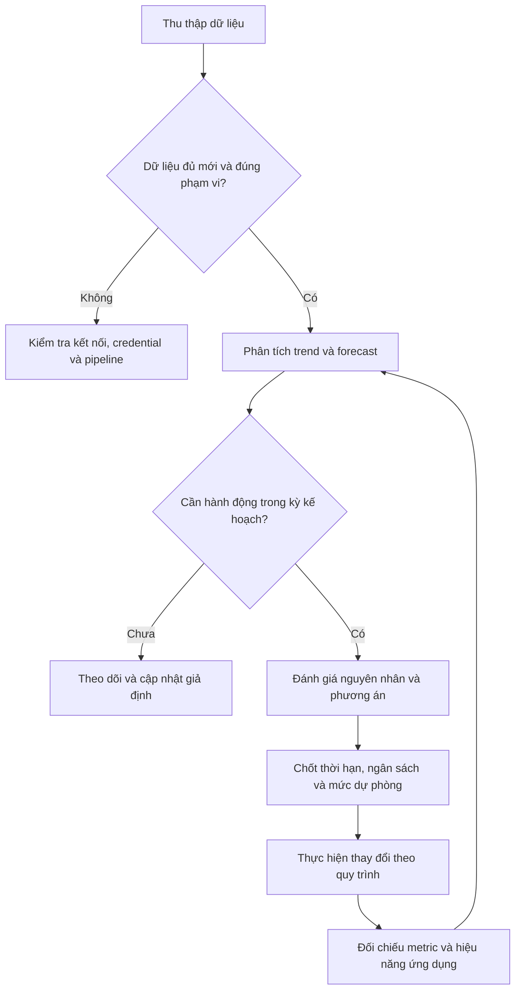

# Operations Insights và dự báo năng lực database

Trong chương **Quản lý và tối ưu cơ sở dữ liệu** của module Oracle Cloud Infrastructure (OCI), Operations Insights giúp chuyển dữ liệu vận hành thành kế hoạch tài nguyên. Một database còn chạy tốt hôm nay vẫn có thể thiếu storage trong kỳ chốt sổ tiếp theo hoặc thiếu CPU sau khi tăng lượng giao dịch.

Bài học tập trung vào năng lực database Oracle trên OCI, đồng thời giải thích cách tiếp nhận dữ liệu từ môi trường ngoài OCI khi cần. Việc triển khai gắn với compartment, IAM, kết nối VCN, giám sát, tự động hóa và kiểm soát chi phí, tính sẵn sàng.

> Oracle hiện gọi dịch vụ này là **Ops Insights** trong tài liệu và Console. Bài học dùng Operations Insights và Ops Insights để chỉ cùng dịch vụ.

## 1. Kết quả cần đạt

Sau bài học, bạn có thể:

- Xác định Operations Insights trả lời câu hỏi nào trong quy trình quản lý database.
- Chuẩn bị nguồn dữ liệu, quyền truy cập và kết nối phù hợp với loại database.
- Đọc allocation, usage, utilization, tải trung bình và tải đỉnh mà không nhầm đơn vị hoặc phạm vi.
- So sánh dự báo tuyến tính, có xét mùa vụ và AutoML; kiểm tra độ hữu ích của dự báo bằng backtesting.
- Ước lượng thời gian chạm ngưỡng và thời hạn bắt đầu thay đổi tài nguyên.
- Kết hợp dự báo với cảnh báo, quy trình thay đổi, ngân sách và yêu cầu dự phòng.

## 2. Đặt Operations Insights vào đúng quy trình vận hành

Ops Insights là dịch vụ OCI phân tích lịch sử sử dụng tài nguyên database và host. Capacity Planning phục vụ dự báo năng lực; các chức năng như SQL Insights hỗ trợ tìm hiểu xu hướng hiệu năng SQL. Bạn có thể bắt đầu bằng dữ liệu mẫu qua Demo mode trước khi kết nối tài nguyên thật. Nguồn: [Giới thiệu Ops Insights](https://docs.oracle.com/en-us/iaas/operations-insights/doc/operations-insights.html).

Một cách phân chia công việc trong đội vận hành:

| Câu hỏi vận hành | Công cụ hoặc hoạt động phù hợp | Quyết định tiếp theo |
| --- | --- | --- |
| CPU đang cao và giao dịch đang chậm? | Metric hiện thời, alarm và điều tra database | Khoanh vùng sự cố đang diễn ra |
| SQL nào thay đổi hành vi sau một bản phát hành? | Phân tích SQL, execution plan và dữ liệu hiệu năng | Sửa truy vấn hoặc nguyên nhân gây tăng tải |
| Với mức tăng hiện tại, tháng tới còn đủ storage? | Capacity Planning và dự báo lịch sử | Lập kế hoạch mở rộng hoặc giảm tốc độ tăng dữ liệu |
| Có thể giảm tài nguyên mà vẫn đáp ứng tải đỉnh? | Phân tích lịch sử kết hợp thử tải và yêu cầu dịch vụ | Thử cấu hình nhỏ hơn trong phạm vi kiểm soát |
| Nếu mất một node, hệ thống còn đủ sức phục vụ? | Mô hình năng lực khi sự cố và thử nghiệm failover | Điều chỉnh mức dự phòng |

Dự báo là đầu vào cho quyết định. Đường forecast không tự chứng minh database cần scale và không tự thực hiện thay đổi cấu hình. Đội vận hành còn phải xem nguyên nhân tăng tải, khả năng tối ưu, giới hạn dịch vụ và tác động đến ứng dụng.

Ví dụ, CPU tăng do một truy vấn mất index sau khi triển khai cần cách xử lý khác với CPU tăng vì số đơn hàng tăng ổn định. Mua thêm CPU có thể tạo thời gian xử lý sự cố, nhưng kế hoạch dài hạn phải phản ánh nguyên nhân thật.

## 3. Từ database đến dữ liệu có thể dự báo

### 3.1. Chọn đường thu thập dữ liệu

Ops Insights hỗ trợ các nguồn telemetry gồm **Cloud Infrastructure**, **Enterprise Manager** và **Agent Service**. Tài nguyên ngoài OCI chưa được Enterprise Manager quản lý thường cần Management Agent; external database còn cần handle và connector thích hợp. Autonomous Database có chế độ basic bao gồm Capacity Planning và chế độ full features mở rộng phân tích. Nguồn: [Điều kiện bật tài nguyên](https://docs.oracle.com/en-us/iaas/operations-insights/doc/prerequisites-enabling-resources.html).

Không áp dụng một công thức cài agent cho mọi database. Trước khi cấu hình, ghi rõ:

| Thông tin phải xác định | Ví dụ cần làm rõ |
| --- | --- |
| Loại dịch vụ | Autonomous Database, Base Database Service, Exadata hoặc external Oracle Database |
| Cấu trúc database | Non-CDB, CDB/PDB, một instance hoặc RAC |
| Nguồn telemetry | Cloud Infrastructure, Enterprise Manager hay Agent Service |
| Đường kết nối | Private endpoint, agent hoặc cầu nối Enterprise Manager theo cấu hình được hỗ trợ |
| Phạm vi phân tích | Một database, nhóm database, host, VM cluster hoặc toàn fleet |
| Chủ thể vận hành | Người bật dịch vụ, người xem dữ liệu, người thay đổi tài nguyên |

Với các cấu hình cloud database và Exadata, Oracle có những phương thức thu thập khác nhau. Dữ liệu sau khi bật dịch vụ có thể cần tới 24 giờ mới xuất hiện. Nguồn: [Bật cloud database và Exadata](https://docs.oracle.com/en-us/iaas/operations-insights/doc/enabling-database-cloud-service-databases-and-exadata-systems.html).

### 3.2. Phân quyền theo nhiệm vụ

Trong IAM, nhóm resource type của dịch vụ là `opsi-family`. Cần phân biệt người cấu hình/bật dịch vụ với người chỉ sử dụng dữ liệu phân tích. Nguồn: [Nhóm, người dùng và policy](https://docs.oracle.com/en-us/iaas/operations-insights/doc/groups-users-policies.html).

Một mô hình tổ chức cho môi trường học tập:

- Nhóm quản trị observability cấu hình việc thu thập trong compartment được giao.
- Nhóm DBA đọc dữ liệu năng lực và điều tra nguyên nhân thay đổi tải.
- Nhóm quản lý hạ tầng thực hiện thay đổi tài nguyên theo quy trình riêng.

Ví dụ minh họa một policy cho nhóm chỉ đọc:

```text
Allow group Default/CapacityReaders to read opsi-family in compartment DbLab
```

Thay `Default`, `CapacityReaders` và `DbLab` bằng identity domain, group và compartment thực tế. Đây là ví dụ về quyền đọc tài nguyên dịch vụ, chưa phải bộ quyền đầy đủ để bật thu thập, đọc mọi metric hoặc truy cập mọi tài nguyên liên quan. Quyền truy cập dữ liệu phân tích và quyền quản trị database cần được xem xét riêng.

Policy Advisor hỗ trợ cấu hình quyền cho người dùng và resource principal của dịch vụ. Khi áp dụng, chọn đúng telemetry, tài nguyên và compartment rồi xem trước policy. Tài liệu Oracle đã chuyển khỏi các service-principal policy cũ; không sao chép nguyên bộ policy từ hướng dẫn cũ. Nguồn: [Policy Advisor](https://docs.oracle.com/en-us/iaas/operations-insights/doc/create-manage-policies-policy-advisor.html).

### 3.3. Chuẩn bị kết nối và thông tin xác thực

Với đường thu thập qua private endpoint, cần kiểm tra VCN/subnet, DNS, NSG hoặc security list và cổng listener thực tế. NSG phải cho phép luồng giữa private endpoint và database theo cấu hình kết nối. Với RAC, cần chú ý địa chỉ SCAN. Nguồn: [Kết nối mạng cho Ops Insights](https://docs.oracle.com/en-us/iaas/operations-insights/doc/prerequisites-network-comms.html).

Đối với Autonomous Database, điều kiện của basic và full features khác nhau; full features có yêu cầu về monitoring user, kiểu credential và mạng. Cấu hình IAM credential cũng có yêu cầu riêng. Nguồn: [Điều kiện cho Autonomous Database](https://docs.oracle.com/en-us/iaas/operations-insights/doc/prerequisites-autonomous-databases.html).

Trong thực hành, xác minh lần lượt ba lớp: endpoint được phân giải và có đường đi mạng; kết nối database xác thực thành công; tài khoản giám sát có quyền thu thập dữ liệu cần thiết. Không dùng tài khoản ứng dụng làm tài khoản giám sát chỉ để vượt qua lỗi cấu hình. Nếu dùng secret hoặc wallet, quản lý chúng theo phương thức được hỗ trợ và quy trình xoay vòng credential của tổ chức.

## 4. Chọn đúng phạm vi trước khi nhìn biểu đồ

Trong Ops Insights, mở **Capacity Planning → Databases**. Các trang gồm Summary, CPU, Storage, Memory, I/O và Database Explorer. Bộ lọc có compartment, thời gian, loại database, entity, nguồn tạo và tag; tùy chọn Include child compartments mở rộng phạm vi xuống các compartment con. Nguồn: [Truy cập Database Capacity Planning](https://docs.oracle.com/en-us/iaas/operations-insights/doc/application-menu-scope.html).

Mỗi lần phân tích, hãy ghi lại một cấu hình quan sát có thể lặp lại:

```text
Region: region chứa tài nguyên và dữ liệu đang xem
Compartment: DbProduction
Bao gồm compartment con: có
Nhóm: các database của ứng dụng đặt hàng
Khoảng lịch sử: 90 ngày, nếu có đủ dữ liệu
Múi giờ dùng khi đối chiếu lịch nghiệp vụ: Asia/Ho_Chi_Minh
Mục tiêu: đánh giá tải đỉnh và tăng trưởng storage trong 30 ngày tới
```

Đây là mẫu ghi chép của người phân tích, không phải file cấu hình import vào OCI. Khoảng 90 ngày là lựa chọn minh họa; nó không bảo đảm đủ dữ liệu cho mọi mô hình hoặc mọi chu kỳ nghiệp vụ.

Phạm vi sai có thể tạo kết luận sai dù phép tính đúng. Chẳng hạn, dashboard toàn production trông ổn nhưng database thanh toán đã gần ngưỡng. Ngược lại, nhìn một PDB mà bỏ qua CDB và host dùng chung có thể che khuất tranh chấp tài nguyên.

Không cộng số liệu CDB và các PDB con nếu chúng biểu diễn cùng lượng tài nguyên ở hai cấp. Khi tổng hợp, xác định đối tượng nào là thành viên độc lập và đối tượng nào chỉ là một cách nhìn khác của cùng hệ thống.

## 5. Hiểu số liệu trước khi dự báo

### 5.1. Allocation, usage và utilization

Về nguyên tắc phân tích:

```text
Utilization (%) = Usage / Allocation × 100
Headroom = Allocation − Usage
```

Hai đại lượng trong phép chia phải cùng đơn vị, cùng thời điểm và cùng phạm vi. Đừng lấy CPU usage của database chia cho allocation của toàn VM cluster rồi gọi đó là utilization của database.

Trên biểu đồ CPU, Oracle phân biệt allocation, max allocation, capacity của hạ tầng, average usage và max usage. Capacity chỉ hiển thị trong một số phạm vi; max allocation có ý nghĩa với cấu hình autoscaling phù hợp. Max usage là cực đại của dữ liệu tổng hợp theo ngày/giờ, nên không đồng nghĩa đỉnh tức thời ở mọi độ phân giải. Nguồn: [Trend and Forecast Chart](https://docs.oracle.com/en-us/iaas/operations-insights/doc/available-cpu-trend-forecast.html).

| Đại lượng đang xem | Câu hỏi cần đặt trước khi kết luận |
| --- | --- |
| Số CPU hoặc đơn vị CPU | Đây là đơn vị biểu đồ, CPU logic, OCPU hay ECPU? |
| Allocation | Là cấu hình của database, host hay một nhóm được cộng lại? |
| Average usage | Trung bình theo giờ, theo ngày hay một thống kê trên cả khoảng chọn? |
| Max usage | Cực đại của chuỗi nào, ở độ phân giải nào? |
| Utilization | Mẫu số allocation có thay đổi trong khoảng quan sát không? |
| Headroom | Phần dư này có còn sử dụng được khi failover hoặc khi nhiều workload trùng đỉnh? |

Không tự quy đổi OCPU sang ECPU bằng một hệ số chung cho mọi phép phân tích. Với ví dụ số học trong bài, “đơn vị CPU” chỉ biểu diễn một thang đo nhất quán; khi áp dụng phải dùng đơn vị thực tế của dịch vụ.

### 5.2. Trung bình thấp vẫn có thể thiếu CPU

Giả sử database được cấp 16 đơn vị CPU:

- Usage trung bình: 4 đơn vị, tương đương 25%.
- Usage đỉnh quan sát được: 12 đơn vị, tương đương 75%.
- Dự báo đỉnh cho kỳ tới: 14 đơn vị, nếu mô hình và dữ liệu đủ phù hợp.

Nếu chỉ nhìn 25%, bạn có thể đề xuất giảm một nửa tài nguyên. Nhưng với 8 đơn vị CPU, tải đỉnh 12 đơn vị đã vượt khả năng cấu hình mới. Cần đối chiếu thêm thời gian đáp ứng, lượng giao dịch và đặc điểm của cửa sổ cao tải.

Đỉnh tải ngắn do batch có thể xử lý bằng đổi lịch chạy. Tải cao kéo dài trong giờ giao dịch có thể cần thêm tài nguyên. Hai tình huống này có cùng trung bình ngày nhưng dẫn đến quyết định khác nhau.

### 5.3. Tổng hợp phần trăm cần trọng số

Giả sử tại cùng thời điểm, hai database sử dụng cùng loại đơn vị CPU:

| Database | Allocation | Usage | Utilization |
| --- | ---: | ---: | ---: |
| A | 4 | 3 | 75% |
| B | 40 | 8 | 20% |

Trung bình số học của hai phần trăm là `(75 + 20) / 2 = 47,5%`. Tuy nhiên, tỷ lệ tổng usage trên tổng allocation là:

```text
(3 + 8) / (4 + 40) × 100 = 25%
```

Con số 25% mô tả tổng nhóm theo cách tính trên, nhưng không xóa rủi ro riêng của A. Với tải đỉnh, cũng không mặc định cộng các đỉnh quan sát ở những giờ khác nhau thành một đỉnh đồng thời của fleet. Muốn đánh giá khả năng gom workload, cần đối chiếu các chuỗi theo cùng trục thời gian.

### 5.4. Storage, memory và I/O không thay thế cho nhau

Ở bảng Database Storage, một số cột usage, allocation và utilization sử dụng percentile 90 của số liệu trung bình ngày trong khoảng chọn. Chúng không nhất thiết là giá trị mới nhất hoặc giá trị lớn nhất. Khi quyết định mở rộng, xem định nghĩa cột và chuỗi thời gian của database cụ thể. Nguồn: [Phân tích tài nguyên storage](https://docs.oracle.com/en-us/iaas/operations-insights/doc/analyze-available-storage-resources-insights.html).

Với storage, cần tách bốn lớp câu hỏi:

1. Database đang sử dụng bao nhiêu dung lượng theo metric đang xem?
2. Tablespace hoặc datafile cụ thể có giới hạn nào cần xử lý?
3. ASM disk group hoặc filesystem bên dưới còn đủ khả năng mở rộng không?
4. Có hạn mức hoặc ràng buộc dịch vụ nào ngăn thao tác tăng dung lượng không?

Thêm dung lượng ở một lớp chưa bảo đảm lớp khác được mở rộng tương ứng. Khi điều tra nguy cơ hết dung lượng, kiểm tra thêm các khu vực vận hành như temporary space, undo hoặc vùng lưu phục hồi bằng công cụ phù hợp với database.

Memory cao cần được đối chiếu với thành phần bộ nhớ, áp lực thực tế và hiệu năng. I/O cần phân biệt số thao tác mỗi giây, throughput và latency. Không suy ra database cần thêm CPU chỉ vì latency tăng khi CPU còn thấp.

Mức độ hiển thị metric phụ thuộc loại tài nguyên; ví dụ tài liệu Oracle nêu thông tin memory của database không có cho Autonomous Database serverless trong màn hình so sánh này. Nguồn: [So sánh memory giữa các database](https://docs.oracle.com/en-us/iaas/operations-insights/doc/compare-memory-utilization-between-databases.html).

## 6. Chọn mô hình và khoảng dữ liệu dự báo

### 6.1. Tách training period và forecast horizon

**Training period** là khoảng lịch sử dùng để xây dựng dự báo. **Forecast horizon** là khoảng tương lai muốn dự đoán. Một khoảng quan sát dài chưa chắc tốt nếu chứa nhiều cấu hình hoặc cách vận hành không còn tương đồng với hiện tại.

Trước khi chọn khoảng dữ liệu, đánh dấu:

- Ngày tăng CPU hoặc storage.
- Ngày chuyển workload, thay đổi partitioning hoặc chính sách lưu dữ liệu.
- Ngày phát hành ứng dụng gây thay đổi lượng truy vấn.
- Kỳ chốt sổ, chiến dịch kinh doanh hoặc batch định kỳ.
- Khoảng database dừng hoặc đường thu thập bị gián đoạn.

Ví dụ, sau một đợt migration, tốc độ tăng dữ liệu đổi từ 5 lên 20 GiB/ngày. Dự báo từ toàn bộ năm trước có thể làm giảm mức tăng ước lượng của giai đoạn mới. Ngược lại, chỉ dùng một tuần cao điểm có thể làm phóng đại nhu cầu dài hạn. Chọn khoảng dữ liệu phải có giải thích về nghiệp vụ và thay đổi cấu hình.

### 6.2. Linear regression

Mô hình tuyến tính là điểm bắt đầu dễ kiểm tra khi chuỗi tăng tương đối đều. Một mô hình minh họa bằng tay là:

```text
Usage dự kiến tại ngày t = Usage hiện tại + Tốc độ tăng trung bình × t
```

Công thức này giúp kiểm tra tính hợp lý của kết quả; nó không mô tả toàn bộ thuật toán forecast của OCI. Chuỗi có bước nhảy cấu hình, mùa vụ hoặc tăng trưởng thay đổi mạnh thường cần phân tích thêm.

### 6.3. Seasonality aware

Mô hình có xét mùa vụ giúp biểu diễn chu kỳ như tải cao vào ngày làm việc hoặc một ngày nhất định trong tuần, vốn có thể bị làm phẳng bởi đường tuyến tính. Khoảng dự báo rộng cho thấy dữ liệu còn nhiều biến động. Nguồn: [Seasonality Aware](https://docs.oracle.com/en-us/iaas/operations-insights/doc/seasonality-aware.html).

Về mặt thực hành, hãy đối chiếu chu kỳ phát hiện với lịch nghiệp vụ. Một biểu đồ dạng sóng không đủ chứng minh mô hình đã hiểu đúng kỳ chốt sổ tháng nếu dữ liệu mới chỉ bao phủ vài tuần. Sự kiện chưa từng xuất hiện, như một chiến dịch lần đầu, cần một kịch bản bổ sung từ đội nghiệp vụ.

### 6.4. AutoML

AutoML lựa chọn mô hình phù hợp từ nhiều mô hình được huấn luyện trên cửa sổ dữ liệu cố định. Theo tài liệu Oracle, chức năng này dùng dữ liệu ngày, tối đa 13 tháng hoặc toàn bộ dữ liệu hiện có nếu tài nguyên mới được bật, và chỉ khả dụng ở phạm vi một tài nguyên. Forecast được tính trước và huấn luyện lại định kỳ. Nguồn: [AutoML Forecasting](https://docs.oracle.com/en-us/iaas/operations-insights/doc/automl-forecasting.html).

Khi dùng AutoML, xem khoảng training và thuật toán mà giao diện hiển thị. Không mặc định thao tác đổi vùng nhìn trên biểu đồ cũng đồng nghĩa huấn luyện lại mô hình. Đồng thời, không suy ra kết quả của một database đại diện cho toàn bộ fleet.

### 6.5. Dải dự báo và mức độ tin cậy

Đường trung tâm giúp nhìn xu hướng; biên dưới và biên trên giúp đánh giá độ bất định. Khi hậu quả thiếu tài nguyên cao, đội vận hành có thể xem thêm kịch bản phía biên trên và dự phòng cho sự kiện nghiệp vụ sắp tới.

Ví dụ, đường trung tâm dự báo chạm ngưỡng sau 40 ngày, nhưng biên trên chạm sau 18 ngày. Nếu tổng thời gian thực hiện thay đổi là 20 ngày, đội vận hành cần xem xét hành động sớm. Không chờ đến ngày thứ 40 chỉ vì đó là điểm cắt của đường trung tâm.

Mức tin cậy thống kê dựa trên dữ liệu và giả định của mô hình. Nó không phải cam kết khả dụng của dịch vụ, cũng không bảo đảm dự báo vẫn đúng sau một thay đổi workload lớn.

## 7. Dùng backtesting để kiểm tra dự báo

Forecast Backtesting cho phép đặt training period trong quá khứ rồi so sánh forecast với phần dữ liệu thực tế đã biết. Giao diện cho phép điều chỉnh training period, forecast period và xem độ lệch. Nguồn: [Forecast Backtesting](https://docs.oracle.com/en-us/iaas/operations-insights/doc/forecast-backtesting.html).

Một quy trình phân tích minh họa khi đã có ít nhất 90 ngày dữ liệu:

1. Dùng 60 ngày đầu để tạo dự báo cho 30 ngày kế tiếp, nếu lựa chọn của mô hình/giao diện cho phép.
2. So sánh dự báo với 30 ngày thực tế đã biết, giữ nguyên đối tượng và đơn vị.
3. Kiểm tra sai lệch tại những ngày cao tải và ngày gần ngưỡng.
4. Lặp lại trên một giai đoạn khác có điều kiện nghiệp vụ tương tự.
5. Ghi nhận trường hợp mô hình dự báo thấp hơn nhu cầu, thay vì chỉ nhìn sai số trung bình.

Có thể dùng sai số tuyệt đối trung bình để kiểm tra độc lập:

```text
MAE = Tổng |Giá trị thực tế − Giá trị dự báo| / Số điểm so sánh
```

Giả sử storage thực tế trong ba ngày là 2.800, 2.820 và 2.840 GiB; dự báo tương ứng là 2.790, 2.800 và 2.810 GiB. MAE bằng `(10 + 20 + 30) / 3 = 20 GiB`. Tuy nhiên, cả ba dự báo đều thấp hơn thực tế, nên cần xem thêm xu hướng đánh giá thiếu.

MAE trên đơn vị gốc giúp đọc trực tiếp mức chênh lệch. Với CPU, cần kiểm tra thêm mô hình có bỏ lỡ cửa sổ cao điểm hay không. Một forecast có sai số trung bình nhỏ nhưng bỏ lỡ đúng đợt tải cuối tháng vẫn có thể không phù hợp để quyết định giảm tài nguyên.

Không loại bỏ mọi outlier để làm biểu đồ đẹp. Chỉ loại một giai đoạn khi có bằng chứng rằng nó không còn đại diện cho vận hành tương lai; lưu lại lý do để người khác có thể đánh giá quyết định.

## 8. Tính ngày chạm ngưỡng và thời hạn hành động

Các phép tính dưới đây là mô hình lập kế hoạch đơn giản với giả định allocation giữ nguyên và usage tăng đều. Kết quả tính tay dùng để đối chiếu forecast, không thay thế mô hình thống kê của dịch vụ.

Ký hiệu:

- `C`: dung lượng đã cấp.
- `U0`: dung lượng đang dùng tại mốc phân tích.
- `g`: tốc độ tăng ròng mỗi ngày.
- `p`: tỷ lệ ngưỡng vận hành, viết dưới dạng số thập phân.

```text
Usage tại ngưỡng = p × C
Số ngày tới ngưỡng ≈ (p × C − U0) / g
```

Chỉ áp dụng công thức chia khi `g > 0`. Nếu đã vượt ngưỡng, coi rủi ro là hiện hữu. Nếu `g ≤ 0`, không kết luận chắc chắn an toàn: vẫn cần kiểm tra peak, mùa vụ và kế hoạch nạp dữ liệu mới.

### 8.1. Ví dụ với storage

Giả sử có số liệu minh họa:

| Tham số | Giá trị |
| --- | ---: |
| Allocation hiện tại | 4.000 GiB |
| Usage tại mốc phân tích | 2.600 GiB |
| Tăng trưởng ròng | 20 GiB/ngày |
| Ngưỡng vận hành do đội chọn | 80% |

Ngưỡng 80% là giả định của ví dụ, không phải một giá trị mặc định chung của OCI.

```text
Usage tại ngưỡng = 0,8 × 4.000 = 3.200 GiB
Phần còn lại trước ngưỡng = 3.200 − 2.600 = 600 GiB
Số ngày tới ngưỡng = 600 / 20 = 30 ngày
Số ngày tới đầy theo mô hình = (4.000 − 2.600) / 20 = 70 ngày
```

“Còn 70 ngày mới đầy” và “còn 30 ngày tới ngưỡng vận hành” trả lời hai câu hỏi khác nhau. Ngưỡng sớm tạo khoảng thời gian xử lý rủi ro trước khi storage cạn.

### 8.2. Tính ngược thời hạn bắt đầu

Giả sử quy trình thay đổi cần:

| Hoạt động | Số ngày minh họa |
| --- | ---: |
| Xác nhận phương án và ngân sách | 7 |
| Kiểm tra hạn mức, khả năng cung cấp và chuẩn bị | 3 |
| Thử nghiệm, triển khai và xác minh | 4 |
| Khoảng dự phòng cho chậm trễ | 6 |
| Tổng thời gian cần dành trước ngưỡng | 20 |

```text
Thời hạn bắt đầu ≈ Số ngày tới ngưỡng − Tổng thời gian cần dành
                  = 30 − 20 = 10 ngày kể từ mốc phân tích
```

Nếu một kịch bản tăng trưởng cao hơn đưa ngày chạm ngưỡng về trước ngày thứ 20, cửa sổ thay đổi đã trở nên gấp. Cần đánh giá phương án rút ngắn thời gian, giải phóng dung lượng có kiểm soát hoặc mở rộng sớm.

Thời gian chuẩn bị không chỉ là thời gian bấm nút scale. Nó còn gồm xử lý quota, xác minh giới hạn cấu hình, lịch bảo trì, phối hợp ứng dụng và đánh giá ảnh hưởng đến phương án phục hồi.

### 8.3. Chọn dung lượng đáp ứng một kỳ kế hoạch

Nếu muốn đáp ứng 90 ngày tiếp theo và dành thêm 400 GiB dự phòng ngoài lượng tăng dự kiến:

```text
Dung lượng yêu cầu tối thiểu
  = (Usage hiện tại + Tăng trưởng × 90 + Dự phòng bổ sung) / Ngưỡng mục tiêu
  = (2.600 + 20 × 90 + 400) / 0,8
  = 6.000 GiB
```

Ở ngày thứ 90, usage dự kiến là 4.400 GiB; với 6.000 GiB đã cấp, utilization khoảng 73,3%. Phần dự phòng bổ sung và ngưỡng mục tiêu có chức năng khác nhau; đội vận hành cần giải thích vì sao chọn cả hai để tránh cấp dư thiếu căn cứ.

Nếu tốc độ tăng đổi thành 30 GiB/ngày, cùng công thức cho kết quả 7.125 GiB. Đây là kiểm tra độ nhạy cho thấy lựa chọn 6.000 GiB phụ thuộc giả định tăng trưởng. Cấu hình triển khai thực tế còn phải làm tròn theo mức dịch vụ hỗ trợ và khả năng mở rộng của lớp lưu trữ bên dưới.

## 9. Kết hợp CPU, chi phí và tính sẵn sàng

### 9.1. Ước lượng tài nguyên từ tải đỉnh

Tiếp tục ví dụ CPU có dự báo peak là 14 đơn vị. Nếu đội vận hành chọn mục tiêu peak sử dụng không quá 70% tài nguyên:

```text
Allocation tham chiếu ≥ Peak dự kiến / Tỷ lệ sử dụng mục tiêu
                     ≥ 14 / 0,7
                     ≥ 20 đơn vị CPU
```

Đây là phép tính tham chiếu với giả định tải và năng lực có thể so sánh trên cùng thang đo. Hiệu năng thực tế có thể không tăng tuyến tính vì lock, I/O, giới hạn kết nối hoặc thuật toán truy vấn. Cần kiểm chứng phương án bằng workload đại diện và chỉ số ứng dụng.

Trước khi chọn tăng CPU, xem xét:

- Có SQL hoặc execution plan bất thường khiến chi phí trên mỗi giao dịch tăng không?
- Batch có thể chuyển sang thời điểm ít tải không?
- Nhu cầu tăng là ngắn hạn hay kéo dài?
- Autoscaling của loại database đang dùng có phù hợp với đặc điểm tải và ngân sách không?
- Có giới hạn tài nguyên khác khiến tăng CPU ít cải thiện thời gian đáp ứng không?

### 9.2. Dự phòng cho sự cố

Giả sử hệ thống có hai node, mỗi node 16 đơn vị CPU, tổng tải đồng thời dự kiến là 24 đơn vị:

```text
Khi đủ hai node: 24 / 32 = 75%
Nếu tải phải chạy trên một node: 24 / 16 = 150%
```

Đây là mô hình đơn giản khi workload còn lại phải tiếp tục trên một node và chưa có nguồn lực thay thế. Nó cho thấy mức sử dụng bình thường chấp nhận được chưa bảo đảm đáp ứng khi sự cố. Với RAC hoặc giải pháp HA khác, cần kiểm tra cơ chế phân phối lại tải, giới hạn trên từng node và mục tiêu hiệu năng khi failover.

Không cộng tổng năng lực primary và standby rồi xem đó là năng lực sẵn dùng của primary. Với Data Guard, kế hoạch phải kiểm tra cấu hình của nơi tiếp quản, giới hạn dịch vụ và tải thực tế sau switchover/failover. Forecast lịch sử ở primary chỉ là một đầu vào cho phân tích này.

### 9.3. Cấp dư và quyền lợi chi phí

CPU trung bình thấp là dấu hiệu cần điều tra khả năng tối ưu, chưa đủ để quyết định giảm cấu hình. Với storage, lượng cấp dư còn cần được đối chiếu khả năng thu nhỏ của dịch vụ; xóa dữ liệu không mặc định làm dung lượng đã cấp và chi phí giảm tương ứng.

Chi phí Ops Insights phụ thuộc cấu hình và SKU áp dụng; không nên giả định bật database và host luôn tạo cùng cách tính phí. Dịch vụ còn có các quy tắc lưu giữ dữ liệu: tối đa 25 tháng và dữ liệu được purge sau 30 ngày kể từ khi tắt Ops Insights trên tài nguyên. Nguồn: [Phạm vi, lưu giữ dữ liệu và pricing](https://docs.oracle.com/en-us/iaas/operations-insights/doc/operations-insights.html).

Trước khi mở rộng giám sát toàn fleet, lập danh sách tài nguyên cần theo dõi, chế độ chức năng cần dùng, đơn vị tính phí và người chịu trách nhiệm ngân sách. Với việc trích xuất dữ liệu từ Oracle Database nguồn hoặc target Enterprise Manager, tài liệu phân tích database nêu yêu cầu Oracle Diagnostics Pack; cần đối chiếu quyền sử dụng thực tế. Nguồn: [Analyze Database Resources](https://docs.oracle.com/en-us/iaas/operations-insights/doc/analyze-database-resources.html).

## 10. Quy trình thực hành trên OCI Console

Thực hành này dành cho một database lab đã có, hoặc dữ liệu mẫu nếu chưa có quyền kết nối tài nguyên. Các bước thay đổi tài nguyên thật cần dùng đúng compartment được giao và quy trình của môi trường.

### Bước 1: Chốt đối tượng và câu hỏi

Ghi database cần phân tích, loại dịch vụ, OCID, compartment, region, chủ sở hữu và câu hỏi cụ thể. Ví dụ: “Storage có vượt ngưỡng do đội đặt trong 30 ngày tới không, và cần bắt đầu chuẩn bị trước ngày nào?”.

### Bước 2: Chuẩn bị và bật thu thập

Trong khu vực Ops Insights, chọn telemetry phù hợp và hoàn tất prerequisite cho tài nguyên. Kiểm tra policy người dùng, policy resource principal, credential và kết nối theo loại database. Nếu tài nguyên đã được bật, kiểm tra trạng thái và nguồn telemetry hiện có trước khi tạo thêm đường thu thập.

### Bước 3: Xác minh dữ liệu đầu vào

Chờ dữ liệu xuất hiện rồi kiểm tra timestamp mới nhất, khoảng trống và đơn vị. Đối chiếu một cửa sổ thời gian với dữ liệu vận hành đang dùng. Database mới bật chưa có đủ lịch sử thì chỉ ghi nhận baseline ban đầu; không trình bày một đường dự báo ngắn như bằng chứng cho cả năm.

### Bước 4: Xem tổng quan rồi thu hẹp

Chọn compartment và khoảng lịch sử, xem Summary để nhận diện database sử dụng nhiều hoặc tăng nhanh. Tiếp theo mở từng database cần quan tâm, kiểm tra CPU và Storage riêng. Với cấu hình hỗ trợ, xem thêm Memory, I/O và các lớp tài nguyên liên quan.

### Bước 5: Phân tích trend và forecast

Ghi rõ thống kê đang xem là average hay maximum. Bắt đầu bằng mô hình dễ giải thích, đối chiếu mùa vụ nếu workload có chu kỳ và xem AutoML khi đủ điều kiện. Kiểm tra dải dự báo, bước nhảy cấu hình và thời gian chạm ngưỡng. Thực hiện backtesting trên phần lịch sử phù hợp nếu có dữ liệu.

### Bước 6: Lập quyết định có thời hạn

Tính gần đúng ngày chạm ngưỡng bằng dữ liệu gốc, đối chiếu với forecast, rồi trừ thời gian chuẩn bị và dự phòng. Đề xuất phương án như tối ưu truy vấn, đổi lịch batch, xử lý retention hoặc tăng tài nguyên. Mỗi phương án cần người phụ trách, thời hạn và cách kiểm chứng kết quả.

### Bước 7: Kiểm chứng sau thay đổi

Sau khi phương án được triển khai, kiểm tra metric và chỉ số ứng dụng trong cửa sổ tương đương, bao gồm một kỳ tải đỉnh. Đánh dấu mốc thay đổi để lần dự báo sau không diễn giải sai sự giảm utilization do allocation tăng thành sự giảm nhu cầu sử dụng.

Đầu ra thực hành nên là một nhận định có số liệu, ví dụ: “Theo mức tăng 20 GiB/ngày và allocation 4.000 GiB, ngưỡng 80% dự kiến đạt sau 30 ngày. Quy trình cần 20 ngày, vì vậy phải bắt đầu trong 10 ngày tới. Cần kiểm tra thêm kịch bản tăng 30 GiB/ngày trước khi chốt mức mở rộng.”

## 11. Truy vấn forecast bằng OCI CLI

CLI hữu ích khi cần lặp lại cùng phép phân tích hoặc đưa kết quả vào báo cáo định kỳ. Ví dụ dưới đây là lệnh đọc dữ liệu; nó không tăng storage và không đổi cấu hình database.

Giả sử OCI CLI đã được cấu hình xác thực, region và quyền phù hợp. Trong PowerShell, thay hai OCID rồi chạy:

```powershell
$forecastArgs = @(
    'opsi', 'database-insights',
    'summarize-database-insight-resource-forecast-trend',
    '--compartment-id', '<compartment_ocid>',
    '--id', '<database_insight_ocid>',
    '--resource-metric', 'STORAGE',
    '--analysis-time-interval', 'P90D',
    '--forecast-days', '30',
    '--forecast-model', 'LINEAR',
    '--statistic', 'MAX',
    '--high-utilization-threshold', '80',
    '--output', 'json'
)
oci @forecastArgs
```

`--id` lọc theo Database Insight OCID; `--database-id` là bộ lọc khác cho OCID của database liên quan. `P90D` chọn khoảng phân tích 90 ngày; `--forecast-days` chọn kỳ dự báo. Tham số mô hình dùng các giá trị `LINEAR`, `ML_NO_AUTO`, `ML_AUTO`, khác nhãn giao diện. Nguồn: [Tham chiếu lệnh forecast](https://docs.oracle.com/en-us/iaas/tools/oci-cli/latest/oci_cli_docs/cmdref/opsi/database-insights/summarize-database-insight-resource-forecast-trend.html).

Khi cần đối chiếu tham số của phiên bản CLI đang cài:

```powershell
oci opsi database-insights summarize-database-insight-resource-forecast-trend --help
```

Khoảng phân tích được yêu cầu không bảo đảm nguồn có đủ 90 ngày dữ liệu. Sau khi nhận kết quả, kiểm tra phạm vi tài nguyên, metric, thống kê, khoảng dữ liệu thực tế và mô hình thay vì chỉ lấy một con số ngày chạm ngưỡng.

Khi tự động hóa báo cáo, giữ nguyên bộ tham số cùng timestamp truy vấn để có thể lặp lại phân tích. Không đưa credential hoặc secret vào nội dung báo cáo. Nếu gọi API cho nhiều database, xử lý phân trang theo API tương ứng, retry có giới hạn và tránh truy vấn dồn dập.

## 12. Từ dự báo đến alarm và quy trình thay đổi

Ops Insights phát metric `DaysToReachHighUtilization` cho biết số ngày dự kiến tới ngưỡng sử dụng cao. Các dimension phân biệt tài nguyên, metric, thống kê và mô hình; `exceededForecastWindow` cần được xem xét để tránh diễn giải mốc cuối cửa sổ thành ngày chạm ngưỡng thật. Nguồn: [Metrics của Ops Insights](https://docs.oracle.com/en-us/iaas/operations-insights/doc/metrics.html).

Ví dụ biểu thức MQL minh họa cho một Database Insight có chuỗi metric tương ứng:

```text
DaysToReachHighUtilization[1D]{resourceId="<database_insight_ocid>",resourceMetric="STORAGE",aggregateDataMeasure="MAX",exceededForecastWindow="false"}.grouping(resourceId).mean() < 30
```

Trong Metrics Explorer/Alarm, chọn namespace thực tế đang phát metric, kiểm tra dimension hiện có, mô hình và ngưỡng đang áp dụng rồi mới dùng biểu thức. Giá trị `30` ở đây là số ngày cảnh báo, không phải utilization 30%. Ngưỡng 80% truyền trong truy vấn CLI riêng không mặc định thay đổi ngưỡng của metric được dịch vụ phát.

`resourceId` của metric là ID tài nguyên Ops Insights; cần phân biệt nó với OCID của database gốc. Các dimension nguồn telemetry giúp nhận diện đường thu thập. Nguồn: [Dimensions của metric](https://docs.oracle.com/en-us/iaas/operations-insights/doc/dimensions-common-all-operations-insights-metrics.html).

Chất lượng đường dữ liệu cũng cần được theo dõi: `DataFlowDelayInHrs` biểu diễn độ trễ xử lý dữ liệu, còn `MetricCollectionErrors` phản ánh lỗi thu thập ở các nguồn được hỗ trợ. Nguồn: [Metric luồng dữ liệu và lỗi thu thập](https://docs.oracle.com/en-us/iaas/operations-insights/doc/metrics.html).

Khi thiết kế cảnh báo, tách hai điều kiện:

- **Rủi ro năng lực:** dữ liệu còn mới và dự báo cho thấy thời gian tới ngưỡng ngắn hơn thời gian đội vận hành cần để phản ứng.
- **Rủi ro quan sát:** metric ngừng cập nhật, thiếu dữ liệu hoặc thu thập lỗi; khi đó kết luận an toàn từ forecast cũ không còn đủ căn cứ.

Không thay giá trị thiếu bằng 0 usage hoặc 0 ngày một cách máy móc. Giá trị thiếu nghĩa là chưa có quan sát thích hợp, cần được xử lý như một trạng thái riêng.

Một luồng xử lý có thể tổ chức như sau:



Cảnh báo có thể gửi đến kênh vận hành đã được cấu hình bằng cơ chế notification phù hợp. Nếu tích hợp một workflow tự động, bước tăng/giảm tài nguyên cần có điều kiện rõ ràng về ngân sách, giới hạn cấu hình, thời điểm thay đổi và cách xử lý thất bại. Truy vấn forecast và thực hiện scale là hai thao tác riêng cần được thiết kế, phân quyền và kiểm chứng riêng.

## 13. Những lỗi thường làm kế hoạch năng lực sai

| Hiện tượng hoặc cách làm | Vì sao kết luận có thể sai | Cách xử lý |
| --- | --- | --- |
| Database đã bật nhưng biểu đồ còn trống | Dữ liệu chưa xuất hiện hoặc pipeline có vấn đề | Xem trạng thái, timestamp và đường telemetry trước khi dự báo |
| Số liệu tổng fleet ổn nhưng ứng dụng vẫn chậm | Tổng hợp che khuất một database hoặc một node nóng | Thu hẹp theo database, instance và cửa sổ tải |
| Dùng trung bình CPU ngày để giảm cấu hình | Batch hoặc giờ giao dịch cao điểm bị làm mờ | Đối chiếu peak, latency và lịch nghiệp vụ |
| Utilization giảm ngay sau scale | Mẫu số allocation tăng, usage chưa chắc giảm | Xem đồng thời usage và lịch thay đổi cấu hình |
| Xem phần trăm storage như giá trị mới nhất | Cột có thể là thống kê trên cả khoảng chọn | Kiểm tra định nghĩa cột và chuỗi thời gian |
| Forecast không phản ánh chiến dịch mới | Lịch sử chưa chứa sự kiện đó | Thêm kịch bản từ dự báo nghiệp vụ và thử tải |
| Gom database dựa trên trung bình | Các workload có thể trùng peak hoặc chia sẻ nút nghẽn | So sánh chuỗi đồng thời và thử khả năng cô lập tài nguyên |
| Cộng CDB với PDB hoặc cộng primary với standby | Tổng bị đếm lặp hoặc không phải năng lực sẵn dùng | Xác định cấp tài nguyên và kịch bản phục vụ |
| Alarm yên lặng khi pipeline dừng | Không có dữ liệu mới để đánh giá rủi ro | Theo dõi thiếu dữ liệu và tình trạng thu thập |
| Coi forecast là lệnh autoscale | Chưa có workflow thực thi và điều kiện kiểm soát | Xây dựng luồng thay đổi riêng, có xác minh sau thực hiện |
| Chỉ xử lý khi gần đầy | Thời gian chuẩn bị có thể dài hơn phần còn lại | Tính thời hạn hành động từ ngày chạm ngưỡng |

## 14. Mẫu ghi nhận quyết định năng lực

Sử dụng mẫu này trong hệ thống quản lý thay đổi hoặc báo cáo vận hành của đội:

```text
Đối tượng: database / PDB / host / VM cluster cụ thể
Phạm vi: region, compartment, OCID và nguồn telemetry
Thời điểm phân tích: ...
Dữ liệu mới nhất: ...
Khoảng lịch sử và các mốc thay đổi cấu hình: ...
Metric, đơn vị và thống kê: ...
Allocation và usage tại mốc phân tích: ...
Mô hình dự báo và kỳ dự báo: ...
Kết quả backtesting hoặc giới hạn của dữ liệu: ...
Ngưỡng vận hành và lý do chọn: ...
Ngày chạm ngưỡng: kịch bản cơ sở / kịch bản tăng tải
Thời gian chuẩn bị, triển khai và dự phòng: ...
Thời hạn bắt đầu xử lý: ...
Phương án: tối ưu / đổi lịch / retention / scale / kết hợp
Ảnh hưởng tới HA, phục hồi và ngân sách: ...
Người phụ trách và điều kiện thực hiện: ...
Cách xác minh sau thay đổi và ngày đánh giá lại: ...
```

Một quyết định đủ cơ sở phải nối được dữ liệu với hành động: tài nguyên nào có rủi ro, giả định nào chi phối dự báo, cần làm trước thời điểm nào và dùng bằng chứng gì để xác nhận phương án đã đạt mục tiêu.
