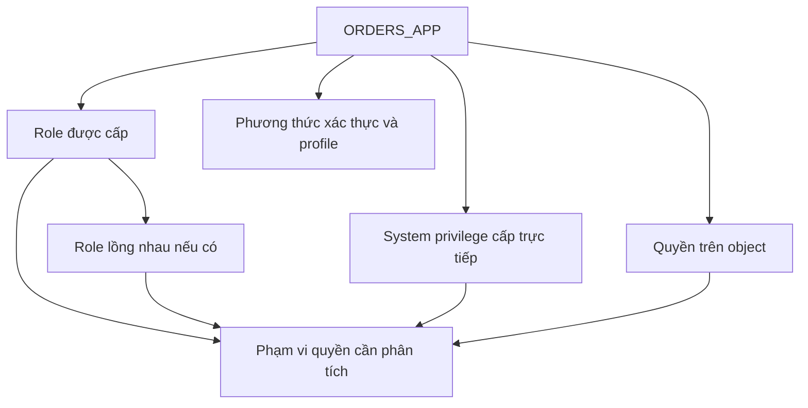
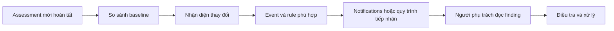

# Data Safe và đánh giá bảo mật cơ sở dữ liệu

## Mục tiêu bài học

Một cơ sở dữ liệu hoạt động ổn định vẫn có thể có tài khoản dư quyền, chính sách mật khẩu không phù hợp hoặc cấu hình kiểm toán chưa đáp ứng nhu cầu vận hành. Những vấn đề này khó được phát hiện chỉ bằng biểu đồ CPU, dung lượng tablespace hay thời gian thực thi SQL.

Trong chương **Quản lý và tối ưu cơ sở dữ liệu** của module **CLOUD_PROVIDERS_ORACLE**, bài học giới thiệu cách dùng **Oracle Data Safe** để đánh giá bảo mật database Oracle, đọc bằng chứng và tổ chức việc khắc phục. Nội dung gắn với tenancy, compartment, IAM, VCN và các dịch vụ database trong OCI; đồng thời xét đến giám sát, tự động hóa, chi phí và tính sẵn sàng của hoạt động đánh giá.

Sau bài học, bạn có thể:

- Giải thích vai trò của Security Assessment và User Assessment.
- Chuẩn bị kết nối và quyền cần thiết để đăng ký một target database.
- Đọc finding theo mức rủi ro, phạm vi và bằng chứng.
- Đối chiếu một số cấu hình bằng SQL chỉ đọc.
- Xây dựng quy trình khắc phục, đánh giá lại và chọn baseline.
- Theo dõi thay đổi cấu hình mà không nhầm báo cáo cũ với trạng thái hiện tại.

## 1. Data Safe giải quyết vấn đề gì?

Oracle Data Safe tập trung các chức năng bảo mật cho database Oracle. Những chức năng liên quan đến bài học gồm đánh giá cấu hình, đánh giá người dùng, khám phá dữ liệu nhạy cảm, giám sát hoạt động kiểm toán và masking. Xem [Oracle Data Safe Overview](https://docs.oracle.com/en-us/iaas/data-safe/doc/oracle-data-safe-overview.html).

Bắt đầu từ câu hỏi cần trả lời để chọn đúng chức năng:

| Câu hỏi | Chức năng phù hợp |
| --- | --- |
| Cấu hình và kiểm soát bảo mật nào cần xem xét? | Security Assessment |
| Tài khoản nào có quyền hoặc đặc điểm cần chú ý? | User Assessment |
| Dữ liệu nhạy cảm nằm ở những cột nào? | Data Discovery |
| Những hoạt động nào được ghi nhận trong audit trail? | Activity Auditing |
| Làm sao chuẩn bị dữ liệu đã che cho môi trường phù hợp? | Data Masking |

Bài này tập trung vào **Security Assessment**, có sử dụng User Assessment và metadata database để điều tra sâu hơn.

Ví dụ xuyên suốt là ứng dụng Java Orders kết nối một Oracle PDB bằng tài khoản ORDERS_APP. Nhóm phát triển cần biết runtime có quyền vượt nhu cầu hay không, chính sách xác thực có phù hợp không và thay đổi sau mỗi lần phát hành có làm tăng rủi ro không.

Một finding cần được chuyển thành quyết định cụ thể: ai xử lý, cần bằng chứng gì, thay đổi tác động đến ứng dụng nào và dùng kết quả nào để xác nhận đã khắc phục.

### Giới hạn của kết quả đánh giá

Hãy xem assessment là kết quả của một tập kiểm tra đối với target tại thời điểm đánh giá. Từ đó:

- Báo cáo cũ không đại diện chắc chắn cho cấu hình vừa thay đổi.
- Một finding đã đạt yêu cầu không bao quát mọi đường tấn công vào ứng dụng.
- Tham chiếu tiêu chuẩn hỗ trợ đối chiếu kiểm soát; tổ chức vẫn cần xác định phạm vi và bằng chứng tuân thủ.
- Các biện pháp cho hệ điều hành, VCN, backup và ứng dụng cần được đánh giá trong quy trình tương ứng.
- Khuyến nghị cần được triển khai và kiểm thử ở đúng thành phần chịu trách nhiệm.

Ví dụ, private subnet có thể hạn chế đường truy cập database nhưng không làm mất quyền dư thừa của một tài khoản đang đăng nhập hợp lệ.

## 2. Target database và phạm vi đánh giá

### 2.1. Đăng ký target là tạo quan hệ quản lý

**Target database** là database được đăng ký để Data Safe kết nối và sử dụng các chức năng được cấp quyền. Các hình thức triển khai Oracle Database được hỗ trợ có thể nằm trên OCI hoặc những môi trường khác. Kiểm tra loại database và cách kết nối tại [Target Registration Overview](https://docs.oracle.com/en/cloud/paas/data-safe/dsiad/datasafe_target_reg.html).

Hồ sơ target nên ghi rõ:

| Thông tin | Ví dụ trong bài |
| --- | --- |
| Môi trường | Lab |
| Dịch vụ database | Oracle Base Database Service |
| Phạm vi cần xem xét | PDB phục vụ Orders |
| Tên hiển thị target | orders-pdb-lab |
| Compartment chứa target Data Safe | DataSafe-Lab |
| Đường kết nối | Data Safe private endpoint |
| Tài khoản kết nối của dịch vụ | Tài khoản riêng phục vụ Data Safe |
| Chủ sở hữu database | Nhóm DBA |
| Người phân loại finding | Nhóm bảo mật database |

Tên trong bảng là ví dụ thiết kế, không phải tên tài nguyên mặc định của Oracle.

Compartment chứa target Data Safe có thể khác compartment chứa DB system. Ghi riêng OCID tài nguyên database và OCID target Data Safe; quyền đọc tài nguyên này chưa mô tả đầy đủ quyền đối với tài nguyên kia. Xem [Register an Oracle Cloud Database](https://docs.oracle.com/en-us/iaas/data-safe/doc/register-oracle-cloud-database.html).

### 2.2. CDB và PDB phải được xác định rõ

Trong hệ thống multitenant, tên CDB, tên PDB và service name có thể khác nhau. Một phiên kết nối nhầm container có thể trả metadata hợp lệ nhưng không phải dữ liệu bạn định kiểm tra.

Trước khi đọc báo cáo hoặc chạy SQL đối chiếu, ghi rõ:

- Target trỏ đến service nào.
- Database và container thực tế là gì.
- Các user và grant được xem trong container nào.
- Nhận xét áp dụng cho một PDB hay phạm vi rộng hơn.

Oracle có automatic registration theo policy cho những loại triển khai được hỗ trợ: cấu hình ở CDB để quản lý đăng ký các PDB đủ điều kiện. Kiểm tra danh sách hỗ trợ trước khi áp dụng; không suy ra rằng một lần đăng ký thủ công sẽ bao phủ mọi PDB hiện tại và tương lai. Xem [Automatically Register Target Databases](https://docs.oracle.com/en-us/iaas/data-safe/doc/automatic-registration.html).

## 3. Hai lớp quyền: OCI IAM và quyền trong database

```mermaid
flowchart LR
    HUMAN["Người vận hành OCI"] --> IAM["IAM policy theo compartment"]
    IAM --> DS["Tài nguyên và assessment của Data Safe"]
    DS --> NET["Private endpoint hoặc on-premises connector"]
    NET --> ACCOUNT["Service account trong database"]
    ACCOUNT --> PRIV["Quyền database cho assessment"]
    PRIV --> TARGET["Target Oracle Database"]
    TARGET --> RESULT["Finding và bằng chứng"]
```



Hai lớp quyền giải quyết hai câu hỏi khác nhau:

| Lớp quyền | Câu hỏi |
| --- | --- |
| OCI IAM | Người hoặc principal nào được thao tác với tài nguyên Data Safe? |
| Quyền database | Phiên kết nối của Data Safe được đọc hoặc thực hiện những gì trong database? |

Oracle xác định quyền Data Safe được kiểm soát ở cả IAM và role trên database đích trong [Security and Permissions](https://docs.oracle.com/en/cloud/paas/data-safe/dsiad/datasafe_iam.html).

### 3.1. Phân quyền OCI theo trách nhiệm

Một cách chia vai trò:

| Nhóm | Trách nhiệm |
| --- | --- |
| Readers | Đọc finding và bằng chứng được giao |
| Assessors | Refresh, so sánh assessment và quản lý baseline trong phạm vi phụ trách |
| Target administrators | Đăng ký target, quản lý kết nối và credential |
| Network administrators | Quản lý endpoint, route và security rule |
| DBA | Cấp quyền dịch vụ và khắc phục cấu hình database |

Với resource **security-assessments**, quyền **read** cho phép xem; các thao tác như refresh và quản lý baseline cần **manage** theo mô hình quyền dịch vụ. Xem [Security Assessment and User Assessment Resources](https://docs.oracle.com/en-us/iaas/data-safe/doc/security-and-user-assessment-resources.html).

Ví dụ quyền cho nhóm phụ trách assessment trong compartment lab:

```text
Allow group 'Default'/'DS-Assessors' to manage security-assessments in compartment DataSafe-Lab
Allow group 'Default'/'DS-Assessors' to read data-safe-work-requests in compartment DataSafe-Lab
```

Thay domain, group và compartment bằng tên thực tế. Đăng ký target và cấu hình network cần các quyền tương ứng riêng. Quyền đọc data-safe-work-requests liên quan đến việc đặt baseline và so sánh kết quả, theo [Common Resources](https://docs.oracle.com/en-us/iaas/data-safe/doc/common-resources.html).

Nếu phân tích thêm User Assessment, xét quyền với user-assessments. Tránh mặc định cấp manage toàn bộ data-safe-family trên tenancy chỉ để mọi account có đủ nút trong Console.

Dùng tài khoản đại diện để nghiệm thu: người đọc báo cáo lab không được chỉnh baseline và không nhìn thấy dữ liệu production ngoài phạm vi được giao.

### 3.2. Service account trong database

Với database non-Autonomous, DBA chuẩn bị tài khoản riêng và cấp bộ quyền cần thiết bằng script **datasafe_privileges.sql** do Data Safe cung cấp. Tài liệu hiện hành liệt kê bộ quyền assessment là **ORA_DSCS_ASSESSMENT**; Autonomous dùng **DS$ASSESSMENT_ROLE** với cách provisioning khác. Xem [Grant Roles to the Oracle Data Safe Service Account](https://docs.oracle.com/en-us/iaas/data-safe/doc/grant-roles-oracle-data-safe-service-account-your-target-database.html).

Ví dụ gọi script hiện hành cho tài khoản non-Autonomous đã được tạo:

```sql
@datasafe_privileges.sql DATASAFE_SVC GRANT ORA_DSCS_ASSESSMENT
```

DBA cần tải script cho môi trường đang dùng và thực hiện theo hướng dẫn đi kèm. Phiên quản trị dùng để provisioning và account Data Safe dùng khi vận hành là hai chủ thể khác nhau.

Khi đổi mật khẩu service account, cập nhật cấu hình target, kiểm tra kết nối và xác minh assessment mới chạy thành công. Quản lý credential theo quy trình bí mật của môi trường; không lưu mật khẩu trong phiếu xử lý.

Quyền assessment không đồng nghĩa phải cấp thêm quyền masking hoặc chỉnh audit policy. Với Database Vault hay cơ chế kiểm soát đặc biệt, kiểm tra hướng dẫn bổ sung cho target đó.

## 4. Chuẩn bị kết nối tới database

### 4.1. Chọn đường kết nối theo vị trí target

| Tình huống | Hướng lựa chọn |
| --- | --- |
| Autonomous có endpoint công khai và đáp ứng điều kiện | Kiểm tra đường đăng ký trực tiếp dành cho loại database đó |
| Database private trên OCI | Data Safe private endpoint theo luồng đăng ký hỗ trợ |
| Database ngoài OCI, đã có đường mạng riêng tới VCN | Private endpoint cùng đường VPN/FastConnect phù hợp |
| Database ngoài OCI, chưa có đường mạng riêng phù hợp | Xem on-premises connector nếu loại target hỗ trợ |

Lựa chọn phải theo loại database; tham khảo [Connectivity Options for Target Databases](https://docs.oracle.com/en-us/iaas/data-safe/doc/connectivity-options-target-databases.html).

Data Safe private endpoint là tài nguyên kết nối của Data Safe. Nó không biến mọi địa chỉ trong VCN thành đích được phép truy cập. Vẫn cần kiểm tra route, listener, DNS nếu sử dụng tên và security rule.

### 4.2. Ví dụ kết nối cho PDB Orders

Giả sử lab sử dụng:

- Database private IP: 10.20.10.20.
- Data Safe private endpoint IP: 10.20.20.15.
- Listener TLS đã cấu hình ở cổng 1522.
- Service name dành cho PDB Orders do DBA cung cấp.

Cổng và IP này là giả định của ví dụ. Dùng listener và giao thức thực tế.

Với rule stateful, xác minh ít nhất:

| Điểm kiểm tra | Luồng hoặc cấu hình | Mục đích |
| --- | --- | --- |
| Egress của endpoint | Endpoint → database, đúng cổng listener | Cho phép tạo kết nối |
| Ingress của database | Endpoint → database, đúng cổng listener | Cho phép nhận kết nối |
| Route giữa subnet/VCN | Đường đi và đường về phù hợp | Gói tin đến đúng mạng |
| TLS | Trust và nhận diện đầu cuối phù hợp | Hoàn tất giao thức đã chọn |

Nếu dùng rule stateless, xét thêm lưu lượng phản hồi theo thiết kế mạng. Với RAC hoặc topology nhiều địa chỉ, xét các địa chỉ mà luồng kết nối thực tế sử dụng.

Private IP và mã hóa đường truyền là hai thuộc tính riêng. Khi yêu cầu TLS, kiểm tra listener, truststore và hình thức xác thực phù hợp, thay vì chỉ dựa vào việc database nằm trong private subnet.

### 4.3. Khi dùng on-premises connector

Connector tạo đường TLS từ host cài connector đến thành phần kết nối của Data Safe. Chặng từ connector đến database vẫn cần giao thức, mạng và xác thực phù hợp. Xem [Oracle Data Safe On-Premises Connector](https://docs.oracle.com/en/cloud/paas/data-safe/dsiad/datasafe_onprem_connector.html).

Theo dõi host connector, chứng thư, khả năng ra endpoint dịch vụ và kết nối tới listener. Connector ngừng hoạt động có thể làm assessment không chạy được dù database vẫn phục vụ Orders.

## 5. Đăng ký và tạo assessment đầu tiên

Thực hiện trong môi trường lab đã được giao quyền. Những bước dưới đây là hướng dẫn để người học triển khai, không phải kết quả đã chạy trên một tenancy.

### Bước 1: Lập danh sách đầu vào

Chuẩn bị region, compartment, loại database, service name, endpoint/connector, giao thức và service account. Ghi người phụ trách network, database và Data Safe để xử lý lỗi theo đúng lớp.

Với Orders, chọn rõ PDB cần đánh giá; không dùng tên hiển thị target để suy ra service name.

### Bước 2: Kiểm tra điều kiện trước đăng ký

Xác minh:

- Quyền IAM cho việc đăng ký và sử dụng tài nguyên kết nối.
- Service account tồn tại, có trạng thái phù hợp và được cấp quyền assessment.
- Listener và đường mạng từ điểm kết nối Data Safe hoạt động.
- Thông tin TLS đã được chuẩn bị nếu sử dụng TLS.
- Những chức năng dự kiến bật trong wizard khớp phạm vi lab.

Một lần đăng nhập thành công từ laptop của DBA chưa xác minh đường đi từ endpoint hoặc connector.

### Bước 3: Chạy wizard theo loại database

Trong Data Safe, chọn wizard phù hợp, khai báo target, credential và đường kết nối. Đọc các rule network được đề xuất trước khi áp dụng.

Theo dõi các bước đăng ký đến khi hoàn tất và xử lý lỗi nếu có. Lưu OCID target, đường kết nối và database/container vào hồ sơ lab. Chi tiết wizard cho Base Database và các cloud database tương ứng được Oracle mô tả tại [Register an Oracle Cloud Database](https://docs.oracle.com/en-us/iaas/data-safe/doc/register-oracle-cloud-database.html).

### Bước 4: Kiểm tra kết quả đầu tiên

Sau đăng ký hợp lệ, Data Safe tự chạy Security Assessment và có lịch mặc định hằng tuần. Hãy kiểm tra lần đánh giá thực tế của target, theo [Security Assessment Overview](https://docs.oracle.com/en-us/iaas/data-safe/doc/security-assessment-overview.html).

Ghi nhận:

- Thời điểm database được đánh giá.
- Phiên bản database và target.
- Trạng thái hoàn thành.
- Tập kiểm tra hoặc template đang áp dụng.
- Nội dung chi tiết của finding.

Trạng thái đăng ký thành công là điều kiện vận hành quan trọng; bằng chứng đánh giá còn cần một assessment hoàn tất với thời điểm rõ ràng.

### Bước 5: Lưu bằng chứng trước thay đổi

Lưu định danh assessment và thông tin phục vụ đối chiếu. Có thể đặt tên dễ nhận biết như SA_orders_lab_before_hardening.

Lưu bản sao latest assessment chỉ lưu kết quả hiện có. Muốn kiểm tra cấu hình vừa sửa, phải refresh và chờ đánh giá mới hoàn tất. Xem [Manage Security Assessments](https://docs.oracle.com/en-us/iaas/data-safe/doc/manage-security-assessments.html).

## 6. Đọc finding theo bằng chứng

### 6.1. Mức rủi ro là đầu vào cho quyết định

| Mức | Cách đọc |
| --- | --- |
| High | Cần chú ý khẩn cấp |
| Medium | Lên kế hoạch xử lý sớm |
| Low | Có thể ghép với bảo trì phù hợp |
| Advisory | Cơ hội tăng cường kiểm soát |
| Evaluate | Cần phân tích thủ công |
| Pass | Kiểm tra không phát hiện rủi ro |
| Deferred | Việc xử lý đã được hoãn |

Đối chiếu ý nghĩa tại [Security Assessment Overview](https://docs.oracle.com/en-us/iaas/data-safe/doc/security-assessment-overview.html).

Khi phân loại công việc, bổ sung ngữ cảnh:

- Database chứa dữ liệu gì và ảnh hưởng nếu bị truy cập trái phép?
- Tài khoản thuộc ứng dụng, quản trị hay tích hợp?
- Đường truy cập và kiểm soát bù trừ nào đang tồn tại?
- Việc sửa có làm ngừng dịch vụ hoặc phá tác vụ định kỳ không?
- Thời điểm đánh giá còn đủ mới cho quyết định không?

Hai database có cùng finding có thể cần ưu tiên khác nhau do mức ảnh hưởng khác nhau.

### 6.2. Các nhóm nội dung cần xem xét

Báo cáo phân loại theo user accounts, privileges and roles, authorization control, fine-grained access control, data encryption, auditing và database configuration.

Một cách đặt câu hỏi cho Orders:

| Nhóm | Câu hỏi điều tra |
| --- | --- |
| User accounts | Tài khoản ứng dụng và bảo trì còn đúng mục đích không? |
| Privileges and roles | Runtime có quyền quản trị ngoài nhu cầu không? |
| Authorization control | Đường cấp quyền có rõ ràng và được kiểm soát không? |
| Fine-grained access control | Kiểm soát chi tiết có phù hợp yêu cầu dữ liệu không? |
| Data encryption | Các lớp mã hóa đã đáp ứng yêu cầu chưa? |
| Auditing | Những hành động cần điều tra có được ghi nhận không? |
| Database configuration | Cấu hình liên quan có đúng chính sách không? |

Các câu hỏi là hướng phân tích, không khẳng định mọi target sẽ có finding tương ứng. Phạm vi kiểm tra và khuyến nghị phụ thuộc loại database, phiên bản và template.

### 6.3. Mở chi tiết thay vì chỉ xem tổng số

Chọn đúng target và compartment, rồi mở từng finding. Có thể lọc theo risk, category và tham chiếu, theo [View and Analyze Security Assessments](https://docs.oracle.com/en-us/iaas/data-safe/doc/view-analyze-sa-history.html).

Với mỗi finding, lập phiếu điều tra:

```text
Target và container:
Assessment OCID:
Assessed time:
Finding/check:
Mức rủi ro được báo cáo:
Cấu hình hoặc đối tượng bị ảnh hưởng:
Bằng chứng cần đối chiếu:
Khuyến nghị:
Chủ sở hữu:
Kế hoạch xử lý và xác minh:
```

Tổng finding giảm chưa đủ để đóng phiếu. Cần biết thay đổi đến từ cấu hình được sửa, thay đổi tập kiểm tra hay điều chỉnh mức rủi ro.

## 7. SQL chỉ đọc để đối chiếu cấu hình

Các truy vấn minh họa trên Oracle Database 19c. Dùng phiên của DBA hoặc người được cấp quyền đọc metadata phù hợp, trong đúng container. Đây là hướng dẫn để người học chạy ở lab.

### 7.1. Xác định ngữ cảnh phiên

```sql
SELECT SYS_CONTEXT('USERENV', 'DB_NAME') AS database_name,
       SYS_CONTEXT('USERENV', 'CON_NAME') AS container_name,
       SYS_CONTEXT('USERENV', 'SESSION_USER') AS session_user
FROM dual;
```

Lưu kết quả cùng bằng chứng. Nếu target là PDB Orders mà phiên SQL ở container khác, cần sửa ngữ cảnh trước khi diễn giải các truy vấn tiếp theo.

### 7.2. Xem trạng thái và profile của tài khoản

```sql
SELECT username,
       account_status,
       authentication_type,
       profile,
       last_login
FROM dba_users
WHERE username = 'ORDERS_APP';
```

Kiểm tra loại xác thực và profile có khớp thiết kế không. LAST_LOGIN trống không tự chứng minh tài khoản không được sử dụng; Oracle không ghi cột này cho một số kiểu kết nối quản trị. Xem [DBA_USERS](https://docs.oracle.com/en/database/oracle/oracle-database/19/refrn/DBA_USERS.html).

Quyết định khóa tài khoản còn cần đối chiếu chủ sở hữu, job, application connection pool, đường proxy và dữ liệu hoạt động phù hợp. Với user do Oracle quản lý, làm theo hướng dẫn của Oracle thay vì áp dụng hàng loạt quy tắc dành cho user ứng dụng.

### 7.3. Xem role được cấp cho runtime

```sql
SELECT grantee,
       granted_role,
       admin_option,
       default_role
FROM dba_role_privs
WHERE grantee = 'ORDERS_APP'
ORDER BY granted_role;
```

Nếu thấy role quản trị không phù hợp, ghi nguồn cấp và lý do tồn tại trước khi đề xuất thu hồi. ADMIN_OPTION cho biết grant có cho phép quản lý việc cấp role tương ứng hay không. Xem [DBA_ROLE_PRIVS](https://docs.oracle.com/en/database/oracle/oracle-database/19/refrn/DBA_ROLE_PRIVS.html).

Truy vấn lọc theo ORDERS_APP mới cho thấy các role cấp trực tiếp cho grantee đó. Role có thể chứa role khác, và quyền thực tế còn có những đường cấp khác. Để kết luận đầy đủ cần phân tích tiếp, chẳng hạn bằng User Assessment và metadata liên quan.

### 7.4. Xem system privilege cấp trực tiếp

```sql
SELECT grantee,
       privilege,
       admin_option
FROM dba_sys_privs
WHERE grantee = 'ORDERS_APP'
ORDER BY privilege;
```

Không có dòng không đồng nghĩa user không có quyền hệ thống qua role. Các cột của view được mô tả tại [DBA_SYS_PRIVS](https://docs.oracle.com/en/database/oracle/oracle-database/19/refrn/DBA_SYS_PRIVS.html).

Với Orders, phân biệt ba nhóm thao tác: runtime thực hiện nghiệp vụ, công cụ migration thay đổi schema và DBA quản trị database. Cấp cùng một bộ quyền cho cả ba làm khó việc thu hẹp tác động khi credential bị lộ.

### 7.5. Xem chính sách mật khẩu

```sql
SELECT profile,
       resource_name,
       limit
FROM dba_profiles
WHERE resource_type = 'PASSWORD'
  AND (
      profile = 'DEFAULT'
      OR profile IN (
          SELECT profile
          FROM dba_users
          WHERE username = 'ORDERS_APP'
      )
  )
ORDER BY profile, resource_name;
```

Truy vấn lấy profile của ứng dụng cùng DEFAULT để hỗ trợ đối chiếu giá trị kế thừa. Tham khảo [DBA_PROFILES](https://docs.oracle.com/en/database/oracle/oracle-database/19/refrn/DBA_PROFILES.html).

Khi đọc kết quả:

- Diễn giải giá trị DEFAULT bằng cấu hình thực tế của profile mặc định.
- Xem phương thức xác thực trước khi suy luận tác động của chính sách mật khẩu.
- Đánh giá lockout và hết hạn mật khẩu cùng quy trình rotation của ứng dụng.
- Xét mọi user dùng chung profile trước khi thay đổi.

Thay chính sách lockout mà không xử lý credential cũ trong nhiều instance Orders có thể tạo đợt lỗi đăng nhập lặp lại. Cần kiểm thử cả kết nối mới từ connection pool sau thay đổi.

## 8. Kết hợp User Assessment để hiểu quyền tài khoản

Security Assessment định hướng vấn đề cấu hình. Khi finding liên quan đến user, User Assessment bổ sung góc nhìn về tài khoản, role, privilege và đặc điểm rủi ro. Xem [User Assessment Overview](https://docs.oracle.com/en-us/iaas/data-safe/doc/user-assessment-overview.html).

Với ORDERS_APP, lập bản đồ:



Đọc một role có tên “read only” chưa đủ. Cần kiểm tra nó chứa quyền gì, ai có thể sửa role và quyền áp dụng với object nào.

Nếu có role quản trị, hãy trả lời:

1. Tác vụ nghiệp vụ nào cần quyền đó?
2. Đây là runtime account hay deployment account?
3. Có thể thay bằng quyền cụ thể trên schema/object phù hợp không?
4. Có procedure, job hoặc tác vụ nền nào bị ảnh hưởng?
5. Làm sao kiểm thử việc bỏ quyền và phục hồi khi có lỗi?

User Assessment giúp chọn đối tượng cần phân tích; lịch sử hoạt động và kiểm thử ứng dụng giúp xác định nhu cầu thực tế.

## 9. Từ finding đến khắc phục có thể kiểm chứng

Giả sử trong lab bạn phát hiện ORDERS_APP có role rộng hơn nhu cầu runtime. Đây là tình huống minh họa, không phải kết luận về một database đã được kiểm tra.

### 9.1. Lập kế hoạch trước thay đổi

| Thành phần | Nội dung cần có |
| --- | --- |
| Phạm vi | Đúng target, container, user và role |
| Hiện trạng | Grant trực tiếp, qua role và tác vụ phụ thuộc |
| Mục tiêu | Bộ thao tác runtime cần thực hiện |
| Thay đổi | Quyền thay thế và quyền dự kiến thu hồi |
| Kiểm thử | Kết nối mới, nghiệp vụ, batch job và migration theo vai trò |
| Phục hồi | Khôi phục cấu hình đã ghi nhận nếu kiểm thử thất bại |
| Bằng chứng đóng phiếu | Cấu hình sau sửa, assessment mới và kiểm thử |

Các hướng khắc phục cần chủ sở hữu và bằng chứng tương ứng:

| Tình huống | Hướng xử lý | Bằng chứng xác minh |
| --- | --- | --- |
| Runtime dư quyền | Tách vai trò, thu hẹp grant theo nhu cầu | Metadata, kiểm thử, assessment mới |
| User không rõ chủ sở hữu | Xác minh người phụ trách và đường sử dụng | Chủ sở hữu xác nhận, dữ liệu hoạt động |
| Profile chưa phù hợp | Thiết kế chính sách và rotation | Profile, thử credential, kết nối mới |
| Kiểm toán chưa đủ | Xác định hành động cần ghi, cấu hình phù hợp | Audit record của thao tác thử |
| Yêu cầu mã hóa chưa đáp ứng | Xử lý ở lớp lưu trữ hoặc kết nối liên quan | Bằng chứng của chính lớp đó |
| Khuyến nghị bản vá | Theo quy trình patch và tương thích | Thông tin patch, assessment sau thay đổi |

Các hàng mô tả phương pháp xử lý; cần đối chiếu khuyến nghị của finding thực tế trước khi chọn thay đổi.

### 9.2. Đánh giá lại và kiểm thử ứng dụng

Sau khi người phụ trách triển khai thay đổi:

1. Đọc lại metadata trong đúng container.
2. Chạy kiểm thử đại diện bằng đúng tài khoản ứng dụng.
3. Tạo kết nối mới, tránh chỉ quan sát session có sẵn.
4. Refresh Security Assessment và đợi hoàn tất.
5. Đọc lại finding, đối chiếu bằng chứng.
6. Ghi rủi ro còn tồn tại hoặc phát sinh mới.

Một thay đổi cải thiện báo cáo nhưng làm Orders không tạo được đơn hàng chưa đạt mục tiêu vận hành.

Ví dụ hồ sơ xác minh cho finding về dư quyền:

```text
Trước thay đổi:
  Role được phát hiện: ghi theo metadata thực tế.
  Những luồng sử dụng role: xác minh với nhóm ứng dụng.

Sau thay đổi:
  Grant và role còn lại: đính kèm kết quả truy vấn.
  Kiểm thử kết nối mới: ghi kết quả thực tế.
  Kiểm thử tạo/đọc/cập nhật đơn: ghi kết quả thực tế.
  Assessment mới: OCID và assessed time.
  Finding sau đánh giá lại: ghi trạng thái và bằng chứng.
```

Mẫu này yêu cầu người học điền kết quả quan sát được, không giả định finding chắc chắn sẽ biến mất sau mọi lần sửa.

### 9.3. Sửa cấu hình và đổi mức rủi ro là hai việc khác nhau

Data Safe cho phép điều chỉnh risk hoặc defer finding, có lý do và thời hạn. Risk modification report ghi nhận những điều chỉnh đó. Xem [View and Analyze Security Assessments](https://docs.oracle.com/en-us/iaas/data-safe/doc/view-analyze-sa-history.html).

Đổi nhãn không tự đổi grant, profile hay cấu hình database. Với ngoại lệ chưa xử lý ngay, hồ sơ nội bộ nên có:

```text
Finding và target:
Bằng chứng hiện trạng:
Lý do chưa khắc phục:
Ảnh hưởng đã phân tích:
Kiểm soát bù trừ:
Người chấp nhận rủi ro:
Hạn xem xét lại:
Kế hoạch xử lý:
```

Đến hạn, kiểm tra ngoại lệ còn hợp lệ và có cần khắc phục không. Không dùng việc giảm severity để thay thế bằng chứng kỹ thuật.

## 10. Baseline và phát hiện cấu hình lệch chuẩn

### 10.1. Baseline của một target

Baseline là mốc so sánh do bạn chọn cho target. Một assessment vừa hoàn tất chưa tự trở thành trạng thái tốt để chuẩn hóa.

Trình tự phù hợp:

1. Đọc và phân loại finding.
2. Xử lý hoặc ghi nhận ngoại lệ được chấp nhận.
3. Refresh để có kết quả sau thay đổi.
4. Xác nhận phạm vi, bằng chứng và thời điểm.
5. Chọn assessment phù hợp làm baseline.
6. So sánh các lần sau với baseline đó.

Oracle mô tả thiết lập baseline và báo cáo so sánh tại [Compare Security Assessments for Single Target Databases](https://docs.oracle.com/en-us/iaas/data-safe/doc/compare-security-assessments-single-target-databases.html).

Khi có drift, cần biết finding mới xuất hiện, đã được xử lý hay có chi tiết thay đổi. Đối chiếu change record để phân biệt thay đổi có chủ đích và ngoài dự kiến.

Đừng thay baseline chỉ để xóa cảnh báo lệch chuẩn. Nếu chuẩn vận hành thay đổi hợp lệ, lưu lý do và bằng chứng của baseline mới.

### 10.2. Template và baseline có vai trò khác nhau

Assessment template chọn tập kiểm tra. Oracle cung cấp template có sẵn và cho phép tạo template tùy chỉnh. Khi áp dụng template, Data Safe còn hỗ trợ template baseline để đối chiếu mức kỳ vọng. Xem [Work with Security Assessment Templates](https://docs.oracle.com/en-us/iaas/data-safe/doc/work-security-assessment-templates.html).

| Thành phần | Vai trò |
| --- | --- |
| Assessment template | Chọn kiểm tra nào được thực hiện |
| Assessment của target | Kết quả quan sát được trên target |
| Baseline assessment của target | Mốc kết quả để so sánh theo thời gian |
| Template baseline | Mức kỳ vọng cho các kiểm tra của template |

Khi so sánh trước và sau, giữ thông tin template. Bỏ một số kiểm tra có thể làm tổng finding giảm dù cấu hình database không đổi.

Với nhiều database, có thể tổ chức target group và chọn kiểm tra phù hợp cho nhóm. Kiểm tra cách tạo assessment và template của group trong [Work with Security Assessments for Target Database Groups](https://docs.oracle.com/en-us/iaas/data-safe/doc/work-security-assessments-target-database-groups.html).

## 11. Lịch đánh giá và tự động hóa

### 11.1. Phân biệt đánh giá lại với lưu bản sao

| Loại lịch | Ý nghĩa |
| --- | --- |
| Latest | Điều khiển lúc chạy đánh giá để cập nhật latest assessment |
| Saved | Lưu bản sao latest assessment theo lịch |

Tạo thêm lịch lưu không bảo đảm database được đánh giá lại ở cùng tần suất. Khi cấu hình lịch, dùng UTC theo hướng dẫn dịch vụ. Xem [Schedule Security Assessments](https://docs.oracle.com/en-us/iaas/data-safe/doc/schedule-security-assessments.html).

Ví dụ thiết kế cho Orders:

- Chạy đánh giá định kỳ theo chính sách môi trường.
- Refresh sau thay đổi quyền hoặc một đợt hardening đáng chú ý.
- Lưu bằng chứng theo nhu cầu của nhóm.
- Ghi cả thời điểm lưu và thời điểm database thực sự được đánh giá.

Nếu công việc dự kiến lúc 02:00 tại Việt Nam, chuyển đúng sang UTC và kiểm tra ngày chạy: thời điểm đó tương ứng 19:00 UTC của ngày trước.

Lịch chạy cần xét lịch bảo trì và khả năng kết nối target. Nếu assessment thất bại, lưu nguyên nhân và đánh giá lại sau khi điều kiện kết nối được phục hồi.

### 11.2. Xử lý thông báo drift

OCI Events hỗ trợ tự động hóa dựa trên thay đổi trạng thái tài nguyên Data Safe. Xem [Events](https://docs.oracle.com/en-us/iaas/data-safe/doc/events.html).

Một luồng vận hành đề xuất:



Đây là thiết kế quy trình; cần cấu hình và thử rule với event được môi trường hỗ trợ. Gắn thông báo với target, assessment, thời điểm và nhóm phụ trách để người nhận truy cập được bằng chứng.

Một lần thử luồng thông báo nên xác nhận:

1. Thay đổi có kiểm soát đã được đánh giá.
2. Có dữ liệu so sánh tương ứng.
3. Rule nhận đúng sự kiện.
4. Người nhận đọc được assessment theo IAM.
5. Có người nhận xử lý và phân loại kết quả.

Đánh giá theo lịch có độ trễ quan sát. Một quyền được cấp rồi thu hồi giữa hai lần chạy có thể không xuất hiện trong ảnh chụp cấu hình. Khi cần theo dõi hoạt động, thiết kế audit bên cạnh assessment.

### 11.3. Theo dõi độ phủ và độ mới

Dashboard nội bộ nên theo dõi:

| Chỉ số quản trị | Ý nghĩa |
| --- | --- |
| Database thuộc phạm vi nhưng chưa có target | Khoảng trống đăng ký |
| Target thiếu assessment thành công gần đây | Khoảng trống bằng chứng mới |
| Finding chưa có chủ sở hữu | Công việc chưa được giao |
| Ngoại lệ quá hạn xem xét | Rủi ro tồn tại ngoài quy trình |
| Thay đổi sau baseline chưa có giải thích | Drift chưa được phân loại |
| Khắc phục có kiểm thử và reassessment | Khả năng chứng minh kết quả |

Ví dụ tự đặt mục tiêu cho lab: mỗi target trong danh sách phải có một lần đánh giá thành công trong bảy ngày gần nhất. Đây là quy ước bài thực hành, không phải SLA mặc định của Oracle.

Một phép tính quản trị đơn giản:

```text
Độ phủ đánh giá mới
= Số database trong phạm vi có assessment thành công còn hiệu lực
  / Tổng số database trong phạm vi
  × 100%
```

Nếu có 10 database nhưng chỉ 8 database được đăng ký và đánh giá thành công đúng hạn, độ phủ là 80%. Báo cáo chỉ nhìn tám target đang có không được dùng để kết luận rằng toàn bộ hệ thống đã được bao phủ.

Giữ danh sách database thuộc phạm vi cùng danh sách target Data Safe để đối chiếu. Có thể tổ chức các bước kiểm tra và xuất báo cáo trong quy trình tự động của nhóm, với account chỉ được cấp quyền cần thiết.

## 12. Tính sẵn sàng, dữ liệu báo cáo và chi phí

### 12.1. Assessment gián đoạn không có nghĩa database ngừng phục vụ

Nếu service account bị khóa hoặc connector không hoạt động, Orders có thể vẫn chạy nhưng nhóm bảo mật mất dữ liệu đánh giá mới. Theo dõi riêng trạng thái database và đường quản lý.

Sau thay đổi listener, chứng thư, mật khẩu, route hoặc chuyển đổi vai trò database, kiểm tra lại kết nối và chạy assessment phù hợp.

Với connector cần tính sẵn sàng cao, Oracle có hướng dẫn triển khai trên hai host Linux cho trường hợp được hỗ trợ. Xem [Register an On-Premises Oracle Database](https://docs.oracle.com/en-us/iaas/data-safe/doc/register-onpremises-oracle-database.html).

Trước khi dừng hoặc thay connector, xác định các target cùng sử dụng nó. Với yêu cầu phục hồi giữa môi trường hoặc region, lập kế hoạch cho credential, đường kết nối, lịch đánh giá và bằng chứng cần giữ; kiểm thử khả năng vận hành sau chuyển đổi.

### 12.2. Báo cáo cũng là dữ liệu cần bảo vệ

Assessment có thể mô tả tài khoản, quyền và điểm yếu cấu hình. Khi xuất hoặc chia sẻ bằng chứng:

- Chọn kho lưu trữ và người đọc theo phạm vi.
- Giữ target, thời điểm đánh giá và định danh assessment.
- Không đưa credential hoặc wallet vào phiếu xử lý.
- Quy định thời hạn giữ và người dọn bản xuất.
- Kiểm tra quyền khi sao chép assessment sang compartment khác.

Báo cáo được chia sẻ rộng có thể tiết lộ cấu trúc phân quyền dù không chứa dữ liệu nghiệp vụ.

### 12.3. Kiểm soát phạm vi và usage

Để lập kế hoạch chi phí, kiểm tra giá và usage theo loại target, region và chức năng thực sự sử dụng. Không suy ra chi phí toàn bộ hệ thống chỉ từ việc bật assessment.

Hồ sơ vận hành nên liệt kê:

| Thành phần | Điều cần kiểm tra |
| --- | --- |
| Database lab | Compute, storage và thời gian tồn tại |
| Host connector nếu có | Tài nguyên chạy host và quản trị hệ điều hành |
| Mạng | Đường kết nối và những dịch vụ mạng liên quan |
| Chức năng Data Safe đã bật | Assessment, audit, discovery hoặc chức năng bổ sung |
| Bản xuất báo cáo | Lưu trữ, quyền truy cập và vòng đời |

Tần suất thu thập và phạm vi tính năng phải có mục đích. Đối với bài đánh giá cấu hình, ghi rõ chức năng nào phục vụ bài và chức năng nào do quy trình khác quản lý.

Khi hoàn thành lab, dọn đúng tài nguyên thử được phép dọn. Endpoint hoặc connector dùng chung cần được giữ cho những target còn sử dụng; việc dừng bài thực hành không tự đặt ra nhu cầu xóa database.

## 13. Khoanh vùng lỗi thường gặp

| Hiện tượng | Điều cần kiểm tra | Bằng chứng để phân biệt |
| --- | --- | --- |
| Không thấy target | Region, compartment, filter và IAM | OCID target và phạm vi account |
| Target không kết nối được | Listener, route, security rule, service name | Lỗi đăng ký và đường đi từ endpoint/connector |
| Lỗi xác thực | Credential, trạng thái user, wallet/chứng thư | Lỗi và thời điểm thay đổi |
| Assessment thiếu hoặc lỗi | Quyền database và phiên bản script | Quyền đã provision, work request |
| Xem được nhưng không refresh được | Quyền thao tác assessment | Policy và resource type thực tế |
| Không đặt baseline/compare được | Quyền assessment và work requests | Policy theo compartment |
| Đã sửa nhưng finding còn nguyên | Assessed time, target/container và cấu hình hiệu lực | Assessment mới, metadata sau sửa |
| Tổng finding giảm bất thường | Template, filter hoặc risk modification | Tập kiểm tra, lịch sử điều chỉnh |
| Bản sao mới nhưng dữ liệu đánh giá cũ | Saved schedule khác latest schedule | Thời điểm assessed và saved |
| SQL đối chiếu không khớp finding | Container, role và phạm vi kiểm tra | Ngữ cảnh phiên, đường cấp quyền |

Khoanh vùng từng lớp trước khi mở rộng quyền. Thêm role quản trị không giải quyết được route sai; mở firewall không giải quyết được mật khẩu hết hạn.

## 14. Bằng chứng cần có sau bài thực hành

Người học hoàn thành bài khi trình bày được:

1. Target nào được đánh giá, ở region, compartment và container nào.
2. Data Safe sử dụng đường kết nối và service account nào.
3. Quyền IAM dành cho người vận hành, quyền database dành cho dịch vụ.
4. Ít nhất một finding được đối chiếu bằng bằng chứng đúng phạm vi.
5. Kế hoạch khắc phục có chủ sở hữu, kiểm thử và cách phục hồi.
6. Assessment sau thay đổi cùng kiểm thử ứng dụng, nếu đã triển khai thay đổi trong lab.
7. Lý do chọn baseline hoặc lý do chưa đủ điều kiện chọn.
8. Sự khác nhau giữa latest schedule, saved schedule và assessment thực sự được dùng.
9. Phương án theo dõi độ phủ, độ mới, ngoại lệ và vòng đời tài nguyên lab.

Nếu chưa triển khai thay đổi, ghi đúng trạng thái “đã đánh giá và lập kế hoạch”, kèm bằng chứng còn thiếu. Hồ sơ bàn giao cần chỉ rõ điều gì đã được quan sát, điều gì đã được sửa và điều gì vẫn cần xác minh.
