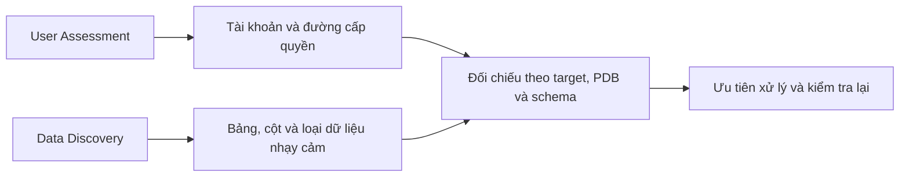

# Đánh giá người dùng và phát hiện dữ liệu nhạy cảm

Trong chương **Quản lý và tối ưu cơ sở dữ liệu** của module **CLOUD_PROVIDERS_ORACLE**, bài học này sử dụng Oracle Data Safe để trả lời hai câu hỏi: **tài khoản nào có khả năng gây ảnh hưởng lớn nếu bị lạm dụng, và dữ liệu nhạy cảm nằm ở đâu trong Oracle Database?** Kết hợp hai câu trả lời giúp chọn đúng đối tượng cần thu hẹp quyền, giám sát hoặc bảo vệ trước khi đưa dữ liệu sang môi trường khác.

Tình huống xuyên suốt là cơ sở dữ liệu của một ứng dụng quản lý khách hàng trên OCI. Tài khoản báo cáo chỉ cần mã khách hàng và phân khúc, nhưng đang được đọc cả email và mã thành viên. Mục tiêu không chỉ là tạo một báo cáo đánh giá: người học cần chứng minh đường cấp quyền, xác nhận các cột nhạy cảm, điều chỉnh quyền trong lab và kiểm tra lại chức năng được phép.

## 1. Kết quả cần đạt và phạm vi

Sau bài học, người học có thể:

- Phân biệt người dùng OCI IAM với tài khoản bên trong Oracle Database.
- Đọc User Assessment, nhận diện tài khoản đặc quyền và diễn giải trạng thái đăng nhập, xác thực, profile.
- Kiểm tra quyền trực tiếp, quyền qua role và các đường truy cập cần rà soát thêm.
- Tạo sensitive data model bằng Data Discovery, chọn phạm vi quét và kiểm chứng sensitive type.
- Ghép thông tin tài khoản với các đối tượng chứa dữ liệu nhạy cảm để đề xuất xử lý có bằng chứng.
- Duy trì baseline và cập nhật mô hình sau thay đổi schema mà vẫn kiểm soát ảnh hưởng vận hành.

Bài tập dùng **Oracle Database 19c trong một PDB không phục vụ production**, đã được đăng ký làm target của Data Safe. Các câu SQL minh họa chạy trên PDB đó; quyền quản trị và tài khoản chạy được ghi tại từng bước. Đây là hướng dẫn để người học thực hiện trong môi trường được phép, không phải kết quả quét một cơ sở dữ liệu thực tế.

## 2. Hai kết quả đánh giá bổ sung cho nhau

### 2.1. User Assessment và Data Discovery

| Thành phần | Câu hỏi chính | Kết quả sử dụng |
| --- | --- | --- |
| User Assessment | Tài khoản có những quyền, role và đặc điểm xác thực nào? | Danh sách tài khoản, potential risk và chi tiết truy cập |
| Data Discovery | Các cột nào có dấu hiệu chứa dữ liệu nhạy cảm? | Sensitive data model, loại dữ liệu và vị trí cột |
| Security Assessment | Cấu hình bảo mật cơ sở dữ liệu có điểm cần cải thiện nào? | Các phát hiện về cấu hình; bổ sung cho bài này |
| Activity Auditing | Những hoạt động nào đã được ghi nhận? | Bằng chứng hành vi trong phạm vi audit được thu thập |

Data Safe lấy thông tin tài khoản và quyền từ data dictionary để đánh giá người dùng, đồng thời cung cấp chức năng khám phá dữ liệu dựa trên metadata và nội dung. Các chức năng có mục đích khác nhau; một báo cáo quyền không chứng minh tài khoản đã đọc dữ liệu. [Nguồn: Oracle Data Safe Overview](https://docs.oracle.com/en-us/iaas/data-safe/doc/oracle-data-safe-overview.html).



Ví dụ, một tài khoản không có quyền quản trị hệ thống vẫn có thể được `SELECT` trên bảng khách hàng. Ngược lại, tài khoản quản trị có thể có quyền mạnh dù chưa có bằng chứng sử dụng dữ liệu của một ứng dụng cụ thể. Cần phân biệt **khả năng truy cập**, **nhu cầu nghiệp vụ** và **hành vi đã được ghi nhận**.

### 2.2. Potential risk không phải kết luận có xâm nhập

User Assessment phân loại potential risk theo các quyền và role đã cấp, với các mức như Critical, High, Medium và Low. Dùng mức này để sắp thứ tự xem xét, sau đó đọc nguyên nhân và bối cảnh tài khoản. Không tự chuyển một màu rủi ro thành kết luận rằng tài khoản đã bị chiếm quyền. [Nguồn: User Assessment Overview](https://docs.oracle.com/en-us/iaas/data-safe/doc/user-assessment-overview.html).

Đối với tình huống của bài, quyền đọc email của khách hàng có thể là sai với nhiệm vụ báo cáo dù tài khoản không mang mức rủi ro cao nhất. Vì vậy, kết quả nghiệp vụ cần ghi rõ đối tượng và trường dữ liệu đang bị phơi lộ, thay vì chỉ đếm tài khoản màu đỏ.

## 3. Chuẩn bị target và hai lớp phân quyền

### 3.1. Điều kiện đầu vào

| Thành phần | Yêu cầu cho lab |
| --- | --- |
| Target Data Safe | Đăng ký đúng PDB và kiểm tra kết nối thành công |
| Compartment | Dùng `DatabaseSecurityLab` cho các tài nguyên Data Safe của bài |
| Tài khoản dịch vụ Data Safe | Được cấp đúng nhóm quyền phục vụ assessment và discovery |
| Nhóm OCI thao tác | `DataSafeReviewers`, điều chỉnh tên theo identity domain thực tế |
| Schema chủ sở hữu | `DS_OWNER_LAB`, chỉ dùng cho dữ liệu tổng hợp |
| Tài khoản báo cáo | `DS_APP_LAB`, có `CREATE SESSION`, không có quyền `ANY` hoặc DBA |
| Role ứng dụng | `DS_REVIEW_READ_LAB`, được tạo riêng cho bài |

DBA chuẩn bị hai tài khoản local trong cùng PDB theo quy trình quản lý mật khẩu của môi trường. `DS_OWNER_LAB` cần quyền tạo table/view và quota phù hợp trên tablespace lab. Không đặt mật khẩu thật vào tài liệu, lịch sử lệnh chia sẻ hoặc script lưu trong repository.

Đường kết nối từ Data Safe tới database phải hoạt động, sử dụng private endpoint hoặc connector phù hợp với vị trí target. Xác nhận service name của PDB, route, firewall, chứng thư nếu có và trạng thái credential. Việc đã nhìn thấy tài nguyên DB system trên Console chưa có nghĩa Data Safe đã kết nối đúng database. [Nguồn: Target Database Registration](https://docs.oracle.com/en-us/iaas/data-safe/doc/target-database-registration.html).

### 3.2. OCI IAM kiểm soát ai dùng Data Safe

Ví dụ policy cho nhóm thực hiện cả hai phần của lab, với target và các tài nguyên đầu ra cùng compartment:

```text
Allow group DataSafeReviewers to read target-databases in compartment DatabaseSecurityLab
Allow group DataSafeReviewers to manage user-assessments in compartment DatabaseSecurityLab
Allow group DataSafeReviewers to read data-safe-security-policy-reports in compartment DatabaseSecurityLab
Allow group DataSafeReviewers to read data-safe-work-requests in compartment DatabaseSecurityLab
Allow group DataSafeReviewers to manage data-safe-sensitive-data-models in compartment DatabaseSecurityLab
Allow group DataSafeReviewers to manage data-safe-discovery-jobs in compartment DatabaseSecurityLab
Allow group DataSafeReviewers to manage data-safe-sensitive-types in compartment DatabaseSecurityLab
```

Policy này giả định target đã được đăng ký. Nó không bao gồm quyền cấp user database hay quản lý hạ tầng mạng. Khi target, assessment, sensitive type và model thuộc các compartment khác nhau, phải kiểm tra quyền ở từng vị trí tương ứng. Tham khảo các resource và ví dụ trong [Create IAM Policies for Oracle Data Safe Users](https://docs.oracle.com/en-us/iaas/data-safe/doc/create-iam-policies-oracle-data-safe-users.html).

`manage user-assessments` cho phép chạy/refresh, đặt baseline và so sánh. Quyền đọc `data-safe-security-policy-reports` phục vụ việc xem chi tiết schema/table mà người dùng truy cập. Với nhóm chỉ xem kết quả, xem xét quyền `read` thay cho quyền quản lý tùy resource. [Nguồn: Assessment Resources](https://docs.oracle.com/en-us/iaas/data-safe/doc/assessment-resources.html).

Đây là policy phục vụ phạm vi bài tập, không phải thiết kế bắt buộc cho mọi tổ chức. Khi vận hành thật, có thể tách nhóm đánh giá tài khoản khỏi nhóm tạo sensitive type hoặc quản lý model. Quyền của người dùng OCI không tự trở thành quyền `SELECT` trong database.

### 3.3. Quyền của service account nằm bên trong database

DBA cấp quyền theo hướng dẫn dành cho loại target, thay vì cấp DBA chỉ để bỏ qua lỗi:

| Chức năng | Nhóm quyền cho target không phải Autonomous | Role tương ứng trên Autonomous |
| --- | --- | --- |
| User/Security Assessment | `ASSESSMENT` | `DS$ASSESSMENT_ROLE` |
| Data Discovery | `DATA_DISCOVERY` | `DS$DATA_DISCOVERY_ROLE` |

Thực hiện việc cấp bằng cơ chế/script Oracle hướng dẫn cho target; các tên trong cột thứ hai mô tả nhóm quyền của Data Safe, không phải chỉ dẫn tự chạy một lệnh `GRANT` phỏng đoán. Trạng thái cấp mặc định và yêu cầu bổ sung khi có Database Vault cần được kiểm tra riêng. [Nguồn: Grant Roles to the Oracle Data Safe Service Account](https://docs.oracle.com/en-us/iaas/data-safe/doc/grant-roles-oracle-data-safe-service-account-your-target-database.html).

Một người có đủ IAM nhưng service account thiếu quyền trong database vẫn có thể gặp job thất bại hoặc kết quả không đầy đủ. Ngược lại, database đã cấp quyền cho service account không đồng nghĩa mọi người trong tenancy được xem báo cáo hoặc dữ liệu mẫu.

## 4. Đọc đánh giá người dùng có bối cảnh

### 4.1. Chạy hoặc refresh đúng target

Trong Console Data Safe, mở **User assessment**, chọn region/compartment phù hợp rồi mở assessment của target lab. Xem thời điểm chạy gần nhất; dùng **Refresh now** nếu cần dữ liệu sau thay đổi quyền. Chờ hoàn tất trước khi diễn giải kết quả. Tài nguyên tồn tại hoặc job đã được gửi chưa đủ chứng minh assessment thành công. [Nguồn: View and Analyze User Assessments and Assessment History](https://docs.oracle.com/en-us/iaas/data-safe/doc/view-and-analyze-user-assessments-and-assessment-history.html).

Ghi lại target/PDB, OCID hoặc tên assessment, thời điểm đánh giá và phạm vi được chọn. Nếu tổng hợp nhiều target, mọi phát hiện phải giữ được liên kết tới database nguồn; cùng một username trên hai PDB không nhất thiết là cùng danh tính nghiệp vụ.

### 4.2. Cách xem một tài khoản

| Nội dung rà soát | Câu hỏi cần trả lời | Bằng chứng bổ sung |
| --- | --- | --- |
| Chủ sở hữu và mục đích | Ai chịu trách nhiệm? Dùng cho người, ứng dụng hay quản trị? | Danh mục tài khoản, cấu hình ứng dụng |
| Role và system privilege | Quyền mạnh đến từ đâu, có cần thiết không? | Data dictionary và giải thích của DBA |
| Schema/table access | Có đọc được dữ liệu ngoài nhiệm vụ không? | Object grants và kiểm thử bằng tài khoản đó |
| Trạng thái/xác thực | Có đăng nhập trực tiếp, external hoặc schema-only không? | `ACCOUNT_STATUS`, `AUTHENTICATION_TYPE` |
| Profile | Chính sách nào áp dụng và giá trị hiệu lực là gì? | Profile được gán và profile mặc định |
| Hoạt động gần nhất | Có dấu hiệu tài khoản không còn dùng không? | Last login, job định kỳ, audit được thu thập |

Tài khoản khóa hoặc schema-only vẫn có thể sở hữu object được ứng dụng sử dụng qua cơ chế khác. Không xóa schema chỉ vì nó không đăng nhập trực tiếp. Tài khoản dự phòng có thể ít dùng nhưng vẫn phục vụ khôi phục sự cố; cần có chủ sở hữu và quy trình kiểm soát rõ ràng.

Không áp dụng yêu cầu đổi password cục bộ như nhau cho mọi phương thức xác thực. Với external/global authentication, cần xem chính sách ở hệ thống danh tính tương ứng. Tên tài khoản chứa `APP` cũng không bảo đảm Data Safe phân loại nó theo nhãn Application của sản phẩm.

### 4.3. SQL đối chiếu metadata

Các truy vấn sau dành cho DBA hoặc tài khoản được cấp quyền đọc dictionary cần thiết. Chạy trong **PDB lab**; không cấp DBA cho tài khoản báo cáo để nó tự kiểm tra quyền.

```sql
SELECT SYS_CONTEXT('USERENV', 'CON_NAME') AS con_name,
       SYS_CONTEXT('USERENV', 'SESSION_USER') AS session_user
FROM dual;

SELECT username, account_status, authentication_type,
       profile, last_login, oracle_maintained
FROM dba_users
WHERE username IN ('DS_OWNER_LAB', 'DS_APP_LAB')
ORDER BY username;
```

`LAST_LOGIN` không được cập nhật cho các kết nối sử dụng đặc quyền quản trị như `AS SYSDBA`. Giá trị null không đủ kết luận tài khoản chưa từng hoạt động. `ORACLE_MAINTAINED = 'Y'` nhận diện user do script Oracle tạo và quản lý; không sửa các user đó tùy tiện. [Nguồn: DBA_USERS, Oracle Database 19c](https://docs.oracle.com/en/database/oracle/oracle-database/19/refrn/DBA_USERS.html).

Kiểm tra system privilege được cấp trực tiếp cho tài khoản hoặc role lab:

```sql
SELECT grantee, privilege, admin_option
FROM dba_sys_privs
WHERE grantee IN ('DS_APP_LAB', 'DS_REVIEW_READ_LAB')
ORDER BY grantee, privilege;
```

Quyền như `SELECT ANY TABLE` có phạm vi khác với một object grant. `ADMIN_OPTION` cũng là thông tin cần xem vì liên quan khả năng cấp tiếp system privilege. Truy vấn trên mới giới hạn vào hai principal; nó chưa mở rộng toàn bộ role graph. [Nguồn: DBA_SYS_PRIVS](https://docs.oracle.com/en/database/oracle/oracle-database/19/refrn/DBA_SYS_PRIVS.html).

Xem các role trực tiếp, rồi mở rộng các role lồng nhau:

```sql
SELECT grantee, granted_role, admin_option, default_role
FROM dba_role_privs
WHERE grantee = 'DS_APP_LAB'
ORDER BY granted_role;

SELECT DISTINCT granted_role
FROM dba_role_privs
START WITH grantee IN ('DS_APP_LAB', 'PUBLIC')
CONNECT BY NOCYCLE PRIOR granted_role = grantee;
```

Role có thể được cấp cho user hoặc role khác. Cần phân biệt quyền đã cấp với role thực sự bật trong một session cụ thể; danh sách trên là bằng chứng về đường cấp quyền, không mô phỏng đầy đủ mọi điều kiện thực thi. [Nguồn: DBA_ROLE_PRIVS](https://docs.oracle.com/en/database/oracle/oracle-database/19/refrn/DBA_ROLE_PRIVS.html).

Nếu cần đối chiếu profile:

```sql
SELECT profile, resource_name, limit
FROM dba_profiles
WHERE resource_type = 'PASSWORD'
  AND (profile = 'DEFAULT'
       OR profile IN (
         SELECT profile
         FROM dba_users
         WHERE username = 'DS_APP_LAB'
       ))
ORDER BY profile, resource_name;
```

Giá trị `DEFAULT` trong profile cần được đối chiếu với profile mặc định để hiểu cấu hình hiệu lực. Không chỉ đọc một dòng rồi suy ra tài khoản không có chính sách. [Nguồn: DBA_PROFILES](https://docs.oracle.com/en/database/oracle/oracle-database/19/refrn/DBA_PROFILES.html).

## 5. Khám phá dữ liệu: mô hình và giới hạn

### 5.1. Sensitive type và sensitive data model

**Sensitive type** mô tả dấu hiệu tìm cột nhạy cảm, chẳng hạn tên cột, comment hoặc mẫu nội dung. **Sensitive data model (SDM)** lưu danh sách cột và các quan hệ được nhận diện cho target. SDM phục vụ quản lý phạm vi và các bước bảo vệ tiếp theo; nó không phải bản sao đầy đủ của database.

Các loại dựng sẵn giúp bắt đầu với email, tên hoặc định danh phổ biến. Mã nội bộ của ứng dụng có thể cần sensitive type tùy chỉnh. Không suy ra hệ thống đã nhận biết toàn bộ định danh Việt Nam hoặc quy tắc nghiệp vụ riêng chỉ vì đã chọn toàn bộ loại dựng sẵn.

Data Discovery có giới hạn theo kiểu dữ liệu và đối tượng. Ví dụ, tài liệu hiện hành không hỗ trợ quét nội dung bằng data pattern cho một số kiểu như BLOB và JSON; một số kiểu có thể được nhận diện từ metadata. Views cũng nằm trong danh sách đối tượng không được discovery hỗ trợ. Vì vậy, cần ghi lại phần nằm ngoài phạm vi thay vì diễn giải không có phát hiện là không có dữ liệu nhạy cảm. [Nguồn: Data Discovery Overview — unsupported types and objects](https://docs.oracle.com/en-us/iaas/data-safe/doc/data-discovery-overview.html).

### 5.2. Lưu dữ liệu mẫu là một lựa chọn riêng

Tùy chọn **Collect, display and store sample data** tạo thêm dữ liệu mẫu để hỗ trợ xác nhận. Trong bài này, **không bật tùy chọn đó**. Khi cần kiểm tra, dùng các bản ghi tổng hợp đã biết hoặc truy vấn giới hạn trong lab.

Không lưu sample không đồng nghĩa chỉ đọc metadata: quy tắc discovery vẫn có thể kiểm tra nội dung cột để khớp data pattern. Khi lập kế hoạch vận hành, cần tính đến quyền đọc, ảnh hưởng truy vấn và đường xử lý dữ liệu của dịch vụ. Nếu cho phép lưu sample trong một tình huống khác, chỉ cấp quyền xem cho người cần thiết và quản lý vòng đời mẫu cùng model. [Nguồn: Create Sensitive Data Models](https://docs.oracle.com/en-us/iaas/data-safe/doc/create-sensitive-data-models.html).

Một kết quả discovery là ứng viên cần xác nhận: tên `EMAIL` có thể chứa dữ liệu thử, còn cột `VALUE_TEXT` có thể chứa email thật. Cần phối hợp chủ sở hữu dữ liệu để quyết định ý nghĩa, mức nhạy cảm và cách xử lý; regex không thay thế quyết định nghiệp vụ.

## 6. Lab kết hợp đánh giá tài khoản và discovery

### Bước 1 — Tạo dữ liệu tổng hợp trong schema lab

Đăng nhập bằng `DS_OWNER_LAB` vào đúng PDB đã đăng ký. Các object dưới đây phải chưa tồn tại; nếu gặp lỗi trùng tên, kiểm tra lần chạy trước thay vì tự xóa object không rõ nguồn gốc.

```sql
SELECT SYS_CONTEXT('USERENV', 'CON_NAME') AS con_name,
       SYS_CONTEXT('USERENV', 'SESSION_USER') AS session_user
FROM dual;

CREATE TABLE ds_customer_lab (
    customer_id NUMBER PRIMARY KEY,
    email       VARCHAR2(120),
    member_ref  VARCHAR2(20),
    segment     VARCHAR2(20)
);

COMMENT ON COLUMN ds_customer_lab.email
IS 'Synthetic email address used only for training';

COMMENT ON COLUMN ds_customer_lab.member_ref
IS 'Synthetic membership identifier used only for training';

INSERT INTO ds_customer_lab
VALUES (1, 'learner01@example.com', 'LAB-000001', 'STANDARD');

INSERT INTO ds_customer_lab
VALUES (2, 'learner02@example.com', 'LAB-000002', 'PREMIUM');

INSERT INTO ds_customer_lab
VALUES (3, 'learner03@example.com', 'LAB-000003', 'STANDARD');

COMMIT;

SELECT COUNT(*) AS row_count FROM ds_customer_lab;
```

Mong đợi ba dòng. Các email và mã `LAB-...` là dữ liệu tổng hợp phục vụ bài tập, không lấy từ khách hàng. Không cần dùng số giấy tờ hoặc thông tin thanh toán thật để kiểm tra discovery.

### Bước 2 — Tạo đường cấp quyền ban đầu để đánh giá

Trong PDB lab, DBA tạo role mới rồi cấp role đó cho tài khoản báo cáo:

```sql
CREATE ROLE ds_review_read_lab;
GRANT ds_review_read_lab TO ds_app_lab;
```

Sau đó, chủ sở hữu `DS_OWNER_LAB` cấp quyền đọc bảng lab cho role:

```sql
GRANT SELECT ON ds_customer_lab TO ds_review_read_lab;
```

Đây là trạng thái mô phỏng quyền rộng hơn nhu cầu báo cáo trong môi trường thử. Không có lệnh cấp DBA hoặc quyền đọc toàn database. Kết nối mới bằng `DS_APP_LAB`, bảo đảm role lab được bật theo cấu hình session rồi kiểm tra:

```sql
SELECT customer_id, email, member_ref, segment
FROM ds_owner_lab.ds_customer_lab
ORDER BY customer_id;
```

Nếu truy vấn thành công, tài khoản báo cáo đang đọc được toàn bộ các cột của bảng thử. Đây là bằng chứng trực tiếp về tình huống cần xử lý, dù mức potential risk trong User Assessment có thể không tăng lên Critical.

### Bước 3 — Thu thập assessment ban đầu và đường quyền

Refresh User Assessment của target, chờ thành công, tìm `DS_APP_LAB` và ghi lại trạng thái, role, potential risk, schema access cùng timestamp. Giữ bản đánh giá ban đầu để so sánh sau; **chưa dùng trạng thái quyền thừa này làm baseline được chấp nhận**.

DBA có thể đối chiếu các object grant tới user, `PUBLIC` và các role liên quan:

```sql
WITH principals AS (
    SELECT 'DS_APP_LAB' AS grantee FROM dual
    UNION
    SELECT 'PUBLIC' AS grantee FROM dual
    UNION
    SELECT granted_role AS grantee
    FROM dba_role_privs
    START WITH grantee IN ('DS_APP_LAB', 'PUBLIC')
    CONNECT BY NOCYCLE PRIOR granted_role = grantee
)
SELECT p.grantee, p.owner, p.table_name,
       p.privilege, p.grantable
FROM dba_tab_privs p
JOIN principals q ON q.grantee = p.grantee
WHERE p.owner = 'DS_OWNER_LAB'
ORDER BY p.table_name, p.grantee, p.privilege;
```

Mong đợi thấy `SELECT` trên `DS_CUSTOMER_LAB` được cấp cho `DS_REVIEW_READ_LAB`. `DBA_TAB_PRIVS` mô tả object grants và có trường nhận diện quyền cấp tiếp. [Nguồn: DBA_TAB_PRIVS](https://docs.oracle.com/en/database/oracle/oracle-database/19/refrn/DBA_TAB_PRIVS.html).

Truy vấn này là một cách truy vết grant, không phải bộ tính quyền hiệu lực hoàn chỉnh. Nó chưa bao quát system privilege dạng `ANY`, quyền sở hữu, column grants, proxy, package chạy theo quyền definer, Database Vault hoặc chính sách hạn chế dòng. Việc không thấy một object grant trực tiếp không đủ chứng minh user không đọc được dữ liệu. Với tình huống phức tạp, cần kiểm tra thêm từng đường và thực thi phép thử trong đúng session ứng dụng.

### Bước 4 — Tạo sensitive type cho mã thành viên lab

Trong Data Safe, vào **Data discovery → Sensitive types**, tạo loại tùy chỉnh với cấu hình:

| Thuộc tính | Giá trị |
| --- | --- |
| Tên | `LAB_MEMBERSHIP_REFERENCE` |
| Compartment | `DatabaseSecurityLab` |
| Category | Category tùy chỉnh dành cho lab |
| Column name pattern | `^MEMBER_REF$` |
| Column data pattern | `^LAB-[0-9]{6}$` |
| Column comment pattern | Để trống |
| Search type | `AND` |

Với hai pattern đã chọn, `AND` yêu cầu đồng thời khớp tên và dữ liệu trong trường hợp cột có dữ liệu. Cách chọn này giúp minh họa một quy tắc hẹp và dễ đối chiếu; nó không được dùng làm quy tắc nhận diện giấy tờ hay mã thành viên thật của tổ chức. [Nguồn: Create Sensitive Types and Categories](https://docs.oracle.com/en-us/iaas/data-safe/doc/create-sensitive-types-and-categories.html).

Trước khi chạy discovery, có thể tự kiểm tra bộ dữ liệu tổng hợp bằng tài khoản owner:

```sql
SELECT COUNT(*) AS matched_rows
FROM ds_customer_lab
WHERE REGEXP_LIKE(member_ref, '^LAB-[0-9]{6}$');
```

Mong đợi ba dòng khớp. Truy vấn này kiểm tra dữ liệu của lab với regex, không tái hiện toàn bộ thuật toán discovery của Data Safe. Khi xây dựng quy tắc thật, thử cả trường hợp phải khớp và không được khớp; lưu lại các ví dụ tổng hợp để giải thích lựa chọn pattern.

### Bước 5 — Tạo sensitive data model với phạm vi hẹp

Trong **Data discovery**, chọn chức năng khám phá dữ liệu hoặc tạo sensitive data model bằng discovery:

1. Đặt tên model `SDM_CUSTOMER_LAB`, chọn compartment `DatabaseSecurityLab`.
2. Chọn đúng target PDB.
3. Chỉ chọn schema `DS_OWNER_LAB`, giới hạn vào bảng `DS_CUSTOMER_LAB`.
4. Chọn sensitive type dựng sẵn dành cho email và loại tùy chỉnh `LAB_MEMBERSHIP_REFERENCE`.
5. Không bật **Collect, display and store sample data**.
6. Không bật khám phá quan hệ application-level trong lab này để giữ phạm vi đơn giản.
7. Khởi chạy discovery, chờ thành công và mở danh sách sensitive columns.

Đầu ra mong đợi để kiểm tra là cột `EMAIL` được nhận diện theo loại email phù hợp và `MEMBER_REF` theo loại tùy chỉnh. Nếu kết quả khác, đối chiếu sensitive type thực sự được chọn, dữ liệu đã commit và scope của job; không tự ghi rằng bài đã PASS chỉ vì model được tạo.

Lựa chọn khám phá quan hệ application-level cần được kiểm soát khi mở rộng: tài liệu Oracle cho biết các quan hệ được tìm thấy có thể đi qua schema ngoài danh sách schema đã chọn. Vì vậy, phạm vi ban đầu không phải một giả định tuyệt đối cho mọi tùy chọn discovery. [Nguồn: Create Sensitive Data Models — discovery options](https://docs.oracle.com/en-us/iaas/data-safe/doc/create-sensitive-data-models.html).

### Bước 6 — Xác nhận kết quả thay vì chỉ chấp nhận nhãn

Đối chiếu từng kết quả bằng schema, table và column, không chỉ tên loại dữ liệu:

| Vị trí | Kỳ vọng trong lab | Cách giải thích |
| --- | --- | --- |
| `DS_OWNER_LAB.DS_CUSTOMER_LAB.EMAIL` | Ứng viên email | Xác nhận dữ liệu tổng hợp và pattern đã chọn |
| `DS_OWNER_LAB.DS_CUSTOMER_LAB.MEMBER_REF` | Loại mã thành viên lab | Xác nhận tên cột và định dạng `LAB-` |
| `DS_OWNER_LAB.DS_CUSTOMER_LAB.SEGMENT` | Chưa có sensitive type riêng trong bài | Không suy ra cột luôn vô hại trong mọi ngữ cảnh |

**False positive** là cột được gắn nhãn nhưng không mang ý nghĩa nhạy cảm theo mục tiêu rà soát. **False negative** là cột có dữ liệu cần bảo vệ nhưng chưa được nhận diện. Trong lab, các giá trị giả vẫn hữu ích để thử độ hoạt động của detector; khi vận hành thật, quyết định bảo vệ phải dựa cả ý nghĩa dữ liệu và quan hệ với các cột khác.

Nếu công cụ không tìm được một cột đã biết, kiểm tra scope, kiểu dữ liệu được hỗ trợ, sensitive type, pattern và quyền trước khi bổ sung thủ công vào SDM. Việc thêm thủ công là quyết định quản lý model, không chứng minh scanner đã tự phát hiện thành công.

### Bước 7 — Ghép kết quả với quyền của tài khoản báo cáo

Từ bước 3, `DS_APP_LAB` nhận `SELECT` bảng qua role. Từ bước 5–6, bảng đó có hai cột đã được xác nhận trong mô hình dữ liệu nhạy cảm. Kết luận của bài tập là:

> Tài khoản báo cáo có đường đọc tới email và mã thành viên trong bảng lab, trong khi yêu cầu nghiệp vụ chỉ cần mã khách hàng và phân khúc.

Đây là phép đối chiếu do người đánh giá thực hiện theo cùng target/PDB/schema. Không mặc định mọi màn hình Data Safe đã tự hợp nhất chính xác tất cả đường quyền, model và tác động nghiệp vụ thành một điểm số duy nhất.

Một bản ghi xử lý tối thiểu nên giữ:

| Thuộc tính | Nội dung ví dụ |
| --- | --- |
| Target/PDB | Target lab đã xác nhận |
| Tài khoản | `DS_APP_LAB` |
| Đường quyền | User → `DS_REVIEW_READ_LAB` → `SELECT` bảng |
| Đối tượng | `DS_OWNER_LAB.DS_CUSTOMER_LAB` |
| Dữ liệu cần hạn chế | `EMAIL`, `MEMBER_REF` |
| Nhu cầu hợp lệ | Đọc `CUSTOMER_ID`, `SEGMENT` |
| Biện pháp | Cấp quyền qua view chỉ có cột cần thiết |
| Bằng chứng | Assessment ID/thời điểm, SDM, kết quả truy vấn kiểm tra |

### Bước 8 — Thu hẹp quyền và kiểm tra cả hai chiều

Bằng tài khoản owner `DS_OWNER_LAB`, tạo view có danh sách cột tường minh:

```sql
CREATE VIEW ds_customer_summary_lab_v AS
SELECT customer_id, segment
FROM ds_customer_lab;

GRANT SELECT ON ds_customer_summary_lab_v TO ds_review_read_lab;
REVOKE SELECT ON ds_customer_lab FROM ds_review_read_lab;
```

Kết nối mới bằng `DS_APP_LAB` và chạy phép thử được phép:

```sql
SELECT customer_id, segment
FROM ds_owner_lab.ds_customer_summary_lab_v
ORDER BY customer_id;
```

Mong đợi đọc được ba dòng với đúng hai cột. Sau đó thử đường truy cập đã thu hồi:

```sql
SELECT email, member_ref
FROM ds_owner_lab.ds_customer_lab;
```

Mong đợi truy vấn thứ hai bị từ chối, thường thể hiện bằng lỗi không thấy object hoặc thiếu quyền. Nếu vẫn đọc được, tìm đường khác như quyền cấp trực tiếp, role khác hoặc `SELECT ANY TABLE`. Không kết luận thu hồi thành công chỉ vì câu `REVOKE` không báo lỗi.

View giới hạn cột là biện pháp phù hợp với nhu cầu mô phỏng, không làm dữ liệu nền được mã hóa hay masking. View dùng danh sách cột tường minh cũng tránh tự thêm cột mới vào đầu ra khi bảng được mở rộng. Data Discovery không quét view như một bảng được hỗ trợ; mô hình vẫn theo dõi các cột nhạy cảm trong bảng nền.

Sau khi điều chỉnh, refresh User Assessment và đối chiếu lại object grants. Chức năng báo cáo vẫn hoạt động là một tiêu chí độc lập với việc đường đọc dữ liệu thừa đã bị chặn. Khi áp dụng ngoài lab, thử bằng đúng cơ chế xác thực, role và chương trình thực thi của ứng dụng.

## 7. Ưu tiên và xử lý phát hiện

### 7.1. Xếp ưu tiên bằng tác động và bối cảnh

Không dùng một công thức nhân điểm tự đặt rồi trình bày như thuật toán của Data Safe. Có thể dùng ma trận nghiệp vụ do nhóm vận hành thống nhất:

| Tình huống | Ưu tiên xem xét | Hướng xử lý ban đầu |
| --- | --- | --- |
| Tài khoản không còn chủ sở hữu, có quyền quản trị | Rất cao | Xác minh phụ thuộc, kiểm soát đường đăng nhập và quyền |
| Tài khoản báo cáo đọc dữ liệu nhạy cảm ngoài nhiệm vụ | Cao theo mức độ dữ liệu và phạm vi | Thu hẹp object/cột, kiểm tra đường cấp qua role |
| Tài khoản quản trị hợp lệ, dùng cho khôi phục | Rà soát có chủ đích | Giữ khả năng vận hành, tăng kiểm soát sử dụng và audit |
| Tài khoản chỉ đọc dữ liệu tổng hợp cần thiết | Theo dõi định kỳ | Xác nhận tiếp tục đúng nhiệm vụ và không phát sinh quyền mới |

Đây là cách sắp việc của tình huống đào tạo, không thay thế potential risk của sản phẩm. Khi hai kết quả khác nhau, ghi rõ nguyên nhân: rủi ro đặc quyền ở mức database và độ nhạy cảm dữ liệu theo nghiệp vụ đo các khía cạnh khác nhau.

### 7.2. Chọn biện pháp theo nguyên nhân

- **Quyền thừa:** thu hẹp system privilege, role hoặc object grant; thử lại tác vụ hợp lệ và tác vụ bị cấm.
- **Tài khoản không còn dùng:** xác nhận với chủ sở hữu và phụ thuộc kỹ thuật trước khi khóa hoặc thu hồi; việc khóa không tự dừng mọi session đang tồn tại.
- **Phương thức xác thực/chính sách chưa phù hợp:** xử lý tại lớp xác thực thực sự được sử dụng, có kế hoạch cập nhật secret cho ứng dụng.
- **Dữ liệu đưa sang non-production:** ưu tiên dữ liệu tổng hợp hoặc quy trình masking đã được thiết kế và kiểm chứng.
- **Cần biết ai đã đọc:** thiết lập hoặc xem Activity Auditing trong đúng khoảng dữ liệu được thu thập, không dùng assessment thay audit trail.

Data Masking là bước bảo vệ riêng có thể dùng SDM làm đầu vào. Nó thay đổi dữ liệu theo masking policy và có thể ảnh hưởng tính sử dụng của bản dữ liệu đích; vì vậy không khởi chạy masking trên production chỉ để xác nhận discovery. [Nguồn: Data Masking Overview](https://docs.oracle.com/en-us/iaas/data-safe/doc/data-masking-overview.html).

Báo cáo phát hiện không tự cấp lại quyền, khóa tài khoản hay thay thế dữ liệu. Mỗi hành động cần người chịu trách nhiệm, phạm vi, thời điểm và bằng chứng kiểm tra sau thay đổi. Ngoại lệ được chấp nhận cũng cần lý do và ngày xem lại, thay vì xóa phát hiện để báo cáo trông tốt hơn.

## 8. Baseline, drift và thay đổi schema

### 8.1. Baseline phải đại diện cho trạng thái đã chấp nhận

Sau khi xử lý quyền thừa và kiểm tra ứng dụng, chạy assessment mới rồi xem xét toàn bộ các tài khoản trong phạm vi. Chỉ đặt assessment đó làm baseline khi trạng thái và các ngoại lệ còn lại đã được chấp nhận.

Ở các lần sau, so sánh latest assessment với baseline hoặc assessment đã lưu của **cùng target**. Đọc thay đổi tài khoản mới, tài khoản bị xóa, quyền/role và thuộc tính liên quan. Không cập nhật baseline ngay khi thấy drift mà chưa xác định drift có chủ đích hay không. [Nguồn: Compare User Assessments](https://docs.oracle.com/en-us/iaas/data-safe/doc/compare-user-assessments-single-target-databases.html).

Muốn thử quy trình trong PDB lab, DBA có thể tạm cấp một system privilege không nằm trong nhiệm vụ tài khoản báo cáo:

```sql
GRANT CREATE VIEW TO ds_app_lab;
```

Refresh assessment, so sánh và kiểm tra phần thay đổi liên quan. Sau phép thử, DBA thu hồi:

```sql
REVOKE CREATE VIEW FROM ds_app_lab;
```

Refresh lại để xác nhận đã trở về trạng thái mong muốn. Không cần tạo view bằng tài khoản báo cáo; mục tiêu là nhìn thấy thay đổi grant. Mức potential risk không nhất thiết đổi màu khi một thuộc tính thay đổi, và việc job hoàn tất không thay thế kiểm tra nội dung comparison.

### 8.2. Incremental discovery cần được xem và áp dụng

Một model cũ có thể bỏ sót cột vừa thêm sau migration. Để mô phỏng, owner có thể bổ sung cột lab:

```sql
ALTER TABLE ds_customer_lab ADD (backup_email VARCHAR2(120));

UPDATE ds_customer_lab
SET backup_email = 'backup01@example.com'
WHERE customer_id = 1;

COMMIT;
```

Chạy **Incremental discovery** của `SDM_CUSTOMER_LAB` với scope và sensitive type thích hợp. Xem các khác biệt được đề xuất, xác nhận cột mới rồi chọn thao tác duyệt/áp dụng vào SDM theo giao diện. Job phát hiện thay đổi và model đã được cập nhật là hai mốc cần kiểm tra riêng. [Nguồn: Update Sensitive Data Models](https://docs.oracle.com/en-us/iaas/data-safe/doc/update-sensitive-data-models.html).

Nếu không phát hiện `BACKUP_EMAIL`, trước tiên kiểm tra bộ detector email, scope và trạng thái dữ liệu. Không mở rộng sang toàn bộ database hoặc bật thu sample như phản xạ đầu tiên. Khi cần thay đổi scope, ghi rõ phần được thêm để còn so sánh với lần trước.

Sau migration, cũng kiểm tra view và quyền: trong lab, view tường minh chỉ có `CUSTOMER_ID` và `SEGMENT`, nên cột email mới không tự có trong đầu ra. Ở ứng dụng thực tế, cần xem cả API, export, ETL và bản sao dữ liệu.

## 9. Vận hành có kiểm soát về tải và dữ liệu đầu ra

### 9.1. Chọn phạm vi quét theo nhu cầu

Discovery có thể đọc dữ liệu để phân loại, vì vậy cần lập kế hoạch như một workload có tác động lên target. Bắt đầu từ schema hoặc bảng của ứng dụng cần rà soát, chọn bộ sensitive type liên quan, đo thời gian và theo dõi ảnh hưởng trước khi mở rộng.

Không có khoảng chạy hay mức song song phù hợp cho mọi database. Với hệ thống phục vụ giao dịch, phối hợp DBA để chọn cửa sổ, theo dõi CPU, I/O, session và độ trễ ứng dụng. Tránh khởi chạy nhiều job lớn đồng thời trên cùng target chỉ vì Console cho phép gửi yêu cầu.

Đối với User Assessment, kiểm tra lịch hiện tại thay vì mặc định assessment đang được làm mới theo chu kỳ mình mong muốn. Có thể kết hợp lịch định kỳ với lần chạy có chủ đích sau thay đổi tài khoản/quyền. Khi tự động hóa bằng API hoặc công cụ hạ tầng, phải theo dõi trạng thái job/work request và liên kết kết quả với đúng target.

Tính chi phí dựa trên dịch vụ và mức sử dụng thực tế trong tenancy, gồm các thành phần lưu trữ hoặc audit nếu bổ sung. Không suy ra mọi tính năng Data Safe luôn miễn phí từ việc một database đã được đăng ký. Bài này không đặt số tiền hoặc quota cố định cho môi trường của người học.

### 9.2. Bảo vệ report, model và sample

Metadata như tên schema, bảng lương hoặc tên cột định danh cũng có giá trị đối với người điều tra hệ thống. Giới hạn người xem model/report và nơi lưu bản export. Khi trao đổi phát hiện, ưu tiên tên đối tượng, loại dữ liệu và số lượng tổng hợp; không đưa nguyên giá trị nhạy cảm vào ticket, ảnh chụp hay log xử lý.

Nếu có bật sample trong một quy trình khác, đặt người chịu trách nhiệm và thời gian lưu. Việc không công bố ra ngoài không tự làm một file export trên máy cá nhân trở thành nơi lưu phù hợp. Xem quyền và vòng đời cho cả bản tải về, không chỉ tài nguyên trên Console.

SDM có thể được chuyển compartment hoặc xuất theo chức năng được hỗ trợ. Việc xóa model là thao tác vĩnh viễn đối với model; chỉ thực hiện khi đã xác định các quy trình phụ thuộc và yêu cầu giữ bằng chứng. [Nguồn: Manage Sensitive Data Models](https://docs.oracle.com/en-us/iaas/data-safe/doc/manage-sensitive-data-models.html).

## 10. Chẩn đoán những kết quả dễ bị hiểu sai

| Biểu hiện | Điều cần xác minh | Cách tiếp cận |
| --- | --- | --- |
| Không thấy target | Region, compartment và quyền `read target-databases` | Xác nhận phạm vi trước khi đăng ký thêm target trùng |
| Assessment/discovery thất bại | Kết nối, credential, service account và lỗi work request | Tách lỗi IAM khỏi lỗi quyền trong database |
| Assessment có timestamp cũ | Job mới đã hoàn tất chưa | Refresh và đọc thời điểm kết quả, không chỉ trạng thái nút bấm |
| Last login null | Kiểu kết nối, tài khoản quản trị, nguồn audit | Không kết luận user chưa từng được dùng |
| Không thấy object grant trực tiếp | Role lồng nhau, `PUBLIC`, quyền `ANY`, cơ chế thực thi | Truy vết và thử bằng đúng tài khoản |
| Cột không được discovery tìm thấy | Scope, sensitive type, pattern, kiểu dữ liệu và dữ liệu đã commit | Kiểm tra giả thuyết hẹp trước khi mở rộng quét |
| Cột bị gắn sai nhãn | Tên cột trùng mẫu nhưng ý nghĩa khác | Xác minh với owner và hiệu chỉnh quy tắc/model có ghi lý do |
| Thu hồi grant nhưng vẫn đọc được | Đường quyền khác hoặc session/cơ chế thực thi khác | Kiểm tra lại từ session mới và xem toàn bộ đường truy cập |
| Model có nhưng thiếu cột mới | Job incremental và bước áp dụng kết quả | Xác nhận model hiện hành đã nhận thay đổi |
| Không có audit của một thao tác | Audit đã bật và được thu thập tại thời điểm đó chưa | Không dùng sự thiếu bản ghi làm bằng chứng thao tác không xảy ra |

Khi đánh giá tác động của một lỗi, giữ tên target, thời điểm, job/work request và thao tác liên quan. Không giải quyết mọi lỗi bằng cách cấp rộng `data-safe-family` trên tenancy hoặc cấp DBA cho service account. Quyền rộng có thể làm mất dấu nguyên nhân và mở thêm phạm vi truy cập ngoài bài toán.

## 11. Bằng chứng hoàn thành và kết thúc lab

Một lần thực hành đạt mục tiêu cần có:

1. Assessment hoàn tất trên đúng target/PDB, ghi nhận được tài khoản và đường cấp quyền ban đầu.
2. SDM và kết quả discovery được kiểm tra với hai cột lab, có nêu phạm vi và lựa chọn không lưu sample.
3. Kết luận giải thích được vì sao tài khoản báo cáo đang có dữ liệu ngoài nhu cầu.
4. Sau điều chỉnh, tài khoản đọc được view giới hạn cột nhưng không đọc được bảng nền qua đường đã thu hồi.
5. Assessment mới và metadata khớp với thay đổi; baseline chỉ được đặt cho trạng thái đã xem xét.
6. Nếu thử incremental discovery, cột mới được đối chiếu và kết quả được áp dụng vào model có chủ đích.

Không cần sao chép các giá trị dữ liệu thật để có bộ bằng chứng này. Lưu định danh tài nguyên, timestamp, scope, đường grant và kết quả kiểm tra đã được giới hạn là đủ cho mục tiêu đào tạo.

Khi kết thúc, thu hồi quyền tạm dùng để thử drift và dừng các job/lịch chỉ tạo cho lab. Xóa các object, role hoặc tài khoản lab khi không còn phụ thuộc và theo quy trình của môi trường; không hủy đăng ký target hay xóa model đang được dùng chung chỉ để dọn một bài tập.

Đánh giá người dùng cho biết quyền và đặc điểm tài khoản tại thời điểm xem xét. Discovery cho biết nơi có ứng viên dữ liệu nhạy cảm trong phạm vi đã quét. Giá trị vận hành của hai kết quả nằm ở việc đối chiếu với nhiệm vụ thực tế, thực hiện thay đổi phù hợp và kiểm tra lại cả quyền truy cập lẫn chức năng ứng dụng.
