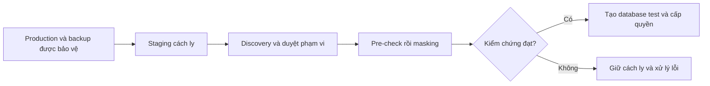

# Data masking cho môi trường kiểm thử

## Mục tiêu và bối cảnh

Trong chương **Quản lý và tối ưu cơ sở dữ liệu** của lộ trình Oracle Cloud Infrastructure (OCI), data masking giúp tạo dữ liệu kiểm thử có ích từ nguồn dữ liệu nhạy cảm mà vẫn kiểm soát người được tiếp cận dữ liệu gốc. Bài này tập trung vào Oracle Database và **Oracle Data Safe**, từ phát hiện cột nhạy cảm đến cấu hình masking, kiểm chứng dữ liệu và phát hành một môi trường kiểm thử.

Giả sử ứng dụng Java `orders-api` cần dữ liệu gần với production để kiểm thử tìm khách hàng, tạo đơn, gửi thông báo và truy vấn báo cáo. Sao chép nguyên database sang dev làm lan truyền tên, email, số điện thoại và ghi chú của khách hàng. Ngược lại, thay mọi giá trị bằng một chuỗi giống nhau có thể làm hỏng uniqueness, quan hệ giữa các bảng và các tình huống kiểm thử.

Mục tiêu là tạo bản dữ liệu **đủ đúng cho mục đích thử nghiệm và đã xử lý các thông tin cần bảo vệ**, với bằng chứng kiểm tra rõ ràng.

Sau bài học, bạn có thể:

- Phân biệt masking dữ liệu lưu trữ với redaction khi truy vấn và mã hóa.
- Thiết kế luồng production → staging cách ly → test.
- Dùng Data Discovery và sensitive data model để xác định phạm vi masking.
- Chọn masking format theo kiểu dữ liệu, tính duy nhất và quan hệ nghiệp vụ.
- Kiểm tra kết quả bằng báo cáo Data Safe, Oracle SQL và hành vi ứng dụng.
- Tự động hóa các lần refresh mà không bỏ qua bước kiểm chứng và kiểm soát quyền.

## 1. Data masking là gì và khác các biện pháp khác ra sao?

Trong bài này, masking là thay thế giá trị nhạy cảm trong bản dữ liệu dành cho môi trường phi production bằng giá trị được thiết kế cho việc sử dụng đó. Oracle Data Safe hỗ trợ phát hiện dữ liệu nhạy cảm và áp dụng masking policy lên target database. [Oracle: Oracle Data Safe Overview](https://docs.oracle.com/en-us/iaas/data-safe/doc/oracle-data-safe-overview.html).

| Biện pháp | Thay đổi dữ liệu đang được lưu? | Vai trò đối với môi trường test |
| --- | --- | --- |
| Static data masking | Thay giá trị trong bản dữ liệu được xử lý | Tạo bản test với giá trị đã thay thế |
| Data Redaction | Giữ giá trị gốc, thay cách trả kết quả theo policy | Hạn chế dữ liệu hiển thị khi truy vấn |
| Mã hóa dữ liệu | Bảo vệ biểu diễn dữ liệu bằng khóa | Bảo vệ lưu trữ hoặc đường truyền; người có quyền vẫn có thể đọc dữ liệu rõ |
| Dữ liệu tổng hợp | Tạo dữ liệu giả theo mô hình và kịch bản | Phù hợp unit test, dữ liệu biên và nhiều bài kiểm thử chức năng |

Oracle Data Redaction tác động vào kết quả truy vấn mà không thay đổi dữ liệu gốc đang lưu. TDE giải mã trong quá trình truy vấn hợp lệ. Vì vậy, chỉ bật redaction hoặc encryption chưa tạo ra một bản database đã được thay thế dữ liệu để giao cho đội test. [Oracle: Oracle Data Redaction and Other Oracle Products](https://docs.oracle.com/en/database/oracle/oracle-database/26/dbred/oracle-data-redaction-and-other-oracle-products-faqs.html).

Cũng không nên đồng nhất mọi masking với một bảo đảm không thể khôi phục. Data Safe có format **Deterministic Encryption** hỗ trợ đảo ngược; người thiết kế phải lựa chọn theo yêu cầu sử dụng. Một bộ dữ liệu đã thay tên vẫn có thể chứa tổ hợp thuộc tính đủ để nhận diện một cá nhân. [Oracle: Deterministic Encryption](https://docs.oracle.com/en-us/iaas/data-safe/doc/deterministic-encryption.html).

Ví dụ minh họa mục tiêu đầu ra, không phải kết quả mặc định của một format:

| Thuộc tính | Nguồn cần bảo vệ | Giá trị dùng trong test |
| --- | --- | --- |
| Tên | Tên khách hàng thực | `Nguoi dung thu nghiem 001` |
| Email | Email giao dịch thực | `qa-001@example.invalid` |
| Số điện thoại | Số liên lạc thực | Dữ liệu giả theo contract test hoặc NULL khi được phép |
| Mã định danh | Mã cá nhân thực | Giá trị thay thế được kiểm tra định dạng và uniqueness |
| Ghi chú | Có thể chứa thông tin tự do | Nội dung tổng hợp phù hợp kịch bản test |

## 2. Thiết kế luồng dữ liệu với staging cách ly

Oracle khuyến nghị tạo bản staging từ nguồn được bảo vệ, thực hiện discovery và masking ở đó, kiểm chứng, rồi tạo database test từ dữ liệu đã xử lý. Không cấp quyền cho developer và tester vào staging chứa dữ liệu gốc. [Oracle: Data Masking Overview — workflow](https://docs.oracle.com/en-us/iaas/data-safe/doc/data-masking-overview.html).



Ba vùng cần có người chịu trách nhiệm riêng:

| Vùng | Người được tiếp cận | Trạng thái dữ liệu |
| --- | --- | --- |
| Production / backup gốc | Nhóm vận hành và người được cấp quyền nguồn | Dữ liệu thật |
| Staging masking | Tài khoản dịch vụ và nhóm thực hiện masking | Có thể còn dữ liệu thật hoặc dữ liệu mới xử lý một phần |
| Test đã phát hành | Đội test theo quyền được cấp | Dữ liệu đã qua tiêu chí phát hành |

Trong OCI, có thể dùng compartment để tổ chức vòng đời và IAM, cùng private subnet, NSG và cơ chế kết nối phù hợp để giới hạn đường truy cập. Compartment tự nó không thay thế kiểm soát mạng hoặc quyền trong database.

Đối với `orders-api`, giữ ứng dụng test chưa được kết nối vào staging. Tắt các job, database link hoặc cấu hình tích hợp có thể liên lạc với production. Email, SMS, thanh toán và webhook phải đi tới stub hoặc sandbox của bài kiểm thử.

Cần quản lý cả backup, export, snapshot, bản sao Object Storage, log và dữ liệu thu mẫu. Masking một bộ bảng không tự thay thế các bản dữ liệu nằm ở những nơi khác. Khi yêu cầu giảm dấu vết lịch sử, cân nhắc export dữ liệu đã xử lý sang database mới, đồng thời đánh giá cơ chế phục hồi và các bản sao đi kèm.

## 3. Lập danh mục dữ liệu cần xử lý

### 3.1. Không chỉ tìm cột có tên dễ nhận ra

Data Discovery dùng sensitive types để tìm dữ liệu theo đặc điểm tên cột, dữ liệu và metadata; đồng thời hỗ trợ phát hiện quan hệ khai báo trong database và quan hệ ở mức ứng dụng. Kết quả được lưu trong **sensitive data model (SDM)**. Nếu bật thu sample, mẫu đó vẫn là dữ liệu nhạy cảm và phải giới hạn người được xem. [Oracle: Data Discovery Overview](https://docs.oracle.com/en-us/iaas/data-safe/doc/data-discovery-overview.html).

Với một ứng dụng đơn hàng, nên rà soát ít nhất:

| Nhóm dữ liệu | Ví dụ vị trí | Cách đặt câu hỏi |
| --- | --- | --- |
| Định danh trực tiếp | Tên, email, số điện thoại, mã cá nhân | Test có cần giữ giá trị thật không? |
| Thuộc tính có thể kết hợp | Ngày sinh, địa chỉ, khu vực nhỏ | Các trường kết hợp có còn nhận diện được người không? |
| Bản sao nghiệp vụ | Email người nhận trên đơn, lịch sử địa chỉ | Thay cột gốc có bỏ sót bản sao không? |
| Nội dung tự do | Ghi chú hỗ trợ, CLOB, JSON | Có thông tin nhạy cảm nằm ngoài cột chuyên biệt không? |
| Bí mật và tài khoản | Token, mật khẩu băm, thông tin kết nối | Có thể loại bỏ hoặc thay bằng tài khoản test riêng không? |
| Tài nguyên ngoài DB | File đính kèm, object, search index | Database đã xử lý nhưng tài nguyên tham chiếu còn dữ liệu thật không? |

SDM cần được rà soát theo hiểu biết ứng dụng. Một cột không bị nhận diện chưa chứng minh nó không nhạy cảm; một kết quả được gợi ý cũng có thể cần điều chỉnh loại dữ liệu.

### 3.2. Ghi rõ quan hệ giữa các cột

Ví dụ `CUSTOMERS.CUSTOMER_ID → ORDERS.CUSTOMER_ID` có thể có foreign key, nhưng `CUSTOMERS.EMAIL → ORDERS.CONTACT_EMAIL` chỉ được ứng dụng duy trì. Hai loại quan hệ đều quan trọng khi thiết kế masking.

Data Safe cho phép bổ sung quan hệ application-level vào SDM để hỗ trợ tính nhất quán. Hãy rà soát quan hệ thực tế trước khi đưa vào model; không coi hai cột cùng tên là chắc chắn cùng một định danh. [Oracle: Update Sensitive Data Models](https://docs.oracle.com/en-us/iaas/data-safe/doc/update-sensitive-data-models.html).

### 3.3. Chốt những gì cần giữ để test còn có ý nghĩa

Đội phát triển và người quản lý dữ liệu nên thống nhất:

- Giữ hoặc thay khóa kỹ thuật nào; khóa đó có liên kết được ra dữ liệu thật không?
- Các cột nào cần bằng nhau giữa nhiều bảng hoặc nhiều hệ thống?
- Những cột nào cần uniqueness, NOT NULL, checksum hoặc độ dài cụ thể?
- Tỷ lệ NULL, phân bố ngày tháng và loại dữ liệu nào cần cho test?
- Những nội dung nào được thay hoàn toàn bằng dữ liệu tổng hợp?

Quyết định giữ một surrogate key chỉ phù hợp khi đã đánh giá vai trò và khả năng liên kết của nó. Không mặc định mọi số ID đều vô hại.

## 4. Chọn masking format theo contract dữ liệu

Data Safe cung cấp các format có sẵn và cho phép tạo format riêng. Khi lựa chọn, kiểm tra kiểu dữ liệu, độ dài đầu ra, khả năng xử lý ký tự nhiều byte, tính xác định và tính duy nhất của format cụ thể. [Oracle: Create or Edit Masking Formats](https://docs.oracle.com/en-us/iaas/data-safe/doc/create-or-edit-masking-formats.html).

| Nhu cầu | Hướng lựa chọn | Điều phải kiểm tra |
| --- | --- | --- |
| Thay tên, email, điện thoại | Format phù hợp hoặc biểu thức được thiết kế | Dữ liệu đầu ra có hợp lệ với ứng dụng không? |
| Bỏ giá trị không cần test | NULL hoặc fixed value nếu schema cho phép | Có vi phạm NOT NULL hoặc UNIQUE không? |
| Giữ cùng đầu vào ra cùng giá trị | Deterministic format phù hợp | Có cùng cấu hình và phụ thuộc giữa các lần chạy không? |
| Giữ quan hệ địa chỉ nhiều cột | Group masking với tập dữ liệu thay thế | Thành phố, vùng và quốc gia còn phù hợp nhau không? |
| Giữ các liên kết cha–con | SDM, quan hệ và format được cấu hình phối hợp | Có tạo bản ghi mồ côi hoặc thay sai khóa không? |
| Xử lý JSON/CLOB hoặc cấu trúc riêng | SQL expression/UDF thích hợp | Có bỏ sót trường lồng hoặc làm hỏng cấu trúc không? |

### 4.1. Deterministic không đồng nghĩa với unique

**Deterministic Substitution** dùng bảng giá trị thay thế và seed. Kết quả xác định yêu cầu seed và dữ liệu thay thế không đổi; format này không bảo đảm uniqueness. Vì vậy, không chọn nó cho một cột UNIQUE chỉ vì muốn kết quả ổn định giữa nhiều lần refresh. [Oracle: Deterministic Substitution](https://docs.oracle.com/en-us/iaas/data-safe/doc/deterministic-substitution.html).

Ví dụ một danh sách chỉ có 100 giá trị thay thế không thể cung cấp một triệu giá trị phân biệt. Dù danh sách lớn hơn số đầu vào, vẫn phải kiểm chứng format và khả năng va chạm thay vì suy luận chỉ từ kích thước.

Đầu ra xác định còn tạo khả năng liên kết giữa các tập dữ liệu. Hãy chỉ duy trì sự ổn định xuyên môi trường khi bài kiểm thử cần nó, đồng thời quản lý seed và cấu hình theo phạm vi đã thống nhất.

### 4.2. Group masking và quan hệ giữa bảng là hai việc cần phân biệt

Group masking xử lý các cột liên quan trong **cùng một bảng** để giữ mối quan hệ giữa chúng, chẳng hạn bộ thành phố–vùng–quốc gia. Data Safe hỗ trợ một số format cụ thể cho cách xử lý nhóm này. [Oracle: Group Masking](https://docs.oracle.com/en-us/iaas/data-safe/doc/group-masking.html).

Việc giữ email khách hàng nhất quán với email lưu trên đơn hàng lại là yêu cầu giữa các bảng. Cần cấu hình quan hệ hoặc một phép biến đổi phối hợp; không chỉ đặt cùng tên nhóm rồi giả định mọi dữ liệu đã đồng bộ.

Cũng nên thận trọng với shuffle: hoán đổi các giá trị thật có thể vẫn giữ nguyên tập thông tin nhạy cảm, và nhóm ít bản ghi có thể không tạo thay đổi hữu ích. Nếu yêu cầu là loại giá trị thật khỏi tập test, hãy dùng dữ liệu thay thế đáp ứng yêu cầu đó.

### 4.3. Đừng xây dữ liệu mới từ phần nhạy cảm chưa xử lý

Biểu thức như `first_name || last_name || '@test-domain'` vẫn có thể giữ tên thật. Giữ một phần số định danh hoặc chỉ băm một miền đầu vào dễ đoán cũng không tự giải quyết toàn bộ khả năng liên kết.

Ưu tiên contract rõ ràng: đầu ra được phép chứa gì, quan hệ nào cần giữ và người nhận có thể dùng thông tin còn lại để liên kết về nguồn hay không.

## 5. Chuẩn bị target, quyền và kế hoạch phục hồi

### 5.1. Tách quyền OCI và quyền trong database

Data Safe cần quyền IAM để dùng tài nguyên của dịch vụ và quyền database cho service account trên target. Người vận hành masking cũng cần đúng phạm vi compartment chứa target, model, policy và báo cáo. [Oracle: Security and Permissions](https://docs.oracle.com/en/cloud/paas/data-safe/dsiad/datasafe_iam.html).

Trong một lab, đặt các tài nguyên liên quan cùng compartment giúp dễ kiểm tra. Production nên phân quyền theo nhiệm vụ: người tạo bản sao, người cấu hình masking và người sử dụng dữ liệu test không nhất thiết là cùng một nhóm.

Với tài khoản dịch vụ, chọn đúng khả năng cần dùng:

| Loại target | Discovery | Masking |
| --- | --- | --- |
| Non-Autonomous Oracle Database | Quyền tính năng `DATA_DISCOVERY` qua script đặc quyền của Data Safe | Quyền tính năng `MASKING` qua script |
| Autonomous Database | Role Data Safe tương ứng cho discovery | Role `DS$DATA_MASKING_ROLE` cho tài khoản thực hiện |

Non-Autonomous dùng script `datasafe_privileges.sql` theo quy trình của Oracle; Autonomous có cơ chế `DS_TARGET_UTIL`. Không thay mọi bước này bằng việc cấp `DBA` cho tài khoản ứng dụng. [Oracle: Grant Roles to the Oracle Data Safe Service Account](https://docs.oracle.com/en-us/iaas/data-safe/doc/grant-roles-oracle-data-safe-service-account-your-target-database.html).

**Lưu ý cho lab có SQL Expression bên dưới:** trên Autonomous Database, policy dùng SQL expression, UDF, post-processing function hoặc pre/post script cần tài khoản riêng cho Data Masking, thay vì mặc định dùng `DS$ADMIN`. Cung cấp credential của tài khoản riêng khi chạy pre-check và job theo yêu cầu của dịch vụ. [Oracle: Create a Data Safe Service Account — exception for Autonomous](https://docs.oracle.com/en-us/iaas/data-safe/doc/create-oracle-data-safe-service-account-your-database.html).

### 5.2. Chuẩn bị dữ liệu và không gian làm việc

Trước khi chạy masking:

- Xác nhận OCID, tên database, service/PDB, region và compartment của **staging**.
- Chuẩn bị cách tạo lại staging từ nguồn được bảo vệ nếu kết quả không đạt.
- Ngừng ghi ứng dụng trong thời gian xử lý để dữ liệu và phép kiểm chứng không thay đổi ngoài ý muốn.
- Kiểm tra tablespace, TEMP, undo, đối tượng phụ thuộc và cửa sổ thực hiện.
- Ghi lại constraint, index, trigger và các policy bảo vệ cần được kiểm tra sau job.

Không coi masking là một phép UPDATE nhỏ có thể luôn hoàn tác bằng `ROLLBACK` ở cuối phiên. Các bước của dịch vụ có thể xử lý bảng và đối tượng phụ thuộc. Nếu job thất bại, phải xác định những gì đã thay đổi trước khi tiếp tục.

## 6. Quy trình thực hiện trên Oracle Data Safe

### Bước 1: đăng ký staging và tạo sensitive data model

Đăng ký đúng target staging với Data Safe, kiểm tra kết nối và quyền service account. Trong **Data Discovery**, tạo SDM cho schema/table thuộc phạm vi. Chỉ bật thu sample nếu người thực hiện được phép lưu và xem mẫu dữ liệu đó.

Rà soát cột được phát hiện, bổ sung cột nghiệp vụ, nội dung tự do và quan hệ application-level cần thiết. SDM phải phản ánh phạm vi hiện tại của schema, không chỉ lần discovery đầu tiên.

### Bước 2: tạo và rà soát masking policy

Trong **Data Masking → Masking policies**, tạo policy từ SDM. Data Safe có thể gán format mặc định cho các cột; người thực hiện vẫn cần kiểm tra lựa chọn và các cột chưa có format phù hợp. [Oracle: Create Masking Policies](https://docs.oracle.com/en-us/iaas/data-safe/doc/create-masking-policies.html).

Rà soát theo từng cột:

```text
Schema / table / column
Loại dữ liệu nhạy cảm
Format và tham số
Quan hệ cần giữ
Độ dài / NULL / uniqueness / điều kiện áp dụng
Kết quả mong đợi và phép kiểm chứng
```

Đặc biệt kiểm tra các nhánh điều kiện. Một nhánh giữ nguyên dữ liệu hoặc điều kiện không khớp có thể để lại giá trị thật ngoài dự kiến.

### Bước 3: chạy Pre-Masking Check

Pre-check kiểm tra khả năng thực hiện job, gồm quyền, dung lượng, đối tượng phụ thuộc và các điều kiện trên target. Xem báo cáo, xử lý lỗi rồi chạy lại trước khi tiếp tục. Một job khác đang masking cùng target cũng là điều cần loại trừ. [Oracle: Pre-Masking Check](https://docs.oracle.com/en-us/iaas/data-safe/doc/pre-masking-check.html).

Pre-check đạt chứng minh các điều kiện kỹ thuật được kiểm tra đã phù hợp; nó không chứng minh policy đã bao phủ mọi dữ liệu nhạy cảm hoặc ứng dụng sẽ vượt mọi bài test.

### Bước 4: chạy job và theo dõi work request

Chọn **Mask sensitive data** hoặc **Mask data** từ policy, xác nhận target và policy, rồi cung cấp seed/credential nếu format yêu cầu. Theo dõi work request và lỗi của job. Data Safe chỉ cho một masking job hoạt động trên cùng target tại một thời điểm. [Oracle: Mask Sensitive Data on a Target Database](https://docs.oracle.com/en-us/iaas/data-safe/doc/mask-sensitive-data-target-database.html).

Trong thời gian này, staging chưa đủ điều kiện phát hành. Không mở quyền đọc cho tester chỉ vì một số bảng đã hoàn thành.

### Bước 5: kiểm chứng và tạo môi trường test

Kiểm tra báo cáo masking, phạm vi cột, các đối tượng phụ thuộc, dữ liệu đầu ra và nghiệp vụ. Sau khi đạt tiêu chí, tạo database test bằng cách clone phù hợp hoặc import dữ liệu đã xử lý vào một database mới, rồi cấp quyền cho đội test.

Kiểm tra cấu hình test một lần nữa: datasource, tài khoản, email/SMS gateway, API sandbox, job lịch và thông tin kết nối không được trỏ ngược vào production.

## 7. Thực hành với dữ liệu tổng hợp và hai bảng có quan hệ

Bài thực hành dùng **dữ liệu tự tạo hoàn toàn**, giúp học cách cấu hình mà không cần sao chép dữ liệu khách hàng thật. Các lệnh dưới đây là hướng dẫn cho người học, chưa được thực thi sẵn trên database.

### 7.1. Tạo schema dữ liệu lab

Dùng schema thử nghiệm riêng trên một target được Data Safe hỗ trợ. Nếu tên bảng đã tồn tại, xác định tài nguyên của lần lab trước trước khi tiếp tục; không ghi đè bảng nghiệp vụ.

```sql
CREATE TABLE mask_lab_customers (
    customer_id NUMBER
        CONSTRAINT ml_customers_pk PRIMARY KEY,
    full_name VARCHAR2(100) NOT NULL,
    email VARCHAR2(100) NOT NULL
        CONSTRAINT ml_customers_email_uk UNIQUE,
    phone VARCHAR2(30),
    national_id VARCHAR2(30)
);

CREATE TABLE mask_lab_orders (
    order_id NUMBER
        CONSTRAINT ml_orders_pk PRIMARY KEY,
    customer_id NUMBER NOT NULL,
    contact_email VARCHAR2(100) NOT NULL,
    total_amount NUMBER(12,2) NOT NULL,
    internal_note VARCHAR2(500),
    CONSTRAINT ml_orders_customer_fk
        FOREIGN KEY (customer_id)
        REFERENCES mask_lab_customers(customer_id),
    CONSTRAINT ml_orders_total_ck
        CHECK (total_amount >= 0)
);

INSERT INTO mask_lab_customers
    (customer_id, full_name, email, phone, national_id)
VALUES
    (1, 'Khach hang mau A', 'seed-a@example.invalid',
     'TEST-PHONE-A', 'SYNTH-ID-A');

INSERT INTO mask_lab_customers
    (customer_id, full_name, email, phone, national_id)
VALUES
    (2, 'Khach hang mau B', 'seed-b@example.invalid',
     NULL, 'SYNTH-ID-B');

INSERT INTO mask_lab_orders
    (order_id, customer_id, contact_email, total_amount, internal_note)
VALUES
    (101, 1, 'seed-a@example.invalid', 150000, 'SYNTHETIC_NOTE_A');

INSERT INTO mask_lab_orders
    (order_id, customer_id, contact_email, total_amount, internal_note)
VALUES
    (102, 1, 'seed-a@example.invalid', 250000, 'SYNTHETIC_NOTE_B');

INSERT INTO mask_lab_orders
    (order_id, customer_id, contact_email, total_amount, internal_note)
VALUES
    (103, 2, 'seed-b@example.invalid', 350000, 'SYNTHETIC_NOTE_C');

COMMIT;
```

Baseline của fixture là 2 khách hàng và 3 đơn hàng. Có hai đơn thuộc cùng khách hàng để kiểm tra phép biến đổi email có nhất quán.

### 7.2. Cấu hình policy lab

Chạy discovery hoặc thêm cột thủ công vào SDM. Các marker giả như `SYNTH-ID-A` có thể không khớp một sensitive type thực tế; vẫn phải đưa các cột cần thử vào phạm vi policy.

Chọn cấu hình sau cho lab:

| Cột | Cách xử lý | Contract đầu ra |
| --- | --- | --- |
| `CUSTOMERS.FULL_NAME` | Fixed String | `Nguoi dung kiem thu` |
| `CUSTOMERS.EMAIL` | SQL Expression theo `CUSTOMER_ID` | Email test duy nhất cho từng khách hàng lab |
| `CUSTOMERS.PHONE` | Null Value | NULL; cột lab cho phép NULL |
| `CUSTOMERS.NATIONAL_ID` | Fixed String | `MASKED`; cột lab không có UNIQUE |
| `ORDERS.CONTACT_EMAIL` | Cùng SQL Expression theo `CUSTOMER_ID` của bảng đơn | Khớp email mới của khách hàng |
| `ORDERS.INTERNAL_NOTE` | Fixed String | `Noi dung kiem thu` |
| Các ID và `TOTAL_AMOUNT` | Giữ nguyên trong lab tổng hợp | Giữ quan hệ và số liệu nghiệp vụ của fixture |

`CUSTOMERS` và `ORDERS` trong bảng trên viết gọn cho `MASK_LAB_CUSTOMERS` và `MASK_LAB_ORDERS`.

Trong cả hai ô SQL Expression dành cho email, dùng:

```sql
'qa-' || TO_CHAR(%CUSTOMER_ID%, 'FM9999999990') || '@example.invalid'
```

Đây là biểu thức cấu hình của **Data Safe**, không phải một câu SELECT độc lập. Data Safe dùng `%COLUMN_NAME%` để tham chiếu cột cùng bảng trong SQL Expression. [Oracle: SQL Expression masking format](https://docs.oracle.com/en-us/iaas/data-safe/doc/sql-expression.html).

Với fixture ID 1 và 2, đầu ra mong đợi là `qa-1@example.invalid` và `qa-2@example.invalid`. ID được giữ nguyên ở cả hai bảng nên hai biểu thức phối hợp được với nhau.

Đây là công thức riêng cho **lab tổng hợp có miền ID nhỏ**. Nó không chứng minh một công thức dựa trên ID production bảo vệ được danh tính; số ID, độ dài, quan hệ và khả năng liên kết phải được đánh giá lại trong dữ liệu thật.

Trong lab này, tính duy nhất đến từ phép tạo chuỗi khác nhau cho các ID đã biết, không đến từ việc gắn nhãn “SQL Expression”. `Fixed String` chỉ được dùng ở cột không có yêu cầu UNIQUE và nơi mất phân bố dữ liệu là chấp nhận được.

### 7.3. Chạy pre-check và masking

Xác nhận policy chỉ nhắm đúng schema/bảng lab, chuẩn bị tài khoản và credential theo phần 5, chạy pre-check rồi mới chạy job. Sau khi job kết thúc, giữ nguyên vùng lab cách ly trong lúc thực hiện các phép kiểm chứng tiếp theo.

## 8. Kiểm chứng kết quả: bảo vệ dữ liệu và tính hữu dụng

### 8.1. Đọc báo cáo Data Safe

Báo cáo masking cho biết target, policy, thời gian, bảng/cột và số giá trị được xử lý. Đối chiếu danh sách đó với phạm vi đã chốt; báo cáo có nhiều cột được mask chưa có nghĩa mọi cột cần bảo vệ đều đã nằm trong policy. [Oracle: Download Data Masking Reports](https://docs.oracle.com/en-us/iaas/data-safe/doc/download-data-masking-reports.html).

Báo cáo và work request là bằng chứng thực thi. Kiểm tra dữ liệu và ứng dụng cung cấp bằng chứng đầu ra đáp ứng yêu cầu. Cần cả hai trước khi phát hành.

### 8.2. Kiểm tra số dòng và uniqueness của lab

Trong schema lab sau masking:

```sql
SELECT 'CUSTOMERS' AS dataset, COUNT(*) AS row_count
FROM mask_lab_customers
UNION ALL
SELECT 'ORDERS', COUNT(*)
FROM mask_lab_orders;
```

Kỳ vọng của fixture là 2 và 3. Đây là policy thay giá trị, không có mục tiêu xóa dòng; nếu số dòng khác baseline, phải giải thích được nguyên nhân.

Kiểm tra có nhóm email trùng không:

```sql
SELECT COUNT(*) AS duplicate_email_groups
FROM (
    SELECT email
    FROM mask_lab_customers
    WHERE email IS NOT NULL
    GROUP BY email
    HAVING COUNT(*) > 1
);
```

Kỳ vọng là 0. Với dữ liệu thật, phải kiểm tra cả trạng thái constraint, giá trị NULL và các biểu thức uniqueness mà ứng dụng sử dụng, chẳng hạn email không phân biệt hoa thường.

### 8.3. Kiểm tra quan hệ cha–con và email nghiệp vụ

Tìm đơn hàng không còn khách hàng:

```sql
SELECT COUNT(*) AS orphan_orders
FROM mask_lab_orders o
LEFT JOIN mask_lab_customers c
  ON c.customer_id = o.customer_id
WHERE c.customer_id IS NULL;
```

Tìm email trên đơn không khớp email khách hàng theo contract lab:

```sql
SELECT COUNT(*) AS email_mismatches
FROM mask_lab_orders o
JOIN mask_lab_customers c
  ON c.customer_id = o.customer_id
WHERE o.contact_email IS NULL
   OR c.email IS NULL
   OR o.contact_email <> c.email;
```

Cả hai kỳ vọng là 0. Phép kiểm tra email bổ sung giá trị mà foreign key trên `CUSTOMER_ID` không bao phủ.

Trong ứng dụng thực tế, email trên đơn có thể là ảnh chụp lịch sử và được phép khác email hiện tại. Khi đó phải định nghĩa lại contract kiểm chứng; không áp một điều kiện lab lên mô hình nghiệp vụ khác.

### 8.4. Kiểm tra format và các cột được thay thế

Kiểm tra email khách hàng đúng phép biến đổi đã thiết kế:

```sql
SELECT COUNT(*) AS unexpected_customer_emails
FROM mask_lab_customers
WHERE email IS NULL
   OR email <>
       'qa-' || TO_CHAR(customer_id, 'FM9999999990') || '@example.invalid';
```

Kiểm tra các giá trị cố định và NULL:

```sql
SELECT COUNT(*) AS unexpected_customer_values
FROM mask_lab_customers
WHERE full_name IS NULL
   OR full_name <> 'Nguoi dung kiem thu'
   OR phone IS NOT NULL
   OR national_id IS NULL
   OR national_id <> 'MASKED';

SELECT COUNT(*) AS unexpected_order_notes
FROM mask_lab_orders
WHERE internal_note IS NULL
   OR internal_note <> 'Noi dung kiem thu';
```

Mỗi truy vấn kỳ vọng trả 0. Các truy vấn này là tiêu chí cụ thể của fixture; không phải công cụ phát hiện mọi dạng thông tin nhạy cảm trong một database bất kỳ.

### 8.5. Kiểm tra constraint và đối tượng phụ thuộc

```sql
SELECT table_name, constraint_name, constraint_type, status, validated
FROM user_constraints
WHERE table_name IN ('MASK_LAB_CUSTOMERS', 'MASK_LAB_ORDERS')
ORDER BY table_name, constraint_name;
```

Đối chiếu với baseline: các constraint mong đợi cần còn hoạt động và được xác nhận phù hợp. Rà soát thêm index, trigger, đối tượng invalid và policy bảo vệ liên quan đến những bảng đã xử lý.

Không kết luận thành công bằng việc tạm tắt constraint rồi bỏ qua nó. Dữ liệu có thể đọc được nhưng ứng dụng vẫn lỗi ở thao tác ghi tiếp theo.

### 8.6. Kiểm tra chức năng và dữ liệu còn sót

Chạy ứng dụng test với một tài khoản chỉ có quyền cần thiết, kiểm tra:

- Tìm khách hàng và tải danh sách đơn có kết quả đúng.
- Tạo hoặc cập nhật đơn giữ được quan hệ và kiểm tra dữ liệu.
- Các luồng xác thực không còn sử dụng credential production được sao chép.
- Email/SMS/webhook đi tới stub hoặc sandbox.
- Log, file xuất, báo cáo và object được tham chiếu không làm lộ bản dữ liệu gốc.

Có thể discovery lại để tìm phạm vi bỏ sót, nhưng dữ liệu giả vẫn có thể khớp mẫu “email” hoặc “số điện thoại”. Một cột tiếp tục được phân loại nhạy cảm sau masking không tự chứng minh giá trị gốc còn nguyên; cần kiểm tra theo policy và mục tiêu bảo vệ.

Ngược lại, vài mẫu ngẫu nhiên không còn thông tin thật cũng chưa chứng minh mọi bản ghi đã xử lý. Kết hợp phạm vi policy, báo cáo, truy vấn kiểm tra và rà soát những nơi chứa dữ liệu phi cấu trúc.

## 9. Xử lý lỗi, bảng ánh xạ và các script bổ sung

| Tình huống | Hướng xử lý | Điều kiện giữ cách ly |
| --- | --- | --- |
| Job dừng giữa chừng | Xem work request, bảng đã xử lý và lỗi trước khi chọn phục hồi hoặc chạy tiếp | Chưa xác nhận toàn bộ phạm vi hoàn thành |
| Format tạo giá trị quá dài | Điều chỉnh format hoặc miền đầu ra, chạy pre-check lại | Còn cột không đạt hoặc bị bỏ sót |
| Va chạm UNIQUE | Chọn format/miền giá trị có khả năng đáp ứng, kiểm tra lại | Còn duplicate hoặc constraint chưa được khôi phục |
| Dữ liệu cha–con không khớp | Rà soát SDM, quan hệ và phép biến đổi phối hợp | Còn bản ghi mồ côi hoặc lệch contract |
| Ứng dụng lỗi validation | Sửa contract dữ liệu test hoặc format theo nhu cầu kiểm thử | Chưa xác nhận tính hữu dụng |
| Có dữ liệu ngoài phạm vi | Bổ sung phạm vi, xử lý bản sao và tài nguyên liên quan | Vẫn còn giá trị gốc ở nơi người test truy cập được |

Data Safe hỗ trợ rerun job lỗi từ bước được chọn. Trước khi dùng, xác định trạng thái hiện tại và tính phù hợp của việc chạy tiếp; chạy lại từ đầu trên dữ liệu đã mask một phần có thể không cho kết quả như một lần chạy trên bản staging mới. [Oracle: Mask Sensitive Data — rerun a failed job](https://docs.oracle.com/en-us/iaas/data-safe/doc/mask-sensitive-data-target-database.html).

Đặc biệt kiểm tra tùy chọn xóa temporary mapping tables. Các bảng ánh xạ có thể chứa cặp giá trị gốc–giá trị thay thế; không giữ chúng trong môi trường được giao cho người dùng test. Data Safe có tùy chọn quản lý việc xóa các bảng này và làm mới statistics sau masking. [Oracle: Edit Masking Policies](https://docs.oracle.com/en-us/iaas/data-safe/doc/edit-masking-policies.html).

Nếu sử dụng pre/post masking scripts, kiểm tra log của từng bước. Theo tài liệu, lỗi của statement/block có thể được ghi nhận mà chuỗi thực thi vẫn tiếp tục; khi retry vì kết nối, script có thể chạy lại từ đầu. Vì vậy cần thiết kế script có khả năng chạy lại an toàn và kiểm tra điều kiện hậu xử lý độc lập. [Oracle: Create Masking Policies — pre/post script behavior](https://docs.oracle.com/en-us/iaas/data-safe/doc/create-masking-policies.html).

Ví dụ, pipeline không được phát hành chỉ vì trạng thái job cuối cùng thành công nếu post-script dùng để xóa bảng phụ đã không đạt. Tương tự, kiểm tra lại chính sách redaction, auditing hoặc bảo vệ khác khi pre-check nêu chúng cần được tái tạo sau masking.

## 10. Tự động hóa refresh mà vẫn kiểm soát được đầu ra

Mỗi lần refresh từ production đưa một bản dữ liệu nguồn mới vào quy trình. Không coi database test đã mask lần trước là vẫn an toàn sau khi được nạp lại dữ liệu chưa xử lý.

Luồng tự động hóa có thể được mô tả bằng pseudocode:

```text
tạo staging cách ly từ nguồn được bảo vệ
xác nhận target thuộc phạm vi cho phép
đối chiếu schema với phiên bản SDM và policy
nếu schema có thay đổi chưa xử lý: dừng phát hành
chạy pre-check và xử lý lỗi
chạy masking rồi kiểm tra báo cáo và script liên quan
kiểm tra dữ liệu, quan hệ, đối tượng và hành vi ứng dụng
nếu mọi tiêu chí đạt:
    tạo bản test, cấu hình sandbox và cấp quyền
nếu có tiêu chí không đạt:
    giữ cách ly và ghi nguyên nhân
thu hồi quyền tạm thời và xử lý tài nguyên theo thời hạn
```

Khi SDM thay đổi, Data Safe có khả năng so sánh và đồng bộ những thay đổi được chọn sang policy. Policy cũ không tự chứng minh đã bao phủ các cột vừa thêm vào schema. [Oracle: Edit Masking Policies — compare with sensitive data model](https://docs.oracle.com/en-us/iaas/data-safe/doc/edit-masking-policies.html).

Nên quản lý một phiên bản cấu hình có thể đối chiếu gồm: SDM, policy, format tùy chỉnh, bộ dữ liệu thay thế, quy tắc seed, schema và bộ kiểm chứng. Credential và seed cần được quản lý theo mức nhạy cảm của cơ chế dùng, không in vào log CI để tiện chẩn đoán.

Về chi phí, tính cả dung lượng staging, test, bản backup, không gian tạm, thời gian chạy và khả năng phục hồi. Chọn kích thước dữ liệu phù hợp mục tiêu kiểm thử; một bản nhỏ chỉ hữu ích nếu vẫn giữ được quan hệ và kịch bản cần thử.

Đối với kiểm thử hiệu năng, số dòng giống nhau chưa đủ. Masking có thể làm thay đổi độ phân biệt, độ lệch dữ liệu và selectivity của cột. Cần đánh giá lại statistics và tính đại diện của workload, thay vì dùng bộ fixed value của lab để dự đoán kế hoạch thực thi production.

## 11. Điều kiện phát hành và hoàn thành bài thực hành

Một bản dữ liệu có thể được đưa vào môi trường test khi đã có đủ bằng chứng:

1. Đúng target và nguồn bản sao, với staging được giới hạn truy cập.
2. Phạm vi cột và quan hệ đã được rà soát theo schema hiện tại.
3. Pre-check, job, báo cáo và các bước phụ trợ đã được kiểm tra.
4. Không còn mapping table hoặc bản dữ liệu gốc trong phạm vi đội test được phép truy cập.
5. Uniqueness, NOT NULL, quan hệ và các contract nghiệp vụ cần thiết đều đạt.
6. Ứng dụng chạy được với dữ liệu đã xử lý và các tích hợp sandbox.
7. Có chủ sở hữu, phiên bản cấu hình và thời hạn giữ tài nguyên.

Với fixture trong bài, lưu bằng chứng số dòng 2/3, các truy vấn đếm lỗi bằng 0, constraint phù hợp và thao tác đọc/tạo đơn trên ứng dụng test. Đây là kết quả người học cần tự kiểm chứng; tài liệu không khẳng định đã thực thi những bước đó.

Sau lab, kết thúc các transaction thử nghiệm, thu hồi quyền tạm và dọn đúng tài nguyên đã tạo riêng khi không còn cần. Nếu giữ môi trường để học tiếp, tiếp tục quản lý quyền và cấu hình sandbox.

Giá trị của data masking nằm ở cả hai phía: giảm việc lan truyền dữ liệu nhạy cảm và giữ một tập dữ liệu kiểm thử thực sự dùng được. Oracle Data Safe hỗ trợ các bước kỹ thuật, còn phạm vi dữ liệu, quan hệ cần giữ và tiêu chí phát hành phải được thiết kế rõ ràng cho ứng dụng.
