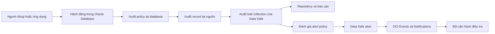

# Database activity auditing và cảnh báo truy cập bất thường

Trong chương **Quản lý và tối ưu cơ sở dữ liệu** của module Oracle Cloud Infrastructure (OCI), auditing giúp trả lời: ai đã truy cập database, thao tác gì, lên đối tượng nào, vào thời điểm nào và kết quả ra sao. Khi kết hợp audit với quy tắc cảnh báo và quy trình điều tra, đội vận hành có thể phát hiện sớm việc dùng sai tài khoản, thay đổi quyền ngoài kế hoạch hoặc truy cập dữ liệu qua đường kết nối không mong đợi.

Bài học tập trung vào Oracle Database và Oracle Data Safe trên OCI. Việc triển khai gắn với compartment, IAM, kết nối VCN, lưu giữ log, giám sát và chi phí. Các ví dụ SQL dùng dữ liệu giả trong database lab; chúng là hướng dẫn thực hành, không phải yêu cầu chạy lệnh trên production.

## 1. Kết quả cần đạt

Sau bài học, bạn có thể:

- Phân biệt database audit với OCI Audit, log ứng dụng và cơ chế ngăn chặn truy cập.
- Thiết kế phạm vi audit theo tài khoản, hành động, đối tượng và kết quả thao tác.
- Kiểm tra Unified Auditing và đọc bằng chứng từ `UNIFIED_AUDIT_TRAIL`.
- Giải thích vai trò của audit policy, audit trail, alert policy và notification.
- Thu thập audit vào Data Safe và tạo cảnh báo từ điều kiện đã kiểm chứng.
- Xây dựng dấu hiệu truy cập bất thường mà không đồng nhất mọi lỗi đăng nhập với tấn công.
- Kiểm soát quyền đọc log, dung lượng, retention và chất lượng đường thu thập.

## 2. Phân biệt các lớp quan sát và kiểm soát

### 2.1. Database audit và OCI Audit

OCI Audit ghi nhận các lời gọi tới public API endpoint được dịch vụ hỗ trợ, bao gồm hoạt động qua Console, CLI hoặc SDK. Nó cung cấp bằng chứng về thao tác trên tài nguyên OCI. Nguồn: [Overview of Audit](https://docs.oracle.com/en-us/iaas/Content/Audit/Concepts/auditoverview.htm).

Database audit ghi nhận hoạt động trong Oracle Database theo cơ chế và policy tương ứng. Một người có thể kết nối bằng SQL Developer và đọc bảng mà không thực hiện một API quản trị OCI nào cho từng câu SQL. Vì vậy, chỉ nhìn OCI Audit không đủ để xác định ai đã đọc bảng khách hàng.

| Lớp | Ví dụ câu hỏi | Bằng chứng cần tìm |
| --- | --- | --- |
| IAM và tài nguyên OCI | Ai đổi cấu hình hạ tầng hoặc quyền truy cập cloud? | OCI Audit và dữ liệu IAM liên quan |
| Oracle Database | Tài khoản nào đọc bảng hoặc thay đổi quyền? | Database audit record |
| Ứng dụng | Người dùng nghiệp vụ nào gửi yêu cầu? | Log ứng dụng, request ID và danh tính đã xác thực |
| Mạng | Kết nối tới database đi qua đường nào? | Log mạng hoặc dữ liệu kết nối phù hợp |
| Hiệu năng | Truy vấn gây tải bao nhiêu? | Dữ liệu hiệu năng, execution plan và công cụ giám sát |

Các lớp này bổ sung cho nhau. Danh tính IAM, database user và người dùng ứng dụng có thể khác nhau; không nối chúng chỉ bằng việc thấy một tên giống nhau.

### 2.2. Audit ghi nhận; kiểm soát truy cập quyết định quyền thực hiện

Một câu `SELECT` hợp lệ về quyền vẫn có thể đáng điều tra nếu chạy từ máy lạ hoặc tài khoản được dùng ngoài nhiệm vụ. Ngược lại, một thao tác bị từ chối vẫn có thể tạo bằng chứng hữu ích.

Audit không tự thay thế:

- Quyền database, role và nguyên tắc cấp quyền tối thiểu.
- Chính sách IAM và kiểm soát đường kết nối mạng.
- Quản lý credential và tài khoản đặc quyền.
- Các cơ chế bảo vệ chuyên biệt khi môi trường có yêu cầu tương ứng.

Cảnh báo dựa trên audit thường xuất hiện sau khi sự kiện đã xảy ra và log đã được xử lý. Không trình bày nó như một cơ chế chặn tức thời mọi câu SQL bất thường.

## 3. Hiểu chuỗi từ hành động đến thông báo

Oracle Data Safe Activity Auditing thu thập audit record từ target database vào repository của Data Safe để phân tích và báo cáo. Đăng ký target, cấu hình chính sách và bắt đầu collection là các công việc riêng. Nguồn: [Activity Auditing Overview](https://docs.oracle.com/en-us/iaas/data-safe/doc/activity-auditing-overview.html).

Data Safe tạo alert khi audit record thu thập khớp alert policy đang áp dụng. Không có record phù hợp thì không có alert. Nguồn: [Alerts Overview](https://docs.oracle.com/en-us/iaas/data-safe/doc/alerts-overview.html).



Bốn khái niệm cần giữ tách biệt:

| Thành phần | Vai trò |
| --- | --- |
| Audit policy tại database | Quy định hoạt động cần được ghi nhận |
| Audit trail collection | Đọc và chuyển bản ghi từ nguồn vào Data Safe |
| Alert policy | Xác định điều kiện trên bản ghi để tạo cảnh báo |
| Notification | Chuyển thông tin cảnh báo tới nơi tiếp nhận |

Một kiểm tra xuyên suốt phải chứng minh được từng mắt xích. “Không nhận email” chưa đủ xác định lỗi ở database; “có log trong database” cũng chưa chứng minh notification hoạt động.

## 4. Thiết kế phạm vi audit theo rủi ro

### 4.1. Bắt đầu từ câu hỏi điều tra

Không bắt đầu bằng mục tiêu “ghi lại mọi thứ”. Hãy xác định những hành vi cần có bằng chứng và hành động sẽ thực hiện khi phát hiện chúng.

| Mục tiêu | Dữ liệu nên có | Ví dụ tín hiệu cần điều tra |
| --- | --- | --- |
| Phát hiện dùng sai credential | Đăng nhập thành công/thất bại, tài khoản và nguồn kết nối | Nhiều lần thất bại rồi thành công từ nguồn chưa biết |
| Theo dõi đặc quyền | Hoạt động quản trị và thay đổi quyền | Cấp quyền mạnh ngoài đợt bảo trì |
| Bảo vệ dữ liệu quan trọng | Truy cập các bảng hoặc thao tác đã xác định | Tài khoản báo cáo đọc đối tượng ngoài phạm vi nhiệm vụ |
| Phát hiện thay đổi cấu trúc | DDL và đối tượng bị tác động | Sửa procedure hoặc drop bảng ngoài kế hoạch |
| Bảo vệ chính auditing | Thay đổi policy và quản lý audit trail | Tắt policy ngay trước một chuỗi truy cập đáng ngờ |
| Phân biệt đường ứng dụng với truy cập trực tiếp | Database user, chương trình, host và ngữ cảnh ứng dụng | Service account xuất hiện từ máy làm việc cá nhân |

Một policy cần nêu đối tượng, user/role, hành động, phạm vi PDB/CDB và kết quả cần ghi. Nếu chỉ audit thao tác thất bại, bạn sẽ thiếu bằng chứng về thao tác thành công bằng credential hợp lệ bị lạm dụng.

### 4.2. Unified Auditing và fine-grained auditing

Unified Auditing cho phép cấu hình audit theo hành động, quyền và đối tượng. Khi cần kiểm soát điều kiện chi tiết như cột hoặc nội dung được truy cập, Oracle có fine-grained auditing thông qua `DBMS_FGA`. Nguồn: [Lựa chọn loại auditing](https://docs.oracle.com/en/database/oracle/oracle-database/19/dbseg/steps-provision-unified-audit-policies.html).

Ví dụ, “audit mọi lần đọc bảng giả lập khách hàng” phù hợp để bắt đầu bằng object action policy. “Chỉ quan tâm truy cập cột nhạy cảm khi một điều kiện dữ liệu thỏa mãn” cần thiết kế tinh hơn. Khi chọn FGA, kiểm tra semantics và hạn chế trên phiên bản database, đồng thời đo tác động của policy trên workload đại diện. Nguồn: [Fine-Grained Auditing](https://docs.oracle.com/en/database/oracle/oracle-database/19/dbseg/value-based-auditing-fine-grained-audit-policies.html).

Một audit record không mặc định chứng minh số dòng đã bị lấy ra hoặc lượng dữ liệu đã truyền qua mạng. Muốn kết luận có trích xuất dữ liệu lớn, cần kết hợp thêm bằng chứng phù hợp; nhiều lần `SELECT` chỉ là một tín hiệu.

### 4.3. Tạo baseline để đánh giá “bất thường”

Baseline là mô tả hành vi được chấp nhận trong một phạm vi cụ thể:

- Database user nào phục vụ ứng dụng nào?
- Các host, chương trình và đường kết nối dự kiến là gì?
- Những thời điểm nào có batch, báo cáo hoặc bảo trì?
- Ai được phép thay đổi quyền và theo yêu cầu thay đổi nào?
- Những bảng nào chỉ một nhóm công việc nhất định được đọc?

Baseline phải có chủ sở hữu và thời hạn đánh giá lại. Một ngoại lệ tạm thời cho migration không nên trở thành allowlist vĩnh viễn. Đừng dùng duy nhất “khác hôm qua” làm bằng chứng xâm nhập khi ứng dụng vừa đổi kiến trúc.

## 5. Chuẩn bị quyền, target và kết nối trên OCI

### 5.1. Tách quyền OCI và quyền bên trong database

Có ít nhất ba nhóm quyền cần phân biệt:

| Chủ thể | Quyền cần xem xét |
| --- | --- |
| Người xem báo cáo/cảnh báo | Quyền đọc tài nguyên và dữ liệu Data Safe trong compartment được giao |
| Người cấu hình audit và collection | Quyền quản lý các thành phần cần thiết của Data Safe |
| Service account tại database | Quyền thu thập audit và, nếu được giao, quyền cấu hình audit |

Trong Oracle Database, `AUDIT_ADMIN` phục vụ quản lý auditing; `AUDIT_VIEWER` phục vụ xem và phân tích audit. Ở môi trường multitenant, cần xét đúng container khi cấu hình và truy vấn. Nguồn: [Introduction to Auditing](https://docs.oracle.com/en/database/oracle/oracle-database/19/dbseg/introduction-to-auditing.html).

Với OCI IAM, ví dụ nhóm đọc tài nguyên Activity Auditing:

```text
Allow group Default/DbAuditReaders to read data-safe-audit-family in compartment DbSecurity
```

Thay identity domain, group và compartment bằng giá trị thực. Family này bao gồm nhiều resource liên quan; nếu cần thu hẹp, xét các resource type như `data-safe-audit-events`. Quyền trên Alerts, Events và Notifications phải được thiết kế theo nhiệm vụ tương ứng. Nguồn: [Activity Auditing Resources](https://docs.oracle.com/en-us/iaas/data-safe/doc/activity-auditing-resources.html).

Không cấp quyền quản lý toàn tenancy chỉ để một người tải báo cáo audit. Đồng thời, không xem người đọc audit là người được phép sửa policy hoặc xóa dữ liệu audit.

### 5.2. Chuẩn bị service account đúng loại target

Data Safe dùng các role khác nhau giữa Autonomous Database và non-Autonomous Database. Tài liệu phân biệt role phục vụ audit collection với role phục vụ audit setting; chỉ cấp những khả năng cần sử dụng. Nguồn: [Role cho Data Safe service account](https://docs.oracle.com/en-us/iaas/data-safe/doc/grant-roles-oracle-data-safe-service-account-your-target-database.html).

Lập danh sách quyền theo mô hình vận hành. Nếu đội DBA tự quản lý policy tại nguồn, nhu cầu cấp quyền sửa policy cho đường thu thập phải được đánh giá riêng. Dùng cơ chế cấp quyền Oracle hướng dẫn cho loại target và phiên bản đang triển khai, không tự thay bằng một tài khoản DBA dùng chung.

### 5.3. Kiểm tra kết nối VCN và database

Data Safe có lựa chọn kết nối trực tiếp hoặc qua private endpoint/on-premises connector tùy loại và vị trí database. Với địa chỉ private, phải chọn phương án có đường kết nối thực tế tới target. Nguồn: [Connectivity Options for Target Databases](https://docs.oracle.com/en-us/iaas/data-safe/doc/connectivity-options-target-databases.html).

Khi target ở private subnet, kiểm tra lần lượt:

1. Endpoint, service name và cổng listener có đúng database/PDB không?
2. DNS và route có đưa kết nối tới đúng nơi không?
3. NSG hoặc security list có cho phép đúng luồng không?
4. Credential, TLS và wallet có phù hợp phương thức đã chọn không?
5. Tài khoản thu thập có quyền đọc đúng audit trail không?

Cổng mở chưa chứng minh xác thực thành công; đăng nhập được chưa chứng minh có quyền đọc trail. Phân lớp kiểm tra giúp tránh việc mở rộng quyền mạng hoặc quyền database mà không xử lý nguyên nhân.

## 6. Kiểm tra Unified Auditing trước khi tạo policy

Các ví dụ trong phần này lấy Oracle Database 19c làm mốc cú pháp. Với Autonomous Database hoặc phiên bản khác, đối chiếu quyền được dịch vụ cho phép và policy hiện có trước khi áp dụng. Không suy ra mọi phiên bản có cùng bộ policy mặc định.

### 6.1. Xác định container và trạng thái audit

Kết nối bằng tài khoản có quyền xem metadata cần thiết, trong đúng PDB của lab:

```sql
SELECT SYS_CONTEXT('USERENV', 'DB_NAME') AS db_name,
       SYS_CONTEXT('USERENV', 'CON_NAME') AS con_name,
       SYS_CONTEXT('USERENV', 'SESSION_USER') AS session_user
FROM dual;

SELECT value
FROM v$option
WHERE parameter = 'Unified Auditing';
```

Ở Oracle Database 19c, giá trị từ `V$OPTION` cho biết đã chuyển sang pure unified auditing hay chưa. Giá trị `FALSE` không tự chứng minh database không có unified audit: mixed mode vẫn là trường hợp cần xem xét. Nguồn: [Chế độ và phạm vi auditing](https://docs.oracle.com/en/database/oracle/oracle-database/19/dbseg/introduction-to-auditing.html).

Không tự chuyển chế độ audit hoặc thay đổi cấu hình instance chỉ để hoàn thành ví dụ. Trước hết xác minh audit policy và record thực tế trong cấu hình hiện có.

### 6.2. Xem policy đang được bật

```sql
SELECT policy_name,
       enabled_option,
       entity_name,
       entity_type,
       success,
       failure
FROM audit_unified_enabled_policies
ORDER BY policy_name, entity_name;
```

View này cho biết policy, đối tượng được áp dụng và việc ghi nhận thao tác thành công/thất bại. Policy tồn tại trong danh mục định nghĩa chưa đồng nghĩa đã được bật. Nguồn: [AUDIT_UNIFIED_ENABLED_POLICIES](https://docs.oracle.com/en/database/oracle/oracle-database/19/refrn/AUDIT_UNIFIED_ENABLED_POLICIES.html).

Ví dụ, Oracle Database 19c có `ORA_LOGON_FAILURES` cho đăng nhập thất bại, nhưng trạng thái mặc định có thể khác giữa database tạo mới và database nâng cấp. Hãy kiểm tra trạng thái tại target. Nguồn: [Predefined Unified Audit Policies](https://docs.oracle.com/en/database/oracle/oracle-database/19/dbseg/auditing-activities-predefined-unified-audit-policies.html).

## 7. Thực hành audit trên bảng dữ liệu giả

Mục tiêu lab là quan sát một lần đọc bảng và một lần đăng nhập thất bại bằng tài khoản thử nghiệm đã được giao.

Điều kiện ban đầu:

- Có PDB lab cho phép Unified Auditing theo cấu hình đang dùng.
- Schema `LAB_APP` và user `LAB_READER` đã được quản trị viên tạo.
- `LAB_APP` có quyền tạo bảng và quota cần thiết; `LAB_READER` có quyền đăng nhập.
- Người cấu hình policy có quyền audit phù hợp; người đọc bằng chứng có quyền xem audit.
- Tên bảng và policy dưới đây chưa bị bài thực hành khác sử dụng.

Việc tạo user và quản lý mật khẩu nằm trong quy trình cấp tài khoản của lab. Không đặt mật khẩu thật vào script, lịch sử terminal hoặc tài liệu chia sẻ.

### 7.1. Tạo đối tượng giả lập

Kết nối với `LAB_APP` trong PDB lab:

```sql
CREATE TABLE customer_demo (
    customer_id       NUMBER PRIMARY KEY,
    full_name         VARCHAR2(100),
    sensitivity_label VARCHAR2(20)
);

INSERT INTO customer_demo
    (customer_id, full_name, sensitivity_label)
VALUES
    (1, 'Demo Customer A', 'SAMPLE');

COMMIT;

GRANT SELECT ON customer_demo TO LAB_READER;
```

Tên khách hàng và nhãn chỉ là dữ liệu giả. Quyền `SELECT` khiến thao tác đọc trong lab thành công; việc có alert sau đó không làm thao tác này trở thành vi phạm quyền database.

### 7.2. Tạo và bật policy

Kết nối bằng người có quyền quản lý audit, vẫn trong đúng PDB:

```sql
CREATE AUDIT POLICY lab_customer_access
    ACTIONS SELECT ON LAB_APP.CUSTOMER_DEMO;

AUDIT POLICY lab_customer_access BY LAB_READER;

CREATE AUDIT POLICY lab_reader_logon
    ACTIONS LOGON;

AUDIT POLICY lab_reader_logon BY LAB_READER;
```

Policy đầu ghi nhận thao tác đọc đối tượng đã chọn. Policy thứ hai ghi nhận đăng nhập của user lab; ví dụ không thêm điều kiện chỉ thành công hoặc chỉ thất bại. Đây là policy giới hạn cho thực hành, chưa phải baseline giám sát mọi user của production.

Cú pháp object action dùng `CREATE AUDIT POLICY ... ACTIONS ... ON ...`. Tạo xong cần bật bằng `AUDIT POLICY`. Nguồn: [Auditing Object Actions](https://docs.oracle.com/en/database/oracle/oracle-database/19/dbseg/auditing-object-actions.html).

Để việc thử nghiệm có kết quả rõ ràng, mở **phiên mới** của user được audit sau khi bật policy. Với cơ chế áp dụng policy trên 19c, phiên đã mở từ trước có thể chưa mang cấu hình audit mới. Nguồn: [Enabling and Applying Unified Audit Policies](https://docs.oracle.com/en/database/oracle/oracle-database/19/dbseg/enabling-and-applying-unified-audit-policies-users-and-roles.html).

### 7.3. Sinh một lần đọc có thể nhận diện

Trong phiên mới của `LAB_READER`:

```sql
BEGIN
    DBMS_SESSION.SET_IDENTIFIER('audit-lab-request-001');
END;
/

SELECT customer_id, full_name
FROM LAB_APP.CUSTOMER_DEMO
WHERE customer_id = 1;
```

Client identifier giúp liên hệ thao tác với yêu cầu thử nghiệm. Đây là ngữ cảnh do phiên/ứng dụng cung cấp, không phải bằng chứng xác thực độc lập về người dùng cuối.

Nếu ứng dụng dùng connection pool, cần đặt và xóa ngữ cảnh đúng vòng đời request để tránh gán thao tác của người này cho người khác. Với logon record, đừng kỳ vọng identifier được đặt sau khi kết nối sẽ xuất hiện ngược trở lại trên sự kiện đăng nhập trước đó. Nguồn: [Client identifier trong audit](https://docs.oracle.com/en/database/oracle/oracle-database/19/dbseg/troubleshooting-for-audit.html).

### 7.4. Thử một lần đăng nhập thất bại

Dùng SQL*Plus hoặc công cụ tương đương, chọn đúng tài khoản lab và nhập sai mật khẩu **một lần** ở prompt. Trước khi thử, xác nhận giới hạn failed login của tài khoản và cách mở khóa trong lab. Không dùng tài khoản ứng dụng đang phục vụ người dùng.

Ví dụ lệnh kết nối không chứa mật khẩu:

```text
sqlplus LAB_READER@<connect_identifier_cua_PDB_lab>
```

Sau đó đăng nhập đúng bằng quy trình của lab. Mục tiêu là tạo một bằng chứng thất bại có kiểm soát; không chạy vòng lặp thử mật khẩu để tạo số lượng lớn sự kiện.

## 8. Đọc và diễn giải audit record

### 8.1. Các trường cần hiểu

`UNIFIED_AUDIT_TRAIL` cung cấp danh tính phiên, thời gian, hành động, đối tượng, kết quả và policy liên quan. `RETURN_CODE = 0` biểu thị thao tác thành công; giá trị khác 0 cần được diễn giải theo lỗi tương ứng. Nguồn: [UNIFIED_AUDIT_TRAIL 19c](https://docs.oracle.com/en/database/oracle/oracle-database/19/refrn/UNIFIED_AUDIT_TRAIL.html).

| Trường | Ý nghĩa khi điều tra |
| --- | --- |
| `EVENT_TIMESTAMP_UTC` | Mốc thời gian UTC |
| `DBUSERNAME` | Database user thực hiện hoạt động |
| `USERHOST` | Host liên quan tới phiên |
| `CLIENT_PROGRAM_NAME` | Chương trình client |
| `CLIENT_IDENTIFIER` | Ngữ cảnh client của phiên |
| `ACTION_NAME`, `AUDIT_TYPE` | Hành động và loại audit |
| `OBJECT_SCHEMA`, `OBJECT_NAME` | Đối tượng bị tác động |
| `RETURN_CODE` | Kết quả thao tác |
| `UNIFIED_AUDIT_POLICIES` | Policy tạo bản ghi, khi có |
| `DBID`, `INSTANCE_ID`, `SESSIONID` | Dữ liệu hỗ trợ liên hệ nguồn và phiên |

Một số trường có thể rỗng hoặc thay đổi theo kiểu kết nối, loại audit và phiên bản. Không biến trường host hoặc tên chương trình thành danh tính đáng tin cậy duy nhất.

### 8.2. Truy vấn giới hạn theo thời gian và tài khoản

Bằng tài khoản được phép đọc audit, chạy trong đúng PDB:

```sql
SELECT event_timestamp_utc,
       dbusername,
       userhost,
       client_program_name,
       client_identifier,
       action_name,
       return_code,
       object_schema,
       object_name,
       unified_audit_policies
FROM unified_audit_trail
WHERE event_timestamp_utc >=
          SYS_EXTRACT_UTC(SYSTIMESTAMP) - INTERVAL '30' MINUTE
  AND dbusername = 'LAB_READER'
ORDER BY event_timestamp_utc DESC
FETCH FIRST 100 ROWS ONLY;
```

Kiểm tra bản ghi đọc `LAB_APP.CUSTOMER_DEMO`, kết quả thao tác và policy lab. Kiểm tra riêng logon thất bại bằng hành động, thời gian và mã lỗi thực tế. Đừng kết luận mỗi request ứng dụng tạo đúng một record: số lượng còn phụ thuộc thao tác, policy và loại audit.

Dùng điều kiện thời gian UTC giúp giới hạn tập dữ liệu. Oracle khuyến nghị lọc `EVENT_TIMESTAMP_UTC` khi truy vấn unified audit trail để hỗ trợ partition pruning. Nguồn: [Guidelines for Auditing](https://docs.oracle.com/en/database/oracle/oracle-database/26/dbseg/guidelines-auditing.html).

Trong điều tra thực tế, có thể cần xem thêm SQL text và bind theo quyền được giao. Những trường đó có khả năng chứa dữ liệu nhạy cảm; không sao chép nguyên vào ticket hoặc kênh thông báo rộng.

### 8.3. Đếm đăng nhập thất bại trong một cửa sổ

Ví dụ phân tích số lần logon thất bại trong 5 phút gần nhất:

```sql
SELECT dbusername,
       userhost,
       COUNT(*) AS failed_logons,
       MIN(event_timestamp_utc) AS first_seen_utc,
       MAX(event_timestamp_utc) AS last_seen_utc
FROM unified_audit_trail
WHERE event_timestamp_utc >=
          SYS_EXTRACT_UTC(SYSTIMESTAMP) - INTERVAL '5' MINUTE
  AND action_name = 'LOGON'
  AND return_code <> 0
GROUP BY dbusername, userhost
HAVING COUNT(*) >= 5
ORDER BY failed_logons DESC;
```

Đây là truy vấn SQL tại thời điểm chạy, nhóm theo database user và host trong một cửa sổ lùi 5 phút. Nó không phải rule SCIM của Data Safe, không tự chạy định kỳ và không tự gửi cảnh báo. Số 5 là ngưỡng minh họa; không cần tạo đủ 5 lần sai mật khẩu để hoàn thành lab.

Trước khi dùng cho vận hành, đối chiếu action thực tế trên nguồn đang thu thập. Nếu audit nguồn không ghi đủ đăng nhập thất bại của toàn bộ tài khoản cần bảo vệ, kết quả đếm không đại diện cho toàn database. Việc nhóm theo host cũng không tương đương nhóm theo địa chỉ IP hoặc danh tính người dùng cuối.

## 9. Thu thập và xem audit trong Data Safe

### 9.1. Chuẩn hóa policy mà không tạo cấu hình trùng

Data Safe hiện quản lý triển khai các unified audit policy qua **Security Policies**. Security policy chứa cấu hình audit và có thể triển khai tới target hoặc target group. Nguồn: [Security Policies Overview](https://docs.oracle.com/en-us/iaas/data-safe/doc/security-policies-overview.html).

Ví dụ SQL ở trên giúp hiểu chính sách tại nguồn. Trong môi trường dùng Data Safe quản lý tập trung, xác định ai sở hữu policy, cách đồng bộ trạng thái và nguồn cấu hình chuẩn. Không tạo thêm một bộ policy tương đương chỉ vì không thấy tên trong một màn hình ngay lập tức.

Đối chiếu cấu hình mong muốn với policy thực tế trên target. Ghi rõ những policy đang ghi lại cùng loại hành động để đánh giá lượng record phát sinh và tránh hiểu sai độ phủ audit.

### 9.2. Bật collection trên đúng audit trail

Một quy trình thực hành:

1. Đăng ký đúng database/PDB với Data Safe theo loại target.
2. Kiểm tra credential, quyền tại database và trạng thái kết nối.
3. Xem audit profile và các audit trail đã phát hiện.
4. Chọn trail phù hợp, chẳng hạn `UNIFIED_AUDIT_TRAIL`, cùng thời điểm bắt đầu thu thập.
5. Bắt đầu collection và xem trạng thái, lỗi hoặc yêu cầu cần can thiệp.
6. Dùng một sự kiện lab có timestamp đã biết để đối chiếu nguồn với Data Safe.

Data Safe cho phép discover, start, stop và resume audit trail; trạng thái collection cần được theo dõi độc lập với sự tồn tại của target. Nguồn: [View and Manage Audit Trails](https://docs.oracle.com/en-us/iaas/data-safe/doc/view-and-manage-audit-trails.html).

Nếu muốn đọc lại bản ghi lab đã phát sinh, thời điểm bắt đầu collection phải bao phủ chúng và bản ghi vẫn phải còn ở nguồn. Khi tiếp nhận backlog, phân biệt **thời gian sự kiện xảy ra** với **thời gian dữ liệu được thu thập**.

### 9.3. Kiểm tra báo cáo với đúng bộ lọc

Trong Activity Auditing, kiểm tra compartment, target, khoảng thời gian và múi giờ đang hiển thị. Tìm sự kiện lab trong báo cáo thích hợp rồi so sánh user, đối tượng, kết quả và timestamp với truy vấn tại nguồn.

Báo cáo không có sự kiện có thể do:

- Policy chưa ghi loại hành động đang tìm.
- Bạn đang xem sai PDB, target, compartment hoặc khoảng thời gian.
- Record có ở nguồn nhưng collection chưa đọc tới.
- Pipeline đang lỗi hoặc bị dừng.
- Record đã nằm ngoài phạm vi lưu giữ hay thời điểm collection được chọn.

Không dùng “target đã đăng ký” làm bằng chứng rằng audit collection đã chạy. Cũng không dùng một biểu đồ yên lặng làm bằng chứng không có hoạt động đáng ngờ.

## 10. Thiết kế cảnh báo truy cập bất thường

### 10.1. Chọn điều kiện gắn với hành động xử lý

| Tín hiệu | Vì sao cần chú ý | Điều cần loại trừ hoặc kiểm tra |
| --- | --- | --- |
| Đăng nhập thất bại lặp lại | Sai credential, dò mật khẩu hoặc service cấu hình lỗi | Mật khẩu vừa đổi nhưng connection pool chưa cập nhật |
| Tài khoản đặc quyền đăng nhập từ nguồn mới | Đường truy cập khác baseline | Phiên hỗ trợ được cho phép và có người xác nhận |
| Thay đổi user, role hoặc quyền ngoài kế hoạch | Có thể mở rộng quyền truy cập | Deployment hoặc yêu cầu thay đổi hợp lệ |
| Tài khoản dịch vụ dùng từ chương trình lạ | Credential có thể đang được dùng tương tác | Tên chương trình không phản ánh chính xác danh tính |
| Đọc đối tượng quan trọng bằng user không thuộc nhiệm vụ | Có thể dùng quyền vượt mục đích công việc | Báo cáo mới được phê duyệt nhưng baseline chưa cập nhật |
| Thay đổi audit policy trước một chuỗi thao tác | Có nguy cơ làm mất khả năng quan sát | Hoạt động quản trị audit được kiểm soát |
| Gia tăng hoạt động đọc | Có thể có truy vấn bất thường hoặc trích xuất dữ liệu | Batch hợp lệ, thay đổi cách truy vấn hoặc retry |

Một tín hiệu riêng lẻ chỉ là điểm bắt đầu điều tra. Chẳng hạn, đăng nhập thất bại sau khi xoay vòng mật khẩu thường có thể xuất phát từ một thành phần ứng dụng chưa cập nhật secret. Cách xử lý khác với trường hợp một tài khoản bị dùng thành công từ nguồn chưa được biết tới.

Data Safe có alert dựng sẵn cho thay đổi audit policy, tham số, quyền, schema và đăng nhập thất bại của admin. Nguồn: [Các loại Data Safe alert](https://docs.oracle.com/en-us/iaas/data-safe/doc/alerts-overview.html).

### 10.2. Phân biệt rule trên record và tương quan nhiều sự kiện

Rule “có một lần đọc bảng quan trọng bởi user X” có thể đánh giá trên một record chứa đủ trường cần thiết. Rule “ít nhất 5 lần thất bại trong 5 phút, sau đó đăng nhập thành công và đọc bảng” cần trạng thái, cửa sổ thời gian và liên kết nhiều record.

Không viết một biểu thức SCIM lọc record rồi tuyên bố nó tự làm đầy đủ việc đếm hoặc tương quan chuỗi. Khi cần các logic đó, dùng lớp phân tích tương ứng đã được thiết kế, chẳng hạn truy vấn tổng hợp kết hợp một quy trình xử lý hoặc SIEM. Cần nêu rõ nguồn dữ liệu, độ trễ, cách nhóm và cách chống đếm lặp.

Ví dụ logic thiết kế, không phải cú pháp nhập trực tiếp vào Data Safe:

```text
Trong cùng target và cùng database user:
  Có nhiều logon thất bại trong cửa sổ quan sát
  Sau đó xuất hiện logon thành công
  Và có truy cập đối tượng cần bảo vệ
  Nguồn kết nối không thuộc baseline đã được xác nhận
=> Tạo một yêu cầu điều tra với mức ưu tiên cao hơn
```

Nếu thiếu dữ liệu logon thành công hoặc thiếu danh tính nguồn, kết luận phải phản ánh phần bằng chứng còn thiếu. Không giả định mọi bản ghi liên tiếp của cùng service account thuộc cùng một người dùng ứng dụng.

## 11. Tạo custom alert từ sự kiện đã kiểm chứng

### 11.1. Dùng record lab làm mẫu

Bắt đầu bằng bản ghi `SELECT` đã xuất hiện trong Data Safe. Từ báo cáo All Activity, lọc các trường nghiệp vụ cần thiết và dùng **Create as alert rule** để tạo điều kiện. Không đưa bộ lọc thời gian cố định hoặc target riêng của báo cáo vào biểu thức reusable nếu workflow không hỗ trợ. Nguồn: [Tạo và quản lý custom alert policy](https://docs.oracle.com/en-us/iaas/data-safe/doc/view-and-manage-alert-policies.html).

Điều kiện minh họa dùng các tên field của Data Safe:

```text
eventName eq "SELECT" and objectOwner eq "LAB_APP" and objectName eq "CUSTOMER_DEMO" and dbUserName eq "LAB_READER"
```

Data Safe hỗ trợ SCIM cho rule với các field như `eventName`, `objectOwner`, `objectName`, `dbUserName`, `clientIp` và `clientProgram`. Đối chiếu giá trị thực tế và biểu thức Console tạo ra trước khi dùng. Nguồn: [Field cho alert condition](https://docs.oracle.com/en-us/iaas/data-safe/doc/view-and-manage-alert-policies.html).

Ví dụ này cố ý khớp thao tác đọc được cho phép trong lab để kiểm tra pipeline. Nó không tuyên bố `LAB_READER` đang tấn công database.

Khi chuyển sang nhu cầu thực, hãy thay điều kiện theo baseline đã có chủ sở hữu. Nếu cần kiểm tra nguồn ngoài allowlist, quyết định rõ cách xử lý field IP/host rỗng; một phép so sánh không khớp chưa đủ chứng minh bản ghi nằm trong nguồn được tin cậy.

### 11.2. Áp dụng policy và kiểm tra bằng sự kiện mới

Đặt tên dễ nhận diện, mức severity phù hợp với mục đích lab, rồi associate policy tới đúng target hoặc target group. Việc tạo policy chưa thay thế việc áp dụng policy cho tài nguyên.

Sau khi xác nhận association đã bật:

1. Mở phiên lab thích hợp.
2. Chạy lại đúng một câu `SELECT` trên bảng giả.
3. Ghi timestamp UTC của lần thử.
4. Xác nhận record ở nguồn, record trong Data Safe và alert khớp.
5. Đối chiếu user, object, rule và target trên alert.

Đừng dựa vào việc một record đã được xử lý trước khi bật rule sẽ chắc chắn tạo alert hồi tố. Dùng sự kiện mới giúp phân biệt lỗi cấu hình với khác biệt thời điểm đánh giá.

Nạp backlog có thể tạo alert cho sự kiện cũ. Data Safe có throttling khi phát sinh quá nhiều alert. Nguồn: [Đánh giá và throttling alert](https://docs.oracle.com/en-us/iaas/data-safe/doc/alerts-overview.html).

### 11.3. Kiểm tra cả trường hợp không nên khớp

Để tránh một rule vô tình quá rộng, dùng một hoạt động hợp lệ khác trong lab, chẳng hạn đọc một đối tượng không nằm trong điều kiện, nếu tài khoản được phép. Đảm bảo hoạt động đó không tạo alert từ **rule đang kiểm chứng**.

Đồng thời kiểm tra chính sách audit và log gốc vẫn hoạt động. Không có alert từ một rule không có nghĩa là không có log, cũng không có nghĩa là toàn bộ các rule khác đều im lặng.

## 12. Gửi thông báo qua OCI Events và Notifications

Data Safe có thể tích hợp OCI Events để chuyển sự kiện tới Notifications topic. Với cảnh báo, chọn event type **Alert Generated**; có thể thêm điều kiện `targetId`. Subscription phải được thiết lập và xác nhận theo loại kênh. Nguồn: [Data Safe Events trong OCI Events](https://docs.oracle.com/en-us/iaas/data-safe/doc/oracle-data-safe-events-in-events-service.html).

Một trình tự triển khai:

1. Xác định topic và nhóm tiếp nhận chịu trách nhiệm xử lý.
2. Tạo subscription phù hợp, hoàn tất bước xác nhận nếu kênh yêu cầu.
3. Tạo Events rule cho sự kiện Data Safe cần chuyển.
4. Kiểm tra compartment, điều kiện target và action chuyển tới đúng topic.
5. Sinh một sự kiện lab mới sau khi toàn bộ đường gửi đã sẵn sàng.
6. Đối chiếu thông báo với alert thực tế trong Console.

Trong event payload, `targetId` là OCID của **Data Safe target database**. Nó không mặc định là OCID của DB system, DB home hoặc Autonomous Database gốc. Xem JSON mẫu và payload thực tế để chọn đúng thuộc tính. Nguồn: [Cấu trúc event Data Safe](https://docs.oracle.com/en-us/iaas/data-safe/doc/oracle-data-safe-events-in-events-service.html).

Nội dung thông báo nên đủ để chuyển người tiếp nhận tới bằng chứng: target, mức ưu tiên, thời điểm, tên rule và liên kết alert. Nếu cần thêm chi tiết, dùng hệ thống quản lý sự cố có quyền truy cập thích hợp thay vì gửi toàn bộ SQL text hoặc bind tới nhiều người.

Lặp lại phép thử notification sau khi đổi topic, subscription, compartment hoặc điều kiện Events rule. Một email test trực tiếp từ topic chỉ kiểm tra được đoạn cuối của pipeline, chưa chứng minh Data Safe event đã đi qua đúng rule.

## 13. Điều tra và giảm nhiễu

### 13.1. Tạo timeline thay vì kết luận từ một dòng log

Khi nhận cảnh báo:

1. Xác nhận target, thời gian sự kiện và thời gian phát hiện.
2. Xem bản ghi audit nguồn hoặc bản sao thu thập tương ứng.
3. Kiểm tra tài khoản, đường kết nối, kết quả và đối tượng bị tác động.
4. Đối chiếu lịch triển khai, bảo trì, thay đổi secret và người phụ trách.
5. Tìm các hành động liên quan trước/sau trong phạm vi thời gian phù hợp.
6. Ghi kết luận, bằng chứng còn thiếu và hành động tiếp theo.

Ví dụ timeline giả định:

| Thời gian UTC | Quan sát | Ý nghĩa cần kiểm tra |
| --- | --- | --- |
| 01:10 | Nhiều logon thất bại của service account | Credential cũ hoặc thử truy cập trái phép? |
| 01:12 | Logon thành công từ host khác baseline | Máy mới hợp lệ hay đường kết nối không được phép? |
| 01:13 | Đọc đối tượng quan trọng | Có request nghiệp vụ hoặc batch tương ứng? |
| 01:15 | Thay đổi quyền cho user khác | Có yêu cầu thay đổi được xác nhận không? |

Đây là ví dụ suy luận từ nhiều sự kiện, không phải kết luận tự động của Data Safe. Nếu host là máy trung gian của connection pool, cần thêm request ID và log ứng dụng để xác định người dùng nghiệp vụ.

### 13.2. Chọn phản ứng theo bằng chứng và tác động

Nếu có dấu hiệu lạm dụng tài khoản, đội có thẩm quyền đánh giá việc giới hạn đường kết nối, thu hồi quyền hoặc xoay vòng credential. Với service account, phải tính tới ứng dụng, connection pool và phương án khôi phục trước khi khóa tài khoản.

Không tự khóa một tài khoản production chỉ vì một lần đăng nhập thất bại. Một hành động tự động sai có thể làm gián đoạn dịch vụ và tạo thêm nhiễu. Nếu triển khai phản ứng tự động, quy tắc cần có điều kiện, phạm vi, giới hạn tác động và cơ chế xác minh kết quả.

Trong lúc điều tra, lưu các mốc thời gian, bộ lọc và định danh record liên quan. Phân biệt bằng chứng gốc với nhận định của người phân tích; ghi rõ trường nào không có dữ liệu.

### 13.3. Tinh chỉnh mà vẫn giữ bằng chứng

Đánh giá alert theo các tiêu chí: có đúng điều kiện phát hiện không, có hoạt động hợp lệ nào giải thích không, mức ưu tiên có phù hợp và người tiếp nhận có hành động được không.

Một ngoại lệ nên gắn với target, tài khoản, nguồn kết nối và thời hạn cụ thể. Khi có bảo trì, ưu tiên điều chỉnh cách đánh giá/chuyển cảnh báo theo quy trình đã thống nhất; không mặc định tắt việc ghi audit tại nguồn.

Tắt alert policy không đồng nghĩa dừng audit collection. Nguồn: [Target policy association](https://docs.oracle.com/en-us/iaas/data-safe/doc/alerts-overview.html).

## 14. Retention, dung lượng và bảo vệ bằng chứng

### 14.1. Phân biệt ba vòng đời dữ liệu

| Lớp dữ liệu | Quyết định cần đưa ra |
| --- | --- |
| Audit tại database nguồn | Dung lượng, cơ chế archive/purge và khả năng chịu gián đoạn collection |
| Audit đã thu thập trong Data Safe | Thời gian lưu online/offline và nhu cầu truy xuất |
| Alert và hồ sơ điều tra | Thời gian giữ kết luận, bản ghi tham chiếu và bằng chứng cần thiết |

Audit profile hỗ trợ cấu hình retention online/offline, paid usage và xem audit volume. Cấu hình cấp target có thể ghi đè thiết lập cấp nhóm hoặc global, nên cần kiểm tra giá trị thực sự có hiệu lực. Nguồn: [View and Manage Audit Profiles](https://docs.oracle.com/en-us/iaas/data-safe/doc/view-and-manage-audit-profiles.html).

Chọn thời gian lưu theo nhu cầu điều tra và yêu cầu quản trị dữ liệu đã xác định của tổ chức. Không mặc định vòng đời alert giống vòng đời toàn bộ audit record hoặc coi bản export cá nhân là kho bằng chứng chính thức.

### 14.2. Ước lượng tải audit

Giả sử một phạm vi audit tạo trung bình 20 record/giây, mỗi record khoảng 1 KiB:

```text
Record mỗi ngày = 20 × 86.400 = 1.728.000
Dung lượng thô mỗi ngày ≈ 1.728.000 KiB ≈ 1,65 GiB
Dung lượng thô 30 ngày ≈ 49,4 GiB
```

Đây là số học minh họa, chưa tính metadata, index, nén, SQL text dài hoặc các chi phí dịch vụ; không dùng nó như đơn giá billing của Data Safe.

Trước khi mở rộng policy:

- Đo tốc độ sinh record trong workload đại diện.
- Đối chiếu lượng record với mục tiêu phát hiện.
- Ước lượng backlog khi collection gián đoạn.
- Kiểm tra cấu hình paid usage và cách xử lý khi chạm giới hạn.
- Dành dung lượng nguồn đủ cho thời gian khắc phục dự kiến.

Không đánh đổi độ phủ audit một cách âm thầm để đạt ngân sách. Nếu phải giảm phạm vi, ghi rõ nhóm hành vi nào sẽ mất khả năng quan sát và ai chấp nhận thay đổi đó.

### 14.3. Purge phải đi sau xác minh việc thu thập và lưu giữ

Data Safe có cơ chế auto purge đối với dữ liệu audit đã thu thập và cập nhật last archive timestamp (LAT). Đây là cấu hình cần phối hợp với việc quản lý audit tại database. Nguồn: [Collection settings và auto purge](https://docs.oracle.com/en-us/iaas/data-safe/doc/view-and-manage-audit-trails.html).

Không trực tiếp xóa các bảng nội bộ audit để giải phóng dung lượng. Sử dụng cơ chế Oracle hỗ trợ, xác minh dữ liệu cần giữ đã được thu thập/lưu trữ và kiểm tra nhu cầu điều tra đang tồn tại trước khi thay đổi vòng đời dữ liệu.

Nếu có nhiều hệ thống cùng đọc audit, xác định bên nào quản lý mốc archive và purge. Không giả định một collector đã hoàn tất đồng nghĩa tất cả hệ thống nhận dữ liệu đều đã đọc xong.

### 14.4. Bảo vệ quyền truy cập vào audit

Audit có thể tiết lộ cấu trúc hệ thống, tên user, SQL text và dữ liệu trong ngữ cảnh truy vấn. Cấp quyền đọc theo nhiệm vụ, kiểm soát việc export và lưu bằng chứng tại nơi có quản lý truy cập.

Nếu export phục vụ điều tra, ghi lại thời gian export, nguồn, bộ lọc, định dạng và người thực hiện. Có thể tính checksum để kiểm tra tệp không đổi trong quá trình chuyển giao, nhưng checksum không tự chứng minh dữ liệu nguồn đầy đủ hoặc chưa bị tác động trước khi export.

## 15. Theo dõi chính đường auditing

Một hệ thống cảnh báo có thể im lặng vì workload bình thường, nhưng cũng có thể vì collector dừng. Hai trạng thái này phải được phân biệt.

Theo dõi:

- Trạng thái kết nối target và audit trail.
- Thời điểm collector hoạt động, lỗi gần nhất và backlog.
- Lượng record thay đổi bất thường so với workload.
- Tình trạng policy/association và alert bị throttled.
- Events rule, topic, subscription và đường chuyển tới người trực.
- Dung lượng audit tại nguồn và kết quả công việc quản lý vòng đời.

Nếu database ít hoạt động, tuổi của record mới nhất không đủ để kết luận collector bị lỗi. Kết hợp trạng thái hệ thống, timestamp xử lý và một phép thử audit được kiểm soát khi cần. Phép thử phải có tài khoản, đối tượng, tần suất và người chịu trách nhiệm rõ ràng.

Với Active Data Guard, audit profile có thể có trail nguồn bảng và trail từ spillover file ở primary hoặc peer được đăng ký. Cần hiểu topology và đường thu thập thực tế. Nguồn: [Audit profile và Active Data Guard](https://docs.oracle.com/en-us/iaas/data-safe/doc/view-and-manage-audit-profiles.html).

Sau switchover/failover, thay đổi endpoint, xoay vòng credential hoặc nâng cấp database, kiểm chứng lại chuỗi audit tới notification. Không suy ra audit trên primary tự động bao phủ mọi thao tác phát sinh ở standby.

## 16. Chẩn đoán các tình huống thường gặp

| Tình huống | Kiểm tra ưu tiên |
| --- | --- |
| Có thao tác nhưng không thấy record tại nguồn | Container, user, action, object, trạng thái policy và phiên kết nối mới |
| Có record tại nguồn nhưng Data Safe chưa thấy | Trail, thời điểm collection bắt đầu, kết nối, quyền và backlog |
| Có record trong Data Safe nhưng không có alert | Field thực tế, expression, association, trạng thái rule và thời điểm đánh giá |
| Có alert nhưng không nhận thông báo | Events rule, compartment, target ID, topic, subscription và quyền liên quan |
| Alert tăng mạnh sau khi bắt đầu collection | Có đang nạp sự kiện cũ và khớp nhiều record lịch sử không? |
| Alert giảm đột ngột | Workload giảm, rule đổi, collection lỗi hay throttling? |
| Nhiều failed login sau khi đổi mật khẩu | Thành phần nào còn giữ credential cũ và retry? |
| Không xác định được người dùng cuối | Có connection pool dùng chung user và thiếu request context không? |
| Báo cáo thể hiện nguồn không đúng kỳ vọng | Có proxy, gateway, host trung gian hoặc field rỗng không? |
| Audit tăng nhanh làm đầy dung lượng | Policy quá rộng, vòng đời chưa phù hợp hoặc collector gián đoạn? |

Khi sửa một mắt xích, chạy lại phép thử xuyên suốt có timestamp rõ ràng. Không chỉ kiểm tra màn hình cấu hình đã chuyển sang trạng thái mong muốn.

## 17. Kết thúc lab và ghi nhận cấu hình vận hành

Nếu kết thúc bài thực hành và cần gỡ đúng các policy lab đã tạo, người có quyền audit thực hiện trong PDB tương ứng:

```sql
NOAUDIT POLICY lab_customer_access BY LAB_READER;
NOAUDIT POLICY lab_reader_logon BY LAB_READER;

DROP AUDIT POLICY lab_customer_access;
DROP AUDIT POLICY lab_reader_logon;
```

Đồng thời gỡ hoặc tắt đúng association/rule notification dành riêng cho lab theo cấu hình đã tạo. Không tắt policy nền của tổ chức, không xóa audit record để “dọn sạch” dấu vết thực hành và không xóa topic dùng chung.

Đối với môi trường vận hành, hồ sơ cấu hình nên có:

```text
Database/PDB và Data Safe target OCID:
Region, compartment và chủ sở hữu:
Loại audit, policy nguồn và trạng thái áp dụng:
User/role, action, object và kết quả được ghi:
Đường collection, trail và thời điểm bắt đầu:
Alert policy, expression và target association:
Điều kiện baseline, ngoại lệ và ngày hết hạn:
Events rule, topic và nơi tiếp nhận:
Retention, dung lượng dự kiến và paid usage:
Cách quản lý LAT/purge và bên chịu trách nhiệm:
Phép thử xuyên suốt gần nhất cùng bằng chứng:
Người xử lý cảnh báo và quy trình phối hợp:
Ngày đánh giá lại cấu hình:
```

Một cấu hình auditing có giá trị khi đội vận hành vừa tạo được bằng chứng cần thiết, vừa biết bằng chứng đang được thu thập đầy đủ, cảnh báo được chuyển tới người chịu trách nhiệm và có quy trình xác minh trước khi phản ứng.
