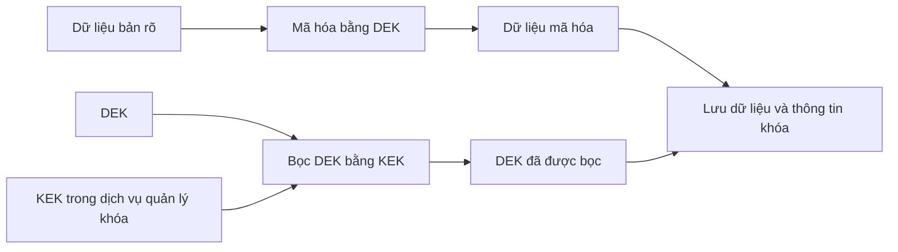
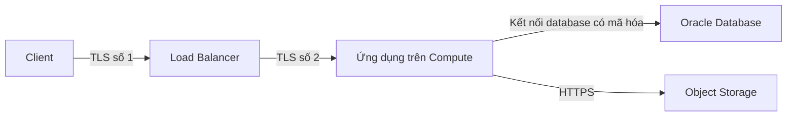

# Mã hóa dữ liệu khi lưu trữ và khi truyền trên OCI

## 1. Mục tiêu và phạm vi

Trong Oracle Cloud Infrastructure (OCI), một bản ghi có thể đi qua trình duyệt, Load Balancer, Compute, cơ sở dữ liệu, Object Storage và hệ thống sao lưu. Mỗi chặng có ranh giới bảo vệ riêng. Việc một dịch vụ mã hóa ổ đĩa không chứng minh rằng ứng dụng đang dùng TLS; việc một API có HTTPS cũng không chứng minh rằng dữ liệu xuất ra máy cá nhân đã được mã hóa.

Bài học này thuộc chương **Mã hóa, secrets và chứng chỉ** của lộ trình Oracle Cloud Infrastructure. Trọng tâm là thiết kế và kiểm tra mã hóa dữ liệu khi lưu trữ, khi truyền, kết hợp tenancy, compartment, IAM, VCN, Compute, lưu trữ và dịch vụ cơ sở dữ liệu. Quản lý secrets và chứng chỉ chỉ được đề cập ở những điểm cần thiết để thiết lập các lớp bảo vệ này.

Sau bài học, bạn có thể:

- Xác định dữ liệu cần bảo vệ và các điểm kết thúc mã hóa trong một hệ thống OCI.
- Phân biệt khóa do Oracle quản lý, khóa do khách hàng quản lý và mã hóa tại ứng dụng.
- Thiết kế TLS từ client đến ứng dụng và cơ sở dữ liệu, kể cả sau Load Balancer.
- Thu thập bằng chứng cấu hình, quyền sử dụng khóa và kết nối TLS; lập kế hoạch xoay khóa, khôi phục và kiểm soát chi phí.

Không áp dụng một tùy chọn giống nhau cho mọi dịch vụ: khả năng chọn khóa, mã hóa đường truyền nội bộ, thay khóa và khôi phục phụ thuộc dịch vụ, loại tài nguyên và cấu hình thực tế.

## 2. Hai trạng thái dữ liệu, hai nhóm kiểm soát

| Trạng thái | Ví dụ trong hệ thống OCI | Cơ chế bảo vệ thường gặp | Điều cần kiểm tra |
| --- | --- | --- | --- |
| Khi lưu trữ — at rest | Block Volume, object, file, dữ liệu cơ sở dữ liệu, bản sao lưu | Mã hóa phía dịch vụ, TDE, mã hóa tại ứng dụng | Phạm vi dữ liệu được mã hóa, nguồn khóa, quyền dùng khóa và khả năng khôi phục |
| Khi truyền — in transit | Client gọi API, Load Balancer gọi backend, ứng dụng kết nối cơ sở dữ liệu | TLS, SSH, cơ chế bảo vệ đường truyền riêng của dịch vụ | Hai đầu kết nối, xác thực đối tác, giao thức và khả năng bị hạ xuống kết nối không mã hóa |
| Khi sử dụng — in use | Dữ liệu đã giải mã trong bộ nhớ của ứng dụng | Kiểm soát tiến trình, IAM, bảo vệ máy chủ; các giải pháp chuyên biệt nếu có | Ai có thể truy cập ứng dụng hoặc bộ nhớ; mã hóa at rest và TLS không tự giải quyết trạng thái này |

Ví dụ, một ứng dụng có thể tải object qua HTTPS từ bucket được mã hóa, sau đó ghi bản rõ vào `/tmp`. Hai lớp bảo vệ ở Object Storage vẫn hoạt động, nhưng bản sao mới cần được đánh giá riêng. Nhật ký, file xuất CSV, ảnh chụp dữ liệu và bản sao lưu cũng là dữ liệu cần đưa vào phạm vi thiết kế.

### 2.1. Mã hóa giải quyết rủi ro nào?

Mã hóa khi lưu trữ hạn chế khả năng đọc dữ liệu từ lớp lưu trữ nếu không có đường giải mã hợp lệ. TLS bảo vệ nội dung trên đường truyền, phát hiện thay đổi và xác thực đầu bên kia khi client kiểm tra chứng chỉ đúng cách.

Tuy nhiên, một tài khoản có quyền đọc object vẫn có thể nhận nội dung đã giải mã qua API. Tương tự, mã độc chạy trong ứng dụng có thể đọc dữ liệu sau khi ứng dụng nhận hoặc giải mã. Vì vậy, mã hóa phải đi cùng IAM tối thiểu, cấu hình ứng dụng, phân đoạn mạng và quản lý máy chủ.

**Ba câu hỏi cần trả lời riêng:** dữ liệu đã được mã hóa chưa; ai được phép lấy dữ liệu bản rõ; ai có thể làm mất khả năng giải mã?

## 3. Mã hóa khi lưu trữ trong OCI

### 3.1. Khóa do Oracle quản lý và khóa do khách hàng quản lý

Nhiều dịch vụ lưu trữ OCI cung cấp mã hóa khi lưu trữ mặc định. Tùy dịch vụ, bạn có thể tiếp tục dùng khóa do Oracle quản lý hoặc chọn khóa do khách hàng quản lý thông qua OCI Key Management. Khi giao diện hoặc tài liệu gọi chung là Vault, cần phân biệt **khóa mã hóa** với **secret** được lưu trong dịch vụ quản lý bí mật.

| Lựa chọn | Cách tổ chức | Phù hợp khi | Trách nhiệm cần tính đến |
| --- | --- | --- | --- |
| Khóa do Oracle quản lý | Dịch vụ vận hành khóa phục vụ mã hóa mặc định | Muốn giảm công việc vận hành, không có yêu cầu tự kiểm soát vòng đời khóa | Kiểm tra cấu hình, IAM dữ liệu và sao lưu; vẫn phải bảo vệ tài khoản truy cập |
| Khóa do khách hàng quản lý — CMK | Chọn key trong OCI Key Management cho tài nguyên có hỗ trợ | Cần tách trách nhiệm, kiểm soát vòng đời khóa hoặc có yêu cầu quản trị riêng | IAM khóa, trạng thái khóa, xoay khóa, phụ thuộc khi sao lưu và khôi phục |
| Mã hóa tại ứng dụng hoặc phía client | Ứng dụng mã hóa trước khi dữ liệu đi vào dịch vụ | Cần giới hạn khả năng đọc bản rõ ở lớp lưu trữ hoặc bảo vệ theo từng trường | Thiết kế mật mã, phân phối khóa, phiên bản dữ liệu, truy vấn và phục hồi |

CMK bổ sung quyền kiểm soát; bản thân việc chọn CMK không chứng minh rằng thuật toán mạnh hơn hay hệ thống có tính sẵn sàng cao hơn. Một khóa bị vô hiệu hóa hoặc mất quyền sử dụng có thể làm gián đoạn tài nguyên đang phụ thuộc vào nó.

Đặt khóa ở compartment riêng có thể giúp tách trách nhiệm. Tuy nhiên, compartment chỉ là ranh giới tổ chức và phân quyền: phải có policy phù hợp thì dịch vụ mới sử dụng được khóa. Không suy ra rằng cùng tenancy hoặc cùng compartment là tự động được phép.

### 3.2. Hiểu envelope encryption

Một mô hình phổ biến cho mã hóa dữ liệu dung lượng lớn là **envelope encryption**:

1. Hệ thống dùng một data encryption key (DEK) để mã hóa dữ liệu.
2. Một key encryption key (KEK) bảo vệ DEK bằng thao tác bọc khóa.
3. Dữ liệu mã hóa và DEK đã được bọc được lưu cùng thông tin cần thiết để chọn khóa hoặc phiên bản khóa.
4. Khi có yêu cầu đọc được phép, hệ thống sử dụng dịch vụ quản lý khóa theo cơ chế tích hợp để giải bọc DEK rồi giải mã dữ liệu.



Đây là mô hình khái niệm; không phải cam kết về cấu trúc DEK hay cách lưu nội bộ của mọi dịch vụ OCI. Với tích hợp mã hóa phía dịch vụ, ứng dụng thường chỉ gọi API đọc/ghi bình thường; ứng dụng không cần nhận khóa chủ dạng bản rõ.

**Không dùng khóa quản lý tập trung để tự mã hóa cả file lớn qua một API dành cho thao tác mật mã nhỏ.** Nếu xây dựng mã hóa phía ứng dụng, cần dùng thư viện và thiết kế mật mã phù hợp, bao gồm mã hóa có xác thực, quản lý nonce và metadata phiên bản. Không tự phát minh thuật toán.

### 3.3. Phạm vi cần kiểm tra theo dịch vụ

| Thành phần | Mã hóa khi lưu trữ | Điểm cần kiểm tra thêm |
| --- | --- | --- |
| Boot Volume và Block Volume | OCI cung cấp mã hóa khi lưu trữ cho dữ liệu volume; có lựa chọn CMK trong cấu hình được hỗ trợ | Khóa đang gắn, quyền của dịch vụ, backup/clone, volume đích khi khôi phục; xem riêng dữ liệu nằm trên thiết bị cục bộ của instance |
| Object Storage | Object được mã hóa phía dịch vụ; bucket có lựa chọn khóa theo khả năng hỗ trợ | Khóa bucket, object đã tồn tại, phiên bản object, bản sao và dữ liệu tải ra ngoài OCI |
| File Storage | File system được mã hóa khi lưu trữ | Khóa được cấu hình, bản sao, snapshot và kết nối NFS; không đồng nhất mã hóa ổ lưu trữ với mã hóa phiên NFS |
| Dịch vụ cơ sở dữ liệu Oracle | TDE là một cơ chế quan trọng để bảo vệ dữ liệu lưu trữ trong các dịch vụ và cấu hình Oracle Database có hỗ trợ | Loại dịch vụ, phạm vi TDE, khóa hoặc wallet, backup, standby và quy trình restore cụ thể |
| Log và dữ liệu xuất | Phụ thuộc nơi lưu đích | Log có chứa dữ liệu nhạy cảm không; file xuất có bị chép sang đĩa hoặc hệ thống không được bảo vệ không |

TDE — Transparent Data Encryption — bảo vệ dữ liệu cơ sở dữ liệu ở lớp lưu trữ theo cấu hình của database. Truy vấn SQL hợp lệ vẫn trả về dữ liệu bản rõ cho người có quyền. TDE không thay thế quyền truy cập bảng, kiểm soát dữ liệu ở ứng dụng hoặc mã hóa kết nối database.

Mã hóa mặc định của bucket cũng không phải bằng chứng rằng bucket đang riêng tư. Quyền public, policy IAM, URL được cấp quyền truy cập và quyền đọc object cần được xem xét độc lập.

### 3.4. Thay khóa, xoay khóa và mã hóa lại khác nhau

Cần phân biệt ba hành động:

- **Xoay khóa:** tạo vật liệu khóa hoặc phiên bản khóa mới theo cơ chế của hệ thống quản lý khóa.
- **Đổi khóa gắn với tài nguyên:** chuyển cấu hình tài nguyên từ một key sang key khác, nếu dịch vụ hỗ trợ.
- **Mã hóa lại dữ liệu:** cập nhật lớp mã hóa của dữ liệu hoặc bọc lại DEK; hành vi cụ thể do dịch vụ quyết định.

Không kết luận rằng tạo phiên bản khóa mới sẽ lập tức mã hóa lại toàn bộ object, volume và backup. Dữ liệu cũ có thể còn phụ thuộc phiên bản khóa cũ. Với Object Storage, cũng không giả định thay khóa mặc định của bucket đã chuyển toàn bộ object và mọi phiên bản lịch sử sang khóa mới.

Trước khi ngừng một key hoặc phiên bản khóa, phải xác định dữ liệu nào còn cần nó và xác minh quy trình đọc, restore hoặc chuyển đổi của từng dịch vụ. Đánh dấu hoàn tất việc xoay khóa dựa trên bằng chứng sử dụng và khôi phục, không chỉ dựa trên thời điểm bấm Rotate.

## 4. IAM cho dữ liệu và IAM cho khóa

Một tích hợp CMK thường có ít nhất ba nhóm quyền khác nhau:

| Chủ thể | Quyền cần có theo nhiệm vụ | Giới hạn nên đặt |
| --- | --- | --- |
| Nhóm quản trị khóa | Tạo, cấu hình, xoay và quản lý vòng đời khóa | Không tự động cấp quyền đọc dữ liệu nghiệp vụ hoặc quản trị toàn tenancy |
| Dịch vụ OCI sử dụng khóa | Thực hiện các thao tác khóa cần cho tài nguyên được tích hợp | Đúng service principal hoặc cơ chế ủy quyền của dịch vụ, đúng key và phạm vi tài nguyên |
| Nhóm vận hành hoặc ứng dụng | Tạo tài nguyên, cấu hình tham chiếu khóa hoặc đọc/ghi dữ liệu theo vai trò | Không cấp toàn bộ quyền quản trị khóa chỉ để ứng dụng đọc object |

Quyền đọc dữ liệu và quyền gọi trực tiếp API mật mã là hai việc khác nhau. Ví dụ, với mã hóa phía dịch vụ của Object Storage, ứng dụng có quyền đọc object thường nhận dữ liệu qua Object Storage; dịch vụ xử lý tích hợp khóa theo policy. Không lấy policy cho ứng dụng gọi KMS trực tiếp rồi áp nguyên xi cho trường hợp này.

Quy trình xác định policy:

1. Xác định dịch vụ nào dùng key, tại region nào, key và tài nguyên nằm ở compartment nào.
2. Xác định ai được chọn key khi tạo hoặc cập nhật tài nguyên.
3. Xác định chủ thể mà dịch vụ dùng để thực hiện các thao tác khóa theo tích hợp thực tế.
4. Cấp quyền tối thiểu cho đúng key; kiểm tra cả policy ở cấp cha và các quyền đang được kế thừa.
5. Kiểm tra lại thao tác đọc/ghi sau cấu hình, không dừng ở việc tạo tài nguyên thành công.

Không dùng một policy mẫu có tên dịch vụ hoặc region suy đoán. Các tích hợp khác nhau có thể dùng service principal, cơ chế ủy quyền và điều kiện policy khác nhau. Với workload trên Compute, ưu tiên cơ chế danh tính workload được hỗ trợ, chẳng hạn instance principal, thay cho chép private key người dùng vào mã nguồn.

Secret như mật khẩu database không phải là KEK dùng bọc DEK. Chứng chỉ TLS xác nhận danh tính đầu kết nối; private key tương ứng phải được bảo vệ riêng. Quản lý ba loại vật liệu này theo đúng vai trò của chúng.

## 5. Mã hóa khi truyền: kiểm tra từng chặng

### 5.1. VCN riêng tư không đồng nghĩa đã mã hóa

Subnet riêng, route table, security list và network security group kiểm soát khả năng tiếp cận mạng. Chúng không tự bật TLS cho một ứng dụng đang nghe HTTP.

FastConnect là hình thức kết nối riêng; không mặc định xem mọi kết nối FastConnect là đã được mã hóa. Nếu yêu cầu bảo mật cần mã hóa đường truyền, phải chọn và cấu hình cơ chế được hỗ trợ trên tuyến cụ thể, như IPsec hoặc một khả năng mã hóa liên kết phù hợp. TLS ở tầng ứng dụng vẫn có vai trò bảo vệ và xác thực phiên kết nối.

### 5.2. TLS kết thúc ở đâu?

Xét kiến trúc có Load Balancer kết thúc TLS:



Hai kết nối TLS ở hai phía Load Balancer là hai phiên độc lập. Load Balancer giải mã yêu cầu trước khi chuyển tiếp theo cấu hình backend. Chứng chỉ ở listener chỉ bảo vệ chặng client đến Load Balancer.

| Chặng | Cấu hình cần xác minh | Lỗi thường gặp |
| --- | --- | --- |
| Client → Load Balancer | Listener HTTPS, chứng chỉ đúng hostname, chuỗi CA hợp lệ, chính sách TLS phù hợp | Có HTTPS nhưng chứng chỉ sai tên hoặc client bỏ kiểm tra chứng chỉ |
| Load Balancer → backend | Backend thực sự nói TLS, trust CA và xác thực chứng chỉ backend theo khả năng cấu hình | Listener ngoài là HTTPS nhưng backend vẫn dùng HTTP |
| Ứng dụng → Oracle Database | Driver và listener dùng phương thức mã hóa được chọn; kiểm tra danh tính server khi dùng TLS | Cấu hình database hỗ trợ TLS nhưng connection string của ứng dụng vẫn đi đường không mã hóa |
| Ứng dụng → Object Storage | Dùng endpoint HTTPS, xác thực chứng chỉ trong SDK hoặc HTTP client | Dùng proxy hoặc cấu hình client làm mất kiểm tra TLS |

Nếu kiến trúc yêu cầu TLS kết thúc trực tiếp tại ứng dụng, cần chọn mô hình chuyển tiếp và dịch vụ phù hợp thay vì mặc định mọi loại Load Balancer đều hoạt động giống nhau. Yêu cầu bảo mật phải nói rõ điểm nào được phép thấy bản rõ.

Health check cần được kiểm tra riêng: giao thức và cổng health check có thể khác đường đi của yêu cầu nghiệp vụ. Backend báo healthy không chứng minh dữ liệu ứng dụng đã được mã hóa.

### 5.3. Mã hóa phải đi cùng xác thực đầu bên kia

Một cấu hình TLS đáng tin cậy cần đồng thời có:

- Phiên bản giao thức và bộ mật mã phù hợp chính sách của hệ thống; loại bỏ giao thức cũ trong cấu hình thực tế.
- Chứng chỉ còn hiệu lực, có hostname phù hợp trong Subject Alternative Name và có chuỗi tin cậy mà client chấp nhận.
- Kiểm tra hostname và chứng chỉ được bật ở client, driver và các proxy trung gian liên quan.
- Private key không bị ghi vào log, đưa vào image công khai hay lưu chung với source code.
- Cơ chế gia hạn và triển khai chứng chỉ trước khi hết hạn, bao gồm chứng chỉ backend và CA nội bộ.

TLS với chứng chỉ server thông thường xác thực server với client. **mTLS** bổ sung xác thực client bằng chứng chỉ. mTLS không thay thế phân quyền: sau khi biết client là ai, ứng dụng vẫn phải quyết định client được làm gì.

Chứng chỉ tự ký hoặc CA nội bộ có thể dùng trong phạm vi quản trị phù hợp nếu trust store được phân phối và kiểm tra đúng. Tắt kiểm tra chứng chỉ để làm kết nối chạy được sẽ làm mất cơ chế xác thực cần có.

### 5.4. Các trường hợp OCI cần chú ý riêng

**Block Volume:** mã hóa khi lưu trữ và mã hóa lưu lượng giữa Compute với volume là hai thuộc tính riêng. Nếu cần mã hóa chặng này, kiểm tra khả năng hỗ trợ của instance shape, kiểu attachment, image và cấu hình tương ứng. Không suy ra trạng thái đường truyền từ trạng thái mã hóa của volume.

**File Storage:** NFS trong subnet riêng chưa đủ để kết luận đã mã hóa phiên mount. Sử dụng khả năng mã hóa khi truyền và công cụ mount được OCI hỗ trợ cho hệ điều hành, kiểu client và cấu hình đang dùng; xác minh ở client. Không chỉ thêm một tùy chọn mount tùy ý rồi coi là đã bật TLS.

**Oracle Database:** TCPS là cách sử dụng Oracle Net với TLS. Native Network Encryption là một cơ chế khác trong những cấu hình có hỗ trợ, có cách đàm phán và kiểm tra riêng. Chọn theo dịch vụ và yêu cầu; không đồng nhất hai cơ chế và không dùng TDE làm bằng chứng cho cả hai. Với dịch vụ sử dụng wallet hoặc mTLS, phải phân phối wallet, CA và thông tin kết nối đúng hướng dẫn của dịch vụ.

**Truy cập quản trị:** dùng SSH hoặc giao thức quản trị được bảo vệ phù hợp; giới hạn đường truy cập bằng IAM và mạng. Tunnel có mã hóa chỉ bảo vệ đoạn nằm trong tunnel; phần kết nối sau điểm kết thúc vẫn cần được đánh giá.

## 6. Thiết kế một hệ thống mẫu

Giả sử một ứng dụng quản lý hồ sơ khách hàng chạy trên Compute, lưu tài liệu trong Object Storage và lưu dữ liệu giao dịch trong Oracle Database. Ứng dụng có endpoint HTTPS qua Load Balancer.

| Yêu cầu | Quyết định thiết kế | Bằng chứng nghiệm thu |
| --- | --- | --- |
| Tài liệu trong bucket được mã hóa bằng khóa của nhóm bảo mật | Dùng CMK được dịch vụ hỗ trợ; bucket riêng tư; policy khóa và dữ liệu được tách | Cấu hình bucket trỏ đúng key, kiểm tra ghi/đọc object và policy liên quan |
| Dữ liệu database và backup được bảo vệ khi lưu trữ | Kiểm tra cấu hình mã hóa của dịch vụ database và cơ chế bảo vệ backup | Thông tin mã hóa của dịch vụ; thử restore trong môi trường được phép |
| Client đến ứng dụng được bảo vệ trên cả hai chặng qua Load Balancer | HTTPS listener và TLS đến backend, xác thực chứng chỉ đúng cấu hình | Kiểm tra từ client, cấu hình backend, trust store và bằng chứng bắt tay TLS của chặng nội bộ |
| Ứng dụng kết nối database bằng kênh mã hóa | Chọn TLS/TCPS hoặc cơ chế được dịch vụ hỗ trợ theo yêu cầu | Cấu hình driver và bằng chứng từ phiên database thực tế |
| Giới hạn quyền và giảm lộ bí mật | Dùng danh tính workload; mật khẩu lấy từ cơ chế quản lý secrets phù hợp | Policy đúng phạm vi, không có bí mật trong source hoặc log |
| Có thể phục hồi khi thay đổi khóa hoặc chuyển nơi khôi phục | Ghi lại phụ thuộc khóa và kiểm tra khả năng hỗ trợ của dịch vụ ở nơi đích | Kịch bản restore thành công với danh tính, key và dữ liệu cần thiết |

Với tính sẵn sàng, cần xem khóa và chứng chỉ như các phụ thuộc vận hành. Không mặc định khóa ở region nguồn có thể được dùng trực tiếp cho tài nguyên ở region đích. Kế hoạch phục hồi phải kiểm tra khả năng sao lưu, phục hồi hoặc sao chép khóa và tích hợp tài nguyên tại nơi đích, thay vì chỉ sao chép dữ liệu mã hóa.

## 7. Thực hành: xác minh Object Storage và TLS

### 7.1. Mục tiêu và điều kiện

Bài thực hành gồm hai phần độc lập: kiểm tra mã hóa khi lưu trữ của một bucket thử nghiệm và kiểm tra TLS của một endpoint thuộc quyền quản lý của bạn. Không cần tạo Load Balancer hoặc database mới chỉ để hoàn thành phần kiểm tra bucket.

Chuẩn bị:

- Một compartment thực hành và OCI CLI đã xác thực, dùng đúng tenancy và region.
- Một symmetric key có trạng thái sử dụng được, cùng region với bucket, và tích hợp CMK được Object Storage hỗ trợ.
- Policy cho người thực hành cấu hình tài nguyên và cho Object Storage sử dụng key, theo phạm vi quyền của môi trường.
- Một file nhỏ chứa dữ liệu giả, cùng endpoint HTTPS có chứng chỉ hợp lệ nếu thực hành phần TLS.

Các lệnh dưới đây chạy trong **Bash**, ví dụ môi trường đã cài OCI CLI. Giá trị OCID, namespace và hostname là placeholder cần thay bằng thông tin môi trường; không dùng dữ liệu khách hàng thật.

### 7.2. Tạo bucket thử nghiệm với CMK

```bash
export COMPARTMENT_OCID='ocid1.compartment...'
export KEY_OCID='ocid1.key...'
export BUCKET='lab-encryption-example'
export NAMESPACE="$(oci os ns get --query data --raw-output)"

oci os bucket create \
  --namespace-name "$NAMESPACE" \
  --compartment-id "$COMPARTMENT_OCID" \
  --name "$BUCKET" \
  --public-access-type NoPublicAccess \
  --kms-key-id "$KEY_OCID"
```

Chỉ dùng tên bucket dành riêng cho bài lab. Nếu bucket đã tồn tại, dừng và xác định quyền sở hữu; không sửa tài nguyên có sẵn để ép lệnh chạy. Nếu gặp lỗi quyền hoặc key, kiểm tra region, key, compartment và policy thay vì cấp quyền quản trị toàn tenancy.

Đọc lại thông tin bucket:

```bash
oci os bucket get \
  --namespace-name "$NAMESPACE" \
  --bucket-name "$BUCKET"
```

Trong dữ liệu trả về, kiểm tra tên bucket, compartment, `public-access-type` và `kms-key-id`. Key phải khớp key đã chọn. Với bucket khác dùng khóa do Oracle quản lý, không có CMK trong trường cấu hình không có nghĩa object không được mã hóa.

### 7.3. Ghi, đọc và đối chiếu dữ liệu

```bash
printf '%s\n' 'Du lieu gia cho bai lab ma hoa OCI' > lab-encryption.txt

oci os object put \
  --namespace-name "$NAMESPACE" \
  --bucket-name "$BUCKET" \
  --name 'lab-encryption.txt' \
  --file './lab-encryption.txt'

oci os object get \
  --namespace-name "$NAMESPACE" \
  --bucket-name "$BUCKET" \
  --name 'lab-encryption.txt' \
  --file './lab-encryption.download.txt'

cmp ./lab-encryption.txt ./lab-encryption.download.txt
```

`cmp` không in khác biệt và trả mã thoát `0` khi hai file giống nhau. Việc tải lại được bản rõ là hành vi bình thường của mã hóa phía dịch vụ khi yêu cầu đọc được phép; không phải dấu hiệu mã hóa thất bại.

Phép thử này chứng minh đường ghi/đọc đang hoạt động và nội dung khớp. Bằng chứng về lựa chọn CMK đến từ cấu hình tài nguyên và cơ chế mã hóa của dịch vụ. Một mình việc so sánh file không chứng minh dữ liệu trên thiết bị lưu trữ đã được mã hóa bằng key cụ thể.

Hai file ở máy chạy CLI vẫn là bản rõ. Không giả định chính sách mã hóa của bucket bảo vệ cả hai bản sao này.

### 7.4. Kiểm tra TLS của endpoint ứng dụng

Thay `api.example.com` bằng hostname của endpoint bạn quản lý; đường dẫn `/health` phải tồn tại và cho phép kiểm tra thích hợp.

```bash
curl --verbose --fail --output /dev/null \
  'https://api.example.com/health'

openssl s_client \
  -connect api.example.com:443 \
  -servername api.example.com \
  -verify_hostname api.example.com \
  -verify_return_error \
  -showcerts </dev/null
```

`curl` mặc định kiểm tra chứng chỉ theo trust store của môi trường; không thêm `-k` hoặc `--insecure`. Khi dùng CA nội bộ, cấu hình đúng CA tin cậy, chẳng hạn qua `--cacert` của curl hoặc tùy chọn CA phù hợp của OpenSSL. Nếu không có endpoint thử nghiệm, ghi nhận phần TLS chưa thực hiện; không dùng một website bên ngoài làm bằng chứng cho hệ thống OCI của mình.

Quan sát kết quả bắt tay, phiên bản TLS được thương lượng, chứng chỉ và kết quả xác thực. `-servername` gửi SNI để server chọn chứng chỉ; `-verify_hostname` yêu cầu kiểm tra hostname. Không coi SNI là thao tác xác thực tên server.

`--fail` của curl còn kiểm tra lỗi HTTP: một phản hồi HTTP lỗi có thể xảy ra sau khi TLS đã bắt tay thành công. Cần đọc phần TLS và mã HTTP để phân biệt lỗi chứng chỉ, lỗi mạng và lỗi ứng dụng.

Phép thử này chỉ quan sát chặng từ máy chạy lệnh đến endpoint. Nếu endpoint là Load Balancer, muốn kết luận về TLS đến backend phải kiểm tra cấu hình backend và kết nối ở chặng đó từ vị trí có quyền truy cập thích hợp. Không mở backend ra Internet chỉ để kiểm tra.

### 7.5. Kết quả cần ghi nhận và dọn tài nguyên

| Hạng mục | Kết quả mong đợi | Giới hạn của bằng chứng |
| --- | --- | --- |
| Cấu hình bucket | Đúng compartment, riêng tư, trỏ đúng CMK | Chưa chứng minh mọi bản sao ngoài bucket dùng cùng key |
| Ghi/đọc object | Thành công, hai file có nội dung giống nhau | Không thay thế bằng chứng cấu hình mã hóa khi lưu trữ |
| Kết nối HTTPS | Bắt tay thành công, chứng chỉ và hostname hợp lệ theo trust store | Chỉ bao phủ chặng được quan sát |
| TLS đến backend/database | Có cấu hình và bằng chứng phiên kết nối tương ứng nếu thuộc phạm vi hệ thống | Không suy ra chỉ từ biểu tượng HTTPS ở trình duyệt |
| Phục hồi dữ liệu | Có kế hoạch hoặc kết quả thử trong môi trường riêng | Bài đọc/ghi ngắn chưa phải bài thử khôi phục sau sự cố |

Sau khi hoàn tất, xóa object và bucket do chính bài lab tạo sau khi xác nhận không có dữ liệu cần giữ; xử lý riêng các phiên bản object nếu đã bật versioning. Dọn các file thử tại máy local và vật liệu thử được tạo riêng. Không lên lịch xóa key dùng chung với tài nguyên khác.

Kiểm soát chi phí bằng dữ liệu nhỏ, thời gian thử ngắn và tái sử dụng endpoint đã được cho phép. Theo dõi chi phí lưu trữ, thao tác API, dịch vụ quản lý khóa và các thành phần mạng được sử dụng; không mặc định mọi loại vault hoặc key đều có chi phí như nhau.

## 8. Vận hành khóa, chứng chỉ và phục hồi

### 8.1. Xoay khóa có kiểm soát

Một quy trình xoay khóa nên có danh mục tài nguyên phụ thuộc, người phê duyệt theo quy trình nội bộ, kết quả thử trên môi trường thực hành và tiêu chí quay lui. Kiểm tra khả năng đọc dữ liệu cũ, ghi dữ liệu mới và khôi phục backup còn thời hạn lưu giữ.

Không dùng việc vô hiệu hóa key đang phục vụ hệ thống thật làm phép thử mã hóa. Nếu cần kiểm tra lỗi phụ thuộc khóa, dùng key và tài nguyên tách biệt trong môi trường được phép, xác định tác động và quy trình khôi phục trước khi thử. Việc một lần đọc vẫn thành công cũng không chứng minh tài nguyên không phụ thuộc key: cache và hành vi giải mã phụ thuộc dịch vụ có thể ảnh hưởng kết quả.

### 8.2. Gia hạn chứng chỉ trước khi hết hạn

Duy trì danh mục hostname, điểm kết thúc TLS, chứng chỉ, CA, ngày hết hạn và chủ sở hữu vận hành. Sau gia hạn, xác minh chứng chỉ thực tế được endpoint phục vụ; chỉ cập nhật một kho chứng chỉ chưa chứng minh listener hoặc backend đã nhận bản mới.

Với mTLS, cập nhật trust store và chứng chỉ client cũng là một phần của vòng đời. Kế hoạch đổi CA cần có giai đoạn tương thích phù hợp để các bên không mất khả năng xác thực lẫn nhau.

### 8.3. Theo dõi và cảnh báo

Kết hợp OCI Audit cho các sự kiện quản trị/API có được ghi nhận với log của dịch vụ, log ứng dụng và hệ thống giám sát. Không giả định mọi thao tác đọc dữ liệu hoặc mọi lần giải mã đều có bản ghi riêng sẵn trong Audit.

Các tín hiệu nên theo dõi gồm thay đổi policy khóa, thay đổi key gắn với tài nguyên, vòng đời key, lỗi đọc/ghi liên quan khóa, lỗi bắt tay TLS và thời hạn chứng chỉ. Khả năng xuất metric hoặc sự kiện cụ thể tùy dịch vụ; dùng cảnh báo tổng hợp hoặc kiểm tra định kỳ khi không có tín hiệu trực tiếp.

Tránh ghi private key, mật khẩu, token, wallet hoặc dữ liệu nhạy cảm vào log điều tra. Bằng chứng vận hành nên chứa thời điểm, OCID tài nguyên, cấu hình và loại lỗi cần thiết, với quyền đọc log phù hợp.

### 8.4. Khả năng khôi phục là một phần của mã hóa

Một backup còn nguyên byte vẫn có thể không dùng được nếu thiếu key, phiên bản khóa, wallet, quyền hoặc cấu hình tại nơi phục hồi. Kế hoạch phục hồi cần chỉ rõ tài liệu nào và vật liệu nào phải còn tồn tại, được bảo vệ và có thể truy cập bởi đúng danh tính.

Trước khi vô hiệu hóa hoặc lên lịch xóa khóa, kiểm tra cả dữ liệu đang chạy, snapshot, backup, replica, bản sao lịch sử và môi trường phục hồi. Xóa key có thể làm mất khả năng khôi phục; không xem đây là cách thay thế mặc định cho quy trình xóa dữ liệu và quản lý thời hạn lưu giữ.

## 9. Chẩn đoán các lỗi thường gặp

| Hiện tượng | Hướng kiểm tra | Cách xử lý theo nguyên nhân |
| --- | --- | --- |
| Tạo bucket hoặc volume với CMK bị từ chối | Đúng key, region, trạng thái key; quyền người cấu hình và quyền dịch vụ | Sửa đúng policy hoặc tham chiếu bị thiếu; không cấp quyền toàn cục để né lỗi |
| Sau thay đổi key hoặc policy, dữ liệu khó truy cập | Sự kiện thay đổi, key đang dùng, trạng thái key, quyền và cơ chế tích hợp | Khôi phục cấu hình hoặc quyền đúng theo kế hoạch; giữ nguyên dữ liệu và bằng chứng |
| curl hoặc SDK báo lỗi chứng chỉ | Hostname/SAN, thời hạn, chuỗi CA, trust store và thời gian hệ thống | Sửa chứng chỉ hoặc trust store; không tắt xác thực TLS |
| Client dùng HTTPS nhưng backend nhận HTTP | Listener, cấu hình backend, proxy và tuyến kết nối thực tế | Bật TLS cho đúng chặng, cấu hình xác thực backend và kiểm tra lại |
| Có TDE nhưng phiên database không mã hóa | Driver, connection string, listener, wallet và trạng thái phiên | Cấu hình phương thức mã hóa khi truyền phù hợp; không suy luận từ TDE |
| Đã tạo phiên bản khóa mới nhưng dữ liệu cũ còn cần khóa cũ | Cơ chế xoay khóa và chuyển đổi của dịch vụ, object/version hoặc backup còn tồn tại | Thực hiện quy trình chuyển đổi được hỗ trợ và xác minh trước khi ngừng khóa cũ |
| Restore ở nơi đích thất bại | Khả năng sử dụng key, wallet, policy và tích hợp dịch vụ tại nơi đích | Hoàn thiện các phụ thuộc phục hồi; không chỉ chép thêm dữ liệu mã hóa |

## 10. Những điểm cần ghi nhớ

- Mã hóa khi lưu trữ, mã hóa khi truyền và phân quyền là các lớp bảo vệ bổ sung cho nhau.
- Mã hóa mặc định không đồng nghĩa đã dùng CMK; dùng CMK kéo theo trách nhiệm vòng đời, IAM và phục hồi.
- TLS phải được kiểm tra trên từng chặng. HTTPS ở phía client không chứng minh kết nối sau Load Balancer đã được bảo vệ.
- Kiểm tra chứng chỉ và hostname là điều kiện để TLS xác thực đúng đầu kết nối; mTLS vẫn cần phân quyền sau xác thực.
- Xoay khóa không đồng nghĩa mọi dữ liệu đã được mã hóa lại; giữ các phụ thuộc cần thiết cho dữ liệu và backup còn hiệu lực.
- Một thiết kế hoàn chỉnh cần bằng chứng đọc/ghi, cấu hình, kết nối và phục hồi, cùng giám sát chi phí và tính sẵn sàng.
