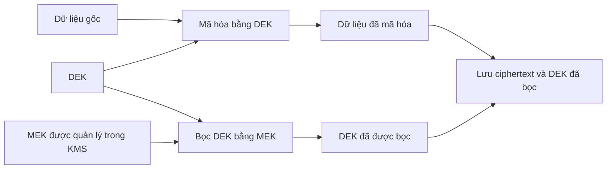

# OCI Vault, vault types và các mô hình quản lý khóa

Trong chương **Mã hóa, secrets và chứng chỉ** của lộ trình Oracle Cloud Infrastructure (OCI), quản lý khóa là cầu nối giữa cơ chế mã hóa và khả năng vận hành hạ tầng. Một bucket, ổ đĩa hay cơ sở dữ liệu có thể vẫn tồn tại nguyên vẹn nhưng ứng dụng không đọc được dữ liệu nếu mất quyền sử dụng khóa.

Bài học tập trung vào OCI Vault và cách chọn mô hình quản lý khóa cho hạ tầng có compartment, IAM và yêu cầu về chi phí, giám sát, tính sẵn sàng. Sau bài học, người học cần phân biệt được ba quyết định: **chọn loại vault, chọn chế độ bảo vệ khóa và chọn nơi kiểm soát vật liệu khóa**.

## 1. Tách ba quyết định trước khi thiết kế

Khi nhận yêu cầu “dùng khóa do khách hàng quản lý”, hãy làm rõ:

| Quyết định | Câu hỏi cần trả lời | Ví dụ |
| --- | --- | --- |
| Loại vault | Cần mức cô lập và tính năng nào? | Default/virtual vault hoặc virtual private vault |
| Chế độ bảo vệ khóa | Vật liệu khóa được lưu và xử lý ở đâu? | HSM hoặc Software trong vault thông thường |
| Mô hình quản lý | Ai tạo khóa, ai kiểm soát vòng đời, vật liệu có nằm ngoài OCI không? | Oracle-managed, customer-managed, BYOK, External KMS |

Ví dụ thiết kế: “Customer-managed key, do OCI sinh, bảo vệ bằng HSM, đặt trong vault `DEFAULT` tại compartment `SecurityProd`”. Câu này xác định rõ cả quyền kiểm soát, nguồn gốc và nơi bảo vệ khóa.

Một mô tả khác như “đã dùng private vault nên khóa không ra khỏi hệ thống doanh nghiệp” cần được kiểm tra lại: phân vùng HSM dành riêng trong OCI vẫn thuộc hạ tầng OCI. Vị trí vật liệu khóa và mức cô lập là hai thuộc tính riêng.

## 2. Vault, key, key version và secret

**Vault** là tài nguyên logic để tổ chức khóa. **Key** là tài nguyên có OCID và một hoặc nhiều **key version**; mỗi version chứa vật liệu mật mã cụ thể. Chính sách truy cập thường tham chiếu key OCID, còn ứng dụng hoặc dịch vụ phải giữ đủ thông tin để xử lý dữ liệu theo đúng version. [Nguồn: Oracle — Overview of Vaults and Key Management](https://docs.oracle.com/en-us/iaas/Content/KeyManagement/Concepts/keyoverview.htm).

Các thuật ngữ cần dùng đúng trong một thiết kế:

| Thuật ngữ | Vai trò trong bài học |
| --- | --- |
| Master encryption key — MEK | Khóa chủ dùng để bảo vệ khóa mã hóa dữ liệu |
| Data encryption key — DEK | Khóa trực tiếp mã hóa nội dung dữ liệu |
| Key encryption key — KEK | Tên gọi theo chức năng: khóa dùng để mã hóa khóa khác |
| Wrapping key | Khóa dùng để bọc vật liệu khóa khi chuyển vào hoặc ra theo cơ chế được hỗ trợ |
| Secret | Giá trị ứng dụng cần lấy để sử dụng, chẳng hạn mật khẩu hoặc token |
| Certificate | Chứng thư gắn danh tính với khóa công khai; cần quản lý cả chuỗi tin cậy và thời hạn |

Đừng đồng nhất việc gọi thao tác mã hóa với việc đọc nội dung secret. Với một khóa HSM, ứng dụng thường gửi yêu cầu sử dụng khóa mà không nhận vật liệu bí mật của khóa.

Oracle hiện mô tả chức năng secrets trong **Secret Management Service**. Bài này chỉ dùng secret để phân biệt đối tượng; việc phân phối mật khẩu và quản lý chứng chỉ cần quy trình riêng. [Nguồn: Oracle — ghi chú về Secret Management Service](https://docs.oracle.com/en-us/iaas/Content/KeyManagement/Concepts/keyoverview.htm).

## 3. Vì sao MEK và DEK thường xuất hiện cùng nhau?

Một mô hình điển hình là **envelope encryption**:



Về mặt khái niệm:

```text
ciphertext  = Encrypt(DEK, plaintext)
wrapped_DEK = Wrap(MEK, DEK)

Khi đọc:
DEK       = Unwrap(MEK, wrapped_DEK)
plaintext = Decrypt(DEK, ciphertext)
```

Đây là ký hiệu giải thích luồng xử lý, không phải mã mật mã để đưa trực tiếp vào ứng dụng. Cách mã hóa, metadata và quản lý DEK thực tế phụ thuộc dịch vụ tích hợp. [Nguồn: Oracle — Envelope Encryption](https://docs.oracle.com/en-us/iaas/Content/KeyManagement/Concepts/keyoverview.htm).

Hệ quả thiết kế: bản sao dữ liệu chỉ hữu ích nếu đường sử dụng khóa vẫn hoạt động. Trong kế hoạch khôi phục, hãy quản lý đồng thời dữ liệu, metadata khóa, IAM và endpoint.

## 4. Các loại vault và tên tương ứng trong API

### 4.1. Default vault và virtual private vault

Trong nhóm vault lưu khóa tại OCI, hai lựa chọn cơ bản là:

| Thuộc tính | Default/virtual vault | Virtual private vault |
| --- | --- | --- |
| Giá trị `vaultType` | `DEFAULT` | `VIRTUAL_PRIVATE` |
| Cô lập ở lớp HSM | Phân vùng HSM dùng chung theo mô hình nhiều khách hàng | Phân vùng HSM dành riêng |
| Hướng sử dụng | Nhu cầu quản lý khóa thông thường, tăng dần theo sử dụng | Nhu cầu cô lập và tính năng của phân vùng riêng |
| Quyết định khi tạo | Chọn ngay từ đầu | Chọn ngay từ đầu |

Vault là tài nguyên do khách hàng tạo trong tenancy; từ “default” ở đây chỉ loại vault. Khách hàng vẫn phải chọn compartment và cấu hình quyền truy cập. Loại vault không đổi được sau khi tạo. [Nguồn: Oracle — Creating a Vault](https://docs.oracle.com/en-us/iaas/Content/KeyManagement/Tasks/managingvaults_topic-To_create_a_new_vault.htm).

Một virtual private vault cung cấp phân vùng HSM dành riêng, nhưng không đồng nghĩa khách hàng được quản trị toàn bộ thiết bị HSM vật lý. Các vault và key cũng có compartment riêng: chuyển compartment của vault không tự chuyển compartment hay quyền truy cập của mọi key bên trong. [Nguồn: Oracle — Managing Vaults](https://docs.oracle.com/en-us/iaas/Content/KeyManagement/Tasks/managingvaults.htm).

### 4.2. External vault trong mô hình hiện hành

CLI hiện liệt kê ba giá trị `--vault-type`:

```text
DEFAULT
VIRTUAL_PRIVATE
EXTERNAL
```

`EXTERNAL` dành cho tích hợp External KMS. Vì vậy, phát biểu “OCI chỉ có hai giá trị vault type trong mọi trường hợp” không phản ánh đầy đủ API hiện hành. Khi so sánh Default với Virtual Private, phạm vi đang xét là các vault lưu khóa tại OCI. [Nguồn: Oracle — OCI CLI vault create](https://docs.oracle.com/en-us/iaas/tools/oci-cli/latest/oci_cli_docs/cmdref/kms/management/vault/create.html).

Một số trang sản phẩm dùng tên ngắn “Virtual Vault” và “Private Vault”. Khi viết tự động hóa, dùng đúng enum API; đừng suy giá trị tham số từ tên hiển thị.

## 5. HSM và Software là thuộc tính của khóa

Một master encryption key trong vault thông thường có thể được bảo vệ bằng HSM hoặc Software:

| Nội dung | HSM | Software |
| --- | --- | --- |
| Nơi lưu và xử lý khóa | Trong HSM | Trong lớp máy chủ của dịch vụ |
| Trọng tâm lựa chọn | Giữ thao tác với vật liệu bí mật trong ranh giới HSM | Nhu cầu sử dụng khóa theo cơ chế phần mềm |
| Có đổi protection mode tại chỗ không? | Không | Không |

Chế độ bảo vệ được chọn khi tạo khóa. Muốn đổi chế độ, cần thiết kế quá trình dùng khóa mới và chuyển các tài nguyên liên quan. AES dùng cho mã hóa đối xứng; RSA và ECDSA phục vụ những chức năng khác nhau, trong đó ECDSA dành cho chữ ký. Phải kiểm tra thuật toán mà dịch vụ đích hỗ trợ trước khi chọn. [Nguồn: Oracle — Creating a Master Encryption Key](https://docs.oracle.com/en-us/iaas/Content/KeyManagement/Tasks/managingkeys_topic-To_create_a_new_key.htm).

Khóa Software có khả năng xuất theo quy trình được hỗ trợ và yêu cầu quyền thích hợp. Xuất khóa làm phát sinh trách nhiệm bảo vệ bản sao bên ngoài dịch vụ. Khóa HSM không được xuất vật liệu bí mật qua cơ chế export key này. [Nguồn: Oracle — Exporting Vault Keys and Key Versions](https://docs.oracle.com/en-us/iaas/Content/KeyManagement/Tasks/exportingkeys.htm).

Đối với khóa bất đối xứng, tải khóa công khai để xác minh chữ ký là nhu cầu khác với xuất khóa riêng.

Ví dụ lựa chọn của một nhóm ứng dụng: nếu chỉ cần gắn khóa với bucket và muốn giữ vật liệu bí mật trong HSM, hãy đánh giá HSM cùng loại vault phù hợp. Chỉ tăng lên virtual private vault khi yêu cầu cô lập, tính năng và ngân sách biện minh cho lựa chọn đó.

## 6. Các mô hình quản lý khóa

### 6.1. Oracle-managed keys

Dịch vụ OCI quản lý khóa mặc định thay khách hàng. Ví dụ, Object Storage mặc định mã hóa dữ liệu bằng khóa do Oracle quản lý; người dùng không cần tạo vault riêng cho lựa chọn này. [Nguồn: Oracle — Object Storage Data Encryption](https://docs.oracle.com/en-us/iaas/Content/Object/Tasks/encryption.htm).

Đây là phương án cần đưa vào đánh giá khi nhóm vận hành muốn giảm công việc quản lý vòng đời khóa. Nếu yêu cầu dự án đòi hỏi quyền chọn khóa hoặc kiểm soát vòng đời riêng, cần xem xét mô hình customer-managed.

### 6.2. Customer-managed keys do OCI sinh

Khách hàng tạo và quản lý tài nguyên khóa; OCI cung cấp hạ tầng dịch vụ. Với Object Storage, có thể chọn vault và khóa do khách hàng quản lý cho bucket. [Nguồn: Oracle — Assigning a Key to an Object Storage Bucket](https://docs.oracle.com/en-us/iaas/Content/Object/Tasks/managingbuckets_topic-To_assign_a_Vault_master_encryption_key_to_a_bucket.htm).

Ví dụ tổ chức: nhóm bảo mật giữ quyền quản trị khóa; nhóm nền tảng cấu hình dịch vụ được dùng khóa; nhóm ứng dụng sử dụng dịch vụ dữ liệu. Trách nhiệm cần được ghi rõ để người sở hữu ứng dụng biết liên hệ ai khi việc giải mã thất bại.

“Khách hàng quản lý” mô tả quyền kiểm soát tài nguyên và vòng đời. Vật liệu khóa vẫn có thể do OCI sinh và lưu trong HSM của OCI.

### 6.3. Bring Your Own Key — BYOK

BYOK dùng vật liệu do khách hàng sinh bên ngoài rồi nhập vào OCI Vault. Vault sử dụng một bản sao đã được nhập. Quy trình import yêu cầu bọc vật liệu khóa bằng cơ chế được hỗ trợ; việc đổi dữ liệu sang Base64 không thay thế bước bọc mật mã. [Nguồn: Oracle — Importing Vault Keys and Key Versions](https://docs.oracle.com/en-us/iaas/Content/KeyManagement/Tasks/importingkeys.htm).

Hệ quả vận hành:

- Ghi nhận nguồn sinh, người chịu trách nhiệm và quy trình lưu giữ bản gốc.
- Kiểm soát bản sao, tệp trung gian và thiết bị thực hiện import.
- Khi xoay khóa, xác định có tiếp tục nhập vật liệu từ nguồn ngoài hay dùng vật liệu do OCI sinh.
- Kiểm tra thuật toán, kích thước và cơ chế wrapping trước mỗi quy trình tự động hóa.

BYOK không đáp ứng yêu cầu “vật liệu khóa không bao giờ được đưa vào OCI”, bởi import chính là đưa một bản sao vào dịch vụ.

### 6.4. Hold Your Own Key — HYOK qua External KMS

External KMS tích hợp với hệ thống quản lý khóa bên ngoài OCI. Khách hàng giữ vật liệu khóa ở hệ thống đó; OCI lưu tham chiếu. Đây là mô hình phù hợp để đánh giá khi yêu cầu quy định nơi lưu khóa phải nằm ngoài OCI. [Nguồn: Oracle — External Key Management Service](https://docs.oracle.com/en-us/iaas/Content/KeyManagement/Tasks/external_key_management.htm).

Các thao tác mật mã được thực hiện ở external key manager. Khi quyền truy cập đến hệ thống ngoài bị thu hồi, thao tác mật mã qua tích hợp sẽ thất bại. [Nguồn: Oracle — How External KMS Works](https://docs.oracle.com/en-us/iaas/Content/KeyManagement/Tasks/tasks_ekms_how_it_works.htm).

Do đó, một thiết kế External KMS phải có chủ sở hữu cho kết nối mạng, xác thực, năng lực xử lý và khôi phục của KMS ngoài. Đây là hệ quả kiến trúc của việc đưa hệ thống ngoài vào đường phục vụ dữ liệu.

Quy trình onboarding gồm thiết lập endpoint, kết nối, TLS, xác thực/ủy quyền và tham chiếu khóa. Không thể tích hợp một KMS bất kỳ chỉ bằng cách nhập URL. [Nguồn: Oracle — Onboarding with External KMS](https://docs.oracle.com/en-us/iaas/Content/KeyManagement/Tasks/ekms_onboarding.htm).

Tạo hoặc xóa key reference trong OCI không tự tạo hoặc xóa vật liệu khóa ở external key manager. Hai phía cần được quản lý như hai đối tượng có liên kết. [Nguồn: Oracle — Managing Key References](https://docs.oracle.com/en-us/iaas/Content/KeyManagement/Tasks/ekms_managing_key_references.htm).

### 6.5. Dedicated KMS

Dedicated KMS cung cấp quyền kiểm soát sâu hơn đối với phân vùng HSM và người dùng mật mã, có thể dùng giao diện như PKCS#11. Đây là lựa chọn dịch vụ riêng cần đánh giá khi ứng dụng đòi hỏi giao tiếp trực tiếp với HSM.

HSM user khác IAM user. Khách hàng cũng phải quan tâm việc đồng bộ người dùng và khóa giữa các replica theo trách nhiệm của Dedicated KMS. [Nguồn: Oracle — Dedicated KMS](https://docs.oracle.com/en-us/iaas/Content/KeyManagement/Tasks/dedicated_kms.htm).

Đừng dùng tên “private vault” để thay thế cho Dedicated KMS trong hồ sơ thiết kế. Hai mô hình có giao diện và trách nhiệm quản trị khác nhau.

### 6.6. Bảng định hướng

Bảng dưới là hướng đánh giá kiến trúc, không thay cho việc kiểm tra tính năng của dịch vụ đích:

| Yêu cầu chính | Mô hình nên khảo sát trước |
| --- | --- |
| Dùng mã hóa mặc định và giảm việc quản trị khóa | Oracle-managed |
| Tự chọn khóa và quản lý vòng đời trong OCI | Customer-managed key do OCI sinh |
| Có quy trình sinh khóa riêng nhưng chấp nhận nhập bản sao vào OCI | BYOK |
| Giữ vật liệu khóa ngoài OCI | External KMS/HYOK |
| Ứng dụng cần trực tiếp sử dụng giao diện HSM | Dedicated KMS |

Oracle Key Vault cũng là một sản phẩm riêng trong hệ sinh thái Oracle; không dùng tên này như tên đồng nghĩa của OCI Vault. [Nguồn: Oracle — Key Management](https://www.oracle.com/security/cloud-security/key-management/).

## 7. Tổ chức compartment và IAM quanh trách nhiệm

Một cấu trúc minh họa:

```text
Tenancy
├── SecurityProd
│   ├── vault-prod
│   ├── key-orders-storage
│   └── key-database-tde
├── AppProd
│   ├── bucket-orders
│   └── compute-orders
└── SecurityLab
    └── vault-lab
```

Đây là đề xuất tổ chức cho ví dụ, không phải cấu trúc bắt buộc của OCI. Tách môi trường giúp giới hạn ảnh hưởng của thao tác nhầm và làm rõ ai chịu trách nhiệm về khóa.

Cần phân biệt quyền đọc metadata, quyền sử dụng khóa và quyền ủy quyền dịch vụ dùng khóa. `key-delegate` cho phép gắn khóa cho dịch vụ tích hợp; nó không cấp cho người dùng quyền trực tiếp gọi thao tác mật mã với khóa. `manage keys` bao gồm cả quyền sử dụng khóa, nên không tự tạo được sự phân tách nhiệm vụ chỉ bằng cách đặt tên nhóm “KeyAdmins”. [Nguồn: Oracle — Details for Vault, Key Management, and Secret Management Service](https://docs.oracle.com/en-us/iaas/Content/Identity/Reference/keypolicyreference.htm).

Ví dụ cho bucket ở `ap-singapore-1`, với khóa trong `SecurityProd`:

```text
Allow group BucketProvisioners to use key-delegate in compartment SecurityProd where target.key.id = '<KEY_OCID>'
Allow service objectstorage-ap-singapore-1 to use keys in compartment SecurityProd where target.key.id = '<KEY_OCID>'
```

Dòng đầu cho nhóm triển khai ủy quyền dùng khóa; dòng sau cho Object Storage sử dụng khóa. Thay `<KEY_OCID>` bằng OCID thật, thay tên nhóm/compartment và định danh nhóm theo identity domain đang dùng. [Nguồn: Oracle — Common Policies](https://docs.oracle.com/en-us/iaas/Content/Identity/Concepts/commonpolicies.htm).

Đây chỉ là phần policy liên quan tới khóa. Nhóm triển khai còn cần quyền tạo hoặc cập nhật bucket tại compartment dữ liệu và quyền xem tài nguyên cần thiết cho giao diện triển khai.

Với cơ sở dữ liệu Oracle, phải tra mô hình tích hợp và principal của đúng dịch vụ. Không sao chép policy Object Storage rồi chỉ đổi tên tài nguyên.

## 8. Management endpoint, crypto endpoint và kết nối

Hai luồng API có mục đích khác nhau:

| Endpoint | Ví dụ thao tác |
| --- | --- |
| Management endpoint | Tạo khóa, đọc cấu hình, tạo key version |
| Cryptographic endpoint | Encrypt, Decrypt, GenerateDataEncryptionKey, Sign, Verify |

Lấy endpoint từ thông tin vault. Dùng nhầm endpoint có thể làm lệnh thất bại dù OCID và thông tin xác thực đều đúng. [Nguồn: Oracle — endpoint trong Creating a Master Encryption Key](https://docs.oracle.com/en-us/iaas/Content/KeyManagement/Tasks/managingkeys_topic-To_create_a_new_key.htm).

Các dịch vụ tích hợp thường có yêu cầu về region của tài nguyên và khóa; kiểm tra trước khi thiết kế liên vùng. Với truy cập từ VCN, OCI Vault hỗ trợ đường qua service gateway. [Nguồn: Oracle — Overview of Vaults and Key Management](https://docs.oracle.com/en-us/iaas/Content/KeyManagement/Concepts/keyoverview.htm).

Theo đó, một bước kiểm tra vận hành nên đi theo thứ tự: đúng region, đúng vault, đúng endpoint, kết nối hoạt động, rồi kiểm tra IAM và trạng thái khóa. Nếu gọi qua External KMS, bổ sung tình trạng hệ thống ngoài và luồng xác thực đến hệ thống đó.

## 9. Thực hành: tạo default vault và khóa HSM

Mục tiêu của phần này là nhìn thấy các thuộc tính đã học trên tài nguyên thật. Chạy trong **Bash của OCI Cloud Shell** hoặc môi trường Bash đã cấu hình OCI CLI; đây không phải cú pháp PowerShell.

Chuẩn bị compartment thử nghiệm `SecurityLab`, quyền tạo vault/key, region đã đăng ký và ngân sách phù hợp. Một policy rộng dành riêng cho người thực hiện lab có thể là:

```text
Allow group VaultLabAdmins to manage vaults in compartment SecurityLab
Allow group VaultLabAdmins to manage keys in compartment SecurityLab
```

Quyền này bao gồm sử dụng và thao tác vòng đời khóa; chỉ dùng trong phạm vi lab đã xác định. Điều chỉnh tên nhóm theo identity domain của tenancy.

### 9.1. Tạo vault loại DEFAULT

```bash
set -euo pipefail

REGION="ap-singapore-1"
COMPARTMENT_ID="<OCID_CUA_SECURITYLAB>"

VAULT_ID=$(oci kms management vault create \
  --region "$REGION" \
  --compartment-id "$COMPARTMENT_ID" \
  --display-name "vault-lab-keys" \
  --vault-type DEFAULT \
  --wait-for-state ACTIVE \
  --query 'data.id' \
  --raw-output)

printf 'Vault OCID: %s\n' "$VAULT_ID"
```

Lệnh tạo một tài nguyên mới mỗi lần chạy. Ghi nhận OCID sau khi tạo và dùng lại tài nguyên đó khi tiếp tục; không chạy lại bước tạo chỉ vì đóng phiên shell.

Tham số `DEFAULT` chọn loại vault. Việc tạo khóa ở bước sau mới quyết định chế độ bảo vệ. [Nguồn: Oracle — OCI CLI vault create](https://docs.oracle.com/en-us/iaas/tools/oci-cli/latest/oci_cli_docs/cmdref/kms/management/vault/create.html).

### 9.2. Lấy endpoint và tạo khóa AES-256

```bash
MGMT_ENDPOINT=$(oci kms management vault get \
  --region "$REGION" \
  --vault-id "$VAULT_ID" \
  --query 'data."management-endpoint"' \
  --raw-output)

CRYPTO_ENDPOINT=$(oci kms management vault get \
  --region "$REGION" \
  --vault-id "$VAULT_ID" \
  --query 'data."crypto-endpoint"' \
  --raw-output)

KEY_ID=$(oci kms management key create \
  --region "$REGION" \
  --endpoint "$MGMT_ENDPOINT" \
  --compartment-id "$COMPARTMENT_ID" \
  --display-name "key-lab-aes256" \
  --key-shape '{"algorithm":"AES","length":32}' \
  --protection-mode HSM \
  --wait-for-state ENABLED \
  --query 'data.id' \
  --raw-output)

printf 'Key OCID: %s\n' "$KEY_ID"
```

`length: 32` là 32 byte, tương ứng 256 bit. JSON được đặt trong dấu nháy đơn theo cú pháp Bash. Việc tạo khóa sử dụng management endpoint của vault. [Nguồn: Oracle — OCI CLI key create](https://docs.oracle.com/en-us/iaas/tools/oci-cli/latest/oci_cli_docs/cmdref/kms/management/key/create.html).

### 9.3. Đọc lại thuộc tính

```bash
oci kms management vault get \
  --region "$REGION" \
  --vault-id "$VAULT_ID"

oci kms management key get \
  --region "$REGION" \
  --endpoint "$MGMT_ENDPOINT" \
  --key-id "$KEY_ID"
```

Đối chiếu:

- Vault có loại `DEFAULT` và trạng thái `ACTIVE`.
- Key có chế độ `HSM` và trạng thái `ENABLED`.
- Key shape có thuật toán AES, độ dài 32 byte.
- Compartment và region đúng với môi trường thử nghiệm.
- Đã ghi nhận cả management endpoint và crypto endpoint.

Chưa cần xuất khóa hay đọc vật liệu khóa để chứng minh cấu hình này. Sau bài thực hành, kiểm kê tài nguyên và dọn dẹp theo quy trình của môi trường lab, sau khi chắc chắn chúng không bảo vệ dữ liệu cần giữ.

## 10. Vòng đời khóa và khả năng đọc dữ liệu cũ

### 10.1. Phân biệt rotation với thay khóa và chuyển dữ liệu

```text
Key OCID ổn định
├── version 1: dùng cho dữ liệu đã mã hóa trước đó
└── version 2: được tạo khi rotate
```

Rotation tạo key version mới; dữ liệu cũ vẫn cần version từng bảo vệ nó. Đổi sang một key OCID khác là quyết định thay khóa, còn re-encryption/rewrapping là công việc xử lý dữ liệu hoặc khóa dữ liệu theo cơ chế dịch vụ. Tạo version mới không tự chứng minh mọi dữ liệu đã được chuyển sang version đó. [Nguồn: Oracle — Rotating a Key](https://docs.oracle.com/en-us/iaas/Content/KeyManagement/Tasks/managingkeys_topic-To_rotate_a_master_encryption_key.htm).

Một chu kỳ rotation hoàn chỉnh trong thiết kế nên xác định người thực hiện, tài nguyên chịu ảnh hưởng, cách kiểm tra đọc dữ liệu cũ và điều kiện kết thúc. Thời gian giữ khóa phải xét cả bản sao lưu và yêu cầu lưu trữ dài hạn.

Automatic key rotation hiện được mô tả cho virtual private vault. Với vault khác, cần kiểm tra khả năng đang hỗ trợ và xây dựng lịch vận hành phù hợp. [Nguồn: Oracle — Automatic Key Rotation](https://docs.oracle.com/en-us/iaas/Content/KeyManagement/Concepts/keyoverview.htm).

Có khác biệt quan trọng giữa các dịch vụ: tài liệu Block Volume hiện yêu cầu đổi sang khóa mới để xoay khóa mã hóa volume; không áp dụng mặc định cách tạo nhiều version của cùng key cho volume. Các backup/clone có trước lần đổi có thể vẫn phụ thuộc khóa cũ. [Nguồn: Oracle — Managing Vault Encryption Keys for Block Volume](https://docs.oracle.com/en-us/iaas/Content/Block/Concepts/managingblockencryptionkeys.htm).

### 10.2. Disable và scheduled deletion

Disable làm khóa không dùng được cho các thao tác phụ thuộc khóa; enable lại có thể là bước phục hồi khi điều kiện cho phép. Đây phải là thao tác có đánh giá ảnh hưởng tới dữ liệu và ứng dụng. [Nguồn: Oracle — Disabling a Vault Key](https://docs.oracle.com/en-us/iaas/Content/KeyManagement/Tasks/managingkeys_topic-To_disable_a_key.htm).

Với khóa trong vault thông thường, scheduled deletion có thời gian chờ 7–30 ngày. Trạng thái `PENDING_DELETION` đã làm khóa không sử dụng được; thời gian chờ không phải khoảng thời gian bảo đảm ứng dụng vẫn đọc được dữ liệu. Khi xóa hoàn tất, vật liệu và metadata khóa bị hủy. [Nguồn: Oracle — Deleting a Key](https://docs.oracle.com/en-us/iaas/Content/KeyManagement/Tasks/managingkeys_topic-To_delete_a_key.htm).

Trước khi xóa, lập danh sách tài nguyên, dữ liệu lịch sử và bản sao lưu còn phụ thuộc. Việc không thấy lời gọi gần đây chỉ là một tín hiệu, chưa đủ để kết luận khóa không còn cần thiết.

## 11. Tính sẵn sàng, replication và backup

### 11.1. Kiểm tra replication trên chính vault

Cross-region replication không còn là khả năng chỉ dành cho virtual private vault. Virtual/default vault đủ điều kiện cũng có thể hỗ trợ; vault cũ có thể không hỗ trợ. Kiểm tra thuộc tính `isVaultReplicable` từ GetVault; trong JSON của OCI CLI, trường tương ứng thường hiển thị là `is-vault-replicable`. [Nguồn: Oracle — Replicating a Vault and Its Keys](https://docs.oracle.com/en-us/iaas/Content/KeyManagement/Tasks/replicatingvaults_topic-To_create_a_vault_replica.htm).

Replica phục vụ thao tác mật mã; không dùng như một vault độc lập để tạo khóa mới. Replication đồng bộ cả thay đổi vòng đời, nên cần phân biệt mục tiêu phục hồi sự cố region với mục tiêu bảo vệ trước thao tác xóa nhầm. [Nguồn: Oracle — Replicating Vaults and Keys](https://docs.oracle.com/en-us/iaas/Content/KeyManagement/Tasks/replicatingvaults.htm).

### 11.2. Backup không đồng nghĩa xuất khóa dạng rõ

Cơ chế backup/restore vault được tài liệu mô tả cho virtual private vault; khóa được backup phải là khóa HSM theo điều kiện dịch vụ. Không áp dụng cơ chế này cho khóa Software hoặc secrets. Backup do dịch vụ bảo vệ và chỉ dịch vụ có thể khôi phục. [Nguồn: Oracle — Backing Up and Restoring Vaults and Keys](https://docs.oracle.com/en-us/iaas/Content/KeyManagement/Tasks/backingupvaultsandkeys.htm).

Một buổi diễn tập khôi phục nên kiểm tra chuỗi phụ thuộc:

| Thành phần | Điều cần chứng minh |
| --- | --- |
| Dữ liệu | Bản sao ở region đích sử dụng được |
| Khóa | Có đủ vật liệu/version cần thiết tại nơi phục hồi |
| Danh tính và quyền | Principal phục hồi được phép dùng khóa |
| Cấu hình ứng dụng | Dùng đúng region và endpoint |
| Quy trình | Người vận hành biết cách chuyển và xác nhận hoạt động |

Đây là tiêu chí đề xuất cho kế hoạch vận hành. Có replica của khóa không tự chứng minh ứng dụng đã đạt RTO/RPO mong muốn.

## 12. Giám sát và kiểm soát chi phí

### 12.1. Phân biệt Audit với Service Logs

Audit ghi nhận các thao tác quản trị như tạo, cập nhật, xóa và xoay khóa. Các thao tác mật mã như `Decrypt` và `GenerateDataEncryptionKey` không được ghi đầy đủ bằng Audit; cần bật **Service Logs** của Key Management để quan sát data plane. Metadata có thể gồm principal, key OCID, key version, loại thao tác và thời điểm. [Nguồn: Oracle — Monitoring Key Usage](https://docs.oracle.com/en-us/iaas/Content/KeyManagement/Tasks/managingkeys-usage.htm).

Từ đó, nhóm vận hành nên có hai góc quan sát: ai thay đổi vòng đời khóa và ai đang sử dụng khóa. Cấu hình lưu giữ log cần đủ dài để hỗ trợ điều tra hoặc quyết định giữ/xóa khóa.

Có thể dùng OCI Events cho các sự kiện như disable, scheduled deletion và cảnh báo giới hạn key version. [Nguồn: Oracle — Events for Vaults and Keys](https://docs.oracle.com/en-us/iaas/Content/KeyManagement/Tasks/event_notification.htm).

### 12.2. Ước lượng theo đúng đơn vị tính

Bảng giá Oracle phân biệt HSM key versions theo tháng, virtual private vault theo giờ và External KMS theo key version/tháng. Software-protected keys có mục giá riêng. Kiểm tra bảng giá đang áp dụng cho tài khoản và hợp đồng trước khi dự toán. [Nguồn: Oracle — Cloud Price List](https://www.oracle.com/cloud/price-list/).

Một mô hình dự toán nội bộ có thể viết:

```text
Chi phí dự kiến =
    phần vault/HSM theo thời gian
  + phần key version thuộc diện tính phí
  + tài nguyên sao chép hoặc dự phòng
  + lưu giữ log và backup
  + hệ thống KMS ngoài, kết nối và vận hành nếu có
```

Các hạng mục là danh sách để khảo sát, không phải công thức tính hóa đơn chính thức.

Ví dụ hoạch định: 10 khóa bắt đầu với một version và mỗi khóa được xoay ba lần sẽ tạo thêm 30 version. Cần tính số version phải giữ cho dữ liệu cũ, thay vì chỉ đếm 10 tên khóa. Không xóa version còn cần dùng chỉ để giảm số lượng.

## 13. Hồ sơ quyết định cho một workload

Ví dụ đề xuất cho ứng dụng lưu hồ sơ đơn hàng trong Object Storage:

| Mục | Quyết định minh họa | Bằng chứng cần thu thập |
| --- | --- | --- |
| Mô hình | Customer-managed key do OCI sinh | Đáp ứng yêu cầu kiểm soát vòng đời |
| Loại vault | `DEFAULT` | Đáp ứng nhu cầu cô lập và tính năng của dự án |
| Protection mode | HSM | Key metadata thể hiện đúng chế độ |
| Tổ chức | Khóa ở `SecurityProd`, bucket ở `AppProd` | Phạm vi compartment và chủ sở hữu rõ ràng |
| IAM | Nhóm triển khai có delegate; Object Storage được dùng đúng khóa | Policy và kiểm tra truy cập thực tế |
| Rotation | Theo quy trình Object Storage và thời hạn lưu dữ liệu | Đọc được dữ liệu trước và sau thay đổi |
| Khôi phục | Đánh giá replica và quy trình phục hồi toàn chuỗi | Diễn tập với dữ liệu mẫu |
| Chi phí | Theo dõi version, tài nguyên dự phòng và log | Dự toán được cập nhật khi thay đổi |

Đây là phương án minh họa để thực hành lập luận. Nếu dự án bổ sung yêu cầu phân vùng HSM dành riêng, cần đánh giá lại virtual private vault. Nếu yêu cầu vật liệu khóa nằm ngoài OCI, cần đánh giá External KMS cùng trách nhiệm vận hành hệ thống ngoài.

Một thiết kế quản lý khóa có thể bàn giao khi người vận hành trả lời được: khóa nào bảo vệ tài nguyên nào, ai được sử dụng, ai được thay đổi vòng đời, dữ liệu cũ cần version nào, và quy trình nào khôi phục việc giải mã khi xảy ra sự cố.
