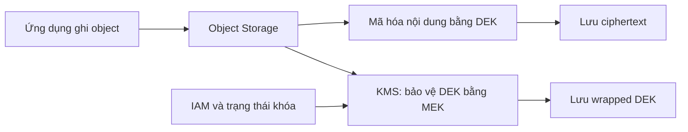

# Master encryption keys và customer-managed keys

## 1. Mục tiêu và bối cảnh

Trong Oracle Cloud Infrastructure (OCI), mã hóa dữ liệu và quản trị khóa là hai trách nhiệm liên quan nhưng khác nhau. Một bucket có thể đã được mã hóa trong khi tổ chức vẫn cần quyết định ai được xoay khóa, ai được cấp quyền sử dụng và bằng cách nào có thể phục hồi dữ liệu nhiều năm sau.

Bài học thuộc chương **Mã hóa, secrets và chứng chỉ**, tập trung vào master encryption key và customer-managed key trong OCI Vault/Key Management Service (KMS). Các ví dụ gắn việc quản trị khóa với compartment, IAM, Object Storage và yêu cầu vận hành hạ tầng có giám sát, tự động hóa, kiểm soát chi phí và tính sẵn sàng.

Sau bài học, bạn có thể:

- Phân biệt khóa mã hóa dữ liệu, khóa mã hóa chủ và phiên bản khóa.
- Chọn giữa khóa do Oracle quản lý và khóa do khách hàng quản lý.
- Thiết kế quyền gán khóa, quyền sử dụng khóa và quyền quản trị khóa.
- Tạo khóa AES, gắn vào bucket và kiểm tra đọc dữ liệu trước, sau khi xoay khóa.
- Lập kế hoạch thay khóa, lưu giữ khóa và phục hồi mà không làm mất quyền giải mã dữ liệu.

## 2. Từ mã hóa dữ liệu đến mã hóa phong bì

### 2.1. Hai tầng khóa

Giả sử một ứng dụng lưu hóa đơn vào Object Storage. Có hai loại tài sản cần bảo vệ: nội dung hóa đơn và khóa có thể giải mã nội dung đó.

| Thành phần | Vai trò | Ví dụ trong bài |
| --- | --- | --- |
| Plaintext | Dữ liệu chưa mã hóa | Nội dung hóa đơn |
| Ciphertext | Dữ liệu đã mã hóa | Nội dung được lưu trên hạ tầng lưu trữ |
| Data encryption key, DEK | Mã hóa trực tiếp dữ liệu | Khóa dùng cho một object |
| Master encryption key, MEK | Bảo vệ DEK | Khóa được chọn từ OCI Vault |
| Wrapped DEK | DEK đã được mã hóa bằng khóa bảo vệ nó | Được lưu cùng thông tin cần thiết để giải mã |

Trong mô hình **envelope encryption**, hay mã hóa phong bì, dữ liệu được mã hóa bằng DEK; DEK tiếp tục được mã hóa bằng MEK. MEK thực hiện vai trò key encryption key (KEK). Đây là sự phân biệt theo chức năng, không phải một yêu cầu tạo thêm một tài nguyên KEK bên cạnh MEK.

Luồng khái niệm cho việc ghi dữ liệu:

1. Dịch vụ tạo hoặc nhận một DEK phù hợp.
2. Dùng DEK mã hóa dữ liệu.
3. Bảo vệ DEK bằng MEK thông qua KMS.
4. Lưu ciphertext, wrapped DEK và metadata cần thiết.
5. Quản lý DEK dạng rõ trong bộ nhớ theo cơ chế của dịch vụ, tránh đưa nó vào nơi lưu trữ lâu dài.

Khi đọc, dịch vụ lấy wrapped DEK, sử dụng KMS để khôi phục DEK rồi giải mã dữ liệu. Với dịch vụ tích hợp, ứng dụng thường chỉ gọi API đọc/ghi của dịch vụ lưu trữ. [Tài liệu Oracle về envelope encryption](https://docs.cloud.oracle.com/en-us/Content/KeyManagement/Concepts/keyoverview.htm).



Sơ đồ thể hiện mô hình trực tiếp MEK–DEK. Một số cơ chế tối ưu có thêm tầng khóa trung gian; không nên dùng sơ đồ này để suy ra chính xác số lần gọi KMS cho mọi thao tác.

### 2.2. Vì sao không mã hóa mọi tệp trực tiếp bằng MEK?

Tách DEK khỏi MEK giúp chia nhỏ phạm vi sử dụng khóa và quản trị vòng đời. Dịch vụ lưu trữ xử lý nội dung lớn bằng DEK, trong khi KMS tập trung bảo vệ khóa và kiểm soát phép toán mật mã.

Ví dụ, khi thay lớp khóa bảo vệ DEK, hệ thống có thể chỉ cần rewrap DEK thay vì đọc, giải mã và mã hóa lại toàn bộ tệp. Tuy nhiên, thao tác nào được thực hiện thực tế phải theo cơ chế của từng dịch vụ.

Không diễn giải “dùng CMK” thành “mọi byte nội dung đều gửi vào KMS”. Cũng không diễn giải “mã hóa tại nơi lưu trữ” thành “người có quyền đọc hợp lệ không thể thấy dữ liệu”: dịch vụ vẫn trả plaintext cho yêu cầu được cho phép.

## 3. Master encryption key và customer-managed key khác nhau thế nào?

**Master encryption key** mô tả vai trò của khóa trong kiến trúc mã hóa. **Customer-managed key (CMK)** mô tả bên chịu trách nhiệm quản trị khóa.

Hai thuật ngữ có thể cùng chỉ một khóa: tổ chức tạo một MEK trong OCI Vault rồi dùng khóa đó làm CMK cho bucket.

| Tiêu chí | Oracle-managed key | Customer-managed key trong OCI Vault |
| --- | --- | --- |
| Người điều khiển vòng đời khóa | Oracle quản lý theo cơ chế của dịch vụ | Khách hàng điều khiển trong phạm vi KMS hỗ trợ |
| Chọn khóa cho tài nguyên | Dịch vụ sử dụng khóa mặc định | Người triển khai chỉ định khóa thích hợp |
| Chính sách truy cập khóa | Được xử lý theo cơ chế mặc định | Cần IAM cho người thao tác và dịch vụ tích hợp |
| Trách nhiệm vận hành | Ít tác vụ quản trị khóa cho khách hàng | Thêm xoay khóa, giám sát, lưu giữ và phục hồi |
| Rủi ro cấu hình | Tập trung vào quyền đối với dữ liệu | Còn có rủi ro từ policy và trạng thái CMK |

Object Storage mã hóa dữ liệu mặc định; chọn CMK là thay đổi quyền kiểm soát khóa, không phải thao tác bắt đầu bật mã hóa cho một bucket vốn lưu dữ liệu rõ. [Tài liệu mã hóa Object Storage](https://docs.oracle.com/en-us/iaas/Content/Object/Tasks/encryption.htm).

CMK hữu ích khi cần vòng đời khóa riêng cho ứng dụng, bằng chứng kiểm soát hoặc ranh giới trách nhiệm giữa nhóm dữ liệu và nhóm bảo mật. Lợi ích này đi kèm một phụ thuộc vận hành mới: dữ liệu còn nguyên nhưng khóa không dùng được thì khả năng phục vụ dữ liệu vẫn có thể bị mất.

### Những đối tượng không nên nhầm với CMK

- **Secret:** một giá trị nhạy cảm cần lưu và lấy lại, chẳng hạn mật khẩu. Khóa KMS là đối tượng dùng trong phép toán mật mã.
- **API signing key hoặc SSH key:** xác thực một chủ thể hoặc phiên truy cập; không tự trở thành MEK cho dịch vụ lưu trữ.
- **Chứng chỉ TLS:** gắn danh tính với public key để phục vụ xác thực và giao tiếp TLS; không thay thế cấu hình mã hóa bucket.
- **SSE-C của Object Storage:** khách hàng cung cấp khóa trong yêu cầu. Cơ chế này khác việc chỉ định OCID của một khóa trong Vault.

## 4. Mô hình tài nguyên khóa trong OCI

### 4.1. Vault, key, key version và key material

Cần phân biệt bốn lớp:

| Lớp | Ý nghĩa |
| --- | --- |
| Vault | Tài nguyên chứa và tổ chức khóa |
| Key | Định danh logic của khóa, có OCID riêng |
| Key version | Một phiên bản vật liệu mật mã thuộc key |
| Key material | Các bit thực sự tham gia phép toán mật mã |

Tên hiển thị giúp con người nhận diện; OCID mới là định danh cần dùng trong cấu hình tham chiếu. Khi xoay khóa, key vẫn giữ OCID nhưng có phiên bản mới. Vì vậy, ghi nhận “đã xoay khóa” cần cả thông tin phiên bản và thời điểm, không chỉ ảnh chụp tên khóa. [Khái niệm khóa và phiên bản trong OCI](https://docs.oracle.com/en-us/iaas/Content/KeyManagement/Concepts/keyoverview.htm).

Ví dụ hồ sơ vận hành:

```text
Ứng dụng: billing
Môi trường: production
Compartment chứa khóa: SecurityKeys
Khóa: billing-prod-object-storage
Key OCID: ocid1.key...<định danh thực>
Tài nguyên sử dụng: bucket hóa đơn tại region đã chọn
Chủ sở hữu: nhóm bảo mật nền tảng
Thời hạn giữ khóa: bao phủ dữ liệu và các bản sao cần phục hồi
```

Hồ sơ chỉ chứa định danh và trách nhiệm. Không lưu key material vào hồ sơ, ticket hoặc log.

### 4.2. Thuật toán và độ dài

Bài thực hành dùng **AES-256**, phù hợp với mục tiêu bảo vệ khóa dữ liệu đối xứng. OCI KMS cũng có khóa bất đối xứng, nhưng không phải mọi loại khóa đều gắn được vào mọi dịch vụ.

| Thuật toán | Công dụng khái quát | Điều cần nhớ |
| --- | --- | --- |
| AES | Mã hóa, giải mã đối xứng | Lựa chọn của bài thực hành |
| RSA | Mã hóa hoặc ký theo phép toán được hỗ trợ | Không mặc nhiên thay được AES trong tích hợp lưu trữ |
| ECDSA | Ký và xác minh chữ ký | Không phải thuật toán mã hóa nội dung |

Trong cấu trúc `KeyShape`, trường `length` dùng **byte**. AES-256 tương ứng `length: 32`, không phải `length: 256`. [Tài liệu KeyShape của Oracle](https://docs.oracle.com/en-us/iaas/tools/python/latest/api/key_management/models/oci.key_management.models.KeyShape.html).

### 4.3. HSM và software protection

Với khóa lưu trong OCI:

- `HSM`: key material được giữ và phép toán dùng khóa được thực hiện trong hardware security module.
- `SOFTWARE`: khóa được bảo vệ khi lưu trữ nhưng xử lý mật mã diễn ra trên máy chủ; có cơ chế export theo điều kiện và quyền tương ứng.

Không thể đổi protection mode của một khóa đã tạo. Nếu yêu cầu thay đổi từ software sang HSM, cần lập kế hoạch tạo khóa mới và chuyển tài nguyên/dữ liệu, thay vì coi đó là chỉnh sửa một thuộc tính. [Tham số tạo master encryption key](https://docs.oracle.com/en-us/iaas/tools/oci-cli/latest/oci_cli_docs/cmdref/kms/management/key/create.html).

Đối với HSM, phân biệt việc không export key material dạng rõ với khả năng backup/restore do dịch vụ cung cấp. Không suy ra rằng “không lấy được khóa dạng rõ” đồng nghĩa “không có phương án phục hồi”.

## 5. Tạo khóa trong OCI, BYOK và khóa bên ngoài

Có ba mô hình cần phân biệt khi thảo luận quyền kiểm soát:

| Mô hình | Nguồn key material | Điểm quản trị chính |
| --- | --- | --- |
| Tạo khóa trong OCI KMS | OCI sinh vật liệu mật mã | Khách hàng điều khiển tài nguyên khóa và policy |
| Bring Your Own Key, BYOK | Vật liệu được sinh bên ngoài rồi import | Khách hàng còn quản trị nguồn gốc và bản giữ bên ngoài |
| External KMS | Vật liệu nằm ở hệ thống quản lý khóa bên ngoài | OCI sử dụng tham chiếu và cơ chế tích hợp được hỗ trợ |

**CMK không bắt buộc là BYOK.** Khóa được sinh trong OCI vẫn có thể do khách hàng quản lý.

Khi import, vật liệu khóa phải được bọc theo quy trình của KMS. Wrapping key phục vụ import không phải chính MEK sẽ được gắn vào bucket. [Tài liệu import khóa và phiên bản khóa](https://docs.oracle.com/en-us/iaas/Content/KeyManagement/Tasks/importingkeys.htm).

External KMS có thêm phụ thuộc vào hệ thống bên ngoài và kết nối đến hệ thống đó. Không giả định mọi dịch vụ hỗ trợ Vault CMK cũng hỗ trợ External KMS; cần đối chiếu danh sách tích hợp của dịch vụ đích. [Tổng quan OCI KMS và quản lý khóa bên ngoài](https://docs.oracle.com/en-us/iaas/Content/KeyManagement/Concepts/keyoverview.htm).

Một thiết kế BYOK cần trả lời được: ai tạo khóa, ai kiểm soát bản gốc, import phiên bản mới như thế nào, và việc kiểm tra phục hồi có bao gồm quyền truy cập bản giữ bên ngoài hay không. Chỉ có một tệp khóa ở nơi khác chưa tạo thành một quy trình phục hồi hoàn chỉnh.

## 6. Thiết kế IAM: người gán khóa và dịch vụ dùng khóa

### 6.1. Ba đường quyền

Xét bucket nằm trong compartment `AppData`, còn khóa ở `SecurityKeys`. Có ba đường quyền riêng:

1. **Quản trị khóa:** tạo khóa, thay đổi cấu hình, xoay khóa hoặc thực hiện tác vụ vòng đời.
2. **Triển khai tài nguyên:** tạo bucket và gán khóa được phép sử dụng.
3. **Dịch vụ sử dụng khóa:** Object Storage gọi phép toán mật mã cần thiết để phục vụ bucket.

`key-delegate` cho phép chủ thể ủy quyền sử dụng khóa qua dịch vụ tích hợp. Nó không đồng nghĩa chủ thể đó được trực tiếp gọi mọi phép toán mật mã. [Tham chiếu IAM cho Key Management](https://docs.oracle.com/en-us/iaas/Content/Identity/Reference/keypolicyreference.htm).

Hệ quả thực tế: có quyền tạo bucket chưa chắc có quyền gán CMK; có quyền gán CMK chưa chắc service principal của Object Storage đã được dùng khóa.

### 6.2. Ví dụ policy có giới hạn theo khóa

Ví dụ sau giả định group `StorageDeployers` nằm trong identity domain `Default`. Thay tên domain, group, compartment, region và key OCID theo môi trường thực.

```text
Allow group Default/StorageDeployers to manage buckets in compartment AppData

Allow group Default/StorageDeployers to manage objects in compartment AppData

Allow group Default/StorageDeployers to use key-delegate in compartment SecurityKeys where target.key.id = '<KEY_OCID>'

Allow service objectstorage-ap-singapore-1 to use keys in compartment SecurityKeys where target.key.id = '<KEY_OCID>'
```

Đây là policy cho bài thực hành đọc/ghi và gán khóa; phạm vi bucket/object cần thu hẹp thêm theo trách nhiệm production. Quyền quản trị khóa cho người tạo và xoay khóa được thiết kế riêng.

Tên principal `objectstorage-ap-singapore-1` chứa region identifier. Chỉ dùng tên này khi tài nguyên thực hành ở `ap-singapore-1`. [Ví dụ Oracle về ủy quyền và quyền dùng khóa của dịch vụ](https://docs.oracle.com/en-us/iaas/Content/Identity/Concepts/commonpolicies.htm).

Nếu người vận hành cần chọn tài nguyên qua Console, bổ sung quyền xem metadata vault/key theo nhu cầu. Không sửa lỗi “không thấy khóa trong danh sách” bằng cách cấp `manage all-resources in tenancy`.

### 6.3. Giới hạn của việc tách nhóm

Tách nhóm quản trị khóa và quản trị dữ liệu là bước tổ chức trách nhiệm. Hiệu lực thực tế còn phụ thuộc toàn bộ policy mà một người thừa hưởng.

Ví dụ, quyền `manage keys` rộng hơn chỉ xoay khóa. Nếu một người đồng thời có quyền dữ liệu và quyền khóa rộng, tên hai group khác nhau không tạo ra sự tách biệt thực chất. Khi yêu cầu nghiêm ngặt, cần giới hạn permission cho từng tác vụ và kiểm soát quyền sửa IAM policy.

Tương tự, người dùng không có quyền gọi KMS trực tiếp vẫn có thể đọc plaintext qua Object Storage nếu được phép đọc object và dịch vụ có đủ quyền giải mã. CMK bổ sung lớp quản trị khóa; quyền truy cập dữ liệu vẫn phải được thiết kế đầy đủ.

## 7. Thực hành: tạo CMK và gắn vào Object Storage

### 7.1. Điều kiện

Ví dụ lệnh dùng **Bash trong OCI Cloud Shell** hoặc môi trường Bash đã cấu hình OCI CLI. Đây là hướng dẫn thực hành, không phải script chạy nguyên trạng trong PowerShell.

Chuẩn bị:

- Một vault đang hoạt động tại region thực hành.
- OCID compartment chứa khóa và compartment chứa bucket.
- Management endpoint lấy từ thông tin của chính vault.
- Principal được quyền tạo, đọc và xoay khóa.
- Policy cho principal triển khai bucket và service principal như phần trước.
- Dữ liệu mẫu không nhạy cảm; tên bucket chưa tồn tại trong namespace.

Nếu dùng hai principal để tách trách nhiệm, thực hiện tạo/xoay khóa bằng principal quản trị khóa; thực hiện các thao tác bucket bằng principal triển khai. Với tài khoản lab có đủ cả hai vai trò, vẫn cần nhận biết ranh giới này.

### 7.2. Tạo khóa AES-256 được bảo vệ bằng HSM

Thay toàn bộ placeholder trước khi chạy:

```bash
export OCI_REGION='ap-singapore-1'
export KEY_COMPARTMENT_OCID='<OCID_COMPARTMENT_SECURITY_KEYS>'
export DATA_COMPARTMENT_OCID='<OCID_COMPARTMENT_APP_DATA>'
export KMS_MANAGEMENT_ENDPOINT='<MANAGEMENT_ENDPOINT_CUA_VAULT>'
export BUCKET_NAME='<TEN_BUCKET_LAB_DUY_NHAT>'

export KEY_OCID="$(
  oci kms management key create \
    --region "$OCI_REGION" \
    --endpoint "$KMS_MANAGEMENT_ENDPOINT" \
    --compartment-id "$KEY_COMPARTMENT_OCID" \
    --display-name 'billing-lab-object-storage' \
    --key-shape '{"algorithm":"AES","length":32}' \
    --protection-mode HSM \
    --query 'data.id' \
    --raw-output
)"
```

Chỉ tiếp tục khi lệnh tạo khóa thành công và `KEY_OCID` có giá trị hợp lệ. Lệnh này tạo tài nguyên có thể phát sinh chi phí.

Kiểm tra thông tin khóa:

```bash
oci kms management key get \
  --region "$OCI_REGION" \
  --endpoint "$KMS_MANAGEMENT_ENDPOINT" \
  --key-id "$KEY_OCID"
```

Kiểm tra trạng thái `ENABLED`, thuật toán, protection mode và phiên bản hiện tại trước khi gán khóa.

Management endpoint dùng cho quản trị; cryptographic endpoint dùng cho các phép toán như encrypt/decrypt. Không hoán đổi hai endpoint. [Tài liệu xem thông tin khóa và endpoint](https://docs.oracle.com/en-us/iaas/Content/KeyManagement/Tasks/managingkeys_topic-To_view_key_details.htm).

Sau khi có OCID thực, cập nhật placeholder trong các policy của bài thực hành và chờ policy có hiệu lực.

### 7.3. Tạo bucket sử dụng CMK

```bash
export OS_NAMESPACE="$(
  oci os ns get \
    --region "$OCI_REGION" \
    --query 'data' \
    --raw-output
)"

oci os bucket create \
  --region "$OCI_REGION" \
  --namespace-name "$OS_NAMESPACE" \
  --compartment-id "$DATA_COMPARTMENT_OCID" \
  --name "$BUCKET_NAME" \
  --kms-key-id "$KEY_OCID"

oci os bucket get \
  --region "$OCI_REGION" \
  --namespace-name "$OS_NAMESPACE" \
  --name "$BUCKET_NAME"
```

Trong phản hồi bucket, kiểm tra `kms-key-id` trỏ đến đúng khóa vừa tạo. Đây là **key OCID**, không phải OCID của một key version. [Tham số tạo bucket bằng OCI CLI](https://docs.oracle.com/en-us/iaas/tools/oci-cli/latest/oci_cli_docs/cmdref/os/bucket/create.html).

### 7.4. Kiểm tra đường dữ liệu

```bash
printf '%s\n' 'invoice-lab-before-rotation' > invoice-before.txt

oci os object put \
  --region "$OCI_REGION" \
  --namespace-name "$OS_NAMESPACE" \
  --bucket-name "$BUCKET_NAME" \
  --name 'invoice-before.txt' \
  --file invoice-before.txt

oci os object get \
  --region "$OCI_REGION" \
  --namespace-name "$OS_NAMESPACE" \
  --bucket-name "$BUCKET_NAME" \
  --name 'invoice-before.txt' \
  --file invoice-before-downloaded.txt

cmp invoice-before.txt invoice-before-downloaded.txt
```

Kết quả mong đợi: upload và download thành công, `cmp` không báo khác biệt. Việc tạo bucket thành công chỉ chứng minh được một phần đường cấu hình; thao tác đọc/ghi giúp kiểm tra đường dữ liệu.

Dùng tên tệp đích chưa tồn tại khi chạy lại bài. Ghi nhận request ID nếu thao tác lỗi để đối chiếu log, không ghi nội dung nhạy cảm vào bản ghi điều tra.

## 8. Xoay khóa, thay khóa và mã hóa lại

### 8.1. Ba thao tác khác nhau

| Thao tác | Định danh key | Điều thay đổi | Việc cần kiểm tra |
| --- | --- | --- | --- |
| Rotate key | Giữ nguyên OCID | Tạo key version mới | Dữ liệu cũ vẫn đọc được |
| Thay key gán cho tài nguyên | Dùng key OCID khác | Khóa được cấu hình cho tài nguyên | Dữ liệu hiện có còn phụ thuộc khóa nào |
| Rewrap/re-encrypt | Tùy kế hoạch | Cập nhật lớp bảo vệ DEK hoặc dữ liệu | Phạm vi xử lý và trạng thái hoàn tất |

Xoay khóa không đồng nghĩa toàn bộ dữ liệu lịch sử đã chuyển sang phiên bản mới. Trong OCI, phiên bản cũ vẫn được giữ để phục vụ giải mã dữ liệu tương ứng. [Hướng dẫn xoay khóa](https://docs.oracle.com/en-us/iaas/Content/KeyManagement/Tasks/managingkeys_topic-To_rotate_a_master_encryption_key.htm).

Ví dụ khái niệm:

```text
Trước rotation:
  Object A -> wrapped DEK dùng key K, version V1

Sau rotation của K:
  K vẫn giữ nguyên OCID, có version mới V2
  Object A còn có thể phụ thuộc V1

Sau khi rewrap đúng phạm vi:
  DEK của Object A được bảo vệ theo phiên bản đích
  Nội dung object không nhất thiết phải mã hóa lại bằng DEK mới
```

Nếu mục tiêu là xử lý một sự cố đã lộ DEK hoặc plaintext, chỉ rewrap DEK không đủ để đảo ngược sự lộ lọt trước đó. Kế hoạch xử lý phải dựa trên loại tài sản đã bị lộ.

### 8.2. Thử xoay khóa trong bài lab

Lưu thông tin khóa trước thao tác, đặc biệt OCID phiên bản hiện tại, rồi tạo phiên bản mới:

```bash
oci kms management key-version create \
  --region "$OCI_REGION" \
  --endpoint "$KMS_MANAGEMENT_ENDPOINT" \
  --key-id "$KEY_OCID"

oci kms management key get \
  --region "$OCI_REGION" \
  --endpoint "$KMS_MANAGEMENT_ENDPOINT" \
  --key-id "$KEY_OCID"
```

Kỳ vọng key OCID không đổi, còn phiên bản hiện tại thay đổi sau khi thao tác hoàn tất. Tiếp theo:

1. Download lại `invoice-before.txt` vào một tệp đích mới và so sánh nội dung.
2. Tạo một tệp `invoice-after.txt`, upload rồi download và so sánh.
3. Đối chiếu log nếu cần xác định phiên bản dùng trong phép toán KMS.

Hai phép thử đọc dữ liệu không tự chứng minh rằng toàn bộ DEK đã dùng phiên bản mới. Chúng kiểm tra tính liên tục của đường dữ liệu qua thời điểm rotation.

### 8.3. Re-encrypt cho Object Storage

Nếu muốn cập nhật lớp bảo vệ DEK của object lab theo khóa được gán cho bucket:

```bash
oci os object reencrypt \
  --region "$OCI_REGION" \
  --namespace-name "$OS_NAMESPACE" \
  --bucket-name "$BUCKET_NAME" \
  --name 'invoice-before.txt'
```

Để chuyển riêng object sang một Vault key khác, thao tác này có thể chỉ định `--kms-key-id` của khóa đích, kèm đủ quyền cần thiết. [Hướng dẫn re-encrypt một object](https://docs.oracle.com/en-us/iaas/Content/Object/Tasks/managingobjects_topic-To_reencrypt_an_object.htm).

Với phạm vi bucket, OCI có thao tác re-encrypt các DEK theo khóa/phiên bản phù hợp. Cần theo dõi work request đến khi hoàn tất và xác định phạm vi dữ liệu cần di chuyển, bao gồm dữ liệu lịch sử có yêu cầu phục hồi. Không coi việc sửa thuộc tính bucket là bằng chứng hoàn tất migration. [Hướng dẫn re-encrypt DEK của bucket](https://docs.oracle.com/en-us/iaas/Content/Object/Tasks/managingbuckets_topic-To_reencrypt_a_buckets_data_encryption_keys.htm).

### 8.4. Xoay khóa tự động

Theo tài liệu OCI, automatic key rotation khả dụng cho khóa trong **virtual private vault**, với khoảng xoay từ **60 đến 365 ngày**. Không mặc định mọi vault đều hỗ trợ tùy chọn này. [Cấu hình automatic key rotation](https://docs.oracle.com/en-us/iaas/Content/KeyManagement/Tasks/tasks_tasks_managingkeys_topic_edit_auto_key_rotation.htm).

Dù xoay tự động hay theo lịch tự động hóa do đội vận hành xây dựng, cần có người nhận cảnh báo khi rotation thất bại. Một lịch đã cấu hình không chứng minh phiên bản mới đã được tạo thành công.

Với BYOK, quyết định rõ phiên bản mới phải tiếp tục được sinh bên ngoài hay có thể được KMS sinh. Đây là yêu cầu về nguồn gốc khóa, khác với việc chỉ có phiên bản mới đúng hạn.

## 9. Vô hiệu hóa và xóa khóa: tác động tới dữ liệu

Có thể xem vòng đời vận hành theo mô hình rút gọn sau; OCI còn có các trạng thái chuyển tiếp:

```text
ENABLED <-> DISABLED
    |
    +--> PENDING_DELETION --> DELETED
                |
                +--> Hủy lịch xóa trước khi hết hạn
```

Disable phục vụ ngừng sử dụng khóa và có đường enable trở lại. Xóa khóa là quyết định có thể làm mất khả năng giải mã lâu dài.

Đối với khóa lưu trong OCI, lịch xóa có thời gian chờ từ **7 đến 30 ngày**, mặc định 30 ngày. Tuy nhiên, khóa ở `PENDING_DELETION` đã không dùng được cho dữ liệu phụ thuộc; thời gian chờ không phải thời gian tiếp tục phục vụ bình thường. Khi xóa hoàn tất, vật liệu và metadata của khóa bị hủy. [Hướng dẫn xóa khóa](https://docs.oracle.com/en-us/iaas/Content/KeyManagement/Tasks/managingkeys_topic-To_delete_a_key.htm).

Nếu lên lịch xóa nhầm, cần hủy trong khi khóa còn `PENDING_DELETION`; kiểm tra khóa trở về `ENABLED` và thử lại đường dữ liệu. [Hướng dẫn hủy lịch xóa khóa](https://docs.oracle.com/en-us/iaas/Content/KeyManagement/Tasks/managingkeys_topic-To_cancel_the_deletion_of_a_key.htm).

Trước khi ngừng một khóa, kiểm kê tối thiểu:

- Tài nguyên đang gán khóa và object có cấu hình khóa riêng.
- Backup, snapshot, object version hoặc bản sao lưu trữ lâu dài còn cần giải mã.
- Quy trình restore và môi trường đích có cần khóa cũ không.
- Tác vụ nền, batch hoặc khôi phục chỉ chạy không thường xuyên.
- Bằng chứng migration đã hoàn tất và người chịu trách nhiệm phê duyệt.

Không dùng khóa production để “thử xem disable có ảnh hưởng không”. Bài thử gián đoạn cần khóa và dữ liệu lab riêng, tiêu chí phục hồi rõ ràng.

Quy tắc thiết kế là giữ được khóa ít nhất trong toàn bộ thời gian cần giải mã dữ liệu và các bản sao phụ thuộc. Thời gian không phát sinh request không đủ chứng minh khóa đã hết giá trị: một bản backup có thể chỉ cần khóa khi sự cố xảy ra.

## 10. Giám sát và điều tra

### 10.1. Audit và service log có vai trò khác nhau

Audit dùng để theo dõi hoạt động quản trị như tạo, cập nhật và xoay khóa. Các phép toán data plane như `Decrypt` hoặc `GenerateDataEncryptionKey` không được Audit ghi lại theo cùng cơ chế; cần bật service log cho Key Management. [Hướng dẫn theo dõi việc dùng khóa](https://docs.oracle.com/en-us/iaas/Content/KeyManagement/Tasks/managingkeys-usage.htm).

Trong OCI Logging, bật log cho vault với category **Crypto Operations**. Metadata log hỗ trợ xác định operation, principal và key version được dùng. [Cấu trúc log Key Management](https://docs.oracle.com/en-us/iaas/Content/Logging/Reference/details_for_kms.htm).

Gợi ý vận hành:

| Tín hiệu | Ý nghĩa cần điều tra | Hành động |
| --- | --- | --- |
| Thay đổi trạng thái khóa ngoài kế hoạch | Có thể ảnh hưởng nhiều tài nguyên | Đối chiếu người thao tác, ticket và dữ liệu phụ thuộc |
| Rotation không hoàn tất | Lịch vòng đời khóa bị gián đoạn | Kiểm tra trạng thái, quyền và giới hạn dịch vụ |
| Lỗi đọc object sau sửa IAM | Có thể thiếu một đường quyền | Đối chiếu quyền object, delegate và service principal |
| Tăng độ trễ hoặc throttling | Có thể chạm giới hạn gọi KMS | Đối chiếu lưu lượng, log và cơ chế tích hợp |
| Truy cập từ principal ngoài dự kiến | Có thể có cấp quyền quá rộng | Kiểm tra policy hiệu lực và hoạt động dữ liệu |

Log cần đủ để điều tra mà không chứa plaintext, DEK dạng rõ hay nội dung secret. Quyền đọc log cũng cần giới hạn vì metadata có thể tiết lộ cấu trúc tài nguyên.

### 10.2. Không suy diễn từ một triệu chứng

| Triệu chứng | Các điểm kiểm tra hợp lý |
| --- | --- |
| Người dùng tạo được bucket nhưng gán CMK thất bại | `key-delegate`, OCID khóa, trạng thái khóa, quyền với bucket |
| Gán CMK thành công nhưng đọc/ghi thất bại | Service principal đúng region, quyền dùng khóa, quyền object |
| Đọc dữ liệu cũ lỗi sau thay khóa | Phụ thuộc khóa cũ, phạm vi re-encrypt, bản sao chưa di chuyển |
| CLI quản trị báo lỗi endpoint | Management endpoint có thuộc đúng vault/region không |
| Không thấy phép toán decrypt trong Audit | Crypto Operations service log đã được bật chưa |
| Restore thất bại dù backup còn tồn tại | Khóa, phiên bản, IAM và khả năng sử dụng ở môi trường phục hồi |

Thông báo không tìm thấy tài nguyên đôi khi cần điều tra cả định danh lẫn quyền; không vội kết luận tài nguyên đã bị xóa. Thu thập request ID, thời điểm và principal để đối chiếu.

## 11. Khả năng phục hồi, phạm vi ảnh hưởng và chi phí

### 11.1. Chọn ranh giới khóa

Một khóa dùng cho mọi workload làm thiết kế đơn giản, nhưng lỗi vòng đời hoặc policy có thể ảnh hưởng rộng. Một khóa cho từng đối tượng lại tăng số tài nguyên và công việc quản trị mà chưa chắc đem lại lợi ích tương xứng.

Điểm bắt đầu hợp lý là xem xét ranh giới theo môi trường, ứng dụng, chủ sở hữu và thời hạn lưu dữ liệu. Ví dụ:

```text
billing-production -> khóa phục vụ dữ liệu và chính sách giữ của billing
analytics-production -> khóa theo vòng đời của analytics
development -> tách khỏi các khóa production
```

Đây là lựa chọn kiến trúc, cần điều chỉnh theo yêu cầu thực tế. Không dùng tên compartment như bằng chứng tự động rằng IAM đã cách ly đúng.

### 11.2. Phục hồi phải có cả dữ liệu lẫn khóa

Với mỗi kế hoạch DR, lập ánh xạ:

```text
Dữ liệu cần phục hồi
    -> khóa/phiên bản cần dùng
    -> vault và region tương ứng
    -> principal thực hiện restore
    -> principal dịch vụ sử dụng khóa
    -> phép thử đọc dữ liệu sau phục hồi
```

Replication của vault/key có điều kiện hỗ trợ theo loại và khả năng của vault. Không phải mọi virtual vault cũ đều hỗ trợ; có thể kiểm tra thuộc tính `isVaultReplicable`. [Tài liệu replicate vault và khóa](https://docs.oracle.com/en-us/iaas/Content/KeyManagement/Tasks/replicatingvaults.htm).

Không xem replica là biện pháp chống mọi thao tác xóa: Oracle nêu việc xóa source vault cũng xóa vault và khóa tương ứng ở destination khi có replication. [Hướng dẫn xóa vault](https://docs.oracle.com/en-us/iaas/Content/KeyManagement/Tasks/managingvaults_topic-To_delete_a_vault.htm).

Vì vậy, một cuộc diễn tập cần thử đọc dữ liệu khôi phục bằng đúng principal ở môi trường đích. Chỉ nhìn thấy tài nguyên khóa hoặc bản backup trong Console chưa chứng minh đạt RTO/RPO.

### 11.3. Kiểm soát chi phí và lưu lượng

Khi ước lượng, tính cả loại vault, protection mode, số khóa/phiên bản, yêu cầu replication, thời gian lưu log và công sức vận hành. Không xóa khóa hoặc phiên bản cũ chỉ để giảm chi phí khi chưa chứng minh dữ liệu không còn phụ thuộc.

Ở Object Storage, **SSE-KMS Bucket Key** là tùy chọn dùng khóa trung gian theo bucket để giảm số lần gọi KMS. Nó không thay vai trò quản trị của CMK. Không suy ra mọi lần đọc/ghi đều tạo một lần gọi KMS trực tiếp. [Mã hóa Object Storage và Bucket Key](https://docs.oracle.com/en-us/iaas/Content/Object/Tasks/encryption.htm).

Bật Bucket Key áp dụng cho object mới; object hiện có cần quy trình re-encrypt để chuyển cơ chế bảo vệ. [Hướng dẫn cập nhật Bucket Key](https://docs.oracle.com/en-us/iaas/Content/Object/Tasks/managingbuckets_topic-To_update_a_bucket_to_use_sse_kms_bucket_key.htm).

Bài lab giữ mô hình cơ bản để dễ quan sát. Với workload lớn, đánh giá cơ chế tối ưu cùng yêu cầu thu hồi quyền, lưu lượng và giới hạn dịch vụ.

## 12. Áp dụng sang dịch vụ OCI khác

OCI cho phép gán MEK do khách hàng quản lý cho các tài nguyên được hỗ trợ như block/boot volume, bucket, file system và một số dịch vụ cơ sở dữ liệu. Quy trình, principal và điều kiện của mỗi tích hợp khác nhau. [Hướng dẫn gán master encryption key](https://docs.oracle.com/en-us/iaas/Content/KeyManagement/Tasks/assigningkeys.htm).

Không sao chép nguyên policy Object Storage sang database hoặc Block Volume. Với mỗi dịch vụ, xác minh:

1. Loại khóa, thuật toán và protection mode được hỗ trợ.
2. Region, compartment và cơ chế tham chiếu khóa.
3. Principal và permission dịch vụ yêu cầu.
4. Hành vi khi rotate, thay key, disable hoặc lên lịch xóa.
5. Quy trình backup/restore và phụ thuộc vào khóa cũ.

Trong ngữ cảnh Oracle Database, cần phân biệt khóa dùng cho Transparent Data Encryption, cấu hình quản lý khóa của từng sản phẩm database và khóa của volume chứa dữ liệu. Mã hóa volume không tự chứng minh rằng database đã được cấu hình dùng đúng CMK theo yêu cầu.

## 13. Tự động hóa và tiêu chí hoàn tất triển khai

Tự động hóa nên quản lý cấu hình và bằng chứng vận hành, không đưa key material vào mã nguồn.

Một pipeline có thể:

1. Tạo hoặc tham chiếu vault/key bằng định danh rõ ràng.
2. Áp dụng IAM trước khi gắn khóa cho tài nguyên.
3. Chờ tài nguyên đạt trạng thái dùng được.
4. Triển khai bucket hoặc dịch vụ đích.
5. Thực hiện smoke test ghi/đọc dữ liệu mẫu.
6. Lưu kết quả, key OCID và request ID cần thiết.
7. Theo dõi rotation, lỗi quyền và kế hoạch hết vòng đời.

Trong công cụ IaC, bảo vệ tài nguyên khóa quan trọng khỏi thao tác destroy ngoài ý muốn bằng cơ chế phù hợp của công cụ. Đây là lớp phòng ngừa vận hành; vẫn phải kiểm soát IAM và kiểm tra kế hoạch thay đổi.

Có thể coi một triển khai đã đủ điều kiện bàn giao vận hành khi xác minh được:

- Tài nguyên dùng đúng key OCID và đúng môi trường.
- Principal triển khai, dịch vụ và quản trị khóa có phạm vi quyền đã xác định.
- Dữ liệu mới và dữ liệu tồn tại trước rotation đều đọc được.
- Có người chịu trách nhiệm xử lý rotation thất bại và thay đổi trạng thái khóa.
- Thời hạn giữ khóa bao phủ dữ liệu và backup cần phục hồi.
- Quy trình restore đã kiểm tra cả đường dữ liệu và đường sử dụng khóa.

Trong lab, chỉ dọn khóa sau khi đã dọn dữ liệu thử và kiểm tra không còn phụ thuộc. Không dùng thao tác xóa khóa như cách dọn nhanh một tài nguyên lưu trữ.

## 14. Các nguyên tắc cần ghi nhớ

- MEK bảo vệ DEK; DEK mã hóa nội dung trong mô hình mã hóa phong bì.
- CMK nói về quyền quản trị, không bắt buộc vật liệu khóa phải sinh ngoài OCI.
- Key OCID và key version là hai định danh khác nhau.
- Quyền với dữ liệu, quyền gán khóa và quyền dịch vụ dùng khóa phải cùng đúng.
- Rotate tạo phiên bản mới; migration dữ liệu sang khóa/phiên bản đích cần quy trình riêng.
- Dữ liệu và backup chỉ hữu ích khi còn đủ khóa, quyền và khả năng giải mã.
