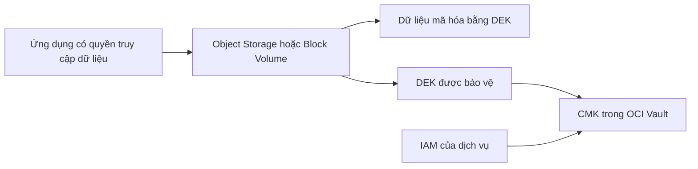

# Gán khóa mã hóa cho Storage và Database services

## 1. Mục tiêu và phạm vi

Trong Oracle Cloud Infrastructure (OCI), nhiều dịch vụ lưu trữ và cơ sở dữ liệu đã mã hóa dữ liệu khi lưu trữ theo cơ chế mặc định của dịch vụ. Khi tổ chức cần tự kiểm soát vòng đời khóa, phân tách trách nhiệm hoặc chứng minh việc sử dụng một khóa cụ thể, việc cần làm là chọn khóa khách hàng quản lý trong OCI Vault và gán khóa đó cho tài nguyên hỗ trợ.

Bài học thuộc chương **Mã hóa, secrets và chứng chỉ**, tập trung vào việc gán khóa cho Storage và Database services. Sau bài học, người học có thể:

- Phân biệt mã hóa mặc định, khóa khách hàng quản lý và mã hóa do ứng dụng thực hiện.
- Chuẩn bị khóa, compartment và quyền IAM cho người triển khai cũng như dịch vụ sử dụng khóa.
- Gán khóa cho Object Storage, Block Volume và xác định quy trình phù hợp với dịch vụ cơ sở dữ liệu Oracle đang sử dụng.
- Kiểm chứng cấu hình, truy cập dữ liệu và khả năng khôi phục sau khi thay đổi khóa.
- Thiết kế rotation, giám sát và phương án bảo vệ khóa theo yêu cầu chi phí, tính sẵn sàng.

Ví dụ xuyên suốt là một ứng dụng nghiệp vụ chạy trên Compute trong VCN riêng. Ứng dụng ghi tệp vào Object Storage, dùng Block Volume cho dữ liệu của máy chủ và lưu giao dịch trong dịch vụ cơ sở dữ liệu Oracle. Nhóm bảo mật quản lý Vault trong compartment `Security`; nhóm ứng dụng quản lý hạ tầng trong compartment `Application`. Đây là mô hình minh họa, không phải tên compartment bắt buộc của OCI.

## 2. Hiểu đúng thứ được gán

### 2.1. Khóa mã hóa không phải secret hay chứng chỉ

| Thành phần | Vai trò | Có dùng trực tiếp làm khóa gán cho Storage/Database không? |
| --- | --- | --- |
| Khóa mã hóa trong OCI Vault | Thực hiện hoặc hỗ trợ các thao tác mật mã theo tích hợp của dịch vụ | Có, khi loại khóa và dịch vụ đích hỗ trợ |
| Secret trong Vault | Lưu giá trị bí mật như mật khẩu hoặc token | Không; OCID của secret không thay thế OCID của khóa |
| Chứng chỉ TLS | Xác thực danh tính và phục vụ bảo vệ kết nối TLS | Không thay thế cấu hình mã hóa dữ liệu lưu trữ |
| Khóa SSH | Xác thực truy cập hệ điều hành | Không thay thế khóa mã hóa volume |
| Wallet/keystore của Oracle Database | Thành phần của cơ chế quản lý khóa và TDE trong database | Phải xử lý theo tích hợp của dịch vụ database, không coi là cùng một tài nguyên với Vault |

Gán CMK không cấu hình HTTPS cho Object Storage, không bật TLS cho kết nối database và không cấp quyền đọc dữ liệu cho người dùng ứng dụng. Các lớp bảo vệ đó cần được cấu hình riêng.

### 2.2. Khóa do Oracle quản lý và khóa khách hàng quản lý

**Khóa do Oracle quản lý** được dịch vụ sử dụng theo cơ chế mặc định của nó. Người dùng không trực tiếp quản trị vòng đời khóa đó như một tài nguyên Vault riêng trong tenancy.

**Khóa khách hàng quản lý**, thường gọi là customer-managed key (CMK), là khóa mà khách hàng quản trị trong OCI Vault và chọn cho tài nguyên hỗ trợ. Khách hàng kiểm soát các quyết định như cấp quyền sử dụng, rotation, vô hiệu hóa và lên lịch xóa khóa. Việc mã hóa dữ liệu vẫn do dịch vụ tích hợp thực hiện; ứng dụng thường không phải tự gọi Vault cho từng lần đọc, ghi dữ liệu.

Việc chuyển sang CMK bổ sung khả năng kiểm soát, đồng thời bổ sung phụ thuộc vận hành: cấu hình IAM hoặc vòng đời khóa sai có thể ảnh hưởng tới truy cập dữ liệu, tạo tài nguyên, backup hoặc restore.

### 2.3. Mô hình mã hóa phong bì

Đối với các tích hợp lưu trữ dùng mã hóa phong bì, có thể hình dung hai tầng:

1. Dữ liệu được mã hóa bằng khóa mã hóa dữ liệu, thường gọi là data encryption key (DEK).
2. DEK được bảo vệ bằng khóa cấp cao hơn. CMK trong Vault tham gia vào tầng bảo vệ khóa theo tích hợp của dịch vụ.



Sơ đồ là mô hình khái niệm, không mô tả một cuộc gọi Vault bắt buộc cho mọi thao tác I/O. Dịch vụ có thể có cơ chế cache và xử lý khóa nội bộ. Với Oracle Database, phải đọc thêm ngữ nghĩa của TDE và tích hợp Vault; không suy từ sơ đồ rằng mọi loại database đều có cùng kiến trúc keystore.

**OCID của khóa** định danh tài nguyên khóa. **Phiên bản khóa** định danh vật liệu khóa trong vòng đời tài nguyên đó. Rotation tạo phiên bản mới không đồng nghĩa với việc OCID của khóa thay đổi hoặc toàn bộ dữ liệu cũ được mã hóa lại ngay.

## 3. Chọn đúng cấp tài nguyên và phạm vi hỗ trợ

Không có một nút gán khóa chung cho toàn tenancy, toàn compartment hoặc toàn nhóm dịch vụ. Phải xác định tài nguyên mà từng dịch vụ dùng để liên kết khóa.

| Dịch vụ hoặc tài nguyên | Điểm cần kiểm tra khi gán khóa | Bằng chứng cần thu thập |
| --- | --- | --- |
| Object Storage | Khóa mã hóa cấu hình trên bucket; quyền của service principal theo region | OCID khóa trên bucket và kết quả ghi/đọc object |
| Block Volume | Khóa gắn với từng volume; khóa của nguồn clone và backup được xem xét riêng | OCID khóa trên volume, trạng thái tài nguyên và kết quả I/O |
| Boot Volume | Khóa gắn với boot volume; không mặc định suy từ data volume | Cấu hình boot volume và kiểm tra vận hành phù hợp trong môi trường thử nghiệm |
| File Storage | Khả năng dùng CMK, loại tài nguyên liên kết và quy trình của cấu hình dịch vụ đang dùng | Cấu hình mã hóa của file system và phép thử đọc/ghi qua mount |
| Oracle Base Database Service hoặc Exadata Database Service | Hỗ trợ quản lý khóa của đúng loại triển khai; tích hợp TDE/Vault và tài nguyên cần cập nhật | Cấu hình quản lý khóa, trạng thái database và bằng chứng TDE phù hợp |
| Autonomous Database | Tùy chọn customer-managed keys của đúng mô hình triển khai và cấu hình database | OCID khóa hoặc thông tin quản lý khóa được dịch vụ công bố, work request và giao dịch thử |

Bảng là cách định vị công việc, không khẳng định mọi tổ hợp dịch vụ, phiên bản, region và topology đều hỗ trợ cùng một thao tác. Trước khi thực hiện với database hoặc File Storage, kiểm tra khả năng của chính deployment và API/provider đang dùng. Không áp dụng lệnh của Object Storage cho File Storage, hoặc quy trình Autonomous Database cho Base Database Service.

Một instance có cả boot volume và nhiều block volume có thể dùng các khóa khác nhau. Gán khóa cho một volume không tự thay đổi khóa của các volume còn lại. Tương tự, khóa của bucket chứa bản xuất dữ liệu không thay thế cấu hình TDE của database nguồn.

## 4. Chuẩn bị khóa, vị trí và quyền IAM

### 4.1. Kiểm tra trước khi chọn khóa

Trước khi tạo hoặc cập nhật tài nguyên, ghi nhận:

| Thuộc tính | Điều cần xác nhận |
| --- | --- |
| Tenancy và region | Khóa, vault và tài nguyên đích thuộc phạm vi được tích hợp hỗ trợ; với các ví dụ trong bài, dùng cùng tenancy và region |
| Trạng thái khóa | Khóa ở trạng thái cho phép sử dụng, không bị vô hiệu hóa hoặc chờ xóa |
| Loại khóa | Chọn khóa đối xứng AES phù hợp yêu cầu của dịch vụ; AES-256 là lựa chọn cho các ví dụ trong bài |
| OCID | Dùng OCID của key, không dùng OCID của vault, secret hoặc phiên bản khóa khi trường cấu hình yêu cầu key OCID |
| Compartment chứa khóa | Xác định nơi đặt policy và phạm vi cấp quyền cho tài nguyên khóa |
| Compartment chứa dữ liệu | Xác định nơi người triển khai có quyền tạo hoặc cập nhật bucket, volume, database |
| Vòng đời | Có người chịu trách nhiệm rotation, xử lý sự cố và phê duyệt thay đổi ảnh hưởng khả năng giải mã |

Khóa và dữ liệu có thể ở hai compartment khác nhau. Compartment là ranh giới tổ chức và phân quyền, không tự tạo ra quyền sử dụng khóa. Quyền của người triển khai trên `Application` không thay thế quyền liên quan đến khóa trong `Security`.

Nếu phải chọn giữa loại vault, mức bảo vệ khóa hoặc mô hình quản lý khác nhau, đánh giá theo yêu cầu của dịch vụ và tổ chức. Không coi cấu hình có mức chi phí cao hơn là điều kiện mặc định để mọi CMK hoạt động.

### 4.2. Hai chủ thể cần được cấp quyền

Cần phân biệt hai tuyến quyền:

1. **Người hoặc pipeline triển khai**: có quyền tạo/cập nhật tài nguyên dữ liệu, xem khóa cần chọn và ủy quyền sử dụng khóa theo cơ chế mà dịch vụ yêu cầu.
2. **Dịch vụ OCI thực sự sử dụng khóa**: có quyền thực hiện thao tác mật mã cần thiết trên khóa.

Một người nhìn thấy khóa trong Console không chứng minh dịch vụ có thể dùng khóa. Ngược lại, dịch vụ được cấp quyền dùng khóa không có nghĩa mọi người đều được quyền gán khóa đó vào tài nguyên.

Ví dụ policy minh họa cho Object Storage và Block Volume:

```text
Allow group StorageProvisioners to read vaults in compartment Security
Allow group StorageProvisioners to read keys in compartment Security
Allow group StorageProvisioners to use key-delegate in compartment Security

Allow service objectstorage-ap-singapore-1 to use keys in compartment Security
Allow service blockstorage to use keys in compartment Security
```

Trong ví dụ:

- `StorageProvisioners` là nhóm minh họa. Điều chỉnh định danh nhóm theo cấu hình IAM và identity domain thực tế.
- `Security` là compartment chứa khóa.
- `ap-singapore-1` là region minh họa cho service principal của Object Storage; phải thay bằng region của bucket.
- `key-delegate` phục vụ quyền ủy quyền sử dụng khóa trong các tích hợp cần quyền này. Nó không thay thế quyền quản lý bucket hoặc volume.
- Policy cho `blockstorage` áp dụng cho tích hợp Block Volume; không sao chép principal đó sang database.

Đây là phần quyền liên quan đến khóa, chưa phải bộ policy triển khai hoàn chỉnh. Người hoặc pipeline vẫn cần quyền tài nguyên storage ở compartment ứng dụng. Đặt policy tại phạm vi có thể cấp quyền cho compartment đích.

Khi cần giới hạn service principal vào một khóa cụ thể, có thể dùng điều kiện phù hợp với tài nguyên khóa, ví dụ:

```text
Allow service objectstorage-ap-singapore-1 to use keys in compartment Security where target.key.id = '<KEY_OCID>'
```

Thay placeholder bằng OCID thật trước khi sử dụng. Không giữ đồng thời một policy rộng hơn cho cùng principal nếu mục tiêu là giới hạn vào khóa này; các quyền Allow có thể cộng dồn.

Với database, principal, dynamic group và các quyền khóa cần thiết phụ thuộc dịch vụ và chế độ triển khai. Nếu quy trình yêu cầu dynamic group, hãy giới hạn membership vào đúng tài nguyên và phạm vi được hướng dẫn. Không cấp `manage all-resources in tenancy` để chữa một lỗi truy cập khóa.

### 4.3. Quyền khóa và quyền dữ liệu độc lập

Một ứng dụng được quyền đọc object không cần được cấp quyền quản trị khóa chỉ để dịch vụ giải mã object cho nó. Object Storage kiểm tra quyền dữ liệu của ứng dụng và sử dụng quyền của dịch vụ trong tích hợp khóa.

Chiều ngược lại, quyền quản trị Vault không tự cấp quyền tải object, mount volume hoặc chạy SQL. Phân tách hai tuyến quyền giúp nhóm bảo mật quản lý khóa mà không mặc định trở thành người sử dụng dữ liệu.

## 5. Gán khóa cho Object Storage

### 5.1. Tạo bucket mới với CMK

Quy trình cơ bản trên Console:

1. Chọn đúng region và compartment ứng dụng.
2. Tạo bucket, kiểm tra các lựa chọn về truy cập, lưu trữ và bảo vệ dữ liệu phù hợp bài toán.
3. Trong cấu hình mã hóa, chọn khóa khách hàng quản lý.
4. Chọn vault, compartment chứa khóa và khóa AES phù hợp.
5. Hoàn tất tạo bucket, chờ tài nguyên sẵn sàng và đọc lại cấu hình.
6. Ghi một object thử, tải lại và so sánh nội dung.

Các đoạn CLI dưới đây là ví dụ cho **Bash** đã cấu hình OCI CLI và cơ chế xác thực hợp lệ. Chúng không chứa thông tin đăng nhập; thay các placeholder và chọn region trong profile hoặc tùy chọn CLI trước khi chạy.

```bash
NAMESPACE='<OBJECT_STORAGE_NAMESPACE>'
APP_COMPARTMENT_OCID='<APPLICATION_COMPARTMENT_OCID>'
KEY_OCID='<VAULT_KEY_OCID>'
BUCKET_NAME='oci-cmk-lab'

oci os bucket create \
  --namespace-name "$NAMESPACE" \
  --compartment-id "$APP_COMPARTMENT_OCID" \
  --name "$BUCKET_NAME" \
  --kms-key-id "$KEY_OCID"
```

Đọc lại khóa đã liên kết:

```bash
oci os bucket get \
  --namespace-name "$NAMESPACE" \
  --name "$BUCKET_NAME" \
  --query 'data."kms-key-id"' \
  --raw-output
```

Kết quả phải trùng OCID khóa dự kiến. Lưu lại kết quả với region và compartment của bucket để tránh nhầm giữa các môi trường có tên gần giống nhau.

Thử ghi và đọc một tệp không nhạy cảm:

```bash
printf 'OCI CMK lab\n' > cmk-check.txt

oci os object put \
  --namespace-name "$NAMESPACE" \
  --bucket-name "$BUCKET_NAME" \
  --name 'checks/cmk-check.txt' \
  --file cmk-check.txt

oci os object get \
  --namespace-name "$NAMESPACE" \
  --bucket-name "$BUCKET_NAME" \
  --name 'checks/cmk-check.txt' \
  --file cmk-check.download.txt

cmp cmk-check.txt cmk-check.download.txt
```

`cmp` trả mã thành công khi hai tệp giống nhau. Chọn tên object mới hoặc xử lý rõ trường hợp object đã tồn tại; không dùng thao tác ghi đè ngoài ý muốn làm bước kiểm thử.

Phép thử này xác nhận một đường đi ghi/đọc hoạt động tại thời điểm thử. Bằng chứng gán khóa vẫn là cấu hình đọc lại từ bucket. Cả hai loại bằng chứng cần được giữ cùng nhau.

### 5.2. Đổi khóa cho bucket đã có

Với bucket hiện hữu, trước tiên ghi lại khóa cũ, lượng dữ liệu, versioning, retention và khả năng khôi phục. Sau đó dùng quy trình cập nhật khóa mà dịch vụ hỗ trợ. Ví dụ trường cấu hình CLI:

```bash
oci os bucket update \
  --namespace-name "$NAMESPACE" \
  --name "$BUCKET_NAME" \
  --kms-key-id "$KEY_OCID"
```

Không dùng việc trường `kms-key-id` đã đổi làm bằng chứng duy nhất rằng mọi object, mọi phiên bản cũ và mọi bản sao đã hoàn tất quá trình bảo vệ bằng khóa đích. Cần kiểm tra ngữ nghĩa cập nhật và re-encrypt của Object Storage cho thao tác được sử dụng, theo dõi công việc liên quan nếu có, rồi kiểm thử dữ liệu cũ lẫn dữ liệu mới.

Lập danh sách các dữ liệu cần bảo vệ trong thay đổi: object đang hoạt động, phiên bản trước, bản sao ở bucket khác và bản sao phục vụ phục hồi. Chỉ kết thúc phụ thuộc vào khóa cũ sau khi có bằng chứng tương ứng với toàn bộ phạm vi đó.

Đừng nhầm cơ chế gán Vault CMK cho bucket với cơ chế khách hàng tự cung cấp khóa trong từng yêu cầu hoặc với mã hóa nội dung tại ứng dụng. Chúng có cách truyền khóa và trách nhiệm vận hành khác nhau.

## 6. Gán khóa cho Block Volume và Boot Volume

### 6.1. Tạo Block Volume bằng CMK

Khi tạo Block Volume, chọn đúng availability domain, dung lượng, hiệu năng và khóa. Gán khóa không tự thiết lập attachment, hệ thống tệp hoặc mount point cho Compute.

Ví dụ Bash và OCI CLI:

```bash
APP_COMPARTMENT_OCID='<APPLICATION_COMPARTMENT_OCID>'
AD_NAME='<AVAILABILITY_DOMAIN_NAME>'
KEY_OCID='<VAULT_KEY_OCID>'

oci bv volume create \
  --compartment-id "$APP_COMPARTMENT_OCID" \
  --availability-domain "$AD_NAME" \
  --display-name 'cmk-data-volume' \
  --size-in-gbs 50 \
  --kms-key-id "$KEY_OCID"
```

Lấy OCID volume từ kết quả tạo, đợi volume chuyển sang trạng thái sẵn sàng rồi kiểm tra:

```bash
VOLUME_OCID='<VOLUME_OCID>'

oci bv volume get \
  --volume-id "$VOLUME_OCID" \
  --query 'data.{id:id,state:"lifecycle-state",key:"kms-key-id"}'
```

Sau đó attach volume vào Compute thử nghiệm, chuẩn bị hệ thống tệp nếu là volume mới, ghi và đọc dữ liệu thử. Không chạy lệnh format trên volume đã có dữ liệu chỉ để kiểm tra mã hóa.

### 6.2. Kiểm tra Boot Volume riêng

Boot Volume có vòng đời gắn với khả năng khởi động instance. Kiểm tra cấu hình khóa của boot volume khi tạo instance hoặc theo quy trình cập nhật mà dịch vụ hỗ trợ. Không kết luận boot volume đã dùng CMK chỉ vì một data volume của instance dùng CMK.

Trong môi trường thử nghiệm, bài kiểm chứng có thể bao gồm khởi động lại instance hoặc tạo bản phục hồi từ backup. Với hệ thống đang phục vụ, phải lên kế hoạch ảnh hưởng và chọn phép thử phù hợp; thao tác gán khóa không mặc định là một thay đổi không gián đoạn.

### 6.3. Đổi khóa, clone và backup

Một cây tài nguyên có thể gồm volume gốc, clone, boot volume và nhiều backup theo thời điểm. Cần kiểm tra cấu hình từng nhánh theo quy trình của dịch vụ:

- Nguồn đang dùng khóa nào và khóa có còn khả dụng không?
- Đích clone hoặc restore sẽ dùng khóa nào?
- Có cần quyền sử dụng cả khóa nguồn và khóa đích không?
- Thao tác có work request hoặc trạng thái chuyển tiếp cần theo dõi không?
- Backup cũ vẫn có thể khôi phục sau thay đổi không?

Thay đổi liên kết khóa trên volume không phải bằng chứng rằng toàn bộ backup lịch sử đã được xử lý. Giữ các khóa cần cho phục hồi trong suốt thời gian lưu giữ dữ liệu liên quan.

## 7. Gán khóa cho dịch vụ cơ sở dữ liệu Oracle

### 7.1. Mối quan hệ với Transparent Data Encryption

Oracle Database sử dụng Transparent Data Encryption (TDE) để bảo vệ dữ liệu lưu trữ theo cấu hình database và dịch vụ. Trong mô hình có nhiều cấp khóa, các khóa mã hóa dữ liệu và khóa chủ TDE có quan hệ với nhau; tích hợp Vault quyết định cách khóa chủ được quản lý hoặc bảo vệ bên ngoài database.

Cần phân biệt:

- **OCID của khóa trong Vault** là định danh tài nguyên OCI.
- **Định danh khóa TDE trong database** thuộc cơ chế quản lý khóa của Oracle Database.
- **Keystore/wallet** là thành phần trong cấu hình khóa của database; trạng thái của nó cần được giải thích theo loại triển khai.

Không coi ba thành phần này là cùng một giá trị. Một câu lệnh SQL hiển thị TDE hoạt động không tự chứng minh database đang gán đúng Vault key OCID dự kiến.

### 7.2. Chọn quy trình theo loại database

| Loại triển khai | Cách tiếp cận |
| --- | --- |
| Base Database Service | Kiểm tra hỗ trợ customer-managed keys của DB system/database, điều kiện phiên bản và quy trình tích hợp Vault tương ứng |
| Exadata Database Service | Xác định phạm vi database, VM cluster và mô hình triển khai; áp dụng đúng quy trình quản lý khóa của dịch vụ |
| Autonomous Database | Dùng chức năng quản lý khóa của đúng mô hình Autonomous, kiểm tra điều kiện cấu hình, backup, clone và standby liên quan |
| Oracle Database tự quản trên Compute | Đây là bài toán cấu hình TDE/keystore và tích hợp phần mềm riêng; gán CMK cho boot/block volume chưa đủ để chứng minh đã cấu hình TDE với Vault |

Tên tùy chọn trên Console và trường API không nhất thiết giống giữa các hàng. Không tạo một lệnh database chung rồi thay OCID của mọi loại database vào đó.

### 7.3. Quy trình thực hiện

1. **Chụp cấu hình trước thay đổi.** Ghi loại database, region, compartment, trạng thái dịch vụ, phương thức quản lý khóa hiện tại, cấu hình backup và topology HA/DR.
2. **Xác nhận khả năng hỗ trợ.** Kiểm tra đúng loại triển khai có hỗ trợ CMK ở bước tạo mới hay chuyển đổi tài nguyên hiện hữu, cùng các điều kiện về phiên bản hoặc cấu hình.
3. **Chuẩn bị khóa và IAM.** Chọn vault/key phù hợp; cấp quyền cho người triển khai và principal hoặc dynamic group được tích hợp database yêu cầu.
4. **Chọn khóa tại tài nguyên đúng.** Trong quy trình tạo hoặc quản lý khóa của dịch vụ, chọn chế độ khách hàng quản lý và cung cấp các định danh vault/key được yêu cầu.
5. **Theo dõi quá trình áp dụng.** Nếu dịch vụ trả work request, theo dõi đến trạng thái kết thúc thành công. Không coi phản hồi tiếp nhận yêu cầu là hoàn tất thay đổi.
6. **Đọc lại cấu hình.** Đối chiếu khóa và chế độ quản lý khóa của tài nguyên sau thao tác với kế hoạch.
7. **Kiểm thử database.** Kết nối bằng tài khoản ứng dụng phù hợp, thực hiện giao dịch thử trong phạm vi được phép và kiểm tra dữ liệu có sẵn trước thay đổi.
8. **Kiểm thử phục hồi.** Tạo hoặc sử dụng backup thử để xác nhận khôi phục sang tài nguyên thử nghiệm với các phụ thuộc khóa cần thiết.

Không chạy lệnh `ADMINISTER KEY MANAGEMENT` hoặc sửa wallet thủ công trên dịch vụ được quản lý chỉ vì muốn thay Vault key OCID. Trên các dịch vụ này, quy trình control plane có thể phải điều phối nhiều thành phần; SQL thủ công không thay thế được quy trình đó.

### 7.4. Bằng chứng ở lớp database

Khi có quyền và dịch vụ cho phép truy vấn các view tương ứng, DBA có thể thu thập thêm trạng thái TDE, ví dụ:

```sql
SELECT con_id, status, wallet_type
FROM v$encryption_wallet
ORDER BY con_id;

SELECT tablespace_name, encrypted
FROM dba_tablespaces
ORDER BY tablespace_name;
```

Đây là truy vấn kiểm tra, không phải lệnh gán khóa. Ý nghĩa kết quả phụ thuộc CDB/PDB đang kết nối, quyền của tài khoản và cơ chế TDE được dịch vụ sử dụng. Dịch vụ được quản lý có thể hạn chế quyền xem hoặc cung cấp bằng chứng qua giao diện quản trị riêng.

Kết hợp ba lớp bằng chứng:

| Lớp kiểm tra | Câu hỏi được trả lời |
| --- | --- |
| Cấu hình OCI | Tài nguyên đã liên kết đúng khóa và đúng chế độ quản lý chưa? |
| Trạng thái TDE/database | Cơ chế mã hóa và trạng thái database có phù hợp với thiết kế không? |
| Giao dịch và phục hồi | Ứng dụng và quy trình restore thực sự vận hành được không? |

Không dùng một giá trị `OPEN` trong view wallet hoặc một giao dịch thành công để thay thế toàn bộ các kiểm tra còn lại.

### 7.5. Backup, Data Guard và triển khai nhiều region

Một database có thể hoạt động bình thường trong khi kế hoạch khôi phục vẫn thiếu khóa. Đánh giá cả:

- Backup được tạo trước và sau khi đổi khóa.
- Clone, refreshable clone hoặc môi trường thử được tạo từ dữ liệu nguồn, nếu có.
- Standby và quy trình switchover/failover được hỗ trợ.
- Bản sao ở region khác cùng yêu cầu khóa tại region đích.
- Thời gian cần giữ khóa cũ theo retention và nghĩa vụ lưu giữ dữ liệu.

Không giả định một key OCID dùng được nguyên trạng ở region khác. Chuẩn bị vault, khóa, quyền và cơ chế sao chép hoặc ánh xạ khóa theo khả năng của từng dịch vụ. Chứng minh DR bằng một bài diễn tập khôi phục trong môi trường được phép, thay vì chỉ nhìn thấy backup tồn tại.

## 8. Tự động hóa việc gán khóa

Khi tạo nhiều tài nguyên, đưa key OCID thành đầu vào có kiểm soát của hạ tầng dưới dạng mã. Không tải vật liệu khóa về máy triển khai để gán cho bucket hoặc volume.

Ví dụ Terraform dưới đây là đoạn cấu hình gắn vào một dự án đã có OCI provider, phiên bản provider được quản lý và các biến đầu vào tương ứng:

```hcl
resource "oci_objectstorage_bucket" "documents" {
  compartment_id = var.application_compartment_id
  namespace      = var.object_storage_namespace
  name           = "application-documents"
  kms_key_id     = var.storage_key_id
}

resource "oci_core_volume" "application_data" {
  compartment_id      = var.application_compartment_id
  availability_domain = var.availability_domain
  display_name        = "application-data"
  size_in_gbs         = 50
  kms_key_id          = var.storage_key_id
}
```

Các biến trong ví dụ phải được khai báo và cấp giá trị trong dự án thực tế. Việc Vault tồn tại trước tài nguyên dữ liệu chỉ giải quyết thứ tự tạo tài nguyên; nó không tự cấp IAM. Khi policy vừa được cập nhật, cần tính đến thời gian lan truyền quyền và chỉ retry các lỗi tạm thời đã xác định.

Trước khi apply, kiểm tra plan để biết công cụ định cập nhật tại chỗ hay thay thế tài nguyên, đặc biệt với database và các thuộc tính có ràng buộc riêng. Sau khi apply, vẫn đọc lại cấu hình từ OCI và kiểm thử chức năng. Một trạng thái Terraform thành công không thay thế phép thử đọc dữ liệu hoặc restore.

Đối với database, thêm các trường khóa theo đúng resource của loại database và phiên bản provider đang dùng. Không sao chép `kms_key_id` một cách máy móc nếu resource yêu cầu thêm vault ID, cấu hình keystore hoặc có giới hạn chuyển đổi riêng.

## 9. Rotation, đổi khóa và mã hóa lại

Ba thao tác thường bị nhầm lẫn:

| Thao tác | Thay đổi chính | Điều không được tự suy ra |
| --- | --- | --- |
| Rotate một khóa Vault | Tạo phiên bản vật liệu khóa mới cho cùng tài nguyên khóa | Mọi dữ liệu, backup và khóa TDE đã chuyển sang phiên bản mới |
| Gán một khóa khác cho tài nguyên | Thay liên kết tới key OCID khác theo quy trình dịch vụ | Mọi bản sao lịch sử đã hết phụ thuộc khóa cũ |
| Re-encrypt/rekey theo dịch vụ | Thực hiện quy trình cập nhật bảo vệ dữ liệu hoặc khóa bên dưới | Có cùng cách thực hiện và cùng mức ảnh hưởng trên tất cả dịch vụ |

Đối với database, rotation của Vault và rotation của khóa chủ TDE có thể là các bước có quan hệ nhưng không đồng nhất. Chỉ thực hiện theo cơ chế được dịch vụ hỗ trợ và kiểm tra bằng chứng sau mỗi bước.

Một quy trình thay đổi có kiểm soát gồm:

1. Kiểm kê tài nguyên, backup và phụ thuộc HA/DR của khóa hiện tại.
2. Tạo phiên bản mới hoặc chuẩn bị khóa mới, cùng IAM cần thiết.
3. Thực hiện thao tác dịch vụ hỗ trợ và theo dõi đến khi hoàn tất.
4. Kiểm tra cấu hình, dữ liệu cũ, dữ liệu mới và restore.
5. Quan sát lỗi trong thời gian phù hợp với tải và cơ chế cache của dịch vụ.
6. Chỉ xem xét kết thúc sử dụng khóa cũ sau khi các phụ thuộc đã được chứng minh là không còn cần thiết.

Không coi việc đổi lại OCID cũ là một rollback chắc chắn. Khả năng quay lại phụ thuộc trạng thái tài nguyên, thao tác đã hoàn tất và giới hạn dịch vụ. Kế hoạch trước thay đổi cần nêu rõ phương án cập nhật ngược được hỗ trợ hoặc phương án khôi phục từ backup.

## 10. Giám sát và xử lý sự cố

### 10.1. Ghi nhận những thay đổi nào?

Theo dõi các thay đổi quản trị có ảnh hưởng tới việc dùng khóa: policy IAM, cấu hình khóa của tài nguyên, rotation, vô hiệu hóa khóa và lên lịch xóa khóa. Đối chiếu OCI Audit, work request và log/metric mà từng dịch vụ cung cấp khi điều tra.

Không giả định mỗi lần ứng dụng đọc một object hay một block đều có một bản ghi Vault tương ứng. Cơ chế cache và cách tích hợp quyết định tần suất gọi dịch vụ khóa. Thiết kế cảnh báo dựa trên dữ liệu thực sự được dịch vụ công bố.

Giữ trong hồ sơ thay đổi: thời điểm, người/pipeline thực hiện, tài nguyên, khóa trước và sau thay đổi, request/work request ID nếu có, cùng kết quả kiểm thử. Không ghi mật khẩu, nội dung secret hoặc vật liệu khóa vào log.

### 10.2. Bảng chẩn đoán

| Hiện tượng | Nhóm nguyên nhân cần kiểm tra | Hướng xử lý |
| --- | --- | --- |
| Không thấy khóa trong danh sách chọn | Sai region/compartment, thiếu quyền xem hoặc loại khóa không được hỗ trợ | Đối chiếu vị trí, loại khóa và quyền của người triển khai |
| Chọn được khóa nhưng tạo tài nguyên thất bại | Dịch vụ thiếu quyền dùng khóa, thiếu quyền delegate, khóa không khả dụng | Kiểm tra cả hai tuyến quyền và trạng thái khóa |
| Lỗi dạng không được phép hoặc không tìm thấy | OCID sai, IAM thiếu quyền hoặc tài nguyên ngoài phạm vi truy cập | Không kết luận khóa đã bị xóa chỉ từ thông báo này; kiểm tra định danh và quyền |
| CLI trả về thành công nhưng trạng thái tài nguyên chưa sẵn sàng | Thao tác bất đồng bộ vẫn đang chạy | Theo dõi work request và trạng thái cuối cùng |
| Dữ liệu đang dùng được nhưng restore thất bại | Backup còn phụ thuộc khóa cũ, đích thiếu quyền hoặc sai region | Xác định khóa cần cho backup nguồn và yêu cầu của tài nguyên đích |
| Đổi policy xong lỗi vẫn xuất hiện ngắn hạn | Có thể là độ trễ lan truyền quyền | Kiểm tra policy đúng trước, sau đó retry có giới hạn |
| Database gặp lỗi liên quan khóa sau thay đổi | Quy trình TDE/Vault chưa hoàn tất hoặc quyền/trạng thái khóa không phù hợp | Thu thập bằng chứng từ control plane và database, xử lý theo runbook dịch vụ |

Khi có sự cố, ưu tiên khôi phục quyền hoặc trạng thái khóa hợp lệ và hoàn tất quy trình được hỗ trợ. Không tạo một khóa khác rồi kỳ vọng nó giải mã dữ liệu được bảo vệ bằng khóa cũ; hai khóa AES cùng độ dài không có cùng vật liệu khóa.

### 10.3. Vô hiệu hóa và xóa khóa

Vô hiệu hóa khóa có thể gây lỗi ở những thao tác cần sử dụng khóa. Tuy nhiên, ảnh hưởng không nhất thiết xuất hiện đồng thời ở mọi phiên đang chạy do cache và trạng thái nội bộ. Một phép đọc thành công ngay sau khi khóa bị vô hiệu hóa không chứng minh hệ thống đã hết phụ thuộc khóa đó.

Chỉ thử tình huống mất quyền hoặc khóa không khả dụng trong môi trường thử nghiệm tách biệt, với dữ liệu dùng một lần và kế hoạch khôi phục rõ ràng. Không dùng việc xóa khóa để kiểm tra phân quyền. Mất khóa cần thiết có thể làm dữ liệu và backup không còn khả năng khôi phục dù các tài nguyên lưu trữ vẫn tồn tại.

## 11. Chi phí và tính sẵn sàng

Thiết kế CMK cần xét cả tài nguyên dữ liệu lẫn tài nguyên khóa:

- Đánh giá chi phí vault/khóa theo loại bảo vệ và mô hình triển khai được chọn; không giả định mọi cấu hình có cùng mức phí.
- Tính thêm chi phí storage, backup, clone và database thử dùng cho bài diễn tập phục hồi.
- Kiểm tra quota, giới hạn dịch vụ và khả năng phục vụ yêu cầu khóa trong mô hình tải của ứng dụng.
- Tách trách nhiệm quản trị khóa, quyền thay đổi policy và quyền dữ liệu để giảm phạm vi ảnh hưởng của sai sót.
- Bảo vệ quy trình thay đổi trạng thái khóa và duy trì khả năng phục hồi khi người quản trị hoặc pipeline gặp lỗi.

Chọn một khóa dùng chung cho nhiều tài nguyên giúp đơn giản việc quản lý nhưng làm tăng phạm vi ảnh hưởng nếu khóa bị vô hiệu hóa hoặc IAM sai. Dùng nhiều khóa giúp tách môi trường, loại dữ liệu hoặc trách nhiệm, đồng thời tăng số phụ thuộc phải kiểm kê và kiểm thử. Chọn ranh giới khóa theo yêu cầu vận hành và phân quyền, không chỉ theo số lượng tài nguyên.

## 12. Bài thực hành tích hợp

### 12.1. Chuẩn bị

Dùng môi trường OCI thử nghiệm có compartment bảo mật và ứng dụng. Chuẩn bị khóa AES-256 đang hoạt động trong Vault cùng region. Dùng tài khoản hoặc pipeline có quyền đúng phạm vi; dữ liệu mẫu không chứa thông tin nhạy cảm.

Nếu triển khai database cho bài thực hành, xác nhận loại triển khai hỗ trợ CMK và dự trù chi phí trước khi tạo. Phần database có thể thực hiện độc lập với phần Storage để phù hợp quyền truy cập và ngân sách của môi trường học.

### 12.2. Các bước

1. Ghi region, compartment, vault OCID, key OCID và phạm vi IAM vào biên bản thực hành.
2. Cấu hình quyền người triển khai và service principal cho hai tài nguyên Storage.
3. Tạo bucket bằng CMK; đọc lại `kms-key-id`; ghi và tải một object thử, so sánh nội dung.
4. Tạo Block Volume bằng CMK; đọc lại khóa; attach vào Compute thử nghiệm và kiểm tra I/O.
5. Xác định khóa của boot volume để chứng minh đã kiểm tra riêng tài nguyên này.
6. Với database được chọn, thực hiện quy trình gán CMK của đúng dịch vụ; ghi lại trạng thái hoàn tất và cấu hình đọc lại.
7. Thực hiện giao dịch database thử và kiểm tra dữ liệu tồn tại từ trước nếu bài thực hành là chuyển đổi tài nguyên hiện hữu.
8. Thực hiện một bài restore được hỗ trợ sang tài nguyên thử nghiệm; xác nhận dữ liệu và các khóa cần dùng.
9. Nếu thực hành rotation, phân biệt rõ đang tạo phiên bản khóa mới hay chuyển sang key OCID khác; lặp lại các phép kiểm chứng cần thiết.
10. Dọn các tài nguyên lab theo chính sách môi trường; chỉ kết thúc vòng đời khóa sau khi đã kiểm kê dữ liệu, backup và tài nguyên phụ thuộc còn giữ lại.

### 12.3. Tiêu chí hoàn thành

| Hạng mục | Điều kiện đạt |
| --- | --- |
| Phạm vi | Xác định đúng tenancy, region và compartment của cả khóa lẫn tài nguyên |
| IAM | Giải thích được quyền của người triển khai và quyền của dịch vụ, tránh cấp quyền toàn tenancy để chữa lỗi |
| Object Storage | Bucket trả về key OCID dự kiến và object thử đọc lại đúng nội dung |
| Block/Boot Volume | Kiểm tra riêng từng loại volume; Block Volume thử hoạt động sau khi attach |
| Database | Xác nhận chế độ CMK, trạng thái hoàn tất và giao dịch thử trên đúng loại triển khai |
| Phục hồi | Restore thử thành công trong phạm vi thực hành, nêu rõ các khóa cần giữ |
| Vòng đời | Phân biệt rotation, đổi khóa và re-encrypt; có danh sách phụ thuộc trước khi xử lý khóa cũ |
| Bằng chứng | Có cấu hình đọc lại, kết quả chức năng và thông tin điều tra thay đổi, không kèm bí mật |

## 13. Các nguyên tắc cần ghi nhớ

Gán khóa mã hóa là việc thiết lập một phụ thuộc giữa tài nguyên dữ liệu, khóa và IAM. Thành công ở một lớp chưa đủ: cần đúng khóa trên cấu hình OCI, dịch vụ được quyền sử dụng khóa, dữ liệu truy cập được và bản sao lưu khôi phục được.

Object Storage, Block Volume và các dịch vụ cơ sở dữ liệu Oracle có điểm liên kết và quy trình quản lý khóa khác nhau. Tự động hóa nên thể hiện rõ khác biệt đó. Với database, luôn phân biệt khóa Vault, khóa chủ TDE và trạng thái keystore; với mọi dịch vụ, giữ khóa cần thiết trong toàn bộ vòng đời dữ liệu và các bản sao phục hồi.
