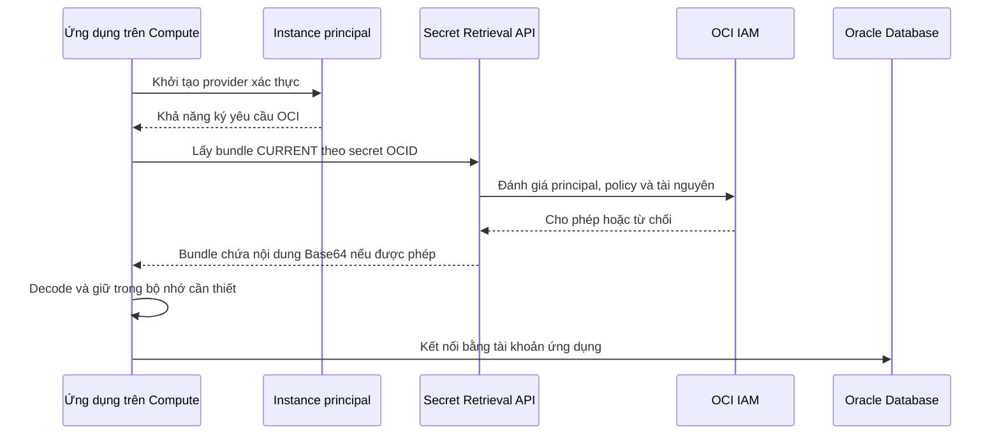

# Lưu trữ, truy xuất và phân quyền đối với secrets

Một ứng dụng chạy trên Oracle Cloud Infrastructure (OCI) có thể cần mật khẩu tài khoản Oracle Database, token gọi API hoặc khóa truy cập của một hệ thống bên ngoài. Đưa các giá trị này vào mã nguồn, image máy ảo hay cấu hình triển khai sẽ khiến mỗi bản sao của phần mềm trở thành một bản sao của bí mật. Cách tổ chức phù hợp hơn là lưu bí mật tập trung, xác thực danh tính của ứng dụng và chỉ cho phép ứng dụng đọc đúng nội dung cần dùng.

Bài học thuộc chương **Mã hóa, secrets và chứng chỉ**, tập trung vào luồng lưu trữ và tiêu thụ secret trong OCI: chọn compartment, liên kết vault và khóa mã hóa, cấp quyền IAM, truy xuất bằng CLI hoặc Java SDK, rồi vận hành mà không làm lộ dữ liệu. Các ví dụ sử dụng ứng dụng trên Compute và một tài khoản cơ sở dữ liệu; không triển khai toàn bộ VCN hoặc cơ sở dữ liệu.

## 1. Kết quả cần đạt

Sau bài học, người học có thể:

- Phân biệt secret, secret version, secret bundle và khóa mã hóa.
- Tách danh tính tạo/cập nhật secret khỏi danh tính chỉ đọc để chạy ứng dụng.
- Viết policy cho một dynamic group được đọc một secret cụ thể.
- Lấy phiên bản `CURRENT` bằng instance principal, giải mã Base64 đúng cách và giữ dữ liệu ngoài log.
- Giải thích tác động của cache, thay đổi quyền và thay đổi thông tin đăng nhập tại hệ thống đích.

## 2. Mô hình tài nguyên và ranh giới bảo vệ

### 2.1. Secret không đồng nghĩa với encryption key

| Thành phần | Vai trò trong luồng sử dụng |
| --- | --- |
| Secret | Tài nguyên đại diện cho bí mật; có OCID, tên, compartment và các phiên bản |
| Secret version | Một lần lưu nội dung; có số phiên bản và trạng thái như `CURRENT` hoặc `PENDING` |
| Secret bundle | Kết quả truy xuất chứa nội dung secret cùng thông tin phiên bản và thuộc tính liên quan |
| Vault | Tài nguyên liên quan đến việc tổ chức khóa và bảo vệ secret khi tạo |
| Master encryption key | Khóa mã hóa bảo vệ nội dung secret trong dịch vụ; không phải mật khẩu mà ứng dụng sẽ dùng |
| Principal | Danh tính thực hiện lời gọi OCI, chẳng hạn người vận hành hoặc Compute instance |

Ví dụ, `orders-db-password` đại diện cho mật khẩu của một tài khoản Oracle Database. Khi mật khẩu thay đổi, ứng dụng vẫn có thể tham chiếu OCID của secret đó và yêu cầu nội dung `CURRENT`; số phiên bản của nội dung sẽ thay đổi. Secret bundle là dữ liệu cần bảo vệ ngay cả khi trường nội dung vẫn đang ở dạng Base64. [Nguồn: tổng quan Secret Management](https://docs.oracle.com/en-us/iaas/Content/secret-management/overview.htm).

OCI hiện gọi phần quản lý secrets là **Secret Management Service**. Tài liệu cũ có thể gọi là secrets trong Vault; các nhóm lệnh CLI quản lý và truy xuất vẫn lần lượt xuất hiện dưới `oci vault` và `oci secrets`. Khi tra cứu, cần phân biệt chức năng của lệnh với tên hiển thị trong Console. [Nguồn: thay đổi tên dịch vụ](https://docs.oracle.com/en-us/iaas/releasenotes/secret-management/introducing-secret-management.htm), [tham chiếu nhóm lệnh `vault`](https://docs.oracle.com/en-us/iaas/tools/oci-cli/latest/oci_cli_docs/cmdref/vault.html).

### 2.2. Ba lớp bảo vệ cần phối hợp

**Lớp lưu trữ:** dịch vụ giữ nội dung được bảo vệ bằng khóa phù hợp. Khi tạo secret bằng cách nhập nội dung, OCI yêu cầu khóa đối xứng thuộc vault đã chọn. [Nguồn: tạo secret](https://docs.oracle.com/en-us/iaas/Content/secret-management/Tasks/create-secret.htm).

**Lớp truy cập:** IAM quyết định principal nào được quản lý metadata, tạo hoặc thay đổi nội dung, hay lấy secret bundle. Một người xem được tên secret chưa chắc đọc được giá trị của nó.

**Lớp ứng dụng:** sau khi được cấp quyền và nhận dữ liệu, tiến trình có thể sử dụng nội dung rõ. Vì thế, mã hóa tại dịch vụ không ngăn việc ứng dụng tự ghi mật khẩu ra log, lưu vào file cấu hình hoặc đưa vào phản hồi HTTP.

Base64 chỉ chuyển byte thành chuỗi có thể truyền qua JSON; ai có chuỗi đó cũng có thể giải ngược. Không coi `secret-bundle-content.content` là dữ liệu an toàn để ghi log chỉ vì nó chưa hiện thành mật khẩu dễ đọc.

### 2.3. Đặt tài nguyên theo phạm vi trách nhiệm

Trong ví dụ này, tenancy có hai compartment:

- `OrdersApp`: chứa Compute instance chạy ứng dụng.
- `OrdersSecrets`: chứa secret, vault và khóa dành cho bài thực hành.

Trong hệ thống thực tế, vault, khóa và secret có thể ở các compartment khác nhau. Policy phải trỏ đến compartment của từng tài nguyên tương ứng; vị trí của ứng dụng không tự quyết định vị trí của secret. Việc chuyển secret sang compartment khác cũng làm thay đổi các policy áp dụng cho nó. [Nguồn: quản lý và di chuyển secrets](https://docs.oracle.com/en-us/iaas/Content/secret-management/Concepts/manage-secrets.htm).

Tách `dev`, `test` và `prod` thành các phạm vi quyền độc lập. Tên, tag và mô tả chỉ nên chứa thông tin quản trị như ứng dụng, môi trường và chủ sở hữu; không đưa mật khẩu hoặc token vào đó. Với hệ thống nhỏ, một vault cùng các secret tách biệt có thể đủ; tạo thêm vault hoặc khóa cần gắn với nhu cầu phân quyền, vận hành và ngân sách cụ thể.

## 3. Luồng từ ứng dụng đến secret



Sơ đồ mô tả quan hệ xác thực và phân quyền, không mô tả chi tiết nội bộ của dịch vụ. Cấu hình triển khai của ứng dụng chỉ cần các tham chiếu như region, secret OCID và địa chỉ cơ sở dữ liệu. Nội dung mật khẩu được lấy lúc chạy.

Có hai lần xác thực độc lập:

1. Instance principal xác thực ứng dụng với OCI để lấy secret.
2. Tài khoản cơ sở dữ liệu xác thực ứng dụng với Oracle Database.

Đọc secret thành công không bảo đảm đăng nhập cơ sở dữ liệu thành công. Mật khẩu có thể đã cũ, tài khoản bị khóa hoặc kết nối mạng đến cơ sở dữ liệu chưa sẵn sàng.

## 4. Chuẩn bị và lưu trữ secret

### 4.1. Chuẩn bị đầu vào

Người thực hành cần có region được chọn, compartment đích, vault đang sử dụng được và một khóa đối xứng trong vault đó. Người vận hành phải có quyền tạo secret và sử dụng vault/khóa liên quan. Người tạo dynamic group và policy có trách nhiệm IAM riêng; không chuyển quyền quản trị IAM cho ứng dụng.

Ghi nhận các tham chiếu, không ghi nhận giá trị bí mật:

```text
region                 = <region-chua-secret>
secret_compartment_id  = <ocid-compartment-OrdersSecrets>
vault_id               = <ocid-vault>
key_id                 = <ocid-khoa-doi-xung>
secret_name            = orders-prod-db-password
```

Mọi chuỗi trong dấu `<...>` phải được thay bằng tài nguyên của môi trường thực hành. Chọn một giá trị giả, không dùng thông tin đăng nhập thật trong lần học đầu tiên.

### 4.2. Nhập secret bằng Console

1. Mở Secret Management trong khu vực Identity & Security và chọn đúng region.
2. Chọn compartment `OrdersSecrets`, bắt đầu tạo secret.
3. Đặt tên `orders-prod-db-password` và mô tả không chứa nội dung bí mật.
4. Chọn vault và khóa đối xứng tương ứng.
5. Nhập nội dung giả trong biểu mẫu secret; nếu chọn nội dung dạng văn bản, Console thực hiện chuyển đổi Base64 cho yêu cầu gửi đến dịch vụ.
6. Hoàn tất và ghi lại secret OCID từ chi tiết tài nguyên.

Tên nhãn và cách bố trí biểu mẫu có thể thay đổi theo giao diện; các thông tin cần xác định vẫn là compartment, vault, khóa và nội dung. [Nguồn: quy trình tạo secret trên Console](https://docs.oracle.com/en-us/iaas/Content/secret-management/Tasks/create-secret.htm).

### 4.3. Ví dụ CLI với dữ liệu giả

Đoạn dưới dùng **Bash trên Linux hoặc OCI Cloud Shell**, không phải cú pháp PowerShell. CLI của người vận hành đã được xác thực và có quyền tạo tài nguyên. Đây là minh họa lệnh, không yêu cầu chạy trên máy đang biên soạn tài liệu.

```bash
SECRET_COMPARTMENT_OCID='<ocid-compartment-OrdersSecrets>'
VAULT_OCID='<ocid-vault>'
KEY_OCID='<ocid-khoa-doi-xung>'
OCI_REGION='<region-chua-secret>'

# Chỉ dùng chuỗi giả: "demo-only-not-a-password".
DEMO_CONTENT_BASE64='ZGVtby1vbmx5LW5vdC1hLXBhc3N3b3Jk'

SECRET_OCID=$(oci vault secret create-base64 \
  --region "$OCI_REGION" \
  --compartment-id "$SECRET_COMPARTMENT_OCID" \
  --vault-id "$VAULT_OCID" \
  --key-id "$KEY_OCID" \
  --secret-name 'orders-prod-db-password' \
  --description 'Gia tri gia cho bai thuc hanh Orders' \
  --secret-content-content "$DEMO_CONTENT_BASE64" \
  --secret-content-stage CURRENT \
  --query 'data.id' \
  --raw-output)
```

Lệnh `create-base64` nhận nội dung đã được mã hóa Base64; khi tạo secret mới, `CURRENT` là trạng thái nội dung phù hợp. Không mã hóa Base64 hai lần. [Nguồn: tham chiếu `create-base64`](https://docs.oracle.com/en-us/iaas/tools/oci-cli/latest/oci_cli_docs/cmdref/vault/secret/create-base64.html).

Ví dụ cố ý dùng giá trị giả vì đối số dòng lệnh, shell tracing, transcript hoặc hệ thống CI có thể lưu lại đầu vào. Với dữ liệu thật, cần quy trình nhập được kiểm soát, tắt việc ghi nội dung nhạy cảm và tránh đưa plaintext vào lịch sử lệnh. Nếu dùng request file, phải bảo vệ cả quyền đọc file, thư mục, thời gian tồn tại và nơi sao lưu. File JSON chứa Base64 vẫn chứa bí mật.

Nếu dùng IaC, việc tham chiếu secret OCID trong cấu hình ứng dụng giúp hạn chế phát tán giá trị. Nếu pipeline tự tạo secret từ nội dung thật, phải đánh giá cả state, plan, artifact và log; không mặc định một thuộc tính được ẩn trên màn hình là đã biến mất khỏi mọi bản lưu.

## 5. Phân quyền theo trách nhiệm

### 5.1. Phân biệt metadata với nội dung

Các resource type cần nhận diện gồm `secrets`, `secret-versions` và `secret-bundles`. `secret-family` bao trùm cả ba. Quyền `read secrets` phục vụ metadata; để lấy nội dung bằng `GetSecretBundle`, principal cần `read secret-bundles`. [Nguồn: tham chiếu IAM cho secrets](https://docs.oracle.com/en-us/iaas/Content/Identity/policyreference/keypolicyreference.htm).

| Vai trò trong ví dụ | Việc cần làm | Giới hạn mong muốn |
| --- | --- | --- |
| Nhóm quản lý vault/khóa | Chuẩn bị và bảo vệ tài nguyên mật mã | Không đồng thời có quyền rộng trên mọi workload |
| Nhóm phát hành secret | Tạo/cập nhật nội dung theo quy trình | Chỉ trong phạm vi bí mật được giao |
| Ứng dụng Orders | Lấy mật khẩu đang sử dụng | Một secret, không tạo, sửa hoặc xóa |
| Người hỗ trợ vận hành | Xem tình trạng tài nguyên và bằng chứng lỗi | Không cần xem mật khẩu để xử lý phần lớn sự cố |

Bảng thể hiện thiết kế trách nhiệm. Một principal có thể nhận quyền từ nhiều policy khác nhau, nên phải kiểm tra tổng quyền thực tế trước khi kết luận vai trò đã được tách biệt.

### 5.2. Policy minh họa cho người phát hành

Giả sử nhóm `SecretPublishers`, vault, khóa và secret đều thuộc phạm vi bài thực hành. Policy dưới cấp quyền quản lý secret trong `OrdersSecrets` và giới hạn việc dùng vault/khóa theo OCID:

```text
Allow group SecretPublishers to manage secrets in compartment OrdersSecrets
Allow group SecretPublishers to use vaults in compartment OrdersSecrets where target.vault.id = '<ocid-vault>'
Allow group SecretPublishers to use keys in compartment OrdersSecrets where target.key.id = '<ocid-khoa-doi-xung>'
```

Đây là quyền **quản lý** trong compartment, có cả thao tác vòng đời; không phải policy tối thiểu chỉ cho phép thêm một phiên bản. Tạo secret cần các quyền trên secret, vault và khóa; khi dùng cho production, quản trị viên cần thu hẹp thêm theo thao tác và trách nhiệm. Ví dụ này không cấp quyền lấy bundle cho nhóm phát hành. [Nguồn: quyền theo API](https://docs.oracle.com/en-us/iaas/Content/Identity/policyreference/keypolicyreference.htm), [các policy quản trị phổ biến](https://docs.oracle.com/en-us/iaas/Content/Identity/Concepts/commonpolicies.htm).

Các tên nhóm trong ví dụ giả định thuộc identity domain mặc định. Nếu dùng domain khác, dùng tên được định danh theo domain hoặc OCID theo cú pháp policy của tenancy. Policy phải được đặt ở phạm vi có thẩm quyền đối với các compartment đích; một quản trị viên chỉ có quyền trong compartment ứng dụng không tự có quyền cấp truy cập tài nguyên bên ngoài phạm vi đó.

Người được sửa secret có thể thay mật khẩu hoặc đưa dữ liệu sai vào phiên bản mới. Vì thế, tách quyền đọc khỏi quyền quản lý nội dung chỉ là một phần của kiểm soát; đường phát hành nội dung cũng phải được bảo vệ.

### 5.3. Dynamic group cho Compute instance

Tạo dynamic group `OrdersRuntime` với một matching rule chỉ khớp instance thực hành:

```text
ALL {instance.id = '<ocid-compute-orders>'}
```

Nếu dùng `instance.compartment.id` thay cho `instance.id`, phạm vi sẽ bao gồm các instance phù hợp trong compartment đó, kể cả những instance được tạo sau này. Với nhóm máy có khả năng mở rộng, có thể dùng defined tag kết hợp compartment; khi đó quyền gắn hoặc sửa tag trở thành một phần của ranh giới cấp quyền. Không dùng free-form tag làm điều kiện IAM. [Nguồn: matching rules cho dynamic group](https://docs.oracle.com/en-us/iaas/Content/Identity/dynamicgroups/Writing_Matching_Rules_to_Define_Dynamic_Groups.htm).

Dynamic group xác định thành viên; policy mới cấp quyền cho thành viên. Tạo group mà chưa có policy không làm instance đọc được secret. [Nguồn: quản lý dynamic groups](https://docs.oracle.com/en-us/iaas/Content/Identity/Tasks/managingdynamicgroups.htm).

### 5.4. Chỉ cho runtime đọc một secret

```text
Allow dynamic-group OrdersRuntime to read secret-bundles in compartment OrdersSecrets where target.secret.id = '<ocid-secret-orders-db-password>'
```

Điều kiện `target.secret.id` giới hạn tài nguyên cần đọc. Với thao tác lấy bundle trong ví dụ, runtime không cần thêm quyền giải mã khóa trực tiếp hoặc quyền `manage secret-family`. [Nguồn: resource type, điều kiện và quyền của `GetSecretBundle`](https://docs.oracle.com/en-us/iaas/Content/Identity/policyreference/keypolicyreference.htm).

Điều kiện này giới hạn theo secret, không chứng minh rằng principal chỉ đọc được `CURRENT`. Việc chọn `CURRENT` trong mã ứng dụng là quy ước sử dụng; không nên xem quy ước đó như một hàng rào IAM bảo vệ các phiên bản khác của cùng secret.

Instance principal giúp tránh phân phối API signing key của người dùng vào máy ảo. Tuy nhiên, người có khả năng truy cập và thực thi trên instance có thể sử dụng quyền của instance đó. Máy ảo chứa nhiều ứng dụng với mức tin cậy khác nhau vì vậy cần được đánh giá kỹ trước khi cấp quyền đọc secret. [Nguồn: gọi dịch vụ bằng instance principal](https://docs.oracle.com/en-us/iaas/Content/Identity/Tasks/callingservicesfrominstances.htm).

## 6. Truy xuất bằng CLI mà không in nội dung

Chạy ví dụ sau **trên Compute instance thuộc `OrdersRuntime`**, đã cài OCI CLI và có kết nối đến các endpoint cần thiết. Không dùng kết quả thành công bằng tài khoản quản trị trên máy cá nhân để thay cho bằng chứng runtime đã được cấp quyền.

```bash
SECRET_OCID='<ocid-secret-orders-db-password>'
OCI_REGION='<region-chua-secret>'

oci secrets secret-bundle get \
  --region "$OCI_REGION" \
  --auth instance_principal \
  --secret-id "$SECRET_OCID" \
  --stage CURRENT \
  --query 'data."version-number"' \
  --raw-output
```

Lệnh chỉ in số phiên bản để người học kiểm tra. Bản thân yêu cầu vẫn gọi API lấy bundle; tùy chọn `--query` chỉ lọc dữ liệu xuất ra ở client, không làm giảm quyền cần có hoặc loại nội dung khỏi phản hồi API. Không bật `--debug` trong luồng có bí mật thật.

`oci vault secret get` dùng để xem chi tiết tài nguyên, không trả nội dung secret. Muốn lấy nội dung phải dùng Secret Retrieval API, chẳng hạn `oci secrets secret-bundle get`. [Nguồn: mô tả secret metadata](https://docs.oracle.com/en-us/iaas/tools/oci-cli/latest/oci_cli_docs/cmdref/vault/secret.html), [lấy nội dung secret](https://docs.oracle.com/en-us/iaas/Content/secret-management/Tasks/get-secrets-contents.htm).

Khi cần lấy giá trị cho một tiến trình Bash, có thể giữ chuỗi Base64 trong biến cục bộ mà không xuất ra terminal:

```bash
SECRET_BASE64=$(oci secrets secret-bundle get \
  --region "$OCI_REGION" \
  --auth instance_principal \
  --secret-id "$SECRET_OCID" \
  --stage CURRENT \
  --query 'data."secret-bundle-content".content' \
  --raw-output)

# Trong ứng dụng, decode rồi chuyển thẳng cho thư viện tiêu thụ.
# Không echo, không export, không ghi giá trị ra file cấu hình.
unset SECRET_BASE64
```

Đây chỉ là minh họa đường lấy dữ liệu; đoạn lệnh không tự kết nối cơ sở dữ liệu. `unset` bỏ tham chiếu biến nhưng không bảo đảm mọi bản sao trong bộ nhớ đã bị xóa. Với chương trình chạy lâu, SDK phù hợp hơn vì có thể quản lý lỗi, cache và vòng đời client ngay trong ứng dụng.

Khi không chỉ định bộ chọn phiên bản, API mặc định lấy `CURRENT`; vẫn nên khai báo rõ để thể hiện chủ ý. `LATEST` là nội dung mới tải lên gần nhất và có thể chưa phải nội dung đã đưa vào sử dụng. [Nguồn: tham chiếu `secret-bundle get`](https://docs.oracle.com/en-us/iaas/tools/oci-cli/latest/oci_cli_docs/cmdref/secrets/secret-bundle/get.html).

## 7. Truy xuất bằng Java SDK

Ví dụ dưới là lớp thư viện cho ứng dụng Java trên OCI Compute. Dự án cần OCI Java SDK có module `oci-java-sdk-secrets` và một HTTP client được SDK hỗ trợ, với các phiên bản dependency tương thích do dự án quản lý. Mã không đọc API signing key của người dùng và không ghi giá trị secret ra stdout.

```java
import com.oracle.bmc.Region;
import com.oracle.bmc.auth.InstancePrincipalsAuthenticationDetailsProvider;
import com.oracle.bmc.secrets.SecretsClient;
import com.oracle.bmc.secrets.model.Base64SecretBundleContentDetails;
import com.oracle.bmc.secrets.model.SecretBundleContentDetails;
import com.oracle.bmc.secrets.requests.GetSecretBundleRequest;

import java.util.Base64;

public final class OciSecretReader {
    private OciSecretReader() {
    }

    public static byte[] loadCurrent(String regionId, String secretOcid) {
        if (regionId == null || regionId.isBlank()
                || secretOcid == null || secretOcid.isBlank()) {
            throw new IllegalArgumentException("Missing secret reference");
        }

        var provider = InstancePrincipalsAuthenticationDetailsProvider
                .builder()
                .build();

        try (SecretsClient client = SecretsClient.builder()
                .region(Region.fromRegionId(regionId))
                .build(provider)) {
            var request = GetSecretBundleRequest.builder()
                    .secretId(secretOcid)
                    .stage(GetSecretBundleRequest.Stage.Current)
                    .build();

            var bundle = client.getSecretBundle(request).getSecretBundle();
            SecretBundleContentDetails details = bundle.getSecretBundleContent();

            if (!(details instanceof Base64SecretBundleContentDetails)) {
                throw new IllegalStateException("Unsupported secret content type");
            }

            String encoded = ((Base64SecretBundleContentDetails) details).getContent();
            if (encoded == null) {
                throw new IllegalStateException("Missing secret content");
            }
            return Base64.getDecoder().decode(encoded);
        }
    }
}
```

Lớp dùng cú pháp Java 11 trở lên. Cách khởi tạo request và lựa chọn `Stage.Current` dựa trên giao diện Java SDK; nội dung Base64 được đọc qua `Base64SecretBundleContentDetails`. [Nguồn: `GetSecretBundle` bằng Java](https://docs.oracle.com/en-us/iaas/tools/java-sdk-examples/latest/secrets/GetSecretBundleExample.java.html), [kiểu nội dung Base64](https://docs.oracle.com/en-us/iaas/tools/java/latest/com/oracle/bmc/secrets/model/Base64SecretBundleContentDetails.html).

Kết quả là `byte[]` để không áp đặt giả định rằng mọi secret đều là văn bản. Nếu hợp đồng dữ liệu quy định mật khẩu là UTF-8, lớp tích hợp cơ sở dữ liệu mới chuyển sang dạng phù hợp với thư viện kết nối. Không gọi `trim()` lên mật khẩu; khoảng trắng hoặc byte xuống dòng có thể là một phần của giá trị.

Lớp gọi chịu trách nhiệm giới hạn thời gian tồn tại của dữ liệu. Có thể xóa mảng byte do mình sở hữu bằng `Arrays.fill` sau khi thư viện tiêu thụ đã sao chép dữ liệu theo hợp đồng của nó, nhưng không thể bảo đảm xóa các chuỗi hoặc bản sao mà SDK và driver đã tạo. Không đưa bundle vào `toString()`, exception, APM attribute hoặc HTTP response.

Để giữ ví dụ tập trung, mỗi lần gọi tạo và đóng client. Với dịch vụ chạy lâu, nên tái sử dụng provider/client theo vòng đời ứng dụng, có timeout, chính sách retry hữu hạn và lớp cache phù hợp. Đây là mã minh họa cần tích hợp vào dự án; chưa phải một chương trình đã được biên dịch hay chạy thử trên tenancy của người học.

## 8. Phiên bản và tính nhất quán với hệ thống đích

| Trạng thái | Ý nghĩa cần nhớ khi tiêu thụ |
| --- | --- |
| `CURRENT` | Nội dung được đánh dấu đang dùng cho tài nguyên đích |
| `PENDING` | Nội dung đã chuẩn bị nhưng chưa chuyển thành giá trị đang dùng |
| `LATEST` | Nội dung mới được tải lên gần nhất, có thể trùng `PENDING` |
| `PREVIOUS` | Nội dung từng là `CURRENT` ngay trước lần chuyển gần nhất |

Một phiên bản có thể mang nhiều trạng thái. Số phiên bản dùng để định danh nội dung; trạng thái dùng để diễn tả vai trò sử dụng. [Nguồn: secret versions](https://docs.oracle.com/en-us/iaas/Content/secret-management/Concepts/secret-versions.htm), [rotation states](https://docs.oracle.com/en-us/iaas/Content/secret-management/Concepts/manage-secrets.htm).

Ví dụ, phiên bản 1 đang là `CURRENT`. Người vận hành tạo phiên bản 2 ở `PENDING`; ứng dụng đọc `CURRENT` vẫn lấy phiên bản 1, còn chọn `LATEST` có thể lấy phiên bản 2. Việc đánh dấu phiên bản 2 thành `CURRENT` không tự thay mật khẩu trong Oracle Database nếu chưa có tích hợp hoặc quy trình thực hiện bước đó.

Quy trình phối hợp cần bảo đảm hệ thống đích chấp nhận giá trị mới trước khi các consumer chuyển sang nó, đồng thời xử lý khoảng giao nhau giữa các phiên bản. Nếu cơ sở dữ liệu chỉ chấp nhận một mật khẩu tại một thời điểm, nhóm vận hành phải chọn chiến lược chuyển đổi phù hợp, chẳng hạn đổi tài khoản ứng dụng theo đợt hoặc dùng cửa sổ bảo trì. Không mặc định có thể đổi mật khẩu mà mọi kết nối mới vẫn hoạt động liên tục.

Rollback cũng phải xét cả hai phía. Đánh dấu nội dung cũ là `CURRENT` chỉ giúp khi hệ thống đích vẫn chấp nhận hoặc đã được khôi phục về giá trị tương ứng. Khi mật khẩu bị lộ, ưu tiên vô hiệu hóa thông tin đăng nhập tại hệ thống đích; chỉ thu hồi quyền đọc secret không làm giá trị đã bị sao chép mất hiệu lực.

Phần này chỉ giải thích ảnh hưởng tới việc truy xuất; triển khai một cơ chế rotation tự động hoàn chỉnh cần quy trình riêng cho hệ thống đích.

## 9. Vận hành: cache, mạng và tính sẵn sàng

### 9.1. Cache có giới hạn thời gian

Gọi API đọc secret cho từng request nghiệp vụ làm tăng độ trễ và số lời gọi không cần thiết. Ngược lại, giữ giá trị vô thời hạn khiến ứng dụng bỏ lỡ thay đổi thông tin đăng nhập.

Một thiết kế tham khảo là lấy `CURRENT` khi khởi động, giữ trong bộ nhớ và làm mới theo TTL. Ví dụ TTL 5 phút chỉ là lựa chọn thiết kế để thảo luận, không phải mặc định của OCI. TTL thực tế phải căn cứ vào yêu cầu thu hồi, số replica và cơ chế cập nhật credential của connection pool.

Cần quyết định rõ:

- Khởi động thất bại nếu chưa từng lấy được secret; không rơi về mật khẩu gắn cứng trong mã.
- Khi refresh lỗi, có cho dùng bản cũ trong một khoảng giới hạn hay không, ai phê duyệt và cảnh báo ở đâu.
- Khi kết nối bị từ chối, có cho phép một lần refresh có kiểm soát trước khi báo lỗi hay không.
- Khi nhiều replica cùng khởi động, dùng độ lệch ngẫu nhiên và giới hạn retry để tránh đồng loạt gây tải.

Có thể ước lượng sơ bộ số lần refresh mỗi giờ bằng `số replica × 3600 / TTL tính bằng giây`, rồi cộng thêm các lần khởi động và retry. Công thức này hỗ trợ đánh giá tải; không thay thế bảng giá hoặc giới hạn dịch vụ hiện hành.

### 9.2. Mạng và danh tính là hai điều kiện khác nhau

Một instance nằm trong private subnet vẫn cần DNS, route và quy tắc egress cho các endpoint OCI được sử dụng. Provider xác thực cũng cần truy cập các thành phần cung cấp danh tính phù hợp. Kiểm tra từ đúng subnet và đúng tiến trình chạy ứng dụng.

Lỗi timeout hoặc không phân giải được DNS thường cần điều tra đường mạng trước. Một phản hồi từ chối quyền từ API cho thấy yêu cầu đã đến được dịch vụ nhưng chưa chứng minh danh tính, tài nguyên và policy đều đúng. Không xử lý timeout bằng cách tăng quyền IAM.

### 9.3. Khôi phục và vùng triển khai

Tham chiếu secret gắn với tài nguyên và region đã triển khai. Một cấu hình DR phải có kế hoạch cho secret, vault/khóa liên quan, IAM, cấu hình ứng dụng và thông tin đăng nhập của hệ thống đích. Tính sẵn sàng nội bộ của dịch vụ không tự tạo ra một kế hoạch khôi phục toàn ứng dụng sang region khác.

Trong bài thực hành, chỉ tạo tài nguyên cần thiết và xem xét chi phí của vault, khóa cùng các thành phần liên quan trước khi mở rộng. Khi dọn môi trường, kiểm tra consumer và phụ thuộc trước khi lên lịch xóa secret hoặc khóa. Một secret còn tồn tại cũng không giúp ứng dụng nếu khóa bảo vệ nó không sử dụng được.

## 10. Quan sát và xử lý sự cố

### 10.1. Bằng chứng cần thu thập

OCI Audit cung cấp sự kiện cho các lời gọi API được hỗ trợ, giúp đối chiếu thời gian, principal, tài nguyên, thao tác và kết quả. Khi điều tra một lỗi đọc secret, kết hợp bằng chứng Audit với lỗi SDK/CLI và request ID của lời gọi. [Nguồn: tổng quan Audit](https://docs.oracle.com/en-us/iaas/Content/Audit/Concepts/auditoverview.htm).

Ứng dụng nên ghi loại thao tác, thời gian xử lý, trạng thái thành công/thất bại và phiên bản đã sử dụng khi phù hợp. Không ghi nội dung secret, chuỗi Base64 hoặc cấu hình kết nối chứa mật khẩu. Dashboard cần phân biệt lỗi lấy secret với lỗi đăng nhập Oracle Database.

Các tín hiệu vận hành hữu ích gồm tỷ lệ refresh thất bại, độ trễ lấy secret, tuổi của cache và thay đổi bất thường của principal truy xuất. Đây là các chỉ số có thể do ứng dụng tự phát ra; không mặc định tất cả đều là metric có sẵn của dịch vụ. Chính sách log và cảnh báo cũng cần tránh đưa dữ liệu nhạy cảm vào thông báo.

### 10.2. Khoanh vùng lỗi theo triệu chứng

| Triệu chứng | Hướng kiểm tra đầu tiên |
| --- | --- |
| Xem được secret trên Console nhưng runtime không đọc được | Đang dùng principal nào; runtime có `read secret-bundles` trên đúng secret hay chưa |
| Tạo secret báo không đủ quyền hoặc không thấy tài nguyên | Compartment đích, vault/khóa được chọn, region và các quyền tạo liên quan |
| `NotAuthorizedOrNotFound` khi đọc | Kiểm tra cả quyền lẫn OCID, region và trạng thái tài nguyên; không suy ra chắc chắn secret đã bị xóa |
| Instance vừa được thêm vào group nhưng chưa đọc được | Matching rule và thời gian có hiệu lực của thay đổi membership |
| Nhận được chuỗi khó đọc | Đó có thể là Base64; kiểm tra kiểu nội dung trước khi decode |
| Decode thành công nhưng mật khẩu sai | Charset, byte xuống dòng, phiên bản được chọn, cache và giá trị thực tại hệ thống đích |
| Timeout hoặc lỗi DNS | DNS, route, egress, proxy và endpoint từ chính môi trường runtime |
| `CURRENT` đã đổi nhưng ứng dụng vẫn dùng giá trị cũ | TTL cache, secret OCID cấu hình và credential của connection pool |

Oracle có hướng dẫn riêng cho lỗi tạo secret liên quan đến quyền hoặc tài nguyên không tìm thấy. Với thay đổi matching rule của dynamic group, tài liệu cũng lưu ý cần thời gian để cập nhật có hiệu lực; việc thử lại ngay lập tức không đủ để kết luận policy sai. [Nguồn: xử lý lỗi Secret Management](https://docs.oracle.com/en-us/iaas/Content/secret-management/troubleshooting.htm), [cập nhật dynamic group](https://docs.oracle.com/en-us/iaas/Content/Identity/Tasks/managingdynamicgroups.htm).

Khi principal không được phép, hãy sửa đúng matching rule, policy hoặc tham chiếu tài nguyên. Việc tạm cấp quyền toàn tenancy để bỏ qua lỗi sẽ làm mất ý nghĩa của kiểm tra phân quyền tối thiểu.

## 11. Thực hành triển khai với dữ liệu giả

Bài thực hành này áp dụng trực tiếp các đoạn lệnh và policy đã trình bày, không dùng mật khẩu production.

1. Chuẩn bị `OrdersApp`, `OrdersSecrets`, một Compute instance và vault/khóa phù hợp.
2. Lưu giá trị giả thành secret, ghi lại OCID và region.
3. Tạo `OrdersRuntime` chỉ khớp instance thực hành.
4. Cấp `read secret-bundles` với điều kiện đúng secret OCID.
5. Trên instance, gọi CLI bằng `--auth instance_principal` và chỉ xuất số phiên bản.
6. Trên một instance nằm ngoài group, thử cùng thao tác; kỳ vọng không đọc được nếu principal đó không được cấp quyền qua đường khác.
7. Với một secret giả thứ hai nằm ngoài điều kiện policy, xác nhận runtime không đọc được dù vẫn đọc được secret Orders.
8. Dùng tài khoản vận hành tạo phiên bản giả mới ở `PENDING`; xác nhận lựa chọn `CURRENT` của runtime vẫn theo phiên bản đang dùng.
9. Khi dọn bài, thu hồi policy không còn cần, kiểm tra phụ thuộc và thực hiện quy trình xóa tài nguyên phù hợp.

Bằng chứng đạt yêu cầu gồm: OCID tham chiếu đúng, truy xuất bằng principal runtime thành công, các truy xuất ngoài phạm vi bị từ chối và không có nội dung bí mật trong đầu ra được lưu. Nếu dùng cơ sở dữ liệu thật để mở rộng bài, phải thêm bằng chứng kết nối bằng tài khoản ứng dụng có quyền dữ liệu phù hợp; không dùng tài khoản quản trị cơ sở dữ liệu chỉ để đơn giản hóa phần secret.

## 12. Những điểm cần ghi nhớ

Secret phải được bảo vệ xuyên suốt từ lúc nhập, lưu trong dịch vụ, truy xuất đến khi tồn tại trong bộ nhớ ứng dụng. Vault và khóa giải quyết phần bảo vệ lưu trữ; principal và IAM quyết định ai được lấy nội dung; ứng dụng chịu trách nhiệm không phát tán giá trị sau khi nhận.

Trong OCI, mẫu triển khai đáng tin cậy cho bài này là: tham chiếu secret bằng OCID và region, dùng instance principal cho Compute, cấp `read secret-bundles` đúng tài nguyên, chọn `CURRENT`, decode Base64 ở lớp tiêu thụ và vận hành cache có thời hạn. Quyền đọc secret, quyền quản lý nội dung và quyền tại Oracle Database cần được xem xét riêng, rồi kiểm tra cùng nhau trong luồng chạy thực tế.
