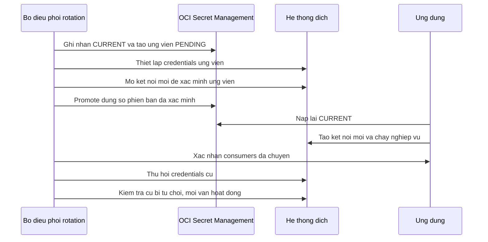

# Secret versions, rotation và thay đổi credentials an toàn

Trong chương **Mã hóa, secrets và chứng chỉ** của module `CLOUD_PROVIDERS_ORACLE`, bài này trình bày cách thay đổi mật khẩu, token và thông tin đăng nhập được lưu trong OCI Secret Management. Trọng tâm là phối hợp kho secret, hệ thống xác thực đích và các ứng dụng đang sử dụng credentials để duy trì khả năng truy cập trong khi giảm thời gian tồn tại của credentials cũ.

Một tình huống xuyên suốt: dịch vụ Java chạy trên nhiều OCI Compute instance truy cập cơ sở dữ liệu Oracle trong mạng riêng. Ứng dụng lấy credentials từ một secret; nhóm vận hành cần đổi credentials mà các instance, connection pool và tác vụ nền vẫn hoạt động theo kế hoạch.

Sau bài học, người học có thể:

- Phân biệt secret, secret version, secret bundle và các nhãn trạng thái phiên bản.
- Chọn cách chuyển đổi phù hợp với khả năng chấp nhận credentials của hệ thống đích.
- Thực hiện một quy trình chuẩn bị, kiểm tra, chuyển phiên bản, nạp lại và thu hồi.
- Xác định điều kiện rollback, xử lý retry và kiểm soát truy cập tới nội dung secret.
- Theo dõi kết quả rotation bằng cả tín hiệu OCI lẫn kết nối thật của ứng dụng.

## 1. Ba nơi phải thống nhất khi đổi credentials

Credentials tồn tại trong ba lớp vận hành độc lập:

| Lớp | Điều cần biết | Ví dụ về sai lệch |
| --- | --- | --- |
| Kho secret OCI | Phiên bản nào được ứng dụng lấy | Kho trả về mật khẩu mới nhưng database chưa chấp nhận |
| Hệ thống đích | Credentials nào thực sự xác thực được | Database đã đổi mật khẩu nhưng kho vẫn trả bản cũ |
| Ứng dụng | Tiến trình và kết nối nào còn giữ credentials cũ | Một instance đã cập nhật, tác vụ chạy đêm vẫn giữ bản cũ |

Việc lưu một mật khẩu mới vào kho secret chỉ thay đổi lớp thứ nhất. Việc đổi mật khẩu database chỉ thay đổi lớp thứ hai. Để hoàn tất rotation, ứng dụng còn phải lấy phiên bản thích hợp và tạo được kết nối mới bằng credentials đó.

Một secret giữ nguyên OCID qua các lần rotation. Nội dung thay đổi được biểu diễn bằng secret version; secret bundle chứa nội dung cùng thông tin phiên bản và metadata. Do đó, ứng dụng có thể giữ cấu hình `secretId` ổn định nhưng lấy nội dung mới theo thời gian. [Khái niệm Secret Management của Oracle](https://docs.oracle.com/en-us/iaas/Content/secret-management/overview.htm).

Trong ví dụ của bài:

```text
secretId: một OCID ổn định
version 12: credentials cũ
version 13: credentials ứng viên
target: database Oracle mà ứng dụng cần truy cập
consumers: API instance, worker nền và tác vụ theo lịch
```

Số phiên bản giúp nhận diện chính xác nội dung đã dùng. Nhãn như `CURRENT` giúp lựa chọn phiên bản theo vai trò; nhãn có thể chuyển sang một số phiên bản khác trong lần rotation tiếp theo.

## 2. Hiểu đúng các trạng thái phiên bản OCI

### 2.1. Số phiên bản và nhãn trạng thái

Khi cập nhật nội dung một secret, OCI tạo phiên bản mới. Số phiên bản bắt đầu từ 1 và tăng dần. Ứng dụng có thể tham chiếu bằng số, tên phiên bản hoặc trạng thái rotation. [Secret Versions](https://docs.oracle.com/en-us/iaas/Content/secret-management/Concepts/secret-versions.htm).

| Nhãn | Ý nghĩa |
| --- | --- |
| `CURRENT` | Phiên bản đang được chọn để sử dụng |
| `PENDING` | Phiên bản chuẩn bị cho chuyển đổi |
| `LATEST` | Phiên bản có nội dung được tải lên gần nhất |
| `PREVIOUS` | Phiên bản giữ vai trò `CURRENT` ngay trước lần chuyển gần nhất |
| `DEPRECATED` | Phiên bản không còn là current, pending hoặc previous |

Một phiên bản có thể mang nhiều nhãn; phiên bản đầu tiên đồng thời là `CURRENT` và `LATEST`. OCI chỉ cho phép lên lịch xóa phiên bản `DEPRECATED`. [Mô hình SecretVersion trong OCI SDK](https://docs.oracle.com/en-us/iaas/tools/python/latest/api/vault/models/oci.vault.models.SecretVersion.html).

### 2.2. Vì sao ứng dụng thường đọc CURRENT

Giả sử version 12 đang phục vụ ứng dụng. Nhóm vận hành tải version 13 lên với nhãn `PENDING`. Khi đó version mới nhất có thể chưa sẵn sàng để sử dụng. Ứng dụng luôn đọc `LATEST` sẽ bỏ qua điểm kiểm soát trước khi phát hành credentials mới.

Quy ước thiết kế trong bài là:

- Luồng phục vụ thông thường đọc `CURRENT`.
- Luồng xác minh ứng viên đọc đúng số phiên bản đã ghi nhận.
- Một đợt triển khai ghim số phiên bản phải có kế hoạch gỡ ghim hoặc cập nhật cấu hình ở lần chuyển tiếp theo.

API lấy secret bundle cho phép chọn stage, tên hoặc số phiên bản; nếu không chỉ định cách chọn thì trả về `CURRENT`. Đây là hành vi truy xuất, không phải bằng chứng database chấp nhận nội dung nhận được. [OCI CLI: secret-bundle get](https://docs.oracle.com/en-us/iaas/tools/oci-cli/latest/oci_cli_docs/cmdref/secrets/secret-bundle/get.html).

### 2.3. Trạng thái trong kho không thu hồi credentials tại đích

`PREVIOUS` thể hiện lịch sử lựa chọn của kho secret. Nó không bảo đảm mật khẩu cũ vẫn đăng nhập được. Tương tự, chuyển một phiên bản khỏi `CURRENT` không tự vô hiệu hóa token ở nhà cung cấp, khóa tài khoản database hoặc chấm dứt session đang mở.

Khi vận hành, luôn đặt hai câu hỏi riêng:

1. Kho sẽ trả về nội dung nào cho yêu cầu của ứng dụng?
2. Hệ thống đích đang chấp nhận nội dung nào?

## 3. Chọn chiến lược chuyển credentials

Quy trình dưới đây là một thiết kế vận hành minh họa. Khả năng cho phép hai credentials cùng hiệu lực phụ thuộc sản phẩm đích, phiên bản, cấu hình tài khoản và chính sách bảo mật; không được suy ra từ việc đã có hai secret version.

| Khả năng của hệ thống đích | Cách chuyển đổi | Điểm cần kiểm tra |
| --- | --- | --- |
| Cho phép hai token hoặc hai khóa hoạt động | Tạo mới, chuyển ứng dụng, rồi thu hồi cũ | Giới hạn số credentials và thao tác thu hồi chính xác |
| Có cơ chế rollover cho mật khẩu được hỗ trợ | Dùng khoảng chồng lấn đã cấu hình | Thời hạn chồng lấn và hành vi đăng nhập mới |
| Có thể dùng hai tài khoản ứng dụng | Chuyển từ tài khoản A sang B | Quyền, schema mặc định, ownership và hành vi nghiệp vụ |
| Chỉ chấp nhận một mật khẩu tại một thời điểm | Phối hợp đổi đích với cập nhật ứng dụng trong cửa sổ kiểm soát | Khoảng sai lệch và khả năng phát sinh lỗi xác thực |

Với hai tài khoản, phải lưu username và password theo một đơn vị cấu hình nhất quán. Nếu cập nhật chúng ở hai secret độc lập, một tiến trình có thể lấy username mới nhưng password cũ. Cũng cần kiểm tra các khác biệt ngoài mật khẩu: quyền thực thi procedure, session initialization, quota, chính sách audit và quyền truy cập đối tượng.

Ví dụ cấu trúc nội dung cho một phiên bản:

```json
{
  "username": "APP_LOGIN_B",
  "password": "<gia-tri-duoc-tao-va-truyen-qua-kenh-bao-mat>"
}
```

Đây là cấu trúc minh họa, không phải credentials dùng thật. Endpoint và tên dịch vụ có thể nằm trong cấu hình riêng nếu vòng đời của chúng khác vòng đời credentials.

Nếu hệ thống chỉ nhận một mật khẩu, việc tạo `PENDING` vẫn hữu ích để chuẩn bị. Tuy nhiên, sau lúc đổi mật khẩu tại đích và trước lúc tất cả consumers nhận bản mới, yêu cầu đăng nhập bằng mật khẩu cũ có thể thất bại. Cần giới hạn lưu lượng, tạm dừng tác vụ, dùng cửa sổ bảo trì hoặc chấp nhận mức gián đoạn đã xác định. Không có bảo đảm không gián đoạn chỉ nhờ thao tác promote.

## 4. Chuẩn bị quyền truy cập, mạng và danh sách consumers

### 4.1. Lập danh sách nơi sử dụng credentials

Trước khi đổi, ghi nhận:

- Secret OCID, region, compartment, số `CURRENT` và hệ thống đích tương ứng.
- Tất cả API instance, worker, cron job, công cụ quản trị và tiến trình khởi động không thường xuyên.
- Cách lấy secret: lúc khởi động, theo TTL, qua tác vụ reload hay khi tạo connection pool.
- Thời gian tối đa của cache, rollout, tác vụ dài và kết nối đang hoạt động.
- Người hoặc bộ điều phối chịu trách nhiệm, điều kiện dừng và điều kiện thu hồi.

Một dịch vụ API khỏe mạnh không chứng minh job cuối tháng đã cập nhật. Consumer hiếm chạy cần được kích hoạt kiểm tra có kiểm soát hoặc được cập nhật và xác minh trước khi đóng cửa sổ chuyển đổi.

### 4.2. Tách quyền đọc nội dung và quyền điều phối

OCI phân biệt tài nguyên `secrets`, `secret-versions` và `secret-bundles`. Xem metadata không đồng nghĩa được đọc nội dung; `GetSecretBundle` cần quyền đọc bundle. Có thể giới hạn policy theo `target.secret.id`. [Tham chiếu IAM cho Vault và Secret Management](https://docs.oracle.com/en-us/iaas/Content/Identity/Reference/keypolicyreference.htm).

Ví dụ policy cho dynamic group của ứng dụng Compute:

```text
Allow dynamic-group app-compute-dg to read secret-bundles in compartment AppSecurity where target.secret.id = '<SECRET_OCID>'
```

Thay các tên và OCID theo môi trường. Policy này chỉ minh họa quyền lấy nội dung của một secret. Nó không cấp quyền cập nhật secret hoặc thay đổi tài khoản database.

Luồng rotation cần được thiết kế riêng để có đủ quyền cập nhật secret và quản trị credentials tại đích. Quyền tạo secret ban đầu, sử dụng khóa mã hóa và xóa phiên bản là các nhu cầu khác nhau; đối chiếu từng API với IAM trước khi cấp quyền. Tránh cấp `manage secret-family` cho ứng dụng chỉ cần đọc.

Tham số `stage=CURRENT` là cách lựa chọn dữ liệu trong yêu cầu. Không coi cách gọi này là ranh giới bảo mật ngăn cùng một principal yêu cầu phiên bản khác. Nếu cần cách ly người có thể đọc credentials ứng viên, thiết kế lại phạm vi secret và principal phù hợp.

### 4.3. Kiểm tra cả hai đường mạng

Tiến trình lấy được secret chưa chắc kết nối được database. Cần xác minh độc lập đường tới endpoint Secret Retrieval và đường tới endpoint database: DNS, định tuyến, NSG hoặc security list, TLS và khả năng xác thực của workload.

Trong ví dụ Compute ở private subnet, chọn đường truy cập dịch vụ OCI phù hợp với kiến trúc mạng. Không mở database ra Internet để khắc phục một lỗi định tuyến từ workload.

## 5. Quy trình rotation có kiểm soát

Ví dụ này giả định hệ thống đích cho phép credentials cũ và mới cùng hoạt động trong thời gian chuyển đổi. Nếu không có khả năng đó, áp dụng cửa sổ kiểm soát ở mục 3.



### Bước 1 — Ghi nhận trạng thái xuất phát và khóa điều phối

Đọc số phiên bản đang là `CURRENT`, ví dụ 12. Gán mã đợt rotation và ngăn một đợt khác cùng thay đổi secret hoặc tài khoản đích. Nếu có lịch rotation tự động, bảo đảm lịch đó không xung đột với thao tác thủ công.

Định danh đối tượng rotation phải bao gồm cả secret và tài khoản đích. Hai secret khác nhau cùng chứa credentials của một tài khoản vẫn có thể gây xung đột tại database.

### Bước 2 — Tạo ứng viên ở PENDING

Sinh credentials theo yêu cầu của hệ thống đích, rồi tạo phiên bản ứng viên và ghi lại số phiên bản thực tế OCI trả về. Không suy ra rằng nó luôn bằng `CURRENT + 1`: có thể đã tồn tại các phiên bản chuẩn bị khác.

Với thao tác cập nhật nội dung, phải chủ động chọn `PENDING` nếu chưa muốn chuyển ứng dụng. Trong lệnh `update-base64`, mặc định stage là `CURRENT`, nên bỏ qua stage có thể làm nội dung mới được sử dụng quá sớm. [OCI CLI: update-base64](https://docs.oracle.com/en-us/iaas/tools/oci-cli/latest/oci_cli_docs/cmdref/vault/secret/update-base64.html).

Không đặt giá trị credentials vào tên phiên bản, tags, description, mã nguồn hoặc log. Ghi lại số phiên bản và mã đợt để theo dõi; nội dung chỉ đi qua kênh được bảo vệ.

### Bước 3 — Cập nhật và xác minh tại hệ thống đích

Thiết lập credentials mới tại đúng tài khoản, endpoint và môi trường. Dùng nội dung của đúng số phiên bản ứng viên để mở một phiên xác thực mới.

Với database, kiểm tra tối thiểu:

1. Tạo kết nối vật lý mới, không mượn một kết nối cũ trong pool.
2. Xác minh đúng danh tính đăng nhập và đúng database/service.
3. Chạy truy vấn kiểm tra được cấp quyền.
4. Chạy một thao tác nghiệp vụ đại diện trong phạm vi dữ liệu thử nghiệm.

Đăng nhập thành công nhưng thiếu quyền nghiệp vụ vẫn là ứng viên chưa đạt. Một câu lệnh đổi mật khẩu trả về thành công cũng chưa đủ để vượt qua bước này.

### Bước 4 — Promote đúng phiên bản đã kiểm tra

Đọc lại trạng thái để bảo đảm `CURRENT` vẫn là phiên bản xuất phát và ứng viên vẫn đúng với đợt đang chạy. Sau đó chuyển số phiên bản đã xác minh sang `CURRENT`.

Không chọn `LATEST` tại thời điểm promote thay cho số ứng viên đã lưu. Nếu một lần tải lên khác xuất hiện, `LATEST` có thể trỏ sang nội dung chưa được kiểm tra.

### Bước 5 — Đưa consumers sang credentials mới

Cho một nhóm nhỏ consumers nạp lại trước. Chỉ mở rộng khi chúng tạo được kết nối mới và thực hiện nghiệp vụ thành công. Với workload chỉ đọc secret khi khởi động, phải rollout hoặc restart có kiểm soát; chờ TTL sẽ không thay đổi tiến trình đó.

Giữ bằng chứng theo từng consumer: số phiên bản đã nạp, thời điểm nạp và kết quả tạo kết nối mới. Không lưu mật khẩu trong bằng chứng.

### Bước 6 — Chờ hết khoảng chuyển đổi và thu hồi cũ

Xác nhận consumers đã chuyển, connection pool cũ đã được drain theo kế hoạch và các tác vụ dài đã xử lý xong. Sau đó thu hồi credentials cũ tại hệ thống đích.

Thực hiện hai kiểm tra riêng: credentials cũ không còn tạo được phiên đăng nhập mới; credentials mới vẫn tạo được phiên mới và chạy nghiệp vụ. Nếu yêu cầu bảo mật bao gồm chấm dứt session cũ, cần thao tác quản lý session tại đích theo khả năng của sản phẩm.

### Bước 7 — Kết thúc đợt rotation

Ghi kết quả, số phiên bản mới, thời gian thu hồi và các consumers đã xác minh. Việc dọn phiên bản trong kho tuân theo điều kiện trạng thái, thời hạn lưu giữ và chính sách phục hồi. Xóa phiên bản trong kho không thay thế thao tác thu hồi tại đích.

Ví dụ các mốc của một lần chuyển:

| Mốc | Version 12 | Version 13 | Hệ thống đích | Consumers |
| --- | --- | --- | --- | --- |
| Ban đầu | `CURRENT`, `LATEST` | Chưa có | Nhận cũ | Đọc cũ |
| Chuẩn bị | `CURRENT` | `PENDING`, `LATEST` | Chưa cấu hình mới | Vẫn đọc cũ |
| Xác minh ứng viên | `CURRENT` | `PENDING`, `LATEST` | Nhận cả hai theo giả định | Luồng kiểm tra dùng mới |
| Promote | `PREVIOUS` | `CURRENT`, `LATEST` | Vẫn nhận cả hai | Chuyển dần |
| Hoàn tất | `PREVIOUS` | `CURRENT`, `LATEST` | Đã thu hồi cũ | Dùng mới |

Bảng giả định không có lần tải lên hoặc rotation khác xen vào. `PREVIOUS` ở hàng cuối vẫn tồn tại dù credentials cũ đã bị thu hồi tại đích.

## 6. Thực hành trên OCI bằng Console và CLI

Thực hành trong compartment thử nghiệm với secret và tài khoản đích dành riêng cho bài lab. Các lệnh dưới đây dùng PowerShell cùng OCI CLI đã cấu hình đúng region và principal. Không chạy thao tác cập nhật lên secret sản xuất khi chưa có kế hoạch vận hành tương ứng.

### 6.1. Liệt kê phiên bản trước khi thay đổi

```powershell
$secretId = '<SECRET_OCID_CUA_LAB>'

$versionsJson = oci vault secret-version list --secret-id $secretId --all
if ($LASTEXITCODE -ne 0) { throw 'Khong doc duoc danh sach phien ban' }

$versions = $versionsJson | ConvertFrom-Json
$versions.data | Select-Object 'version-number', stages, 'time-created'
```

Lệnh này lấy metadata phiên bản; `--all` lấy tất cả các trang kết quả. Ghi số phiên bản xuất phát vào biên bản lab. [OCI CLI: secret-version list](https://docs.oracle.com/en-us/iaas/tools/oci-cli/latest/oci_cli_docs/cmdref/vault/secret-version/list.html).

### 6.2. Tạo ứng viên và kiểm tra ngoài luồng phục vụ

Trong OCI Console, mở đúng secret, tạo phiên bản nội dung mới và chọn `PENDING`. Sau khi tạo, liệt kê lại để ghi nhận số ứng viên. Với tự động hóa, dùng SDK và truyền nội dung trong bộ nhớ của tiến trình được bảo vệ.

Nội dung secret bundle được biểu diễn bằng Base64; giải mã để sử dụng trong ứng dụng không làm nó bớt nhạy cảm. Base64 không phải một lớp mã hóa bảo vệ mật khẩu. [Getting a Secret's Contents](https://docs.oracle.com/en-us/iaas/Content/secret-management/Tasks/get-secrets-contents.htm).

Mã giả cho luồng xác minh, không phải tên hàm SDK có thể chạy trực tiếp:

```text
candidate = readBundle(secretId, versionNumber = candidateVersion)
credentials = decodeAndParse(candidate.content)
connection = openFreshPhysicalConnection(target, credentials)
try:
    verifyIdentity(connection)
    verifyRequiredOperation(connection)
finally:
    close(connection)
    releaseSensitiveReferences(credentials)
```

Không đưa mật khẩu thật vào tham số dòng lệnh, lịch sử shell hoặc tệp JSON nằm trong repository. Tắt việc ghi request/response body chứa secret trong pipeline và công cụ chẩn đoán. Giải phóng tham chiếu trong bộ nhớ là biện pháp giảm thời gian lưu; không bảo đảm xóa sạch mọi bản sao chuỗi trong JVM.

### 6.3. Promote bằng số phiên bản

Chỉ thực hiện sau khi ứng viên đã được chấp nhận tại đích và phép kiểm tra kết nối mới đã đạt. Giá trị 13 dưới đây là ví dụ, phải thay bằng số thực tế của lab.

```powershell
$candidateVersion = 13

oci vault secret update --secret-id $secretId --current-version-number $candidateVersion
if ($LASTEXITCODE -ne 0) { throw 'Promote that bai; can doc lai trang thai' }
```

Lệnh `update` hỗ trợ đổi số phiên bản hiện hành qua `--current-version-number`. Nó cũng có `--if-match` để kiểm soát cập nhật đồng thời bằng ETag. Khi dùng ETag, đọc từ phản hồi quản trị ngay trước cập nhật và xử lý xung đột bằng cách đọc lại trạng thái. [OCI CLI: secret update](https://docs.oracle.com/en-us/iaas/tools/oci-cli/latest/oci_cli_docs/cmdref/vault/secret/update.html).

ETag bảo vệ điều kiện cập nhật tài nguyên OCI; nó không tạo giao dịch nguyên tử với database. Bài lab thực hiện tuần tự trong môi trường riêng. Bộ điều phối thực tế vẫn cần khóa và sổ trạng thái như mục 8.

### 6.4. Xác nhận trạng thái và hành vi ứng dụng

Chạy lại lệnh liệt kê để xác nhận số ứng viên có nhãn `CURRENT`. Nếu cần kiểm tra đường đọc bundle dưới principal của workload, có thể chỉ hiển thị danh sách stage:

```powershell
oci secrets secret-bundle get --secret-id $secretId --stage CURRENT --query data.stages
if ($LASTEXITCODE -ne 0) { throw 'Workload khong doc duoc CURRENT' }
```

Lệnh vẫn truy xuất bundle nhạy cảm rồi lọc phần hiển thị tại CLI. Không bật `--debug` hoặc ghi toàn bộ phản hồi. Kết quả stage chỉ xác nhận luồng đọc; hoàn thành bài lab còn đòi hỏi reload ứng dụng, mở kết nối database mới và thu hồi credentials cũ theo quy trình.

## 7. Ứng dụng Java: cache, reload và connection pool

### 7.1. Đừng gọi kho secret cho mọi request

Một thiết kế tham khảo là cache theo thời gian hữu hạn, có lịch refresh lệch nhau giữa các instance và cơ chế yêu cầu reload khi vận hành. Khi lấy thành công một bundle, lưu cùng số phiên bản để biết tiến trình đang sử dụng nội dung nào.

Việc chọn TTL phải cân bằng độ trễ chuyển đổi, số lần gọi dịch vụ, khả năng chịu lỗi và yêu cầu thu hồi. TTL dài làm chậm nhận credentials mới; TTL quá ngắn có thể khiến cả cụm phụ thuộc mạnh vào đường truy xuất secret.

Nếu secret tạm thời không truy xuất được, chỉ tiếp tục dùng bản cache khi chính sách cho phép, credentials còn hợp lệ và chưa có yêu cầu thu hồi khẩn cấp. Ghi rõ giới hạn dùng cache cũ; không vô thời hạn kéo dài TTL sau mỗi lần refresh lỗi.

### 7.2. Thay credentials và thay kết nối là hai việc khác nhau

Connection pool có thể còn nhiều kết nối vật lý được tạo trước rotation. Các request tiếp tục thành công qua những kết nối đó có thể che giấu việc credentials mới bị sai.

Một cách triển khai ứng dụng có kiểm soát:

1. Lấy bundle mới và phân tích username/password như một cấu hình hoàn chỉnh.
2. Tạo pool ứng viên bằng cấu hình mới.
3. Mở kết nối thật và kiểm tra nghiệp vụ trên pool ứng viên.
4. Chuyển các yêu cầu mới sang pool ứng viên theo cơ chế đồng bộ của ứng dụng.
5. Ngừng cấp kết nối từ pool cũ và chờ các giao dịch đang chạy kết thúc.
6. Đóng pool cũ trong thời hạn đã đặt; xử lý giao dịch quá hạn theo chính sách.

Đây là thiết kế minh họa, không phải hành vi mặc định của JDBC hoặc mọi thư viện pool. Cần xác minh thư viện và framework đang dùng hỗ trợ cập nhật cấu hình, drain và đóng pool như thế nào. Nếu không hỗ trợ, dùng rolling restart với dung lượng dự phòng phù hợp.

### 7.3. Tính khoảng chồng lấn theo consumer chậm nhất

Với luồng refresh định kỳ, một ước lượng bảo thủ cho ví dụ là:

```text
W_overlap >= T_phat_hien_moi
           + T_rollout_hoac_tao_pool
           + T_drain_toi_da
           + T_quan_sat
           + T_du_phong
```

Giả sử các thành phần lần lượt là 5, 7, 15, 10 và 5 phút, cửa sổ dự kiến ít nhất 42 phút. Đây là tham số thiết kế của tình huống, không phải mặc định OCI.

Phải bổ sung đường xử lý cho job ngủ lâu hoặc consumer chỉ đọc secret khi khởi động. Nếu thời gian chồng lấn được đích cho phép ngắn hơn thời gian cần chuyển, hãy thay cách rollout hoặc giảm thời gian giữ credentials cũ trước khi triển khai.

## 8. Tự động hóa, retry và cập nhật đồng thời

OCI hỗ trợ automatic secret rotation tích hợp với Autonomous Database và OCI Functions. Với rotation function, Oracle mô tả bốn bước: `VERIFY_CONNECTION`, `CREATE_PENDING_VERSION`, `UPDATE_TARGET_SYSTEM`, `PROMOTE_PENDING_VERSION`. Cần kiểm tra loại target và cấu hình được hỗ trợ trước khi bật. [Managing Secrets: Automatic Secret Generation and Rotation](https://docs.oracle.com/en-us/iaas/Content/secret-management/Concepts/manage-secrets.htm).

Bốn bước xử lý credentials cần được kết hợp với cơ chế reload và xác minh consumers của hệ thống cụ thể. Bật lịch tự động không bổ sung khả năng reload cho một chương trình chỉ đọc secret khi khởi động.

### 8.1. Ghi sổ trạng thái không chứa nội dung secret

Ví dụ bản ghi điều phối:

```text
rotationId: rot-lab-2026-11-21-01
secretId: <SECRET_OCID>
targetAccount: <DINH_DANH_TAI_KHOAN_DICH>
startingCurrentVersion: 12
candidateVersion: 13
phase: TARGET_VERIFIED
lastSuccessfulStepAt: <UTC_TIMESTAMP>
```

`phase` trong ví dụ là trạng thái của bộ điều phối, không phải nhãn phiên bản OCI. Sổ trạng thái phải được bảo vệ khỏi sửa trái phép; không lưu password, token hoặc toàn bộ bundle vào đây.

### 8.2. Retry phải kiểm tra điều gì đã xảy ra

Timeout có thể xảy ra sau khi hệ thống đích đã đổi credentials thành công. Nếu retry bằng cách sinh tiếp một mật khẩu khác, kho và đích sẽ dễ sai lệch thêm.

Thiết kế retry theo trạng thái quan sát được:

- Nếu đã có ứng viên cho đợt này, dùng lại đúng số phiên bản thay vì tạo thêm mỗi lần gọi.
- Trước khi cập nhật đích lần nữa, thử kết nối mới bằng ứng viên đã ghi nhận.
- Nếu ứng viên đã hoạt động, tiếp tục từ bước xác minh hoặc promote phù hợp.
- Nếu `CURRENT` đã là ứng viên, xác nhận kết quả rồi tiếp tục theo dõi consumers.
- Nếu `CURRENT` chuyển sang một phiên bản không thuộc đợt này, dừng và điều tra xung đột.
- Nếu cả credentials cũ và ứng viên đều không hoạt động, chuyển sang luồng phục hồi có quyền quản trị đích.

Không dùng việc có cùng `rotationId` như bằng chứng duy nhất cho tính đúng đắn. Cần đối chiếu secret, số phiên bản, tài khoản và kết quả xác thực tại đúng target. Khóa điều phối cũng cần cơ chế hết hạn, gia hạn và phục hồi khi tiến trình bị dừng.

## 9. Rollback phải phục hồi được quan hệ xác thực

Rollback chỉ bằng cách chuyển kho về version 12 sẽ thất bại nếu đích đã thu hồi mật khẩu của version 12. Quyết định phải dựa vào credentials nào còn được đích chấp nhận và consumers nào đang dùng chúng.

| Lỗi xảy ra tại đâu | Trạng thái cần xác minh | Hướng xử lý |
| --- | --- | --- |
| Tạo ứng viên thất bại | `CURRENT` và đích chưa đổi | Giữ vận hành hiện tại, sửa nguyên nhân rồi tiếp tục |
| Đã tạo pending nhưng cập nhật đích lỗi | Ứng viên chưa hoạt động, cũ còn hoạt động | Không promote; xử lý quyền, định dạng hoặc policy của đích |
| Đích đã nhận mới nhưng promote timeout | Số `CURRENT` thực tế và ứng viên nào hoạt động | Đọc lại trước khi retry; không tạo credentials khác |
| Một nhóm consumers lỗi sau promote | Cũ còn hợp lệ không, lỗi do quyền hay reload | Dừng mở rộng; sửa consumers hoặc rollback đồng bộ nếu đủ điều kiện |
| Cũ đã bị thu hồi | Chỉ mới hoạt động tại đích | Ưu tiên sửa tiến về phía trước; không tự chuyển về cũ |
| Credentials mới bị lộ | Phạm vi lộ và quyền của credentials | Tạo ứng viên sạch, chuyển nhanh và thu hồi credentials bị lộ |

Trong trường hợp cũ còn hợp lệ và được phép sử dụng lại, có thể đưa số phiên bản cũ về `CURRENT`, rồi yêu cầu consumers reload. Trước đó cần kiểm tra điều kiện truy xuất, hạn sử dụng và các quy tắc secret đang áp dụng. Nếu phải khôi phục credentials tại database, đây là thao tác riêng với thẩm quyền và ràng buộc của database.

Không dùng lại credentials đã biết bị lộ chỉ để khôi phục dịch vụ nhanh hơn. Quy trình sự cố cần một credentials mới và một đường phục hồi được bảo vệ độc lập.

## 10. Expiry, thu hồi và dọn phiên bản

OCI có secret reuse rule và secret expiry rule. Expiry rule có thể chặn truy xuất nội dung sau hạn tùy cấu hình. Đặt expiry không tự thực hiện chuỗi cập nhật credentials tại hệ thống đích và triển khai ứng dụng. [Secret Rules](https://docs.oracle.com/en-us/iaas/Content/secret-management/Concepts/secret-rules.htm).

Cần phân biệt bốn thời điểm:

1. Thời điểm lên lịch rotation.
2. Thời điểm phiên bản trong kho hết hạn hoặc bị chặn truy xuất.
3. Thời điểm credentials tại đích hết hiệu lực hoặc bị thu hồi.
4. Thời điểm session đã xác thực trước đó kết thúc.

Nếu secret hết hạn trước khi consumers kịp refresh, các instance khởi động mới có thể lỗi ngay cả khi instance cũ còn phục vụ bằng cache. Bố trí khoảng dự phòng để phát hiện, thử lại và phục hồi trước hạn; không đợi đến sát hạn mới bắt đầu đổi.

Với mỗi phiên bản cần giữ, xác định mục đích cụ thể: phục hồi có kiểm soát, điều tra hoặc đối chiếu lịch sử. Theo dõi giới hạn phiên bản hiện hành của dịch vụ và kế hoạch dọn dẹp. Đừng giữ vô hạn mọi phiên bản, cũng đừng xóa ngay bản cũ trước khi kiểm tra khả năng phục hồi.

Với khôi phục database từ backup, có thể xuất hiện sai lệch giữa credentials trong database được phục hồi và `CURRENT` trong kho. Runbook phục hồi cần kiểm tra xác thực lại, rồi lựa chọn credentials được phép sử dụng hoặc đặt một bộ mới. Không mặc định rằng phiên bản cũ được giữ trong kho luôn có thể dùng để đăng nhập.

## 11. Giám sát kết quả và kiểm soát chi phí vận hành

OCI cung cấp các metric trong namespace `oci_secrets`, gồm `GetSecretBundle` và `UpdateSecret`, với thông tin như tài nguyên và mã phản hồi. Dùng chúng để quan sát lỗi truy xuất hoặc cập nhật và thiết lập cảnh báo phù hợp. [Monitoring Secrets](https://docs.oracle.com/en-us/iaas/Content/secret-management/Concepts/metrics.htm).

Bổ sung tín hiệu do ứng dụng và hệ thống đích phát ra:

| Tín hiệu | Câu hỏi được trả lời |
| --- | --- |
| Số phiên bản đã nạp theo instance hoặc nhóm workload | Consumer nào còn dùng bản cũ? |
| Kết nối vật lý mới thành công/thất bại | Credentials mới có xác thực được không? |
| Lỗi xác thực và lỗi phân quyền nghiệp vụ | Lỗi ở mật khẩu hay ở quyền của tài khoản? |
| Số giao dịch và kết nối trong pool cũ | Đã có thể đóng đường dùng cũ chưa? |
| Thời gian kẹt ở từng phase rotation | Đợt đổi dừng ở khâu nào? |
| Kiểm tra credentials cũ sau thu hồi | Đã cắt được khả năng đăng nhập cũ chưa? |

Các tín hiệu bổ sung trên là đề xuất thiết kế của bài; không phải tất cả đều là metric có sẵn của OCI. Thu thập bằng instrumentation phù hợp và giới hạn số chiều metric để tránh bùng nổ dữ liệu theo instance hoặc mã đợt.

Ví dụ ngưỡng vận hành cho môi trường thử nghiệm: dừng rollout nếu xuất hiện lỗi đăng nhập mới vượt mức nền, nếu một nhóm consumers không chuyển trong thời hạn dự kiến hoặc nếu kiểm tra nghiệp vụ thất bại. Ngưỡng cụ thể phải xuất phát từ SLO và lưu lượng thật.

Để kiểm soát lượng công việc và chi phí, dùng cache có giới hạn, refresh lệch thời điểm, retry với backoff và giới hạn số lần thử. Không tạo Functions invocation, secret version hoặc kết nối mới vô hạn khi gặp lỗi. Giới hạn thời gian tồn tại của tài nguyên lab và dọn tài khoản thử nghiệm sau khi thu thập đủ bằng chứng.

Log chỉ nên chứa mã đợt, số phiên bản, định danh consumer, phase và kết quả đã lọc. Không ghi raw bundle, chuỗi kết nối chứa password hoặc dấu vết HTTP chưa che nội dung nhạy cảm.

## 12. Tiêu chí hoàn thành bài thực hành

Một đợt rotation trong bài chỉ được coi là hoàn tất khi có đủ bằng chứng sau:

- Đúng số phiên bản ứng viên đã kiểm tra trở thành `CURRENT`.
- Tất cả nhóm consumers trong danh sách đã nạp bản mới hoặc đã được xử lý theo kế hoạch.
- Kết nối xác thực mới và thao tác nghiệp vụ bằng credentials mới thành công.
- Credentials cũ đã bị thu hồi tại đích và không tạo được phiên đăng nhập mới.
- Các session, pool và tác vụ dùng cũ đã được xử lý theo yêu cầu vận hành.
- Điều kiện rollback còn lại, hạn sử dụng, lịch rotation tiếp theo và kế hoạch dọn phiên bản được ghi nhận.
- Bằng chứng vận hành không chứa nội dung secret.

Trạng thái `CURRENT` cho biết lựa chọn trong kho secret. Kết quả vận hành còn phụ thuộc vào sự thống nhất giữa nội dung trong kho, khả năng xác thực tại đích và credentials thực tế của từng consumer. Đó là điều phải kiểm chứng xuyên suốt mỗi lần thay đổi.
