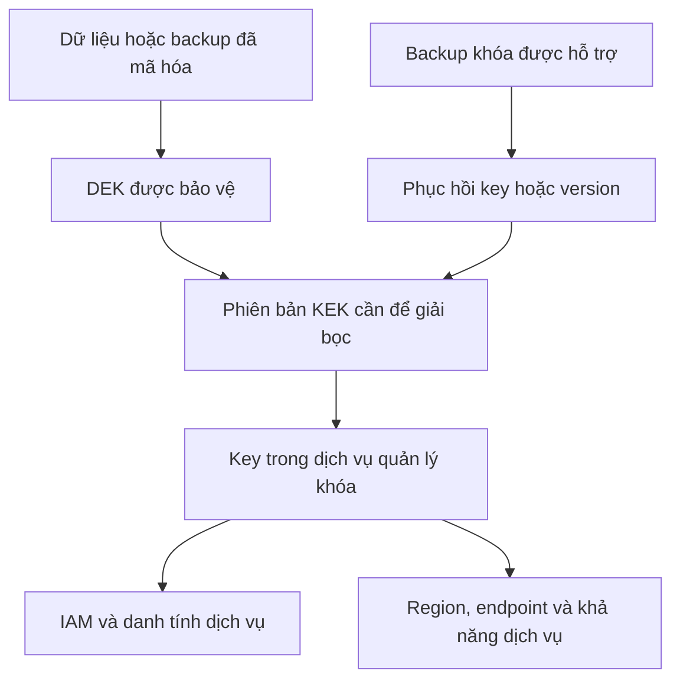

# Key rotation, backup và quy trình xóa khóa

## 1. Mục tiêu và phạm vi

Trong Oracle Cloud Infrastructure (OCI), khóa mã hóa là một phụ thuộc của dữ liệu. Object, volume hoặc bản sao lưu cơ sở dữ liệu có thể vẫn tồn tại nhưng không sử dụng được nếu thiếu khóa, phiên bản khóa, quyền truy cập hoặc cấu hình phục hồi tương ứng.

Bài học thuộc chương **Mã hóa, secrets và chứng chỉ** của lộ trình Oracle Cloud Infrastructure. Nội dung tập trung vào vòng đời khóa mã hóa: xoay khóa, bảo vệ bản sao lưu khóa và kiểm soát việc xóa khóa. Các tình huống được đặt trong bối cảnh tenancy, compartment, IAM, lưu trữ, Compute và dịch vụ cơ sở dữ liệu Oracle, có xét giám sát, tự động hóa, chi phí và tính sẵn sàng.

Sau bài học, bạn có thể:

- Phân biệt xoay phiên bản khóa, thay khóa gắn với tài nguyên và mã hóa lại dữ liệu.
- Xác định vì sao dữ liệu cũ và backup có thể còn cần phiên bản khóa cũ.
- Thiết kế bằng chứng sao lưu và phục hồi khóa, thay vì chỉ xác nhận có file backup.
- Thực hiện một runbook xóa khóa có điều kiện dừng, thời gian chờ và kiểm tra sau thay đổi.
- Tách nhiệm vụ quản trị khóa, quản trị dữ liệu và xác nhận khả năng khôi phục.

Bài học chủ yếu xét khóa đối xứng dùng cho mã hóa dữ liệu khi lưu trữ trong OCI Key Management, thường được thao tác trong ngữ cảnh Vault. Xoay mật khẩu trong Secrets, gia hạn chứng chỉ TLS và đổi cặp khóa bất đối xứng có quy trình riêng; không áp dụng máy móc các thao tác dưới đây cho những loại vật liệu đó.

## 2. Các đối tượng phải phân biệt

| Đối tượng | Ý nghĩa | Hệ quả vận hành |
| --- | --- | --- |
| Vault | Tài nguyên tổ chức và cung cấp ngữ cảnh quản lý khóa theo loại vault | Thao tác ở cấp vault có thể ảnh hưởng nhiều khóa và dịch vụ |
| Key | Tài nguyên khóa có định danh, thuật toán, trạng thái và chính sách truy cập | Tài nguyên lưu trữ có thể tham chiếu key bằng OCID |
| Key version | Một phiên bản vật liệu khóa thuộc key | Dữ liệu hoặc DEK đã được bọc trước đây có thể vẫn cần phiên bản cũ |
| DEK — data encryption key | Khóa dùng để mã hóa dữ liệu trong mô hình envelope encryption | Không nhất thiết trùng với key mà người quản trị chọn cho bucket hoặc volume |
| KEK — key encryption key | Khóa bảo vệ hoặc bọc DEK | Xoay KEK không mặc nhiên thay toàn bộ DEK hay ghi lại toàn bộ dữ liệu |
| Backup dữ liệu | Bản sao object, volume, database hoặc dữ liệu ứng dụng | Chưa đủ để phục hồi nếu các phụ thuộc mật mã bị mất |
| Backup khóa | Bản sao được bảo vệ của thông tin hoặc vật liệu khóa theo cơ chế dịch vụ hỗ trợ | Không chứa dữ liệu nghiệp vụ và không thay thế backup dữ liệu |

Một key có nhiều version vẫn là một tài nguyên key. Ngược lại, tạo một key khác là tạo một định danh và một quan hệ phụ thuộc mới. Hai trường hợp này có thể đòi hỏi thay đổi IAM, cấu hình dịch vụ và quy trình phục hồi khác nhau.

Không suy ra thuật toán, protection mode hoặc khả năng backup từ tên key. Phải đọc thuộc tính tài nguyên thực tế và xác nhận loại vault, loại key cùng cơ chế tích hợp của dịch vụ sử dụng nó.

### 2.1. Mô hình phụ thuộc



Sơ đồ là mô hình khái niệm. Cách dịch vụ lưu DEK, cache và tham chiếu phiên bản khóa có thể khác nhau. Điều cần quản lý là đường khôi phục hợp lệ từ dữ liệu đã mã hóa đến đúng vật liệu khóa và danh tính có quyền sử dụng.

## 3. Xoay khóa thực sự thay đổi điều gì?

### 3.1. Ba thao tác khác nhau

| Thao tác | Thay đổi chính | Không được mặc định kết luận |
| --- | --- | --- |
| Tạo key version mới | Có vật liệu khóa mới trong cùng key, theo cơ chế được hỗ trợ | Toàn bộ dữ liệu cũ đã được mã hóa lại |
| Chuyển tài nguyên sang key khác | Tài nguyên sử dụng một key có định danh khác | Mọi object, snapshot, backup và bản sao lịch sử đã chuyển sang key mới |
| Mã hóa lại dữ liệu hoặc bọc lại DEK | Cập nhật lớp mã hóa theo khả năng của dịch vụ | Không còn phụ thuộc khóa cũ nếu chưa kiểm tra tất cả bản sao |

Với một key đối xứng hỗ trợ rotation, tạo version mới thường giữ nguyên OCID của key và bổ sung một OCID phiên bản mới. Ứng dụng hoặc tài nguyên đang tham chiếu key OCID không nhất thiết phải đổi định danh key. Tuy nhiên, thời điểm dịch vụ sử dụng version mới và cách xử lý dữ liệu cũ phụ thuộc tích hợp cụ thể.

**Xoay khóa không đồng nghĩa thu hồi phiên bản cũ.** Dữ liệu đã được mã hóa bằng vật liệu cũ có thể vẫn cần nó để giải mã. Việc giữ phiên bản cũ để đọc dữ liệu hợp lệ là một phần của vận hành bình thường, không phải dấu hiệu rotation thất bại.

### 3.2. Ví dụ với Object Storage và database

Giả sử bucket dùng key K. Tháng trước, một số object được ghi trong giai đoạn K có version V1. Hôm nay, người quản trị tạo V2.

Các câu hỏi cần trả lời riêng:

1. Dịch vụ có tự sử dụng V2 cho thao tác mới theo cơ chế nào?
2. Object đã có được xử lý lại hay vẫn cần vật liệu cũ?
3. Object version, bản sao sang nơi khác và bản lưu trữ dài hạn còn tham chiếu gì?
4. Có quy trình được hỗ trợ để chuyển dữ liệu cũ sang key hoặc version khác không?
5. Các bằng chứng nào cho phép ngừng V1?

Với Oracle Database, còn phải xác định lớp nào đang được xoay: key trong OCI Key Management, TDE master key, hay khóa thuộc một cơ chế khác của dịch vụ database. Một thay đổi ở lớp quản lý khóa không tự chứng minh toàn bộ lớp mã hóa database và backup đã hoàn tất một vòng chuyển đổi.

Không dùng quy trình của Object Storage làm quy trình cho Block Volume hoặc TDE. Từng dịch vụ có cách quản lý DEK, bản sao, metadata và thời điểm gọi dịch vụ khóa khác nhau.

### 3.3. Trường hợp BYOK và nghi ngờ lộ khóa

BYOK — Bring Your Own Key — đưa vật liệu khóa từ nguồn bên ngoài vào một cơ chế được OCI hỗ trợ. Cần phân biệt tạo vật liệu khóa mới trong dịch vụ với nhập vật liệu mới từ nguồn quản trị bên ngoài. Không giả định một thao tác rotation tự sinh khóa đáp ứng yêu cầu phải tiếp tục dùng vật liệu do tổ chức kiểm soát từ nguồn đó.

Bản gốc của vật liệu nhập phải được bảo vệ theo quy trình quản lý khóa của tổ chức. Không đưa vào Git, ticket, email hoặc file cấu hình dùng chung. Cũng không coi một file nguồn là bản sao đầy đủ của mọi key version, metadata và quan hệ sử dụng tại OCI.

Nếu nghi ngờ lộ khóa, một lịch rotation thông thường có thể không đủ. Tạo version mới không khiến bên đã có bản sao khóa cũ mất khả năng đọc ciphertext cũ mà họ đang giữ. Cần xử lý nguồn lộ, đánh giá dữ liệu bị ảnh hưởng và lập kế hoạch chuyển đổi mã hóa phù hợp trước khi quyết định ngừng khóa cũ.

## 4. Runbook xoay khóa

### 4.1. Chuẩn bị danh mục phụ thuộc

Mỗi key nên có một hồ sơ vận hành đủ để trả lời:

| Nhóm thông tin | Nội dung cần ghi |
| --- | --- |
| Nhận diện | Tenancy, region, compartment, vault OCID, key OCID và các version liên quan |
| Thuộc tính | Thuật toán, protection mode, nguồn vật liệu và trạng thái |
| Chủ sở hữu | Nhóm quản trị khóa, chủ dữ liệu, nhóm vận hành dịch vụ và người xử lý sự cố |
| Tài nguyên đang dùng | Bucket, volume, tài nguyên database hoặc ứng dụng theo tích hợp thực tế |
| Bản sao lịch sử | Backup, snapshot, object version, replica, export và bản lưu trữ dài hạn |
| Quyền | Policy cho quản trị khóa, người cấu hình tài nguyên và chủ thể sử dụng key |
| Phục hồi | Backup khóa tương ứng, nơi lưu, lần restore đã thử và môi trường đích |
| Thay đổi | Lần rotation gần nhất, version trước/sau và kết quả kiểm tra |

Không xem kết quả tìm kiếm tài nguyên theo key OCID là danh mục đầy đủ một cách tự động. Một bản export hoặc metadata của backup có thể nằm ngoài tập tài nguyên mà công cụ đang liệt kê. Cần kết hợp cấu hình dịch vụ, danh mục backup và hồ sơ dữ liệu của ứng dụng.

### 4.2. Thực hiện theo các cổng kiểm tra

1. **Xác định mục tiêu:** rotation định kỳ, chuyển quyền quản lý vật liệu hay xử lý sự cố. Chọn đúng thao tác thay vì tạo key mới theo thói quen.
2. **Kiểm tra trước thay đổi:** key đang sử dụng được; quyền, trạng thái dịch vụ và backup cần thiết đã sẵn sàng; ghi nhận version hiện tại.
3. **Thử trong môi trường tách biệt:** dùng tài nguyên thử có cùng cơ chế tích hợp; kiểm tra đọc dữ liệu cũ và ghi dữ liệu mới.
4. **Thực hiện rotation:** tạo version hoặc nhập vật liệu theo phương thức được hỗ trợ cho key đó.
5. **Kiểm tra sau thay đổi:** đọc trước/sau, ghi mới, hoạt động của các dịch vụ phụ thuộc và lỗi liên quan khóa.
6. **Cập nhật đường phục hồi:** thực hiện backup sau rotation nếu cơ chế hỗ trợ; ghi nhận backup nào chứa version mới.
7. **Đóng thay đổi:** lưu kết quả, cập nhật danh mục và kế hoạch giữ version cũ.

Không xóa version cũ trong cùng thao tác chỉ vì version mới đã được tạo thành công. Tạo version mới là một mốc kỹ thuật; xác nhận dữ liệu và khả năng phục hồi là các mốc khác.

### 4.3. Quay lui phải được thiết kế trước

Không giả định OCI cung cấp một nút để đặt mọi dịch vụ quay lại version trước. Trong nhiều tình huống, bước xử lý đúng là sửa policy, khôi phục trạng thái key hoặc sửa cấu hình tích hợp, trong khi vẫn giữ các version đã dùng.

Nếu đã ghi dữ liệu bằng version mới, không xóa version đó để làm môi trường “giống trước thay đổi”. Khi chuyển sang một key khác, việc quay lại key nguồn cũng phải tuân theo khả năng chuyển đổi của dịch vụ. Giữ cả hai phía cần thiết cho đến khi dữ liệu và backup đã được kiểm tra.

### 4.4. Ví dụ CLI cho môi trường lab

Các lệnh sau chạy trong **Bash** với OCI CLI đã xác thực. Chỉ dùng key đối xứng được phép rotation trong compartment thực hành; không gọi chúng với key sản xuất chỉ để hoàn thành bài học.

```bash
export KEY_OCID='ocid1.key...'
export KMS_MGMT_ENDPOINT='https://<management-endpoint-cua-vault>'

oci kms management key get \
  --endpoint "$KMS_MGMT_ENDPOINT" \
  --key-id "$KEY_OCID"

oci kms management key-version list \
  --endpoint "$KMS_MGMT_ENDPOINT" \
  --key-id "$KEY_OCID" \
  --all
```

Lấy management endpoint từ thông tin vault thực tế. Management endpoint và cryptographic endpoint có vai trò khác nhau; không tự dựng endpoint từ tên vault hoặc OCID.

Sau khi ghi lại version hiện tại và xác nhận điều kiện lab, tạo version mới bằng thao tác được hỗ trợ:

```bash
oci kms management key-version create \
  --endpoint "$KMS_MGMT_ENDPOINT" \
  --key-id "$KEY_OCID"

oci kms management key get \
  --endpoint "$KMS_MGMT_ENDPOINT" \
  --key-id "$KEY_OCID"

oci kms management key-version list \
  --endpoint "$KMS_MGMT_ENDPOINT" \
  --key-id "$KEY_OCID" \
  --all
```

Trong kết quả, đối chiếu key OCID, version hiện tại, danh sách version và trạng thái tài nguyên. Lệnh tạo version này minh họa rotation với vật liệu do dịch vụ tạo trong trường hợp hỗ trợ; không thay thế quy trình nhập vật liệu của một yêu cầu BYOK.

Không lặp lại lệnh tạo version khi chưa biết lần gọi trước đã thành công hay chưa. Nếu mất kết nối hoặc timeout, đọc lại trạng thái và danh sách version trước khi quyết định tiếp tục.

## 5. Backup khóa: có file chưa có nghĩa là phục hồi được

### 5.1. Ba lớp phải bảo vệ cùng nhau

Một đường phục hồi dữ liệu mã hóa cần xem xét ít nhất ba lớp:

- **Dữ liệu:** bản sao database, object, volume hoặc dữ liệu ứng dụng.
- **Mật mã:** vật liệu hoặc cơ chế phục hồi key/version cần thiết, wallet và thành phần liên quan theo từng dịch vụ.
- **Cấu hình vận hành:** IAM, danh tính dịch vụ, region, endpoint, tham chiếu key và thông tin tích hợp.

Backup khóa không thay thế backup database. Ngược lại, backup database có mã hóa không mặc nhiên chứa mọi phụ thuộc cần để sử dụng một key bên ngoài.

### 5.2. Xác định khả năng backup/restore được hỗ trợ

OCI có các cơ chế backup/restore cho những tổ hợp vault, key và protection mode được hỗ trợ. Không phải mọi loại tài nguyên đều có cùng khả năng hoặc cùng điều kiện phục hồi.

Trước khi thiết kế, xác nhận cụ thể:

1. Có thể backup toàn vault, từng key hay chỉ dùng một phương thức bảo vệ khác?
2. Những loại key và protection mode nào được hỗ trợ?
3. Backup chứa những version nào tại thời điểm tạo và các thay đổi đang diễn ra có ảnh hưởng gì?
4. Có thể restore ở region, tenancy và loại vault đích dự kiến không?
5. Restore xử lý định danh, version đã có và xung đột tài nguyên ra sao?
6. Cần những quyền và bước cấu hình nào sau restore để dịch vụ dùng được key?

Nếu cấu hình không hỗ trợ xuất bản sao theo cách mong muốn, phải thiết kế lại phương án phục hồi hoặc lựa chọn tài nguyên phù hợp. Không tìm cách trích xuất private material hay khóa HSM qua một đường không được dịch vụ hỗ trợ.

### 5.3. File backup khóa không phải bản xuất khóa rõ

Một bản backup khóa được tạo theo cơ chế dịch vụ là hiện vật được bảo vệ, phục vụ quy trình restore tương ứng. Không coi đây là file chứa plaintext key có thể mở bằng trình soạn thảo hoặc đưa sang thư viện mật mã bất kỳ.

Dù đã được bảo vệ, hiện vật backup vẫn nhạy cảm. Hạn chế người đọc, kiểm soát sao chép, lưu lịch sử tạo và tránh đính kèm vào ticket. Có backup không có nghĩa được phép bỏ qua ranh giới truy cập của vật liệu khóa.

Mã kiểm tra toàn vẹn như SHA-256 giúp phát hiện file thay đổi nếu giá trị đối chiếu đáng tin cậy được bảo vệ riêng. Nó không chứng minh rằng file restore được, chứa đúng version hoặc không bị thay thế cùng manifest.

### 5.4. Tránh phụ thuộc vòng tròn

Giả sử backup của key K được lưu trong bucket B và B cũng dùng chính K làm CMK. Nếu K không sử dụng được, quá trình lấy file từ B có thể bị chặn trước khi bắt đầu restore.

Một bản backup có cấu trúc mật mã hợp lệ vẫn có thể không thể truy cập do phụ thuộc lưu trữ. Thiết kế nơi lưu phải xét:

- Quyền lấy backup khi hệ thống nguồn gặp sự cố.
- Khóa bảo vệ nơi lưu và việc khóa đó có phụ thuộc vào key cần phục hồi không.
- Region, đường mạng và tài khoản cần thiết để tải hiện vật.
- Cơ chế chống xóa hoặc thay thế ngoài quy trình được cho phép.

Không cần bỏ mã hóa cho nơi lưu backup. Cần chọn một đường truy cập được bảo vệ nhưng đủ độc lập với sự cố đang muốn khắc phục.

### 5.5. Manifest cho một lần backup

Ngoài hiện vật backup, lưu hồ sơ nhận diện, chẳng hạn:

```yaml
backupRecord:
  sourceRegion: "<region-nguon>"
  sourceVaultOcid: "<vault-ocid>"
  sourceKeyOcid: "<key-ocid>"
  capturedAtUtc: "<thoi-diem-UTC>"
  includedVersionOcids:
    - "<version-da-xac-nhan-co-trong-backup>"
  artifactLocation: "<vi-tri-luu-hien-vat-duoc-bao-ve>"
  artifactSha256: "<gia-tri-do-duoc>"
  lastRestoreTestUtc: "<thoi-diem-hoac-chua-thu>"
  restoreTestResult: "<ket-qua-co-bang-chung>"
```

Đây là mẫu hồ sơ vận hành, không phải cấu trúc yêu cầu của OCI API. Chỉ ghi version đã được xác nhận theo cơ chế backup, không suy ra rằng mọi version nhìn thấy sau đó đều có trong file.

Không đưa plaintext key, mật khẩu, token hoặc nội dung wallet nhạy cảm vào manifest. Bản thân OCID, vị trí lưu và thông tin tổ chức cũng cần quyền đọc phù hợp.

## 6. Thiết kế và kiểm tra khả năng khôi phục

### 6.1. Khoảng trống giữa rotation và backup

Xét chuỗi sự kiện giả định:

| Mốc | Sự kiện | Ý nghĩa khi có sự cố |
| --- | --- | --- |
| T0 | Key K có V1; tạo backup khóa B1 | B1 chỉ được xem là có các version đã được xác nhận tại T0 |
| T1 | Tạo V2 | B1 không tự được cập nhật |
| T2 | Có dữ liệu được bảo vệ bằng vật liệu liên quan V2 | Bắt đầu có dữ liệu mới cần đường phục hồi cho V2 |
| T3 | Tạo backup B2 và xác minh có V2 | Có thêm hiện vật phục hồi cho version mới |
| T4 | Thử restore B2 và đọc dữ liệu thử | Có bằng chứng mạnh hơn việc chỉ tải file backup thành công |

Nếu mất khả năng sử dụng key sau T2 nhưng chỉ có B1, một backup dữ liệu mới nhất chưa chắc giúp đọc được dữ liệu cần V2. Đó là lý do cần liên kết lịch rotation với việc bảo vệ version mới và kiểm tra đường phục hồi.

**RPO dữ liệu và mức mất mát chấp nhận được của trạng thái khóa phải phù hợp nhau.** Việc dữ liệu được backup mỗi giờ không có ý nghĩa đầy đủ nếu vật liệu khóa mới chỉ có một đường phục hồi chưa được kiểm chứng. Cơ chế sao chép hoặc bảo vệ khác, nếu được hỗ trợ và đã xác minh, có thể là một phần của phương án; không suy ra từ tên tính năng.

### 6.2. Runbook restore

1. **Xác định tình huống:** lỗi IAM, key disabled, thay đổi cấu hình hay thực sự mất tài nguyên/vật liệu cần thiết. Không restore khi có thể sửa đúng policy hoặc hủy một thay đổi chưa hoàn tất.
2. **Chọn hiện vật:** xác minh nguồn gốc, tính toàn vẹn và tập version cần có; đối chiếu với dữ liệu muốn phục hồi.
3. **Kiểm tra nơi đích:** region, tenancy, loại vault, khả năng restore, tài nguyên đang tồn tại và điều kiện xung đột.
4. **Thực hiện cơ chế restore được hỗ trợ:** dùng danh tính có quyền và ghi lại kết quả, OCID cùng trạng thái tài nguyên.
5. **Khôi phục cấu hình liên quan:** policy, danh tính dịch vụ, tham chiếu key, endpoint hoặc wallet theo yêu cầu.
6. **Kiểm tra đường dữ liệu:** đọc dữ liệu cũ, thực hiện thao tác mới nếu thuộc kịch bản và thử restore backup dữ liệu có liên quan.
7. **Ghi nhận thời gian và giới hạn:** version nào đã thử, dữ liệu nào chưa được kiểm tra, bước nào cần xử lý thủ công.

Không giả định có đúng vật liệu khóa là mọi tham chiếu OCID tự hoạt động. Cũng không giả định một key mới tạo có thể thay thế key nguồn chỉ bằng cách đổi tên. Hành vi định danh sau restore và khả năng gắn lại vào tài nguyên phải được xác nhận theo cơ chế cụ thể.

### 6.3. Kiểm tra bằng dữ liệu thuộc nhiều thế hệ

Một bộ kiểm tra phục hồi nên bao gồm:

- Dữ liệu tạo trước rotation.
- Dữ liệu tạo sau rotation.
- Một backup hoặc snapshot được giữ từ trước rotation.
- Dữ liệu của từng dịch vụ dùng key, nếu key được dùng cho nhiều tích hợp.
- Các cấu hình nơi đích mà kế hoạch phục hồi thực sự dựa vào.

Một thao tác giải mã thử trực tiếp với KMS có thể xác nhận một đường mật mã, nhưng chưa chứng minh Object Storage, Block Volume hoặc database đã dùng lại key thành công. Cần kiểm tra ở mức dịch vụ và ứng dụng.

RTO phải tính đến đường công việc quyết định thời gian phục hồi: truy cập hiện vật, restore key, chờ trạng thái sẵn sàng, sửa IAM, phục hồi dữ liệu và kiểm tra ứng dụng. Một số bước có thể chạy song song; không chỉ đo thời gian hoàn thành API restore key.

### 6.4. Replication không thay thế mọi mục tiêu của backup

Một bản sao đang hoạt động ở region khác có thể giúp xử lý sự cố hạ tầng, nhưng chưa chắc bảo vệ trước thao tác quản trị sai hoặc xóa khóa. Phạm vi đồng bộ trạng thái và vòng đời phải được kiểm tra theo cơ chế replication đang dùng.

Tương tự, nhiều bản sao file backup ở cùng một vùng quyền quản trị có thể cùng bị xóa hoặc thay thế. Thiết kế phục hồi cần xét sự cố dữ liệu, sự cố khóa, lỗi thao tác và sự cố quyền truy cập riêng biệt.

## 7. Vô hiệu hóa, lên lịch xóa và xóa hoàn tất

### 7.1. Hiểu đúng các trạng thái

| Hành động hoặc trạng thái | Ý nghĩa vận hành | Cách sử dụng thận trọng |
| --- | --- | --- |
| Vô hiệu hóa key | Ngừng khả năng dùng key theo trạng thái và hành vi dịch vụ; tài nguyên key chưa bị xóa | Chỉ thực hiện khi đã đánh giá tác động; có thể gây gián đoạn dữ liệu |
| Lên lịch xóa | Đưa tài nguyên vào quy trình xóa sau thời gian chờ được dịch vụ cho phép | Là thay đổi có tác động, không phải ghi chú nhắc việc |
| Hủy lịch xóa | Dừng lịch trước khi xóa hoàn tất nếu trạng thái còn cho phép | Phải đọc lại trạng thái và kiểm tra dịch vụ đã dùng key được chưa |
| Xóa hoàn tất | Tài nguyên đã đi qua bước xóa không thể hoàn tác bằng thao tác hủy lịch | Không giả định tạo key khác hoặc gọi lại OCID cũ sẽ phục hồi được dữ liệu |

Tên trạng thái chi tiết và thao tác hợp lệ khác nhau giữa vault, key và key version. Không dùng bảng này làm danh sách đầy đủ enum của API. Luôn đọc trạng thái thực tế và các hạn chế của đúng loại tài nguyên trước khi thao tác.

**Thời gian chờ xóa không phải thời gian bảo đảm key tiếp tục phục vụ dữ liệu.** Khi tài nguyên bị disabled hoặc chuyển sang trạng thái chờ xóa, các thao tác cần key có thể bị ảnh hưởng trước thời điểm xóa hoàn tất.

Một lần đọc còn thành công sau thay đổi cũng không chứng minh key không được dùng: dịch vụ có thể có cache hoặc một đường đọc chưa chạm đến thao tác khóa mới. Không dùng hiện tượng đó để suy ra việc xóa là an toàn.

### 7.2. Ba phạm vi xóa

| Phạm vi | Đối tượng có nguy cơ bị ảnh hưởng | Câu hỏi bắt buộc |
| --- | --- | --- |
| Một key version | Dữ liệu còn cần version đó | Có dữ liệu lịch sử, bản sao hoặc backup nào chưa hết phụ thuộc không? |
| Toàn bộ key | Các version và tài nguyên phụ thuộc key | Có bất kỳ workload hoặc đường phục hồi nào còn cần key không? |
| Vault | Nhiều key và quan hệ sử dụng trong phạm vi vault | Đã kiểm tra từng key và các điều kiện xóa của vault chưa? |

Không coi xóa vault là thao tác dọn vỏ chứa. Cũng không mặc định mọi version đều có thể xóa riêng, hoặc rằng việc xóa version hiện tại được phép. Kiểm tra các ràng buộc tương ứng trước khi đưa vào runbook.

### 7.3. Xóa khóa và khả năng khôi phục dữ liệu

Nếu không còn vật liệu khóa cần thiết và không còn đường phục hồi hợp lệ, dữ liệu đã mã hóa có thể không thể đọc được dù ciphertext vẫn nguyên vẹn.

Tuy nhiên, chỉ xóa một tài nguyên key chưa đủ để kết luận mọi bản dữ liệu đã bị loại bỏ hoàn toàn. Cần xét bản sao vật liệu BYOK ở nguồn, backup khóa có thể phục hồi, bản rõ đã xuất ra ngoài, DEK hoặc nội dung đã có ở một hệ thống khác và các bản sao do ứng dụng quản lý.

Vì vậy, không dùng thông báo “key deleted” làm bằng chứng duy nhất cho một mục tiêu xóa dữ liệu. Phạm vi của mục tiêu phải rõ: ngừng dùng key ở dịch vụ, làm dữ liệu cụ thể không còn đọc được, hay dọn toàn bộ bản sao và hiện vật có liên quan.

## 8. Runbook xóa khóa an toàn

### 8.1. Cổng A — Xác định chính xác yêu cầu

Ghi rõ đây là xóa version, key hay vault; lý do xóa; dữ liệu nào được phép ngừng phục hồi; ai sở hữu dữ liệu và ai chịu trách nhiệm thay đổi.

Không chấp nhận yêu cầu chỉ có tên hiển thị như “xóa key cũ”. Dùng OCID, region và compartment để tránh chọn nhầm tài nguyên trùng tên.

Nếu lý do là ngừng dùng một ứng dụng, cần phân biệt thời điểm ứng dụng dừng với thời điểm các bản lưu dữ liệu của nó hết nhu cầu khôi phục. Hai thời điểm này thường không trùng nhau.

### 8.2. Cổng B — Kiểm kê toàn bộ phụ thuộc

Đối chiếu ít nhất:

- Tài nguyên đang chạy và tài nguyên tạm dừng nhưng còn dữ liệu.
- Bucket, các object/version liên quan, volume, snapshot, clone và bản sao.
- Database, standby, bản backup, dữ liệu xuất và thành phần phục hồi liên quan.
- Backup lưu lâu dài hoặc chuyển ra hệ thống khác.
- Key/version được ghi trong metadata của ứng dụng hoặc pipeline.
- Bản sao khóa, hiện vật backup và vật liệu BYOK nếu có.
- Policy và danh tính có thể vẫn dùng key cho những workload chưa được gắn nhãn đúng.

Nếu không xác định được chủ sở hữu của một phụ thuộc, dừng yêu cầu xóa để làm rõ. “Không tìm thấy ai sử dụng” và “đã chứng minh không còn phụ thuộc” là hai mức bằng chứng khác nhau.

### 8.3. Cổng C — Hoàn tất di chuyển hoặc kết thúc lưu giữ

Với dữ liệu cần giữ, thực hiện quy trình chuyển đổi được dịch vụ hỗ trợ sang khóa còn được quản lý. Kiểm tra dữ liệu và tất cả lớp bản sao thuộc phạm vi yêu cầu.

Không chỉ đổi trường key trên một tài nguyên rồi đánh dấu hoàn tất. Nếu việc chuyển đổi không xử lý dữ liệu cũ, phải có kế hoạch riêng hoặc tiếp tục giữ khóa cũ.

Với dữ liệu không cần giữ, xác nhận quy trình kết thúc lưu giữ đã hoàn thành. Không xóa dữ liệu hoặc backup chỉ để vượt qua một điều kiện xóa key khi chưa có quyền xử lý những bản sao đó.

### 8.4. Cổng D — Có bằng chứng khôi phục và quyết định giữ backup khóa

Đối với phần dữ liệu tiếp tục được bảo vệ bằng khóa mới, kiểm tra restore thành công. Đối với khóa sẽ xóa, quyết định rõ hiện vật backup khóa còn được giữ cho mục tiêu gì, trong bao lâu và với quyền nào.

Hai mục tiêu có thể yêu cầu cách xử lý khác nhau:

- Nếu vẫn cần khả năng phục hồi, không xóa đường truy cập cần thiết tới backup khóa hoặc vật liệu liên quan.
- Nếu mục tiêu là chấm dứt khả năng giải mã trong phạm vi xác định, một backup khóa còn phục hồi được cũng là phụ thuộc phải xử lý theo quy trình được phép.

Không tự động tạo rồi lưu backup vô thời hạn cho mọi lần xóa, cũng không tự động hủy backup chỉ vì tài nguyên key đã bị xóa. Quyết định phải nhất quán với mục tiêu dữ liệu và quyền đã được giao.

### 8.5. Cổng E — Phê duyệt theo quy trình và lập lịch

Người quản trị khóa chuẩn bị thay đổi; chủ dữ liệu xác nhận tác động và phạm vi; người kiểm tra khả năng khôi phục cung cấp bằng chứng. Với thay đổi quan trọng, nên có kiểm tra độc lập thay vì để một người tự xác nhận toàn bộ.

Chọn thời gian chờ trong khoảng được OCI cho phép cho đúng tài nguyên. Trước khi xác nhận, đọc lại OCID, thời điểm xóa, múi giờ và phạm vi ảnh hưởng. Dùng UTC trong hồ sơ và hiển thị múi giờ địa phương nếu cần để tránh nhầm lẫn.

Không đưa con số thời gian chờ suy đoán vào script. Đọc yêu cầu API/Console của môi trường thực tế và kiểm tra thời điểm dịch vụ chấp nhận trong kết quả trả về.

### 8.6. Cổng F — Theo dõi trong thời gian chờ

Sau khi lên lịch:

1. Đọc lại trạng thái và thời điểm xóa từ dịch vụ, không chỉ dựa vào thông báo thành công.
2. Theo dõi lỗi của tài nguyên phụ thuộc, ứng dụng và backup/restore đã lên lịch.
3. Nếu phát hiện phụ thuộc chưa xử lý, hủy lịch khi còn được phép và điều tra.
4. Sau hủy, kiểm tra trạng thái hoạt động, IAM và đường dữ liệu; không chỉ kết luận từ việc hủy lịch thành công.
5. Ghi mọi thay đổi vào hồ sơ cùng người chịu trách nhiệm.

Không dùng môi trường sản xuất để thử xem lỗi có xuất hiện trong giai đoạn chờ hay không. Kiểm tra tác động phải được chuẩn bị trước, và giám sát sau thay đổi là một lớp phát hiện bổ sung.

### 8.7. Cổng G — Đóng thay đổi

Khi xóa hoàn tất, cập nhật danh mục tài nguyên, quan hệ phụ thuộc, policy không còn cần và hồ sơ giám sát. Xử lý quyền hoặc tài nguyên phụ trợ theo phạm vi được cho phép, không xóa hàng loạt chỉ vì cùng tên hoặc cùng compartment.

Lưu bằng chứng trạng thái cuối và danh sách dữ liệu đã được chuyển hoặc kết thúc lưu giữ. Nếu có việc chưa xác minh được, ghi rõ giới hạn thay vì báo hoàn tất toàn bộ mục tiêu an toàn dữ liệu.

## 9. Bài thực hành với key và dữ liệu riêng

### 9.1. Mục tiêu và giới hạn

Mục tiêu là tạo bằng chứng cho rotation và đường phục hồi, sau đó diễn tập quy trình xóa bằng hồ sơ và kiểm tra trạng thái. Không cần thực sự xóa một key đang có phụ thuộc để chứng minh đã hiểu bài.

Chuẩn bị một compartment lab, key đối xứng riêng, tài nguyên dữ liệu thử có hỗ trợ tích hợp key đó và quyền tối thiểu. Nếu thực hành backup/restore, chọn loại vault, key và nơi đích có hỗ trợ; kiểm tra chi phí trước khi tạo thêm tài nguyên chuyên dụng.

Nếu môi trường hiện có không hỗ trợ backup/restore theo kịch bản, ghi rõ phần này chưa thực hiện và điều kiện còn thiếu. Không đánh dấu đã kiểm tra phục hồi chỉ vì đã tải một file cấu hình key.

### 9.2. Thực hành theo từng giai đoạn

| Giai đoạn | Việc thực hiện | Bằng chứng cần giữ |
| --- | --- | --- |
| Trước rotation | Đọc thông tin key/version; ghi dữ liệu giả A qua dịch vụ đã tích hợp | Key OCID, version hiện tại, cấu hình dữ liệu và kết quả đọc A |
| Backup ban đầu | Tạo backup theo cơ chế được hỗ trợ nếu có | Vị trí hiện vật, thời điểm, version được bao phủ, mã kiểm tra toàn vẹn |
| Rotation | Tạo version mới bằng thao tác lab ở phần 4 | Kết quả version trước/sau và trạng thái |
| Sau rotation | Ghi dữ liệu giả B, đọc lại A và B | Nội dung khớp, dịch vụ không có lỗi khóa chưa xử lý |
| Bảo vệ trạng thái mới | Tạo backup sau rotation hoặc xác minh cơ chế phục hồi đã chọn | Bằng chứng version mới nằm trong đường phục hồi |
| Restore | Thực hiện ở môi trường được hỗ trợ, tách khỏi dữ liệu thật | Trạng thái key, IAM và kết quả thử dữ liệu theo các thế hệ |
| Diễn tập xóa | Điền các cổng A đến G cho key lab | Quyết định tiếp tục/dừng với lý do và danh mục phụ thuộc |

Một bản thử chỉ đọc dữ liệu qua key nguồn còn hoạt động chưa chứng minh key phục hồi được sử dụng. Khi thiết kế bước restore, cần phân biệt đường đọc qua tài nguyên nguồn với đường đọc thực sự dựa vào kết quả phục hồi được hỗ trợ.

Nếu tích hợp dịch vụ không cho phép thay key phục hồi theo cách dự kiến, không sửa OCID hoặc metadata thủ công để ép chạy. Ghi giới hạn đó vào kế hoạch và chọn kịch bản phục hồi hợp lệ.

### 9.3. Tiêu chí hoàn thành

- Xác định được key và version trước/sau rotation.
- Có bằng chứng dữ liệu trước và sau thay đổi vẫn đọc được qua dịch vụ.
- Biết hiện vật hoặc cơ chế nào bảo vệ version mới và đã thử đến mức nào.
- Phân biệt rõ backup dữ liệu, backup khóa và cấu hình cần phục hồi.
- Runbook xóa chỉ ra được ít nhất một điều kiện phải dừng.
- Không sử dụng trạng thái thành công của một lệnh làm bằng chứng thay cho toàn bộ đường phục hồi.

Các giới hạn chưa thực hiện, như chưa có môi trường restore hoặc chưa thử database, phải được ghi riêng. Việc hoàn thành phần rotation không tự hoàn thành phần backup hay xóa khóa.

### 9.4. Dọn tài nguyên và kiểm soát chi phí

Sau lab, dọn dữ liệu thử và tài nguyên do chính bài thực hành tạo theo đúng quyền được giao. Kiểm tra tài nguyên nào vẫn đang dùng key trước khi xem xét xóa key lab hoặc vault.

Theo dõi các khoản liên quan đến loại vault/key, hiện vật backup, Object Storage, thao tác API, tài nguyên dữ liệu và truyền dữ liệu giữa nơi nguồn/đích. Không mặc định mọi loại vault có cùng mô hình chi phí. Không xóa key còn cần chỉ để giảm một khoản chi phí trước mắt.

## 10. IAM, giám sát và tự động hóa

### 10.1. Tách quyền theo nhiệm vụ

| Nhóm nhiệm vụ | Quyền cần xem xét | Quyền không nên gộp theo thói quen |
| --- | --- | --- |
| Quản trị vòng đời khóa | Xem, tạo version và thao tác vòng đời theo nhiệm vụ | Quyền đọc toàn bộ dữ liệu nghiệp vụ |
| Dịch vụ sử dụng key | Các thao tác khóa mà tích hợp yêu cầu cho đúng tài nguyên | Quyền quản trị hoặc xóa key |
| Quản trị backup | Tạo/lưu/đọc hiện vật backup trong phạm vi được giao | Quyền xóa mọi hiện vật và key nguồn cùng một lúc |
| Vận hành phục hồi | Đọc hiện vật, restore và cấu hình cần thiết theo runbook | Quyền quản trị toàn tenancy chỉ để chạy một lần restore |
| Kiểm tra độc lập | Đọc cấu hình và bằng chứng cần thiết | Quyền thay đổi trạng thái tài nguyên đang được kiểm tra |

OCI IAM phải được viết theo loại tài nguyên, quyền và cơ chế tích hợp thực tế. Không dùng một policy tổng quát cho mọi dịch vụ. Kiểm tra cả policy kế thừa, quyền của nhóm, service principal hoặc danh tính workload đang tham gia.

Với tình huống khẩn cấp, xác định trước danh tính và quyền cần thiết, cách truy cập cùng cơ chế ghi nhận. Không đợi đến khi key gặp sự cố mới phát hiện tài khoản có quyền phục hồi cũng không thể lấy file backup.

### 10.2. Theo dõi các tín hiệu có ý nghĩa

Kết hợp OCI Audit với log dịch vụ, log ứng dụng và dữ liệu giám sát có sẵn. Các tín hiệu đáng chú ý gồm:

- Tạo key version, thay đổi key hoặc vật liệu nhập.
- Vô hiệu hóa, lên lịch xóa, hủy lịch và thay đổi trạng thái quan trọng.
- Thay đổi policy hoặc danh tính có quyền quản trị/sử dụng key.
- Backup/restore lỗi, hiện vật không truy cập được hoặc kiểm tra toàn vẹn thất bại.
- Lỗi truy cập dữ liệu có liên quan đến khóa và các thay đổi cùng thời điểm.
- Rotation đã hoàn thành nhưng đường phục hồi chưa được cập nhật.

Không giả định Audit chứa một bản ghi riêng cho mọi lần giải mã dữ liệu. Hoạt động data plane, cache và khả năng ghi log khác nhau theo dịch vụ. “Không thấy sự kiện dùng key gần đây” chưa đủ để kết luận key không còn cần thiết.

### 10.3. Tự động hóa với trạng thái và điều kiện

Một pipeline rotation nên có khóa điều phối để tránh chạy trùng, kiểm tra phiên bản trước khi thao tác, chờ trạng thái hoàn tất và xác nhận kết quả. Nếu lần gọi tạo version bị timeout, đọc lại thay vì lập tức thử tạo lần nữa.

Cấu trúc khái niệm:

```text
đọc key + version + trạng thái
  -> xác nhận đúng tài nguyên và chưa có thay đổi đang chạy
  -> tạo version bằng cơ chế phù hợp
  -> đọc lại cho đến khi có kết quả rõ ràng
  -> kiểm tra dữ liệu trước/sau
  -> cập nhật backup hoặc đường phục hồi
  -> lưu bằng chứng và thông báo kết quả
```

Lịch rotation tự động không nên kéo theo xóa version cũ chỉ dựa trên số ngày. Tiêu chí xóa phải gắn với phụ thuộc dữ liệu, backup và quyết định lưu giữ. Khi chưa xác định chắc kết quả một bước, pipeline cần dừng ở trạng thái cần xử lý, không tiếp tục thao tác có phạm vi ảnh hưởng lớn hơn.

## 11. Chẩn đoán các tình huống thường gặp

| Hiện tượng | Hướng kiểm tra | Cách xử lý theo nguyên nhân |
| --- | --- | --- |
| Tạo version mới bị từ chối | Endpoint quản lý, trạng thái key, IAM và khả năng rotation của loại key | Sửa đúng điều kiện; không tạo key khác để bỏ qua lỗi khi chưa có kế hoạch chuyển đổi |
| Có version mới nhưng dữ liệu cũ vẫn cần version cũ | Cơ chế envelope encryption và hành vi dịch vụ | Giữ phụ thuộc cũ hoặc thực hiện quy trình chuyển đổi được hỗ trợ |
| Có file backup nhưng không restore được | Loại backup, nơi đích, khả năng hỗ trợ, tính toàn vẹn và quyền | Chọn hiện vật và cấu hình hợp lệ; không giả định file nào cũng dùng ở mọi nơi |
| Key restore xong nhưng ứng dụng vẫn lỗi | Định danh, endpoint, policy và cấu hình tích hợp dịch vụ | Phục hồi đủ cấu hình và kiểm tra data plane |
| Lên lịch xóa xong dữ liệu bắt đầu lỗi | Trạng thái key và tài nguyên còn phụ thuộc | Hủy lịch nếu còn được phép, khôi phục trạng thái cần thiết và xử lý thiếu sót kiểm kê |
| Không thấy key được dùng nhưng restore backup cũ thất bại | Backup dài hạn và version có liên quan | Khôi phục đường khóa hợp lệ nếu còn khả năng; cập nhật danh mục phụ thuộc |
| Backup khóa nằm trong bucket không truy cập được khi key lỗi | Khóa bảo vệ bucket, IAM và phụ thuộc vòng tròn | Sử dụng đường phục hồi độc lập đã chuẩn bị; điều chỉnh thiết kế backup |
| Đã xoay key nhưng sự cố lộ dữ liệu chưa chấm dứt | Nguồn lộ, bản rõ, vật liệu cũ và quyền ứng dụng | Xử lý nguyên nhân gốc; rotation chỉ là một phần của phương án |

## 12. Những điểm cần ghi nhớ

- Rotation bổ sung hoặc thay đổi vật liệu khóa; không tự chứng minh dữ liệu cũ đã được mã hóa lại.
- Dữ liệu đang chạy và dữ liệu lịch sử có thể cần những version khác nhau trong cùng một key.
- Backup khóa, backup dữ liệu và cấu hình phục hồi là ba phần phải phối hợp.
- Sau rotation, phải bảo vệ version mới và xác định rõ khoảng trống phục hồi.
- Chỉ restore và kiểm tra ở mức dịch vụ mới cung cấp bằng chứng đầy đủ hơn việc có file backup.
- Vô hiệu hóa và lên lịch xóa có thể ảnh hưởng tính sẵn sàng trước khi xóa hoàn tất.
- Xóa version, xóa key và xóa vault có phạm vi ảnh hưởng khác nhau; mọi thao tác cần kiểm kê đúng phạm vi.
- Không dùng tuổi khóa, log vắng hoạt động hoặc một lần đọc thành công làm điều kiện duy nhất để xóa.
