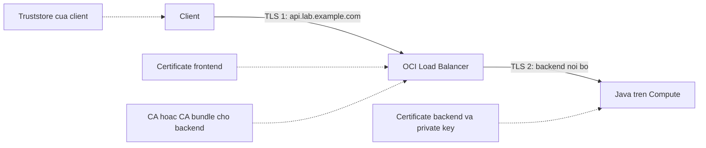
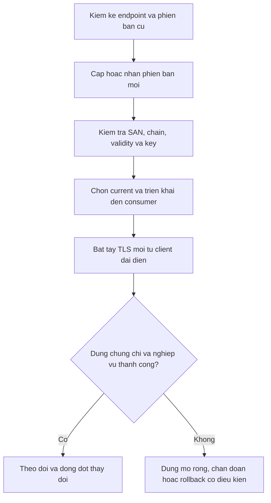

# OCI Certificates và quản lý vòng đời chứng chỉ TLS

Trong chương **Mã hóa, secrets và chứng chỉ** của module `CLOUD_PROVIDERS_ORACLE`, bài này trình bày cách quản lý chứng chỉ TLS bằng OCI Certificates: lựa chọn nguồn cấp, bảo vệ private key, liên kết với dịch vụ sử dụng, gia hạn, kiểm chứng triển khai, thu hồi và dọn dẹp tài nguyên.

Tình huống xuyên suốt là một API Java chạy trên OCI Compute trong private subnet, được truy cập qua OCI Load Balancer. Nhóm vận hành cần bảo vệ kết nối TLS, phân quyền quản lý chứng chỉ theo compartment và thay chứng chỉ trước khi hết hạn mà vẫn kiểm soát được khả năng truy cập của client.

Sau bài học, người học có thể:

- Phân biệt chứng chỉ leaf, certificate authority, CA bundle, certificate bundle và private key.
- Chọn đúng chế độ cấp và quản lý chứng chỉ trong OCI Certificates.
- Thiết kế TLS cho cả chặng client–Load Balancer và chặng Load Balancer–backend.
- Theo dõi phiên bản, gia hạn và xác nhận chứng chỉ thực tế đang được phục vụ.
- Xử lý thay CA, khóa bị lộ, thu hồi và xóa tài nguyên theo đúng mục đích.

## 1. TLS cần chứng minh điều gì?

TLS bảo vệ một kết nối giữa hai đầu cuối. Đối với HTTPS thông thường, client phải kiểm tra được danh tính server trước khi tin rằng dữ liệu đang được gửi đến đúng dịch vụ.

Một lần kiểm tra chứng chỉ cần xem xét nhiều điều kiện:

| Điều kiện | Câu hỏi vận hành |
| --- | --- |
| Danh tính endpoint | Tên DNS mà client dùng có được chứng chỉ bao phủ không? |
| Chuỗi tin cậy | Có dựng được chuỗi từ chứng chỉ server đến trust anchor mà client chấp nhận không? |
| Hiệu lực thời gian | Hiện tại có nằm trong khoảng `Not Before` và `Not After` không? |
| Mục đích sử dụng | Chứng chỉ và các ràng buộc có phù hợp với xác thực TLS server hoặc client không? |
| Quyền sử dụng khóa | Endpoint có private key tương ứng để thực hiện xác thực TLS không? |
| Trạng thái thu hồi | Theo chính sách client, có bằng chứng chứng chỉ đã bị thu hồi không? |

Có chứng chỉ trong OCI chưa chứng minh được các điều kiện trên. Chứng chỉ có thể được tạo đúng nhưng listener chưa dùng nó, thiếu intermediate, sai tên DNS hoặc client chưa tin CA.

Đồng thời, TLS không thay thế phân quyền ứng dụng. Một client có chứng chỉ hợp lệ vẫn cần được hệ thống ánh xạ vào danh tính và quyền phù hợp. Quyền IAM dùng để quản trị tài nguyên OCI cũng là lớp khác với việc client tin chuỗi chứng chỉ khi kết nối đến API.

## 2. Các tài nguyên trong OCI Certificates

OCI Certificates quản lý certificate authorities, certificates và CA bundles; dịch vụ hỗ trợ các thao tác như cấp, lưu trữ, gia hạn, liên kết và thu hồi trong phạm vi được hỗ trợ. [Overview of Certificates](https://docs.oracle.com/en-us/iaas/Content/certificates/overview.htm).

| Thành phần | Vai trò | Điểm phải phân biệt |
| --- | --- | --- |
| Certificate authority, viết tắt CA | Cấp và ký chứng chỉ theo một hệ thống tin cậy | Khóa ký của CA có phạm vi ảnh hưởng lớn hơn khóa của một server |
| Leaf certificate | Gắn public key với danh tính của server hoặc client | Thường là chứng chỉ endpoint trình bày trong TLS |
| Certificate version | Một phiên bản nội dung và thời hạn của tài nguyên certificate | Gia hạn có thể tạo phiên bản mới trong cùng tài nguyên |
| Certificate bundle | Nội dung chứng chỉ, chuỗi và thông tin liên quan | Loại bundle có thể bao gồm private key hoặc chỉ nội dung công khai |
| CA bundle | Tập hợp chứng chỉ CA công khai dùng cho cấu hình trust | Không phải cặp chứng chỉ leaf và private key của server |
| Association | Mối liên kết với tài nguyên OCI sử dụng chứng chỉ hoặc trust material | Cần xác minh tài nguyên đích thực sự đã nhận cấu hình |

Private key là bí mật chứng minh quyền sử dụng public key. Chứng chỉ công khai và chain có thể được phân phối cho client; private key của server và private key ký của CA cần được bảo vệ theo hai phạm vi riêng.

### 2.1. CA riêng không tự tạo niềm tin trên Internet

CA được tạo trong OCI Certificates là private CA. Client phải có trust anchor phù hợp; trình duyệt hoặc JVM không tự tin một CA chỉ vì nó nằm trong tenancy của bạn. [Bài thực hành Oracle về chứng chỉ nội bộ](https://docs.oracle.com/en/learn/internal-certs-nginx/index.html).

Với API nội bộ, doanh nghiệp có thể phân phối root CA đến các truststore được quản lý. Với website cho người dùng Internet đại chúng, cần một chứng chỉ có chuỗi được các client mục tiêu tin cậy, chẳng hạn cấp bởi public CA thích hợp rồi import vào OCI. Việc import không làm một CA riêng trở thành public CA được mọi trình duyệt chấp nhận.

## 3. Chọn cách cấp và quản lý chứng chỉ

Các chế độ dưới đây khác nhau chủ yếu ở nơi cấp chứng chỉ và nơi quản lý private key. Đừng chọn chỉ theo việc chúng cùng xuất hiện trong trang Certificates.

### 3.1. Issued by internal CA, managed internally

Ở chế độ này, OCI Certificates cấp chứng chỉ từ CA nội bộ và quản lý private key của chứng chỉ. Đây là lựa chọn có thể cấu hình gia hạn tự động bằng dịch vụ. Khi tạo, cần chọn issuer, subject, SAN, profile và các ràng buộc hiệu lực phù hợp. [Creating a Certificate](https://docs.oracle.com/en-us/iaas/Content/certificates/creating-certificate.htm).

Chế độ này phù hợp với các endpoint nội bộ và dịch vụ tích hợp khi tổ chức đã có kế hoạch phân phối trust. Việc key được quản lý trong dịch vụ không có nghĩa mọi principal đều được phép đọc nó; vẫn phải kiểm soát quyền truy xuất bundle.

### 3.2. Issued by internal CA, managed externally

Tổ chức tạo và giữ private key ở ngoài dịch vụ, tạo certificate signing request, viết tắt CSR, rồi yêu cầu CA nội bộ của OCI ký. Dịch vụ không tự gia hạn loại chứng chỉ có private key do bạn quản lý bên ngoài. [Creating a Certificate to Manage Externally](https://docs.oracle.com/en-us/iaas/Content/certificates/creating-certificate-to-manage-externally.htm).

Luồng vận hành phải bao gồm nơi giữ khóa, quy trình tạo CSR mới khi cần và cách đưa chứng chỉ đã ký về endpoint. Không chọn chế độ này cho một tích hợp cần dịch vụ cung cấp cả private key mà không kiểm tra khả năng hỗ trợ của tích hợp.

### 3.3. Imported

Nếu đã có chứng chỉ từ CA bên ngoài, có thể import nội dung PEM, chain và private key theo yêu cầu của OCI Certificates. Cần kiểm tra thuật toán, định dạng và giới hạn import hiện hành của dịch vụ. [Importing a Certificate](https://docs.oracle.com/en-us/iaas/Content/certificates/importing-certificate.htm).

Việc gia hạn tại public CA hoặc PKI bên ngoài vẫn do luồng cấp đó chịu trách nhiệm. Sau khi có nội dung mới, nhóm vận hành cập nhật tài nguyên import và xác minh endpoint; không coi việc lưu chứng chỉ trong OCI là đã bật gia hạn ở CA bên ngoài.

| Cách quản lý | Nơi cấp | Nơi chịu trách nhiệm vòng đời private key | OCI tự gia hạn chứng chỉ |
| --- | --- | --- | --- |
| Cấp và quản lý nội bộ | CA nội bộ OCI | OCI Certificates theo cấu hình | Có thể cấu hình |
| Cấp nội bộ, quản lý bên ngoài | CA nội bộ OCI | Hệ thống bên ngoài | Không |
| Import | CA hoặc luồng PKI bên ngoài | Luồng bên ngoài và nơi lưu bản import | Không |

Với hai loại cuối, phải có quy trình cập nhật PEM hoặc CSR thích hợp. Oracle cũng yêu cầu giữ cùng common name khi cập nhật PEM của tài nguyên hiện có; common name không khớp có thể tạo phiên bản lỗi. [Updating a Certificate PEM](https://docs.oracle.com/en-us/iaas/Content/certificates/updating-certificate-PEM.htm).

## 4. Thiết kế TLS cho Load Balancer và ứng dụng Java

Một kiến trúc minh họa có hai kết nối TLS riêng biệt:



Tên miền trong bài chỉ dùng minh họa. Khi triển khai thật, thay bằng tên mà tổ chức quản lý và đưa đúng tên đó vào SAN.

### 4.1. Chặng client đến Load Balancer

Listener HTTPS trình bày chứng chỉ cho client. Chứng chỉ cần bao phủ tên DNS client sử dụng; client cần tin issuer và nhận đủ chain để xác minh.

Nếu Load Balancer kết thúc TLS rồi gửi HTTP đến backend, chặng phía sau không được TLS bảo vệ. Private subnet không tự biến HTTP thành kết nối mã hóa. Khi yêu cầu bảo mật bao gồm chặng phía sau, cấu hình TLS riêng cho backend.

### 4.2. Chặng Load Balancer đến backend

Ứng dụng Java hoặc reverse proxy phía backend cần chứng chỉ server và private key tương ứng. Load Balancer đóng vai client TLS và cần cấu hình xác minh peer cùng CA hoặc CA bundle thích hợp.

CA bundle ở backend set chứa trust material để xác minh peer; nó không thay thế việc cài server certificate và private key trên backend. Cũng cần kiểm tra cấu hình xác minh danh tính mà dịch vụ hỗ trợ, chain, độ sâu xác minh và tên mà ứng dụng hoặc thành phần kiểm tra sử dụng. Không suy ra rằng bật mã hóa là đã bật đầy đủ mọi điều kiện xác minh.

### 4.3. Khi cần mutual TLS

Với mTLS, bên nhận còn kiểm tra chứng chỉ client. Cần thiết kế riêng CA được tin, mục đích chứng chỉ, danh tính được chấp nhận và ánh xạ quyền. Nếu mTLS kết thúc ở Load Balancer, ứng dụng phía sau không trực tiếp thực hiện cùng phiên bắt tay TLS đó.

Phân biệt rõ chứng chỉ mà mỗi đầu cuối trình bày và tập CA mà mỗi bên dùng để tin peer. Không gửi private key của client trong CA bundle.

## 5. Chuẩn bị CA, khóa, compartment và IAM

### 5.1. Điều kiện cho một CA được tạo và quản lý trong OCI

Tạo CA trong OCI Certificates cần khóa bất đối xứng được bảo vệ bằng phần cứng trong OCI Vault. Nếu cấu hình certificate revocation list, viết tắt CRL, bằng Object Storage, cần chuẩn bị bucket và quyền phù hợp. [Creating a Certificate Authority](https://docs.oracle.com/en-us/iaas/Content/certificates/creating-certificate-authority.htm).

Phân biệt khóa ký CA này với private key leaf của listener. Mất khả năng dùng khóa ký CA có thể làm hỏng luồng cấp hoặc gia hạn; lộ private key CA có thể ảnh hưởng cả hệ thống tin cậy bên dưới.

Khi CA gọi Vault và Object Storage, cần resource principal policy tương ứng; quyền của người quản trị tạo CA không tự thay thế quyền của CA khi vận hành. Oracle mô tả luồng dynamic group và policy cho CA tại [Certificate Authorities: Required IAM Policy](https://docs.oracle.com/en-us/iaas/Content/certificates/managing-certificate-authorities.htm).

### 5.2. Chia vai trò theo nhiệm vụ

Một thiết kế tham khảo:

- Nhóm PKI quản lý CA, khóa ký, thời hạn và cấu hình thu hồi.
- Nhóm ứng dụng yêu cầu hoặc gia hạn leaf certificate theo phạm vi được cấp.
- Nhóm mạng hoặc pipeline được phép gắn chứng chỉ vào đúng listener và backend set.
- Nhóm giám sát đọc metadata và nội dung công khai phục vụ kiểm tra.

Đặt tài nguyên vào compartment có người chịu trách nhiệm rõ ràng. Với tài nguyên ở các compartment khác nhau, xác minh đủ quyền trên cả certificate và tài nguyên tiêu thụ. Không cấp quyền quản lý mọi CA chỉ để cho một pipeline đổi chứng chỉ listener.

Ví dụ policy chỉ đọc bundle công khai của một certificate:

```text
Allow group TlsObservers to read leaf-certificate-bundles in compartment AppSecurity where all {target.leaf-certificate.id = '<CERTIFICATE_OCID>', target.leaf-certificate.bundle-type = 'CERTIFICATE_CONTENT_PUBLIC_ONLY'}
```

Policy này không phải bộ quyền hoàn chỉnh để tạo certificate, sửa Load Balancer hoặc đọc private key. Đối chiếu từng thao tác với tài nguyên `leaf-certificates`, `leaf-certificate-bundles` và associations. [Details for the Certificates Service](https://docs.oracle.com/en-us/iaas/Content/Identity/Reference/certificatespolicyreference.htm).

### 5.3. Giới hạn việc xuất private key

Chỉ principal thực sự cần triển khai khóa mới có quyền lấy bundle chứa private key. Không đưa key vào repository, build log, ticket, description hoặc tag. Tệp PEM có header dễ đọc không có nghĩa là dữ liệu công khai.

Nếu ứng dụng Java cần PKCS#12 hoặc keystore khác, coi bước chuyển định dạng là thao tác xử lý bí mật: giới hạn quyền tệp, bảo vệ mật khẩu và tránh in key ra terminal. Không xuất key CA để giải quyết nhu cầu triển khai một leaf certificate.

## 6. Cấp chứng chỉ và gắn vào dịch vụ sử dụng

### 6.1. Xác định yêu cầu trước khi tạo

Ghi lại tối thiểu:

| Thông tin | Ví dụ minh họa |
| --- | --- |
| Chủ sở hữu | Nhóm vận hành API |
| Môi trường và compartment | Lab, `AppSecurity` |
| Tên DNS | `api.lab.example.com` |
| Nơi kết thúc TLS | Listener 443 của Load Balancer |
| Issuer | CA nội bộ đã được client lab tin cậy |
| Profile | TLS server phù hợp với endpoint |
| Đường triển khai | Liên kết tài nguyên Certificates với listener |
| Người nhận cảnh báo | Nhóm trực vận hành |

Trước khi cấp, xác định toàn bộ SAN cần thiết. Không dùng một wildcard rộng cho nhiều môi trường chỉ để giảm số lượng tài nguyên nếu điều đó khiến cùng private key bị phân phối quá nhiều nơi.

### 6.2. Luồng thao tác trong Console

Trong OCI Console, mở Certificates và chọn đúng compartment. Với bài lab dùng CA nội bộ:

1. Chọn tạo certificate do internal CA cấp và quản lý nội bộ.
2. Chọn issuer đã chuẩn bị cùng subject và SAN cho endpoint thử nghiệm.
3. Chọn profile, thời hạn và renewal rule phù hợp với chính sách CA.
4. Tạo và chờ trạng thái xử lý hoàn tất; ghi lại certificate OCID và số phiên bản.
5. Trong cấu hình SSL/TLS của listener, chọn tài nguyên Certificates tương ứng.
6. Kiểm tra associations và thực hiện bắt tay TLS từ client lab.

CA phải còn đủ hiệu lực để cấp chứng chỉ với thời hạn mong muốn. Chọn `Not Before` ở tương lai có thể làm chứng chỉ chưa sử dụng được ngay dù việc tạo tài nguyên đã thành công.

### 6.3. Phân biệt liên kết OCI Certificates và upload trực tiếp lên Load Balancer

Với tích hợp tham chiếu tài nguyên Certificates, Load Balancer tự phát hiện thay đổi và sử dụng phiên bản current của các thực thể Certificates trong cấu hình SSL được hỗ trợ. [Creating a Load Balancer Backend Set](https://docs.oracle.com/en-us/iaas/Content/Balance/Tasks/managingbackendsets_topic-Creating_Backend_Sets.htm).

Đường quản lý chứng chỉ bằng cách upload bundle trực tiếp trong Load Balancer có quy trình cập nhật khác: tải bundle mới và sửa listener hoặc backend set để dùng bundle đó. [Updating an Expiring Load Balancer Certificate](https://docs.oracle.com/en-us/iaas/Content/Balance/Tasks/update_certificate.htm).

Vì vậy, không giả định một bundle đã sao chép trước đây sẽ tự đồng bộ theo OCI Certificates. Với Java hoặc Nginx tự cài certificate, còn cần pipeline phân phối và reload riêng. Với mọi tích hợp, xác nhận điều kiện hỗ trợ hiện hành và đo chứng chỉ endpoint thực tế sau cập nhật; không đặt một thời gian lan truyền cố định khi chưa có bảo đảm tương ứng.

## 7. Certificate versions và lựa chọn phiên bản hiện hành

Gia hạn tạo phiên bản certificate mới với nội dung và thời hạn mới. OCI chỉ hỗ trợ tự gia hạn cho chứng chỉ được cấp và quản lý trong dịch vụ; phiên bản cũ không tự bị xóa sau khi tạo bản mới. [Renewing a Certificate](https://docs.oracle.com/en-us/iaas/Content/certificates/renewing-certificate.htm).

| Nhãn thường gặp | Ý nghĩa |
| --- | --- |
| `CURRENT` | Phiên bản được chọn để sử dụng hiện hành |
| `LATEST` | Phiên bản có nội dung được thêm gần nhất |
| `PENDING` | Phiên bản chuẩn bị, chưa chuyển sang sử dụng hiện hành |
| `PREVIOUS` | Phiên bản từng là current ngay trước lần chuyển gần nhất |
| `DEPRECATED` | Phiên bản không còn current, pending hoặc previous |

Một phiên bản có thể mang nhiều nhãn. Phiên bản đầu tiên thường đồng thời là `CURRENT` và `LATEST`; latest không bảo đảm đã được chọn để phục vụ. [Certificate Versions and Rotation States](https://docs.oracle.com/en-us/iaas/Content/certificates/rotation-states.htm).

Cần phân biệt nhãn phiên bản với lifecycle state như `ACTIVE`, `UPDATING` hoặc `FAILED` của tài nguyên. Cũng phải đọc khoảng hiệu lực và trạng thái thu hồi. `ACTIVE` không chứng minh tên DNS đúng, truststore client đầy đủ hoặc listener đã dùng bản mới.

Trong tình huống có phiên bản ứng viên:

```text
certificate OCID: ổn định cho tài nguyên đang quản lý
version 4: CURRENT, đang được endpoint phục vụ
version 5: PENDING và LATEST, chờ kiểm tra/chuyển đổi
```

Khi promote, chọn đúng số phiên bản đã kiểm tra, không chọn theo suy đoán rằng số lớn nhất luôn là ứng viên của đợt thay đổi. Cần phối hợp lịch gia hạn tự động với thao tác thủ công để tránh hai luồng cùng cập nhật.

## 8. Quy trình gia hạn và triển khai có kiểm chứng

Quy trình dưới đây là thiết kế vận hành minh họa. Tùy chế độ quản lý, việc tạo bản mới có thể do renewal rule, thao tác Console hoặc pipeline PKI bên ngoài thực hiện.



### Bước 1 — Ghi nhận trạng thái và thời gian còn lại

Lập danh sách certificate OCID, số phiên bản, fingerprint, SAN, issuer, thời hạn và associations. Ghi thêm các endpoint sao chép certificate ra ngoài dịch vụ, các region và các nhóm client quan trọng.

Đừng chỉ kiểm tra tuổi thọ leaf. Intermediate hoặc root gần hết hạn có thể giới hạn cả chuỗi; thay leaf cùng issuer không giải quyết được việc trust anchor sắp hết hiệu lực.

### Bước 2 — Tạo hoặc nhận phiên bản mới

Với quản lý nội bộ, sử dụng chức năng renew hoặc renewal rule. Với import, hoàn tất gia hạn tại CA bên ngoài rồi cập nhật PEM. Với quản lý khóa bên ngoài, chuẩn bị CSR và key theo quy trình được bảo vệ.

Renewal, rekey và thay CA là ba quyết định khác nhau. Không suy ra rằng mọi lần gia hạn đều đã thay key theo yêu cầu của tổ chức. Kiểm tra cấu hình và public key của phiên bản mới; nếu cần rekey, xác nhận cặp khóa mới được tạo và triển khai đúng.

### Bước 3 — Kiểm tra ứng viên trước khi đưa vào phục vụ

Xác nhận SAN, profile, chain, khoảng hiệu lực và thuật toán tương thích với client mục tiêu. Nếu xử lý key bên ngoài, kiểm tra certificate và private key thuộc cùng một cặp.

Nếu có đường staging hoặc tài nguyên thử nghiệm riêng, dùng nó để thực hiện bắt tay thật. Không chuyển production sang chứng chỉ chưa đến `Not Before`, thiếu chain hoặc chưa được client tin cậy.

### Bước 4 — Chuyển và triển khai

Với phiên bản pending, thực hiện Make current khi điều kiện đã đạt. Với tích hợp tham chiếu Certificates, quan sát quá trình consumer nhận bản current. Với consumer tự cài certificate, cập nhật đủ leaf, chain và key rồi reload theo khả năng của phần mềm.

Khi đổi cấu hình listener hoặc backend set, đánh giá ảnh hưởng đến kết nối đang mở và kế hoạch dự phòng. Không coi mọi thay đổi cấu hình TLS đều mặc nhiên không gây gián đoạn.

### Bước 5 — Kiểm tra bằng kết nối mới

Tạo bắt tay TLS mới từ các mạng và runtime đại diện. Đọc fingerprint hoặc serial thực tế của leaf, so sánh với bản mong đợi và kiểm tra yêu cầu nghiệp vụ.

Một kết nối HTTP keep-alive đã tồn tại không chứng minh endpoint mới đang phục vụ certificate mới. TLS session resumption cũng có thể làm phép kiểm tra không quan sát được đầy đủ một lần xác thực bằng certificate mới; dùng tiến trình kiểm tra mới và phương pháp quan sát phù hợp.

### Bước 6 — Kết thúc và giữ khả năng phục hồi có giới hạn

Chỉ kết thúc khi các endpoint và nhóm client cần thiết đã đạt. Ghi lại phiên bản, thời gian triển khai, kết quả kiểm tra và điều kiện giữ hoặc dọn bản cũ.

Rollback chỉ phù hợp nếu bản cũ vẫn còn hiệu lực, chưa bị thu hồi, key còn an toàn và client vẫn tin chuỗi của nó. Không quay lại chứng chỉ có private key đã bị lộ để phục hồi dịch vụ.

### 8.1. Chọn khoảng gia hạn sớm

Renewal rule có renewal interval và advance renewal period; cấu hình được tính theo thời điểm hết hạn của phiên bản current. [Editing Certificate Rules](https://docs.oracle.com/en-us/iaas/Content/certificates/editing-certificate-rules.htm).

Một cách ước lượng khoảng dự phòng của nhóm vận hành:

```text
Thoi_gian_gia_han_som >= Thoi_gian_cap_lai
                       + Thoi_gian_kiem_tra
                       + Thoi_gian_phan_phoi_reload
                       + Thoi_gian_phuc_hoi
                       + Du_phong
```

Ví dụ với chứng chỉ nội bộ có thời hạn do tổ chức chọn là 90 ngày, nhóm có thể thiết kế gia hạn trước hạn 14 ngày nếu đủ cho toàn bộ chuỗi trên. Các con số này chỉ là tham số minh họa, không phải mặc định hay giới hạn của OCI. Đừng áp chúng cho public CA mà không kiểm tra chính sách cấp hiện hành.

## 9. Thực hành quan sát bằng OCI CLI, OpenSSL và curl

Các lệnh dưới đây dành cho lab đã có certificate, Load Balancer và DNS hoặc IP thử nghiệm phù hợp. Không cần lấy private key để kiểm tra chứng chỉ đang được endpoint trình bày.

### 9.1. Đọc metadata và liệt kê phiên bản

Ví dụ PowerShell với OCI CLI đã cấu hình đúng region, principal và compartment:

```powershell
$certificateId = '<CERTIFICATE_OCID_CUA_LAB>'

oci certs-mgmt certificate get --certificate-id $certificateId
if ($LASTEXITCODE -ne 0) { throw 'Khong doc duoc certificate' }

oci certs-mgmt certificate-version list --certificate-id $certificateId --all
if ($LASTEXITCODE -ne 0) { throw 'Khong doc duoc cac phien ban' }
```

Hai lệnh thuộc API quản trị và dùng để xem metadata, phiên bản. Lệnh lấy certificate bundle là luồng khác, có thể liên quan đến quyền đọc nội dung hoặc private key. [CLI certificate get](https://docs.oracle.com/en-us/iaas/tools/oci-cli/latest/oci_cli_docs/cmdref/certs-mgmt/certificate/get.html), [CLI certificate-version list](https://docs.oracle.com/en-us/iaas/tools/oci-cli/latest/oci_cli_docs/cmdref/certs-mgmt/certificate-version/list.html).

### 9.2. Đưa phiên bản đã kiểm tra thành current

Chỉ thực hiện khi có một phiên bản đủ điều kiện đã kiểm tra. Số 5 là ví dụ, phải thay bằng số ứng viên thực tế của lab.

```powershell
$candidateVersion = 5

oci certs-mgmt certificate update --certificate-id $certificateId --current-version-number $candidateVersion
if ($LASTEXITCODE -ne 0) { throw 'Cap nhat current that bai; can doc lai trang thai' }
```

Đổi `current-version-number` là một thao tác riêng, không kết hợp với cập nhật thuộc tính khác trong cùng yêu cầu. Bộ điều phối có thể dùng ETag và `--if-match` để kiểm soát cập nhật đồng thời. Nếu timeout, đọc lại trạng thái trước khi retry hoặc tạo phiên bản khác. [CLI certificate update](https://docs.oracle.com/en-us/iaas/tools/oci-cli/latest/oci_cli_docs/cmdref/certs-mgmt/certificate/update.html).

OCI không cho đưa phiên bản `DEPRECATED` thành current. Vì vậy, không xây dựng phương án rollback dựa trên giả định mọi phiên bản còn tồn tại đều có thể chọn lại. [Making a Certificate Version Current](https://docs.oracle.com/en-us/iaas/Content/certificates/making-certificate-version-current.htm).

### 9.3. Kiểm tra nội dung chứng chỉ công khai

Giả sử `leaf.pem`, `intermediates.pem` và `trusted-root.pem` là các tệp công khai đã chuẩn bị trong môi trường lab. Trust anchor phải được nhận qua kênh được xác thực, không chọn tin một root chỉ vì endpoint vừa gửi nó.

```powershell
openssl x509 -in .\leaf.pem -noout -subject -issuer -serial -dates -ext subjectAltName -fingerprint -sha256
if ($LASTEXITCODE -ne 0) { throw 'Khong phan tich duoc leaf certificate' }

openssl verify -CAfile .\trusted-root.pem -untrusted .\intermediates.pem -purpose sslserver -verify_hostname api.lab.example.com .\leaf.pem
if ($LASTEXITCODE -ne 0) { throw 'Chain, muc dich hoac ten endpoint khong hop le' }
```

`-untrusted` cung cấp intermediate để dựng chain; trust anchor nằm trong nguồn tin cậy đã chọn bằng `-CAfile`. Nếu chain không có intermediate thì bỏ tham số `-untrusted`. Kết quả này kiểm tra các tệp đã cung cấp, chưa chứng minh listener đang phục vụ đúng nội dung. [OpenSSL x509](https://docs.openssl.org/3.5/man1/openssl-x509/), [OpenSSL verify](https://docs.openssl.org/3.5/man1/openssl-verify/).

### 9.4. Kiểm tra endpoint thật, SNI và tên DNS

Giả sử Load Balancer lab có IP riêng `10.0.1.20` và máy kiểm tra đã có đường mạng tới IP đó:

```powershell
'' | openssl s_client -connect 10.0.1.20:443 -servername api.lab.example.com -verify_hostname api.lab.example.com -verify_return_error -CAfile .\trusted-root.pem -showcerts
```

`-servername` gửi SNI để server chọn chứng chỉ theo tên. `-verify_hostname` kiểm tra danh tính tên đó. Hai chức năng khác nhau; chỉ gửi SNI không thay thế xác minh hostname. `-verify_return_error` yêu cầu dừng khi xác minh thất bại. Xem kết quả verification, chain server gửi và fingerprint của leaf thay vì chỉ nhìn thông báo kết nối TCP thành công. [OpenSSL s_client](https://docs.openssl.org/3.5/man1/openssl-s_client/).

Để kiểm tra cả HTTPS và đường dẫn ứng dụng mà vẫn giữ tên endpoint:

```powershell
curl.exe --resolve api.lab.example.com:443:10.0.1.20 --cacert .\trusted-root.pem --connect-timeout 5 --max-time 20 --fail-with-body https://api.lab.example.com/health
```

`--resolve` chọn IP kết nối cho tên trong URL; `--cacert` chọn CA tin cậy cho phép kiểm tra này. Thay `/health` bằng endpoint phù hợp với ứng dụng. Không dùng `-k` hoặc `--insecure` làm bằng chứng nghiệm thu TLS. [curl manual](https://curl.se/docs/manpage.html).

Với client Java, chạy thêm yêu cầu từ JVM và truststore thực tế. OpenSSL hoặc curl thành công không chứng minh JVM đã được cập nhật truststore, proxy hoặc cấu hình TLS giống nhau.

## 10. Thay CA là một đợt chuyển đổi trust

Gia hạn leaf cùng issuer thường giữ nguyên nguồn tin cậy mà client đã biết. Chuyển sang CA hoặc chain khác có thể yêu cầu cập nhật client trước khi thay chứng chỉ server.

Một kế hoạch tham khảo khi cả CA cũ và mới còn được phép tin:

1. Chuẩn bị CA mới, chain và leaf mới; xác minh các ràng buộc và thời hạn.
2. Phân phối trust mới đến client trong khi vẫn giữ trust cũ cần thiết.
3. Kiểm tra các client đại diện có thể xác minh leaf mới trong môi trường thử nghiệm.
4. Chuyển server sang certificate và chain mới, rồi tạo các kết nối mới để kiểm tra.
5. Xác nhận toàn bộ endpoint và client đã chuyển; gỡ trust cũ theo chính sách.

Thứ tự này tránh tình huống server trình bày chain mới trước khi client nhận trust. Với mTLS, phải lập kế hoạch cho cả hai hướng: server tin client và client tin server.

Nếu truststore Java được đóng gói trong container image hoặc chỉ được nạp khi khởi động, cần rollout tương ứng. Việc sửa một CA bundle trong OCI không tự thay đổi truststore độc lập bên trong JVM.

Gia hạn CA cũng là lịch vận hành riêng. Không suy ra renewal rule của leaf sẽ tự gia hạn CA; Oracle không hỗ trợ tự gia hạn CA bằng renewal rule. [Renewing a Certificate Authority](https://docs.oracle.com/en-us/iaas/Content/certificates/renewing-certificate-authority.htm).

Nếu CA cũ đã bị xâm phạm, việc tiếp tục giữ trust cũ có thể không chấp nhận được. Chuyển sang quy trình sự cố với phạm vi ảnh hưởng, thời hạn cắt trust và khả năng gián đoạn được đánh giá cụ thể.

## 11. Thu hồi, hết hạn và xóa có mục đích khác nhau

| Thao tác hoặc sự kiện | Ý nghĩa | Không tự bảo đảm điều gì? |
| --- | --- | --- |
| Hết hạn | Chứng chỉ vượt quá khoảng hiệu lực | Không xóa key trên endpoint |
| Thu hồi | Công bố chứng chỉ không còn đáng tin trước hạn | Không bảo đảm mọi client đã nhận và kiểm tra trạng thái |
| Thay phiên bản current | Đổi nội dung được chọn cho consumer | Không tự thu hồi mọi bản cũ đã sao chép |
| Xóa certificate hoặc version | Loại bỏ tài nguyên/nội dung theo cơ chế dịch vụ | Không thay cho thu hồi một chứng chỉ đã bị lộ key |
| Gỡ association | Bỏ liên kết tài nguyên sử dụng | Không làm mất các bản key nằm ngoài dịch vụ |

Trong OCI Certificates, thu hồi bằng dịch vụ có phạm vi hỗ trợ cụ thể: không dùng dịch vụ để thu hồi chứng chỉ import hoặc externally managed; không thu hồi phiên bản root CA bằng thao tác thu hồi certificate version. Cần làm việc với issuer hoặc luồng PKI tương ứng. [Certificate Revocation](https://docs.oracle.com/en-us/iaas/Content/certificates/revocation.htm).

### 11.1. CRL phải đến được nơi kiểm tra

CRL là danh sách chứng chỉ bị thu hồi do issuer công bố. Có CRL trong Object Storage chưa đủ: cấu hình phát hành phải đúng, URL phân phối phải truy cập được từ verifier, dữ liệu phải được cập nhật và client phải có chính sách kiểm tra phù hợp.

Các lệnh TLS ở mục 9 không mặc nhiên chứng minh luồng kiểm tra thu hồi đã hoạt động. Nếu hệ thống yêu cầu CRL, cần phép kiểm tra riêng với CRL hợp lệ và một chứng chỉ thử nghiệm đã thu hồi, đồng thời quan sát cách client xử lý khi không lấy được dữ liệu thu hồi.

Không mặc định mọi thư viện Java, trình duyệt và Load Balancer đều có cùng hành vi CRL hoặc OCSP. Xác minh từng thành phần, thay vì suy ra từ việc một client đã từ chối chứng chỉ thử nghiệm.

### 11.2. Khi private key leaf bị lộ

Tạo cặp khóa mới và chứng chỉ thay thế theo quy trình được bảo vệ. Triển khai, kiểm tra các endpoint, thu hồi bản bị ảnh hưởng qua issuer thích hợp và xử lý các bản key đã phân phối.

Giữ bằng chứng điều tra và xác định ai có quyền đọc key. Chỉ gia hạn với cùng key đã bị lộ không giải quyết được nguyên nhân. Với lộ khóa CA, phạm vi có thể bao gồm nhiều chứng chỉ con và truststore; cần kế hoạch ứng phó PKI ở phạm vi tương ứng.

### 11.3. Dọn phiên bản và tài nguyên

Chỉ lên lịch xóa phiên bản khi trạng thái và điều kiện dịch vụ cho phép. Kiểm tra associations trước khi gỡ tài nguyên. Giữ các phiên bản cần cho phục hồi trong thời hạn có lý do rõ ràng và theo dõi giới hạn certificate/version hiện hành.

Đừng xóa Vault key ký CA hoặc bucket CRL như một phần dọn lab trước khi xử lý các tài nguyên còn phụ thuộc. Xác định dependency và thời hạn lưu bằng chứng trước khi xóa.

## 12. Giám sát hai nơi: dịch vụ quản lý và endpoint phục vụ

Một dashboard hữu ích cần quan sát cả metadata trong OCI Certificates và chứng chỉ nhìn thấy trên đường truyền. Hai nguồn có thể khác nhau khi reload chưa xảy ra, association sai hoặc một node vẫn dùng cấu hình cũ.

Các tín hiệu sau là đề xuất instrumentation của bài, không phải tên metric mặc định của OCI Certificates:

| Tín hiệu | Mục đích |
| --- | --- |
| Số ngày còn hiệu lực của leaf thực tế trên endpoint | Phát hiện nơi vẫn phục vụ bản gần hết hạn |
| Số ngày còn hiệu lực của issuer quan trọng | Phát hiện rủi ro ở chuỗi CA |
| Fingerprint endpoint so với phiên bản mong đợi | Phát hiện triển khai thiếu hoặc sai |
| Kết quả TLS mới theo nhóm client | Phát hiện lỗi hostname, trust hoặc tương thích |
| Kết quả tạo/gia hạn và thời gian kẹt xử lý | Phát hiện lỗi IAM, khóa hoặc điều kiện CA |
| Lỗi TLS và health của backend | Phân biệt lỗi chặng phía trước với phía sau |
| Kết quả kiểm tra CRL nếu được yêu cầu | Phát hiện dữ liệu thu hồi không đến được verifier |

Có thể xây luồng kiểm tra định kỳ và gửi custom metrics vào OCI Monitoring, sau đó dùng alarms và kênh Notifications phù hợp. Monitoring hỗ trợ cả resource metrics và custom metrics; cần lựa chọn tín hiệu thực sự có trong môi trường. [Overview of Monitoring](https://docs.oracle.com/en-us/iaas/Content/Monitoring/Concepts/monitoringoverview.htm).

Đặt ngưỡng theo thời gian cấp lại và triển khai của tổ chức. Ví dụ lab có thể cảnh báo khi còn 14 ngày và nâng mức khi còn 7 ngày, nhưng các mốc này chỉ là thiết kế minh họa. Cảnh báo phải có chủ sở hữu, runbook và cách phân biệt lỗi kiểm tra với chứng chỉ thực sự sắp hết hạn.

Để kiểm soát chi phí và khối lượng vận hành, giới hạn số lần probe, retry có backoff, tránh tạo phiên bản mới sau mọi timeout và dọn tài nguyên thử nghiệm đúng dependency. Theo dõi cả chi phí liên quan đến Load Balancer, Vault, Object Storage, Functions hoặc hệ thống giám sát được chọn; đối chiếu bảng giá hiện hành khi dự toán thực tế.

## 13. Chẩn đoán các lỗi thường gặp

| Biểu hiện | Hướng kiểm tra đầu tiên | Cách xử lý đúng trọng tâm |
| --- | --- | --- |
| OCI báo active nhưng client báo unknown issuer | Chain server gửi và truststore của chính client đó | Bổ sung intermediate hoặc phân phối trust đúng phạm vi |
| Sai hostname | Tên URL, SAN và SNI | Cấp đúng SAN và gọi đúng tên endpoint |
| Certificate not yet valid | `Not Before` và đồng hồ các bên | Sửa lịch hiệu lực hoặc đồng bộ thời gian |
| Chứng chỉ đã hết hạn dù đã renew | Fingerprint trên endpoint và số current trong OCI | Sửa association, triển khai hoặc reload còn thiếu |
| Một nhóm client lỗi sau thay CA | Truststore, image, JVM và proxy của nhóm đó | Hoàn tất phân phối trust, kiểm tra lại bằng runtime thật |
| Frontend khỏe nhưng backend không truy cập được | TLS backend, CA bundle, peer verification và health check | Sửa riêng chặng Load Balancer–backend |
| Import hoặc cập nhật phiên bản lỗi | PEM, cặp key/certificate, chain và common name | Chuẩn bị lại nội dung đúng điều kiện dịch vụ |
| Auto-renew không xảy ra | Loại certificate, rule, issuer, IAM và trạng thái tài nguyên | Sửa luồng gia hạn phù hợp với chế độ quản lý |
| Đã thu hồi nhưng một client vẫn chấp nhận | Chính sách thu hồi, CRL và cache của client | Kiểm tra đường phát hành và enforcement thực tế |

Đừng khắc phục bằng cách tắt hostname verification, cài trust-all trong Java hoặc dùng `--insecure` làm cấu hình thường trực. Các cách đó bỏ qua điều kiện cần chứng minh và làm mất ý nghĩa xác thực của TLS.

## 14. Tiêu chí hoàn thành bài thực hành

Trong compartment thử nghiệm, hoàn thành một vòng cấp và thay chứng chỉ cho endpoint lab. Thu thập bằng chứng công khai, không thu thập private key vào báo cáo:

- Có certificate đúng chế độ quản lý, SAN và issuer đã thiết kế.
- Có quyền IAM phù hợp và không cấp quyền đọc private key cho vai trò chỉ giám sát.
- Listener sử dụng đúng tài nguyên certificate; backend TLS được cấu hình riêng nếu thuộc yêu cầu.
- Client đại diện tin chain và xác minh tên endpoint thành công.
- Sau renew hoặc cập nhật, số phiên bản và fingerprint mới được ghi nhận trên cả tài nguyên quản lý và endpoint thật.
- Kiểm tra bằng kết nối TLS mới và yêu cầu ứng dụng thành công.
- Có đường xử lý cho imported/externally managed certificate, thay CA và key bị lộ.
- Có cảnh báo trước hạn, người chịu trách nhiệm và kế hoạch dọn phiên bản/tài nguyên theo dependency.

Chứng chỉ được gia hạn trong OCI chỉ là một mốc của vòng đời. Kết quả cần đạt là đúng chứng chỉ và key được triển khai đến đúng endpoint, đúng client tin cậy chuỗi đó, và toàn bộ quá trình thay đổi có thể được quan sát, phục hồi và kiểm soát quyền truy cập.
