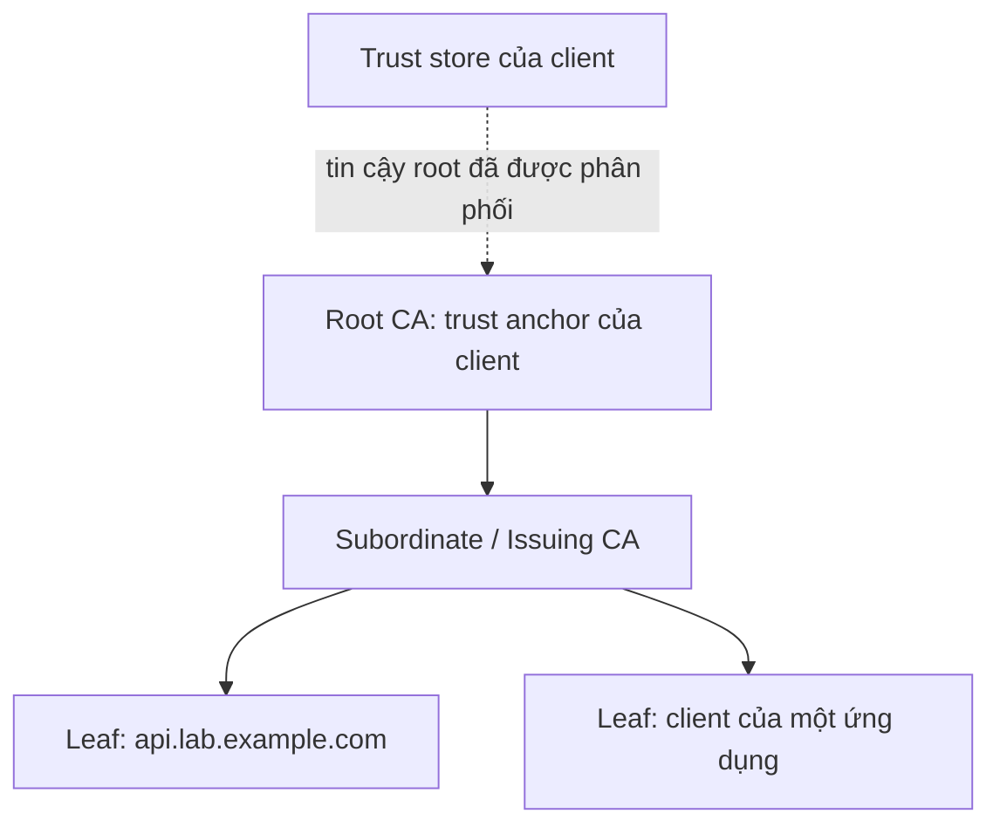
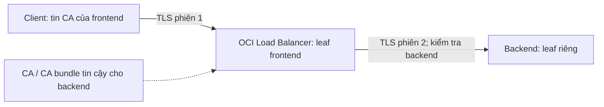

# Certificate authorities và triển khai chứng chỉ cho dịch vụ

## 1. Mục tiêu và bối cảnh

Một dịch vụ HTTPS cần nhiều hơn một tệp chứng chỉ: cần đúng danh tính, private key tương ứng, chuỗi CA hợp lệ, nơi kiểm tra tin cậy và quy trình cập nhật trước khi hết hạn. Nếu bỏ sót một mắt xích, tài nguyên vẫn có thể ở trạng thái hoạt động trong OCI nhưng ứng dụng không kết nối được.

Trong chương **Mã hóa, secrets và chứng chỉ** của module Oracle Cloud Infrastructure (OCI), bài này tập trung vào certificate authority (CA) và việc đưa chứng chỉ vào sử dụng. Nội dung kết nối OCI Certificates với Vault, compartment, IAM, VCN, Load Balancer và Compute; đồng thời xem xét giám sát, tự động hóa, chi phí và tính sẵn sàng.

Sau bài học, bạn có thể:

- Giải thích root CA, subordinate CA, leaf certificate và chuỗi tin cậy.
- Chọn CA nội bộ hoặc chứng chỉ được cấp bởi CA công cộng theo đối tượng sử dụng.
- Chuẩn bị quyền và khóa để tạo CA trong OCI.
- Cấp chứng chỉ cho một hostname, triển khai trên Load Balancer hoặc máy chủ.
- Kiểm tra endpoint thực tế, gia hạn, thay CA và xử lý sự cố private key.

## 2. CA và chuỗi tin cậy

### 2.1. Chứng chỉ xác nhận điều gì?

Chứng chỉ X.509 gắn một public key với danh tính và các điều kiện sử dụng. CA ký lên nội dung chứng chỉ để bên kiểm tra có thể xác minh chữ ký theo chuỗi tin cậy.

| Thành phần | Ý nghĩa |
| --- | --- |
| Subject | Chủ thể được chứng nhận |
| Subject Alternative Name, SAN | Tên DNS hoặc địa chỉ IP dùng để nhận diện endpoint |
| Issuer | CA cấp chứng chỉ |
| Public key | Khóa công khai thuộc chủ thể |
| Validity | Khoảng thời gian chứng chỉ có hiệu lực |
| Key Usage và Extended Key Usage | Các mục đích sử dụng khóa/chứng chỉ |
| Serial number | Số định danh chứng chỉ trong phạm vi issuer |
| Signature | Chữ ký của CA lên nội dung chứng chỉ |

**Private key không nằm trong chứng chỉ công khai.** Với TLS server, máy chủ phải có khả năng sử dụng private key tương ứng để chứng minh quyền sở hữu khóa. Chứng chỉ đúng hostname nhưng đi kèm private key khác vẫn không tạo được cấu hình TLS hợp lệ.

Chứng chỉ cũng không trực tiếp mã hóa mọi byte dữ liệu ứng dụng. TLS sử dụng cơ chế bắt tay và khóa phiên để bảo vệ kết nối; chứng chỉ tham gia xác thực danh tính.

### 2.2. Root, subordinate và leaf



- **Root CA** ở đỉnh hệ thống CA; chứng chỉ root thường tự ký.
- **Subordinate CA**, thường gọi là intermediate CA, được CA phía trên cấp chứng chỉ và có quyền cấp tiếp theo ràng buộc.
- **Leaf certificate**, hay end-entity certificate, dùng cho máy chủ, client hoặc mục đích cuối cùng; không dùng như CA để cấp tiếp.

Một root tự ký không tự nhiên trở nên đáng tin. Client phải có trust anchor phù hợp trong trust store theo một kênh quản trị được tin cậy. Việc server gửi thêm root trong handshake không tự cấp niềm tin đó. [Khái niệm CA và chain of trust của OCI](https://docs.oracle.com/en-us/iaas/Content/certificates/overview.htm).

Tách root và issuing CA giúp phân chia trách nhiệm và phạm vi thay đổi. Tuy nhiên, một root được tạo và vận hành trực tuyến trong OCI không phải một offline root chỉ vì nó nằm ở đỉnh sơ đồ.

### 2.3. Kiểm tra hostname khác kiểm tra chữ ký

Kết nối đến `api.lab.example.com` cần chứng chỉ chứa danh tính phù hợp, thường là DNS SAN cho tên đó. Theo mô hình xác minh danh tính TLS hiện đại, không dựa vào Common Name như phương án thay thế cho SAN. [RFC 9525 về danh tính dịch vụ TLS](https://www.rfc-editor.org/rfc/rfc9525.html).

Ví dụ:

| Cách truy cập | Danh tính cần kiểm tra |
| --- | --- |
| `https://api.lab.example.com` | DNS SAN cho `api.lab.example.com` |
| `https://10.0.2.15` | IP SAN tương ứng nếu chủ đích truy cập bằng IP |
| `https://api.lab.example.com/health` | Vẫn là hostname, không phải đường dẫn `/health` |

Đừng đưa tiền tố `https://`, port hoặc URL path vào DNS SAN. Wildcard cũng có giới hạn khớp tên; không coi một wildcard là chứng chỉ hợp lệ cho mọi cấp tên miền.

## 3. Chọn mô hình tin cậy và quản lý chứng chỉ

### 3.1. CA nội bộ và CA công cộng

| Nhu cầu | Hướng triển khai |
| --- | --- |
| API nội bộ, máy chủ và client do tổ chức quản lý | CA nội bộ và phân phối trust anchor có kiểm soát |
| Website phục vụ trình duyệt người dùng Internet | Chứng chỉ có chuỗi được các client mục tiêu tin cậy, thường từ CA công cộng |
| Doanh nghiệp đã có PKI riêng | Tích hợp chuỗi CA hiện có hoặc dùng chứng chỉ do hệ thống đó cấp |
| Dịch vụ cần client certificate | Thiết kế cả danh tính client, trust store và quyền ứng dụng |

CA riêng được tạo trong OCI Certificates không mặc nhiên được trình duyệt công cộng tin cậy. Với chứng chỉ do bên thứ ba cấp, OCI có thể quản lý bản import để dùng trong tenancy. [Tổng quan OCI Certificates](https://docs.oracle.com/en-us/iaas/Content/certificates/overview.htm).

Ví dụ, HTTPS trên private load balancer dùng CA nội bộ là phù hợp nếu các client đã tin root đó. Ngược lại, yêu cầu khách hàng Internet cài root của doanh nghiệp chỉ để truy cập website thường không đáp ứng trải nghiệm mong muốn.

### 3.2. Ba cách quản lý leaf certificate

| Cách | Private key do đâu quản lý? | Trách nhiệm cập nhật |
| --- | --- | --- |
| Issued by internal CA, managed internally | Certificates service quản lý theo cấu hình | Có thể cấu hình tự gia hạn |
| Issued by internal CA, managed externally | Người vận hành tạo và giữ khóa ngoài service | Tổ chức chịu trách nhiệm quy trình CSR và triển khai |
| Imported | Nhập chứng chỉ và vật liệu cần thiết từ bên ngoài | Tổ chức lấy bản gia hạn từ issuer và cập nhật bản import |

Với cách quản lý bên ngoài, có thể tạo private key và certificate signing request (CSR) tại máy chủ rồi gửi CSR cho OCI CA cấp chứng chỉ. CSR chứa public key và yêu cầu cấp, không chứa private key. [Tạo chứng chỉ quản lý bên ngoài](https://docs.oracle.com/en-us/iaas/Content/certificates/creating-certificate-to-manage-externally.htm).

Chứng chỉ import và chứng chỉ có private key được quản lý bên ngoài không được OCI tự gia hạn theo cơ chế dành cho chứng chỉ được cấp và quản lý nội bộ. [Hướng dẫn gia hạn chứng chỉ](https://docs.oracle.com/en-us/iaas/Content/certificates/renewing-certificate.htm).

## 4. Tài nguyên OCI và ranh giới private key

OCI Certificates có các tài nguyên cần phân biệt:

| Tài nguyên | Chức năng |
| --- | --- |
| Certificate authority | Cấp chứng chỉ và quản lý vòng đời CA |
| Certificate | Đối tượng logic chứa một hay nhiều phiên bản leaf certificate |
| Certificate version | Nội dung chứng chỉ cụ thể, gồm thời hạn và serial |
| CA bundle | Tập chứng chỉ CA công khai phục vụ xây dựng/kiểm tra chuỗi |
| Association | Liên kết tài nguyên chứng chỉ/CA/bundle với tài nguyên sử dụng |

**CA bundle không phải gói chứa private key của CA.** Một bundle phục vụ trust và một bộ chứng chỉ máy chủ kèm private key là hai loại dữ liệu khác nhau, dù một số công cụ đều dùng từ “bundle”.

### 4.1. Khóa ký CA trong Vault

Để tạo CA, OCI yêu cầu khóa bất đối xứng được bảo vệ bằng **HSM** trong Vault. Các lựa chọn được tài liệu hỗ trợ gồm RSA 2048/4096 hoặc ECDSA với NIST_P384. Khóa AES dùng cho mã hóa dữ liệu không phù hợp làm khóa ký CA; khóa software-protected cũng không đáp ứng điều kiện này. [Điều kiện tạo CA](https://docs.oracle.com/en-us/iaas/Content/certificates/creating-certificate-authority.htm).

Khóa ký CA và private key TLS của từng dịch vụ có vai trò khác nhau:

```text
Khóa CA:
    ký chứng chỉ cho các chủ thể

Khóa TLS của api.lab.example.com:
    chứng minh quyền sở hữu public key trong leaf certificate

Khóa AES của một bucket:
    bảo vệ dữ liệu/khóa dữ liệu theo cơ chế mã hóa lưu trữ
```

Không dùng chung một khóa cho các vai trò chỉ để giảm số tài nguyên.

### 4.2. Những quyền cần bảo vệ riêng

Người xem metadata chứng chỉ không nhất thiết cần lấy private key. Quyền đọc certificate bundle có private key là quyền nhạy cảm cần được cấp riêng theo loại bundle và nhiệm vụ. [Tham chiếu quyền Certificates](https://docs.oracle.com/en-us/iaas/Content/Identity/Reference/certificatespolicyreference.htm).

Không đưa private key vào Git, image máy chủ, log CI hoặc ticket. Public certificate có thể được phân phối rộng hơn, nhưng trust anchor vẫn phải được xác thực nguồn gốc: thay root trong trust store có thể thay toàn bộ quan hệ tin cậy.

## 5. Thiết kế IAM cho CA và triển khai

### 5.1. Phân biệt người quản trị và resource principal

Một CA cần được phép sử dụng khóa Vault để ký. Nếu xuất bản certificate revocation list (CRL), CA còn cần quyền ghi object vào bucket tương ứng. Đây là quyền của **tài nguyên CA**, không chỉ quyền của người bấm Create.

Ví dụ tách compartment:

```text
SecurityPKI  : root CA, issuing CA, leaf certificate và CA bundle
SecurityKeys : Vault và khóa ký CA
PKIPublication: bucket chuyên dụng chứa CRL
AppNetwork   : Load Balancer, listener và các cấu hình mạng
```

Các tên trên là ví dụ tổ chức tài nguyên, không tạo ra quyền tự động.

### 5.2. Dynamic group cho CA

Ví dụ matching rule chỉ lấy CA trong compartment PKI:

```text
ALL {
  resource.type = 'certificateauthority',
  resource.compartment.id = '<PKI_COMPARTMENT_OCID>'
}
```

Sau đó cấp quyền cho dynamic group, ví dụ `CertificateAuthorityDG`:

```text
Allow dynamic-group CertificateAuthorityDG to use keys in compartment SecurityKeys where target.key.id = '<CA_SIGNING_KEY_OCID>'

Allow dynamic-group CertificateAuthorityDG to manage objects in compartment PKIPublication where target.bucket.name = '<BUCKET_CRL_CUA_CA>'
```

Thay tên bằng tên đầy đủ phù hợp identity domain của tenancy. Nếu root và subordinate dùng khóa/bucket riêng, bổ sung policy đúng từng tài nguyên. [Hướng dẫn Oracle về IAM cho CA](https://docs.oracle.com/en-us/iaas/Content/certificates/managing-certificate-authorities.htm).

Ví dụ chỉ thể hiện quyền ký và xuất bản CRL. Người quản trị CA vẫn cần quyền quản lý CA, đọc Vault/key, ủy quyền dùng khóa và xem bucket theo nhiệm vụ.

### 5.3. Quyền cho người cấp và triển khai chứng chỉ

Nên tách các nhiệm vụ:

| Vai trò | Quyền cần xem xét |
| --- | --- |
| Quản trị PKI | CA, khóa ký, quy tắc cấp và thu hồi |
| Người cấp chứng chỉ | Cấp leaf theo CA được phép và quản lý phiên bản |
| Người triển khai | Đọc tài nguyên cần dùng, quản lý association và cập nhật dịch vụ đích |
| Ứng dụng hoặc máy chủ lấy vật liệu | Chỉ đọc certificate/bundle cần thiết, private key nếu mô hình đòi hỏi |

Nhóm quản lý leaf không nhất thiết cần quyền tạo hay xóa CA. Quyền association và quyền cập nhật listener/backend set cũng phải được xét riêng. [Quản lý chứng chỉ và ví dụ policy](https://docs.oracle.com/en-us/iaas/Content/certificates/managing-certificates.htm).

Khi cấu hình native integration với Load Balancer, đối chiếu quyền Certificates và quyền Load Balancer cho tác vụ cụ thể. Không suy ra rằng có quyền đọc chứng chỉ thì đã có quyền gắn nó vào mọi listener.

## 6. Xác định nơi kết thúc TLS

Trước khi cấp chứng chỉ, xác định bên nào trình chứng chỉ và bên nào xác minh nó.

| Mô hình | Client tới Load Balancer | Load Balancer tới backend | Điểm quản lý chứng chỉ |
| --- | --- | --- | --- |
| TLS termination | HTTPS | HTTP | Chủ yếu tại listener |
| TLS re-encryption | HTTPS | HTTPS độc lập | Listener và backend; thêm trust của Load Balancer |
| TCP chuyển tiếp TLS | Kết nối TLS được chuyển tiếp | Backend kết thúc TLS | Backend giữ chứng chỉ/private key |

Với re-encryption có hai phiên TLS, không phải một phiên xuyên suốt. Chứng chỉ frontend và backend có thể khác nhau vì đại diện các danh tính khác nhau.



OCI Load Balancer hỗ trợ cấu hình SSL/TLS ở listener và backend set. Bật HTTPS ở listener không tự bật TLS cho kết nối backend. [Hướng dẫn SSL của Load Balancer](https://docs.oracle.com/en-us/iaas/Content/Balance/Tasks/managingcertificates.htm).

Trong cấu hình một chiều, server trình chứng chỉ cho client. Với **mutual TLS (mTLS)**, client cũng trình chứng chỉ và bên server kiểm tra. Một client certificate hợp lệ chỉ cung cấp danh tính mật mã; ứng dụng vẫn cần ánh xạ danh tính đó sang quyền truy cập.

## 7. Thực hành chính: cấp chứng chỉ và gắn vào Load Balancer

### 7.1. Phạm vi bài thực hành

Mục tiêu là triển khai frontend HTTPS cho `api.lab.example.com` bằng CA riêng. Tên miền là ví dụ; thay bằng tên nội bộ được tổ chức quản lý.

Chuẩn bị trong cùng region thực hành:

- Compartment cho PKI, khóa và ứng dụng, cùng IAM đã cấu hình.
- Hai khóa ký CA phù hợp trong Vault, tách root và issuing CA.
- Một OCI Load Balancer có backend thử nghiệm đang hoạt động.
- Backend có endpoint `/health` trả kết quả mong đợi.
- Client thử nghiệm có đường mạng đến Load Balancer.
- OpenSSL và curl trong Bash; các lệnh dưới đây không phải cú pháp PowerShell.

Bài chính dùng TLS termination để tập trung vào frontend. Nếu backend đang dùng HTTP, kết nối Load Balancer–backend vẫn là HTTP. Phần tiếp theo mở rộng sang HTTPS backend.

Đối với private load balancer, client phải có kết nối mạng thích hợp, chẳng hạn từ VCN hoặc mạng được kết nối với VCN. Có chứng chỉ không tạo ra route hoặc quyền qua NSG.

### 7.2. Tạo root và issuing CA

Trong phần Certificate Authorities của OCI Certificates:

1. Tạo root CA cho lab trong compartment PKI, chọn khóa ký root đã chuẩn bị.
2. Đặt subject nhận diện CA và thời hạn theo chính sách lab.
3. Nếu dùng CRL, cấu hình bucket riêng cho CA cùng CRL distribution point (CDP) mà client có thể truy cập.
4. Chờ root CA hoạt động.
5. Tạo subordinate CA do root này cấp, chọn khóa ký riêng của subordinate.
6. Đặt quy tắc cấp leaf và thời hạn trong phạm vi CA cha cho phép.
7. Nếu subordinate xuất bản CRL, dùng bucket chuyên dụng khác với bucket của root.

OCI cũng có kiểu subordinate được external CA cấp và được quản lý nội bộ; quy trình này cần CSR và bước hoàn tất với CA bên ngoài. Không coi việc tạo một subordinate như vậy là đã hoàn tất trước khi nhận chứng chỉ được ký. [Tạo CA và các kiểu subordinate](https://docs.oracle.com/en-us/iaas/Content/certificates/creating-certificate-authority.htm).

Với lab, có thể chọn leaf ngắn hạn hơn issuing CA và issuing CA ngắn hạn hơn root. Đây là thiết kế vòng đời, không phải lý do bỏ qua giới hạn và quy tắc thực tế trong form tạo CA.

### 7.3. Cấp leaf certificate cho frontend

Tạo certificate với các lựa chọn chính:

| Trường | Giá trị ví dụ |
| --- | --- |
| Tên tài nguyên | `lab-api-frontend` |
| Kiểu quản lý | Issued by internal CA, managed internally |
| Issuer | Issuing CA vừa tạo |
| Mục đích | TLS Server |
| Common Name | `api.lab.example.com` |
| DNS SAN | `api.lab.example.com` |
| Key algorithm | Loại khóa được client và dịch vụ đích hỗ trợ |
| Thời hạn | Khoảng ngắn phù hợp lab, không vượt issuer |
| Renewal rule | Cấu hình gia hạn trước khi hết hiệu lực |

Đừng chọn TLS Client cho một chứng chỉ chỉ dùng làm server. Kiểm tra SAN và ngày hiệu lực trên chứng chỉ được cấp, thay vì chỉ kiểm tra tên tài nguyên OCI. [Cấu hình leaf certificate trong OCI](https://docs.oracle.com/en-us/iaas/Content/certificates/creating-certificate.htm).

Lưu certificate OCID, issuer, serial, version hiện tại và ngày hết hạn vào hồ sơ vận hành. Không cần lấy private key ra máy cá nhân khi dùng tích hợp được quản lý với Load Balancer.

### 7.4. Phân phối phần công khai cho client thử nghiệm

Lấy chứng chỉ root công khai qua kênh quản trị PKI đã xác thực và lưu thành `lab-root-ca.pem` trên client lab. Giữ các intermediate công khai để kiểm tra chuỗi nếu cần.

Đối với production, phân phối trust anchor qua cơ chế quản lý thiết bị, cấu hình ứng dụng hoặc trust store có kiểm soát thay đổi. Không lấy root từ chính một endpoint chưa xác minh rồi mặc nhiên tin nó.

Không đưa root vào trust store toàn hệ thống chỉ để thực hiện một lệnh thử. Với curl có thể chỉ định CA riêng cho yêu cầu bằng `--cacert`.

### 7.5. Gắn certificate vào listener

Trong cấu hình OCI Load Balancer:

1. Xác nhận backend set và health check hiện có hoạt động.
2. Tạo hoặc cập nhật listener HTTPS trên port 443.
3. Chọn loại certificate resource được **Certificates service** quản lý.
4. Chọn đúng compartment và leaf certificate `lab-api-frontend`.
5. Chọn backend set đích; cấu hình phiên bản TLS và các lựa chọn tương thích theo yêu cầu.
6. Áp dụng, chờ thao tác hoàn tất và kiểm tra lại listener.

Chọn leaf certificate để đại diện server. Chọn CA hoặc CA bundle cho trust là nhiệm vụ khác; chỉ gắn CA bundle không cung cấp danh tính và private key TLS của server.

Tích hợp Load Balancer sử dụng phiên bản current của các tài nguyên Certificates được liên kết và tự phát hiện cập nhật. Cần kiểm tra endpoint sau thay đổi, vì đây không phải một cam kết cập nhật đồng thời tức thì trên mọi kết nối. [Cấu hình và cập nhật chứng chỉ cho Load Balancer](https://docs.oracle.com/en-us/iaas/Content/Security/Reference/configuration_tasks.htm).

Kiểm tra NSG/security list cho client tới port 443 và Load Balancer tới backend đúng port. DNS phải trỏ đến đúng Load Balancer; khi chưa đổi DNS có thể kiểm tra bằng `--resolve`.

### 7.6. Kiểm tra từ client

Thay địa chỉ IP bên dưới bằng địa chỉ thực của Load Balancer mà client truy cập được:

```bash
export SERVICE_DNS='api.lab.example.com'
export LB_IP='<DIA_CHI_IP_LOAD_BALANCER>'

curl --fail --show-error --verbose \
  --cacert lab-root-ca.pem \
  --resolve "$SERVICE_DNS:443:$LB_IP" \
  "https://$SERVICE_DNS/health"
```

Lệnh vẫn sử dụng hostname trong URL để kiểm tra danh tính; `--resolve` chỉ thay cách phân giải hostname/port tới IP. Kết quả mong đợi gồm TLS hợp lệ và mã HTTP phù hợp của `/health`. [Tài liệu curl về CA và phân giải tên](https://curl.se/docs/manpage.html).

Kiểm tra sâu hơn:

```bash
openssl s_client \
  -connect "$LB_IP:443" \
  -servername "$SERVICE_DNS" \
  -verify_hostname "$SERVICE_DNS" \
  -CAfile lab-root-ca.pem \
  -verify_return_error \
  -showcerts </dev/null
```

- `-servername` gửi SNI để endpoint chọn cấu hình theo tên.
- `-verify_hostname` kiểm tra danh tính mong đợi.
- `-verify_return_error` làm phép thử thất bại khi xác minh chứng chỉ lỗi.

Không coi một kết nối `s_client` đã bắt tay được là bằng chứng xác minh đã đạt nếu công cụ vẫn tiếp tục sau lỗi. [Tài liệu OpenSSL s_client](https://docs.openssl.org/master/man1/openssl-s_client/).

Không dùng `curl -k` làm tiêu chí nghiệm thu, vì tùy chọn đó bỏ qua phần xác minh quan trọng của bài thực hành.

## 8. Triển khai trên Compute và mở rộng HTTPS backend

### 8.1. Quy trình cho máy chủ tự quản

Khi Nginx hoặc ứng dụng trên Compute trực tiếp kết thúc TLS, cần quy trình cài chứng chỉ riêng. Việc tạo phiên bản mới trong OCI không tự thay các tệp trên mọi máy chủ.

Một quy trình có thể dùng private key tạo tại server:

1. Tạo khóa và CSR trong môi trường được bảo vệ.
2. Chọn kiểu chứng chỉ cấp bởi internal CA nhưng quản lý bên ngoài, gửi CSR.
3. Nhận leaf certificate và chain công khai.
4. Kiểm tra chứng chỉ tương ứng private key và đúng SAN.
5. Cài theo phiên bản, áp dụng quyền truy cập tệp.
6. Kiểm tra cấu hình, reload và thử kết nối mới.
7. Ghi nhận phiên bản chứng chỉ mà từng máy đang phục vụ.

Nếu thay vào đó lấy certificate bundle có private key từ OCI, dùng resource principal hoặc workload identity với quyền tối thiểu cần thiết. Tránh nhúng credential dài hạn vào image chỉ để tải chứng chỉ.

### 8.2. Kiểm tra tệp trước khi cài

Giả định có:

```text
backend-leaf.pem       : leaf cho backend.lab.example.com
backend.key            : private key tương ứng
issuing-chain.pem      : intermediate, theo thứ tự lên issuer
lab-root-ca.pem        : root đã được tin cậy từ trước
```

Xem metadata và xác minh chuỗi cho mục đích TLS server:

```bash
openssl x509 -in backend-leaf.pem -noout \
  -subject -issuer -serial -dates -ext subjectAltName

openssl verify \
  -CAfile lab-root-ca.pem \
  -untrusted issuing-chain.pem \
  -purpose sslserver \
  -verify_hostname backend.lab.example.com \
  backend-leaf.pem
```

Ở đây, intermediate là đầu vào xây dựng chuỗi; root mới là trust anchor chủ định của phép thử. Phép thử này không tự thực hiện đầy đủ mọi chính sách kiểm tra thu hồi của ứng dụng. [Tài liệu openssl verify](https://docs.openssl.org/3.5/man1/openssl-verify/).

Có thể so sánh fingerprint SHA-256 của public key để kiểm tra cặp khóa:

```bash
openssl x509 -in backend-leaf.pem -pubkey -noout \
  | openssl pkey -pubin -outform DER \
  | openssl dgst -sha256

openssl pkey -in backend.key -pubout -outform DER \
  | openssl dgst -sha256
```

Hai giá trị phải giống nhau. Nếu không giống, dừng triển khai và tìm lại private key đúng; không sửa nội dung PEM bằng tay để cố làm chúng khớp.

### 8.3. Ví dụ cấu hình Nginx

Tạo full chain theo thứ tự leaf rồi đến intermediate, gần leaf trước:

```bash
cat backend-leaf.pem issuing-chain.pem > backend-fullchain.pem
```

Thông thường server không cần gửi root trong chain; client phải có trust anchor riêng.

Sau khi cài các tệp vào đường dẫn được quản lý trên máy chủ, có thể cấu hình:

```nginx
server {
    listen 8443 ssl;
    server_name backend.lab.example.com;

    ssl_certificate     /etc/nginx/tls/backend-fullchain.pem;
    ssl_certificate_key /etc/nginx/tls/backend.key;
    ssl_protocols       TLSv1.2 TLSv1.3;

    location = /health {
        default_type text/plain;
        return 200 "ok\n";
    }
}
```

Private key cần quyền hạn chế nhưng vẫn phải đọc được bởi tiến trình có trách nhiệm nạp khóa. Kiểm tra ownership, cơ chế bảo vệ của hệ điều hành và cấu hình Nginx trước khi reload. [Hướng dẫn HTTPS chính thức của Nginx](https://nginx.org/en/docs/http/configuring_https_servers.html).

Trên hệ thống Linux dùng systemd và service tên `nginx`, có thể áp dụng sau khi đã cài đủ tệp:

```bash
sudo nginx -t
# Chỉ chạy reload khi kiểm tra cấu hình phía trên thành công.
sudo systemctl reload nginx
```

Với nhiều backend, triển khai từng máy và kiểm tra trước khi chuyển tiếp. Giữ phiên bản cấu hình trước để rollback nếu phiên bản đó vẫn an toàn và còn hiệu lực.

### 8.4. Cấu hình TLS giữa Load Balancer và backend

Sau khi backend phục vụ HTTPS:

1. Mở đường mạng từ Load Balancer đến port backend TLS, ví dụ 8443.
2. Cập nhật backend set để sử dụng SSL/TLS tới backend.
3. Cấu hình CA/CA bundle dùng xác minh chứng chỉ backend.
4. Bật kiểm tra peer certificate theo mô hình bảo mật yêu cầu.
5. Kiểm tra chain, độ sâu xác minh và các tùy chọn hostname của cấu hình thực tế.
6. Điều chỉnh health check đúng giao thức, port và đường dẫn.
7. Kiểm tra cả backend health và yêu cầu HTTPS xuyên qua frontend.

SNI dùng chọn chứng chỉ và hostname verification dùng kiểm tra danh tính là hai chức năng khác nhau; không tự suy ra đã cấu hình một chức năng thì chức năng còn lại đúng.

Nếu gặp 502, kiểm tra backend có thực sự nhận TLS, chứng chỉ có hợp lệ và trust chain có đầy đủ. Một frontend TLS hợp lệ không chứng minh kết nối TLS backend đã thành công. [Khắc phục lỗi SSL của OCI Load Balancer](https://docs.oracle.com/en-us/iaas/Content/Balance/Reference/troubleshooting_ssl.htm).

## 9. Gia hạn, thay phiên bản và thay CA

### 9.1. Phân biệt cấp mới và đưa vào phục vụ

Gia hạn trong Certificates tạo certificate version mới. Theo cơ chế quản lý, việc này có thể tự động hoặc cần cập nhật PEM từ bên ngoài. Phiên bản cũ không tự bị xóa chỉ vì có phiên bản mới. [Vòng đời gia hạn chứng chỉ](https://docs.oracle.com/en-us/iaas/Content/certificates/renewing-certificate.htm).

Cần theo dõi ít nhất ba trạng thái:

```text
Đã cấp phiên bản mới
    -> phiên bản mong muốn đang current
    -> endpoint thực tế đang phục vụ đúng chứng chỉ
```

Với native integration, xác minh association và chờ cập nhật tới dịch vụ. Với máy chủ tự quản, cần phân phối, kiểm tra cấu hình và reload. Không coi một job gia hạn thành công là bằng chứng tất cả backend đã cập nhật.

### 9.2. Kiểm tra sau gia hạn

Ghi lại serial, fingerprint và ngày hết hạn trước thay đổi. Sau cập nhật, mở kết nối mới và đối chiếu:

- Endpoint trình phiên bản mong muốn.
- SAN, issuer và khoảng hiệu lực đúng.
- Client xây dựng được chuỗi đến trust anchor.
- Backend health và tỷ lệ lỗi ứng dụng ổn định.
- Mọi node hoặc endpoint cần phục vụ đã cập nhật.

Kết nối cũ và TLS session resumption có thể không phản ánh một handshake đầy đủ mới. Khi kiểm thử rotation, chủ động dùng kết nối mới.

Để kiểm tra một chứng chỉ PEM sắp hết hạn trong bảy ngày:

```bash
openssl x509 -in backend-leaf.pem -checkend 604800 -noout
```

Lệnh trả kết quả theo thời hạn, không chứng minh hostname, chain hoặc trạng thái thu hồi đều hợp lệ. [Tài liệu openssl x509](https://docs.openssl.org/3.5/man1/openssl-x509/).

### 9.3. Thay issuing CA hoặc root CA

Thay CA cần quản lý cả phía cấp và phía tin cậy. Trình tự điển hình:

1. Chuẩn bị CA và trust chain mới.
2. Phân phối trust mới tới client trước khi chúng gặp leaf từ CA mới.
3. Cấp và triển khai leaf mới trên một phạm vi nhỏ.
4. Kiểm tra các client đại diện, gồm ứng dụng có trust store riêng.
5. Mở rộng triển khai, kiểm kê tài nguyên còn dùng chuỗi cũ.
6. Chỉ loại bỏ trust cũ khi không còn nhu cầu hợp lệ và đã xử lý yêu cầu lưu giữ.

Khoảng chồng lấp trust cần có thời hạn và chủ sở hữu. Trong tình huống CA bị xâm phạm, không tiếp tục tin CA cũ chỉ để giữ một kế hoạch chuyển đổi thuận tiện; cần quy trình xử lý sự cố phù hợp.

Một ứng dụng Java có thể sử dụng trust store riêng thay vì kho CA của hệ điều hành. Cài root vào hệ điều hành chưa đủ chứng minh ứng dụng đã tin chuỗi mới.

## 10. Thu hồi chứng chỉ và xử lý lộ khóa

**Hết hạn**, **thu hồi** và **xóa tài nguyên** là ba việc khác nhau:

| Thao tác | Ý nghĩa |
| --- | --- |
| Hết hạn | Chứng chỉ vượt thời điểm Not After |
| Thu hồi | Issuer công bố một chứng chỉ không còn đáng tin trước hạn |
| Xóa | Loại bỏ tài nguyên/vật liệu quản lý theo vòng đời dịch vụ |

OCI Certificates sử dụng CRL cho cơ chế thu hồi được hỗ trợ. CRL có serial các chứng chỉ bị thu hồi và được xuất bản vào Object Storage; client cần tiếp cận CDP và thực sự kiểm tra CRL. Tổ chức chịu trách nhiệm về khả năng truy cập CDP. [Thu hồi chứng chỉ trong OCI](https://docs.oracle.com/en-us/iaas/Content/certificates/revocation.htm).

Không mặc định một client sẽ kiểm tra thu hồi, hoặc OCI sẽ cung cấp OCSP cho mọi chứng chỉ. Cần xác minh cơ chế và hành vi khi không lấy được trạng thái của đúng phần mềm sử dụng.

Nếu lộ private key TLS:

1. Xác định các endpoint và bản sao đang giữ khóa.
2. Sinh cặp khóa mới trong môi trường an toàn.
3. Cấp và triển khai chứng chỉ mới.
4. Thu hồi phiên bản bị ảnh hưởng qua issuer.
5. Xác minh client xử lý được thông tin thu hồi và endpoint không còn phục vụ bản cũ.
6. Điều tra nguồn lộ và xử lý quyền, log hoặc pipeline liên quan.

Với chứng chỉ import, quy trình thu hồi phải làm việc với issuer bên ngoài. OCI không thay thế quyền thu hồi của CA đã cấp chứng chỉ đó. [Phạm vi thu hồi certificate version](https://docs.oracle.com/en-us/iaas/Content/certificates/revoking-certificate.htm).

Đừng xóa khóa CA hoặc bucket CRL trước khi hoàn tất thu hồi: mất khóa, bucket hoặc policy có thể làm thao tác thu hồi/xuất bản CRL thất bại. [Các vấn đề đã biết của Certificates](https://docs.oracle.com/en-us/iaas/Content/certificates/known-issues.htm).

## 11. Giám sát và chẩn đoán lỗi

### 11.1. Theo dõi cả control plane và endpoint

Audit hỗ trợ điều tra thay đổi cấu hình và chủ thể thao tác. Log/metrics của Load Balancer và phép thử TLS từ bên ngoài cho biết tác động lên đường phục vụ.

Một hồ sơ chứng chỉ nên có:

```text
Certificate OCID và version:
Hostname / SAN:
Issuer và chuỗi tin cậy:
Ngày hết hạn:
Listener, backend hoặc máy chủ sử dụng:
Cách triển khai: association hay cài tệp
Chủ sở hữu vận hành:
Cơ chế gia hạn và cảnh báo:
Nơi kiểm tra CRL nếu có:
```

Với service-managed integration, có thể xem Associations để kiểm kê tài nguyên dùng chứng chỉ. Với bản đã sao chép thành tệp, cần kiểm kê bổ sung ngoài danh sách association. [Xem certificate associations](https://docs.oracle.com/en-us/iaas/Content/certificates/viewing-certificate-associations.htm).

Đặt ngưỡng cảnh báo phù hợp thời hạn và thời gian xử lý của tổ chức; ví dụ 30, 14 và 7 ngày là các mốc thiết kế, không phải cam kết mặc định của OCI. Theo dõi cả ngày hết hạn issuing CA/root và lỗi gia hạn, không chỉ leaf.

### 11.2. Khoanh vùng theo triệu chứng

| Triệu chứng | Điểm kiểm tra |
| --- | --- |
| Unknown CA / unable to get local issuer | Trust anchor của client, intermediate server gửi, đúng chain chưa |
| Hostname mismatch | URL, DNS/IP SAN, SNI và chứng chỉ listener đang chọn |
| Certificate expired / not yet valid | Ngày hiệu lực, UTC, đồng hồ máy và phiên bản thực tế |
| Key pair mismatch | Public key của leaf và private key được cài |
| OCI không hiển thị khóa khi tạo CA | Loại khóa, HSM, kích thước/curve, compartment và IAM |
| Gắn certificate thất bại | Quyền association, quyền dịch vụ đích, region và loại tài nguyên |
| TLS frontend tốt nhưng trả 502 | Backend health, port, giao thức, chain và trust backend |
| OCI đã gia hạn nhưng server còn bản cũ | Current version, association hoặc pipeline phân phối và reload |
| Thu hồi không có tác dụng như kỳ vọng | Xuất bản CRL, khả năng truy cập CDP, cache và cơ chế kiểm tra của client |

Đừng sửa một lỗi trust bằng cách tắt xác minh trên toàn hệ thống. Thu thập hostname, thời điểm, serial/fingerprint, request ID và log liên quan để tìm đúng mắt xích.

## 12. Tính sẵn sàng, chi phí và tự động hóa

### 12.1. Phụ thuộc vận hành

Nếu một máy chủ đã nạp leaf và private key, mỗi TLS handshake thông thường không cần CA ký lại chứng chỉ. Vì vậy, CA tạm thời không cấp được chứng chỉ không đồng nghĩa mọi phiên TLS đang phục vụ lập tức hỏng.

Tác động có thể xuất hiện ở lần gia hạn, cấp mới, xuất bản CRL hoặc kiểm tra trạng thái. Cần mô hình hóa các phụ thuộc này thay vì chỉ theo dõi trạng thái CA.

Kế hoạch nhiều region cần chuẩn bị tài nguyên, quyền, chứng chỉ và trust tương ứng tại đích. Không giả định OCID, association hay vật liệu TLS tự nhân bản cùng ứng dụng. Diễn tập failover phải bao gồm TLS và danh tính DNS.

### 12.2. Chi phí và giới hạn

Dự toán cả khóa/vault HSM, Load Balancer, Compute, lưu trữ CRL, log và công sức vận hành; kiểm tra bảng giá của loại tài nguyên thực tế trước triển khai. Không cần tạo một CA riêng cho mỗi backend nếu cùng một ranh giới tin cậy.

Certificate version có giới hạn dịch vụ. Lập quy trình dọn phiên bản cũ sau khi đã kiểm tra nhu cầu rollback, bằng chứng vận hành và tài nguyên phụ thuộc; không xóa tùy tiện để làm trống danh sách. [Giới hạn dịch vụ OCI](https://docs.oracle.com/en-us/iaas/Content/General/service-limits/default.htm).

### 12.3. Pipeline triển khai nên kiểm tra gì?

Một pipeline hợp lý nối việc cấp chứng chỉ với kết quả phục vụ:

1. Kiểm tra tên yêu cầu, profile và issuer được phép.
2. Cấp/import/gia hạn và chờ trạng thái phù hợp.
3. Xác minh SAN, thời hạn, chain và cặp khóa nếu xử lý private key.
4. Cập nhật association hoặc phân phối vật liệu theo phiên bản.
5. Kiểm tra cấu hình, rollout từng phần và mở kết nối TLS mới.
6. Đối chiếu fingerprint/serial tại endpoint.
7. Lưu bằng chứng và theo dõi lỗi sau thay đổi.

Bảo vệ state IaC và kho artifact nếu chúng có chứa private key. Ưu tiên cơ chế tham chiếu tài nguyên và nhận dạng workload phù hợp, đồng thời biết rõ thành phần nào thực sự nắm private key.

## 13. Tiêu chí hoàn tất

Một chứng chỉ đã được tạo trong OCI mới là một phần kết quả. Có thể bàn giao triển khai khi xác minh được:

- Leaf đại diện đúng hostname và đúng mục đích server/client.
- Private key đúng cặp, được bảo vệ và chỉ chủ thể cần thiết truy cập.
- Endpoint gửi chain phù hợp; client tin đúng root và kiểm tra danh tính.
- Mỗi chặng TLS, gồm backend nếu có, hoạt động với cấu hình xác minh dự kiến.
- Gia hạn tạo được phiên bản mới và phiên bản đó đến được mọi nơi phục vụ.
- Có người nhận cảnh báo, phương án rollback an toàn và quy trình thu hồi.
- Kiểm kê association và các bản sao trên máy chủ đủ để thay chứng chỉ hoặc CA khi cần.

CA tạo nền tảng tin cậy; triển khai chứng chỉ hoàn chỉnh là đưa nền tảng đó vào cả nơi phục vụ, nơi xác minh và quy trình vận hành hằng ngày.
