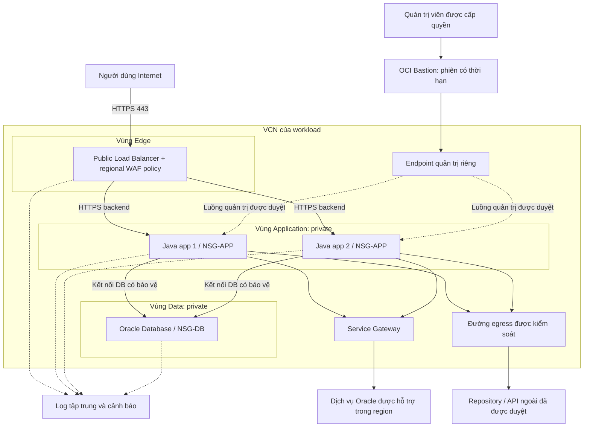

# Thiết kế defense in depth cho workload OCI

**Defense in depth**, hay phòng thủ nhiều lớp, là cách kết hợp các kiểm soát để một lỗi cấu hình hoặc một lớp bảo vệ bị vượt qua không mở toàn bộ đường đến dữ liệu. Với Oracle Cloud Infrastructure (OCI), thiết kế này phải bao phủ cả danh tính, mạng, máy chủ, ứng dụng, dữ liệu và khả năng vận hành.

Bài học thuộc chương **Bảo vệ mạng và máy chủ**, sử dụng một ứng dụng Java chạy trên OCI Compute và truy cập cơ sở dữ liệu Oracle làm ví dụ xuyên suốt. Trọng tâm là xác định mỗi lớp bảo vệ điều gì, phụ thuộc lớp nào, ai vận hành và cần bằng chứng gì để biết lớp đó hoạt động.

## 1. Hiểu đúng ý nghĩa của nhiều lớp bảo vệ

Giả sử ứng dụng có WAF ở phía trước nhưng máy chủ ứng dụng vẫn nhận kết nối trực tiếp từ Internet. Kẻ tấn công có thể đi theo đường không qua WAF. Nếu khắc phục đường truy cập đó nhưng ứng dụng dùng tài khoản cơ sở dữ liệu có quyền quản trị, một lỗi thực thi mã trong ứng dụng vẫn có thể gây thiệt hại lớn.

Một thiết kế tốt cần trả lời đồng thời bốn câu hỏi:

1. **Ngăn chặn:** điều gì giới hạn người hoặc kết nối được phép vào?
2. **Giới hạn ảnh hưởng:** nếu một thành phần bị chiếm, nó tiếp cận được những gì?
3. **Phát hiện và ứng phó:** ai nhận ra bất thường, rồi thực hiện hành động nào?
4. **Khôi phục:** bằng cách nào đưa dịch vụ và dữ liệu về trạng thái tin cậy?

Số lượng sản phẩm bảo mật không phải thước đo duy nhất. Hai lớp cùng phụ thuộc một tài khoản quản trị có quyền sửa tất cả vẫn có thể thất bại cùng lúc. Vì vậy, phải xét cả sự phân tách trách nhiệm và các đường có thể bỏ qua kiểm soát.

| Lớp | Mục tiêu trong thiết kế | Giới hạn cần hiểu |
| --- | --- | --- |
| IAM và quản trị | Giới hạn ai được thay đổi hạ tầng | Quyền OCI không thay thế quyền bên trong ứng dụng |
| Mạng và điểm vào | Giới hạn nguồn, đích, giao thức và đường truyền | Một kết nối được phép vẫn có thể chứa yêu cầu nguy hiểm |
| Máy chủ | Giảm khả năng khai thác và leo thang đặc quyền | Máy chủ đã vá vẫn có thể chạy ứng dụng có lỗi |
| Ứng dụng và dữ liệu | Kiểm tra danh tính, quyền nghiệp vụ, phạm vi dữ liệu | Mã hóa không ngăn người đã được cấp quyền đọc sai mục đích |
| Giám sát và ứng phó | Phát hiện, điều tra và cô lập | Có log nhưng không có người xử lý thì phản ứng vẫn chậm |
| Khôi phục | Phục hồi từ cấu hình và dữ liệu đáng tin cậy | Bản sao chưa từng restore chưa chứng minh được khả năng phục hồi |

## 2. Xác định trách nhiệm giữa Oracle và khách hàng

OCI sử dụng mô hình trách nhiệm bảo mật chia sẻ. Oracle bảo vệ hạ tầng nền tảng; khách hàng chịu trách nhiệm cấu hình tài nguyên, quyền truy cập và workload của mình. Mức trách nhiệm cụ thể còn phụ thuộc loại dịch vụ được sử dụng. [Nguồn: Oracle — Security Overview](https://docs.oracle.com/en-us/iaas/Content/Security/Concepts/security_overview.htm).

Trong ví dụ của bài, nên lập bảng trách nhiệm nội bộ như sau:

| Hạng mục | Chủ sở hữu đề xuất | Công việc cụ thể |
| --- | --- | --- |
| Tenancy và danh tính quản trị | Nhóm quản trị danh tính | Quy trình cấp/thu hồi quyền, xác thực mạnh, tài khoản khẩn cấp |
| VCN, NSG và route | Nhóm nền tảng mạng | Duyệt luồng kết nối, kiểm tra cấu hình thay đổi |
| OCI Compute | Nhóm vận hành máy chủ | Image, bản vá, tài khoản OS, firewall và agent |
| Ứng dụng Java | Nhóm phát triển | Thư viện, phân quyền API, kiểm tra đầu vào và bản phát hành |
| Cơ sở dữ liệu | Nhóm dữ liệu | Quyền truy cập, cập nhật theo dịch vụ DB, backup và restore |
| Giám sát | Nhóm vận hành an ninh | Thu thập log, cảnh báo, điều tra và phối hợp ứng phó |

Đây là phân công minh họa. Với cơ sở dữ liệu do dịch vụ quản lý, phải xác định phần Oracle quản lý và phần khách hàng còn phải cấu hình; không tự coi toàn bộ bảo mật DB là trách nhiệm nhà cung cấp.

## 3. Bắt đầu từ tài sản và các đường tấn công

Workload minh họa là API quản lý đơn hàng:

- Khách hàng gọi API HTTPS từ Internet.
- Load Balancer chuyển yêu cầu đến hai Compute instance chạy Java.
- Ứng dụng truy cập Oracle Database qua kết nối riêng.
- Ứng dụng cần một số secret và có thể ghi tài liệu vào Object Storage.
- Quản trị viên chỉ cần truy cập máy chủ trong thời gian bảo trì.
- Hệ thống cần giữ được bằng chứng điều tra và khôi phục dữ liệu.

Các mục tiêu bảo vệ là dữ liệu đơn hàng, thông tin đăng nhập, quyền quản trị OCI, khóa mật mã và khả năng phục vụ.

| Tình huống cần xét | Rủi ro chính | Hướng kiểm soát |
| --- | --- | --- |
| Tài khoản quản trị bị lộ | Thay IAM, mở mạng, xóa backup | Xác thực mạnh, quyền tối thiểu, phân tách quyền và Audit |
| API có lỗi | Lộ dữ liệu hoặc thực thi mã | Kiểm soát ứng dụng, WAF, vá thư viện và giới hạn quyền tiến trình |
| Một app server bị chiếm | Di chuyển sang host khác hoặc lấy secret | Phân đoạn mạng, quyền workload hẹp và quản lý secret |
| Thay nhầm security rule | Mở đường truy cập ngoài dự kiến | IaC, duyệt thay đổi và phát hiện drift |
| Mã độc phá dữ liệu | Gián đoạn và mất dữ liệu | Hạn chế quyền xóa, backup tách quyền và diễn tập phục hồi |

Bảng này là phân tích cho ví dụ, không phải danh sách đầy đủ mọi mối đe dọa. Nó giúp chọn kiểm soát theo hậu quả cần ngăn thay vì bật dịch vụ theo thói quen.

## 4. Kiến trúc tham chiếu và các ranh giới tin cậy

Ví dụ dùng VCN `10.40.0.0/16`:

| Vùng | CIDR minh họa | Thành phần |
| --- | --- | --- |
| Edge | `10.40.10.0/24` | Public Load Balancer |
| Application | `10.40.20.0/24` | Compute chạy Java, không có public IP |
| Data | `10.40.30.0/24` | Endpoint riêng của Oracle Database |
| Management | `10.40.40.0/24` | Kết nối quản trị riêng theo thiết kế Bastion |

Các CIDR là ví dụ và phải tránh chồng lấn với mạng doanh nghiệp hoặc VCN khác.



Sơ đồ thể hiện luồng logic, không mô tả đầy đủ mọi gateway, interface hoặc kết nối nội bộ của dịch vụ. Regional WAF policy gắn với Load Balancer trong ví dụ này; WAF không nhất thiết là một máy trung gian riêng.

Mỗi ranh giới cần có cả kiểm soát kết nối và kiểm soát danh tính phù hợp. Việc app server nằm trong mạng riêng không tự biến mọi lời gọi từ nó thành đáng tin cậy.

## 5. Lớp quản trị: IAM, compartment và guardrail

### 5.1. Giới hạn quyền thay đổi các lớp bảo vệ

Một cách tổ chức minh họa:

```text
Tenancy
├── SharedNetwork
├── OrdersProd
│   ├── Edge
│   ├── App
│   └── Data
├── SecurityOperations
└── OrdersNonProd
```

Compartment giúp tổ chức và đặt phạm vi IAM. Nó không tự tạo tường lửa giữa hai tài nguyên. Nếu hai VNIC có đường kết nối và các kiểm soát cho phép, việc chúng thuộc compartment khác nhau không tự chặn lưu lượng.

Áp dụng các nguyên tắc sau cho ví dụ:

- Nhóm triển khai ứng dụng chỉ có quyền cần cho workload của mình.
- Quyền sửa IAM, mạng và chính sách lưu giữ bằng chứng được phân công rõ.
- Người vận hành thường ngày không cần quyền xóa mọi tài nguyên.
- Tài khoản khẩn cấp có quy trình sử dụng và được giám sát.
- Quyền của pipeline CI/CD cũng được xét như quyền của một danh tính có thể bị lộ.

Không chỉ kiểm tra từng policy riêng: quyền hiệu lực còn phụ thuộc các policy khác và quyền được thừa kế. Một quyền rộng ở cấp trên có thể làm ý định giới hạn ở cấp dưới không đạt được.

### 5.2. Dùng Security Zones cho yêu cầu cần ngăn ngay

Security Zones kiểm tra thao tác tạo/cập nhật tài nguyên theo recipe và có thể từ chối thao tác vi phạm. Recipe có thể bao gồm hạn chế public access hoặc yêu cầu bảo vệ dữ liệu. Security Zone không cấp quyền IAM. [Nguồn: Oracle — Overview of Security Zones](https://docs.oracle.com/en-us/iaas/Content/security-zone/using/security-zones.htm).

Đối với ví dụ, hãy đánh giá recipe trước khi áp dụng cho các compartment dữ liệu. Khu vực chứa public Load Balancer phải phù hợp với các policy đã chọn. Không áp dụng một recipe cấm public resource cho toàn bộ kiến trúc rồi kỳ vọng điểm vào Internet vẫn được tạo bình thường.

Đó là quyết định bố trí tài nguyên và guardrail cần thực hiện trước triển khai, không phải ngoại lệ được xử lý bằng cách mở rộng quyền quản trị.

## 6. Lớp mạng: thiết kế từ ma trận luồng

### 6.1. Tách subnet chưa đủ để phân đoạn

OCI có local routing cho lưu lượng trong VCN. Hai subnet cùng VCN không cần thêm route tường minh chỉ để liên lạc với nhau. Vì vậy, không dùng việc “không thấy route đến subnet DB” làm bằng chứng DB đã được cô lập. [Nguồn: Oracle — VCN Route Tables](https://docs.oracle.com/en-us/iaas/Content/Network/Tasks/managingroutetables.htm).

Private subnet ngăn gán public IP cho VNIC theo đặc tính subnet, nhưng vẫn phải xét kết nối từ VCN khác, mạng doanh nghiệp, host nội bộ và đường đi qua các dịch vụ kết nối. Mục tiêu cần chứng minh là **đúng nguồn được truy cập đúng đích**, thay vì chỉ chứng minh tài nguyên không có public IP.

### 6.2. Lập NSG theo vai trò

Trong ví dụ:

- `NSG-LB`: các VNIC của Load Balancer.
- `NSG-APP`: các VNIC ứng dụng.
- `NSG-DB`: tài nguyên DB hỗ trợ NSG.
- Luồng quản trị: theo nguồn endpoint của Bastion và loại phiên được triển khai.

NSG áp dụng cho các VNIC được gắn vào nhóm; có thể tham chiếu NSG khác trong cùng VCN làm nguồn hoặc đích. Cần kiểm tra khả năng hỗ trợ của từng dịch vụ và cả VNIC phụ. [Nguồn: Oracle — Network Security Groups](https://docs.oracle.com/en-us/iaas/Content/Network/Concepts/networksecuritygroups.htm).

Ma trận minh họa dưới đây mô tả **kết nối được khởi tạo**, chưa phải danh sách rule đầy đủ để áp dụng trực tiếp:

| Nguồn khởi tạo | Đích | Cổng/giao thức ví dụ | Mục đích |
| --- | --- | --- | --- |
| Internet | Load Balancer | TCP 443 | API công khai |
| `NSG-LB` | `NSG-APP` | TCP 8443 | HTTPS đến backend |
| `NSG-LB` | App backend | Cổng health check đã cấu hình | Xác nhận backend sẵn sàng |
| `NSG-APP` | `NSG-DB` | Cổng listener DB đã cấu hình | Truy cập dữ liệu |
| Nguồn riêng của Bastion | App host được chỉ định | TCP 22 | Phiên SSH được cấp |
| App host | Dịch vụ Oracle được hỗ trợ | TCP 443 | Secret, storage hoặc API cần thiết |
| App host | Repository/API ngoài được duyệt | TCP 443 | Cập nhật và tích hợp |
| App host | DNS/NTP được cấu hình | Theo giao thức dịch vụ | Phân giải tên và đồng bộ giờ |

`8443` là lựa chọn của ứng dụng mẫu. Nếu dùng TCPS, `2484` có thể là một cổng listener được cấu hình; không giả định mọi Oracle Database đều sử dụng cổng này. Thông số thực tế phải khớp listener, chứng chỉ và cấu hình client.

### 6.3. Kiểm tra tập rule hiệu lực

NSG và security list dùng rule cho phép. Các rule áp dụng cho một VNIC được cộng gộp; một rule mở ở security list không bị một NSG hẹp hơn phủ định. Với rule stateful, lưu lượng phản hồi của kết nối được theo dõi được xử lý theo trạng thái; stateless yêu cầu xét cả chiều về. [Nguồn: Oracle — Security Rules](https://docs.oracle.com/en-us/iaas/Content/Network/Concepts/securityrules.htm).

Hệ quả cho ví dụ: sau khi chỉ cho `NSG-APP` vào DB, phải kiểm tra mọi security list và NSG đang áp dụng. Nếu còn rule cho toàn VCN vào cổng DB, mục tiêu giới hạn theo app tier chưa đạt.

Đừng coi stateful là “chỉ cần rule ở một đầu”. Đối với kết nối mới giữa hai tài nguyên có lọc mạng, vẫn phải xét egress phía khởi tạo và ingress phía nhận.

Nếu triển khai thêm Zero Trust Packet Routing, endpoint có security attribute còn phải thỏa ZPR policy tương ứng. Việc thêm attribute có thể làm thay đổi kết nối đang hoạt động. [Nguồn: Oracle — lưu ý về ZPR trong Network Security Groups](https://docs.oracle.com/en-us/iaas/Content/Network/Concepts/networksecuritygroups.htm).

## 7. Lớp điểm vào và kiểm soát lưu lượng đi ra

### 7.1. Bảo vệ HTTP tại Load Balancer và WAF

OCI WAF hỗ trợ các kiểm soát HTTP như protection rules và rate limiting; regional WAF policy có thể gắn với Load Balancer. WAF có thể kiểm tra một số mẫu tấn công ứng dụng, nhưng không thay thế kiểm tra quyền nghiệp vụ trong API. [Nguồn: Oracle — Overview of Web Application Firewall](https://docs.oracle.com/en-us/iaas/Content/WAF/Concepts/overview.htm).

Đối với ứng dụng đơn hàng, cần thiết kế thêm:

- Chỉ công khai listener cần sử dụng.
- Bảo vệ TLS từ client đến điểm kết thúc TLS; quyết định rõ việc mã hóa đoạn LB–backend.
- Giới hạn backend để tránh đường trực tiếp ngoài ý muốn.
- Kiểm tra rate limit không làm gián đoạn khách hàng dùng chung NAT/proxy.
- Theo dõi cảnh báo và điều chỉnh rule dựa trên lưu lượng hợp lệ trước khi mở rộng chặn.

Nếu dùng mô hình WAF khác, như edge policy, phải thiết kế lại đường đến origin theo mô hình đó. Thay DNS một mình không chứng minh origin không còn đường truy cập trực tiếp.

### 7.2. NAT Gateway không phải danh sách đích được phép

NAT Gateway cho phép tài nguyên không có public IP khởi tạo kết nối Internet và nhận phản hồi, đồng thời không nhận kết nối Internet khởi tạo vào theo đường NAT đó. [Nguồn: Oracle — NAT Gateway](https://docs.oracle.com/en-us/iaas/Content/Network/Tasks/NATgateway.htm).

Từ đó có một giới hạn thiết kế: một host bị chiếm vẫn có thể tìm cách gửi dữ liệu ra ngoài nếu egress cho phép rộng. Cần kiểm soát đích bằng giải pháp phù hợp, chẳng hạn proxy, firewall hoặc tập endpoint đã được duyệt; đồng thời quan sát các đích mới xuất hiện.

### 7.3. Service Gateway và Network Firewall giải quyết việc khác nhau

Service Gateway cung cấp đường riêng đến các dịch vụ Oracle được hỗ trợ trong cùng region. Nó không tự cấp quyền truy cập bucket hay secret và không phải đường đến mọi website bên ngoài. [Nguồn: Oracle — Access to Oracle Services: Service Gateway](https://docs.oracle.com/en-us/iaas/Content/Network/Tasks/servicegateway.htm).

Network Firewall có thể kiểm tra và áp chính sách lên lưu lượng được định tuyến qua nó. Chỉ tạo firewall resource không khiến mọi luồng trong VCN tự đi qua firewall. [Nguồn: Oracle — Overview of the Network Firewall Service](https://docs.oracle.com/en-us/iaas/Content/network-firewall/overview.htm).

Nếu chọn Network Firewall cho egress hoặc giữa các vùng, hồ sơ thiết kế phải chỉ rõ route đi/về, các đường có thể bỏ qua và cách bảo đảm tính sẵn sàng. Phải xét tác động của kiểm tra TLS, chứng chỉ tin cậy, hiệu năng và vận hành trước khi bật những chức năng liên quan.

## 8. Lớp quản trị máy chủ: truy cập ngắn hạn và có phạm vi

OCI Bastion cung cấp truy cập có giới hạn thời gian đến tài nguyên không có public endpoint. IAM kiểm soát quyền với Bastion/session, còn client CIDR allowlist và SSH key tham gia kiểm soát kết nối. [Nguồn: Oracle — Bastion Overview](https://docs.oracle.com/en-us/iaas/Content/Bastion/Concepts/bastionoverview.htm).

Quy trình đề xuất cho một lần bảo trì:

1. Xác định host, loại phiên, người thực hiện và công việc cần làm.
2. Cấp quyền cho người hoặc nhóm phù hợp, với phạm vi phiên theo thiết kế.
3. Chỉ cho phép nguồn client đã duyệt.
4. Bảo đảm đường từ endpoint riêng của Bastion tới target chỉ mở cổng cần thiết.
5. Dùng tài khoản OS có quyền phù hợp và ghi nhận hoạt động.
6. Kết thúc phiên, thu hồi quyền tạm và xác nhận thay đổi.

Quyền tạo phiên không tự thay thế quyền trong hệ điều hành hoặc cơ sở dữ liệu. Ngược lại, tài khoản OS có quyền mạnh cũng không nên được dùng như tài khoản mặc định của mọi người.

Managed SSH có yêu cầu về image Linux, Oracle Cloud Agent, Bastion plugin và SSH server. SSH port forwarding có điều kiện khác; phải chọn đúng loại phiên thay vì mặc định chúng giống nhau. [Nguồn: Oracle — Session Types](https://docs.oracle.com/en-us/iaas/Content/Bastion/Concepts/bastionoverview.htm).

Không cần dựng một VM SSH công khai lâu dài chỉ vì workload có máy chủ riêng. Nếu tổ chức dùng VPN/FastConnect và mạng quản trị riêng, vẫn phải giới hạn danh tính, nguồn kết nối và thời gian cấp quyền theo cùng mục tiêu.

## 9. Lớp máy chủ: image, bản vá, tiến trình và metadata

### 9.1. Xây baseline cho Compute instance

Baseline là cấu hình chuẩn có thể tái tạo. Với Linux app server, một baseline thực tế nên xác định:

| Thành phần | Yêu cầu thiết kế minh họa |
| --- | --- |
| Image | Nguồn được duyệt, còn được hỗ trợ, có phiên bản |
| Package | Chỉ cài phần cần thiết và theo dõi cập nhật |
| Tài khoản | Phân tách người quản trị và tài khoản chạy ứng dụng |
| Dịch vụ | Tắt dịch vụ không dùng, chỉ mở listener cần thiết |
| Đặc quyền | Ứng dụng chạy không có quyền root nếu không cần |
| Host firewall | Khớp luồng đã duyệt và giữ phụ thuộc hệ thống |
| Kiểm soát OS | Duy trì cơ chế như SELinux theo baseline của tổ chức |
| Telemetry | Agent và log cần thiết hoạt động, có theo dõi tình trạng |

Đây là baseline đề xuất cho ví dụ; không phải tất cả image đều có cùng dịch vụ, file hoặc công cụ.

Shielded Instances có thể bổ sung Secure Boot, Measured Boot và TPM trên tổ hợp shape/image được hỗ trợ. Các tính năng này bảo vệ quá trình khởi động theo phạm vi của chúng, không thay cho việc vá ứng dụng. [Nguồn: Oracle — Shielded Instances](https://docs.oracle.com/en-us/iaas/Content/Compute/References/shielded-instances.htm).

### 9.2. Tách phát hiện lỗ hổng khỏi khắc phục

Vulnerability Scanning kiểm tra các loại tài nguyên, image và lỗ hổng trong phạm vi được hỗ trợ. Kết quả scan là đầu vào để xử lý; không tự chứng minh máy đã được vá hoặc ứng dụng không còn lỗi. [Nguồn: Oracle — Vulnerability Scanning Overview](https://docs.oracle.com/en-us/iaas/Content/scanning/using/overview.htm).

Một vòng xử lý cần có: phát hiện, xác định ảnh hưởng, chọn bản vá hoặc biện pháp giảm thiểu, triển khai, xác minh và cập nhật hồ sơ. Thư viện Java, JDK và mã ứng dụng cần quy trình riêng phù hợp với chuỗi phát hành.

OS Management Hub hỗ trợ quản lý cập nhật tập trung cho môi trường được hỗ trợ. Cần đăng ký instance, cấu hình agent, nguồn phần mềm và lịch cập nhật đúng với môi trường đang dùng. [Nguồn: Oracle — Overview of OS Management Hub](https://docs.oracle.com/en-us/iaas/osmh/doc/arch-overview.htm).

Với hai app server sau LB, có thể cập nhật từng máy, kiểm tra rồi chuyển sang máy tiếp theo nếu ứng dụng và dung lượng còn lại đáp ứng. Không reboot đồng thời mọi thành phần chỉ để hoàn tất lịch vá.

Đối với DB system, dùng quy trình cập nhật của đúng dịch vụ cơ sở dữ liệu; không áp dụng máy móc lệnh vá OS của Compute cho mọi host do dịch vụ quản lý.

### 9.3. Bảo vệ instance metadata

OCI cung cấp IMDSv2; yêu cầu v2 dùng header `Authorization: Bearer Oracle`. Việc chuyển đổi cần kiểm tra tương thích, di chuyển client rồi vô hiệu IMDSv1 theo điều kiện image. [Nguồn: Oracle — Getting Instance Metadata](https://docs.oracle.com/en-us/iaas/Content/Compute/Tasks/gettingmetadata.htm).

IMDSv2 vẫn cần đi cùng phòng chống SSRF trong ứng dụng, giới hạn quyền workload và kiểm soát truy cập metadata từ tiến trình. Không coi header tĩnh đó là một mật khẩu bí mật bảo vệ toàn bộ máy.

Khi siết host firewall, phải giữ các luồng hệ thống cần thiết, chẳng hạn metadata, DNS, NTP và iSCSI tùy cấu hình. Oracle nêu rõ các phụ thuộc link-local này trong hướng dẫn bảo vệ Compute. [Nguồn: Oracle — Securing Compute](https://docs.oracle.com/en-us/iaas/Content/Security/Reference/compute_security.htm).

## 10. Lớp ứng dụng, danh tính workload và dữ liệu

### 10.1. Giới hạn quyền của chính ứng dụng

Nếu Java API chỉ cần đọc/ghi đơn hàng, tài khoản DB của nó không nên có quyền quản trị toàn bộ cơ sở dữ liệu. API phải kiểm tra cả danh tính và quyền với từng đối tượng: biết một mã đơn hàng không có nghĩa được đọc đơn hàng đó.

Một số quyết định thiết kế cần ghi rõ:

- Service account và schema mà ứng dụng sử dụng.
- Quyền đọc, ghi hoặc thực thi procedure thật sự cần thiết.
- Cách bảo vệ kết nối DB và xác minh endpoint.
- Cách cập nhật thư viện, JDK và image ứng dụng.
- Quy trình thay credential mà vẫn giữ được khả năng phục vụ.

Ngay cả khi WAF chặn được nhiều mẫu payload, các kiểm tra nghiệp vụ này vẫn thuộc ứng dụng.

### 10.2. Dùng instance principal nhưng giới hạn quyền

Instance principal cho phép Compute instance gọi OCI API mà không cần lưu bộ credential của một IAM user trên máy. Dynamic group và policy xác định quyền được cấp. Người có quyền truy cập instance cũng cần được coi là có khả năng sử dụng các quyền mà instance được cấp. [Nguồn: Oracle — Calling Services from an Instance](https://docs.oracle.com/en-us/iaas/Content/Identity/Tasks/callingservicesfrominstances.htm).

Hệ quả cho ví dụ: instance chạy Orders API chỉ nên có quyền với secret hoặc tài nguyên cần cho Orders API. Không cấp quyền quản lý toàn tenancy cho dynamic group chỉ để ứng dụng đọc một giá trị cấu hình.

Cần bảo vệ cả điều kiện tham gia dynamic group. Nếu một người có thể tạo hoặc gắn tài nguyên vào nhóm đặc quyền bằng thao tác mà họ được phép làm, đó cũng là đường mở rộng quyền cần đánh giá.

### 10.3. Bảo vệ dữ liệu theo nhiều cơ chế

Đối với workload mẫu, thiết kế nên phối hợp:

| Mục tiêu | Kiểm soát đề xuất |
| --- | --- |
| Bảo vệ trên đường truyền | TLS và xác minh chứng chỉ theo từng chặng |
| Bảo vệ dữ liệu lưu trữ | Cơ chế mã hóa của dịch vụ và mô hình quản lý khóa phù hợp |
| Giữ bí mật credential | Dịch vụ quản lý secret và quy trình phân phối hạn chế |
| Giảm lộ dữ liệu qua log | Không ghi token, mật khẩu hoặc dữ liệu nhạy cảm dư thừa |
| Giới hạn truy xuất | IAM cho dịch vụ OCI, quyền DB và quyền nghiệp vụ trong API |
| Giữ khả năng khôi phục | Backup, quyền dùng khóa và metadata cần thiết |

Không đặt secret trong source code, user-data, image hoặc đầu ra pipeline chỉ vì các thành phần đó “nằm trong nội bộ”. Mỗi bản sao làm tăng số nơi cần kiểm soát và thu hồi.

Mã hóa dữ liệu không tự ngăn thao tác đọc hợp lệ bằng credential đã bị chiếm. Vì vậy, bảo vệ khóa cần đi cùng kiểm soát người và workload được phép dùng khóa.

## 11. Lớp phát hiện: ghép các nguồn tín hiệu

### 11.1. Chọn log theo câu hỏi điều tra

| Nguồn tín hiệu | Câu hỏi cần trả lời trong ví dụ |
| --- | --- |
| OCI Audit | Ai thay đổi NSG, route hoặc tài nguyên cloud? |
| WAF/LB log được cấu hình | Yêu cầu đi vào đâu, bị xử lý thế nào? |
| VCN Flow Logs | Nguồn nào liên lạc với đích nào, kết quả lọc mạng ra sao? |
| OS và ứng dụng | Ai đăng nhập, tiến trình lỗi gì, request nào thất bại? |
| DB audit theo cấu hình | Tài khoản nào thực hiện thao tác với dữ liệu? |
| Cloud Guard/scan findings | Có cấu hình hoặc hành vi nào cần điều tra? |
| Metrics và alarms | Có dấu hiệu mất khả dụng hoặc tăng tải bất thường? |

Audit tự động ghi các lời gọi đến OCI API được hỗ trợ. Nó không thay thế toàn bộ log đăng nhập OS, hành động bên trong ứng dụng hoặc thao tác dữ liệu của mọi dịch vụ. [Nguồn: Oracle — Overview of Audit](https://docs.oracle.com/en-us/iaas/Content/Audit/Concepts/auditoverview.htm).

Flow Logs cung cấp metadata như địa chỉ, cổng, giao thức, số byte và hành động ACCEPT/REJECT theo bản ghi. Không dùng Flow Logs như bản sao đầy đủ nội dung HTTP hay bằng chứng rằng nghiệp vụ đã được phân quyền đúng. Cần xét cả tình trạng thu thập và phạm vi log. [Nguồn: Oracle — Details for VCN Flow Logs](https://docs.oracle.com/en-us/iaas/Content/Logging/Reference/details_for_vcn_flow_logs.htm).

### 11.2. Đặt Cloud Guard đúng vai trò

Cloud Guard kiểm tra tài nguyên và hoạt động theo target/detector recipe, tạo problem và có thể đề xuất hoặc thực hiện hành động theo cấu hình responder. Bật Cloud Guard không đồng nghĩa mọi vấn đề đều được tự động sửa. [Nguồn: Oracle — Cloud Guard Concepts](https://docs.oracle.com/en-us/iaas/Content/cloud-guard/using/cg-concepts.htm).

Trong ví dụ, nhóm vận hành cần xác định phạm vi được theo dõi, loại cảnh báo, người nhận và thời hạn xử lý. Responder có khả năng làm thay đổi tài nguyên phải được giới hạn để tránh gây gián đoạn ngoài dự kiến.

Một cảnh báo có thể hành động được nên có:

- Tài nguyên và thời điểm liên quan.
- Lý do đáng nghi và mức ưu tiên.
- Người hoặc nhóm xử lý.
- Bước kiểm tra đầu tiên và điều kiện cô lập.
- Cách xác nhận sự cố đã kết thúc.

Log tập trung cần có quyền truy cập và chính sách lưu giữ phù hợp. Người vận hành app không mặc nhiên cần quyền xóa mọi bằng chứng điều tra của chính app đó.

## 12. Ứng phó và khôi phục khi một lớp thất bại

### 12.1. Chuẩn bị trước cách cô lập một app server

Ví dụ phát hiện một host kết nối đến nhiều đích không thuộc thiết kế:

1. Xác định instance, VNIC, thời điểm và các nguồn log liên quan.
2. Kiểm tra ảnh hưởng đến dịch vụ trước khi tách khỏi LB.
3. Cô lập các luồng cần chặn bằng biện pháp đã diễn tập.
4. Thu hồi hoặc hạn chế danh tính/credential có khả năng bị lộ.
5. Giữ bằng chứng cần thiết và triển khai máy thay thế từ nguồn tin cậy.
6. Kiểm tra dữ liệu, cấu hình và các host liên quan trước khi kết thúc sự cố.

Không chỉ gắn thêm một NSG tên “quarantine” rồi kết luận host đã bị chặn: rule cho phép ở NSG khác hoặc security list vẫn có thể còn hiệu lực. Cần xét cả kết nối đã tồn tại và kiểm soát phía host/dịch vụ.

Thứ tự thực hiện phụ thuộc mức độ nguy hiểm và yêu cầu duy trì dịch vụ. Những hành động này nên được viết thành runbook có chủ sở hữu trước khi xảy ra sự cố.

### 12.2. Tách tính sẵn sàng khỏi khả năng phục hồi dữ liệu

Hai app server và health check giúp giảm gián đoạn khi một máy lỗi. Chúng không tự bảo vệ trước lỗi ứng dụng xóa dữ liệu hợp lệ ở DB.

Block Volume hỗ trợ backup và restore volume theo cơ chế của dịch vụ. Với dữ liệu DB, phải chọn cách backup/restore đảm bảo tính nhất quán theo loại cơ sở dữ liệu và dịch vụ đang sử dụng. [Nguồn: Oracle — Block Volume Backups](https://docs.oracle.com/en-us/iaas/Content/Block/Concepts/blockvolumebackups.htm).

Hồ sơ khôi phục cần có:

| Thành phần | Điều cần xác định |
| --- | --- |
| RPO | Mức mất dữ liệu tối đa chấp nhận được |
| RTO | Thời gian gián đoạn tối đa chấp nhận được |
| Backup | Lịch tạo, lưu giữ, phạm vi dữ liệu và quyền xóa |
| Cấu hình | Cách dựng lại VCN, IAM, host và ứng dụng |
| Khóa/secret | Cách khôi phục quyền giải mã và kết nối |
| Diễn tập | Bằng chứng restore và kiểm tra nghiệp vụ thành công |

RPO/RTO là mục tiêu của cả workload. Không suy từ một tính năng HA hoặc một bản backup riêng lẻ rằng toàn bộ ứng dụng đã đạt mục tiêu.

## 13. Thực hành xây thiết kế và thu thập bằng chứng

Phần này thực hiện trong môi trường thử nghiệm được phép. Các lệnh minh họa dùng **Bash**, OCI CLI đã cấu hình và quyền đọc phù hợp; lệnh OS chạy trên Oracle Linux có công cụ tương ứng.

### 13.1. Chốt thiết kế trước khi tạo nhiều rule

Thực hiện theo thứ tự:

1. Chọn tài sản và dữ liệu cần bảo vệ.
2. Vẽ điểm vào, đường quản trị, đường đến DB và đường đi ra.
3. Hoàn thành ma trận nguồn–đích–giao thức–cổng–mục đích.
4. Phân công quyền thay đổi IAM, mạng, host và backup.
5. Chọn log và quy trình ứng phó cho những tình huống đã nêu.
6. Xác định chi phí và mục tiêu khôi phục.

Sau đó biểu diễn tài nguyên bằng IaC hoặc quy trình cấu hình có thể tái tạo. Mỗi thay đổi mở thêm quyền hoặc kết nối cần có mục đích và thời điểm đánh giá lại.

### 13.2. Đọc lại cấu hình subnet và NSG

```bash
REGION="ap-singapore-1"
APP_SUBNET_ID="<OCID_SUBNET_APP>"
APP_NSG_ID="<OCID_NSG_APP>"

oci network subnet get \
  --region "$REGION" \
  --subnet-id "$APP_SUBNET_ID"

oci network nsg rules list \
  --region "$REGION" \
  --nsg-id "$APP_NSG_ID" \
  --all
```

Lệnh subnet trả thông tin để đối chiếu CIDR, khả năng gán public IP, route table và security lists. Lệnh NSG chỉ liệt kê rule của NSG đã chọn; chưa thể hiện toàn bộ rule đang áp lên một VNIC. [Nguồn: Oracle — OCI CLI subnet get](https://docs.oracle.com/en-us/iaas/tools/oci-cli/latest/oci_cli_docs/cmdref/network/subnet/get.html), [OCI CLI NSG rules list](https://docs.oracle.com/en-us/iaas/tools/oci-cli/latest/oci_cli_docs/cmdref/network/nsg/rules/list.html).

Tiếp tục đối chiếu VNIC membership, mọi NSG liên quan và security list của subnet bằng Console hoặc công cụ quản lý tương ứng. Lưu kết quả theo cách không làm lộ secret hoặc credential.

### 13.3. Quan sát cấu hình host

```bash
# Chạy trên host Oracle Linux trong phạm vi được phép.
sudo ss -lntup
sudo systemctl --failed
sudo firewall-cmd --get-active-zones
sudo firewall-cmd --list-all-zones
sudo sshd -T
getenforce
```

Các lệnh đọc trạng thái listener, dịch vụ lỗi, firewall, cấu hình SSH và SELinux. Nếu baseline không dùng firewalld hoặc SELinux, cần công cụ đối chiếu tương ứng; không bật/tắt cơ chế bảo vệ chỉ để làm cho đầu ra giống ví dụ.

Hãy nối kết đầu ra với thiết kế: tiến trình nào đang nghe cổng, cổng đó phục vụ luồng nào, và host có dịch vụ nào nằm ngoài phạm vi đã duyệt?

### 13.4. Kiểm chứng cả đường được phép và đường phải bị chặn

| Hành vi thử trong lab | Kết quả mong đợi | Bằng chứng cần xem |
| --- | --- | --- |
| Gọi API hợp lệ qua HTTPS | Thành công | LB/app log và phản hồi nghiệp vụ |
| Gọi thẳng app từ Internet | Không có đường truy cập trực tiếp | Cấu hình IP, route và kiểm tra kết nối |
| Từ host thử không thuộc app tier gọi cổng DB | Bị chặn theo thiết kế | Rule hiệu lực, Flow Logs trong phạm vi có log |
| Dùng tài khoản ứng dụng đọc đối tượng không thuộc quyền | Bị API từ chối | App log và kết quả kiểm tra phân quyền |
| Gọi API ngoài không nằm trong đích được duyệt | Bị cơ chế egress đã chọn chặn | Proxy/firewall log |
| Kết thúc phiên quản trị rồi kết nối lại | Không tiếp tục bằng phiên đã hết hiệu lực | Trạng thái phiên và log liên quan |
| Khôi phục dữ liệu mẫu vào môi trường tách biệt | Đọc và đối chiếu được dữ liệu | Báo cáo restore và kiểm tra nghiệp vụ |

Timeout chưa xác định được lớp chặn; có thể do DNS, route, firewall hoặc dịch vụ không hoạt động. Cần bằng chứng tương quan trước khi kết luận một kiểm soát đã đạt mục tiêu.

Chỉ kiểm tra các tài nguyên nằm trong phạm vi được phép và không dùng dữ liệu khách hàng để tạo tình huống rò rỉ giả lập.

## 14. Cân đối chi phí, tính sẵn sàng và hồ sơ bàn giao

Defense in depth cần được duy trì liên tục, nên phải tính cả chi phí tài nguyên và công vận hành. Đối với workload mẫu, có thể lập bảng đánh giá:

| Quyết định | Giá trị cần đạt | Chi phí hoặc phụ thuộc cần xét |
| --- | --- | --- |
| LB và nhiều app instance | Duy trì dịch vụ khi một host lỗi/bảo trì | Dung lượng dự phòng và khả năng chịu tải |
| WAF | Kiểm soát lưu lượng HTTP theo nguy cơ | Rule, lưu lượng và công điều chỉnh |
| Kiểm soát egress chuyên dụng | Giới hạn đích và quan sát lưu lượng ra | Hạ tầng, route, hiệu năng và vận hành |
| Scan và vá | Giảm thời gian tồn tại lỗ hổng | Agent, lịch bảo trì và trách nhiệm xử lý |
| Log tập trung | Điều tra và phản ứng được | Khối lượng, thời gian lưu giữ và quyền truy cập |
| Backup/DR | Khôi phục theo RPO/RTO | Lưu trữ, sao chép và thời gian diễn tập |

Bảng là công cụ lập quyết định, không phải bảng giá OCI. Khi chọn dịch vụ tính phí, kiểm tra đơn vị và mức giá áp dụng cho tài khoản tại thời điểm triển khai.

Không bỏ log, backup hoặc kiểm soát truy cập để làm cho bản triển khai đầu tiên rẻ hơn mà chưa đánh giá hậu quả. Nếu ngân sách giới hạn, giảm phạm vi dữ liệu thử, chọn mức dự phòng theo mục tiêu và triển khai theo giai đoạn có chủ sở hữu.

Hồ sơ bàn giao của thiết kế nên gồm sơ đồ luồng, ma trận truy cập, chủ sở hữu IAM, baseline host, phạm vi giám sát, runbook ứng phó và bằng chứng khôi phục. Với mỗi lớp bảo vệ, ghi rõ rủi ro còn lại và người chịu trách nhiệm đánh giá lại khi workload thay đổi.
