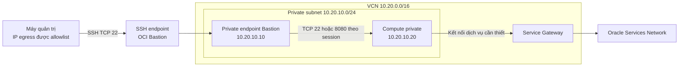

# OCI Bastion và truy cập tài nguyên private subnet

Một máy chủ trong private subnet không có public IP, nhưng đội vận hành vẫn cần đăng nhập để kiểm tra sự cố hoặc truy cập một dịch vụ nội bộ. Gắn public IP cho máy chủ chỉ để mở SSH sẽ tạo thêm đường truy cập phải bảo vệ. OCI Bastion cung cấp một cách khác: tạo phiên truy cập được giới hạn theo thời gian, địa chỉ nguồn và quyền IAM, rồi kết nối tới tài nguyên private qua SSH.

Bài học thuộc chương **Bảo vệ mạng và máy chủ** trong phạm vi Oracle Cloud Infrastructure. Người học sẽ kết hợp tenancy, compartment, IAM, VCN và Compute để thiết lập đường quản trị có kiểm soát; đồng thời hiểu cách sử dụng tunnel với dịch vụ cơ sở dữ liệu Oracle, ghi nhận bằng chứng truy cập và dọn tài nguyên sau thực hành.

## 1. Mục tiêu và phạm vi

Sau bài học, người học có thể:

- Giải thích sự khác nhau giữa dịch vụ OCI Bastion và một máy ảo tự quản làm jump host.
- Chọn Managed SSH, SSH port forwarding hoặc dynamic port forwarding phù hợp với mục đích truy cập.
- Phân biệt IAM, CIDR allowlist, SSH key, rule mạng và quyền trên hệ thống đích.
- Truy cập một Compute instance private hoặc một cổng TCP private mà không cấp public IP cho tài nguyên đích.
- Khoanh vùng lỗi và kết thúc phiên mà không để lại đường truy cập rộng hơn dự định.

Các địa chỉ và OCID trong bài là dữ liệu minh họa. Lệnh được trình bày để người học thực hiện trong môi trường OCI được cấp quyền; bài viết không khẳng định tài nguyên đã được tạo hoặc lệnh đã được chạy trên tenancy thực tế.

## 2. OCI Bastion giải quyết bài toán nào?

OCI Bastion cung cấp quyền truy cập có giới hạn tới tài nguyên không có public endpoint. Dịch vụ có thể hỗ trợ SSH tới máy Linux hoặc chuyển tiếp kết nối tới cổng của các dịch vụ khác. Bastion gắn với một VCN; không nên thiết kế một Bastion ở VCN A rồi mặc định dùng nó cho tài nguyên tại VCN B. [Nguồn: tổng quan Bastion](https://docs.oracle.com/en-us/iaas/Content/Bastion/Concepts/bastionoverview.htm).

Có hai cách thường gặp để tạo điểm trung chuyển quản trị:

| Cách tiếp cận | Trách nhiệm vận hành cần dự kiến |
| --- | --- |
| Máy ảo jump host tự quản | Quản lý hệ điều hành, SSH server, bản vá, tài khoản, log, tài nguyên Compute và đường mạng |
| OCI Bastion | Quản lý cấu hình Bastion, policy, allowlist, khóa, phiên và quyền trên tài nguyên đích |

OCI Bastion là dịch vụ do Oracle quản lý. Người dùng tạo và kết nối tới session; không SSH vào một hệ điều hành của Bastion để quản trị nó như một jump host thông thường. [Nguồn: kết nối tới Bastion sessions](https://docs.oracle.com/en-us/iaas/Content/Bastion/Tasks/connectingtosessions.htm).

Bastion phù hợp với công việc quản trị có điểm bắt đầu và kết thúc: kiểm tra một máy chủ, xem log hoặc chạy công cụ quản lý cơ sở dữ liệu trong một cửa sổ làm việc. Với luồng ứng dụng liên tục, kết nối giữa các hệ thống doanh nghiệp hoặc truy cập diện rộng, cần thiết kế kết nối mạng phù hợp như VPN hoặc FastConnect thay vì phụ thuộc vào tunnel trên laptop của một cá nhân.

## 3. Các thành phần cần phân biệt

### 3.1. Bastion, session và target

- **Bastion**: tài nguyên dịch vụ chứa cấu hình mạng, CIDR allowlist và giới hạn thời gian cho các phiên.
- **Session**: một lần cấp đường truy cập có thời hạn, gắn với khóa công khai và loại kết nối cụ thể.
- **Target resource**: tài nguyên private cần truy cập, chẳng hạn Compute instance hoặc endpoint cơ sở dữ liệu.
- **Private endpoint IP của Bastion**: địa chỉ phía VCN cần nhận diện khi cho phép lưu lượng từ Bastion đến target.
- **SSH endpoint của session**: địa chỉ dịch vụ mà SSH client kết nối tới; lấy từ lệnh do OCI cung cấp.

Bastion OCID và session OCID là hai định danh khác nhau. Khi kết nối, phải dùng thông tin của đúng session đang hoạt động, không thay session OCID bằng Bastion OCID.

### 3.2. Năm điều kiện độc lập của một đường truy cập

| Điều kiện | Câu hỏi phải trả lời |
| --- | --- |
| IAM | Người này được tạo, đọc hoặc xóa session nào? |
| CIDR allowlist | Kết nối SSH đến Bastion xuất phát từ IP được cho phép chưa? |
| SSH key của session | Client có private key khớp public key đã dùng khi tạo session không? |
| Mạng từ Bastion đến target | Đúng IP, cổng, route và rule bảo vệ chưa? |
| Quyền tại target | Tài khoản OS, ứng dụng hoặc cơ sở dữ liệu được phép làm gì? |

Ví dụ, một người có quyền tạo port forwarding session tới cổng Oracle Database vẫn phải xác thực bằng tài khoản cơ sở dữ liệu. Tunnel không tự cấp quyền đọc bảng. Ngược lại, có mật khẩu cơ sở dữ liệu đúng cũng không giúp vượt qua một tunnel chưa được thiết lập.

Trong thực hành, nên coi điều kiện kết nối thành công là phép kết hợp của cả năm lớp. Một lớp đã đạt không thay thế cho các lớp còn lại.

## 4. Chọn loại session

### 4.1. Managed SSH

Managed SSH dùng để đăng nhập SSH tới Compute instance Linux có OpenSSH server, Oracle Cloud Agent và Bastion plugin được bật. Không dùng loại phiên này để đăng nhập Windows. Cần kiểm tra plugin thực sự chạy được, thay vì chỉ thấy một tùy chọn đã được bật trong Console. [Nguồn: truy cập Compute private bằng Bastion](https://docs.oracle.com/en-us/iaas/Content/Compute/Tasks/connect-to-instance-private-subnet.htm), [Oracle Cloud Agent và plugins](https://docs.oracle.com/en-us/iaas/Content/Compute/Tasks/manage-plugins.htm).

Loại phiên này phù hợp khi mục tiêu là làm việc trên shell của một instance đáp ứng điều kiện. Người tạo phiên chọn instance, OS username và public key cho phiên.

Username phải tồn tại và phù hợp với công việc. Không mặc định dùng `root`; cũng không coi `opc` hoặc `ubuntu` là tài khoản ít quyền vì các tài khoản mặc định trên platform image thường có khả năng dùng `sudo`. Với công việc chỉ xem trạng thái, nên chuẩn bị một tài khoản OS có quyền phù hợp trước khi tạo phiên. [Nguồn: bảo mật Bastion](https://docs.oracle.com/en-us/iaas/Content/Security/Reference/bastion_security.htm).

### 4.2. SSH port forwarding

Port forwarding tạo đường chuyển tiếp từ một cổng trên máy client tới một IP và cổng TCP cụ thể tại target. Bản thân kiểu phiên này không yêu cầu target chạy Oracle Cloud Agent hoặc SSH server; target cần có dịch vụ đích tương ứng đang lắng nghe. Nếu cổng đích là SSH thì SSH server vẫn cần tồn tại vì đó chính là dịch vụ muốn sử dụng. [Nguồn: tạo port forwarding session](https://docs.oracle.com/en-us/iaas/Content/Bastion/Tasks/create-session-port-forwarding.htm).

Một số tình huống sử dụng:

| Nhu cầu | Target của session | Phần xác thực vẫn cần tại target |
| --- | --- | --- |
| SSH tới máy không đáp ứng Managed SSH | IP private và cổng SSH thực tế | Tài khoản OS và phương thức đăng nhập SSH hợp lệ |
| RDP tới Windows | IP private và cổng RDP thực tế | Tài khoản Windows được phép RDP |
| Công cụ quản trị Oracle Database | Endpoint private và cổng listener thực tế | Tài khoản DB, service name và cấu hình TLS/wallet nếu áp dụng |
| Kiểm tra dịch vụ web nội bộ | IP private và cổng HTTP/HTTPS thực tế | Cơ chế đăng nhập của ứng dụng, nếu có |

Trong bài thực hành, port forwarding sẽ trỏ tới một endpoint kiểm tra sức khỏe tại `10.20.10.20:8080`. Đây là dịch vụ giả định đã được chuẩn bị, không phải cổng mặc định của Bastion.

### 4.3. Dynamic port forwarding, SOCKS5

Dynamic port forwarding tạo một SOCKS5 proxy để client quyết định đích cần kết nối khi sử dụng tunnel. Nó linh hoạt hơn phiên cố định một IP/cổng, đồng thời mở ra phạm vi sử dụng rộng hơn. Bastion phải được cấu hình hỗ trợ FQDN/SOCKS5 khi cần tính năng này. [Nguồn: tạo Bastion với FQDN/SOCKS5](https://docs.oracle.com/en-us/iaas/Content/Bastion/Tasks/create-bastion.htm), [kết nối dynamic port forwarding](https://docs.oracle.com/en-us/iaas/Content/Bastion/Tasks/connect-dynamic-port-forwarding.htm).

Ứng dụng client phải biết sử dụng SOCKS5; một proxy được mở không tự chuyển toàn bộ lưu lượng của máy tính vào OCI. DNS cũng cần được thiết kế đúng: tên private mà laptop không phân giải được có thể cần được phân giải qua cơ chế proxy phù hợp.

Với một công việc chỉ cần một cổng cụ thể, phiên cố định IP/cổng thường dễ kiểm soát và giải thích hơn. Chỉ bật dynamic forwarding khi có nhu cầu rõ ràng và đã xác định các đích mà đường mạng phía VCN cho phép đi tới.

## 5. Mô hình thực hành

### 5.1. Sơ đồ đường đi



Sơ đồ mô tả quan hệ kết nối, không mô tả cấu trúc nội bộ của dịch vụ Bastion. Máy target không có public IP. Public endpoint của dịch vụ Bastion không biến private IP của target thành một địa chỉ public.

### 5.2. Các giá trị minh họa

| Tham chiếu | Giá trị dùng để diễn giải |
| --- | --- |
| Compartment thực hành | `PrivateLab` |
| VCN | `10.20.0.0/16` |
| Private subnet | `10.20.10.0/24` |
| Bastion private endpoint IP | `10.20.10.10`, phải lấy IP thực sau khi tạo |
| Compute target | `10.20.10.20` |
| IP public egress của người dùng | `203.0.113.25`, chỉ là địa chỉ tài liệu |
| CIDR allowlist | IP egress thực tế kèm `/32` |
| Tài khoản Linux đã chuẩn bị | `opsreader` |
| TTL session thực hành | `1800` giây, tức 30 phút |

Không nhập nguyên `203.0.113.25` làm IP của mình; đây là địa chỉ dành cho ví dụ. Nếu máy đang dùng VPN hoặc mạng doanh nghiệp, IP mà Bastion quan sát là địa chỉ egress sau NAT/VPN, không phải địa chỉ Wi-Fi nội bộ như `192.168.1.10`.

Trong mô hình đơn giản này, Bastion, network và Compute nằm cùng compartment để policy dễ theo dõi. Nếu hệ thống thực chia chúng sang các compartment khác nhau, các quyền đọc và quản trị phải được đặt đúng phạm vi của từng tài nguyên.

## 6. Chuẩn bị mạng đúng hướng

### 6.1. Đường từ client đến dịch vụ Bastion

Client cần phân giải được hostname của SSH endpoint và được phép đi ra TCP 22 tới endpoint đó. Firewall hoặc proxy doanh nghiệp có thể chặn đường này dù Console OCI vẫn mở được qua HTTPS.

CIDR allowlist của Bastion giới hạn nguồn kết nối đến session. Chọn IP egress cụ thể hoặc dải mạng doanh nghiệp đã được phê duyệt; không mở `0.0.0.0/0` chỉ để tránh việc cập nhật IP khi đổi mạng. Khi IP egress thay đổi, cập nhật lại danh sách theo quy trình vận hành.

### 6.2. Đường từ Bastion đến target

Trên rule mạng áp dụng cho target, nguồn cần cho phép là **private endpoint IP của Bastion**, không phải IP public của laptop. OCI hướng dẫn lấy địa chỉ này từ chi tiết Bastion và cho phép ingress vào đúng cổng target. [Nguồn: cho phép mạng từ Bastion](https://docs.oracle.com/en-us/iaas/Content/Bastion/Tasks/connectingtosessions.htm).

Thiết kế rule cho ví dụ:

| Nơi áp dụng | Hướng | Nguồn hoặc đích | Giao thức và cổng |
| --- | --- | --- | --- |
| Rule bảo vệ target | Ingress | Nguồn `10.20.10.10/32` | TCP đích `22` khi dùng Managed SSH |
| Rule bảo vệ target | Ingress | Nguồn `10.20.10.10/32` | TCP đích `8080` khi thực hành tunnel web |
| Phía subnet/endpoint Bastion nếu egress bị giới hạn | Egress | Đích `10.20.10.20/32` | TCP tới cổng đã được cho phép cho công việc |

Chỉ thêm rule tương ứng với công việc cần làm. Hai cổng trong bảng là hai lựa chọn thực hành; không có yêu cầu phải luôn mở cả hai.

NSG có thể giúp gắn rule theo vai trò của target. Tuy nhiên, rule cho phép trong security list và các NSG liên quan được kết hợp; thêm một rule `/32` trong NSG không vô hiệu hóa rule rộng đang tồn tại ở security list. Nếu tài nguyên dùng ZPR, cần xét cả policy ZPR áp dụng. [Nguồn: security rules của VCN](https://docs.oracle.com/en-us/iaas/Content/Network/Concepts/securityrules.htm).

Host firewall cũng phải phù hợp với đường truy cập. Dịch vụ đích cần lắng nghe trên private interface hoặc một địa chỉ thích hợp, không chỉ trên loopback của chính target. `127.0.0.1` trên laptop và `127.0.0.1` trên VM là hai nơi khác nhau.

### 6.3. Đường tới Oracle Services Network

Bài thực hành chọn Service Gateway để đáp ứng yêu cầu kết nối dịch vụ OCI của mô hình. Chuẩn bị Service Gateway, service CIDR label phù hợp với region và route từ subnet cần sử dụng tới gateway. Dùng nhóm dịch vụ `All <region> Services in Oracle Services Network` khi cần truy cập các dịch vụ OCI được hỗ trợ, thay vì chỉ cấu hình Object Storage rồi cho rằng mọi endpoint OCI đều truy cập được.

Service Gateway giúp tài nguyên private truy cập các dịch vụ Oracle được hỗ trợ trong region mà không cần public IP. Nó không phải đường internet tổng quát và không thay thế các rule ingress từ Bastion tới target. [Nguồn: Service Gateway](https://docs.oracle.com/en-us/iaas/Content/Network/Tasks/servicegateway.htm).

Với Managed SSH, cần kiểm tra cả đường liên lạc của agent/plugin. Đường agent dùng để làm việc với dịch vụ và đường TCP từ Bastion tới SSH server là hai vấn đề riêng. Chỉ tạo gateway mà chưa có route hoặc egress thích hợp chưa đủ để plugin hoạt động.

## 7. IAM: tách người chuẩn bị hạ tầng khỏi người mở phiên

### 7.1. Các vai trò trong mô hình

| Vai trò | Trách nhiệm |
| --- | --- |
| Quản trị hạ tầng | Tạo Bastion, chuẩn bị subnet, route, rule mạng và giới hạn phiên |
| Nhóm `PrivateOps` | Tạo và sử dụng session trong phạm vi thực hành được giao |
| Quản trị máy chủ/DB | Chuẩn bị tài khoản đích, phân quyền OS/DB, log và cấu hình dịch vụ |
| Người kiểm tra truy cập | Đối chiếu session, principal, đích và bằng chứng vận hành |

Người tạo session không nhất thiết cần quyền thay đổi route hoặc mở thêm cổng. Tách quyền cấu hình mạng giúp giữ nguyên ranh giới truy cập khi người dùng bắt đầu một phiên làm việc.

### 7.2. Policy cơ sở cho compartment thực hành

Giả sử quản trị viên đã tạo Bastion và chuẩn bị network. Policy dưới cấp cho `PrivateOps` quyền dùng Bastion, quản lý session và đọc thông tin liên quan trong `PrivateLab`:

```text
Allow group PrivateOps to use bastion in compartment PrivateLab
Allow group PrivateOps to manage bastion-session in compartment PrivateLab
Allow group PrivateOps to read instance-family in compartment PrivateLab
Allow group PrivateOps to read virtual-network-family in compartment PrivateLab
Allow group PrivateOps to read instance-agent-plugins in compartment PrivateLab
```

Resource type chính là `bastion` và `bastion-session`; `bastion-family` bao trùm cả hai. Các quyền đọc hỗ trợ lựa chọn và kiểm tra target/network; Managed SSH còn liên quan tới quyền đọc plugin. [Nguồn: tham chiếu policy Bastion](https://docs.oracle.com/en-us/iaas/Content/Bastion/Reference/bastionpolicyreference.htm).

Policy này dành cho một compartment lab được cô lập. Nó cho phép quản lý các session trong phạm vi đó, chưa giới hạn từng target, từng username hoặc chỉ session của chính người tạo. Không coi đây là policy tối thiểu cho production. Tên nhóm giả định thuộc identity domain mặc định; với domain khác, dùng tên được định danh theo domain hoặc OCID phù hợp với tenancy.

### 7.3. Thu hẹp khi triển khai thực tế

Có thể dùng các điều kiện Bastion hỗ trợ để hạn chế Bastion cụ thể, Compute instance đích và OS username khi tạo phiên. Phải kiểm tra điều kiện áp dụng cho từng thao tác; điều kiện gắn với dữ liệu lúc tạo không tự bảo đảm thao tác liệt kê, đọc hoặc xóa cũng hoạt động như mong muốn.

Một thiết kế phù hợp hơn cho đội chỉ xem log là:

1. Chỉ cấp quyền tạo phiên tới instance được giao.
2. Chỉ dùng tài khoản `opsreader` đã được giới hạn quyền.
3. Tách quyền quản trị Bastion và mạng khỏi nhóm hỗ trợ.
4. Xác định rõ ai được đọc thông tin và kết thúc session.
5. Kiểm tra cả các policy khác mà người đó được hưởng; một policy hạn chế không thu hẹp được một quyền rộng đã được cấp qua nơi khác.

Phân quyền ở IAM và phân quyền tại OS phải cùng thể hiện trách nhiệm công việc. Một phiên được giới hạn tới đúng instance nhưng đăng nhập bằng tài khoản có toàn quyền `sudo` vẫn cho phép tác động rất lớn trên instance đó.

## 8. Tạo Bastion và chuẩn bị SSH key

### 8.1. Tạo Bastion bằng Console

Trong đúng region của môi trường thực hành:

1. Mở dịch vụ Bastion và chọn compartment `PrivateLab`.
2. Chọn tạo Bastion; đặt tên dễ nhận diện, chẳng hạn `PrivateLabAccess`.
3. Chọn VCN và private subnet dùng để truy cập target.
4. Nhập CIDR allowlist theo IP egress thực tế của máy quản trị.
5. Đặt maximum session TTL phù hợp, ví dụ 30 phút cho bài lab.
6. Chỉ bật FQDN/SOCKS5 nếu cần loại truy cập tương ứng.
7. Khi tài nguyên sẵn sàng, ghi lại Bastion OCID và private endpoint IP.

Tài liệu tạo Bastion yêu cầu chuẩn bị private subnet, Service Gateway và route liên quan. Phần giới hạn TTL hiện cho phép khoảng 30 đến 180 phút; TTL của session phải phù hợp với mức tối đa đã cấu hình cho Bastion. [Nguồn: tạo Bastion](https://docs.oracle.com/en-us/iaas/Content/Bastion/Tasks/create-bastion.htm).

### 8.2. Khóa cho session

Dùng cặp SSH key riêng cho từng session khi có thể; chỉ gửi public key cho OCI. Private key cần được giữ trên máy quản trị có kiểm soát, bảo vệ bằng quyền file và passphrase thích hợp. Không đưa private key vào trường mô tả, ticket, chat nhóm hoặc repository.

Ví dụ dưới dùng **Bash với OpenSSH**. Chọn đường dẫn mới, chưa có key, để tránh ghi đè một cặp khóa đang sử dụng:

```bash
KEY_PATH="$HOME/.ssh/oci-bastion-lab-session"
ssh-keygen -t rsa -b 3072 -f "$KEY_PATH" -C 'private-lab-session'
```

`ssh-keygen` hỏi passphrase khi chạy. File có hậu tố `.pub` là public key để tạo phiên; file không có hậu tố `.pub` là private key để kết nối. Loại khóa và thuật toán phải tương thích với cấu hình dịch vụ và SSH client của môi trường. Không giải quyết lỗi tương thích bằng cách tắt xác minh host key hoặc áp dụng cấu hình thuật toán yếu trên toàn bộ máy.

MFA cho thao tác quản trị OCI giúp bảo vệ tài khoản tạo phiên. Không suy ra rằng mỗi lần dùng private key nối SSH sẽ tự được hỏi MFA; nếu cần xác thực bổ sung ở hệ điều hành, phải cấu hình cơ chế tương ứng tại target.

## 9. Thực hiện Managed SSH

### 9.1. Kiểm tra target trước khi tạo phiên

Target Linux cần đang hoạt động, có SSH server lắng nghe, Oracle Cloud Agent chạy và Bastion plugin được bật. Chuẩn bị sẵn username `opsreader` cùng quyền làm việc cần thiết. Kiểm tra đường mạng và rule TCP 22 từ private endpoint Bastion.

Nếu chưa có đường SSH vào máy để bật plugin, dùng quy trình tạo image, khởi tạo instance hoặc cơ chế quản trị được phê duyệt. Không cần biến máy private thành public chỉ để xử lý phần chuẩn bị này.

### 9.2. Tạo và kết nối phiên

1. Trong chi tiết Bastion, mở danh sách Sessions và chọn tạo phiên.
2. Chọn Managed SSH.
3. Chọn target instance đúng compartment, nhập `opsreader` và public key đã chuẩn bị.
4. Chọn TTL phù hợp, ví dụ 30 phút.
5. Chờ session sẵn sàng; nếu tạo thất bại, xem lỗi thay vì thử SSH ngay.
6. Chọn **Copy SSH command**, thay chỗ giữ đường dẫn private key bằng file tương ứng trên máy client.
7. Chạy lệnh đã được điều chỉnh, xử lý passphrase và xác minh host key theo quy trình của môi trường.

OCI cung cấp lệnh kết nối dựa trên thông tin session. Nên dùng lệnh đó để giữ đúng endpoint và session OCID thay vì tự đoán hostname theo region. [Nguồn: tạo Managed SSH session](https://docs.oracle.com/en-us/iaas/Content/Bastion/Tasks/create-session-managed-ssh.htm), [kết nối Managed SSH](https://docs.oracle.com/en-us/iaas/Content/Bastion/Tasks/connect-managed-ssh.htm).

Sau khi đăng nhập, xác nhận danh tính và máy đích bằng các thao tác chỉ đọc:

```bash
whoami
hostname
id
```

Kết quả mong muốn là tài khoản và host được giao. Nếu mục tiêu chỉ xem log, việc đăng nhập thành công không phải lý do để mở rộng quyền bằng `sudo`.

Thoát shell khi xong và kết thúc session không còn cần. TTL là giới hạn cuối của cửa sổ truy cập, không phải lý do để để phiên mở đến khi tự hết hạn.

## 10. Thực hiện port forwarding tới dịch vụ private

### 10.1. Tạo phiên cố định IP và cổng

Giả sử target đã có endpoint HTTP kiểm tra sức khỏe tại `10.20.10.20:8080`, rule mạng và host firewall đã chuẩn bị. Ví dụ CLI sau dùng Bash; OCI CLI trên máy người vận hành đã được cấu hình xác thực với đúng quyền.

```bash
OCI_REGION='<region-cua-moi-truong>'
BASTION_OCID='<ocid-bastion>'
KEY_PATH="$HOME/.ssh/oci-bastion-lab-session"

oci bastion session create-port-forwarding \
  --region "$OCI_REGION" \
  --bastion-id "$BASTION_OCID" \
  --display-name 'private-lab-health' \
  --target-private-ip '10.20.10.20' \
  --target-port '8080' \
  --ssh-public-key-file "${KEY_PATH}.pub" \
  --key-type PUB \
  --session-ttl '1800'
```

Tạo session là thao tác bất đồng bộ. Ghi nhận session OCID từ kết quả hoặc Console và kiểm tra trạng thái, không coi một phản hồi nhận yêu cầu là bằng chứng tunnel đã hoạt động. Tham số `--session-ttl` sử dụng đơn vị giây. [Nguồn: CLI tạo port forwarding](https://docs.oracle.com/en-us/iaas/tools/oci-cli/latest/oci_cli_docs/cmdref/bastion/session/create-port-forwarding.html).

Có thể đọc trạng thái và metadata của phiên bằng:

```bash
SESSION_OCID='<ocid-session-vua-tao>'

oci bastion session get \
  --region "$OCI_REGION" \
  --session-id "$SESSION_OCID" \
  --query 'data."lifecycle-state"' \
  --raw-output

oci bastion session get \
  --region "$OCI_REGION" \
  --session-id "$SESSION_OCID" \
  --query 'data."ssh-metadata"'
```

Chỉ kết nối khi session ở trạng thái sẵn sàng, thường hiển thị `ACTIVE`. Cách lấy chi tiết dùng API đọc session; nếu người dùng không có quyền đọc cần thiết, tạo phiên thành công chưa đủ để đoạn kiểm tra này chạy được. [Nguồn: CLI `session get`](https://docs.oracle.com/en-us/iaas/tools/oci-cli/latest/oci_cli_docs/cmdref/bastion/session/get.html).

### 10.2. Mở tunnel trên loopback

Lấy SSH command của session từ Console hoặc metadata. Lệnh dưới minh họa cấu trúc cho target đã cố định ở bước trên; thay `BASTION_HOST` bằng hostname thật trong lệnh OCI cung cấp:

```bash
BASTION_HOST='<hostname-tu-lenh-SSH-cua-session>'

ssh -i "$KEY_PATH" \
  -o IdentitiesOnly=yes \
  -o ExitOnForwardFailure=yes \
  -N \
  -L 127.0.0.1:18080:10.20.10.20:8080 \
  -p 22 \
  "${SESSION_OCID}@${BASTION_HOST}"
```

Ý nghĩa của các thành phần:

- `-i`: private key khớp public key khi tạo session.
- `-N`: giữ kết nối chuyển tiếp, không yêu cầu một shell trên dịch vụ Bastion.
- `127.0.0.1:18080`: địa chỉ và cổng lắng nghe trên máy client.
- `10.20.10.20:8080`: endpoint private phù hợp với session đã tạo.
- `IdentitiesOnly=yes`: giới hạn khóa SSH client thử dùng theo cấu hình đã chỉ định.
- `ExitOnForwardFailure=yes`: thoát khi không thiết lập được forwarding ban đầu; không thay thế kiểm tra ứng dụng đích.

Terminal tiếp tục chạy và không trả về shell là hành vi bình thường của tunnel. Không thêm `-g` hoặc đổi địa chỉ lắng nghe thành `0.0.0.0` nếu chỉ cần truy cập từ chính máy client, vì điều đó có thể mở cổng tunnel cho máy khác trên mạng.

Trong terminal thứ hai:

```bash
curl --fail --show-error http://127.0.0.1:18080/health
```

Đường đi của yêu cầu là client loopback, tunnel SSH, Bastion rồi target private. Không gọi `10.20.10.20:8080` trực tiếp từ laptop và kỳ vọng nó có đường mạng chỉ vì tunnel đang mở. Khi hoàn tất, dừng tiến trình SSH bằng `Ctrl+C` và xóa session không còn sử dụng.

Luồng sử dụng tunnel và kết nối tiếp tới cổng local dựa trên hướng dẫn port forwarding của OCI. Cổng `18080` và đường dẫn `/health` là lựa chọn riêng của bài thực hành. [Nguồn: kết nối port forwarding](https://docs.oracle.com/en-us/iaas/Content/Bastion/Tasks/connect-port-forwarding.htm).

### 10.3. Nếu target là SSH hoặc cơ sở dữ liệu

Nếu tạo session tới cổng 22, một kết nối SSH thứ hai vào cổng local vẫn phải dùng tài khoản OS và khóa/phương thức xác thực mà target chấp nhận. Public key của session port forwarding không tự được cài vào `authorized_keys` của target. Có thể dùng hai cặp khóa riêng: một cho tunnel và một cho OS.

Với Oracle Database, phải lấy cổng listener, service name và cấu hình kết nối thực tế. Không mặc định mọi hệ thống đều dùng cùng một cổng. SQL Developer hoặc công cụ tương ứng kết nối qua cổng local, nhưng vẫn cần tài khoản DB hợp lệ.

Tunnel SSH không thay thế yêu cầu TLS/mTLS của cơ sở dữ liệu. Khi chuyển endpoint phía client thành `localhost`, phải bảo toàn việc xác minh danh tính máy chủ theo cấu hình driver và wallet; không tắt kiểm tra certificate để bỏ qua lỗi hostname. Nếu cơ chế kết nối dựa vào FQDN, DNS hoặc nhiều endpoint, cần đánh giá hỗ trợ FQDN/SOCKS5 và cấu hình client thay vì chỉ sửa chuỗi kết nối một cách cơ học.

Mã hóa của tunnel bảo vệ chặng SSH tới dịch vụ. Với một luồng TCP được chuyển tiếp tới target, vẫn phải xem xét cách bảo vệ giao thức trên chặng private và tại ứng dụng đích. Ví dụ HTTP trong bài chỉ dành cho dữ liệu kiểm tra giả.

## 11. Thời hạn, thu hồi và bằng chứng truy cập

### 11.1. Quản lý vòng đời phiên

Mỗi phiên cần có người chịu trách nhiệm, mục đích, target và khoảng thời gian làm việc cụ thể. Có thể đặt tên theo mã công việc không chứa dữ liệu nhạy cảm. Chọn TTL đủ cho thao tác dự kiến và kết thúc sớm khi xong.

Giữ riêng ba hành động:

1. **Đóng tunnel hoặc shell ở client**: dừng kết nối đang dùng trên máy đó.
2. **Kết thúc/xóa session trong OCI**: chấm dứt tài nguyên truy cập được cấp cho phiên.
3. **Thu hồi quyền tạo phiên mới**: thay đổi quyền IAM hoặc tư cách nhóm theo quy trình.

Không mặc định sửa quyền IAM là cách duy nhất hoặc ngay lập tức để cắt một kết nối đã được thiết lập bằng SSH key. Khi xử lý sự cố, phải xác định và kết thúc session đang hoạt động, đồng thời xử lý tài khoản và thông tin xác thực ở target nếu có nguy cơ đã bị sử dụng sai.

### 11.2. Audit không phải bản ghi shell

Sự kiện quản trị Bastion, chẳng hạn tạo session, có thể được đối chiếu qua OCI Audit. Bằng chứng nên liên kết người tạo, session OCID, Bastion, thời gian và target. Audit API không nên được diễn giải là bản ghi mọi phím gõ, câu SQL hoặc nội dung dữ liệu đi qua tunnel.

Nếu cần biết lệnh nào được thực hiện trên máy chủ, phải có cơ chế ghi nhận phù hợp ở OS và kiểm soát `sudo`. Với cơ sở dữ liệu, dùng khả năng auditing của DB theo yêu cầu. Tránh dùng tài khoản OS/DB dùng chung khi cần truy vết từng người.

Trong báo cáo thực hành, chỉ lưu các tham chiếu và kết quả cần thiết. Không đưa private key, passphrase, mật khẩu cơ sở dữ liệu hoặc nội dung log nghiệp vụ nhạy cảm vào bằng chứng.

### 11.3. Tính sẵn sàng và chi phí vận hành

Session có TTL và phụ thuộc vào đường mạng, client cùng dịch vụ đích. Không đặt tác vụ nền quan trọng hoặc luồng production liên tục vào một phiên trên laptop rồi kỳ vọng nó hoạt động lâu dài.

Thiết kế vận hành cần có cách tạo lại session khi phiên hết hạn, quy trình cập nhật allowlist khi IP egress đổi và phương án quản trị thay thế được phê duyệt khi đường chính không sẵn sàng. Phương án thay thế cũng phải giữ phạm vi quyền và bằng chứng truy cập rõ ràng.

Về ngân sách, đánh giá toàn bộ môi trường: Compute, lưu trữ, cơ sở dữ liệu, đường truyền và tài nguyên hỗ trợ. Không suy từ việc dùng dịch vụ Bastion sang kết luận mọi tài nguyên thực hành đều không có chi phí. Sau bài lab, dọn các thành phần không còn cần theo phụ thuộc của chúng.

## 12. Khoanh vùng lỗi theo từng lớp

| Triệu chứng | Vùng cần kiểm tra trước |
| --- | --- |
| Không thấy Bastion hoặc instance khi chọn tài nguyên | Region, compartment và quyền đọc của principal đang dùng |
| API tạo session bị từ chối | IAM, scope tài nguyên, quyền hỗ trợ và loại session được phép |
| Managed SSH tạo thất bại | Oracle Cloud Agent, Bastion plugin, OS hỗ trợ, username và đường liên lạc dịch vụ |
| Không kết nối tới SSH endpoint Bastion | DNS, egress TCP 22 từ client, IP egress có trong allowlist và session còn hiệu lực |
| `Permission denied (publickey)` | Dùng đúng session OCID, private key, định dạng key và thông tin trong lệnh được sinh |
| Tunnel mở nhưng truy cập dịch vụ bị timeout | IP/cổng target, ingress từ private endpoint Bastion, egress, firewall host và dịch vụ lắng nghe |
| `Connection refused` khi gọi cổng local | Tiến trình tunnel còn chạy, đúng cổng local; xem thêm lỗi kết nối tới target trong terminal tunnel |
| Không bind được cổng local | Cổng đã bị sử dụng hoặc địa chỉ lắng nghe không phù hợp |
| DB yêu cầu xác thực nhưng không đăng nhập được | Tài khoản DB, service name, wallet/TLS và quyền DB; tunnel có thể đã hoạt động |
| Phiên bị ngắt sau một khoảng thời gian | TTL, trạng thái session, mạng client, VPN và timeout của các thành phần liên quan |

Khi kiểm tra Managed SSH, trạng thái plugin và đường tới dịch vụ OCI là các điểm quan trọng. Tài liệu Oracle có hướng dẫn riêng cho lỗi tạo phiên do agent hoặc Bastion plugin. [Nguồn: Managed SSH session creation failed](https://docs.oracle.com/en-us/iaas/Content/Bastion/Tasks/troubleshooting_managed_ssh_session_creation_failed.htm).

Với lỗi kết nối, đối chiếu lệnh do OCI cung cấp, khóa, allowlist và rule mạng trước. Có thể thêm `-v` để quan sát tiến trình SSH theo hướng dẫn Oracle; tài liệu khuyến cáo không dùng mức `-vv` hoặc `-vvv` cho luồng này. Log chẩn đoán cần được xem xét trước khi chia sẻ. [Nguồn: xử lý lỗi kết nối session](https://docs.oracle.com/en-us/iaas/Content/Bastion/Tasks/troubleshooting_connect_session_failed.htm).

Trình tự điều tra hợp lý là:

1. Xác nhận đúng region, Bastion, session và target.
2. Kiểm tra session đã sẵn sàng và chưa hết hạn.
3. Xác nhận client đến được SSH endpoint từ IP egress được phép.
4. Kiểm tra key và thông tin xác thực của phiên.
5. Kiểm tra đường Bastion đến đúng IP/cổng target.
6. Kiểm tra xác thực và quyền trong dịch vụ đích.

Không dùng việc mở `0.0.0.0/0`, cấp quyền toàn tenancy hoặc tắt host firewall làm bước sửa mặc định. Những thay đổi đó vừa có thể che khuất nguyên nhân, vừa làm sai phạm vi truy cập của bài thực hành.

## 13. Thực hành và bằng chứng hoàn thành

Thực hiện trên môi trường lab với dữ liệu giả:

1. Xác nhận Compute target nằm trong private subnet và không có public IP.
2. Chuẩn bị Service Gateway, route, agent/plugin nếu chọn Managed SSH, cùng dịch vụ đích cần truy cập.
3. Tạo Bastion với allowlist theo IP egress cụ thể và maximum TTL phù hợp.
4. Cho phép đúng private endpoint Bastion truy cập đúng cổng target.
5. Dùng người thuộc `PrivateOps` tạo một phiên theo phạm vi được cấp.
6. Với Managed SSH, đăng nhập đúng OS username và chạy các lệnh chỉ đọc để xác nhận target.
7. Với port forwarding, chỉ bind trên `127.0.0.1` và gọi endpoint kiểm tra qua cổng local.
8. Trong môi trường thử nghiệm kiểm soát được, xác nhận một nguồn ngoài allowlist hoặc principal không được cấp quyền không thực hiện được thao tác tương ứng.
9. Dừng kết nối, kết thúc session và ghi nhận kết quả dọn dẹp.

Bằng chứng nên thể hiện topology private, phạm vi policy, CIDR allowlist, rule cổng đích, session OCID/TTL và kết quả truy cập. Khi làm kiểm tra từ chối, phải chắc rằng người hoặc nguồn thử nghiệm không có một đường cấp quyền khác làm sai kết luận.

Nếu xóa toàn bộ lab, xử lý Bastion và các phụ thuộc mạng trước khi xóa subnet/VCN theo quy trình dịch vụ. Không xóa tài nguyên dùng chung chỉ vì phiên của riêng mình đã kết thúc.

## 14. Những điểm cần ghi nhớ

OCI Bastion giúp tạo đường quản trị có thời hạn tới tài nguyên private. Chọn Managed SSH khi Compute Linux đáp ứng yêu cầu agent/plugin; chọn port forwarding khi cần một dịch vụ TCP cụ thể; cân nhắc SOCKS5 khi thật sự cần tính linh hoạt và đã kiểm soát được phạm vi đích.

Một đường truy cập đúng cần đồng thời có quyền IAM phù hợp, IP nguồn trong allowlist, key của session, rule mạng từ private endpoint Bastion và quyền tại target. Giữ target private, giới hạn cổng và tài khoản, kết thúc session khi xong và thu thập bằng chứng ở đúng lớp sẽ giúp việc quản trị OCI rõ ràng, có thể kiểm tra và vận hành được.
