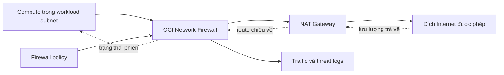
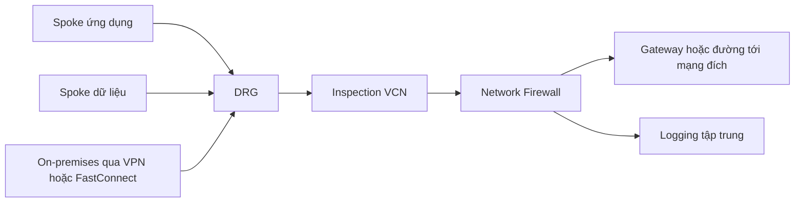

# Network Firewall và kiểm soát lưu lượng tập trung

## 1. Bài toán cần giải quyết

Trong Oracle Cloud Infrastructure (OCI), một ứng dụng thường nằm trên nhiều subnet, VCN hoặc kết nối với hệ thống tại chỗ qua VPN/FastConnect. Nếu mỗi nhóm tự mở đường ra Internet và tự đặt luật cho từng máy chủ, tổ chức khó trả lời ba câu hỏi: lưu lượng đã đi qua điểm kiểm soát nào, policy nào đã cho phép nó và khi xảy ra sự cố phải tìm bằng chứng ở đâu?

**OCI Network Firewall** là dịch vụ firewall mạng được quản lý, dùng để kiểm tra và kiểm soát lưu lượng theo policy. Dịch vụ hỗ trợ xây dựng điểm kiểm soát tập trung cho những đường lưu lượng được định tuyến qua nó. Tính tập trung không đến từ việc chỉ tạo một firewall: phải kết hợp topology mạng, định tuyến, policy, phân quyền IAM và giám sát.

Bài học thuộc chương **Bảo vệ mạng và máy chủ**, tập trung vào:

- Phân biệt Network Firewall với NSG, security list, WAF và firewall trên máy chủ.
- Đưa lưu lượng qua firewall theo cả chiều đi lẫn chiều về.
- Xây dựng policy dựa trên nguồn, đích, dịch vụ và nhu cầu kiểm tra sâu.
- Tổ chức kiểm soát tập trung cho một VCN và mô hình hub–spoke nhiều VCN.
- Kiểm chứng đường đi, hành động của policy, tính sẵn sàng và chi phí vận hành.

Ví dụ xuyên suốt là một ứng dụng chạy trên OCI Compute trong private subnet. Ứng dụng cần tải bản cập nhật từ các đích được phép, kết nối tới cơ sở dữ liệu nội bộ và không được mở kết nối Internet tùy ý. Nhóm bảo mật quản lý firewall và policy; nhóm nền tảng quản lý kết nối, route table; nhóm ứng dụng quản lý workload.

## 2. Network Firewall đứng ở đâu trong kiến trúc bảo vệ?

### 2.1. Các lớp kiểm soát có mục đích khác nhau

| Thành phần | Phạm vi chính | Vai trò điển hình |
| --- | --- | --- |
| NSG | Các VNIC/tài nguyên được đưa vào nhóm theo khả năng hỗ trợ | Cho phép kết nối mạng cần thiết tới hoặc từ một nhóm tài nguyên |
| Security list | Các VNIC trong subnet chịu tác động của danh sách | Cho phép lưu lượng mạng ở phạm vi subnet |
| OCI Network Firewall | Lưu lượng thực sự được đưa qua firewall | Thực thi policy tập trung, kiểm tra lưu lượng và các chức năng bảo vệ được cấu hình |
| WAF | Lưu lượng web đi qua điểm bảo vệ HTTP/HTTPS tương ứng | Bảo vệ ứng dụng web theo đặc tính và yêu cầu lớp ứng dụng |
| Firewall hệ điều hành | Máy chủ hoặc network namespace cụ thể | Giới hạn kết nối tới tiến trình và giao diện trên host |
| IAM | Thao tác quản trị tài nguyên OCI | Quy định ai được tạo, cập nhật firewall, policy, route table và log |

NSG và security list của OCI là các tập luật cho phép; chúng không phải danh sách có luật deny với thứ tự giống policy của một firewall chuyên dụng. Khi nhiều security list/NSG cùng áp dụng, cần xét sự kết hợp các luật cho phép đó. Không suy rằng một nhóm không có luật cho phép sẽ tự phủ nhận luật cho phép ở nhóm khác.

Network Firewall là một lớp thực thi riêng trên đường truyền. Một kết nối có thể được NSG cho phép nhưng vẫn bị firewall chặn. Nó cũng có thể được firewall cho phép nhưng bị host firewall hoặc cấu hình listener của ứng dụng chặn.

### 2.2. Control plane và data plane

- **Control plane** gồm thao tác tạo firewall, sửa policy, cập nhật route table, IAM và logging.
- **Data plane** là các gói tin hoặc phiên kết nối thực tế chạy từ nguồn tới đích.

Tạo thành công tài nguyên firewall là thành công ở control plane. Để data plane được kiểm tra, route phải đưa lưu lượng tới firewall và policy phải phù hợp. Một firewall ở trạng thái sẵn sàng nhưng không nằm trên đường truyền sẽ không bảo vệ được đường đó.

### 2.3. Những điều firewall không tự làm

Việc tạo Network Firewall không tự:

- Thay default route của các subnet ứng dụng.
- Gỡ public IP khỏi Compute hoặc tắt các đường Internet trực tiếp khác.
- Đưa toàn bộ lưu lượng nội bộ của VCN qua firewall.
- Tạo kết nối giữa các VCN chưa được kết nối.
- Thay NAT Gateway, Internet Gateway hoặc DRG.
- Cấu hình TDE, mã hóa volume hoặc bảo mật tài khoản database.
- Cho phép đọc đầy đủ nội dung TLS chỉ bằng cách mở kiểm tra TCP/443.

Firewall chỉ có thể kiểm tra những gì thực sự đi qua nó và những gì cơ chế kiểm tra đã cấu hình có thể quan sát được.

## 3. Các thành phần của OCI Network Firewall

### 3.1. Firewall và firewall policy

**Firewall** là tài nguyên triển khai trong subnet được chọn, có thông tin mạng để các route dẫn lưu lượng tới nó. **Firewall policy** chứa các đối tượng và luật quyết định cách xử lý lưu lượng.

Tách hai khái niệm này giúp trả lời đúng câu hỏi khi có lỗi:

| Câu hỏi | Thành phần cần xem trước |
| --- | --- |
| Gói tin có tới firewall không? | Route table, gateway, DRG, endpoint của firewall |
| Firewall đang áp dụng bộ luật nào? | Liên kết firewall với policy |
| Luật nào phù hợp với kết nối? | Nội dung, thứ tự và điều kiện của security rules |
| Có kiểm tra được dữ liệu mã hóa không? | Decryption policy, chứng chỉ và đặc tính phiên TLS |
| Thay đổi đã có hiệu lực chưa? | Trạng thái tài nguyên, work request và kết quả đọc lại |

Policy có thể dùng các đối tượng tái sử dụng như danh sách địa chỉ, dịch vụ hoặc URL theo khả năng của dịch vụ. Khả năng hỗ trợ ứng dụng, kiểu đối tượng, giới hạn số lượng và cách cập nhật cần được xác nhận cho region, API/provider và cấu hình đang triển khai. Không dùng một bản thiết kế khái niệm làm bằng chứng rằng mọi thuộc tính đều khả dụng trong mọi môi trường.

### 3.2. Các dạng xử lý lưu lượng

Khi thiết kế policy, phân biệt các ý nghĩa sau:

- **Allow**: cho phép lưu lượng theo ngữ nghĩa của luật.
- **Drop**: loại bỏ lưu lượng; phía nguồn thường quan sát timeout.
- **Reject**: từ chối bằng phản hồi phù hợp với giao thức khi hành động này được hỗ trợ.
- **Intrusion detection**: kiểm tra và ghi nhận nguy cơ; không đồng nghĩa với chủ động ngăn mọi nguy cơ phát hiện được.
- **Intrusion prevention**: kiểm tra và áp dụng hành động ngăn chặn theo cơ chế bảo vệ được cấu hình.

Tên trường API có thể biểu diễn kiểm tra xâm nhập bằng một hành động kiểm tra kèm loại inspection. Khi tự động hóa, dùng đúng schema của resource đang sử dụng; không coi các nhãn khái niệm ở trên là JSON có thể gửi nguyên trạng.

Không mặc định một luật Allow đã bật IPS. Nếu mục tiêu là kiểm tra xâm nhập, phải kiểm tra lựa chọn inspection và bằng chứng threat log tương ứng.

### 3.3. Firewall có trạng thái và yêu cầu đối xứng

Firewall theo dõi trạng thái của kết nối. Với một phiên TCP, đường đi và đường về phải đi qua điểm kiểm tra phù hợp để firewall liên hệ được các gói tin với cùng phiên.

Ví dụ đường đi sai:

```text
Chiều đi: Workload -> Network Firewall -> NAT Gateway -> Internet
Chiều về: Internet -> NAT Gateway -> Workload
```

Chiều về đã bỏ qua firewall. Tùy topology và xử lý trạng thái, kết nối có thể thất bại hoặc mất phạm vi kiểm tra mong muốn. Vì vậy thiết kế phải xác định cả hai chiều, không chỉ thêm một default route ở subnet nguồn.

## 4. Thiết kế lab kiểm soát egress trong một VCN

### 4.1. Địa chỉ và tài nguyên minh họa

| Thành phần | Giá trị minh họa |
| --- | --- |
| VCN | `10.60.0.0/16` |
| Workload subnet | `10.60.10.0/24`, private subnet |
| Database subnet, dùng ở phần east–west | `10.60.20.0/24`, private subnet |
| Firewall subnet | `10.60.100.0/24`, dành riêng cho firewall trong lab |
| Địa chỉ riêng firewall | `10.60.100.10`, giá trị giả định sau khi tạo |
| Compute thử nghiệm | `10.60.10.10`, không có public IP |
| Đường ra Internet | NAT Gateway |

Địa chỉ firewall trong bảng chỉ để giải thích đường đi. Khi triển khai, lấy endpoint và định danh đích route mà OCI công bố cho firewall thật. Với cơ chế route tới private IP, chọn đúng đối tượng private IP; không thay một trường yêu cầu OCID bằng chuỗi địa chỉ IP hoặc policy OCID.

Firewall subnet được tách khỏi workload để đơn giản hóa quyền, route và vận hành. NAT Gateway là tài nguyên gateway của VCN, không phải một máy chủ NAT đặt trong firewall subnet.



NAT Gateway cung cấp đường ra với địa chỉ nguồn được chuyển đổi và xử lý lưu lượng trả lời tương ứng. Firewall thực hiện kiểm tra policy; nó không thay thế vai trò NAT chỉ vì nằm trước gateway.

### 4.2. Ma trận định tuyến cần có

Đối với topology egress minh họa, thiết kế route như sau:

| Nơi áp dụng route table | Đích | Next hop dự kiến |
| --- | --- | --- |
| Workload subnet | `0.0.0.0/0` | Endpoint riêng của Network Firewall |
| Firewall subnet | `0.0.0.0/0` | NAT Gateway |
| Route table cho lưu lượng đi vào VCN từ NAT Gateway | `10.60.10.0/24` | Endpoint riêng của Network Firewall |
| Firewall subnet, khi trả về workload | `10.60.10.0/24` | Đường nội bộ tới workload, không quay lại firewall |

Dòng cuối biểu diễn yêu cầu đường đi. Trong topology này, đường nội bộ của VCN có thể đáp ứng nó; không nhất thiết tạo thêm một custom route nếu route nội bộ đã đúng. Quan trọng là không đưa đích workload trở lại chính firewall hoặc NAT Gateway.

Route table gắn với gateway để điều khiển lưu lượng đi vào VCN khác với route table gắn với workload subnet. Khi cấu hình chiều về, phải kiểm tra association thực tế trên NAT Gateway và khả năng ingress routing của topology đã chọn. Chỉ sửa route table của firewall subnet không thay thế được bước này.

### 4.3. Đọc một phiên theo từng chặng

Giả sử Compute mở HTTPS tới một máy chủ thử nghiệm được phép:

1. Compute gửi tới địa chỉ đích Internet. Default route của workload subnet chọn firewall.
2. Firewall đối chiếu policy và trạng thái phiên. Nếu được phép, gói tin được chuyển tiếp theo route phía firewall subnet.
3. Route tới Internet chọn NAT Gateway. Gateway xử lý chuyển đổi địa chỉ để kết nối ra ngoài.
4. Gói trả lời tới NAT Gateway được ánh xạ về Compute nguồn.
5. Route cho lưu lượng đi vào VCN từ gateway đưa gói trả lời qua firewall.
6. Firewall nhận ra chiều trả lời của phiên và chuyển về workload theo đường nội bộ.

Tại mỗi chặng, cần kiểm tra route và các kiểm soát mạng thực sự áp dụng. NSG/security list trên workload, host firewall và listener vẫn có thể ảnh hưởng kết nối. Đối với subnet hoặc endpoint của dịch vụ được quản lý, dùng yêu cầu mạng được hỗ trợ của chính dịch vụ; không giả định mọi endpoint đều cho phép gắn NSG như VNIC của Compute.

### 4.4. Ba lỗi route dễ gặp

**Vòng lặp:** default route của firewall subnet lại trỏ tới firewall. Lưu lượng đã được kiểm tra quay về chính điểm kiểm tra thay vì tới NAT Gateway.

**Bất đối xứng:** default route của workload qua firewall nhưng route chiều về từ gateway về thẳng workload.

**Đường đi vòng:** tồn tại route cụ thể hơn hoặc đường Internet khác đưa một phần lưu lượng bỏ qua firewall. Longest-prefix match có thể làm một route `/32` hoặc route dịch vụ cụ thể thắng default route.

Không chữa các lỗi này bằng cách mở rộng luật Allow. Khi gói tin không đi đúng đường, nới policy thường không giải quyết được nguyên nhân.

## 5. Kiểm soát east–west trong cùng VCN

Lưu lượng giữa các subnet nội bộ thường có đường định tuyến trực tiếp của VCN. Default route `0.0.0.0/0` qua firewall không tự đưa mọi kết nối nội bộ qua firewall, vì đích nội bộ có đường cụ thể hơn.

Nếu cần kiểm tra kết nối từ ứng dụng tới database ở subnet khác, phải thiết kế intra-VCN routing tương ứng. Ví dụ yêu cầu logic:

| Subnet | Đích | Đường mong muốn |
| --- | --- | --- |
| Workload `10.60.10.0/24` | Database `10.60.20.0/24` | Qua firewall |
| Database `10.60.20.0/24` | Workload `10.60.10.0/24` | Qua cùng firewall |
| Firewall subnet | Hai subnet ứng dụng/database | Đi tới subnet đích, không tự lặp |

Dùng các route đích đủ cụ thể và được OCI hỗ trợ để điều khiển đường nội bộ. Trước khi áp dụng, đối chiếu với route cục bộ và mọi custom route đang tồn tại. Xác nhận nguồn và đích thực sự nằm ở hai subnet cần kiểm soát; không suy rằng sửa route table subnet có thể cưỡng bức mọi trao đổi giữa hai máy trong cùng subnet đi qua một firewall ngoài subnet.

Sau khi routing đã đúng, firewall chỉ cho phép cổng database thật sự cần dùng. Ví dụ, nếu ứng dụng dùng Oracle Database qua TCPS trên cổng đã cấu hình, cho phép đúng cổng đó từ subnet/địa chỉ ứng dụng được duyệt. Không mặc định mở đồng thời mọi cổng thường gặp của Oracle Database.

NSG phía database vẫn giới hạn nguồn hợp lệ. Firewall tập trung giúp kiểm soát và quan sát đường liên subnet; nó không thay thế cấu hình TLS, xác thực database hoặc quyền SQL.

## 6. Xây dựng policy từ nhu cầu nghiệp vụ

### 6.1. Lập ma trận kết nối trước khi viết luật

Một yêu cầu tốt mô tả nguồn, đích, giao thức, mục đích, người sở hữu và thời hạn. Tránh yêu cầu chung chung như “mở Internet để ứng dụng chạy”.

Ví dụ ma trận cho lab:

| Luồng | Nguồn | Đích | Dịch vụ | Mục đích |
| --- | --- | --- | --- | --- |
| Cập nhật phần mềm | Workload thử nghiệm | Danh sách máy chủ cập nhật được duyệt | TCP/443 | Tải gói cập nhật |
| Giao dịch database | Workload thử nghiệm | Endpoint database nội bộ | Cổng TCPS đã cấu hình | Giao dịch nghiệp vụ |
| Phân giải tên | Nguồn thực sự cần đi qua firewall | DNS resolver được duyệt | UDP/TCP theo cấu hình DNS | Phân giải tên hợp lệ |
| Kết nối khác | Phạm vi được kiểm soát | Các đích còn lại | Các dịch vụ còn lại | Từ chối theo thiết kế |

Dịch vụ DNS hoặc metadata do OCI cung cấp có thể có đường truy cập nền tảng riêng, chẳng hạn địa chỉ link-local. Không giả định các luồng đó đi qua firewall chỉ vì workload có default route qua firewall. Chỉ đưa chúng vào luật firewall khi đã xác định đường đi và khả năng kiểm soát tương ứng.

### 6.2. Dùng đối tượng có tên và phạm vi rõ ràng

Có thể tổ chức các đối tượng khái niệm như sau:

```text
SRC_APP_LAB       = địa chỉ hoặc CIDR workload được duyệt
DST_UPDATE_TEST   = các địa chỉ đích cập nhật thuộc phạm vi thử nghiệm
DST_DATABASE      = endpoint hoặc CIDR database được duyệt
SVC_HTTPS         = TCP/443
SVC_DB_TCPS       = TCP/cổng TCPS thật của database
```

Đây là ký hiệu thiết kế, không phải cú pháp import policy của OCI. Khi chuyển thành address list, service list hoặc đối tượng khác, dùng đúng loại mà policy hỗ trợ.

Danh sách địa chỉ IP và danh sách URL không có cùng ý nghĩa. Nếu một tên miền dùng nhiều IP, CDN hoặc thay đổi địa chỉ, luật IP có thể thiếu hoặc quá rộng. Ngược lại, lọc URL cần dữ liệu lớp ứng dụng mà firewall thực sự nhìn thấy; không thay thế một loại đối tượng bằng loại khác chỉ vì cùng biểu diễn một dịch vụ nghiệp vụ.

### 6.3. Thứ tự luật và hành động

Ví dụ thứ tự logic:

| Ưu tiên | Điều kiện | Hành động dự kiến |
| --- | --- | --- |
| 10 | Luồng DNS đã xác định thực sự qua firewall, tới resolver được duyệt | Cho phép hoặc kiểm tra theo thiết kế |
| 20 | `SRC_APP_LAB` tới `DST_UPDATE_TEST` qua `SVC_HTTPS` | Kiểm tra với chế độ phòng chống xâm nhập nếu được cấu hình |
| 30 | `SRC_APP_LAB` tới `DST_DATABASE` qua `SVC_DB_TCPS` | Cho phép hoặc kiểm tra theo yêu cầu database |
| 900 | Lưu lượng còn lại trong phạm vi policy | Drop, đồng thời thu thập traffic log phù hợp |

Security rules có thứ tự; một luật rộng khớp sớm có thể làm các luật cụ thể phía sau không được dùng. Khi đưa thiết kế vào OCI, kiểm tra vị trí thực tế, quan hệ với các rule loại khác và hành vi mặc định của policy. Đặt luật kết thúc rõ ràng khi cơ chế policy cho phép, thay vì phụ thuộc vào một giả định về mặc định.

Ví dụ lỗi: đặt `SRC_APP_LAB -> Any -> Any -> Allow` trước luật chặn đích không được duyệt. Luật Allow rộng đã làm mất mục tiêu giới hạn egress, dù luật chặn vẫn có mặt trong danh sách.

Một thay đổi luật cần nêu rõ xử lý với phiên đang tồn tại. Không giả định sửa policy sẽ lập tức đóng mọi phiên TCP cũ. Kiểm thử bằng kết nối mới và đối chiếu cơ chế cập nhật policy của dịch vụ.

### 6.4. Kiểm tra xâm nhập cần bằng chứng riêng

Chuyển từ allowlist mạng sang kiểm tra xâm nhập là bổ sung khả năng phân tích lưu lượng. Cần xác định luật nào áp dụng inspection, chế độ phát hiện hay ngăn chặn, cách ghi threat log và quy trình xử lý false positive.

Một request bị chặn do sai cổng không chứng minh IPS hoạt động. Tương tự, không có threat log trong một bài thử HTTPS thông thường không chứng minh IPS bị lỗi. Bài kiểm tra IPS phải dùng phương pháp thử vô hại, được môi trường cho phép và phù hợp khả năng của dịch vụ; không quét hoặc tấn công các hệ thống Internet không thuộc phạm vi quản lý.

## 7. HTTPS và giới hạn quan sát dữ liệu mã hóa

### 7.1. TCP/443 không đồng nghĩa với URL đã được kiểm tra

Một kết nối tới TCP/443 có thể được nhận diện ở mức địa chỉ, cổng và một số metadata giao thức. Điều đó không có nghĩa firewall đọc được toàn bộ HTTP path, header hoặc nội dung tải về bên trong TLS.

Khi yêu cầu là “chỉ cho phép tải từ một nhóm URL cụ thể”, cần xác định dữ liệu nào có thể quan sát trong chế độ hiện tại. Thông tin tên máy chủ có thể có giới hạn; các cơ chế mã hóa hoặc giao thức mới có thể làm giảm metadata nhìn thấy. Không dùng một kiểm tra cổng thành công để kết luận policy URL đã được thực thi.

### 7.2. TLS decryption là một thay đổi kiến trúc

Khi sử dụng tính năng giải mã TLS được Network Firewall hỗ trợ, phải thiết kế cả decryption policy và quản lý chứng chỉ/khóa liên quan. Hai hướng thường cần phân biệt là kiểm tra kết nối đi ra theo mô hình forward proxy và kiểm tra kết nối tới máy chủ mà tổ chức quản lý.

Các vấn đề phải giải quyết gồm:

- Nguồn chứng chỉ và khóa riêng phù hợp với chế độ giải mã.
- Trust store của client và quy trình triển khai CA được tổ chức phê duyệt.
- Ứng dụng dùng certificate pinning, mutual TLS hoặc cơ chế xác thực không tương thích với việc giải mã trung gian.
- Ngoại lệ đối với dữ liệu hoặc dịch vụ không được phép giải mã theo chính sách tổ chức.
- Ảnh hưởng tới hiệu năng, độ trễ và khả năng xử lý sự cố.
- Quyền đọc vật liệu chứng chỉ/secret của thành phần được hỗ trợ, không phát tán khóa vào log hay pipeline output.

Không dùng tùy chọn bỏ kiểm tra chứng chỉ của client làm cách khắc phục lâu dài. Khi HTTPS lỗi sau khi bật decryption, kiểm tra chuỗi tin cậy, ngoại lệ và chế độ giải mã trước khi thay đổi policy mạng rộng hơn.

## 8. Kiểm soát tập trung trong mô hình hub–spoke

### 8.1. Vai trò của inspection VCN và DRG

Khi nhiều VCN cần cùng một điểm kiểm tra, có thể xây dựng inspection VCN chứa firewall và dùng Dynamic Routing Gateway (DRG) để kết nối các mạng. Mỗi spoke chứa một nhóm workload; hub chứa điểm kiểm tra và các đường kết nối dùng chung theo thiết kế.



Sơ đồ chỉ thể hiện các thành phần. DRG có nhiều attachment và nhiều route table; không có một tuyến duy nhất tự áp dụng cho mọi hướng. Cần thiết kế riêng đường vào inspection VCN, đường sau kiểm tra và chiều về.

### 8.2. Các lớp route phải đồng bộ

| Lớp | Câu hỏi cần trả lời |
| --- | --- |
| Route table subnet ở spoke | Lưu lượng cần kiểm tra có được đưa tới DRG không? |
| DRG route table gắn với attachment nguồn | Đích đó có được đưa tới inspection attachment hay đi thẳng sang mạng khác? |
| Route table phía VCN attachment của inspection VCN | Lưu lượng vào VCN có tới firewall không? |
| Route table của firewall subnet | Sau kiểm tra, gói tin tới gateway/DRG/đích nội bộ nào? |
| DRG route table cho hướng sau kiểm tra | Có chọn đúng attachment đích, tránh quay lại vòng kiểm tra không? |
| Các route chiều về | Có đi qua cùng điểm kiểm tra phù hợp trạng thái phiên không? |

Route import distribution của DRG có thể làm xuất hiện đường trực tiếp giữa các spoke hoặc tới mạng tại chỗ. Vì vậy cần kiểm tra effective routes, không chỉ policy import được khai báo. Một route được import ngoài ý muốn có thể tạo bypass dù firewall policy rất chặt.

Không coi việc gắn tất cả VCN vào cùng DRG là đã kiểm tra lưu lượng tập trung. Kiểm tra cả route table của DRG attachment và route table của VCN/subnet.

### 8.3. Phân vùng policy và trách nhiệm

Tập trung không nhất thiết có nghĩa mọi workload dùng một luật nguồn rất rộng. Policy vẫn nên nhận biết vùng nguồn/đích hoặc CIDR tương ứng với môi trường, ứng dụng và mức độ tin cậy.

Ví dụ: môi trường phát triển được tới kho phần mềm thử nghiệm nhưng không được kết nối database sản xuất. Đường mạng có thể dùng chung hub, nhưng policy cần thể hiện sự phân tách đó.

Tránh coi địa chỉ nguồn luôn được giữ nguyên ở mọi chặng. NAT, load balancer hoặc thiết bị trung gian có thể thay đổi địa chỉ firewall nhìn thấy. Xác định vị trí chuyển đổi địa chỉ trước khi dùng source CIDR làm tiêu chí phân vùng.

## 9. Đưa ingress qua firewall một cách có chủ đích

Lưu lượng từ Internet tới ứng dụng công khai có các yêu cầu khác egress. Trước khi đưa firewall vào đường ingress, xác định endpoint công khai là load balancer, network load balancer, máy chủ hay thành phần khác, và cách địa chỉ nguồn/đích thay đổi trên đường truyền.

Thiết kế phải nêu rõ:

1. Gateway hoặc endpoint nào nhận kết nối từ bên ngoài.
2. Route nào đưa lưu lượng tới firewall trước điểm cần bảo vệ.
3. Lưu lượng sau kiểm tra tới frontend/backend bằng cách nào.
4. Chiều trả lời có qua đúng firewall và giữ được trạng thái cần thiết không.
5. Health check và kết nối quản trị đi theo tuyến nào.

Không sao chép nguyên ma trận egress qua NAT Gateway cho ingress công khai. NAT Gateway không phải cổng công bố dịch vụ cho kết nối Internet chủ động đi vào. Nếu cần bảo vệ web ở lớp HTTP, phối hợp WAF và các lớp khác theo mục tiêu; không coi Network Firewall tự thay thế mọi chức năng WAF.

## 10. Quy trình triển khai có kiểm soát

### 10.1. Chuẩn bị và phân quyền

Ghi rõ compartment chứa firewall/policy, compartment của mạng và workload, region, subnet triển khai, các đường đi dự kiến và người chịu trách nhiệm từng loại thay đổi.

IAM cần phân biệt quyền quản lý firewall/policy với quyền đổi route hoặc gateway. Một người có quyền sửa policy nhưng không quản lý route vẫn có thể gây ảnh hưởng lớn tới lưu lượng đã đi qua firewall; người có quyền đổi route có thể tạo bypass dù không được sửa policy.

Chỉ cấp quyền liên quan trong phạm vi cần thiết. Quyền Logging, lưu giữ log và quyền đọc chứng chỉ/secret nếu dùng TLS decryption cũng cần được xác định. Không cấp quyền toàn tenancy để giải quyết một lỗi thiếu quyền riêng lẻ.

### 10.2. Thứ tự áp dụng

1. Lưu cấu hình mạng hiện tại và đường quản trị độc lập để xử lý khi workload mất kết nối.
2. Tạo subnet và các tài nguyên nền theo topology đã duyệt.
3. Tạo firewall policy, các đối tượng và luật cần cho bài thử.
4. Tạo firewall gắn policy; chờ trạng thái sẵn sàng.
5. Đọc lại định danh firewall, policy, địa chỉ/endpoint và trạng thái.
6. Bật các loại log cần thiết và xác nhận quyền truy cập log.
7. Chuẩn bị route chiều đi, chiều về và đường sau kiểm tra.
8. Chuyển một subnet hoặc phạm vi thử nghiệm trước; không đổi đồng thời toàn bộ đường sản xuất.
9. Chạy các phép thử cho phép, từ chối, chiều về và quan sát log.
10. Mở rộng phạm vi khi đã có bằng chứng, đồng thời tiếp tục theo dõi lỗi và độ trễ.

Không đưa lưu lượng thật tới một policy rỗng hoặc chưa hoàn thiện rồi mới tìm cách bổ sung các luật thiết yếu. Phải hiểu hành vi mặc định và có đường khôi phục trước khi chuyển route.

### 10.3. Tự động hóa

Ví dụ Terraform sau chỉ minh họa mối liên kết firewall–policy trong một dự án đã cấu hình OCI provider và các biến đầu vào:

```hcl
resource "oci_network_firewall_network_firewall_policy" "central" {
  compartment_id = var.security_compartment_id
  display_name   = "central-inspection-policy"
}

resource "oci_network_firewall_network_firewall" "central" {
  compartment_id             = var.security_compartment_id
  subnet_id                  = var.firewall_subnet_id
  display_name               = "central-inspection-firewall"
  network_firewall_policy_id  = oci_network_firewall_network_firewall_policy.central.id
}
```

Đoạn cấu hình chưa chứa security rules, decryption, logging hoặc route table; không phải một hệ thống kiểm soát lưu lượng hoàn chỉnh. Trong triển khai thật, thêm các resource phù hợp phiên bản provider, tạo phụ thuộc theo đúng thứ tự và chỉ chuyển route sau khi policy sẵn sàng.

Xem plan để phân biệt cập nhật tại chỗ và thay thế tài nguyên. Một thay đổi thay thế firewall có thể thay endpoint đích route; không chỉ kiểm tra tên hiển thị. Giữ các thay đổi route, policy và chứng chỉ có thể truy vết cùng phiên bản cấu hình.

## 11. Kiểm chứng đường đi và hành vi policy

### 11.1. Đọc lại cấu hình control plane

Ví dụ OCI CLI dưới đây dùng Bash, với CLI đã xác thực và chọn đúng region. Đây là các lệnh đọc cấu hình; thay placeholder bằng OCID của môi trường thử nghiệm.

```bash
FIREWALL_OCID='<NETWORK_FIREWALL_OCID>'
POLICY_OCID='<NETWORK_FIREWALL_POLICY_OCID>'
RT_WORKLOAD_OCID='<WORKLOAD_ROUTE_TABLE_OCID>'
NAT_GATEWAY_OCID='<NAT_GATEWAY_OCID>'

oci network-firewall network-firewall get \
  --network-firewall-id "$FIREWALL_OCID"

oci network-firewall network-firewall-policy get \
  --network-firewall-policy-id "$POLICY_OCID"

oci network route-table get \
  --rt-id "$RT_WORKLOAD_OCID"

oci network nat-gateway get \
  --nat-gateway-id "$NAT_GATEWAY_OCID"
```

Đối chiếu policy đang gắn với firewall, trạng thái tài nguyên, route rules và association của route table phía gateway. Đọc tiếp các route table và security rules liên quan bằng giao diện hoặc API tương ứng; kết quả lấy metadata policy không nhất thiết chứa đầy đủ mọi đối tượng luật con.

Nếu thao tác trước đó sinh work request, kiểm tra trạng thái cuối cùng. Phản hồi API tiếp nhận thay đổi hoặc công cụ IaC báo đã gửi lệnh chưa đủ chứng minh data plane đã áp dụng xong.

### 11.2. Kiểm thử từ Compute trong workload subnet

Chuẩn bị hai máy chủ HTTPS thử nghiệm do nhóm kiểm soát hoặc được phép sử dụng: một đích thuộc allowlist và một đích nằm ngoài allowlist. Cả hai phải hoạt động bình thường từ một đường kiểm tra độc lập để tránh nhầm máy chủ đích hỏng với firewall chặn.

```bash
ALLOWED_TEST_HOST='<ALLOWED_TEST_HOST>'
DENIED_TEST_HOST='<DENIED_TEST_HOST>'

curl --connect-timeout 5 --max-time 15 \
  -I "https://${ALLOWED_TEST_HOST}/"

curl --connect-timeout 5 --max-time 15 \
  -I "https://${DENIED_TEST_HOST}/"
```

Không dùng tùy chọn bỏ xác minh chứng chỉ TLS. Chọn đích có hỗ trợ phương thức HEAD hoặc thay bằng request thử hợp lệ do nhóm ứng dụng cung cấp.

Kỳ vọng:

- Đích cho phép hoàn tất kết nối và trả phản hồi phù hợp.
- Đích không được phép bị xử lý theo luật từ chối, có bằng chứng log tương ứng.
- Không có đường trực tiếp từ workload tới gateway bỏ qua firewall.

Timeout không tự chứng minh firewall đã chặn. HTTP `403` cũng có thể do máy chủ hoặc lớp bảo vệ web khác trả về. Phải đối chiếu địa chỉ đích thực tế, thời điểm và log của điểm kiểm soát.

### 11.3. Bộ thử tối thiểu

| Phép thử | Điều cần chứng minh |
| --- | --- |
| Kết nối mới tới đích/cổng được phép | Routing hai chiều và luật cho phép hoạt động |
| Kết nối mới tới đích không được phép | Luật từ chối được dùng, không có bypass |
| Kết nối tới cổng không được phép trên một đích hợp lệ | Policy không chỉ kiểm tra địa chỉ đích quá rộng |
| Kết nối database nội bộ | Luồng east–west đi đúng thiết kế và chỉ mở dịch vụ cần dùng |
| Phiên truyền dữ liệu có phản hồi nhiều gói | Chiều về và trạng thái phiên hoạt động, không chỉ kiểm tra được SYN ban đầu |
| Kiểm tra tên miền phân giải thành nhiều IP | Các địa chỉ thực tế được xử lý theo phạm vi policy dự kiến |
| Thay đổi policy có kiểm soát | Kết nối mới phản ánh cấu hình mới sau khi áp dụng hoàn tất |
| Luồng nền tảng/quản trị cần thiết | Không vô tình làm mất DNS, cập nhật agent hoặc đường xử lý sự cố |

Nếu bật IPv6, thiết kế và thử cả lưu lượng IPv6 theo khả năng hỗ trợ của các thành phần. Chỉ kiểm tra `0.0.0.0/0` và policy IPv4 không đủ chứng minh đã kiểm soát một mạng dual-stack.

### 11.4. Log và công cụ quan sát

Kết hợp các nguồn bằng chứng:

| Nguồn | Giá trị sử dụng | Giới hạn cần nhớ |
| --- | --- | --- |
| Traffic log của firewall | Đối chiếu luồng và hành động theo thông tin log cung cấp | Cần bật đúng loại log, đúng phạm vi và tính đến độ trễ thu thập |
| Threat log của firewall | Xem sự kiện từ cơ chế kiểm tra nguy cơ | Không phải mọi kết nối hợp lệ đều tạo sự kiện threat |
| VCN Flow Logs tại điểm được hỗ trợ | Quan sát luồng mạng và quyết định ở lớp kiểm soát tương ứng | Không thay thế kết luận về URL, nội dung hoặc IPS |
| Audit và work request | Xác định ai thay đổi gì, khi nào và kết quả thao tác | Không chứng minh một phiên ứng dụng cụ thể đã chạy qua firewall |
| Log ứng dụng và hệ điều hành | Xác nhận kết nối, lỗi TLS, listener và giao dịch | Cần ghép với bằng chứng mạng để xác định nguyên nhân |

Khi tìm log, dùng thời gian có múi giờ rõ ràng, địa chỉ/cổng nguồn và đích, giao thức, tài nguyên firewall, policy/rule hoặc hành động nếu schema log cung cấp. Không giả định tên field giống nhau giữa mọi loại log.

Traceroute chỉ là tín hiệu hỗ trợ. Firewall hoặc gateway có thể không phản hồi theo cách traceroute mong đợi, vì vậy không thấy một hop không đồng nghĩa lưu lượng bỏ qua firewall. Có thể dùng capture giới hạn trên Compute thử nghiệm để quan sát bắt tay hoặc retransmission, nhưng capture trên host không tự chứng minh policy của firewall đã khớp.

## 12. Chẩn đoán các lỗi thường gặp

| Hiện tượng | Nguyên nhân cần kiểm tra | Hướng xác minh |
| --- | --- | --- |
| Mọi đích Internet đều timeout | Route sai, firewall chưa sẵn sàng, thiếu luật thiết yếu, NAT hoặc chiều về sai | Đọc lại các association và route theo từng chặng trước khi nới policy |
| Chỉ một số đích bỏ qua kiểm tra | Route cụ thể hơn, gateway khác, peering trực tiếp hoặc IPv6 chưa được kiểm soát | Xem effective route, family địa chỉ và đường thực tế của từng đích |
| Bắt tay TCP hoặc phiên bị gián đoạn | Bất đối xứng, trạng thái phiên, MTU hoặc thành phần mạng khác | Đối chiếu chiều đi/về, log và gói retransmission |
| Policy có luật Allow nhưng kết nối vẫn lỗi | Luật trước đã khớp, đối tượng sai, firewall gắn policy khác hoặc lỗi ở lớp khác | Xác nhận policy đang dùng, thứ tự luật và địa chỉ/cổng thực tế |
| Có kết nối nhưng không có threat log | Không phát sinh nguy cơ, chưa bật đúng logging hoặc luật không thực hiện inspection | Kiểm tra chế độ inspection và dùng bài thử vô hại được hỗ trợ |
| HTTPS lỗi sau khi bật decryption | Client không tin CA, pinning/mTLS hoặc ngoại lệ không phù hợp | Kiểm tra chuỗi tin cậy và thiết kế decryption, không tắt kiểm tra TLS trên client |
| Sửa policy nhưng phiên cũ chưa đổi hành vi | Phiên đã tồn tại hoặc thay đổi chưa áp dụng xong | Kiểm tra work request và mở kết nối mới để thử |
| Không có log ở firewall | Lưu lượng chưa qua firewall hoặc logging chưa đúng | Tách kiểm tra routing khỏi kiểm tra cấu hình log |
| Ứng dụng nội bộ vẫn kết nối trực tiếp | Chỉ cấu hình default route Internet | Thiết kế thêm intra-VCN routing hai chiều nếu cần kiểm tra east–west |

Quy trình điều tra nên đi từ cấu hình đã đọc lại, đường đi hai chiều, luật khớp, rồi tới kiểm tra sâu và ứng dụng. Thay nhiều luật và nhiều route cùng lúc làm mất khả năng xác định thay đổi nào đã gây ra hoặc sửa lỗi.

## 13. Tính sẵn sàng, rollback và chi phí

### 13.1. Dịch vụ được quản lý vẫn cần thiết kế vận hành

OCI quản lý hạ tầng dịch vụ Network Firewall, nhưng khách hàng vẫn chịu trách nhiệm topology, policy, route, chứng chỉ và phạm vi kiểm soát. Không cấu hình route tới các node nội bộ giả định; dùng endpoint mà dịch vụ hỗ trợ.

Đánh giá tác động khi firewall không khả dụng, policy sai hoặc đường tới gateway/DRG lỗi. Không mặc định mạng sẽ tự đi vòng qua firewall hoặc tự fail-open. Nếu mục tiêu là bắt buộc kiểm tra, đường đi vòng chưa được kiểm soát có thể vi phạm thiết kế ngay cả khi giúp kết nối hoạt động trở lại.

Với nhiều region, chuẩn bị tài nguyên firewall, policy, routing và logging theo region tương ứng. Một firewall ở region này không tự kiểm tra mọi luồng ở region khác. Bài diễn tập DR phải gồm cả khả năng kiểm soát lưu lượng, không chỉ việc khởi động được workload.

### 13.2. Kế hoạch rollback phải cụ thể

Trước khi chuyển route, lưu lại route rules, association và policy cũ, cùng thứ tự khôi phục. Duy trì đường quản trị không phụ thuộc hoàn toàn vào luồng đang thử để tránh mất khả năng sửa lỗi.

Nếu rollback đưa lưu lượng về đường trực tiếp, phải xác định rõ đó có phải trạng thái được phép của hệ thống hay không, thời gian duy trì và các biện pháp bù đắp. Không tự động tạo bypass như một phản ứng mặc định với mọi cảnh báo.

Sau rollback, kiểm tra lại phiên mới và các đường chiều về. Việc khôi phục một route table chưa đủ nếu gateway association hoặc DRG route table cũng đã thay đổi.

### 13.3. Chi phí của kiểm soát tập trung

Ước lượng chi phí theo mô hình tính phí và cấu hình thực tế của dịch vụ, không sử dụng một con số cố định cho mọi region và thời điểm. Các thành phần cần xét gồm firewall, lưu lượng được xử lý, logging/lưu giữ log, gateway, kết nối liên mạng/liên region và tài nguyên thử nghiệm.

Tập trung nhiều luồng có thể tăng phạm vi ảnh hưởng, lưu lượng xử lý và độ trễ trên một tuyến. TLS decryption, inspection và lượng log cần được đánh giá bằng tải đại diện. Không suy năng lực xử lý hoặc thời gian hội tụ từ việc một lệnh `curl` đã thành công.

Đặt retention và quyền đọc log phù hợp. Log mạng có thể chứa thông tin nhạy cảm về đích truy cập hoặc cấu trúc hệ thống; chỉ thu thập, lưu giữ và chia sẻ theo nhu cầu vận hành đã xác định.

## 14. Bài thực hành tổng hợp

### 14.1. Chuẩn bị

Dùng tenancy hoặc compartment thử nghiệm, một private workload subnet, một firewall subnet riêng, NAT Gateway và Compute không có public IP. Dự trù chi phí firewall, logging và các tài nguyên lab trước khi tạo.

Chuẩn bị đích HTTPS cho phép/từ chối thuộc phạm vi thử nghiệm. Nếu thực hành east–west, thêm database hoặc dịch vụ thử ở subnet thứ hai. Không dùng database sản xuất chỉ để kiểm tra luật mạng.

### 14.2. Thực hiện

1. Vẽ đường đi và chiều về cho egress, ghi rõ route table gắn với từng subnet/gateway.
2. Tạo policy với đối tượng nguồn/đích cụ thể, luật cần thiết và hành vi từ chối phần còn lại.
3. Tạo firewall, chờ sẵn sàng và đọc lại policy/endpoint.
4. Bật traffic log và threat log theo mục tiêu bài thử.
5. Chuẩn bị route phía firewall và gateway; chuyển workload thử nghiệm qua firewall theo kế hoạch.
6. Thử đích/cổng được phép và đích/cổng không được phép bằng kết nối mới.
7. Đối chiếu kết quả với log, không kết luận chỉ từ timeout hoặc mã HTTP.
8. Kiểm tra route cụ thể hơn, đường qua gateway khác và IPv6 nếu có để tìm bypass.
9. Nếu làm east–west, cấu hình hai chiều và chứng minh kết nối database đi qua đúng điểm kiểm tra.
10. Thực hành rollback trong phạm vi lab, xác nhận cả kết nối và trạng thái bảo vệ sau khôi phục.
11. Dọn tài nguyên theo thứ tự phụ thuộc: chuyển route khỏi tài nguyên sẽ xóa, xác nhận không còn lưu lượng cần dùng, rồi xóa tài nguyên lab và xử lý log theo chính sách lưu giữ.

Không xóa firewall khi route vẫn đang trỏ tới nó. Một bài lab đã hoàn tất chức năng nhưng để lại next hop không còn tồn tại có thể làm gián đoạn các tài nguyên tiếp tục sử dụng VCN đó.

### 14.3. Tiêu chí hoàn thành

| Hạng mục | Điều kiện đạt |
| --- | --- |
| Phạm vi | Xác định đúng region, compartment, subnet và các đường cần kiểm soát |
| Định tuyến | Giải thích được next hop cho cả hai chiều, không có vòng lặp hoặc đường tắt ngoài thiết kế |
| Policy | Phân biệt allow, deny và inspection; kiểm tra thứ tự luật và hành vi mặc định |
| Egress | Đích được phép hoạt động, đích không được phép bị xử lý đúng với bằng chứng log |
| East–west | Nếu thuộc phạm vi lab, có route hai chiều và luật database đúng dịch vụ |
| TLS | Không nhầm kiểm tra TCP/443 với kiểm tra toàn bộ URL/nội dung; mô tả được điều kiện decryption |
| Giám sát | Có thể ghép thay đổi quản trị, traffic log và kết quả ứng dụng theo thời gian |
| Khôi phục | Thực hiện được rollback có kiểm soát và không để lại route tới firewall đã xóa |
| Chi phí | Nhận diện các tài nguyên tính phí và xử lý tài nguyên lab còn lại |

## 15. Những nguyên tắc cần giữ

Kiểm soát tập trung chỉ đạt được khi các luồng trong phạm vi thực sự đi qua Network Firewall, policy thực thi đúng mục tiêu và hệ thống có bằng chứng vận hành. Routing quyết định firewall có nhìn thấy lưu lượng hay không; policy quyết định xử lý lưu lượng nhìn thấy như thế nào.

Trong OCI, cần phối hợp subnet route table, gateway ingress routing và DRG khi topology yêu cầu; luôn thiết kế chiều về và tìm các route tạo bypass. Duy trì NSG, bảo vệ host, TLS, IAM và các kiểm soát database phù hợp. Mỗi lớp có trách nhiệm riêng, và phép thử hoàn thành phải chứng minh cả kết nối hợp lệ lẫn khả năng từ chối lưu lượng ngoài phạm vi.
