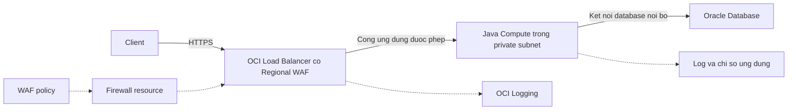

# Web Application Firewall và bảo vệ ứng dụng web

Trong chương **Bảo vệ mạng và máy chủ** của module `CLOUD_PROVIDERS_ORACLE`, bài này trình bày cách sử dụng OCI Web Application Firewall để kiểm soát lưu lượng HTTP, phát hiện các mẫu tấn công web phổ biến và triển khai cơ chế chặn có thể quan sát, điều chỉnh và phục hồi.

Tình huống xuyên suốt là một ứng dụng Java chạy trên OCI Compute trong private subnet, truy cập cơ sở dữ liệu Oracle bằng đường mạng nội bộ. Người dùng gọi ứng dụng qua OCI Load Balancer. Nhóm vận hành cần hạn chế request độc hại nhưng vẫn giữ các luồng đăng nhập, tìm kiếm, tải tệp và tích hợp API hợp lệ.

Trọng tâm thực hành là **Regional WAF gắn với OCI Load Balancer**. Edge WAF được giới thiệu để người học phân biệt kiến trúc, thuật ngữ và phạm vi tính năng.

Sau bài học, người học có thể:

- Chọn đúng vị trí WAF trong kiến trúc bảo vệ nhiều lớp.
- Phân biệt WAF policy, firewall resource, rule, condition và action.
- Thiết kế access control, protection rules, body inspection và rate limiting.
- Đưa rule từ quan sát sang chặn theo bằng chứng về lưu lượng hợp lệ.
- Kiểm chứng enforcement bằng request thực tế, log WAF và log ứng dụng.
- Ngăn truy cập đi vòng qua điểm bảo vệ và kiểm soát ảnh hưởng khi thay policy.

## 1. WAF bảo vệ điều gì trong một ứng dụng web?

WAF kiểm tra các thuộc tính của lưu lượng web theo chính sách được cấu hình. OCI WAF có các khả năng bảo vệ trước những mẫu như SQL injection và cross-site scripting, viết tắt XSS. Dịch vụ có mô hình enforcement theo region và tại edge. [Overview of Web Application Firewall](https://docs.oracle.com/en-us/iaas/Content/WAF/Concepts/overview.htm).

Một request hợp lệ ở tầng mạng vẫn có thể mang nội dung nguy hiểm:

```text
TCP 443 được phép qua NSG
    -> bắt tay TLS hợp lệ
    -> HTTP request có tham số hoặc nội dung đáng ngờ
    -> WAF áp dụng policy trước khi request được chuyển đến ứng dụng
```

NSG cho phép TCP 443 không có nhiệm vụ hiểu câu truy vấn tìm kiếm, JSON hoặc mẫu XSS. Ngược lại, WAF không phải cơ chế quản trị SSH, vá hệ điều hành hay phân quyền truy cập dữ liệu trong database.

| Lớp bảo vệ | Trách nhiệm chính trong tình huống của bài |
| --- | --- |
| NSG và security list | Giới hạn nguồn, đích, protocol và port ở mức mạng |
| TLS | Bảo vệ kết nối và xác minh danh tính theo cấu hình tin cậy |
| WAF | Áp dụng kiểm soát HTTP và phát hiện mẫu request theo policy |
| Ứng dụng Java | Xác thực, phân quyền, kiểm tra dữ liệu và xử lý nghiệp vụ |
| Database | Quyền tài khoản, truy vấn an toàn và kiểm soát truy cập dữ liệu |
| Bảo vệ máy chủ | Vá lỗi, cấu hình dịch vụ, tài khoản và giám sát tiến trình |

Ví dụ, parameterized query trong Java vẫn cần thiết ngay cả khi WAF đã bật nhóm rule SQL injection. WAF có thể giảm rủi ro khai thác một lớp lỗi, nhưng không sửa câu SQL nối chuỗi trong mã nguồn.

WAF cũng không thể tự hiểu đầy đủ quyền sở hữu một đơn hàng. Một request đọc đơn hàng của người khác có thể hoàn toàn bình thường về cú pháp HTTP; ứng dụng phải kiểm tra quyền đối với đúng đối tượng đó.

## 2. Phân biệt Regional WAF và Edge WAF

### 2.1. Regional WAF trên Load Balancer

WAF policy là cấu hình bảo vệ theo region. Firewall resource tạo liên kết giữa policy và điểm enforcement, trong bài là OCI Load Balancer. Một policy có thể được dùng với nhiều Load Balancer trong cùng region; Network Load Balancer và listener TCP không phải các đối tượng tương thích của WAF policy này. [Getting Started with Web Application Firewall Policies](https://docs.oracle.com/en-us/iaas/Content/WAF/Policies/getting_started_with_waf-policies.htm).

Listener phải xử lý HTTP ở tầng ứng dụng. Để phục vụ HTTPS, cấu hình TLS ở listener HTTP phù hợp để Load Balancer xử lý lưu lượng đã giải mã. Không kỳ vọng WAF đọc được HTTP nằm trong một luồng TLS được chuyển tiếp nguyên vẹn bằng TCP passthrough.

Regional WAF có thể bảo vệ ứng dụng public hoặc private trên Load Balancer phù hợp. Vì vậy, nhu cầu bảo vệ API nội bộ cũng có thể thuộc phạm vi của kiến trúc này. [Bài thực hành Oracle về WAF trên Flexible Load Balancer](https://docs.oracle.com/en/learn/oci-waf-flex-lbaas/index.html).

### 2.2. Edge WAF

Với Edge WAF, client truy cập qua hạ tầng edge rồi edge chuyển request đến origin. Cấu hình thường liên quan tên miền, DNS và kiểm soát nguồn kết nối đến origin. Đây là đường triển khai khác với việc gắn Regional WAF vào Load Balancer. [Getting Started with Edge Policies](https://docs.oracle.com/en-us/iaas/Content/WAF/Concepts/gettingstarted.htm).

Các chức năng challenge như JavaScript, human interaction hoặc CAPTCHA được mô tả trong luồng Edge Policies. Không tự áp các bước và tính năng đó vào policy regional nếu chưa xác nhận hỗ trợ. [Managing Edge Policies](https://docs.oracle.com/en-us/iaas/Content/WAF/Tasks/managingwaf.htm).

| Khía cạnh | Regional WAF trong bài | Edge WAF |
| --- | --- | --- |
| Điểm enforcement | Tích hợp với Load Balancer trong region | Hạ tầng edge phía trước origin |
| Gắn bảo vệ | Policy và firewall resource | Edge policy, domain và origin |
| Đường lưu lượng | Client đến Load Balancer đã gắn WAF | Client đến edge rồi đến origin |
| Điểm cần kiểm chứng | Rule, association và các đường đến backend | DNS, TLS, edge policy và truy cập trực tiếp origin |

Khi đọc tài liệu, xác nhận đang ở phần **WAF Policies** hay **Edge Policies**. Trạng thái, tên action, API, logging và các giới hạn không nên được suy từ loại này sang loại kia.

## 3. Kiến trúc mẫu và kiểm soát đường đi vòng



Sơ đồ mô tả các vai trò logic. Regional WAF là tích hợp tại Load Balancer, không phải một Compute instance mà người học phải tự chèn vào route table.

### 3.1. Không để backend có đường public không được bảo vệ

Nếu ứng dụng vẫn có public IP mở port 8080, một request có thể đến thẳng Compute mà không qua Load Balancer đã gắn WAF. Một hostname cũ hoặc Load Balancer phụ chưa gắn policy cũng có thể tạo đường đi vòng.

Một thiết kế tham khảo:

| Tài nguyên | Luồng ingress được thiết kế |
| --- | --- |
| Load Balancer | Các port frontend thực sự cần cho client |
| Backend Compute | Port ứng dụng từ nhóm hoặc nguồn Load Balancer phù hợp |
| Database | Port database từ nhóm ứng dụng cần truy cập |
| Quản trị máy chủ | Đường quản trị riêng được kiểm soát |

Với NSG trong cùng VCN, có thể dùng NSG nguồn trong security rule để mô tả quan hệ giữa Load Balancer và backend. Phải đối chiếu khả năng hỗ trợ của tài nguyên và bố trí cả traffic health check cần thiết. [Managing Security Rules for an NSG](https://docs.oracle.com/en-us/iaas/Content/Network/Concepts/manage-nsg-security-rules.htm).

Kiểm tra toàn bộ security lists và NSGs liên quan. Các rule áp dụng cho một VNIC được kết hợp theo phép hợp; thêm một NSG hạn chế không tự triệt tiêu rule rộng đang cho phép traffic ở security list khác. [Security Rules](https://docs.oracle.com/en-us/iaas/Content/Network/Concepts/securityrules.htm).

### 3.2. Kiểm tra tất cả cửa vào

Lập danh sách hostname, listener, IP public, endpoint dự phòng và đường nội bộ. Đối với mỗi cửa vào, ghi rõ có cần WAF không, policy nào bảo vệ và ai chịu trách nhiệm kiểm tra.

Một origin chỉ được coi là đã khóa đường đi vòng khi phép thử từ nguồn không được phép không thể gọi trực tiếp ứng dụng. Việc request qua hostname chính bị WAF chặn chưa chứng minh điều này.

Với Edge WAF, ngoài backend còn cần bảo vệ chính origin khỏi kết nối trực tiếp không qua edge. Thực hiện theo mô hình nguồn kết nối và yêu cầu origin hiện hành của Edge WAF; không dùng một header do client tùy ý gửi làm bằng chứng duy nhất rằng request đến từ edge.

### 3.3. Tách bảo vệ request khỏi bảo vệ kết nối

Chứng chỉ TLS ở frontend không tự mã hóa chặng Load Balancer–backend. Nếu kiến trúc yêu cầu TLS trên chặng đó, cấu hình riêng chứng chỉ và xác minh peer cho backend. WAF chỉ là một phần của đường xử lý HTTP, không thay thế thiết kế TLS giữa các thành phần.

## 4. Policy, rule và action phải được đọc cùng nhau

### 4.1. Các đối tượng cấu hình

| Đối tượng | Vai trò |
| --- | --- |
| WAF policy | Chứa cấu hình access control, rate limiting, protections và actions |
| Firewall resource | Liên kết policy với Load Balancer cần enforcement |
| Rule | Một đơn vị kiểm soát với phạm vi và hành động xác định |
| Condition | Điều kiện để rule áp dụng |
| Action | Cách tiếp tục, ghi nhận hoặc trả phản hồi khi rule khớp |
| Network address list | Tập địa chỉ hoặc dải mạng dùng trong policy |

Tạo policy nhưng chưa gắn firewall resource vào đúng Load Balancer không bảo vệ đường request. Tương tự, policy đã gắn nhưng rule chưa có phạm vi phù hợp có thể không xử lý endpoint mong muốn.

### 4.2. Thứ tự xử lý tổng quát

Đối với request đi qua các bước liên quan mà chưa bị kết thúc xử lý, thứ tự module của WAF policy regional là:

```text
requestAccessControl
    -> requestRateLimiting
    -> requestProtection
    -> backend xu ly request
    -> responseAccessControl
    -> responseProtection
```

Thứ tự module và thứ tự rule bên trong module ảnh hưởng đến kết quả. Đặc biệt, xử lý ở phía response xảy ra sau khi backend có thể đã thực hiện thao tác. [Thứ tự xử lý WAF Policies](https://docs.oracle.com/en-us/iaas/Content/WAF/Policies/getting_started_with_waf-policies.htm).

Vì vậy, không dùng việc thay response bằng mã lỗi như một biện pháp bảo đảm thao tác ghi dữ liệu chưa diễn ra. Khi cần ngăn request đến ứng dụng, phải chặn ở nhánh request thích hợp.

### 4.3. Ý nghĩa của ba action

| Action | Hành vi |
| --- | --- |
| Allow | Bỏ qua các rule còn lại trong module hiện tại |
| Check | Ghi nhận kết quả, tiếp tục xử lý rule |
| Return HTTP response | Kết thúc xử lý request hoặc response và trả phản hồi cấu hình |

`Allow` không có nghĩa bỏ qua toàn bộ WAF policy. `Check` ở một rule cũng không bảo đảm request sẽ đi đến backend nếu rule khác vẫn chặn. Khi return response ở phía request, request không được chuyển đến backend bởi action đó. [Actions for Web Application Firewalls](https://docs.oracle.com/en-us/iaas/Content/WAF/Actions/actions_management.htm).

Thiết kế response phù hợp client. Có thể chọn 403 cho kiểm soát truy cập hoặc 429 cho rate limiting trong cấu hình của bài; đây là lựa chọn vận hành, không phải kết quả mặc định của mọi rule. Tránh response chứa stack trace, tên bảng database hoặc mô tả chi tiết mẫu phát hiện nội bộ.

## 5. Access control và điều kiện theo endpoint

OCI WAF dùng JMESPath cho rule conditions và cung cấp dữ liệu về request, response và kết nối cho quá trình đánh giá. [Understanding Conditions](https://docs.oracle.com/en-us/iaas/Content/WAF/Concepts/understanding_conditions.htm).

Ví dụ điều kiện lab nhận diện đúng một path:

```text
http.request.url.path == '/__waf_lab__/blocked'
```

Nếu gắn condition trên vào request access rule có action trả 403, nhóm vận hành có một phép thử enforcement không phụ thuộc mẫu SQL injection hoặc XSS. Điều kiện tự nó chưa chặn; action đi kèm mới quyết định hành vi.

Ví dụ condition cho một API lab được thiết kế chỉ sử dụng GET, POST và OPTIONS:

```text
starts_with(http.request.url.path, '/api/') && !contains(['GET', 'POST', 'OPTIONS'], http.request.method)
```

Đây là ví dụ giới hạn method cho API cụ thể. Không áp danh sách đó lên một API cần PUT, PATCH hoặc DELETE. Cũng cần kiểm tra CORS preflight, callback thanh toán, webhook và công cụ tích hợp.

### 5.1. Cẩn thận với độ rộng của condition

Điều kiện prefix `/admin` có thể khớp cả `/administrator` nếu dùng thao tác bắt đầu bằng chuỗi. Một path chính xác có thể không bao phủ dấu gạch chéo cuối hoặc các route con. Thiết kế phạm vi theo routing thực tế, rồi kiểm tra các biểu diễn URL mà hệ thống chấp nhận.

Không suy ra rằng mọi lớp proxy và ứng dụng đều chuẩn hóa URL giống nhau. Khi điều tra một request, so sánh biểu diễn path ở WAF với route mà Java thực sự xử lý.

### 5.2. Địa chỉ IP không phải danh tính người dùng

Nếu có CDN hoặc reverse proxy phía trước, địa chỉ nguồn kết nối mà WAF nhìn thấy có thể là địa chỉ của proxy. `X-Forwarded-For` do client tự gửi không phải dữ liệu đáng tin nếu đường proxy chưa kiểm soát việc ghi đè, bổ sung và xác minh nguồn.

Trước khi dùng IP để giới hạn hoặc tạo ngoại lệ, xác nhận WAF đang đánh giá địa chỉ nào trong cấu hình thực tế. Kiểm tra cả người dùng đi qua NAT, proxy doanh nghiệp và IPv6 nếu kiến trúc hỗ trợ.

Geo hoặc ASN có thể là tín hiệu lọc lưu lượng, nhưng không thay thế authentication. Không dùng điều kiện vùng địa lý như bằng chứng rằng request thuộc một tài khoản doanh nghiệp cụ thể.

## 6. Protection rules: lựa chọn theo ứng dụng và điều chỉnh ngoại lệ

Protection rules sử dụng các protection capabilities do OCI cung cấp. WAF policy regional không cung cấp custom protection rules theo nghĩa tự viết mẫu protection signature tùy ý; điều này khác với việc viết custom condition cho access rule. Chọn capability và phiên bản từ danh sách hiện hành trong Console. [Request Protection Rules](https://docs.oracle.com/en-us/iaas/Content/WAF/Protections/protections_management.htm).

Với ứng dụng Java trong tình huống của bài, có thể đánh giá các nhóm liên quan đến SQL injection, XSS, đường dẫn bất thường, protocol và stack công nghệ đang dùng. Chọn theo rủi ro và dạng request thực tế, không coi việc bật càng nhiều capability càng bảo đảm an toàn.

### 6.1. Hai loại sai lệch cần theo dõi

- **False positive:** request hợp lệ bị nhận diện là nguy hiểm hoặc bị chặn.
- **False negative:** request nguy hiểm không bị rule đang áp dụng phát hiện hoặc ngăn lại.

Ví dụ false positive có thể xuất hiện khi người dùng lưu đoạn HTML vào trình soạn thảo, tìm kiếm văn bản có ký tự đặc biệt hoặc gửi chuỗi trông giống cú pháp SQL trong một tài liệu. Phải kiểm tra context và quyền của endpoint, không chỉ nhìn một chuỗi đáng ngờ.

Một mẫu request được cho qua cũng không chứng minh nó an toàn. Ứng dụng vẫn phải giới hạn kích thước, kiểm tra schema, dùng truy vấn tham số hóa và encode output theo đúng context.

### 6.2. Quan sát trước, chặn có phạm vi

Một cách triển khai tham khảo:

1. Chọn nhóm capabilities theo ứng dụng và ghi rõ mục tiêu phát hiện.
2. Đặt các capabilities đang đánh giá vào hành vi Check thích hợp.
3. Thu thập lưu lượng đại diện cho các luồng nghiệp vụ và loại client.
4. Điều tra mẫu khớp, phân loại hợp lệ hay không hợp lệ.
5. Tạo ngoại lệ hẹp hoặc điều chỉnh phạm vi khi có lý do rõ ràng.
6. Chuyển các capability đạt yêu cầu sang hành vi chặn rồi kiểm tra lại.

Kiểm tra cả action của rule, override ở capability và các hành động khác trong policy. Một rule đang Check không làm toàn bộ policy thành chế độ chỉ quan sát.

### 6.3. Ngoại lệ phải có chủ sở hữu và giới hạn

Đối với endpoint soạn thảo nội dung, một ngoại lệ có thể cần giới hạn theo host, path, method và trường dữ liệu liên quan. Tùy khả năng exclusion của OCI, kết hợp phạm vi rule với exclusion được hỗ trợ; không giả định mọi chiều điều kiện đều có trong cùng một hộp exclusion.

Một bản ghi thiết kế ngoại lệ có thể gồm:

```text
Ly do: noi dung HTML hop le trong truong mo ta
Pham vi route: endpoint chinh sua noi dung da xac thuc
Pham vi field: truong mo ta can xu ly
Capability bi anh huong: ID va version da dieu tra
Chu so huu: nhom ung dung
Dieu kien xem lai: thay doi schema hoac phien ban ung dung
Ngay het han ngoai le: theo ke hoach van hanh
```

Đây là thông tin quản trị thay đổi, không phải schema JSON gửi trực tiếp vào OCI. Tránh vô hiệu hóa nhóm SQL injection hoặc XSS trên toàn ứng dụng chỉ để xử lý một field đặc thù.

## 7. Request body inspection và giới hạn dữ liệu được kiểm tra

Theo tài liệu OCI hiện hành, request body không được protection rules kiểm tra theo mặc định; phải bật body inspection cho rule phù hợp. WAF buffer body trước khi chuyển tiếp, và khoảng cấu hình số byte kiểm tra là 0–8.192 byte. Cần chọn hành động khi body vượt giới hạn. [HTTP Request Body Inspection](https://docs.oracle.com/en-us/iaas/Content/WAF/Protections/request-body-inspection.htm).

Điểm quan trọng là **giới hạn kiểm tra không đồng nghĩa giới hạn kích thước upload được ứng dụng chấp nhận**. Nếu cấu hình chỉ kiểm tra phần đầu rồi tiếp tục, phần còn lại không có cùng bảo đảm đã được protection rule phân tích.

| Lựa chọn thiết kế | Đánh đổi cần đánh giá |
| --- | --- |
| Kiểm tra phần body trong giới hạn rồi tiếp tục | Giữ luồng dữ liệu lớn nhưng còn phần không được kiểm tra |
| Trả phản hồi khi vượt giới hạn | Giới hạn vùng dữ liệu lọt qua nhưng có thể chặn upload hợp lệ |
| Tách các endpoint có loại body khác nhau | Cho phép điều chỉnh theo nghiệp vụ, cần quản lý thêm rule |

Ví dụ API JSON nhỏ có thể áp dụng giới hạn chặt hơn endpoint tải tài liệu. Tuy nhiên, endpoint upload vẫn cần giới hạn kích thước, loại tệp, quyền truy cập và cơ chế kiểm tra tệp ở lớp ứng dụng hoặc dịch vụ xử lý tương ứng. WAF không tự trở thành hệ thống quét mã độc cho mọi tệp.

Kiểm tra với đúng `Content-Type`, JSON, form hoặc multipart mà ứng dụng sử dụng. Đừng dùng kết quả kiểm tra query string để kết luận rằng body JSON đã được kiểm tra.

Body buffering có thể làm thay đổi latency và đặc điểm xử lý upload. Đo tác động với request hợp lệ, nhất là streaming hoặc upload dài; xem giới hạn của đúng loại policy đang dùng thay vì lấy giới hạn Edge WAF áp cho Regional WAF.

## 8. Rate limiting cho endpoint có chi phí hoặc rủi ro cao

Regional WAF rate limiting giới hạn tần suất theo từng địa chỉ IP client. Có thể cấu hình số request, khoảng thời gian và thời gian áp dụng action; rule cũng có condition để khoanh vùng lưu lượng. [Rate Limiting](https://docs.oracle.com/en-us/iaas/Content/WAF/RateLimiting/rate_limiting_rule_management.htm), [Adding a Rate Limiting Rule](https://docs.oracle.com/en-us/iaas/Content/WAF/RateLimiting/create_rate_limiting_rule.htm).

Các endpoint thường cần đánh giá riêng gồm đăng nhập, khôi phục mật khẩu, tìm kiếm tốn tài nguyên và xuất báo cáo. Không dùng một ngưỡng duy nhất cho toàn bộ website nếu ảnh, API nền, webhook và các thao tác người dùng có đặc tính khác nhau.

### 8.1. Ngưỡng xuất phát từ hành vi thật

Giả sử một endpoint tìm kiếm hợp lệ thường có tối đa vài request mỗi giây cho một phiên làm việc, nhưng nhiều người dùng có thể chia sẻ cùng IP công ty. Đặt một ngưỡng theo IP mà chỉ tính một người sẽ chặn nhầm cả nhóm.

Cần xem:

- Burst khi trang tải nhiều request song song.
- Lưu lượng từ NAT, proxy, hệ thống tích hợp và giám sát.
- Thời gian action có thể ảnh hưởng các request tiếp theo.
- Các retry tự động của SDK hoặc client sau lỗi.
- Khả năng kẻ gây quá tải phân tán request qua nhiều IP.

Rate limiting theo IP là một lớp kiểm soát. Với quota theo tài khoản hoặc tenant, đặt thêm giới hạn ở lớp đã xác thực danh tính. Không lấy một header account ID chưa được xác thực làm cơ sở miễn giới hạn.

### 8.2. Không dùng rate limit làm bộ đếm nghiệp vụ chính xác

Đo hành vi enforcement thực tế ở kiến trúc triển khai, kể cả lưu lượng song song và nhiều điểm xử lý. Không giả định một rate rule là giao dịch đếm chính xác toàn cục cho thanh toán, quota dịch vụ hoặc số lần tiêu thụ một quyền lợi.

Ứng dụng vẫn cần timeout, giới hạn concurrency, backpressure và kiểm soát truy vấn tốn tài nguyên. WAF cũng không thay thế toàn bộ cơ chế bảo vệ DDoS ở tầng mạng.

## 9. Triển khai Regional WAF trong compartment thử nghiệm

### 9.1. Chuẩn bị quyền và baseline

Chuẩn bị Load Balancer hoạt động, listener HTTP ở tầng ứng dụng, backend khỏe và đường quản trị riêng. Với HTTPS, chứng chỉ và cấu hình TLS phải hoạt động trước khi dùng kết quả HTTP để đánh giá WAF.

OCI dùng resource types như `waf-policy`, `web-app-firewall`, `waf-network-address-list` và nhóm tổng hợp `waf-family`. Ví dụ vai trò chỉ đọc tài nguyên regional:

```text
Allow group WafObservers to read waf-policy in compartment AppSecurity
Allow group WafObservers to read web-app-firewall in compartment AppSecurity
```

Các policy trên không cấp quyền thay đổi WAF, sửa Load Balancer hoặc đọc log. Cấp quyền quản trị và logging theo nhiệm vụ thực tế, đối chiếu điều kiện của từng API và tài nguyên liên quan. [Policy Details for Web Application Firewall](https://docs.oracle.com/en-us/iaas/Content/Identity/Reference/wafpolicyreference_topic-Details_for_WAF_Policies.htm).

Ghi baseline của ứng dụng: tỷ lệ lỗi, latency, các route quan trọng và kết quả health check. Không bắt đầu từ một backend đang lỗi rồi quy mọi phản hồi 5xx cho WAF.

### 9.2. Tạo policy và enforcement point

Trong OCI Console:

1. Chọn đúng region và compartment của bài lab.
2. Tạo WAF policy regional với tên và tags thể hiện chủ sở hữu.
3. Kiểm tra actions, default actions và các rule sẵn có trước khi thêm cấu hình.
4. Tạo firewall resource liên kết policy với Load Balancer lab.
5. Chờ thao tác hoàn tất, đọc lại policy và firewall resource.
6. Bật WAF logging rồi gửi request để kiểm tra đường enforcement.

Chưa cần bật chặn hàng loạt protection capabilities. Trước hết chứng minh đúng policy đã gắn vào đúng đường request.

### 9.3. CLI để đọc trạng thái và tạo liên kết lab

Ví dụ PowerShell, giả định policy lab đã được tạo và các biến OCID đều thuộc môi trường thử nghiệm:

```powershell
$wafPolicyId = '<WAF_POLICY_OCID_CUA_LAB>'
$firewallId = '<WEB_APP_FIREWALL_OCID_CUA_LAB>'

oci waf web-app-firewall-policy get --web-app-firewall-policy-id $wafPolicyId
if ($LASTEXITCODE -ne 0) { throw 'Khong doc duoc WAF policy' }

oci waf web-app-firewall get --web-app-firewall-id $firewallId
if ($LASTEXITCODE -ne 0) { throw 'Khong doc duoc firewall resource' }
```

Đây là hai lệnh đọc riêng cho policy và firewall resource. [CLI policy get](https://docs.oracle.com/en-us/iaas/tools/oci-cli/latest/oci_cli_docs/cmdref/waf/web-app-firewall-policy/get.html), [CLI firewall get](https://docs.oracle.com/en-us/iaas/tools/oci-cli/latest/oci_cli_docs/cmdref/waf/web-app-firewall/get.html).

Nếu chưa tạo firewall resource bằng Console và Load Balancer lab chưa có liên kết tương ứng, có thể dùng:

```powershell
$compartmentId = '<COMPARTMENT_OCID_CUA_LAB>'
$loadBalancerId = '<LOAD_BALANCER_OCID_CUA_LAB>'

oci waf web-app-firewall create-for-load-balancer --compartment-id $compartmentId --load-balancer-id $loadBalancerId --web-app-firewall-policy-id $wafPolicyId --display-name 'lab-java-waf'
if ($LASTEXITCODE -ne 0) { throw 'Can kiem tra ket qua tao firewall va work request' }
```

Thao tác tạo dùng work request để theo dõi tiến độ. Sau phản hồi ban đầu hoặc timeout, đọc lại tài nguyên và trạng thái xử lý trước khi thử tạo thêm. [CLI create-for-load-balancer](https://docs.oracle.com/en-us/iaas/tools/oci-cli/latest/oci_cli_docs/cmdref/waf/web-app-firewall/create-for-load-balancer.html).

Không dùng lệnh tạo liên kết như cách retry mù khi một tài nguyên có thể đã tồn tại. Ghi lại OCID và kết quả của đợt thay đổi để tránh cấu hình trùng hoặc sai môi trường.

## 10. Bài lab kiểm chứng enforcement và lưu lượng hợp lệ

Các phép thử sau chỉ gửi đến endpoint lab do người học kiểm soát. Không cần quét lỗ hổng diện rộng để chứng minh rule đã hoạt động.

### 10.1. Chuẩn bị hai route thử nghiệm

Ứng dụng lab cần có route đọc an toàn `/__waf_lab__/blocked` và `/__waf_lab__/rate`, ban đầu trả thành công. Tên route là quy ước của bài, không phải endpoint có sẵn của OCI.

Trước khi thêm rule chặn, gọi từng route để ghi baseline. Sau đó tạo request access rule với condition path chính xác ở mục 5 và action trả 403 cho `/__waf_lab__/blocked`.

Giả sử DNS và TLS của `app.lab.example.com` đã được cấu hình trong lab:

```powershell
$baseUrl = 'https://app.lab.example.com'

curl.exe --silent --show-error --connect-timeout 5 --max-time 15 --output NUL --write-out 'HTTP=%{http_code}\n' "$baseUrl/health"
curl.exe --silent --show-error --connect-timeout 5 --max-time 15 --output NUL --write-out 'HTTP=%{http_code}\n' "$baseUrl/__waf_lab__/blocked"
```

Thay `/health` bằng route kiểm tra thật của ứng dụng. Nếu dùng CA riêng, cung cấp CA tin cậy phù hợp cho curl thay vì tắt xác minh TLS.

Kết quả mong đợi sau khi rule đã áp dụng: route sức khỏe vẫn trả kết quả bình thường; route bị chặn nhận 403 theo action đã cấu hình. Đồng thời kiểm tra log cho thấy response do request access rule tạo, không phải 403 sẵn có từ ứng dụng.

### 10.2. Chứng minh khác biệt giữa Check và chặn

Đổi chính rule thử nghiệm sang Check, chờ cập nhật hoàn tất rồi gọi lại cùng request. Nếu các lớp khác không chặn, request sẽ đến backend và nhận phản hồi của ứng dụng; log ghi nhận rule đã khớp.

Chuyển lại action chặn rồi lặp phép thử. Đối chiếu cả phản hồi phía client lẫn log backend. Không chỉ nhìn việc có log khớp rule để kết luận enforcement đang bật.

### 10.3. Kiểm tra một rate rule với tải nhỏ

Tạo rate rule chỉ cho path `/__waf_lab__/rate`. Ví dụ lab có thể chọn 5 request trong 30 giây, action duration 10 giây và response 429. Các giá trị này là thiết kế thử nghiệm, không phải mặc định OCI hoặc ngưỡng production.

Gửi một số request nhỏ từ cùng máy kiểm tra:

```powershell
1..8 | ForEach-Object {
    curl.exe --silent --show-error --connect-timeout 5 --max-time 10 --output NUL --write-out 'HTTP=%{http_code}\n' "$baseUrl/__waf_lab__/rate"
    Start-Sleep -Milliseconds 500
}
```

Quan sát lúc xuất hiện response do rate rule tạo và xác minh khả năng truy cập trở lại sau thời gian cấu hình. Không nghiệm thu bằng giả định máy móc rằng mọi kiến trúc đều phải chặn chính xác request thứ sáu. Kiểm tra thêm client khác hoặc luồng NAT theo nhu cầu thực tế.

### 10.4. Kiểm tra protection và body inspection riêng

Với capability đã chọn, dùng mẫu kiểm thử bảo mật của nhóm trong môi trường lab có dữ liệu thử nghiệm. Ghi rõ request nằm ở query, header hay body; kiểm tra rule nào khớp và action nào thực sự kết thúc request.

Với body inspection, thử một body hợp lệ nhỏ và một body vượt giới hạn đã cấu hình. Xác minh hành động vượt giới hạn đúng thiết kế; không dùng việc một query string bị chặn làm bằng chứng cho khả năng kiểm tra toàn bộ JSON hoặc tệp upload.

### 10.5. Chạy lại các luồng hợp lệ

Kiểm tra đăng nhập, tìm kiếm có dấu tiếng Việt, nội dung có ký tự đặc biệt, CORS, webhook và upload đúng định dạng. Thử từ các client đại diện như trình duyệt, Java HTTP client và công cụ tích hợp.

Bổ sung phép thử truy cập trực tiếp backend từ nguồn không được phép và đi qua endpoint dự phòng. Kết quả cần phản ánh kiến trúc đã thiết kế, không chỉ hostname chính.

## 11. Logging, tương quan sự kiện và cảnh báo

Bật log cho firewall trong OCI Logging. Nếu cần phân tích tập trung, có thể dùng Connector Hub chuyển log sang Log Analytics theo cấu hình riêng; không bắt buộc triển khai toàn bộ luồng đó để bắt đầu quan sát. [Setting Up Firewall Logging](https://docs.oracle.com/en-us/iaas/Content/WAF/Protections/setting_up_logging_analytics.htm).

Trong log WAF regional, các trường hữu ích gồm `request.id`, `request.path`, `response.code`, `responseProvider` và các nhóm thông tin matched rules. `backendStatusCode` giúp đối chiếu phản hồi upstream khi có dữ liệu tương ứng. [Details For Web Application Firewall Logs](https://docs.oracle.com/en-us/iaas/Content/Logging/Reference/details_for_lbwaf.htm).

### 11.1. Điều tra một response bị chặn

Một luồng điều tra tham khảo:

1. Ghi thời gian, host, path, method và mã tương quan có sẵn từ client.
2. Tìm request trong log đúng firewall, region và khoảng thời gian.
3. Xem nguồn tạo response và module/rule liên quan.
4. Đối chiếu với log Load Balancer và ứng dụng nếu cần.
5. Phân loại do access rule, rate rule, protection, ứng dụng hoặc một lớp phía trước.
6. Xác định request hợp lệ bị chặn nhầm hay request đúng mục tiêu kiểm soát.

Mã HTTP không tự xác định nguyên nhân. 403 có thể đến từ WAF hoặc ứng dụng; 429 có thể đến từ rate rule hoặc dịch vụ backend. Nếu lỗi xảy ra ở DNS, TCP hoặc TLS trước HTTP, không nên kỳ vọng luôn có bản ghi WAF tương ứng.

### 11.2. Chỉ số phải gắn với nghiệp vụ

Các chỉ số sau là mục tiêu thiết kế quan sát, không phải tên metric mặc định của OCI:

| Chỉ số | Ý nghĩa |
| --- | --- |
| Lưu lượng theo host, route và nhóm client | Nhận biết thay đổi tải và tập client |
| Tỷ lệ chặn theo rule | Phát hiện rule mới có ảnh hưởng bất thường |
| Request hợp lệ bị chặn đã xác nhận | Đo false positive bằng bằng chứng nghiệp vụ |
| Latency và tỷ lệ lỗi ứng dụng | Nhận biết tác động sau cập nhật policy |
| Lỗi đăng nhập, thanh toán hoặc webhook | Phát hiện luồng quan trọng bị ảnh hưởng |
| Đường truy cập chưa gắn WAF | Theo dõi khoảng trống coverage |

Một đợt tăng block có thể là tấn công thật hoặc một bản phát hành frontend làm request thay đổi. Không dùng số block tăng làm bằng chứng duy nhất rằng cấu hình mới tốt hơn.

### 11.3. Dữ liệu log cũng cần được bảo vệ

Path hoặc matched data có thể chứa thông tin nhạy cảm. Không đưa password, token hoặc dữ liệu cá nhân vào query string; không xuất toàn bộ header Authorization hoặc cookie phiên vào báo cáo điều tra.

Giới hạn quyền đọc log, thời hạn giữ, nơi chuyển tiếp và khả năng truy cập dữ liệu đã lưu. Mã tương quan nên được xử lý nhất quán giữa các lớp; một header do client tùy ý gửi không tự trở thành định danh đáng tin cậy của hệ thống.

## 12. Vận hành thay đổi policy, rollback và kiểm soát chi phí

### 12.1. Bắt đầu từ thay đổi nhỏ có thể đánh giá

Một policy dùng chung cho nhiều Load Balancer có phạm vi ảnh hưởng lớn. Trước khi sửa, lập danh sách mọi firewall và ứng dụng đang sử dụng policy. Nếu các ứng dụng có đặc tính khác nhau, cân nhắc tách policy hoặc giới hạn condition rõ ràng.

Lưu cấu hình mong muốn trong quy trình quản lý thay đổi của nhóm, đọc cấu hình hiện tại trước cập nhật và kiểm tra kết quả sau áp dụng. Với API hoặc IaC, đối chiếu schema của đúng tài nguyên và dùng cơ chế kiểm soát cập nhật đồng thời khi được hỗ trợ. Không gửi một cấu hình rút gọn làm mất các rule hoặc action đang dùng.

Một bản thay đổi cần ghi rõ: rule nào đổi, capability/version liên quan, traffic hợp lệ đã thử, log cần quan sát và thao tác phục hồi cụ thể. Giữ quyền quản trị tách khỏi đường gọi ứng dụng để một rule chặn API không làm nhóm vận hành mất luôn đường sửa policy.

### 12.2. Rollback theo nguyên nhân

Nếu request hợp lệ bị chặn nhầm sau một thay đổi, dừng mở rộng và xác định rule thực sự tạo response. Có thể phục hồi cấu hình rule đã thay đổi, đưa đúng capability về Check hoặc thu hẹp condition theo bằng chứng.

Không đổi một rule ngẫu nhiên sang Check khi response do rule khác hoặc hành động vượt giới hạn body tạo ra. Không mở public backend để giúp người dùng đi vòng WAF trong lúc điều tra.

Nếu lưu lượng đúng là tấn công, việc tắt toàn bộ WAF để giảm số lỗi sẽ loại bỏ chính biện pháp đang bảo vệ hệ thống. Phối hợp chủ ứng dụng và nhóm an ninh để chọn điều chỉnh hẹp, giữ kiểm soát cần thiết và xử lý nguyên nhân ở ứng dụng hoặc backend.

### 12.3. WAF là lớp giảm rủi ro, ứng dụng vẫn phải được sửa

Khi xuất hiện lỗ hổng mới, một rule phù hợp có thể đóng vai trò giảm thiểu tạm thời trong khi triển khai bản vá. Cần xác nhận đúng endpoint, kiểu request và khả năng phát hiện; không coi rule là bằng chứng mọi biến thể khai thác đã được ngăn.

Sau khi vá, chạy lại kiểm tra hợp lệ và kiểm tra bảo mật, xem xét giữ hay điều chỉnh rule dựa trên rủi ro. Các lỗi phân quyền nghiệp vụ, lộ secrets, cấu hình host và database vẫn cần được xử lý tại lớp sở hữu chúng.

### 12.4. Kiểm soát tài nguyên và lượng dữ liệu

Dự toán theo lưu lượng, số tài nguyên, logging, lưu trữ và các dịch vụ phân tích được chọn. Đối chiếu bảng giá hiện hành khi lập chi phí thật; không giả định WAF hoặc toàn bộ pipeline log luôn miễn phí.

Giới hạn thời gian chạy tải lab, retry và số request thử. Chọn retention đáp ứng nhu cầu điều tra, kiểm soát dữ liệu chuyển qua Connector Hub và dọn tài nguyên thử nghiệm sau khi không còn phụ thuộc. Không xóa policy đang được nhiều ứng dụng dùng chỉ vì một Load Balancer lab đã kết thúc.

## 13. Các lỗi triển khai cần nhận biết

| Biểu hiện | Nguyên nhân cần kiểm tra | Hướng xử lý |
| --- | --- | --- |
| Policy tồn tại nhưng không thấy enforcement | Chưa tạo firewall resource hoặc gắn sai Load Balancer | Kiểm tra OCID, region và liên kết thực tế |
| Không gắn được vào Network Load Balancer | Chọn sai điểm enforcement cho Regional WAF | Dùng Load Balancer và listener tương thích |
| Một rule Check nhưng request vẫn bị chặn | Module khác, capability override hoặc body limit action | Tìm nguồn response trong log |
| Allow rule không bỏ qua protection | Allow chỉ kết thúc rule trong module hiện tại | Thiết kế ngoại lệ đúng phạm vi cần điều chỉnh |
| Query bị kiểm tra nhưng JSON body lọt qua | Body inspection chưa bật hoặc vùng kiểm tra không đủ | Kiểm tra đúng rule, loại body và giới hạn |
| Người dùng công ty cùng bị rate limit | Nhiều người chia sẻ IP NAT hoặc proxy | Điều chỉnh ngưỡng, phạm vi và giới hạn theo danh tính ở ứng dụng |
| Upload hợp lệ bị lỗi sau thay đổi | Oversize action, buffering hoặc giới hạn liên quan | Kiểm tra đường upload và điều kiện riêng của endpoint |
| Backend bị gọi trực tiếp | Public IP, listener phụ hoặc security rule rộng | Đóng đường đi vòng và kiểm tra lại từ nguồn không được phép |
| Tăng 5xx nhưng không có block tương ứng | Backend, TLS hoặc đường mạng có lỗi | Đối chiếu health, log Load Balancer và ứng dụng |
| Sửa một ứng dụng làm nhiều ứng dụng lỗi | Policy dùng chung có phạm vi rộng | Quản lý danh sách consumers và tách phạm vi hợp lý |

## 14. Tiêu chí hoàn thành bài thực hành

Bài lab đạt yêu cầu khi có bằng chứng cho cả hiệu lực bảo vệ và tính sẵn sàng của ứng dụng:

- Đúng policy regional được liên kết với đúng Load Balancer trong region đã chọn.
- Request thử nghiệm path chính xác bị chặn bởi rule mong đợi, có log xác nhận nguồn response.
- Khi chuyển rule thử nghiệm sang Check, hành vi quan sát được phù hợp với các rule còn lại.
- Các luồng hợp lệ quan trọng vẫn thành công qua WAF.
- Body inspection và hành động khi vượt giới hạn được kiểm tra độc lập.
- Rate limiting được xác minh với tải nhỏ, có đánh giá tác động NAT hoặc proxy.
- Backend và các cửa vào khác không tạo đường đi vòng ngoài thiết kế.
- Có quyền IAM phù hợp, logging, chủ sở hữu cảnh báo và thao tác rollback cụ thể.
- Có kế hoạch vá ứng dụng, bảo vệ máy chủ, kiểm soát database và dọn tài nguyên lab.

Kết quả cần đạt không chỉ là một policy có trạng thái hoạt động. WAF phải nằm trên đúng đường request, thực thi đúng rule, giữ được lưu lượng hợp lệ và cung cấp đủ bằng chứng để nhóm vận hành hiểu vì sao một request được cho qua hoặc bị chặn.
