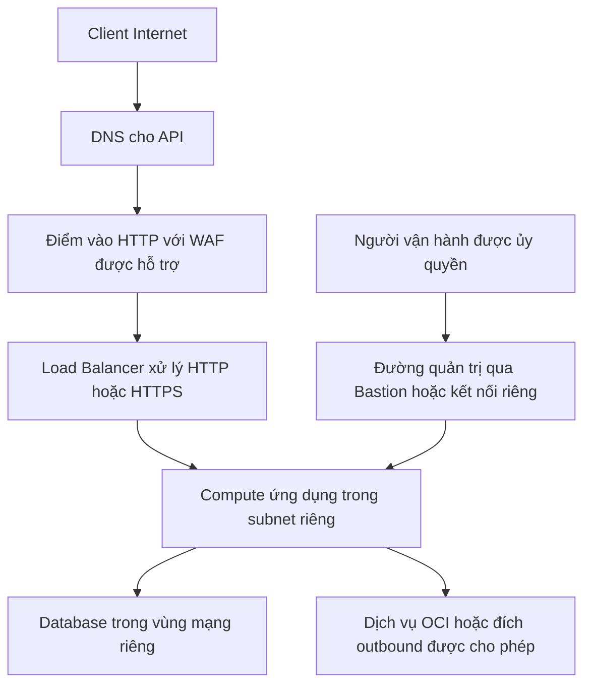

# Bảo vệ trước DDoS và thiết kế giảm bề mặt tấn công

## 1. Mục tiêu và bối cảnh OCI

Một hệ thống có HTTPS vẫn có thể ngừng phục vụ nếu đường truyền, bộ cân bằng tải, worker ứng dụng hoặc connection pool cơ sở dữ liệu bị cạn tài nguyên. Ngược lại, mở thêm Compute không giải quyết được một cổng quản trị đang công khai hoặc một endpoint có thể tạo truy vấn cực kỳ tốn kém.

Trong chương **Bảo vệ mạng và máy chủ** của lộ trình Oracle Cloud Infrastructure (OCI), bài học này kết hợp tenancy, compartment, IAM, VCN, Load Balancer, Compute và các dịch vụ dữ liệu để thiết kế phòng thủ nhiều lớp. Mục tiêu gồm duy trì tính sẵn sàng, thu hẹp tài nguyên có thể bị truy cập trực tiếp, giám sát được tác động và kiểm soát chi phí khi lưu lượng tăng.

Sau bài học, bạn có thể:

- Phân biệt DDoS ở tầng mạng/vận chuyển với lạm dụng ở tầng HTTP và tài nguyên ứng dụng.
- Chọn đúng vai trò của bảo vệ hạ tầng OCI, WAF, NSG, security list và kiểm soát trên máy chủ.
- Thiết kế đường vào có kiểm soát, backend riêng tư và đường quản trị tách biệt.
- Tránh để origin hoặc một listener khác trở thành đường vòng qua lớp bảo vệ.
- Thu thập bằng chứng, xử lý sự cố và kiểm tra cấu hình bằng lưu lượng thử nhỏ trong môi trường được phép.

**DDoS — Distributed Denial of Service** — là làm suy giảm hoặc mất dịch vụ bằng lưu lượng hay yêu cầu được tạo từ nhiều nguồn. Giảm bề mặt tấn công là giảm số tài nguyên, giao thức, cổng, endpoint và quyền có thể bị đối tượng không mong muốn sử dụng. Hai việc hỗ trợ nhau nhưng không thay thế nhau.

## 2. Nhận diện loại tấn công và điểm nghẽn

### 2.1. Không phải mọi đợt tăng tải đều giống nhau

| Nhóm tình huống | Tài nguyên bị tiêu hao | Hướng phòng thủ chính |
| --- | --- | --- |
| Lưu lượng lớn ở tầng mạng | Băng thông và năng lực xử lý gói tin | Bảo vệ ở hạ tầng/mạng phía trước workload, phối hợp nhà cung cấp khi cần |
| Tấn công tầng vận chuyển, như gây áp lực lên kết nối TCP | Trạng thái kết nối, hàng đợi và tài nguyên xử lý kết nối | Bảo vệ tầng mạng/vận chuyển, cấu hình bộ cân bằng tải và timeout phù hợp |
| HTTP flood hoặc bot gọi liên tục | Năng lực xử lý HTTP của WAF, Load Balancer và ứng dụng | WAF, kiểm soát lưu lượng, cache và giới hạn đồng thời |
| Yêu cầu ít nhưng đắt | CPU, bộ nhớ, connection pool, truy vấn hoặc dịch vụ phía sau | Kiểm soát chi phí mỗi yêu cầu, timeout, giới hạn tài nguyên và phân quyền |
| Lạm dụng đăng nhập, tìm kiếm hoặc API có tính phí | Tài khoản, backend và ngân sách | Hạn mức theo danh tính/chức năng, phát hiện bất thường, chống bot theo khả năng hỗ trợ |
| Tăng tải hợp lệ | Năng lực phục vụ thực tế | Dự báo, cache, mở rộng có giới hạn và ưu tiên nghiệp vụ |

Một báo cáo tạo trong vài phút có thể gây tốn tài nguyên hơn hàng nghìn yêu cầu lấy nội dung tĩnh. Vì vậy, số request/giây là một chỉ báo, không phải thước đo đầy đủ cho mức độ nguy hiểm.

Phân biệt DDoS với lỗi triển khai, lỗi DNS, chứng chỉ hết hạn, database chậm hoặc sự kiện kinh doanh tạo tải thật. Bật chặn rộng khi chưa biết nguyên nhân có thể làm gián đoạn chính người dùng hợp lệ.

### 2.2. Xác định mục tiêu bảo vệ

Trước khi chọn rule, ghi rõ:

- Chức năng nào phải tiếp tục hoạt động, chẳng hạn đăng nhập và xử lý giao dịch.
- Chức năng nào có thể giảm ưu tiên, chẳng hạn xuất báo cáo lớn.
- Chỉ số thành công: tỷ lệ giao dịch thành công, độ trễ, số lỗi và thời gian phục hồi.
- Năng lực giới hạn của Load Balancer, backend, database và dịch vụ phụ thuộc.
- Chi phí chấp nhận được trong một đợt tăng tải.

Không dùng việc “WAF đã chặn nhiều request” làm kết luận duy nhất. Nếu giao dịch hợp lệ vẫn thất bại vì database cạn kết nối, mục tiêu sẵn sàng chưa được đáp ứng.

## 3. Các lớp bảo vệ trong OCI

### 3.1. Bảo vệ hạ tầng và kiểm soát của khách hàng

OCI cung cấp cơ chế bảo vệ DDoS ở lớp hạ tầng đối với các dạng lưu lượng mạng/vận chuyển trong phạm vi dịch vụ. Đây là một phần của nền tảng, không phải bằng chứng rằng mọi kiểu lạm dụng HTTP hoặc mọi cấu hình ứng dụng đều được xử lý tự động.

Khách hàng vẫn phải cấu hình đường vào, bảo vệ HTTP, giảm endpoint công khai, kiểm soát tài nguyên ứng dụng và chuẩn bị ứng phó. Không suy ra một mức băng thông, thời gian giảm thiểu hay cam kết chi phí cụ thể nếu chưa đối chiếu dịch vụ và thỏa thuận áp dụng.

| Thành phần | Vai trò | Giới hạn cần hiểu |
| --- | --- | --- |
| Bảo vệ hạ tầng OCI | Phát hiện/giảm thiểu các dạng tấn công mạng và vận chuyển theo cơ chế nền tảng | Không thay thế phân quyền API hay giới hạn truy vấn tốn tài nguyên |
| OCI WAF | Kiểm tra và xử lý HTTP(S) ở điểm thực thi được hỗ trợ | Không phải tường lửa cho mọi giao thức hay mọi public IP |
| Load Balancer | Phân phối yêu cầu, kiểm tra backend và làm điểm vào tập trung | Bản thân cân bằng tải không bảo đảm mọi request đều hợp lệ |
| NSG và security list | Cho phép lưu lượng theo giao thức, cổng và nguồn/đích | Không hiểu ý nghĩa truy vấn SQL hoặc nội dung nghiệp vụ HTTP |
| Firewall trên host | Bảo vệ các cổng của máy và bổ sung giới hạn tại host | Nằm sau đường mạng; không tự cứu được đường vào đã bão hòa |
| Ứng dụng và database | Giới hạn chi phí xử lý, đồng thời và quyền theo danh tính | Cần thiết kế cụ thể theo chức năng |
| IAM và quản trị cấu hình | Hạn chế người có thể mở cổng, đổi WAF hoặc cấp public access | Không thay thế lọc lưu lượng data plane |

OCI có các mô hình và tài nguyên WAF với cách triển khai khác nhau. Xác nhận điểm thực thi, loại Load Balancer hoặc endpoint được hỗ trợ, chức năng và khả năng ghi log trước khi áp dụng. Không mặc định một cấu hình WAF ở edge và một policy gắn với Load Balancer có cùng cách bảo vệ origin.

### 3.2. Một thiết bị không nên gánh tất cả mục tiêu

Đưa một network firewall hoặc một máy proxy vào đường đi có thể bổ sung kiểm soát, nhưng cũng tạo thêm giới hạn năng lực và phụ thuộc tính sẵn sàng. Cần thiết kế route, đường đi đối xứng khi có yêu cầu trạng thái, khả năng mở rộng và xử lý sự cố.

Đặt firewall trên một Compute nhỏ phía sau đường Internet không thay thế được bảo vệ lưu lượng lớn ở phía trước. Tương tự, tăng số backend chỉ có ích khi điểm nghẽn thực sự có thể chia tải và dịch vụ phía sau vẫn còn năng lực.

## 4. Thiết kế đường vào và backend

### 4.1. Kiến trúc mẫu

Giả sử ứng dụng quản lý đơn hàng có một API HTTPS, chạy trên Compute và dùng Oracle Database.



Sơ đồ thể hiện các vai trò logic. WAF có thể được thực thi ngay tại lớp tích hợp Load Balancer; không bắt buộc có một hop mạng riêng giữa WAF và Load Balancer. Chọn một mô hình triển khai thực tế và xác minh toàn bộ đường đi của request.

Các nguyên tắc chính:

1. Công khai số điểm vào cần thiết, thường là endpoint HTTPS cho nghiệp vụ.
2. Backend không có đường vào Internet trực tiếp cho cổng ứng dụng hoặc quản trị.
3. Database chỉ nhận lưu lượng từ nhóm ứng dụng cần thiết.
4. Đường quản trị có xác thực, thời hạn và nguồn truy cập được kiểm soát.
5. Outbound được thiết kế theo nhu cầu, thay vì mở mọi đích vì tiện triển khai.
6. Các tài nguyên được gắn với compartment, chủ sở hữu và cấu hình có thể kiểm tra.

Subnet riêng và NSG không tự bật TLS. Cấu hình mã hóa, xác thực chứng chỉ và quản lý secrets vẫn cần được thực hiện riêng ở từng chặng.

### 4.2. Ma trận kết nối tối thiểu

Ví dụ dưới đây dùng một Load Balancer HTTP(S) đóng vai trò proxy và backend trong cùng VCN. Port ứng dụng và database chỉ là lựa chọn minh họa.

| Đích | Lưu lượng cần cho phép | Nguồn cần kiểm soát | Không mở theo thói quen |
| --- | --- | --- | --- |
| Listener công khai | TCP 443 | Client được phép theo mô hình dịch vụ; nếu có edge riêng, xét nguồn từ edge | Cổng quản trị của backend |
| Backend ứng dụng | TCP 8443 trong ví dụ | NSG của Load Balancer hoặc nguồn thực tế được dịch vụ hỗ trợ | Toàn Internet hoặc toàn dải VCN khi không cần |
| Database | Port dịch vụ database đã chọn | NSG của ứng dụng hoặc nguồn được xác định | Máy người dùng Internet |
| SSH của Compute | TCP 22 nếu cần | Đường Bastion/kết nối riêng được phép theo cấu hình thực tế | `0.0.0.0/0` và `::/0` |
| Health check | Port và giao thức health check | Thành phần kiểm tra backend | Endpoint quản trị mở công khai |
| Kết nối ra ngoài | Đích và port cần thiết | Workload có nhu cầu hợp lệ | Mọi giao thức tới mọi đích |

Không sao chép quy tắc nguồn của proxy Load Balancer sang Network Load Balancer hoặc một chế độ bảo toàn địa chỉ nguồn mà chưa kiểm tra. Nguồn gói tin mà backend nhìn thấy có thể khác; policy phải theo đường dữ liệu thực tế.

### 4.3. NSG và security list có tính cộng gộp

Trong OCI, lưu lượng có thể được cho phép bởi các rule security list áp dụng cho subnet và các NSG liên quan tới VNIC. Một NSG siết chặt không tự phủ định một rule rộng ở security list.

Ví dụ, backend có NSG chỉ cho phép port 8443 từ Load Balancer, nhưng security list của subnet lại cho phép cùng port từ `0.0.0.0/0`. Nếu backend còn có đường mạng công khai hợp lệ, rule rộng có thể làm mất mục tiêu giới hạn nguồn.

Khi đánh giá một cổng, kiểm tra đồng thời:

- Public/private IP và khả năng tiếp cận địa chỉ đó.
- Route table, Internet Gateway và các thành phần trung gian.
- Tất cả security list và NSG liên quan.
- Rule stateful/stateless và lưu lượng chiều về tương ứng.
- Firewall hệ điều hành và tiến trình thực sự đang lắng nghe.

NSG và security list không phải danh sách deny theo thứ tự mà một dòng hẹp tự ghi đè dòng rộng. Chỉ xóa rule rộng sau khi xác định tác động và có cấu hình thay thế đúng.

### 4.4. IPv6 và đường truy cập phụ

Kiểm tra IPv6 riêng. Việc loại bỏ một rule IPv4 rộng không xử lý một rule IPv6 cho phép `::/0`. DNS AAAA, địa chỉ IPv6, route và listener phải được đưa vào cùng danh mục bề mặt công khai.

Các đường truy cập phụ thường bị bỏ sót gồm:

- Public IP cũ của máy chủ sau khi đã chuyển sang Load Balancer.
- Listener hoặc hostname thử nghiệm chưa gắn policy cần thiết.
- Dashboard vận hành, API quản trị, cổng debug hoặc endpoint health quá chi tiết.
- Bucket public, đường dẫn được cấp quyền truy cập và file backup phát hành ngoài dự kiến.
- Môi trường dev/test dùng chung dữ liệu hoặc credential với production.

Không phải tài nguyên công khai nào cũng có thể hoặc nên đặt sau cùng một WAF. Với các dịch vụ dữ liệu, phải dùng IAM và cơ chế kiểm soát truy cập của chính dịch vụ.

### 4.5. Đường ra và đường quản trị

NAT Gateway phục vụ một số mô hình outbound cho workload riêng tư; nó không phải proxy WAF cho inbound. Service Gateway cung cấp đường tới các dịch vụ OCI được hỗ trợ theo cấu hình route, không phải lối truy cập mọi đích Internet.

Ưu tiên đường quản trị qua OCI Bastion hoặc kết nối riêng phù hợp, với IAM, phiên có thời hạn và quyền đúng mục tiêu. Tách tài khoản vận hành khỏi danh tính ứng dụng; không cho người quản trị thay WAF hoặc mở public IP chỉ để xử lý một lỗi ứng dụng mà chưa đánh giá tác động.

## 5. Tránh đường vòng qua WAF

### 5.1. Phải biết WAF được thực thi ở đâu

| Mô hình | Rủi ro cần xét | Bằng chứng cần có |
| --- | --- | --- |
| Reverse proxy/edge trước origin công khai | Client truy cập origin trực tiếp, bỏ qua policy ở edge | Origin chỉ nhận nguồn/kênh hợp lệ theo mô hình hỗ trợ |
| WAF thực thi tại Load Balancer | Một đường vào khác không đi qua listener/tài nguyên được bảo vệ | Policy thực sự áp dụng cho đúng Load Balancer và đường request |
| Backend có public IP | Client bỏ qua cả Load Balancer lẫn WAF | Backend không tiếp cận trực tiếp từ nguồn không được phép |
| Nhiều hostname hoặc listener | Một endpoint cũ chưa có cấu hình tương đương | Kiểm kê và kiểm tra từng điểm vào |

Không kết luận rằng gọi trực tiếp IP Load Balancer luôn vượt WAF. Nếu policy được thực thi ngay tại Load Balancer đó, request vẫn có thể nằm trong phạm vi kiểm tra. Ngược lại, đổi DNS sang edge không tự đóng origin cũ.

Ẩn hostname origin là một biện pháp phụ. DNS lịch sử, cấu hình ứng dụng hoặc nguồn khác có thể làm lộ địa chỉ. Bảo vệ phải dựa trên kiểm soát truy cập hoặc cơ chế xác thực origin phù hợp với dịch vụ đã chọn.

### 5.2. Giữ đúng danh tính client

Một chuỗi proxy có thể làm ứng dụng nhìn thấy địa chỉ proxy thay vì người dùng thật. Rate limiting theo địa chỉ này có thể gộp toàn bộ người dùng vào một nhóm.

Cần xác định thành phần nào tạo hoặc chuẩn hóa thông tin client và thành phần nào được phép tin nó. Không lấy trực tiếp một header do Internet gửi, chẳng hạn `X-Forwarded-For`, làm danh tính đáng tin nếu chưa có quy tắc proxy rõ ràng.

Ngay cả client IP hợp lệ cũng có giới hạn: nhiều người dùng có thể chung NAT, còn bot phân tán có thể sử dụng nhiều địa chỉ. Kết hợp tín hiệu ở lớp mạng với tài khoản, API credential, tenant và hành vi nghiệp vụ tại ứng dụng.

## 6. Kiểm soát lưu lượng HTTP và tài nguyên ứng dụng

### 6.1. Triển khai WAF theo từng bước

Một quy trình phù hợp gồm:

1. **Chọn điểm thực thi:** xác nhận đúng tài nguyên, region, hostname và listener thuộc phạm vi bảo vệ.
2. **Thu thập baseline:** biết endpoint, method, kích thước request và kiểu client hợp lệ.
3. **Bật các khả năng cần thiết:** access control, protection rule hoặc kiểm soát lưu lượng theo tính năng của loại WAF.
4. **Quan sát trước khi chặn rộng:** dùng hành động ghi nhận/detection nếu cơ chế đó hỗ trợ.
5. **Điều chỉnh ngoại lệ hẹp:** theo endpoint, tham số hoặc điều kiện đã có bằng chứng.
6. **Chặn có kiểm soát:** triển khai từng phần, theo dõi giao dịch hợp lệ và có phương án quay lui.
7. **Kiểm tra đường vào khác:** không để một endpoint thay thế làm mất hiệu lực của policy.

Một managed rule có thể giảm công việc vận hành nhưng vẫn cần đánh giá false positive. Không tắt toàn bộ nhóm bảo vệ chỉ vì một chức năng gặp lỗi; khoanh vùng request hợp lệ và chỉnh đúng điều kiện.

Các khả năng như chống bot, challenge, rate limiting và hành động trả response phụ thuộc loại WAF cùng cấu hình được hỗ trợ. Đặc biệt, challenge phù hợp trình duyệt có thể không phù hợp ứng dụng di động, máy gọi API hoặc webhook.

### 6.2. Chọn đơn vị rate limiting

| Đơn vị giới hạn | Có ích cho | Hạn chế |
| --- | --- | --- |
| IP đã được xác định đúng | Giảm một nguồn gửi liên tục | NAT có thể gộp người dùng; nguồn phân tán có thể né giới hạn |
| Tài khoản hoặc API credential | Hạn mức sử dụng nghiệp vụ | Cần xác thực và xử lý nhiều credential |
| Tenant/khách hàng | Bảo vệ công bằng giữa các nhóm sử dụng | Phải thiết kế theo mô hình đa tenant |
| Endpoint hoặc chức năng | Cô lập tác vụ đắt như tìm kiếm/báo cáo | Một ngưỡng chung có thể không phù hợp mọi chức năng |
| Số tác vụ đồng thời | Bảo vệ worker, DB pool và dịch vụ phía sau | Cần timeout, hàng đợi và cơ chế trả lỗi rõ ràng |
| Dung lượng request hoặc chi phí xử lý | Upload, truy vấn phức tạp, thao tác có tính phí | Cần kiểm tra ở đúng lớp trước khi tiêu hao quá nhiều tài nguyên |

WAF có thể thực thi một phần chính sách ở phía trước; ứng dụng cần xử lý các hạn mức đòi hỏi danh tính hoặc hiểu biết nghiệp vụ. Không giả định mọi tiêu chí trong bảng đều là trường cấu hình sẵn của OCI WAF.

Một con số ví dụ như “100 yêu cầu trong một khoảng thời gian” chỉ có ý nghĩa khi biết cách tính cửa sổ, khóa phân nhóm, phạm vi thực thi và hành động khi vượt. Không coi ngưỡng cấu hình là cam kết tuyệt đối về tổng request, chi phí hoặc lưu lượng đến backend trong mọi thời điểm.

Ứng dụng có thể dùng HTTP 429 cho tình huống quá hạn mức và hướng dẫn thời gian thử lại phù hợp. Client cần backoff có giới hạn và jitter; retry tức thì từ nhiều client có thể làm tải nặng hơn.

### 6.3. Giới hạn chi phí cho mỗi request

Thiết kế ứng dụng cần kiểm soát:

- Kích thước body, file upload, số phần multipart và thời gian đọc request.
- Số phần tử phân trang, độ phức tạp truy vấn và phạm vi lọc.
- Thời gian thực thi tác vụ, truy vấn database và lời gọi dịch vụ phụ thuộc.
- Số kết nối, thread/worker và công việc đồng thời.
- Kích thước hàng đợi cùng chính sách từ chối khi đầy.
- Số lần thử lại và thời gian chờ tổng của một giao dịch.

Với ứng dụng Java, kiểm tra cả cấu hình web server, executor và connection pool. Tăng thread mà giữ nguyên một database đã đầy kết nối có thể tăng thời gian chờ và bộ nhớ thay vì tăng throughput.

Đưa tác vụ dài vào hàng đợi giúp tách request tương tác khỏi xử lý nền, nhưng hàng đợi phải có dung lượng, hạn mức và người tiêu thụ được kiểm soát. Một hàng đợi tăng vô hạn chỉ chuyển điểm cạn tài nguyên sang nơi khác.

### 6.4. Cache và chế độ suy giảm có chủ đích

Cache có thể giảm tải cho nội dung phù hợp. Cần thiết kế cache key, TTL, dữ liệu được phép cache và hành vi khi cache miss. Không cache lẫn dữ liệu cá nhân giữa các người dùng.

Tránh cache stampede: nhiều request cùng lúc hết hạn không nên đều chạy một truy vấn đắt. Có thể dùng làm mới có điều phối, khoảng TTL lệch nhau hoặc cơ chế phục vụ bản cũ theo yêu cầu nghiệp vụ.

Xác định trước chế độ suy giảm, chẳng hạn tạm giảm chức năng báo cáo nhưng giữ giao dịch cốt lõi. Circuit breaker và timeout giúp ngăn lỗi của một phụ thuộc lan tới toàn bộ hệ thống, song cần được hiệu chỉnh theo lưu lượng thật.

## 7. Giảm bề mặt tấn công trên máy chủ và dịch vụ

### 7.1. Danh mục dịch vụ cần công khai

Mỗi cổng hoặc endpoint công khai nên có chủ sở hữu, mục đích và điều kiện truy cập. Nếu không cần phục vụ Internet, chuyển về đường riêng phù hợp hoặc tắt dịch vụ đó.

Những mục cần kiểm tra trên Compute:

- SSH, RDP, cổng database và các công cụ quản trị.
- Console quản lý, cổng debug, JMX và endpoint chẩn đoán.
- API quản trị, endpoint như `/actuator` trong ứng dụng có sử dụng.
- Web server mặc định, ứng dụng mẫu và dịch vụ cài nhưng không dùng.
- Listener trên mọi interface khi chỉ cần lắng nghe trên địa chỉ nội bộ.
- Phần mềm, image và gói hệ điều hành đã cũ.

Một URL khó đoán không thay thế xác thực. Ngược lại, endpoint health công khai có thể trả một kết quả đơn giản khi cần, nhưng không nên tiết lộ stack trace, credential, danh sách dependency hoặc cấu trúc mạng.

### 7.2. Bảo vệ host và danh tính workload

Duy trì vá lỗi, cấu hình hệ điều hành, quyền file và tài khoản dịch vụ theo nhiệm vụ. Hạn chế tiến trình ứng dụng chạy với quyền quản trị và bảo vệ các file cấu hình có bí mật.

Ưu tiên danh tính workload được OCI hỗ trợ cho thao tác tới dịch vụ OCI thay vì đặt credential cá nhân lâu dài trong máy chủ. IAM của workload chỉ nên cho phép tài nguyên và thao tác cần thiết.

Đối với luồng quản trị, áp dụng xác thực phù hợp, ghi nhận truy cập và giới hạn quyền. Một người có thể mở security list toàn subnet là một phần quan trọng của bề mặt quản trị, dù cổng ứng dụng hiện tại đã đóng.

### 7.3. Không quên database, storage và môi trường phụ

Database nên có đường truy cập và danh tính riêng cho ứng dụng, cùng quyền tối thiểu ở lớp database. NSG chỉ xác định khả năng kết nối; người kết nối vẫn phải được xác thực và phân quyền.

Object Storage cần kiểm tra public access, IAM và các đường truy cập được cấp trước. WAF cho API ứng dụng không tự sửa một bucket public hoặc thu hồi một URL đã được phát hành ngoài dự kiến.

Đặt dev/test vào phạm vi quyền và dữ liệu phù hợp. Một máy thử có public IP và credential đọc production có thể làm mất hiệu quả của kiến trúc production đã được bảo vệ chặt.

## 8. Giám sát năng lực phục vụ và chi phí

### 8.1. Đo ở nhiều lớp

| Lớp | Tín hiệu cần theo dõi | Câu hỏi cần trả lời |
| --- | --- | --- |
| Điểm vào/WAF | Request được phép, bị chặn, bị giới hạn; rule/action và endpoint | Policy có đang xử lý đúng loại lưu lượng không? |
| Load Balancer | Kết nối, lưu lượng, response code, độ trễ và backend health theo metric có sẵn | Điểm nghẽn ở listener hay backend? |
| Compute/ứng dụng | CPU, bộ nhớ, worker, hàng đợi, timeout và lỗi | Backend có bị cạn năng lực xử lý không? |
| Database | Kết nối, thời gian truy vấn, chờ và tải theo công cụ dịch vụ | Tài nguyên phía sau có chịu được mức mở rộng ứng dụng không? |
| Mạng | Flow log và tín hiệu mạng được dịch vụ hỗ trợ | Nguồn, đích và đường đi thực tế có đúng thiết kế không? |
| Nghiệp vụ | Tỷ lệ giao dịch hợp lệ thành công, thời gian hoàn thành | Người dùng thật có tiếp tục sử dụng được không? |
| Chi phí | Lưu lượng, log, tài nguyên mở rộng và mức chi tiêu quan sát được | Phòng thủ có tạo ra tăng chi phí ngoài dự kiến không? |

Dùng đúng tên metric và khả năng log của tài nguyên thực tế; không mặc định mọi sản phẩm OCI đều có cùng bộ chỉ số. Flow log không phải bản ghi nội dung HTTP, còn log HTTP không thay thế quan sát tình trạng kết nối hoặc đường mạng.

### 8.2. Liên kết bằng chứng

Kết hợp OCI Monitoring, Logging và Audit theo chức năng:

- Monitoring hỗ trợ theo dõi metric và cảnh báo.
- Logging thu thập các loại log đã được bật và được dịch vụ hỗ trợ.
- Audit hỗ trợ truy vết thay đổi quản trị/API, chẳng hạn thay policy hoặc cấu hình.
- Phép thử từ client cho biết khả năng phục vụ từ một đường truy cập cụ thể.

Ghi thời điểm bằng UTC, tài nguyên/OCID, hostname, rule/action liên quan và request ID nếu có. Cần phân biệt thời điểm xảy ra với thời điểm dữ liệu log được nhận.

Không log toàn bộ token, mật khẩu, nội dung nhạy cảm hoặc body chỉ để điều tra DDoS. Có thể tăng mức log tạm thời cho phạm vi cần thiết, kèm quyền truy cập, thời hạn lưu và giới hạn chi phí.

### 8.3. Cảnh báo gắn với hành động

Ví dụ một nhóm cảnh báo có thể gồm:

- Tỷ lệ lỗi hoặc độ trễ tăng cùng lúc backend health suy giảm.
- Số request bị WAF chặn tăng bất thường.
- Số kết nối hoặc mức đồng thời tiệm cận năng lực vận hành.
- Endpoint đắt xuất hiện nhiều request hơn baseline.
- Có thay đổi mở cổng, gỡ WAF hoặc thêm public IP ngoài kế hoạch.
- Tài nguyên mở rộng đến giới hạn đã đặt.

Mỗi cảnh báo cần có người nhận và hành động kiểm tra đầu tiên. Một ngưỡng request chung không đủ cho mọi thời điểm; so sánh với lịch sử, mùa vụ và chỉ số nghiệp vụ.

### 8.4. Autoscaling và ngân sách

Autoscaling có thể giúp tải hợp lệ và một phần áp lực lưu lượng, nhưng cần giới hạn số instance, năng lực database, thời gian mở rộng và điều kiện thu hẹp. Không đặt mức tối đa lớn chỉ vì muốn dịch vụ “không bao giờ hết tài nguyên”.

OCI Budgets và các cảnh báo chi phí giúp nhận biết chi tiêu theo khả năng dịch vụ; không coi budget là công tắc dừng lưu lượng hoặc hard cap tức thời. Dữ liệu chi phí có thể đến sau thời điểm phát sinh.

Xem cả chi phí WAF, Load Balancer, Compute, truyền dữ liệu, log và dịch vụ phụ thuộc. Thống nhất trước mức mở rộng khẩn cấp được phép để tránh phải quyết định ngân sách trong lúc hệ thống đang suy giảm.

## 9. Runbook khi nghi có DDoS hoặc lạm dụng lưu lượng

### 9.1. Xác minh tác động và nguyên nhân

1. Kiểm tra lỗi từ một client và đối chiếu nhiều vị trí quan sát phù hợp.
2. Xem giao dịch hợp lệ có thất bại không; xác định endpoint và tài nguyên bị nghẽn.
3. Kiểm tra thay đổi gần đây: DNS, chứng chỉ, WAF, NSG, route, deploy và database.
4. Phân loại áp lực chủ yếu ở mạng, kết nối, HTTP hay xử lý nghiệp vụ.
5. Lưu bằng chứng hiện trạng trước khi thay đổi cấu hình.

Không suy ra có DDoS chỉ từ CPU cao. Một truy vấn sai kế hoạch, job nền hoặc lỗi retry cũng có thể tạo dấu hiệu tương tự.

### 9.2. Giảm thiểu theo lớp đang bị ảnh hưởng

- Với áp lực mạng/vận chuyển, dùng tín hiệu và cơ chế giảm thiểu sẵn có của OCI, phối hợp hỗ trợ theo quy trình của tenancy khi cần.
- Với HTTP, áp dụng rule hoặc giới hạn có phạm vi, tránh chặn toàn bộ API khi chỉ một chức năng bị lạm dụng.
- Với endpoint tốn tài nguyên, giảm mức đồng thời, giới hạn tham số, tạm giảm chức năng phụ hoặc đưa tác vụ sang luồng được kiểm soát.
- Với đường vòng qua origin, đóng đúng đường không được phép sau khi xác nhận tuyến hợp lệ vẫn hoạt động.
- Với áp lực database, kiểm soát tải ở ứng dụng và bảo vệ pool; mở thêm frontend có thể làm tình hình nặng hơn.

Không mở backend ra Internet hoặc tắt toàn bộ WAF để giải quyết một lỗi false positive chưa được khoanh vùng. Thay đổi khẩn cấp vẫn cần người chịu trách nhiệm, phạm vi và điều kiện quay lui.

### 9.3. Kiểm tra hiệu quả và quay lui khi cần

Sau mỗi thay đổi, đo lại tỷ lệ giao dịch hợp lệ, độ trễ, tài nguyên và request bị chặn. Rule chặn được nhiều request nhưng làm mất giao dịch quan trọng cần được điều chỉnh.

Khi request hợp lệ bị chặn, tìm đúng rule, điều kiện và mẫu request. Ngoại lệ nên hẹp về endpoint, method hoặc đặc điểm đã xác minh; không tạo một bypass rộng mà client bất kỳ có thể tự khai báo bằng header.

Ghi thứ tự thay đổi để biết điều gì có hiệu quả. Nếu một biện pháp làm tình trạng xấu hơn, quay lui đúng phần đó theo kế hoạch thay vì gỡ tất cả kiểm soát.

### 9.4. Phối hợp và tổng kết

Chuẩn bị thời gian UTC, region, tài nguyên bị ảnh hưởng, triệu chứng, metric, request ID và các thay đổi đã làm khi cần chuyển cho nhóm vận hành hoặc hỗ trợ OCI. Không gửi private key hoặc credential trong hồ sơ sự cố.

Sau sự cố, cập nhật baseline, năng lực, rule, giới hạn ứng dụng và danh mục đường công khai. Nếu đã tạo ngoại lệ tạm thời, phải có thời điểm hết hạn và người xác nhận dọn.

## 10. Thực hành phòng thủ với lượng request nhỏ

### 10.1. Môi trường và điều kiện

Dùng một ứng dụng thử, hostname bạn quản lý và endpoint HTTPS được phép kiểm tra. Có thể dùng môi trường sẵn có; không cần tạo thêm WAF, Load Balancer hoặc database nếu chưa có quyền và ngân sách.

Phạm vi bài thực hành là kiểm tra cấu hình và đường đi, không đo khả năng chịu tấn công bằng lưu lượng lớn. Không chạy flood, không tạo nhiều nguồn giả lập và không gọi tài nguyên của bên thứ ba.

Chuẩn bị:

- Sơ đồ mô hình WAF đang dùng và điểm thực thi.
- Danh sách public IP, hostname, listener và backend liên quan.
- Bản cấu hình trước thay đổi cùng cách quay lui.
- Quyền xem metric/log và quyền thay đổi đúng tài nguyên lab.
- Một endpoint health đơn giản không trả dữ liệu nhạy cảm.

### 10.2. Kiểm kê trước khi thay đổi

Trong Console hoặc công cụ quản trị được phép, kiểm tra:

1. Policy WAF thực sự gắn với điểm vào nào.
2. Load Balancer có những listener nào và backend nào.
3. Backend có public IP hoặc đường vào khác không.
4. Toàn bộ NSG và security list đang cho phép gì.
5. Route, IPv4/IPv6 và đường quản trị.
6. Database hoặc tài nguyên lưu trữ có bị công khai ngoài thiết kế không.

Ghi ma trận nguồn → đích → port → mục đích. Mỗi mục rộng chưa giải thích được là một vấn đề cần xử lý, không phải mặc định mở tiếp cho tương thích.

### 10.3. Kiểm tra HTTPS hợp lệ

Các lệnh dưới đây chạy trong **Bash**. Thay hostname bằng môi trường của bạn, và chỉ gửi từng request có thời gian chờ hữu hạn:

```bash
curl --silent --show-error \
  --connect-timeout 5 \
  --max-time 10 \
  --dump-header - \
  --output /dev/null \
  'https://api.lab.example.com/health'
```

Kiểm tra mã HTTP, kết quả TLS và log tương ứng. Không thêm `-k` hoặc `--insecure`. Với CA nội bộ, cấu hình CA tin cậy bằng cơ chế phù hợp thay vì bỏ xác thực chứng chỉ.

Một HTTP 200 xác nhận endpoint trả thành công cho request đó; nó chưa chứng minh request đi qua WAF. Cần đối chiếu policy, đường đi và bằng chứng quan sát tại lớp bảo vệ.

### 10.4. Kiểm tra một rule WAF có phạm vi hẹp

Nếu loại WAF hỗ trợ điều kiện và hành động phù hợp, tạo một rule lab chỉ khớp khi **đồng thời** có:

- Đường dẫn riêng, chẳng hạn `/lab-waf-check`.
- Header thử `X-Lab-Check: approved`.
- Phạm vi nguồn lab nếu có thể cấu hình và phù hợp mô hình.

Cấu hình hành động chặn hoặc response thử rõ ràng và ghi log theo khả năng được hỗ trợ. Rule này phục vụ xác nhận thực thi, không phải chứng minh hiệu quả của managed rule trước một cuộc tấn công thật.

Gửi một request không có header và một request có header:

```bash
curl --silent --show-error \
  --connect-timeout 5 --max-time 10 \
  --dump-header - --output /dev/null \
  'https://api.lab.example.com/lab-waf-check'

curl --silent --show-error \
  --connect-timeout 5 --max-time 10 \
  --header 'X-Lab-Check: approved' \
  --dump-header - --output /dev/null \
  'https://api.lab.example.com/lab-waf-check'
```

Đối chiếu rule/action trong log và kết quả đã cấu hình. Request không khớp có thể được ứng dụng trả 200 hoặc 404 tùy endpoint; không ép ứng dụng mở một chức năng mới chỉ để có 200.

Một mã 403 riêng lẻ chưa chứng minh WAF đã chặn: ứng dụng hoặc proxy khác cũng có thể trả mã đó. Kết hợp thời điểm, điều kiện thử và bản ghi từ đúng lớp thực thi.

### 10.5. Kiểm tra đường origin theo đúng mô hình

Chỉ thử endpoint và địa chỉ do bạn quản lý. Nếu cần giữ hostname TLS/HTTP nhưng kết nối tới một public IP cụ thể, có thể dùng:

```bash
curl --silent --show-error \
  --connect-timeout 5 --max-time 10 \
  --resolve 'api.lab.example.com:443:<PUBLIC_IP_CAN_KIEM_TRA>' \
  --dump-header - --output /dev/null \
  'https://api.lab.example.com/health'
```

Thay placeholder bằng IP hợp lệ đã được cấp quyền kiểm tra. Lệnh giữ hostname để kiểm tra chứng chỉ; không chuyển sang URL IP rồi tắt xác thực TLS.

Diễn giải theo kiến trúc:

- Với edge đứng trước origin, truy cập origin từ nguồn không được phép phải bị từ chối theo kiểm soát đã thiết kế.
- Với WAF tại chính Load Balancer đang thử, truy cập IP đó vẫn có thể được bảo vệ. Dùng rule thử và log để xác nhận.
- Với backend riêng tư, không cần tạo public IP để chạy phép thử. Dựa vào cấu hình và kiểm tra từ vị trí mạng được phép.

Không lấy timeout làm bằng chứng duy nhất rằng NSG đã chặn đúng: lỗi route, DNS hoặc dịch vụ không lắng nghe cũng có thể gây timeout.

### 10.6. Kiểm tra giới hạn ứng dụng mà không tạo tải lớn

Xem cấu hình timeout, request size, số worker, pool và hàng đợi. Nếu cần xác nhận hành vi khi vượt giới hạn, dùng một ngưỡng lab nhỏ được chủ môi trường phê duyệt và số request hữu hạn, rồi trả cấu hình về trạng thái đã thống nhất.

Không dùng kết quả một phép thử thủ công nhỏ để công bố năng lực chống DDoS. Kiểm thử tải quy mô lớn cần kế hoạch, giới hạn, giám sát và quy định sử dụng dịch vụ riêng.

### 10.7. Kết quả cần ghi nhận và dọn lab

| Hạng mục | Tiêu chí đạt | Giới hạn bằng chứng |
| --- | --- | --- |
| Đường hợp lệ | HTTPS hoạt động với chứng chỉ được xác minh | Chỉ phản ánh request và vị trí thử |
| WAF thực thi | Rule lab/action được ghi nhận đúng | Không đo hiệu quả trước mọi dạng tấn công |
| Origin | Trạng thái truy cập đúng mô hình đã chọn | Cần kiểm kê cả hostname/listener khác |
| Backend | Không có đường công khai ngoài thiết kế | Kiểm tra cấu hình cùng hiệu lực rule tổng hợp |
| Ứng dụng | Có giới hạn tài nguyên và hành vi khi quá tải | Cần kiểm thử tải riêng để đo năng lực |
| Giám sát | Có thể liên kết request thử với log và trạng thái | Không phải mọi lớp đều có cùng log/metric |

Dọn rule thử, ngoại lệ, tài nguyên và log lab theo thời hạn được phép. Giữ lại những cải thiện bảo mật đã được chấp thuận và bằng chứng cấu hình cuối. Xác nhận đường hợp lệ vẫn hoạt động sau khi dọn.

## 11. Tự động hóa và tiêu chí bàn giao

Quản lý WAF, NSG, route và cấu hình điểm vào bằng quy trình có thể xem lại giúp giảm sai lệch giữa môi trường. Khi dùng IaC hoặc pipeline, kiểm tra thay đổi như thêm public IP, mở nguồn rộng, gỡ policy hoặc tăng giới hạn mở rộng.

Một pipeline triển khai nên:

1. Xác nhận tài nguyên và phạm vi được giao.
2. So sánh ma trận kết nối trước/sau.
3. Áp dụng thay đổi có thể quay lui.
4. Gửi một số request thử nhỏ và kiểm tra log.
5. Kiểm tra cả đường hợp lệ lẫn đường cần bị từ chối.
6. Theo dõi metric và giao dịch sau thay đổi.
7. Ghi người sở hữu cùng thời hạn của ngoại lệ.

Kiểm tra cấu hình tự động không chứng minh một hệ thống chịu được lưu lượng bất kỳ. Kết hợp nó với kiểm thử năng lực được lên kế hoạch, diễn tập sự cố và đánh giá phụ thuộc.

Có thể bàn giao khi xác minh được:

- Các điểm công khai có mục đích, chủ sở hữu và lớp bảo vệ rõ ràng.
- WAF áp dụng tại đúng điểm vào, với ngoại lệ đủ hẹp.
- Backend, database và đường quản trị không bị mở ngoài thiết kế.
- Cả IPv4, IPv6, NSG và security list đều đã được xét.
- Ứng dụng có timeout, giới hạn đồng thời và cơ chế giảm tải.
- Giám sát thể hiện tác động lên người dùng hợp lệ, không chỉ số request bị chặn.
- Autoscaling, log và xử lý khẩn cấp có giới hạn chi phí phù hợp.
- Có runbook ứng phó, quay lui và dọn ngoại lệ sau sự cố.
