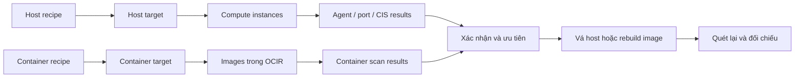

# Vulnerability Scanning cho hosts và container images

Trong chương **Bảo vệ mạng và máy chủ** của lộ trình Oracle Cloud Infrastructure (OCI), Vulnerability Scanning giúp biến việc “máy chủ và image có thể có lỗ hổng” thành các phát hiện có tài nguyên, thời điểm và người xử lý cụ thể.

Bài học sử dụng một dịch vụ Java làm ví dụ: ứng dụng có thể chạy trực tiếp trên Compute hoặc được đóng gói thành container image trong OCI Container Registry. Hai cách triển khai cần hai phạm vi quét khác nhau. Mục tiêu là cấu hình đúng phạm vi, đọc đúng báo cáo và hoàn thành vòng **phát hiện → ưu tiên → khắc phục → xác minh** mà vẫn kiểm soát chi phí và tính sẵn sàng.

## 1. Dịch vụ giải quyết vấn đề nào?

OCI Vulnerability Scanning Service kiểm tra Compute hosts và container images trong Container Registry, tạo báo cáo về các vấn đề được phát hiện. Tài nguyên và báo cáo của dịch vụ có phạm vi region. [Nguồn: Oracle — Vulnerability Scanning Overview](https://docs.oracle.com/en-us/iaas/Content/scanning/using/overview.htm).

Một quy trình quản lý lỗ hổng cần phân biệt:

| Công việc | Kết quả cần có |
| --- | --- |
| Quét | Phát hiện trên đúng tài nguyên, bằng cấu hình và thời điểm xác định |
| Phân tích | Xác định tài nguyên có thật sự bị ảnh hưởng và mức ưu tiên |
| Khắc phục | Vá, thay image, sửa cấu hình hoặc áp dụng biện pháp giảm thiểu |
| Xác minh | Có bằng chứng trạng thái sau thay đổi |
| Quản trị | Có chủ sở hữu, thời hạn, ngoại lệ và lịch đánh giá lại |

Scanner cung cấp đầu vào cho quy trình này. Một báo cáo xuất hiện không tự vá máy chủ; image có kết quả quét cũng không tự khiến pipeline từ chối triển khai.

“Không thấy lỗ hổng” chỉ có ý nghĩa khi đã xác nhận quét thành công, đúng tài nguyên, đúng loại kiểm tra và đủ mới. Báo cáo trống do thiếu quyền hoặc target sai không phải bằng chứng an toàn.

## 2. Host scan và image scan bảo vệ hai đối tượng khác nhau

| Phạm vi | Đối tượng quan sát | Hành động khắc phục điển hình |
| --- | --- | --- |
| Host | Trạng thái máy chủ được chọn và các kiểm tra đã bật | Cập nhật package, sửa cấu hình, tắt listener không cần |
| Container image | Nội dung image trong repository được chọn | Sửa nguồn build/base image, build và phát hành image mới |
| Container đang chạy | Cần thêm quan sát runtime tương ứng | Kiểm tra workload thực tế và thay phiên bản triển khai |
| Mã nguồn/thư viện ứng dụng | Cần quy trình kiểm tra phù hợp với loại phụ thuộc | Sửa mã, cập nhật dependency và kiểm tra bản phát hành |

Hai dòng cuối mô tả nhu cầu bổ sung của thiết kế, không khẳng định đó là toàn bộ khả năng của OCI Vulnerability Scanning.

Ví dụ, quét host chạy container không chứng minh mọi image trong registry đã được kiểm tra. Ngược lại, một image có báo cáo tốt không chứng minh host, cấu hình Kubernetes hoặc quyền của container đều phù hợp.

Một workload cần nối các danh tính với nhau:

```text
Workload Java
├── Host: instance OCID và trạng thái hệ điều hành
├── Artifact: repository, image digest và bản build
└── Deployment: phiên bản đang chạy và môi trường triển khai
```

Nhờ vậy, khi một image bị phát hiện lỗ hổng, nhóm vận hành có thể xác định những deployment đang sử dụng chính image đó.

## 3. Recipe, target và report

Ba đối tượng nên được hiểu theo trách nhiệm của chúng:

| Đối tượng | Câu hỏi cần trả lời |
| --- | --- |
| Scan recipe | Kiểm tra loại vấn đề nào, với các tùy chọn và lịch nào? |
| Scan target | Áp recipe lên instance, compartment hoặc repository nào? |
| Scan report/result | Lần quét đã quan sát điều gì trên tài nguyên cụ thể? |

Luồng cấu hình và xử lý:



Không dùng một host recipe làm container recipe. Khi đặt tên, nên thể hiện môi trường và mục đích, chẳng hạn `host-ol9-app-lab` hoặc `image-orders-lab`; tránh đưa thông tin bí mật vào tên.

Có thể chọn từng Compute instance hoặc phạm vi compartment, kể cả subcompartment theo tùy chọn target. Với repository, target cũng cần chỉ rõ phạm vi được chọn. Phạm vi rộng giúp tự bao phủ tài nguyên mới nhưng phải được kiểm tra với cấu trúc compartment thực tế. [Nguồn: Oracle — Creating a Compute Target](https://docs.oracle.com/en-us/iaas/Content/scanning/using/create-host-target.htm), [Creating a Container Image Target](https://docs.oracle.com/en-us/iaas/Content/scanning/using/create-image-target.htm).

### Phân biệt compartment chứa target với compartment chứa workload

Hai vị trí có thể khác nhau. Khi xem báo cáo, phải chọn đúng compartment chứa kết quả theo target; không mặc định chỉ cần mở compartment đang chứa VM hoặc repository. Oracle mô tả trường hợp kết quả được lưu theo compartment của scan target. [Nguồn: Oracle — Container Image Scans](https://docs.oracle.com/en-us/iaas/Content/scanning/using/image-scan.htm).

Trong hồ sơ vận hành, hãy ghi cả region, target OCID, recipe OCID và compartment báo cáo. Chỉ ghi tên hiển thị sẽ khó phân biệt khi nhiều môi trường dùng tên giống nhau.

## 4. Các hình thức quét host

### 4.1. Quét cổng từ public IP

Public IP port scanning dùng network mapper kiểm tra các cổng theo mức cấu hình:

| Mức | Phạm vi theo tài liệu Oracle |
| --- | --- |
| Light | 100 cổng phổ biến |
| Standard | 1.000 cổng phổ biến |
| None | Không thực hiện kiểm tra cổng public |

Đây không phải phép quét tất cả cổng của mọi interface. Recipe cũng có thể tắt agent-based scanning; nếu tắt cả kiểm tra public port và agent, target không có công việc quét để thực hiện. [Nguồn: Oracle — Creating a Compute Scan Recipe](https://docs.oracle.com/en-us/iaas/Content/scanning/using/create-host-recipe.htm).

Kết quả từ phía public và kết quả quan sát bên trong máy trả lời các câu hỏi khác nhau. Một listener chỉ nghe trên private IP có thể tồn tại dù không được nhìn thấy từ Internet.

### 4.2. Quét bằng OCI agent

Agent-based scanning kiểm tra những nội dung đã bật, như package hệ điều hành, cấu hình hoặc benchmark, và có khả năng quan sát cổng trên các VNIC theo cấu hình hỗ trợ. [Nguồn: Oracle — Compute Scan Recipes](https://docs.oracle.com/en-us/iaas/Content/scanning/using/managing-host-recipes.htm).

Cần kiểm tra Oracle Cloud Agent, plugin Vulnerability Scanning, quyền của dịch vụ và khả năng kết nối. Việc instance đang chạy bình thường không chứng minh plugin đang thu thập dữ liệu thành công.

Với CIS, hãy đọc từng benchmark và phạm vi profile. Không suy từ một điểm CIS rằng máy đã được chứng nhận đáp ứng toàn bộ mọi yêu cầu CIS hoặc mọi quy định của tổ chức.

### 4.3. File scan và ứng dụng Java

Recipe OCI agent có tùy chọn file scan cho thư mục Linux được chọn. Tài liệu hiện mô tả phạm vi phát hiện của tính năng này cho `log4j` và `spring4shell`; trường cấu hình thư mục Windows không đồng nghĩa file scan Windows đã được hỗ trợ. Lịch file scan cũng được cấu hình riêng. [Nguồn: Oracle — Creating a Compute Scan Recipe with an OCI Agent](https://docs.oracle.com/en-us/iaas/Content/scanning/using/create-host-recipe-oci-agent.htm).

Hệ quả đối với dự án Java: không dùng file scan này thay cho kiểm tra toàn bộ dependency, SBOM hoặc phân tích mã nguồn. Cần biết ứng dụng được đóng gói ở đâu, thư mục nào được quét và loại lỗ hổng nào nằm trong phạm vi công cụ.

### 4.4. Lựa chọn Qualys agent

OCI còn có quy trình tích hợp Qualys agent dùng license Qualys phù hợp. Lựa chọn này có các điều kiện riêng về tài khoản, secret và quyền. Khi muốn đổi giữa OCI agent và Qualys agent, tài liệu yêu cầu tạo recipe khác. [Nguồn: Oracle — Creating a Compute Scan Recipe with a Qualys Agent](https://docs.oracle.com/en-us/iaas/Content/scanning/using/create-host-recipe-qualys-agent.htm).

Bài thực hành bên dưới chọn OCI agent. Không cần thêm tích hợp Qualys nếu mục tiêu học tập chưa yêu cầu.

## 5. IAM: quyền người vận hành và quyền dịch vụ

Người tạo recipe/target và dịch vụ thực hiện quét là hai chủ thể khác nhau. Cấp `manage vss-family` cho một nhóm người dùng không tự cấp cho dịch vụ quyền đọc VM hoặc pull image.

Ví dụ môi trường thử nghiệm đặt tài nguyên trong `ScanningLab`:

```text
Allow group ScanOperators to manage vss-family in compartment ScanningLab
Allow group ScanReaders to read vss-family in compartment ScanningLab
```

Nhóm vận hành có thể cấu hình dịch vụ; nhóm đọc theo dõi báo cáo. Điều chỉnh tên nhóm theo identity domain của tenancy. Quyền xóa hoặc export kết quả cần được xét riêng theo nhiệm vụ; quyền đọc không mặc nhiên bao gồm mọi thao tác export. [Nguồn: Oracle — Vulnerability Scanning IAM Policies](https://docs.oracle.com/en-us/iaas/Content/scanning/using/iam-policies.htm).

### 5.1. Quyền dịch vụ cho host

Ví dụ khi VM và các tài nguyên mạng liên quan nằm trong `ScanningLab`:

```text
Allow service vulnerability-scanning-service to manage instances in compartment ScanningLab
Allow service vulnerability-scanning-service to read compartments in compartment ScanningLab
Allow service vulnerability-scanning-service to read vnics in compartment ScanningLab
Allow service vulnerability-scanning-service to read vnic-attachments in compartment ScanningLab
```

Nếu VNIC nằm trong compartment mạng riêng, đặt quyền đọc VNIC và attachment vào đúng compartment đó. Phạm vi phải khớp tài nguyên thật, không chỉ compartment chứa recipe. [Nguồn: Oracle — Required IAM Policy for Compute Scanning Recipes](https://docs.oracle.com/en-us/iaas/Content/scanning/using/required-iam-policy-host-scan.htm).

Đây là bộ policy minh họa theo mô hình một compartment cho lab. Trong production, cần đối chiếu yêu cầu hiện hành và tổ chức tài nguyên để giới hạn phạm vi thay vì đổi tất cả thành `in tenancy` khi gặp lỗi.

### 5.2. Quyền dịch vụ cho Container Registry

Để quét image, dịch vụ cần quyền đọc repository ở nơi chứa image:

```text
Allow service vulnerability-scanning-service to read repos in compartment ScanningLab
Allow service vulnerability-scanning-service to read compartments in compartment ScanningLab
```

Nếu repository nằm ở compartment khác, thay phạm vi theo repository đó. Đây là quyền của dịch vụ để đọc nội dung phục vụ quét; không yêu cầu làm repository public. [Nguồn: Oracle — Required IAM Policy for Image Scanning Recipes](https://docs.oracle.com/en-us/iaas/Content/scanning/using/required-iam-policy-image-scan.htm).

Tài khoản build/push image và tài khoản xem báo cáo vẫn cần các quyền của chính chúng. Không dùng chung một bộ credential quản trị chỉ để đơn giản hóa bài thực hành.

## 6. Kết nối và điều kiện của host trong private subnet

Theo hướng dẫn Oracle, host không có public IP hoặc nằm trong private subnet cần Service Gateway và route tương ứng cho quá trình quét. Phải xét thêm các security rule và điều kiện kết nối của agent. [Nguồn: Oracle — Securing Vulnerability Scanning](https://docs.oracle.com/en-us/iaas/Content/Security/Reference/scanning_security.htm).

Một đường kiểm tra triển khai:

```text
Compute instance
  → agent/plugin hoạt động
  → DNS và đường kết nối hợp lệ
  → route tới Oracle Services Network qua Service Gateway
  → quyền dịch vụ và quyền tài nguyên phù hợp
  → kết quả tại đúng region/compartment báo cáo
```

Không cần mở SSH từ Internet hoặc gán public IP cho app server chỉ để làm cho host scan có kết quả. Cấu hình đường quản trị và đường phục vụ agent là hai việc riêng.

Trong thiết kế, ghi rõ dịch vụ Oracle cần truy cập, service CIDR label được dùng và route của subnet. Khi chẩn đoán, đối chiếu hướng dẫn của Vulnerability Scanning với cấu hình Service Gateway thực tế; chỉ mở đường đến Object Storage chưa đủ để kết luận mọi phụ thuộc của scanner đã được đáp ứng.

Các điều kiện về image, hệ điều hành và loại tài nguyên cũng phải được kiểm tra. Đừng đưa mọi máy “có địa chỉ IP trong OCI” vào cùng giả định hỗ trợ.

## 7. Thực hành cấu hình host scan

### 7.1. Chuẩn bị phạm vi nhỏ

Dùng một Compute instance Linux còn được hỗ trợ trong môi trường thử nghiệm. Ghi nhận:

- Region và instance OCID.
- Compartment chứa instance và các VNIC.
- Compartment sẽ chứa recipe/target và kết quả.
- Người sở hữu máy và thời gian có thể khắc phục.
- Trạng thái Oracle Cloud Agent/plugin và đường kết nối.
- Các policy cần thiết đã được cấp trong phạm vi lab.

Mục tiêu đầu tiên là có một chuỗi quét hoạt động trên một instance xác định. Chỉ mở rộng target theo compartment sau khi hiểu rõ phạm vi tài nguyên mới sẽ được đưa vào.

### 7.2. Tạo recipe và target bằng Console

Trong khu vực **Scanning** của OCI Console:

1. Tạo recipe Compute, chọn OCI agent.
2. Chọn mức quét cổng public và CIS profile.
3. Nếu bật file scan, chọn thư mục Linux và lịch.
4. Kiểm tra lịch của từng loại quét.
5. Tạo target gắn recipe với instance lab.

Ghi lại cấu hình đã lưu để giải thích phạm vi báo cáo. [Nguồn: Oracle — Creating a Compute Scan Recipe](https://docs.oracle.com/en-us/iaas/Content/scanning/using/create-host-recipe.htm).

Sau khi tạo target, không kỳ vọng báo cáo xuất hiện tức thời. Dịch vụ có thể cần đến 24 giờ cho lần quét đầu; thời gian chờ phải được tính trong buổi thực hành và kế hoạch pipeline. [Nguồn: Oracle — Troubleshooting the Vulnerability Scanning service](https://docs.oracle.com/en-us/iaas/Content/scanning/using/troubleshoot.htm).

### 7.3. Xác nhận đã quét đúng máy

Khi báo cáo xuất hiện, đối chiếu instance OCID, thời gian và loại scan. Nếu chỉ có kết quả port, chưa đủ để kết luận đã có agent scan hoặc kiểm tra CIS.

Một cổng được phát hiện cần được giải thích bằng tiến trình và luồng mạng. Ví dụ, `8443` có thể là cổng backend HTTPS hợp lệ của ứng dụng mẫu; cổng đó vẫn cần bị giới hạn nguồn truy cập theo thiết kế. Việc scanner nhận diện cổng không tự kết luận nó đang bị mở cho toàn Internet.

## 8. Cấu hình quét container images trong OCIR

### 8.1. Chọn đúng repository và số image ban đầu

Container recipe có tùy chọn số image ban đầu được quét khi tạo target, trong khoảng 1–4 theo tài liệu hiện hành. Sau bước khởi tạo, image mới được push vào phạm vi target sẽ được quét. [Nguồn: Oracle — Creating a Container Image Scan Recipe](https://docs.oracle.com/en-us/iaas/Content/scanning/using/create-image-recipe.htm).

Ví dụ repository `orders-api` đang có sáu image và recipe chọn hai image ban đầu. Không suy rằng tạo target xong là cả sáu image đã có báo cáo. Cần kiểm kê riêng những artifact đang dùng trong production và xác nhận từng artifact đã được quét.

Repository tồn tại cũng chưa đủ để kết luận scanning đang được bật. Kiểm tra scanner/target và cấu hình thực tế của repository.

### 8.2. Các bước thực hành

Dùng repository riêng của lab:

1. Ghi nhận region, repository và compartment chứa repository.
2. Cấp quyền cho dịch vụ pull image.
3. Tạo container recipe, chọn số image ban đầu theo mục tiêu thử nghiệm.
4. Tạo container target và chọn đúng repository.
5. Dùng một image hợp lệ của ứng dụng thử nghiệm để quan sát lần quét sau push.
6. Xem báo cáo tại OCI Scanning hoặc khu vực Scan results của image trong Container Registry.

Repository được gắn với target phải được chọn rõ; khi cấu hình qua API/CLI, không bỏ danh sách repository nếu ý định chỉ quét một repository. Target có thể nằm khác compartment với repository. [Nguồn: Oracle — Creating a Container Image Target](https://docs.oracle.com/en-us/iaas/Content/scanning/using/create-image-target.htm).

### 8.3. Theo dõi image bằng digest

Tag như `release` hoặc `latest` có thể được trỏ đến nội dung khác theo quy trình phát hành. Để kiểm soát artifact, lưu cả:

```text
repository
image tag tại thời điểm phát hành
image digest
build/release identifier
scan result identifier
scan timestamp
deployment đang sử dụng artifact
```

Đây là bộ thông tin vận hành đề xuất. Pipeline phải xác minh báo cáo ứng với đúng nội dung image cần triển khai; chỉ thấy tên repository hoặc tag giống nhau chưa đủ.

Image được push mới và việc đánh giá lại image khi có CVE mới là những thời điểm cần quan sát. Container Registry có cơ chế quét lại khi cơ sở dữ liệu CVE có bổ sung; kết quả của cùng artifact có thể thay đổi dù không có build mới. [Nguồn: Oracle — Scanning Images for Vulnerabilities](https://docs.oracle.com/en-us/iaas/Content/Registry/Tasks/registryscanningimagesforvulnerabilities.htm).

Hệ quả: kết quả trước ngày phát hành không phải giấy phép sử dụng image vô thời hạn. Cần theo dõi cả những digest đang chạy và các bản dự phòng có thể được rollback.

## 9. Đọc và thu thập báo cáo

### 9.1. Các báo cáo host phải được xem riêng

OCI có các nhóm kết quả agent, port và CIS benchmark. Khi xem Scanning Reports, dùng bộ lọc compartment, thời gian và risk phù hợp; bộ lọc mặc định có thể khiến báo cáo cũ không xuất hiện. [Nguồn: Oracle — Listing Host Scans](https://docs.oracle.com/en-us/iaas/Content/scanning/using/view-host-scan-report.htm).

Ví dụ đọc kết quả bằng OCI CLI trong **Bash**, sau khi cấu hình thông tin xác thực và quyền đọc:

```bash
REGION="ap-singapore-1"
REPORT_COMPARTMENT_ID="<OCID_COMPARTMENT_CHUA_KET_QUA>"

oci vulnerability-scanning host scan result agent list \
  --region "$REGION" \
  --compartment-id "$REPORT_COMPARTMENT_ID" \
  --all

oci vulnerability-scanning host scan result port list \
  --region "$REGION" \
  --compartment-id "$REPORT_COMPARTMENT_ID" \
  --all

oci vulnerability-scanning host scan result cis-benchmark list \
  --region "$REGION" \
  --compartment-id "$REPORT_COMPARTMENT_ID" \
  --all
```

Các lệnh này đọc danh sách, không khởi chạy một lần scan đồng bộ. Đọc hết các trang kết quả rồi mới tổng hợp; không lấy trang đầu làm toàn bộ danh mục.

Muốn lấy chi tiết một agent scan:

```bash
AGENT_SCAN_RESULT_ID="<OCID_HOST_AGENT_SCAN_RESULT>"

oci vulnerability-scanning host scan result agent get \
  --region "$REGION" \
  --host-agent-scan-result-id "$AGENT_SCAN_RESULT_ID"
```

ID ở đây là **scan result OCID**, không phải instance OCID. [Nguồn: Oracle — Getting a Host Scan's Details](https://docs.oracle.com/en-us/iaas/Content/scanning/using/get-host-scan-report.htm).

Với port report, đối chiếu cổng theo VNIC, sau đó nối với listener thực tế và rule mạng. Một máy có nhiều VNIC cần được xem đủ phạm vi liên quan. [Nguồn: Oracle — Listing Open Ports in a Host Scan](https://docs.oracle.com/en-us/iaas/Content/scanning/using/view-host-scan-report-open-ports.htm).

### 9.2. Đọc kết quả image

```bash
oci vulnerability-scanning container scan result list \
  --region "$REGION" \
  --compartment-id "$REPORT_COMPARTMENT_ID" \
  --all
```

Lệnh hỗ trợ truy vấn kết quả theo các điều kiện như repository và thời gian. Khi xây tự động hóa, dùng schema thật và xác minh định danh artifact; không coi lệnh liệt kê chung này là một release gate hoàn chỉnh. [Nguồn: Oracle — OCI CLI container scan result list](https://docs.oracle.com/en-us/iaas/tools/oci-cli/latest/oci_cli_docs/cmdref/vulnerability-scanning/container/scan/result/list.html).

Ở chi tiết báo cáo image, đọc issue ID, risk level, mô tả, first detected, last detected và hướng remediation khi có. Mỗi trường giúp trả lời một câu hỏi khác nhau; thời điểm “last detected” không phải thời điểm đã vá. [Nguồn: Oracle — Getting a Container Image's Report Details](https://docs.oracle.com/en-us/iaas/Content/scanning/using/get_image_scan.htm).

Một phiếu phân tích nên ghi:

| Trường nội bộ | Mục đích |
| --- | --- |
| Tài nguyên hoặc digest | Xác định đúng nơi bị ảnh hưởng |
| CVE/issue ID | Liên kết phát hiện và thông tin sửa |
| Package/component, phiên bản | Xác định thay đổi cần thực hiện khi dữ liệu có sẵn |
| Scan timestamp và nguồn | Đánh giá độ mới và phạm vi kiểm tra |
| Exposure | Xác định đường tiếp cận ngoài thực tế |
| Chủ sở hữu và thời hạn | Biến phát hiện thành công việc có người xử lý |
| Bằng chứng sau sửa | Xác nhận trạng thái mới |

Đây là mẫu quản trị đề xuất, không khẳng định API trả sẵn tất cả các trường trên.

## 10. Ưu tiên theo rủi ro của workload

Mức độ trong báo cáo giúp sắp thứ tự ban đầu. Quyết định vận hành còn cần xét khả năng bị khai thác, dữ liệu liên quan, quyền tiến trình, đường truy cập và biện pháp bảo vệ đang có.

Ví dụ hai phát hiện trên ứng dụng Java:

| Phát hiện minh họa | Bối cảnh | Cách xem xét |
| --- | --- | --- |
| Một package có lỗ hổng nghiêm trọng trên host nhận lưu lượng công khai | Có đường tiếp cận và bản sửa phù hợp | Ưu tiên xác nhận, giảm exposure và triển khai bản sửa |
| Cùng package trên host lab đã tách khỏi luồng người dùng | Ít đường tiếp cận hơn | Vẫn có người xử lý và thời hạn, điều chỉnh ưu tiên theo ảnh hưởng |

Không suy rằng mạng private loại bỏ mọi rủi ro. Một host bị chiếm trong VCN hoặc credential bị lộ có thể tạo đường tiếp cận khác.

Có thể dùng quy tắc nội bộ như sau:

```text
Ưu tiên xử lý =
  mức độ kỹ thuật
  + khả năng tiếp cận / khai thác
  + mức nhạy cảm của dữ liệu
  + phạm vi ảnh hưởng
  + tình trạng có bản sửa hoặc biện pháp giảm thiểu
```

Đây là cách tổ chức quyết định, không phải công thức chấm điểm chính thức của OCI.

Nếu tổ chức đặt thời hạn như “xác nhận trong một ngày” hoặc “vá trong cửa sổ bảo trì gần nhất”, hãy ghi đó là mục tiêu nội bộ. Không trình bày thời hạn tự chọn như SLA của dịch vụ scanning.

### Quản lý ngoại lệ

Ngoại lệ cần có đối tượng cụ thể, lý do, bằng chứng, biện pháp tạm thời, người chấp nhận rủi ro và ngày hết hạn. Không bỏ qua toàn bộ một nhóm CVE chỉ vì một lần phân tích cho thấy không ảnh hưởng đến một workload.

Khi có thông tin khai thác mới hoặc exposure thay đổi, đánh giá lại ngoại lệ dù chưa tới ngày hết hạn.

## 11. Khắc phục host và image theo hai quy trình khác nhau

### 11.1. Host: vá và xác minh trạng thái đang chạy

Với host, hãy xác định package hoặc cấu hình bị ảnh hưởng rồi chọn cách sửa phù hợp:

1. Kiểm tra hướng dẫn của nhà cung cấp hệ điều hành.
2. Chọn package hoặc cấu hình đích đã được duyệt.
3. Thử trên môi trường phù hợp trước khi mở rộng.
4. Thực hiện theo cửa sổ bảo trì, bảo đảm dung lượng phục vụ còn lại.
5. Kiểm tra tiến trình hoặc kernel đang sử dụng bản mới.
6. Đọc kết quả scan mới và kiểm tra chức năng ứng dụng.

Có thể dùng OS Management Hub cho môi trường được hỗ trợ để tổ chức cập nhật; đây là hoạt động khắc phục tách biệt với việc đọc báo cáo scanner.

Đối với app tier nhiều instance, cập nhật theo nhóm nhỏ và theo dõi health check. Một lệnh cập nhật package hoàn tất không tự chứng minh tiến trình Java hoặc kernel đang chạy đã dùng mã mới.

### 11.2. Image: sửa nguồn build, tạo artifact mới

Quy trình đề xuất:

```text
Finding trong image cũ
  → xác định base image hoặc package gây ảnh hưởng
  → sửa Dockerfile / dependency / quy trình build
  → build image mới
  → push vào repository có scanner
  → xác minh kết quả của digest mới
  → triển khai digest mới
  → kiểm tra workload và các bản rollback
```

Sửa package trực tiếp bên trong một container đang chạy không làm thay đổi image đã lưu trong registry. Khi container được tạo lại từ image cũ, vấn đề có thể quay lại.

Chỉ đổi tag hoặc ký image cũng không loại bỏ package có lỗ hổng. Chữ ký và kết quả quét phục vụ các mục tiêu khác nhau: nguồn gốc/toàn vẹn và nhận diện vấn đề trong phạm vi quét.

### 11.3. Xác minh false positive bằng bằng chứng

Một CVE có thể vẫn xuất hiện do bản vá được backport, trạng thái Ksplice hoặc file/package cũ. Đối chiếu advisory, package release và trạng thái thực tế trước khi kết luận. Không chỉ nhìn số phiên bản upstream hoặc xóa báo cáo. [Nguồn: Oracle — Reported CVE is Already Fixed in Host](https://docs.oracle.com/en-us/iaas/Content/scanning/using/troubleshoot.htm).

Nếu phát hiện được xác nhận là false positive, lưu bằng chứng và phạm vi áp dụng. Nếu chưa đủ bằng chứng, giữ trạng thái cần điều tra thay vì chuyển ngay thành “đã xử lý”.

Một ticket chỉ nên đóng khi đạt tiêu chí đã thống nhất: tài nguyên được sửa, kết quả mới hoặc bằng chứng kỹ thuật phù hợp, và workload vẫn hoạt động.

## 12. Đưa quét image vào quy trình phát hành

Container Registry có thể quét image, nhưng quy tắc cho phép phát hành là logic của pipeline hoặc nền tảng triển khai. Thiết kế phải xử lý cả trường hợp scanner chưa trả kết quả.

Ví dụ giả mã cho release gate:

```text
artifact = image digest sắp triển khai
result   = tìm báo cáo ứng với đúng artifact

nếu chưa có kết quả hoàn tất:
    WAIT hoặc BLOCK theo chính sách

nếu có lỗi quét hoặc kết quả quá cũ:
    BLOCK và tạo công việc kiểm tra

nếu có phát hiện vượt ngưỡng:
    BLOCK, trừ ngoại lệ hợp lệ và còn hạn

nếu đủ điều kiện:
    ghi nhận artifact + report + quyết định
    triển khai đúng artifact đã được đánh giá
```

`WAIT` và `BLOCK` là trạng thái do pipeline tự định nghĩa, không phải enum lifecycle của OCI.

Những điều cần quyết định:

- Mức phát hiện nào chặn phát hành.
- Tuổi tối đa của kết quả được chấp nhận.
- Thời gian chờ và cách thử lại khi scan bất đồng bộ.
- Cách xử lý lỗi xác thực, lỗi truy vấn và thiếu báo cáo.
- Cách xác thực ngoại lệ và lưu dấu quyết định.
- Cách theo dõi image đang chạy khi phát sinh CVE mới.

Không đánh đồng danh sách kết quả rỗng với số lỗ hổng bằng không. Tự động hóa phải phân biệt “không có report”, “report chưa hoàn tất”, “truy vấn lỗi” và “đã có kết quả không phát hiện vấn đề trong phạm vi kiểm tra”.

Quy trình cũng cần xác định ai được bypass gate. Một cơ chế bypass không được ghi nhận sẽ làm mất giá trị của các bằng chứng phát hành.

## 13. Cloud Guard, giám sát và tự động hóa

### 13.1. Cloud Guard tổng hợp vấn đề

Có thể xem vấn đề do Vulnerability Scanning phát hiện trong Cloud Guard. Báo cáo scanning vẫn mang phạm vi region; Cloud Guard có reporting region riêng. Cloud Guard và Vulnerability Scanning sử dụng các target khác nhau. [Nguồn: Oracle — Scanning with Cloud Guard](https://docs.oracle.com/en-us/iaas/Content/scanning/using/scanning-with-cloud-guard.htm).

Cần xác nhận scope của Cloud Guard bao phủ scope cần tổng hợp. Bật Cloud Guard không tự tạo mọi scanning target và cũng không tự vá mọi host hoặc rebuild image.

Trong tổ chức nhiều compartment, mỗi vấn đề cần đi tới nhóm sở hữu workload. Nhóm an ninh có thể quản lý recipe chung, nhưng nhóm vận hành máy chủ và nhóm phát triển vẫn phải nhận trách nhiệm sửa đúng phần của mình.

### 13.2. Quan sát cả kết quả lẫn độ phủ

Ngoài số phát hiện, nên theo dõi các chỉ số nội bộ:

```text
Độ phủ host =
  số host đủ điều kiện có kết quả đạt yêu cầu về độ mới
  / tổng host đủ điều kiện nằm trong phạm vi phải quét

Độ phủ artifact =
  số digest đang sử dụng có kết quả hợp lệ
  / tổng digest đang sử dụng thuộc phạm vi yêu cầu
```

Các công thức này là đề xuất quản trị. Mẫu số phải đến từ danh mục tài sản; không chỉ đếm tài nguyên đã có báo cáo vì như vậy sẽ bỏ sót tài nguyên chưa được quét.

OCI công bố metrics của dịch vụ trong namespace `oci_vss`. Chọn metric/dimension hiện có và cấu hình alarm phù hợp; không giả định mọi chỉ số nội bộ ở trên đều có sẵn dưới dạng metric của OCI. [Nguồn: Oracle — Scanning Metrics](https://docs.oracle.com/en-us/iaas/Content/scanning/using/metrics.htm).

### 13.3. Phân biệt event quản trị với finding mới

Scanning có các event liên quan tài nguyên, chẳng hạn tạo/sửa/xóa recipe hoặc target. Khi tự động hóa bằng OCI Events, phải chọn đúng event được dịch vụ hỗ trợ; không tự đặt tên một event “phát hiện CVE mới” rồi coi nó sẽ được phát. [Nguồn: Oracle — Scanning Events](https://docs.oracle.com/en-us/iaas/Content/scanning/using/events.htm).

Một cách triển khai là kết hợp Cloud Guard phù hợp với việc định kỳ đọc kết quả qua API, rồi chuẩn hóa tài nguyên, issue ID và thời điểm để tránh tạo ticket trùng. Việc truy vấn định kỳ ở đây là thiết kế của hệ thống vận hành, không phải yêu cầu chạy lặp thủ công trong bài học.

Cũng cần theo dõi thay đổi recipe/target. Một target bị xóa có thể làm số finding giảm vì mất độ phủ, không phải vì workload đã được sửa.

## 14. Chẩn đoán khi kết quả thiếu hoặc khác kỳ vọng

Đi theo chuỗi phụ thuộc, sửa đúng điểm lỗi:

| Hiện tượng | Kiểm tra trước |
| --- | --- |
| Không tạo được recipe/target | Quyền người thao tác và compartment |
| Target mới chưa có report | Thời gian tạo, lịch và cơ chế quét |
| Có port report nhưng thiếu agent report | Recipe, plugin và image hỗ trợ |
| Host private không có dữ liệu | Service Gateway, route, rule và agent |
| Image không có report | Scanner, target, repository và quyền pull |
| Báo cáo không thấy trên Console | Region, compartment báo cáo, quyền và bộ lọc |
| CLI trả danh sách thiếu | Phân trang, bộ lọc và phạm vi truy vấn |
| Sau sửa vẫn còn finding | Thời điểm scan, artifact/host và bằng chứng bản vá |

Đây là thứ tự kiểm tra đề xuất; không phải mọi lỗi đều có cùng nguyên nhân. Tài liệu Oracle mô tả các tình huống như target mới, recipe tắt các tùy chọn và sai compartment. [Nguồn: Oracle — Troubleshooting the Vulnerability Scanning service](https://docs.oracle.com/en-us/iaas/Content/scanning/using/troubleshoot.htm).

Không xử lý lỗi thiếu report bằng cách đồng thời mở toàn mạng, cấp quyền toàn tenancy và tạo thêm nhiều target. Những thay đổi đó vừa khó xác định nguyên nhân vừa có thể mở rộng phạm vi ngoài ý định.

Khi cần hỗ trợ, thu thập region, target/recipe/result OCID, thời điểm, cấu hình liên quan và lỗi đã nhận. Giữ credential, token và dữ liệu nhạy cảm ngoài gói thông tin chẩn đoán.

## 15. Giới hạn cần ghi trong hồ sơ vận hành

Một chương trình quét phải ghi rõ các loại tài nguyên và hệ điều hành được hỗ trợ. Host do dịch vụ DB quản lý không mặc nhiên là Compute host có thể quét theo cùng quy trình. Oracle cũng nêu Vulnerability Scanning không phải scanner đáp ứng yêu cầu quét PCI. [Nguồn: Oracle — phạm vi và giới hạn của Vulnerability Scanning](https://docs.oracle.com/en-us/iaas/Content/scanning/using/overview.htm).

Những giới hạn thiết kế khác cần được xét:

- Không suy “quét không thấy” thành “không có lỗ hổng chưa biết”.
- Không dùng một nhóm file scan hạn chế để đại diện cho mọi dependency Java.
- Không dùng image scan thay kiểm tra cấu hình runtime và quyền ứng dụng.
- Không dùng CIS score thay toàn bộ đánh giá tuân thủ.
- Không dùng quét lỗ hổng thay kiểm tra phân quyền nghiệp vụ hoặc kiểm thử ứng dụng.
- Không coi biện pháp giảm exposure là bằng chứng đã loại bỏ package lỗi.

Đây là các nguyên tắc giải thích kết quả theo phạm vi. Chúng giúp chọn công cụ bổ sung theo nhu cầu thay vì yêu cầu một scanner trả lời mọi câu hỏi bảo mật.

## 16. Chi phí, tính sẵn sàng và bàn giao

Chi phí của một quy trình scanning không chỉ là khoản phí scanner. Cần xét tài nguyên lab, lưu trữ image, license tích hợp nếu dùng, lưu giữ báo cáo, hệ thống ticket, pipeline và công xử lý phát hiện.

Để quản lý quy mô:

| Quyết định | Cách áp dụng cho workload mẫu |
| --- | --- |
| Bắt đầu nhỏ | Một host và một repository lab có người sở hữu |
| Mở rộng có kiểm soát | Dùng target theo compartment sau khi kiểm tra phạm vi |
| Giữ báo cáo có ích | Lưu bằng chứng trước/sau sửa và quyết định ngoại lệ |
| Tránh artifact không xác định | Ghi digest và build ID của image triển khai |
| Giữ khả năng phục vụ | Vá theo đợt, theo dõi health check, chuẩn bị phục hồi |
| Đánh giá lại | Kiểm tra độ phủ khi có region, compartment hoặc pipeline mới |

Không xóa hàng loạt image hoặc report chỉ để làm giảm số finding trên dashboard. Phải phân biệt artifact cần giữ để rollback với artifact đã hết vòng đời, đồng thời bảo toàn bằng chứng theo chính sách của tổ chức.

Hồ sơ bàn giao nên cho phép người vận hành trả lời: tài nguyên nào phải được quét, recipe nào áp dụng, kết quả nằm ở đâu, ai nhận finding, khi nào phải sửa, cách chứng minh đã sửa và cách xử lý khi scanner ngừng tạo dữ liệu.
