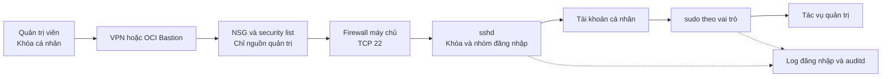

# Harden Oracle Linux, SSH và quyền quản trị máy chủ

## 1. Mục tiêu và phạm vi

Trong chương **Bảo vệ mạng và máy chủ** của module Oracle Cloud Infrastructure (OCI), hardening là quá trình giảm bề mặt tấn công và giới hạn thiệt hại khi một lớp bảo vệ bị vượt qua. Một máy chủ chỉ cho phép SSH bằng khóa vẫn có thể gặp rủi ro nếu khóa được chia sẻ, mọi tài khoản đều có quyền root hoặc quản trị viên không nhận biết việc thay đổi cấu hình.

Bài học tập trung vào Oracle Linux chạy trên OCI Compute: kiểm soát đường quản trị, cập nhật hệ điều hành, cấu hình OpenSSH, phân quyền bằng sudo, duy trì SELinux và ghi nhận hoạt động quản trị. Các ví dụ hướng đến Oracle Linux 8/9 sử dụng systemd và DNF; cần đối chiếu phiên bản gói, image và chính sách tổ chức trước khi áp dụng. Đây là một baseline thực hành, không phải chứng nhận đáp ứng toàn bộ CIS Benchmark hoặc STIG.

Sau bài học, người học có thể:

- Phân biệt quyền OCI IAM với quyền đăng nhập và quản trị trong hệ điều hành.
- Chuyển từ tài khoản bootstrap sang tài khoản cá nhân có khóa SSH riêng.
- Áp dụng cấu hình SSH có kiểm tra cú pháp, kiểm tra giá trị hiệu lực và phương án khôi phục.
- Cấp quyền sudo theo vai trò, nhận ra các quyền có thể dẫn tới root.
- Kết hợp NSG, firewall máy chủ, SELinux, vá lỗi và log để vận hành an toàn.

Phạm vi này áp dụng cho hệ điều hành mà khách hàng được phép quản trị. Với Autonomous Database hoặc dịch vụ được Oracle quản lý, không giả định có quyền SSH vào máy chủ nền để thực hiện các lệnh dưới đây. Với máy chủ cơ sở dữ liệu được phép truy cập hệ điều hành, phải kiểm tra thêm yêu cầu của sản phẩm và tác động tới Oracle Database, Grid Infrastructure hoặc quy trình hỗ trợ.

## 2. Hiểu đúng các lớp quyền trên OCI

### 2.1. IAM và Linux giải quyết hai bài toán khác nhau

OCI IAM kiểm soát thao tác với tài nguyên trong tenancy và compartment: tạo instance, thay đổi mạng, quản lý Bastion hoặc thực hiện các hoạt động khôi phục được cấp phép. Linux kiểm soát tài khoản, khóa SSH, tiến trình, tệp và việc nâng quyền bên trong máy chủ.

Trên nhiều platform image Oracle Linux, tài khoản ban đầu là `opc` và có thể dùng sudo. Cần kiểm tra thực tế bằng `sudo -l`, vì custom image và chính sách nội bộ có thể khác. Xem [Oracle: Accessing an Instance](https://docs.oracle.com/en-us/iaas/oracle-linux/oci/gs-access-instance.htm).

| Thành phần | Câu hỏi cần trả lời | Cấu hình cần kiểm tra |
| --- | --- | --- |
| OCI IAM | Ai được thay đổi instance, mạng và phương tiện khôi phục? | Policy theo compartment, nhóm quản trị, quyền với boot volume và console |
| Đường mạng | Nguồn nào tiếp cận được cổng SSH? | Route, VPN/Bastion, NSG và security list |
| SSH | Danh tính nào được đăng nhập? | Tài khoản Linux, khóa công khai, chính sách sshd |
| sudo | Người đã đăng nhập được làm gì? | Nhóm, sudoers và quyền ghi vào chương trình được thực thi |
| Kiểm soát tiến trình | Tiến trình có thể truy cập tài nguyên nào? | Quyền tệp, tài khoản dịch vụ và SELinux |
| Quan sát | Ai đã thay đổi gì, vào lúc nào? | Log hệ điều hành, auditd và OCI Audit |

Xóa một người khỏi nhóm IAM không tự động xóa khóa của họ trong `authorized_keys`. Ngược lại, xóa khóa Linux không thu hồi quyền API mà họ còn nắm giữ. Quy trình nghỉ việc hoặc xử lý sự cố phải bao phủ cả hai phía.

MFA cho đăng nhập OCI Console cũng không tự động trở thành MFA cho SSH vào Oracle Linux. Nếu yêu cầu MFA cho đường quản trị, cần thiết kế riêng chuỗi xác thực và kiểm chứng từ đầu đến cuối.

### 2.2. Mô hình đường quản trị

Một phương án phù hợp cho máy chủ ứng dụng là giữ instance trong private subnet và đưa truy cập quản trị qua một đường kiểm soát được:



Nếu dùng OCI Bastion, cần phân biệt **Managed SSH session** với **SSH port forwarding session**. Managed SSH cần các điều kiện về OpenSSH, Oracle Cloud Agent và Bastion plugin; port forwarding là một kiểu phiên khác. Chọn và thử đường truy cập trước khi áp dụng giới hạn nhóm hoặc forwarding trên máy đích. Tham khảo [OCI Bastion Overview](https://docs.oracle.com/en-us/iaas/Content/Bastion/Concepts/bastionoverview.htm).

Địa chỉ nguồn mà máy đích nhìn thấy có thể là địa chỉ riêng của điểm kết nối Bastion hoặc một địa chỉ sau NAT, không phải IP công khai của laptop. Dùng địa chỉ thực tế này khi xây dựng rule trên máy đích; danh sách IP được vào Bastion và danh sách nguồn được vào máy đích là hai cấu hình khác nhau.

### 2.3. Giới hạn SSH ở đúng lớp mạng

Đối với SSH quản trị:

- Ưu tiên private IP và đường quản trị riêng.
- Nếu cần public IP trong bài lab, chỉ mở TCP 22 từ CIDR quản trị cụ thể, chẳng hạn một địa chỉ công khai `/32`.
- Kiểm tra cả IPv4 lẫn IPv6 nếu instance sử dụng hai giao thức.
- Xem mọi security list gắn với subnet và mọi NSG gắn với VNIC.

Một NSG chỉ mở SSH từ IP văn phòng không làm mất hiệu lực của một security list khác đang cho phép SSH từ `0.0.0.0/0`. Các rule cho phép của NSG và security list cùng tham gia quyết định lưu lượng được phép; không coi NSG là lớp phủ tự động chặn rule rộng hơn. Xem [OCI: Security Rules](https://docs.oracle.com/en-us/iaas/Content/Network/Concepts/securityrules.htm).

Đổi cổng SSH có thể giảm một phần log quét tự động, nhưng không thay thế giới hạn nguồn, khóa mạnh hoặc vá lỗi. Giữ cổng 22 trong bài thực hành giúp giảm số biến phải xử lý khi kiểm chứng.

## 3. Chuẩn bị thay đổi mà vẫn giữ khả năng truy cập

### 3.1. Môi trường thực hành

Các giá trị sau chỉ là ví dụ:

| Tham số | Giá trị minh họa |
| --- | --- |
| Instance Oracle Linux | `10.20.20.15` |
| Mạng quản trị sau VPN | `10.20.10.0/24` |
| Tài khoản bootstrap | `opc` |
| Tài khoản quản trị cá nhân | `linhadmin` |
| Nhóm được đăng nhập SSH | `ssh-login` |
| Nhóm quản trị hệ điều hành | `host-admins` |
| Nhóm vận hành ứng dụng | `app-ops` |

Ví dụ firewall dùng mạng sau VPN. Khi dùng Bastion, phải thay bằng nguồn phù hợp với phiên Bastion thực tế; không sao chép nguyên CIDR này.

Các khối `bash` chạy trong shell Linux của VM, trừ khối ghi rõ **máy quản trị**. Chúng là hướng dẫn để thực hành trên môi trường được phép thay đổi; không phải một script duy nhất để chạy toàn bộ từ đầu đến cuối.

Chuẩn bị trước khi chỉnh cấu hình:

1. Giữ một phiên SSH đang hoạt động và đã kiểm tra được quyền sudo.
2. Chuẩn bị phiên thứ hai để thử kết nối mới, không dùng lại kết nối SSH multiplex đang mở.
3. Kiểm tra phương án khôi phục qua instance console hoặc xử lý boot volume bằng một máy hỗ trợ có quyền phù hợp. Console vẫn có cơ chế xác thực riêng; không giả định tạo console connection là tự có shell root.
4. Sao lưu cấu hình và bảo đảm bản sao boot volume/dữ liệu cần thiết có thể khôi phục. Snapshot của máy đang chạy cần được đánh giá về tính nhất quán ứng dụng.
5. Chọn cửa sổ bảo trì nếu có cập nhật gói, thay đổi firewall hoặc khởi động lại.

### 3.2. Thu thập trạng thái ban đầu

```bash
cat /etc/os-release
uname -r
rpm -q openssh-server sudo firewalld audit
id
sudo -l
sudo systemctl status sshd --no-pager
sudo /usr/sbin/sshd -t
sudo /usr/sbin/sshd -T
sudo ss -lntup
getenforce
sudo systemctl is-active firewalld
```

`sshd -t` thường không in gì khi cú pháp hợp lệ; phải kiểm tra cả mã thoát. `sshd -T` cho biết cấu hình hiệu lực, có ích hơn việc chỉ nhìn một tệp vừa sửa. Nếu dịch vụ không dùng tệp cấu hình mặc định, cần kiểm tra unit và chạy công cụ với đúng tệp đó.

Xác định nguồn của phiên hiện tại:

```bash
echo "$SSH_CONNECTION"
```

Bốn trường lần lượt là IP client, cổng client, IP server và cổng server. Với kết nối qua trung gian, IP client ở đây là địa chỉ peer mà sshd nhận thấy. Không đưa log hoặc thông tin nội bộ chưa xử lý lên nơi công khai.

Sao lưu vào thư mục root, ngoài các thư mục nạp cấu hình:

```bash
CHANGE_TAG=$(date +%Y%m%d-%H%M%S)
sudo cp -a /etc/ssh "/root/ssh-before-$CHANGE_TAG"
sudo cp -a /etc/sudoers "/root/sudoers-before-$CHANGE_TAG"
sudo cp -a /etc/sudoers.d "/root/sudoers.d-before-$CHANGE_TAG"
```

Bản sao `/etc/ssh` có thể chứa host private key; phải bảo vệ bản sao như dữ liệu nhạy cảm. Không để file backup có đuôi `.conf` trong `sshd_config.d`, vì nó có thể bị nạp như cấu hình thật.

## 4. Vá lỗi và giảm dịch vụ không cần thiết

### 4.1. Cập nhật có kiểm soát

Trên Oracle Linux 8/9:

```bash
sudo dnf repolist
sudo dnf updateinfo list security
sudo dnf upgrade --security
```

Đọc giao dịch dự kiến trước khi chấp nhận. Khi cần cập nhật đầy đủ các gói trong phạm vi repository đã phê duyệt, dùng `sudo dnf upgrade` theo kế hoạch bảo trì. Tùy repository, thông tin advisory của gói bên thứ ba có thể không đầy đủ; không dùng một danh sách security errata trống làm bằng chứng duy nhất rằng máy không có lỗ hổng.

Nếu hệ thống có plugin cung cấp lệnh sau:

```bash
sudo dnf needs-restarting -r
```

Kết hợp kết quả với danh sách gói vừa thay đổi để quyết định restart dịch vụ hay reboot. Không hứa rằng cập nhật gói luôn có hiệu lực ngay với tiến trình đang chạy. Với Ksplice hoặc công cụ quản lý cập nhật tập trung, vẫn phải đánh giá các thành phần nằm ngoài phạm vi live patch. Tham khảo [Oracle: Installing Security Updates Using DNF](https://docs.oracle.com/en-us/iaas/oracle-linux/oci/security-updates-using-dnf.htm) và [Updating Software on Oracle Linux](https://docs.oracle.com/en/operating-systems/oracle-linux/software-management/sfw-mgmt-UpdateSoftwareonEnterpriseLinux.html).

Nếu dịch vụ có nhiều instance sau load balancer, có thể drain lưu lượng rồi cập nhật lần lượt, kiểm tra sức khỏe trước khi đưa lại vào phục vụ. Một VM đơn lẻ cần kế hoạch gián đoạn và thời gian khôi phục phù hợp.

### 4.2. Kiểm kê thay vì tắt hàng loạt

```bash
sudo systemctl list-unit-files --type=service --state=enabled
sudo systemctl --type=service --state=running
sudo ss -lntup
```

Với mỗi dịch vụ đang lắng nghe, xác định chủ sở hữu, mục đích, interface bind và nguồn được phép truy cập. Chỉ dùng `systemctl disable --now TEN_DICH_VU` sau khi đã xác định dịch vụ đó không cần thiết và có phương án phục hồi.

Không tắt Oracle Cloud Agent, công cụ quản lý hệ điều hành, đồng bộ thời gian hoặc tác vụ mạng chỉ vì không nhận ra tên. Một thành phần có thể phục vụ Bastion, giám sát, cập nhật hoặc hoạt động khởi tạo instance. Đồng thời, không cài thêm bộ công cụ và daemon không phục vụ workload; ít thành phần hơn giúp giảm công sức vá lỗi.

## 5. Tạo danh tính cá nhân và kiểm thử sudo trước

### 5.1. Tạo khóa trên máy quản trị

**Máy quản trị**, dùng shell có OpenSSH client:

```bash
ssh-keygen -t rsa -b 3072 -a 100 -f ~/.ssh/oci-linhadmin
```

Đặt passphrase đủ mạnh cho private key. Khóa công khai là tệp có đuôi `.pub`; private key phải ở máy quản trị hoặc thiết bị quản lý khóa phù hợp, không sao chép lên VM. Có thể chọn Ed25519 khi chính sách mật mã của môi trường cho phép; môi trường FIPS cần kiểm tra thuật toán được hỗ trợ.

Mỗi người dùng một khóa riêng, mỗi mục đích nên có nhận diện rõ ràng. Không chia sẻ private key qua nhóm chat hoặc đưa khóa vào repository, image hay user-data.

### 5.2. Tạo tài khoản và phân tách nhóm

Trên VM lab mới, nơi các nhóm và tài khoản minh họa chưa tồn tại:

```bash
sudo groupadd ssh-login
sudo groupadd host-admins
sudo useradd -m -s /bin/bash -G ssh-login,host-admins linhadmin
sudo passwd linhadmin
sudo usermod -aG ssh-login opc
```

Mật khẩu vừa đặt dùng cho xác thực sudo theo chính sách bên dưới. Nó không làm SSH chấp nhận mật khẩu khi cấu hình SSH đã tắt phương thức đó. Trong môi trường dùng danh tính tập trung, áp dụng cơ chế tài khoản và xác thực sudo tương ứng thay vì tạo bản sao danh tính cục bộ.

Nếu tên đã tồn tại, kiểm tra bằng `getent` và `id` rồi điều chỉnh; không tạo lại hoặc thay UID/GID tùy tiện. `usermod -aG` thêm nhóm phụ; bỏ `-a` có thể làm mất các nhóm phụ đang cần.

Ở đây `ssh-login` chỉ cho phép đăng nhập; `host-admins` cấp quyền quản trị. Được vào máy không có nghĩa là được làm root. Giữ `opc` trong nhóm đăng nhập ở giai đoạn chuyển đổi để duy trì đường khôi phục đang hoạt động.

### 5.3. Cài khóa công khai

Trên VM:

```bash
sudo install -d -m 700 -o linhadmin -g linhadmin /home/linhadmin/.ssh
sudo -u linhadmin tee /home/linhadmin/.ssh/authorized_keys >/dev/null <<'PUBLIC_KEY'
THAY_DONG_NAY_BANG_TOAN_BO_KHOA_CONG_KHAI_TU_TEP_PUB
PUBLIC_KEY
sudo chown linhadmin:linhadmin /home/linhadmin/.ssh/authorized_keys
sudo chmod 600 /home/linhadmin/.ssh/authorized_keys
sudo chmod go-w /home/linhadmin
sudo restorecon -Rv /home/linhadmin/.ssh
```

Phải thay dòng minh họa bằng khóa công khai thật, đủ trên một dòng, trước khi chạy. Khối này dùng cho tài khoản mới và ghi nội dung `authorized_keys`; với tài khoản đã có khóa, cần bảo toàn các mục được duyệt thay vì ghi đè.

Kiểm tra quyền của toàn bộ đường dẫn khi SSH từ chối khóa:

```bash
namei -l /home/linhadmin/.ssh/authorized_keys
ls -ldZ /home/linhadmin /home/linhadmin/.ssh
ls -lZ /home/linhadmin/.ssh/authorized_keys
```

### 5.4. Cấp sudo cho vai trò quản trị hệ điều hành

Tạo một file riêng bằng công cụ kiểm tra cú pháp:

```bash
sudo visudo -f /etc/sudoers.d/20-host-admins
```

Nội dung:

```sudoers
%host-admins ALL=(ALL:ALL) ALL
```

Sau khi lưu:

```bash
sudo chown root:root /etc/sudoers.d/20-host-admins
sudo chmod 440 /etc/sudoers.d/20-host-admins
sudo visudo -c
```

Quy tắc này cho nhóm `host-admins` quyền quản trị đầy đủ; chỉ áp dụng cho người thực sự quản lý hệ điều hành. Nó thường yêu cầu mật khẩu của người gọi, nhưng các quy tắc khác hoặc thiết lập xác thực hiện có có thể thay đổi hành vi. Phải kiểm tra toàn bộ quyền hiệu lực. Xem [Oracle Linux: Granting sudo Access to Users](https://docs.oracle.com/en/operating-systems/oracle-linux/9/userauth/userauth-GrantingsudoAccesstoUsers.html).

Từ **một terminal mới trên máy quản trị**, sau khi xác minh host fingerprint qua kênh tin cậy:

```bash
ssh -o IdentitiesOnly=yes -o ControlMaster=no -o ControlPath=none -i ~/.ssh/oci-linhadmin linhadmin@10.20.20.15
```

Trong phiên mới:

```bash
id
sudo -k
sudo -v
sudo -l
sudo id -u
```

Kết quả cuối cần là `0`. Nếu chưa đăng nhập được bằng khóa và chưa nâng quyền được, dừng việc siết SSH; giữ phiên `opc` để sửa nguyên nhân trước.

## 6. Harden OpenSSH theo cấu hình thực sự có hiệu lực

### 6.1. Kiểm tra thứ tự nạp cấu hình

Không giả định file có số thứ tự lớn hơn sẽ thắng. Với nhiều chỉ thị OpenSSH, giá trị được đọc đầu tiên là giá trị được sử dụng; vị trí `Include`, thứ tự file và khối `Match` đều có ý nghĩa. Oracle Linux hỗ trợ cấu hình qua `sshd_config.d`, nhưng cần kiểm tra image thực tế có nạp thư mục này và nạp ở đâu. Tham khảo [Oracle: Working With OpenSSH Server Configuration Files](https://docs.oracle.com/en/operating-systems/oracle-linux/openssh/openssh-ModifyingOpenSSHServerConfigurationFiles.html) và [OpenSSH: sshd_config](https://man.openbsd.org/sshd_config).

Trên VM:

```bash
sudo grep -nE '^[[:space:]]*(Include|Match)' /etc/ssh/sshd_config
sudo ls -l /etc/ssh/sshd_config.d
sudo systemctl cat sshd
```

Nếu thư mục chưa tồn tại hoặc không được include, phải điều chỉnh tệp đang thực sự được dịch vụ sử dụng. Không chỉ tạo một file drop-in rồi kết luận rằng chính sách đã được áp dụng.

Trên image có `Include /etc/ssh/sshd_config.d/*.conf` phù hợp, có thể dùng một file như `/etc/ssh/sshd_config.d/00-local-hardening.conf` sau khi kiểm tra nó không bị giá trị đọc trước hoặc tham số khởi chạy dịch vụ chi phối. Nếu file đã tồn tại, xem và chỉnh có chủ đích, không ghi đè mù quáng.

### 6.2. Baseline minh họa

Nội dung file hardening:

```sshconfig
PermitRootLogin no
PubkeyAuthentication yes
PasswordAuthentication no
KbdInteractiveAuthentication no
PermitEmptyPasswords no
UsePAM yes
AllowGroups ssh-login
MaxAuthTries 3
LoginGraceTime 30
X11Forwarding no
AllowAgentForwarding no
AllowTcpForwarding no
PermitTunnel no
ClientAliveInterval 300
ClientAliveCountMax 2
LogLevel VERBOSE
```

Chính sách này giả định người dùng chỉ cần shell quản trị trên máy đích. Nếu cần TCP forwarding, agent forwarding, tunnel, SFTP có yêu cầu riêng hoặc các luồng vận hành đặc biệt, xác định ngoại lệ trước rồi thử đúng luồng đó. Không vô hiệu hóa tính năng đang phục vụ truy cập hợp lệ mà chưa có thay thế.

Các quyết định quan trọng:

| Nhóm cấu hình | Ý nghĩa vận hành |
| --- | --- |
| Tắt root login | Người dùng vào bằng danh tính cá nhân rồi nâng quyền có kiểm soát |
| Public key và tắt hai phương thức tương tác | Tránh vẫn còn đường nhập mật khẩu qua keyboard-interactive |
| Giữ PAM | Không bỏ qua xử lý tài khoản và phiên chỉ vì đã dùng khóa |
| `AllowGroups` | Chỉ các tài khoản đáp ứng điều kiện nhóm được đăng nhập |
| Giới hạn thử xác thực và thời gian login | Giảm tài nguyên dành cho kết nối chưa xác thực |
| Tắt forwarding không cần thiết | Thu hẹp chức năng chuyển tiếp từ phiên SSH |
| Alive interval/count | Phát hiện peer không còn phản hồi |
| Log verbose | Tăng thông tin phục vụ truy vết, cần quản lý dung lượng log |

Nếu áp dụng SSH MFA qua PAM/keyboard-interactive, baseline tắt keyboard-interactive này cần được thiết kế lại cùng `AuthenticationMethods` và cơ chế MFA. Không áp dụng hai yêu cầu mâu thuẫn rồi chờ người dùng đăng nhập.

`ClientAliveInterval` và `ClientAliveCountMax` không bảo đảm đăng xuất người đã ngừng gõ phím: SSH client vẫn có thể phản hồi thông điệp alive. Chính sách hết hạn do người dùng không hoạt động phải được thiết kế riêng và xét cả phiên tương tác, lệnh chạy lâu, shell khác và công cụ tự động.

Không chép cố định một danh sách cipher/MAC từ hướng dẫn cũ. Ưu tiên OpenSSH được vá và crypto policy được hỗ trợ của hệ điều hành; mọi ngoại lệ tương thích cần có phạm vi và thời hạn. Việc chỉnh crypto policy, đặc biệt FIPS, là một thay đổi riêng có thể ảnh hưởng nhiều dịch vụ hơn SSH.

### 6.3. Kiểm tra trước khi nạp lại

Sau khi lưu cấu hình, đặt quyền phù hợp cho file mới:

```bash
sudo chown root:root /etc/ssh/sshd_config.d/00-local-hardening.conf
sudo chmod 600 /etc/ssh/sshd_config.d/00-local-hardening.conf
sudo restorecon -v /etc/ssh/sshd_config.d/00-local-hardening.conf
sudo /usr/sbin/sshd -t
```

Chỉ tiếp tục khi kiểm tra cú pháp thành công. Tiếp đó kiểm tra giá trị hiệu lực:

```bash
sudo /usr/sbin/sshd -T | grep -E '^(permitrootlogin|pubkeyauthentication|passwordauthentication|kbdinteractiveauthentication|usepam|allowgroups|allowtcpforwarding|allowagentforwarding|x11forwarding|loglevel) '
```

Nếu có `Match`, kiểm tra với ngữ cảnh một kết nối cụ thể:

```bash
sudo /usr/sbin/sshd -T -C user=linhadmin,addr=10.20.10.25,host=admin-client.example
```

Thay địa chỉ và tên bằng ngữ cảnh thật; thêm thông tin địa chỉ/cổng phía server khi điều kiện `Match` sử dụng chúng. Kiểm tra riêng cả tài khoản được phép và tài khoản bị giới hạn. Kết quả `sshd -T` chứng minh giá trị cấu hình, chưa chứng minh khóa, PAM, quyền tệp hay đường mạng đều hoạt động.

Nạp lại bằng thao tác mà unit hỗ trợ. Với unit chuẩn hỗ trợ reload:

```bash
sudo systemctl reload sshd
sudo systemctl is-active sshd
sudo journalctl -u sshd --since "5 minutes ago" --no-pager
```

Nếu image yêu cầu restart, thực hiện sau khi đã kiểm tra cú pháp và chuẩn bị đường khôi phục. Không đóng phiên quản trị cũ trong quá trình này.

### 6.4. Kiểm tra hành vi từ kết nối mới

Từ **máy quản trị**, mở kết nối mới bằng khóa của `linhadmin`, tắt việc dùng lại kết nối có sẵn như phần trước. Xác nhận:

1. Đăng nhập bằng khóa đúng thành công.
2. `sudo -k`, `sudo -v` và một tác vụ được cấp quyền hoạt động.
3. Đăng nhập SSH trực tiếp bằng `root` bị từ chối.
4. Đăng nhập không dùng public key bị từ chối.
5. Tài khoản ngoài nhóm được phép không vào được SSH.
6. Các công cụ quản trị hợp lệ, kể cả Bastion nếu dùng, vẫn hoạt động.

Thử đường không dùng public key:

```bash
ssh -o ControlMaster=no -o ControlPath=none -o PubkeyAuthentication=no -o PreferredAuthentications=password,keyboard-interactive linhadmin@10.20.20.15
```

Lệnh này cần thất bại với baseline hiện tại. Đọc log phía server để xác nhận nguyên nhân; một kết nối bị firewall chặn không chứng minh rằng sshd đã tắt xác thực mật khẩu.

Không dùng `StrictHostKeyChecking=no` làm cách xử lý mặc định cho lỗi host key. Khi fingerprint thay đổi, đối chiếu với việc rebuild/rotate host key đã được xác nhận rồi cập nhật trust store đúng đích.

Các biện pháp khóa công khai, tắt mật khẩu và tắt đăng nhập root phù hợp với [khuyến nghị bảo vệ Compute của Oracle](https://docs.oracle.com/en-us/iaas/Content/Security/Reference/compute_security.htm).

## 7. Giới hạn sudo theo vai trò vận hành

### 7.1. Quyền nhỏ phải được diễn đạt bằng lệnh cụ thể

Một người vận hành chỉ cần restart dịch vụ ứng dụng không cần quyền thay đổi kernel, cài gói hoặc sửa tài khoản. Giả sử VM có unit ứng dụng **`java-app.service`** đã được quản trị viên tạo và kiểm soát, có thể cấp một tập lệnh cụ thể:

```bash
sudo groupadd app-ops
sudo visudo -f /etc/sudoers.d/30-app-ops
```

Nội dung:

```sudoers
Cmnd_Alias JAVA_APP_OPS = /usr/bin/systemctl restart java-app.service, /usr/bin/systemctl is-active java-app.service
%app-ops ALL=(root) JAVA_APP_OPS
```

Kiểm tra đường dẫn thực tế của `systemctl` trên máy trước khi dùng. Sau khi lưu, đặt chủ sở hữu root, mode `0440` và chạy `sudo visudo -c`. Cấp thành viên nhóm `app-ops` và quyền đăng nhập `ssh-login` cho tài khoản cá nhân cần vận hành; không đồng thời thêm người này vào nhóm quản trị đầy đủ.

Đăng nhập lại để nhận nhóm mới rồi kiểm tra:

```bash
sudo -k
sudo -l
sudo /usr/bin/systemctl is-active java-app.service
sudo /usr/bin/id
```

Lệnh kiểm tra trạng thái được phép; lệnh `id` với sudo phải bị từ chối đối với người chỉ có quy tắc trên. Chỉ thử restart trong môi trường hoặc cửa sổ được phép.

Một rule hẹp chỉ có ý nghĩa khi người được cấp quyền không có đường rộng hơn từ `wheel`, `host-admins`, file sudoers khác hoặc danh tính tập trung. Xem toàn bộ `sudo -l`, không chỉ file vừa tạo.

### 7.2. Đánh giá quyền gián tiếp dẫn đến root

Quyền chạy một lệnh có thể rộng hơn tên lệnh gợi ý:

| Quyền được cấp | Khả năng vượt phạm vi |
| --- | --- |
| Chạy shell hoặc trình thông dịch bằng sudo | Có thể thực thi tác vụ tùy ý với quyền được nâng |
| Chạy editor, pager có shell escape | Có thể mở shell hoặc sửa tệp ngoài dự kiến |
| Cài gói bằng trình quản lý gói | Script cài đặt có thể chạy với quyền root |
| Sửa unit systemd hoặc `ExecStart` | Có thể khiến dịch vụ chạy chương trình do người dùng kiểm soát |
| Restart một dịch vụ chạy root nhưng script/config cho phép người vận hành ghi | Có thể biến quyền restart thành thực thi mã với root |
| Tham gia nhóm điều khiển container daemon có đặc quyền | Có thể đạt quyền tương đương root tùy mô hình runtime |
| Sửa wrapper được sudo cho phép chạy | Có thể thay tác vụ được cho phép bằng lệnh khác |

Với `java-app.service`, kiểm tra unit, drop-in, executable, environment file và thư mục cha. Nếu ứng dụng phải ghi dữ liệu, cấp quyền vào thư mục dữ liệu riêng; không cho phép tài khoản ứng dụng hoặc người vận hành sửa mã khởi động có đặc quyền.

Không dùng wildcard rộng như `/usr/bin/systemctl *` để thay danh sách thao tác. Nếu cần wrapper, wrapper phải thuộc root, không cho người gọi ghi và phải kiểm tra đầu vào rõ ràng. Không dựa vào `NOEXEC` như một hàng rào đầy đủ cho chương trình tùy ý.

### 7.3. Sử dụng NOPASSWD có chủ đích

Với quản trị viên tương tác, yêu cầu xác thực lại bằng sudo thường giúp giảm rủi ro từ một terminal bị bỏ mở. Với tác vụ tự động không có người nhập mật khẩu, có thể cần `NOPASSWD` cho đúng lệnh đã phê duyệt.

Không đặt `NOPASSWD: ALL` cho mọi người để tránh phải xử lý mật khẩu. Đồng thời, hiểu rằng mật khẩu sudo không vô hiệu hóa rủi ro từ private key bị lấy cắp nếu tài khoản vẫn có các đường nâng quyền không cần xác thực.

Tài khoản `opc` cần được xử lý như một tài khoản bootstrap có thể có quyền rất rộng. Sau khi đường truy cập cá nhân, tự động hóa và khôi phục đã được thử, lựa chọn giữ có kiểm soát, hạn chế hoặc vô hiệu hóa đường dùng hằng ngày theo chính sách. Không xóa tài khoản và khóa bootstrap trước khi chứng minh phương án thay thế.

## 8. Firewall máy chủ và các rule đặc thù OCI

### 8.1. Xác định công cụ đang quản lý firewall

```bash
sudo systemctl is-active firewalld
sudo firewall-cmd --get-active-zones
sudo firewall-cmd --list-all-zones
sudo firewall-cmd --permanent --list-all-zones
sudo nft list ruleset
```

Một số lệnh chỉ tồn tại khi gói tương ứng được cài và dịch vụ đang chạy. Trên image sử dụng cơ chế khác, kiểm tra cơ chế đó thay vì bật thêm một firewall song song. Không quản lý đồng thời cùng một tập rule bằng nhiều công cụ không có quy ước rõ ràng.

Trên OCI, mạng link-local `169.254.0.0/16` được dùng cho các chức năng nền tảng, trong đó có metadata và các kết nối lưu trữ iSCSI. Platform image có rule bảo vệ việc truy cập endpoint iSCSI; phải giữ các rule cần thiết và các giới hạn người được truy cập. Không flush toàn bộ iptables/nftables để thử mở cổng. Xem [OCI: Best Practices for Your Compute Instances](https://docs.oracle.com/en-us/iaas/Content/Compute/References/bestpracticescompute.htm).

Oracle có ghi nhận trường hợp `firewall-cmd --reload` làm mất kết nối boot volume iSCSI do thứ tự nạp rule. Với instance liên quan, tránh dùng reload như thao tác mặc định; áp dụng thay đổi permanent và runtime có kiểm soát theo [OCI: Known Issues for Compute](https://docs.oracle.com/en-us/iaas/Content/Compute/known-issues.htm).

### 8.2. Ví dụ giới hạn SSH từ một mạng quản trị

Chỉ áp dụng ví dụ này khi:

- firewalld đã là công cụ quản lý firewall trên máy.
- Interface nhận SSH thuộc zone `public`.
- Nguồn hợp lệ mà máy đích nhìn thấy là `10.20.10.0/24`.
- Zone và các policy liên quan không có cấu hình allow rộng khác vượt qua giới hạn dự kiến.
- Phiên khôi phục vẫn hoạt động.

Nếu interface nằm trong zone khác, thay đúng zone. Không đưa toàn bộ một zone sang target ACCEPT để mở nhanh SSH.

Thêm rule nguồn được phép vào cấu hình persistent trước, rồi runtime:

```bash
sudo firewall-cmd --permanent --zone=public --add-rich-rule='rule family="ipv4" source address="10.20.10.0/24" service name="ssh" accept'
sudo firewall-cmd --zone=public --add-rich-rule='rule family="ipv4" source address="10.20.10.0/24" service name="ssh" accept'
```

Sau khi xác nhận rule đã có và đường quản trị hợp lệ đúng nguồn, loại bỏ service SSH cho mọi nguồn:

```bash
sudo firewall-cmd --permanent --zone=public --remove-service=ssh
sudo firewall-cmd --zone=public --remove-service=ssh
```

Kiểm tra hai lớp cấu hình:

```bash
sudo firewall-cmd --zone=public --list-all
sudo firewall-cmd --permanent --zone=public --list-all
```

Phải xử lý cả rule mở trực tiếp `22/tcp`, rich rule rộng, direct rule, zone theo nguồn và policy khác nếu chúng đang cho phép SSH. Hai lệnh remove-service không tự xóa những đường cho phép đó. Nếu dùng IPv6, thêm rule nguồn IPv6 cần thiết hoặc bảo đảm SSH không bị mở ngoài ý muốn qua IPv6.

Thử một kết nối TCP/SSH mới từ nguồn hợp lệ và từ máy kiểm thử thuộc nguồn không hợp lệ. Không dùng phiên đang mở để kết luận, vì connection tracking có thể tiếp tục cho phép phiên đó. Ghi nhận riêng trường hợp bị chặn ở NSG và trường hợp bị chặn ở host firewall để hiểu lớp nào đang tác động.

Cấu hình runtime phục vụ ngay, còn cấu hình permanent phục vụ các lần nạp sau. Không dùng `--runtime-to-permanent` tùy tiện nếu runtime có thay đổi tạm thời chưa được duyệt. Tham khảo [Oracle Linux: Configuring firewalld Zones](https://docs.oracle.com/en/operating-systems/oracle-linux/9/firewall/firewall-ConfiguringfirewalldZones.html).

## 9. Giữ SELinux và sửa đúng nguyên nhân bị từ chối

SELinux bổ sung kiểm soát truy cập theo policy bên cạnh UID, GID và quyền đọc/ghi/thực thi truyền thống. Nó có thể giới hạn tác động của tiến trình bị khai thác, tùy miền bảo vệ và policy được áp dụng; không thay thế việc vá lỗi hoặc phân quyền tối thiểu.

Kiểm tra trạng thái:

```bash
getenforce
sestatus
```

Nếu hệ thống đã được cấu hình và kiểm thử với SELinux, duy trì chế độ `Enforcing`. Nếu image đang `Disabled` hoặc `Permissive`, việc chuyển sang enforcing cần kế hoạch đánh giá policy, nhãn tệp, relabel và kiểm thử workload. Không coi `setenforce 1` là cách hoàn tất chuyển đổi cho mọi trạng thái hệ thống. Tham khảo [Oracle Linux: About SELinux](https://docs.oracle.com/en/operating-systems/oracle-linux/9/security/security-AboutSELinux.html).

Khi SSH từ chối khóa, trước hết xác minh tài khoản, nhóm, đường dẫn khóa, owner và mode. Nếu nghi ngờ nhãn SELinux:

```bash
ls -ldZ /home/linhadmin /home/linhadmin/.ssh
ls -lZ /home/linhadmin/.ssh/authorized_keys
sudo ausearch -m AVC,USER_AVC -ts recent -i
sudo restorecon -Rv /home/linhadmin/.ssh
```

`restorecon` áp dụng nhãn theo policy hiện có, phù hợp khi file ở đường dẫn tiêu chuẩn bị sai nhãn. Nếu dùng đường dẫn home hoặc dữ liệu tùy chỉnh, cần khai báo ánh xạ file context phù hợp rồi mới restorecon; không mặc định nhãn chuẩn của `/home` áp dụng cho mọi đường dẫn.

Không tắt SELinux để giải quyết lỗi quyền truy cập thường ngày và không tạo policy allow từ mọi AVC mà chưa hiểu hoạt động bị chặn. Với dịch vụ ứng dụng, xác định cổng, loại nội dung, quyền truy cập mạng và Boolean thực sự cần; giới hạn ngoại lệ theo chức năng.

Một số tiến trình có thể chạy trong miền ít bị ràng buộc. Vì vậy, thấy chữ `Enforcing` chưa đủ để kết luận mọi ứng dụng đã được cô lập tốt.

## 10. Ghi nhận hoạt động SSH và thay đổi quyền

### 10.1. Log nào trả lời câu hỏi nào?

| Nguồn log | Nội dung hữu ích | Giới hạn cần nhớ |
| --- | --- | --- |
| Log sshd | Kết nối, tài khoản, kết quả xác thực, thông tin khóa tùy cấu hình | Không phải bản ghi mọi thao tác trong shell |
| Log sudo | Người gọi, người đích và lệnh được sudo chấp nhận/từ chối | `sudo -i` không tự cho biết toàn bộ lệnh bên trong root shell |
| auditd | Các sự kiện được audit policy thu thập | Cần rule, dung lượng và quy trình đọc log phù hợp |
| OCI Audit | Thao tác API với tài nguyên OCI | Không thay thế audit bên trong hệ điều hành |
| OCI Logging hoặc hệ thống log tập trung | Lưu giữ, tìm kiếm và cảnh báo khi đã cấu hình thu thập | Không tự xuất hiện đầy đủ log Linux chỉ vì VM đang chạy trên OCI |

Xem log gần thời điểm thay đổi:

```bash
sudo journalctl -u sshd --since "30 minutes ago" --no-pager
sudo journalctl _COMM=sudo --since "30 minutes ago" --no-pager
sudo tail -n 100 /var/log/secure
```

`/var/log/secure` phụ thuộc cấu hình syslog và có thể không tồn tại trên mọi image. Chọn nguồn log thực sự được hệ thống thu thập, kiểm tra việc lưu qua reboot, xoay vòng và quyền đọc log. Đồng bộ thời gian giúp ghép sự kiện giữa máy chủ, Bastion và OCI.

### 10.2. Ví dụ audit các file quan trọng

Nếu auditd chưa được cài, cài gói `audit` theo quy trình quản lý gói đã được duyệt. Kiểm tra dịch vụ và trạng thái audit:

```bash
sudo systemctl enable --now auditd
sudo auditctl -s
sudo auditctl -l
```

Trên hệ thống dùng `augenrules` để nạp các file `/etc/audit/rules.d/*.rules`, tạo một file riêng, chẳng hạn `/etc/audit/rules.d/50-host-access.rules`, chứa:

```text
-w /etc/sudoers -p wa -k privilege_change
-w /etc/sudoers.d -p wa -k privilege_change
-w /etc/ssh/sshd_config -p wa -k ssh_policy_change
-w /etc/ssh/sshd_config.d -p wa -k ssh_policy_change
-w /home/linhadmin/.ssh/authorized_keys -p wa -k admin_key_change
```

Đây là cú pháp watch minh họa, dùng cho những đường dẫn đang tồn tại trong bài lab. Khi có nhiều tài khoản hoặc khóa được lấy từ nguồn tập trung, mở rộng phạm vi theo cơ chế thực tế; một watch cho `linhadmin` không bao phủ mọi khóa trên máy.

Giữ file thuộc root, không cho người không có quyền quản trị sửa. Sau khi kiểm tra nội dung cùng các rule hiện có:

```bash
sudo augenrules --check
sudo augenrules --load
sudo auditctl -l
```

Không ghi đè file rule khác hoặc xóa toàn bộ rule để nạp ví dụ này. Nếu audit đang ở trạng thái immutable, thay đổi rule cần được lên lịch qua reboot; không cố vô hiệu hóa cơ chế bảo vệ. `--check` không thay thế việc kiểm tra kết quả nạp và rule hiệu lực.

Tra cứu sự kiện:

```bash
sudo ausearch -k privilege_change -ts today -i
sudo ausearch -k ssh_policy_change -ts today -i
sudo ausearch -k admin_key_change -ts today -i
```

Tạo một thay đổi có kiểm soát trong lab, xác nhận sự kiện xuất hiện và có thể gắn với danh tính đăng nhập ban đầu. Tham khảo [Oracle: Audit Oracle Linux with Auditd](https://docs.oracle.com/en/learn/ol-auditd/index.html) và [Generating Audit Reports](https://docs.oracle.com/en/operating-systems/oracle-linux/9/auditing/generating_audit_reports.html).

### 10.3. Cảnh báo phục vụ vận hành

Ưu tiên các tín hiệu có thể hành động:

- Nhiều lần SSH thất bại bất thường hoặc thành công từ nguồn ngoài mẫu vận hành.
- Thay đổi sudoers, nhóm quản trị, khóa được phép hoặc chính sách sshd.
- Dịch vụ SSH/auditd dừng ngoài kế hoạch.
- Log không còn được gửi, đồng hồ lệch hoặc phân vùng log gần đầy.
- Bản vá quan trọng quá hạn theo chính sách tổ chức.

Theo dõi dung lượng, tốc độ tăng log và thời hạn lưu. Rule audit quá rộng hoặc log không xoay vòng có thể ảnh hưởng hiệu năng và tính sẵn sàng. Chọn phạm vi thu thập theo nhu cầu điều tra; bảo vệ log tập trung để việc chiếm quyền một VM không đồng thời xóa được toàn bộ bằng chứng.

## 11. Quản lý vòng đời khóa và quyền truy cập

### 11.1. Cấp mới và luân chuyển

Mỗi mục khóa cần có chủ sở hữu, mục đích và thời điểm rà soát trong hệ thống quản lý truy cập. Comment cuối khóa giúp nhận diện nhưng không phải bằng chứng danh tính; đối chiếu fingerprint:

```bash
ssh-keygen -lf /home/linhadmin/.ssh/authorized_keys
```

Khi luân chuyển khóa:

1. Tạo cặp khóa mới trên máy quản trị.
2. Thêm public key mới vào đúng nguồn xác thực được sử dụng.
3. Dùng một kết nối hoàn toàn mới để kiểm tra đăng nhập và quyền cần thiết.
4. Xóa public key cũ sau khi đường mới đã được xác nhận.
5. Xác minh khóa cũ không còn đăng nhập được và ghi nhận việc thu hồi.

Không giả định sửa khóa trong thông tin khởi tạo của instance sẽ tự cập nhật mọi `authorized_keys` trên VM đang chạy. Phải xác định thành phần thực sự cấp khóa: file cục bộ, agent, directory service hoặc cơ chế chứng thư SSH.

Với môi trường nhiều máy, quản lý tập trung danh tính hoặc dùng chứng thư SSH ngắn hạn có thể giảm lượng khóa cục bộ cần thu hồi. Chuyển đổi này vẫn cần thiết kế trust, thời hạn, thu hồi và phương án khẩn cấp.

### 11.2. Thu hồi phải bao phủ cả phiên đang mở

Xóa public key ngăn một số lần xác thực mới, nhưng không tự kết thúc phiên SSH đã đăng nhập. Khi một người rời nhóm hoặc khóa bị lộ:

- Thu hồi khóa/chứng thư và quyền nhóm tại mọi nguồn xác thực liên quan.
- Rà soát phiên đang mở, tiến trình, scheduled task và khả năng đã tạo đường truy cập khác.
- Chấm dứt phiên liên quan theo quy trình xử lý sự cố, sau khi bảo đảm không cắt nhầm tác vụ cần giữ.
- Thu hồi quyền IAM, token, API key và phiên Bastion thuộc phạm vi người đó.
- Điều tra thay đổi đã thực hiện nếu tài khoản từng có quyền nâng cao.

Khóa mật khẩu bằng `passwd -l` không nên được coi là biện pháp duy nhất để vô hiệu hóa mọi kiểu truy cập. Hành vi đăng nhập còn phụ thuộc PAM, trạng thái tài khoản và phương thức xác thực. Cần kiểm chứng việc từ chối bằng đường đăng nhập thật.

Tài khoản dịch vụ nên chạy với UID riêng, chỉ có quyền vào dữ liệu cần thiết và không dùng làm tài khoản quản trị chung. Nếu không có nhu cầu đăng nhập tương tác, chọn shell và chính sách đăng nhập phù hợp, đồng thời bảo đảm workload không bị ảnh hưởng.

## 12. Khôi phục khi thay đổi gây mất truy cập

### 12.1. Vẫn còn phiên quản trị hoạt động

Giữ phiên đó, kiểm tra log và khôi phục đúng phần vừa thay đổi:

- Sai cấu hình SSH: khôi phục file đã sửa, chạy `sshd -t`, rồi reload bằng phương thức được unit hỗ trợ.
- Sai `AllowGroups`: sửa danh sách hoặc thành viên nhóm theo thiết kế rồi thử kết nối mới.
- Sai quyền khóa: sửa owner, mode và nhãn SELinux; không mở quyền toàn bộ thư mục home.
- Sai sudoers: dùng phiên còn quyền quản trị để sửa bằng `visudo`, sau đó chạy `visudo -c`.
- Sai firewall: sửa rule bằng công cụ đang quản lý, giữ các rule nền tảng của OCI và kiểm tra cả runtime/permanent.

Nếu `00-local-hardening.conf` là file mới hoàn toàn và là nguyên nhân trực tiếp, có thể đưa file đó ra ngoài thư mục include vào vị trí root được bảo vệ, rồi kiểm tra và reload. Nếu đã chỉnh một file tồn tại từ trước, phải phục hồi từ bản sao tương ứng; không xóa toàn bộ thư mục cấu hình.

Thử lại một kết nối mới trước khi kết thúc phiên cứu hộ. Một lần reload thành công chưa phải bằng chứng rằng người dùng đăng nhập được.

### 12.2. Không còn phiên SSH nào

Trước hết xác định lớp hỏng: route/NSG, firewall máy chủ, sshd, xác thực hay sudo. Nếu lỗi ở security list hoặc NSG, người có quyền IAM phù hợp có thể sửa mà không cần can thiệp boot volume.

Nếu lỗi nằm trong hệ điều hành và không còn đường vào, dùng phương án đã chuẩn bị:

- Instance console nếu cấu hình và cơ chế khôi phục hệ điều hành cho phép.
- Quy trình dừng instance, tách boot volume, gắn vào máy hỗ trợ và sửa offline theo hướng dẫn OCI áp dụng cho instance.
- Phục hồi hoặc thay instance từ image/backup đã kiểm chứng nếu phù hợp với kiến trúc.

Can thiệp boot volume có thể gây gián đoạn, cần giữ nguyên quyền tệp, nhãn SELinux và xác định đúng filesystem. Không mở tạm SSH cho toàn Internet để giải quyết lỗi `authorized_keys` hoặc sudo; thay đổi mạng không sửa được các lỗi đó.

Mọi quyền với console, boot volume và backup phải được giới hạn vì chúng có thể cho phép tác động tới dữ liệu hoặc cơ chế xác thực của hệ điều hành.

## 13. Nhận diện lỗi theo triệu chứng

| Triệu chứng | Khả năng cần kiểm tra | Bước tiếp theo |
| --- | --- | --- |
| SSH timeout | Route, nguồn thực sau VPN/Bastion, NSG/security list, host firewall | Kiểm tra kết nối từ đúng nguồn, xác định lớp đang chặn |
| Connection refused | Dịch vụ không nghe, sai địa chỉ/cổng hoặc firewall chủ động reject | Kiểm tra `sshd`, `ss -lntp` và log |
| Permission denied (publickey) | Sai user/key, quyền tệp, nhãn SELinux, nhóm đăng nhập hoặc tài khoản | Đối chiếu log server, fingerprint và cấu hình hiệu lực |
| Đổi cấu hình nhưng hành vi cũ | File không được include, giá trị đọc trước, khối Match hoặc chưa reload | Dùng `sshd -T` và `sshd -T -C` với đúng ngữ cảnh |
| Sudo yêu cầu mật khẩu rồi thất bại | Tài khoản chưa có phương thức xác thực phù hợp hoặc chính sách PAM khác | Kiểm tra danh tính, PAM và quy tắc sudo áp dụng |
| Sudo vẫn làm được mọi việc | Còn quy tắc rộng hoặc nhóm quản trị khác | Xem `id` và toàn bộ `sudo -l` trong phiên mới |
| Phiên cũ chạy, phiên mới không vào được | Rule hoặc xác thực mới chặn; phiên cũ còn được theo dõi | Giữ phiên cũ để phục hồi và thử kết nối mới |
| Chỉnh firewall xong VM treo | Có thể tác động kết nối lưu trữ hoặc rule nền tảng | Dùng đường cứu hộ và kiểm tra lưu ý iSCSI của OCI |
| Khóa bị xóa nhưng người dùng vẫn thao tác | Phiên cũ còn sống hoặc còn nguồn cấp khóa khác | Kiểm tra phiên, tiến trình và mọi nguồn xác thực |
| AVC xuất hiện khi ứng dụng truy cập tệp | Nhãn hoặc policy SELinux không phù hợp | Xác định yêu cầu thật, sửa nhãn/policy theo phạm vi |

Trên client OpenSSH thông thường có thể dùng log chẩn đoán để tìm khóa đang được gửi và bước xác thực thất bại. Với lệnh kết nối Bastion, tuân theo mức verbose và hướng dẫn riêng của dịch vụ; không công khai log chứa thông tin hạ tầng.

## 14. Thực hành hoàn chỉnh và tiêu chí hoàn thành

Thực hiện trên một VM lab có đường khôi phục, theo thứ tự:

1. Ghi lại image, phiên bản hệ điều hành, dịch vụ lắng nghe và nguồn SSH thực tế.
2. Xác nhận quyền IAM phục vụ vận hành và khôi phục thuộc đúng người/nhóm.
3. Rà soát đường mạng, loại bỏ quyền SSH rộng ngoài ý muốn sau khi đường hợp lệ đã được kiểm thử.
4. Tạo tài khoản cá nhân và khóa riêng; xác nhận sudo theo vai trò trước khi giới hạn SSH.
5. Áp dụng baseline SSH, kiểm tra cú pháp và cấu hình hiệu lực, reload rồi thử phiên mới.
6. Giới hạn firewall máy chủ theo nguồn, giữ rule nền tảng OCI và kiểm tra runtime/permanent.
7. Xác nhận SELinux, cập nhật bảo mật, log và rule audit.
8. Thử thu hồi một khóa lab, xác nhận kết nối mới bị từ chối và nhận diện phiên cũ còn mở.
9. Thử phục hồi một thay đổi cấu hình nhỏ từ bản sao trong lab.
10. Chỉ sau đó xử lý đường bootstrap và ghi lại trạng thái vận hành mong muốn.

Một kết quả đạt yêu cầu cần có bằng chứng tương ứng:

| Tiêu chí | Bằng chứng tối thiểu |
| --- | --- |
| Chỉ nguồn quản trị tiếp cận được SSH | Kết quả thử kết nối mới từ nguồn được phép và nguồn bị chặn |
| Danh tính cá nhân hoạt động | Kết nối bằng khóa riêng, tài khoản rõ chủ sở hữu |
| Không đăng nhập root/mật khẩu qua SSH | Thử thất bại đúng nguyên nhân và giá trị sshd hiệu lực phù hợp |
| Quyền sudo đúng vai trò | Lệnh được phép thành công, lệnh ngoài phạm vi bị từ chối |
| Không có quyền root gián tiếp ngoài dự kiến | Rà soát quyền ghi unit, script, config và các nhóm đặc quyền |
| SELinux được quản lý đúng | Trạng thái, kiểm thử workload và xử lý AVC có lý do |
| Thay đổi được truy vết | Sự kiện SSH/sudo/audit có timestamp và danh tính phù hợp |
| Có thể khôi phục | Bản sao cấu hình và một lần thử khôi phục có ghi nhận |

Lưu baseline dưới dạng quản lý cấu hình hoặc image có kiểm soát khi triển khai nhiều máy. Tự động hóa nên kiểm tra cú pháp trước khi nạp dịch vụ, chỉ thay đổi file thuộc quyền quản lý và rollout theo nhóm nhỏ. Không đóng gói private key của quản trị viên hoặc host key dùng chung cho cả fleet vào image.

Khi dọn môi trường lab, xóa khóa và tài khoản thử không còn cần, thu hồi phiên truy cập tạm, xử lý instance/volume/backup theo yêu cầu lưu giữ và kiểm tra tài nguyên còn tính phí. Với hệ thống thật, duy trì lịch vá lỗi, rà soát quyền và thử khôi phục định kỳ để baseline tiếp tục có hiệu lực sau các thay đổi.
