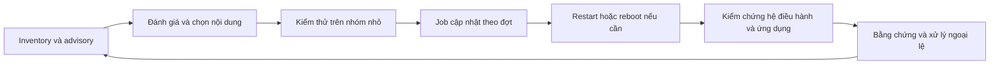
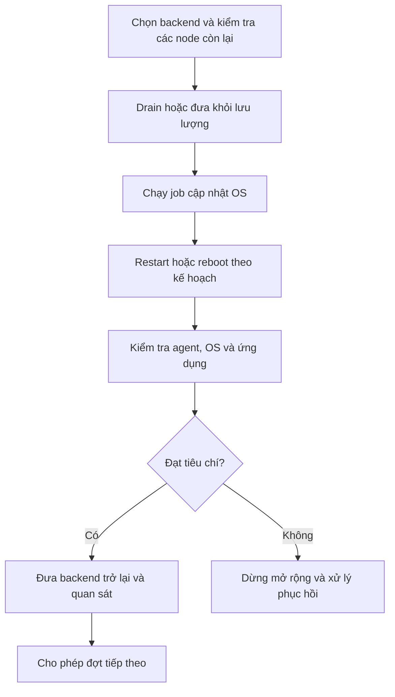

# OS Management Hub và quản lý bản vá hệ điều hành

## 1. Mục tiêu và phạm vi

Một máy chủ trên Oracle Cloud Infrastructure (OCI) không được bảo vệ đầy đủ chỉ nhờ đặt trong private subnet hoặc cấu hình NSG chặt chẽ. Hệ điều hành vẫn cần cập nhật để khắc phục lỗ hổng, lỗi ổn định và các vấn đề tương thích. Khi số lượng máy chủ tăng, việc đăng nhập từng máy rồi chạy cập nhật thủ công khó kiểm soát: máy nào đã vá, dùng nguồn phần mềm nào, có cần reboot và ứng dụng đã hoạt động trở lại hay chưa?

**OS Management Hub** cung cấp khả năng quản lý hệ điều hành tập trung cho các loại máy và môi trường được dịch vụ hỗ trợ. Trong một quy trình quản lý bản vá, dịch vụ giúp tổ chức thông tin máy được quản lý, nguồn phần mềm, nhóm máy và các công việc cập nhật. Hiệu quả bảo vệ phụ thuộc cả đăng ký agent, IAM, kết nối mạng, nội dung bản vá và cách triển khai thay đổi.

Sau bài học, người học có thể:

- Giải thích các thành phần chính của OS Management Hub và mối quan hệ giữa chúng.
- Chuẩn bị Compute instance, agent, quyền IAM và đường mạng cần thiết để quản lý bản vá.
- Tổ chức nguồn phần mềm, nhóm máy và quá trình kiểm thử trước khi đưa bản vá vào sản xuất.
- Lập lịch, theo dõi và kiểm chứng một đợt vá mà vẫn bảo vệ tính sẵn sàng của ứng dụng.
- Phân biệt hoàn tất job, cài đặt bản vá, hoàn tất reboot và khôi phục dịch vụ nghiệp vụ.

Ví dụ xuyên suốt là ứng dụng Java chạy trên ba OCI Compute instance Linux sau Load Balancer, sử dụng cơ sở dữ liệu ở một tầng riêng. Nhóm nền tảng quản lý hệ điều hành; nhóm ứng dụng xác nhận health check và giao dịch; nhóm bảo mật xác định ưu tiên khắc phục. Các ví dụ lệnh Linux dùng một bản Oracle Linux có DNF và được OS Management Hub hỗ trợ. Không suy từ ví dụ rằng mọi bản phân phối hoặc phiên bản Linux đều đăng ký được.

## 2. Quản lý bản vá là một vòng đời

Một đợt vá cần trả lời nhiều câu hỏi hơn “lệnh cập nhật có chạy thành công không?”:

1. **Phát hiện:** máy nào nằm trong phạm vi quản lý, thông tin inventory cập nhật đến lúc nào?
2. **Đánh giá:** bản vá giải quyết vấn đề gì, có áp dụng cho máy và gói đang cài không?
3. **Chuẩn bị:** nguồn nội dung, backup, dung lượng và điều kiện ứng dụng đã sẵn sàng chưa?
4. **Triển khai:** cập nhật theo nhóm nào, thứ tự nào, ai được phép thực hiện?
5. **Kích hoạt:** có cần restart tiến trình hoặc reboot để dùng mã mới không?
6. **Kiểm chứng:** phiên bản, trạng thái hệ điều hành và giao dịch ứng dụng có đạt yêu cầu không?
7. **Lưu bằng chứng:** thay đổi nào đã thực hiện, ngoại lệ nào còn lại, ai chịu trách nhiệm xử lý?



OS Management Hub tham gia vào quản lý hệ điều hành; nó không tự thay thế backup ứng dụng, kiểm thử nghiệp vụ, quét lỗ hổng, quản lý secret hay phân quyền database. Một bản vá hệ điều hành thành công cũng không đồng nghĩa thư viện được đóng gói bên trong ứng dụng Java hoặc container đã được cập nhật.

## 3. Các thành phần chính

| Thành phần | Vai trò trong quy trình |
| --- | --- |
| Managed instance | Máy đã đăng ký để dịch vụ thu thập thông tin và thực hiện các hoạt động quản lý được hỗ trợ |
| Agent và plugin liên quan | Thành phần trên máy giúp liên lạc, thu thập inventory và thực thi hoạt động quản lý hệ điều hành |
| Registration profile | Cấu hình phục vụ đăng ký và các liên kết ban đầu mà loại profile hỗ trợ |
| Software source | Nguồn nội dung phần mềm Linux được quản lý theo mô hình của dịch vụ |
| Custom software source | Nguồn tùy chỉnh từ nội dung được lựa chọn theo khả năng hỗ trợ |
| Versioned custom software source | Nguồn có phiên bản, phục vụ kiểm soát và đưa một tập nội dung xác định qua các giai đoạn |
| Managed instance group | Nhóm máy tương thích để tổ chức hoạt động quản lý chung |
| Lifecycle environment và stage | Tổ chức các giai đoạn như kiểm thử và sản xuất cho nội dung được hỗ trợ |
| Scheduled job và kết quả thực thi | Xác định công việc, mục tiêu, thời điểm và theo dõi việc thực hiện |
| Management station | Thành phần phục vụ quản lý, đồng bộ hoặc phân phối nội dung cho các môi trường Linux mà mô hình triển khai yêu cầu |

Không phải mọi thành phần trong bảng đều áp dụng giống nhau cho Linux, Windows, máy OCI và máy ngoài OCI. Chọn đúng luồng onboarding của dịch vụ cho hệ điều hành và vị trí triển khai. Không bắt đầu bằng việc cài management station cho mọi Compute instance.

### 3.1. Máy OCI và máy ngoài OCI

Đối với các Compute instance OCI được hỗ trợ, quy trình thường liên quan Oracle Cloud Agent cùng plugin OS Management Hub phù hợp. Cần kiểm tra trạng thái plugin và việc đăng ký vào dịch vụ, thay vì chỉ xác nhận Oracle Cloud Agent đã được cài.

Đối với môi trường ngoài OCI được hỗ trợ, như hệ thống tại chỗ hoặc đám mây khác, kiến trúc agent, đăng ký và management station có các yêu cầu riêng. Management station có thể đảm nhiệm vai trò đồng bộ, lưu đệm và phân phối nội dung phần mềm Linux theo thiết kế dịch vụ. Máy và station vẫn phải đáp ứng các đường kết nối quản trị cần thiết; một kho mirror không thay thế toàn bộ control plane.

Phạm vi hệ điều hành, phiên bản, kiến trúc CPU và tính năng hỗ trợ cần được kiểm tra tại thời điểm triển khai. Không mặc định một image tùy chỉnh hoặc một bản phân phối tương tự Oracle Linux sẽ được hỗ trợ với cùng quy trình.

### 3.2. Phân biệt với cơ chế quản lý cũ

Không dùng tên plugin, policy, API hoặc quy trình của OS Management Service cũ làm bằng chứng rằng máy đã đăng ký với OS Management Hub. Nếu tiếp nhận một hệ thống hiện hữu, xác định dịch vụ đang quản lý máy, agent/plugin tương ứng và quy trình chuyển đổi được hỗ trợ.

Không bật nhiều cơ chế quản lý package độc lập trên cùng máy mà không xác định quyền sở hữu. Một cron job chạy DNF, công cụ cấu hình khác và job của OS Management Hub có thể tranh chấp khóa package manager hoặc làm lệch tập gói đã được kiểm thử.

## 4. Chuẩn bị trước khi đăng ký máy

### 4.1. Kiểm tra tài nguyên và hệ điều hành

| Nhóm điều kiện | Nội dung cần xác nhận |
| --- | --- |
| Định danh OCI | Đúng tenancy, region, compartment và instance cần quản lý |
| Hệ điều hành | Bản phân phối, phiên bản và kiến trúc nằm trong phạm vi hỗ trợ |
| Agent | Agent/plugin phù hợp đã cài, được bật và hoạt động |
| Xác thực | Cơ chế nhận diện máy, nhóm động hoặc thành phần xác thực phù hợp luồng onboarding |
| Nguồn phần mềm | Có nguồn tương thích với phiên bản hệ điều hành và kiến trúc máy |
| Mạng | DNS, đồng bộ thời gian, truy cập endpoint quản trị và nguồn tải nội dung hoạt động |
| Dung lượng | Đủ chỗ cho metadata, package cache, tải gói, giao dịch cập nhật và kernel nếu có |
| Khả năng phục hồi | Có backup hoặc phương án thay instance và phục hồi dữ liệu phù hợp |

Một máy đã xuất hiện trong Console chưa chắc có inventory mới hoặc có khả năng tải bản vá. Kiểm tra thời điểm liên lạc, trạng thái quản lý và kết quả thao tác nhỏ trước khi đưa vào lịch vá tập trung.

### 4.2. Private subnet không đồng nghĩa không vá được

Máy trong private subnet không cần có public IP để được quản lý. Tuy nhiên, nó phải tới được các endpoint và nguồn nội dung mà luồng triển khai yêu cầu.

Tùy đích, đường đi có thể dùng Service Gateway cho dịch vụ OCI phù hợp, NAT Gateway cho đích Internet, proxy được quản lý hoặc management station. Service Gateway không phải một cổng Internet tổng quát; không mặc định mọi kho phần mềm bên ngoài đều đi qua đó.

Khi mạng có Network Firewall hoặc proxy:

- Xác định các endpoint, cổng và tên miền thật sự cần dùng cho agent, dịch vụ và nội dung.
- Kiểm tra DNS và chuỗi tin cậy TLS, đặc biệt khi có TLS inspection.
- Theo dõi đường trả lời và timeout, không chỉ luật egress ở subnet nguồn.
- Giữ phạm vi cho phép theo yêu cầu dịch vụ; không mở toàn bộ Internet chỉ để agent chuyển trạng thái hoạt động.

Quản lý tập trung không có nghĩa phải mở SSH/RDP từ Internet vào từng máy. Kênh quản lý của agent và đường tải nội dung phải được thiết kế theo mô hình được hỗ trợ, độc lập với lựa chọn quản trị tương tác của người vận hành.

## 5. Phân quyền IAM và trách nhiệm vận hành

### 5.1. Tách quyền người vận hành khỏi quyền của máy

Có hai tuyến quyền khác nhau:

1. **Người hoặc pipeline:** xem inventory, quản lý nguồn, tạo nhóm, lập lịch hoặc chạy hoạt động cập nhật.
2. **Máy/agent:** đăng ký, liên lạc và sử dụng các chức năng dịch vụ cần thiết theo cơ chế được hỗ trợ.

Một người được quyền xem managed instance không làm agent tự có quyền hoạt động. Ngược lại, agent đăng ký thành công không cho phép mọi thành viên trong tenancy tạo job vá máy.

| Vai trò | Phạm vi hợp lý |
| --- | --- |
| Người xem tình trạng | Xem inventory, advisory và kết quả job trong compartment được giao |
| Người quản lý nội dung | Quản lý nguồn phần mềm và phiên bản được phê duyệt |
| Người vận hành bản vá | Tạo/chạy job trong phạm vi nhóm máy được giao |
| Người phê duyệt sản xuất | Xác nhận nội dung, thời điểm và bằng chứng kiểm thử theo quy trình tổ chức |
| Agent hoặc principal của máy | Chỉ có quyền cần cho đăng ký và hoạt động quản lý được hỗ trợ |
| Người quản lý mạng | Quản lý route, gateway, firewall/proxy cần cho đường quản trị và tải nội dung |

Áp dụng các resource type và policy IAM đúng của OS Management Hub, agent và mô hình triển khai đang dùng. Không sao chép nguyên policy của dịch vụ cũ hoặc cấp quyền quản trị toàn tenancy cho nhóm động của mọi Compute instance.

### 5.2. Phạm vi compartment và nhóm động

Đặt máy thử nghiệm, sản xuất và các thành phần quản lý trong compartment có trách nhiệm rõ ràng. Nếu dùng dynamic group, viết membership theo tài nguyên và phạm vi cần thiết; tránh để mọi instance mới trong tenancy tự nhận quyền quản lý không liên quan.

Các quyền có thể cộng dồn từ nhiều policy. Một policy riêng trông hẹp chưa chứng minh người vận hành chỉ có quyền đó. Kiểm tra các quyền thực tế khi thiết kế phân tách trách nhiệm.

Nếu quy trình yêu cầu phê duyệt thay đổi, lưu quyết định trong hệ thống quản lý thay đổi hoặc workflow của tổ chức. Không mặc định việc tạo scheduled job đã bao gồm một bước phê duyệt nghiệp vụ độc lập.

## 6. Đăng ký và xác nhận managed instance

Quy trình thực hành trên Console nên đi theo thứ tự:

1. Chọn đúng region và compartment, xác nhận máy thuộc phạm vi OS Management Hub hỗ trợ.
2. Chuẩn bị IAM theo luồng đăng ký của loại máy.
3. Chuẩn bị registration profile và các liên kết ban đầu phù hợp, chẳng hạn nguồn phần mềm hoặc nhóm/stage mà profile hỗ trợ.
4. Trên Compute OCI, kiểm tra Oracle Cloud Agent và plugin OS Management Hub tương ứng; với môi trường khác, dùng quy trình agent và station của môi trường đó.
5. Thực hiện đăng ký bằng cơ chế được cung cấp cho loại profile và máy.
6. Chờ managed instance xuất hiện, agent liên lạc và inventory được thu thập.
7. Kiểm tra thông tin OS, kiến trúc, nguồn phần mềm, nhóm hoặc lifecycle stage.
8. Thực hiện một hoạt động đọc hoặc làm mới thông tin được hỗ trợ trước khi chạy cập nhật.

Không coi profile là thông tin có thể áp dụng tùy ý cho mọi máy. Một profile gắn với nguồn hoặc môi trường không tương thích có thể khiến registration hoặc hoạt động quản lý sau đó thất bại.

Nếu đăng ký không thành công, kiểm tra lỗi xác thực, IAM, region, mạng và trạng thái plugin. Không gỡ/cài lại agent nhiều lần hoặc tạo nhiều registration trùng nhau trước khi hiểu nguyên nhân.

## 7. Nguồn phần mềm và kiểm soát nội dung

### 7.1. Nguồn phần mềm quyết định máy có thể nhận gì

Trên Linux, thông tin package và advisory gắn với nguồn phần mềm và metadata tương ứng. Một máy có agent khỏe nhưng thiếu đúng source có thể không nhìn thấy bản cập nhật cần thiết.

Khi chọn source, kiểm tra:

- Đúng hệ điều hành, major version và kiến trúc CPU.
- Đúng dòng kernel hoặc các kênh nội dung đang sử dụng.
- Quyền sử dụng nội dung và điều kiện hỗ trợ nếu có.
- Metadata và nội dung đã đồng bộ, sẵn sàng tải xuống.
- Phụ thuộc package và các thành phần ứng dụng có tương thích không.

Không gắn nguồn của major version khác để cố tìm một package mới hơn. Nâng major version hệ điều hành là một thay đổi có kế hoạch riêng, không phải hệ quả mặc định của job cài các bản cập nhật hiện có.

### 7.2. Nguồn tùy chỉnh và nguồn có phiên bản

Nguồn tùy chỉnh giúp giới hạn hoặc tổ chức tập nội dung theo nhu cầu. Nguồn có phiên bản giúp xác định rõ tập nội dung được đưa qua các giai đoạn kiểm thử và phát hành.

Ví dụ quy trình:

```text
Nội dung từ nguồn được hỗ trợ
    -> phiên bản nội dung PATCHSET-TEST-01
    -> stage Development
    -> stage Test
    -> stage Production
```

`PATCHSET-TEST-01` là tên minh họa của tổ chức, không phải định dạng bắt buộc. Khi kiểm thử một phiên bản, cần bảo đảm sản xuất nhận đúng tập nội dung đã phê duyệt, thay vì vô tình dùng nguồn động đã có thêm package sau thời điểm kiểm thử.

Nguồn có phiên bản không tự chứng minh toàn bộ môi trường ứng dụng có thể tái tạo. Java runtime, thư viện nhúng, container image, cấu hình và dữ liệu vẫn cần được quản lý riêng.

### 7.3. Lifecycle environment và promotion

Lifecycle environment giúp tổ chức các stage cho quá trình đưa nội dung được hỗ trợ tới các nhóm máy. Khi promote một phiên bản nguồn, cần kiểm tra stage đích, các instance liên quan và những công việc cập nhật mà quy trình tạo hoặc yêu cầu thực hiện.

Phân biệt hai bằng chứng:

- **Nội dung đã được đưa tới stage:** máy có thể sử dụng tập nội dung nào?
- **Máy đã áp dụng nội dung:** package nào thực sự đã cài và mã nào đang chạy?

Không đóng thay đổi chỉ vì promotion thành công. Xem các job liên quan, kết quả từng máy, nhu cầu reboot và health check ứng dụng.

### 7.4. Nhóm máy phải tương thích

Không gom mọi máy Linux vào cùng một nhóm chỉ vì cùng thuộc một ứng dụng. Xác nhận các ràng buộc tương thích của group, nguồn phần mềm và lifecycle stage, đặc biệt OS version và kiến trúc.

Ngay cả khi cùng tương thích về hệ điều hành, có thể cần tách nhóm theo vai trò vận hành: canary, ứng dụng không trạng thái, node stateful hoặc máy yêu cầu thời gian bảo trì khác. Tổ chức nhóm phục vụ cả tính hợp lệ kỹ thuật lẫn giảm phạm vi ảnh hưởng.

## 8. Chọn bản vá và xác định ưu tiên

### 8.1. Security update không phải mọi thay đổi hệ điều hành

Các nội dung cập nhật có thể thuộc nhóm bảo mật, sửa lỗi hoặc cải tiến theo metadata của nhà cung cấp. Ưu tiên cần xét:

| Tiêu chí | Ví dụ câu hỏi |
| --- | --- |
| Mức độ ảnh hưởng | Lỗ hổng có thể thực thi mã, leo thang quyền hay chỉ gây lỗi trong điều kiện hẹp? |
| Khả năng áp dụng | Gói và phiên bản bị ảnh hưởng có hiện diện trên máy không? |
| Bề mặt tiếp cận | Thành phần có lắng nghe mạng hoặc xử lý dữ liệu không tin cậy không? |
| Biện pháp hiện có | Cô lập mạng hoặc tắt tính năng có giảm rủi ro trong thời gian chờ vá không? |
| Ảnh hưởng cập nhật | Có thay kernel, thư viện nền, agent hoặc thành phần ứng dụng đang dùng không? |
| Thời hạn xử lý | Chính sách nội bộ yêu cầu khắc phục và theo dõi ngoại lệ thế nào? |

Số lượng advisory không đồng nghĩa số lượng CVE độc lập hoặc số package cần cài. Một advisory có thể chứa nhiều gói và nhiều vấn đề. Ngược lại, một package có thể liên quan nhiều advisory.

Không chỉ so số phiên bản upstream để kết luận một package còn lỗ hổng. Nhà cung cấp có thể backport bản sửa trong phiên bản đóng gói của hệ điều hành. Đối chiếu advisory và release của package từ đúng nguồn hỗ trợ.

### 8.2. Kernel, reboot và live patching

Cài package kernel mới và chạy kernel mới là hai trạng thái khác nhau. `uname -r` cho biết kernel đang chạy; danh sách package cho biết những gì đã được cài. Nếu quy trình yêu cầu reboot, phải thực hiện và xác minh máy khởi động vào kernel mong muốn.

Oracle Ksplice cung cấp live patching cho các cấu hình, nội dung và quyền sử dụng phù hợp. Nó có thể giảm nhu cầu reboot cho những bản sửa nằm trong phạm vi hỗ trợ, nhưng không có nghĩa mọi bản vá, mọi nâng cấp hoặc mọi thay đổi hệ điều hành đều không cần restart.

Nếu sử dụng live patching, ghi nhận cả trạng thái bản vá live và baseline package theo công cụ được hỗ trợ. Không dùng riêng chuỗi phiên bản kernel làm bằng chứng phủ nhận hoặc xác nhận mọi live patch. Sau cùng, vẫn cần kế hoạch reboot và nâng cấp khi loại thay đổi yêu cầu.

### 8.3. Phạm vi ứng dụng và database

Trên Compute tự quản, cập nhật OS có thể ảnh hưởng Java runtime cài bằng package manager, thư viện hệ thống hoặc công cụ mạng. Nó không tự cập nhật JAR được đóng gói trong ứng dụng hoặc mọi image container đang triển khai.

Đối với dịch vụ database được OCI quản lý, dùng cơ chế bảo trì và runbook của đúng dịch vụ. Không tùy ý cài agent hoặc vá hệ điều hành của các thành phần được quản lý như đang vận hành một Compute instance thông thường. Bản vá Oracle Database, cấu hình Data Guard và nâng cấp schema là các quy trình riêng cần phối hợp.

## 9. Thiết kế đợt vá bảo vệ tính sẵn sàng

### 9.1. Tiền kiểm

Trước mỗi đợt, ghi rõ tập máy mục tiêu và kiểm tra:

1. Máy còn liên lạc với dịch vụ, inventory đủ mới và không có job cập nhật xung đột.
2. Nguồn nội dung đúng, đồng bộ và tải được từ mạng thực tế của máy.
3. Đủ dung lượng, đặc biệt ở các filesystem chứa cache, dữ liệu giao dịch package và boot.
4. Backup hoặc phương án phục hồi đã sẵn sàng; biết cách truy cập khi máy không khởi động.
5. Có baseline package, kernel, cấu hình và chỉ số ứng dụng trước thay đổi.
6. Nhóm ứng dụng đã xác định cách drain, health check, restart và điều kiện dừng triển khai.

Không xem boot volume backup là bản sao nhất quán tự động của toàn bộ ứng dụng phân tán. Dữ liệu trên các volume khác, giao dịch database và hệ thống ngoài máy cần phương án backup phù hợp. Khả năng restore nên được kiểm thử trong môi trường cho phép.

### 9.2. Canary rồi triển khai theo đợt

Với ba Compute instance sau Load Balancer, một kế hoạch có thể là:

| Đợt | Phạm vi | Điều kiện đi tiếp |
| --- | --- | --- |
| Canary | Một máy thử hoặc máy đại diện đã tách khỏi lưu lượng người dùng | OS cập nhật thành công, restart/reboot hoàn tất, kiểm thử ứng dụng đạt |
| Đợt sản xuất đầu | Một backend, còn các backend khác phục vụ | Health check và giao dịch đạt, tải trên phần còn lại trong ngưỡng |
| Đợt tiếp theo | Từng backend còn lại | Máy ở đợt trước ổn định và không có lỗi mới cần điều tra |

Một group hoặc scheduled job nhắm nhiều máy không tự chứng minh chúng sẽ được drain và vá từng máy theo ngân sách tính sẵn sàng của ứng dụng. Nếu dịch vụ không cung cấp điều phối cần thiết cho thiết kế này, chia tập mục tiêu và phối hợp bằng workflow vận hành hoặc công cụ tự động hóa phù hợp.

Không đưa đồng thời mọi node của một cluster hoặc cặp dự phòng vào cùng đợt chỉ vì chúng cùng OS. Thứ tự vá, quorum, failover và khả năng phục vụ phải tuân theo yêu cầu của ứng dụng đó.

### 9.3. Trình tự cho một backend



Drain, điều chỉnh Load Balancer và health check nghiệp vụ là các bước điều phối xung quanh job OS. Không giả định OS Management Hub tự hiểu khi nào một giao dịch Java đã hoàn tất hoặc backend đã sẵn sàng nhận khách hàng.

## 10. Lập lịch và theo dõi công việc

### 10.1. Lịch bắt đầu không phải giới hạn bảo trì

Khi tạo scheduled job, xác định đúng thao tác, loại cập nhật, nguồn nội dung và tập mục tiêu. Ghi rõ thời điểm, múi giờ, tính lặp lại và cách xử lý các máy không online khi tới lịch.

Một giờ bắt đầu không tự tạo ra thời hạn kết thúc hoặc cơ chế tự hủy khi hết maintenance window. Tính cả thời gian tải gói, cài đặt, reboot, kiểm thử và dự phòng cho sự cố. Nếu thao tác không có khả năng dừng an toàn, không coi việc hết cửa sổ bảo trì là lý do để kill package manager.

Ví dụ chuyển múi giờ: **02:00 tại Việt Nam, UTC+7, tương ứng 19:00 UTC ngày trước đó**. Kiểm tra múi giờ mà trường lịch thực sự dùng và đối chiếu thời điểm chạy tiếp theo sau khi lưu. Không suy múi giờ của job chỉ từ múi giờ máy trạm đang mở Console.

### 10.2. Trạng thái tổng và kết quả từng máy

Theo dõi các định danh của lịch, lần chạy, công việc con hoặc work request mà thao tác cung cấp. Trong một đợt nhiều máy, cần ghi nhận tối thiểu:

- Máy nào thành công, thất bại, bị bỏ qua hoặc chưa hoàn tất.
- Package/update nào được áp dụng và lỗi cụ thể nếu có.
- Có cần restart/reboot không, bước đó đã thực hiện chưa.
- Máy còn liên lạc sau thay đổi không.
- Ứng dụng đã được xác nhận khỏe hay còn bị cách ly khỏi Load Balancer.

Một phản hồi API tiếp nhận job không phải bằng chứng cập nhật xong. Một kết quả tổng không thay thế việc kiểm tra từng máy và các bước vận hành sau cập nhật.

### 10.3. Retry có mục tiêu

Trước khi retry, phân loại lỗi là tạm thời hay do cấu hình. Mạng gián đoạn có thể phù hợp với retry có giới hạn; source không tương thích hoặc thiếu dung lượng cần xử lý nguyên nhân trước.

Khi chỉ một phần máy thất bại, xác nhận tập mục tiêu của lần chạy lại để tránh vô tình lặp reboot trên những máy đã phục hồi. Không mặc định mọi job cập nhật đều có cùng hành vi idempotent ở các bước restart và điều phối ứng dụng.

## 11. Kiểm chứng sau cập nhật

### 11.1. Đọc lại cấu hình từ dịch vụ

Ví dụ dưới đây dùng Bash và OCI CLI đã xác thực, chọn đúng region. Đây là các lệnh đọc thông tin; thay placeholder bằng OCID thật của môi trường.

```bash
COMPARTMENT_OCID='<MANAGED_INSTANCE_COMPARTMENT_OCID>'
MANAGED_INSTANCE_OCID='<OS_MANAGEMENT_HUB_MANAGED_INSTANCE_OCID>'

oci os-management-hub managed-instance list \
  --compartment-id "$COMPARTMENT_OCID" \
  --all

oci os-management-hub managed-instance get \
  --managed-instance-id "$MANAGED_INSTANCE_OCID"
```

Managed instance là tài nguyên quản lý của dịch vụ. Không tự thay tham số yêu cầu managed instance OCID bằng Compute OCID chỉ vì cả hai cùng liên quan một máy; dùng định danh đúng mà API yêu cầu và đối chiếu liên kết tới Compute tương ứng.

Từ Console hoặc API phù hợp, kiểm tra tiếp nguồn phần mềm, nhóm/stage, thời điểm inventory, lịch sử công việc và trạng thái cần reboot mà dịch vụ cung cấp. Trường metadata của máy không nhất thiết chứa toàn bộ kết quả chi tiết của mọi job.

### 11.2. Đối chiếu trên Oracle Linux

Các lệnh sau minh họa kiểm tra cục bộ trên máy thử nghiệm có DNF. Chúng không thay thế việc xác nhận job từ OS Management Hub.

```bash
cat /etc/os-release
uname -r

sudo systemctl status oracle-cloud-agent --no-pager

df -h / /var /boot
sudo dnf repolist

rpm -q openssl-libs
sudo dnf check-update
```

Giải thích kết quả:

- `/etc/os-release` xác nhận hệ điều hành đang kiểm tra.
- `uname -r` cho biết kernel hiện chạy, không phải mọi kernel đã cài.
- Trạng thái `oracle-cloud-agent` chỉ hữu ích trên máy dùng service đó; agent hoạt động không tự chứng minh plugin OS Management Hub khỏe.
- `df` giúp kiểm tra dung lượng; layout khác cần điều chỉnh đường dẫn filesystem.
- `dnf repolist` giúp đối chiếu repository mà máy thấy.
- `rpm -q openssl-libs` là ví dụ một package; chọn package thực sự thuộc advisory hoặc job của đợt vá.
- `dnf check-update` có thể trả mã `100` khi có bản cập nhật. Không coi mã này như lỗi thực thi thông thường trong script giám sát.

Khi metadata và plugin phù hợp đã có, có thể kiểm tra security advisory hoặc nhu cầu reboot bằng các lệnh được hỗ trợ trên bản OS đó:

```bash
sudo dnf updateinfo list --security --available
sudo dnf needs-restarting -r
```

`needs-restarting` cần plugin tương ứng và có thể dùng mã thoát để báo nên reboot. Sự vắng mặt của lệnh hoặc plugin không chứng minh máy không cần reboot. Ngược lại, không có security advisory đang hiển thị cũng chưa đủ chứng minh máy đã tuân thủ nếu source, metadata hoặc inventory không đúng.

Không chạy DNF song song với job đang cập nhật package. Các bước làm mới metadata hoặc kiểm tra cần được bố trí khi package manager không có giao dịch xung đột.

### 11.3. Trường hợp Windows

Với Windows, xác nhận đúng phiên bản và môi trường được OS Management Hub hỗ trợ, cùng nguồn cập nhật và yêu cầu mạng của luồng đó. Không áp dụng software source Linux, lệnh DNF hoặc quy tắc advisory Linux cho Windows.

Một số kiểm tra PowerShell cục bộ có thể hỗ trợ đối chiếu:

```powershell
Get-CimInstance Win32_OperatingSystem |
  Select-Object Caption, Version, LastBootUpTime

Get-HotFix |
  Sort-Object InstalledOn -Descending |
  Select-Object -First 10 HotFixID, InstalledOn
```

`Get-HotFix` không phải danh mục đầy đủ của mọi loại cập nhật Windows. Kết hợp kết quả job, lịch sử cập nhật, trạng thái cần reboot và kiểm thử ứng dụng theo công cụ được hỗ trợ. Chính sách nguồn cập nhật nội bộ, proxy hoặc các thiết lập Windows Update khác cần được phối hợp với cấu hình quản lý tập trung để tránh xung đột.

### 11.4. Kiểm chứng ứng dụng

Sau khi hệ điều hành sẵn sàng, kiểm tra ứng dụng Java theo baseline đã thống nhất:

| Lớp | Ví dụ bằng chứng |
| --- | --- |
| Tiến trình | Service ứng dụng khởi động ổn định, không lặp restart |
| Kết nối | TLS, DNS và kết nối tới database hoạt động |
| Health check | Endpoint readiness và health check Load Balancer đạt |
| Nghiệp vụ | Một giao dịch đọc/ghi thử trong phạm vi được phép hoàn tất |
| Hiệu năng | Độ trễ, lỗi và tài nguyên không vượt ngưỡng dừng triển khai |
| Tính sẵn sàng | Backend đã trở lại phục vụ, năng lực dự phòng đủ cho đợt tiếp theo |

Đừng dùng riêng một mã HTTP `200` để xác nhận toàn bộ ứng dụng nếu endpoint không kiểm tra phụ thuộc quan trọng. Ngược lại, kiểm thử không được ghi dữ liệu nghiệp vụ tùy tiện; dùng giao dịch thử có kiểm soát hoặc cơ chế synthetic check đã thiết kế.

## 12. Khôi phục và rollback

### 12.1. Không có rollback chung cho mọi bản vá

Hạ phiên bản package, khởi động vào kernel trước đó và phục hồi một boot volume là các phương án khác nhau. Khả năng dùng phương án nào phụ thuộc package, script cài đặt, tương thích dữ liệu và trạng thái máy.

Không coi DNF history undo hoặc một thao tác downgrade là bảo đảm khôi phục đầy đủ. Package cũ có thể không còn ở nguồn, cấu hình đã thay đổi hoặc dữ liệu ứng dụng không tương thích với phiên bản trước.

### 12.2. Chuẩn bị phương án phù hợp kiến trúc

| Kiểu máy | Phương án cần đánh giá |
| --- | --- |
| Backend không trạng thái | Thay bằng instance/image đã kiểm thử, áp cấu hình và đưa lại vào Load Balancer |
| Máy có dữ liệu cục bộ | Phục hồi boot/data volume theo kế hoạch nhất quán và kiểm tra dữ liệu |
| Node trong cluster | Dừng mở rộng đợt vá, giữ quorum và dùng runbook phục hồi riêng của cluster |
| Máy lỗi sau thay kernel | Dùng đường quản trị/khôi phục được hỗ trợ, đánh giá khả năng dùng kernel trước hoặc restore |

Trước thay đổi, xác nhận người vận hành có quyền truy cập console connection hoặc công cụ khôi phục phù hợp khi SSH/RDP không hoạt động. Nếu dùng khóa mã hóa khách hàng quản lý cho boot/data volume hoặc backup, bảo đảm khóa và IAM cần cho restore vẫn khả dụng.

Chỉ tiếp tục đợt tiếp theo sau khi sự cố đã được hiểu và tiêu chí an toàn được đáp ứng. Một máy canary lỗi là tín hiệu dừng để điều tra, không phải lý do bỏ qua canary rồi vá toàn bộ nhóm.

## 13. Giám sát và chẩn đoán

### 13.1. Những tín hiệu nên theo dõi

- Máy không liên lạc hoặc inventory quá cũ so với yêu cầu của tổ chức.
- Job thất bại, không hoàn tất đúng thời gian kỳ vọng hoặc có nhiều máy bị bỏ sót.
- Bản vá ưu tiên cao chưa áp dụng trong thời hạn, kèm ngoại lệ và người chịu trách nhiệm.
- Máy còn cần reboot/restart sau khi job đã kết thúc.
- Nguồn nội dung hoặc management station đồng bộ lỗi, thiếu dung lượng hoặc không phân phối được gói.
- Ứng dụng lỗi hoặc backend chưa trở lại phục vụ sau đợt vá.

Chọn Logging, Monitoring, Audit, Events hoặc công cụ ngoài theo các dữ liệu và tích hợp mà tài nguyên thực sự cung cấp. Không giả định mọi thay đổi trạng thái đều tự phát sinh một notification. Cấu hình thu thập, cảnh báo và thử việc chuyển cảnh báo tới đúng nhóm vận hành.

### 13.2. Bảng chẩn đoán

| Hiện tượng | Nhóm nguyên nhân | Hướng kiểm tra |
| --- | --- | --- |
| Máy không xuất hiện sau đăng ký | Sai profile/region, agent/plugin, IAM hoặc đường mạng | Đối chiếu luồng onboarding, trạng thái plugin và lỗi đăng ký |
| Máy xuất hiện nhưng thông tin cũ | Agent mất liên lạc, proxy/TLS/DNS hoặc hoạt động inventory lỗi | Kiểm tra thời điểm liên lạc, log agent và kết nối tới endpoint cần thiết |
| Không thấy bản vá mong đợi | Sai source, metadata cũ, package không áp dụng hoặc bản sửa đã backport | Đối chiếu advisory, OS/architecture, nguồn và release package |
| Job lỗi tải package | Repository/station chưa đồng bộ, thiếu đường mạng hoặc nội dung không khả dụng | Thử đường tải phù hợp, kiểm tra đồng bộ và quyền truy cập nguồn |
| Package manager đang bị khóa | Job khác, cập nhật tự động hoặc công cụ cấu hình chạy đồng thời | Xác định chủ giao dịch; không xóa lock hoặc kill tiến trình tùy tiện |
| Không đủ dung lượng | Cache, `/var`, phân vùng boot hoặc log tăng | Đánh giá dung lượng và dọn theo quy trình, không xóa ngẫu nhiên package/kernel đang cần |
| Job thành công nhưng kernel chưa đổi | Chưa reboot hoặc boot vào kernel khác | Kiểm tra kernel đang chạy, lịch reboot và cấu hình boot theo runbook |
| OS khỏe nhưng ứng dụng lỗi | Tương thích thư viện/runtime, cấu hình hoặc phụ thuộc dịch vụ | So baseline, log ứng dụng và giao dịch; dừng mở rộng đợt vá |
| Một số máy không chạy theo lịch | Mục tiêu lịch sai, máy không online, quyền hoặc điều kiện thực thi | Xem tập mục tiêu thực tế và kết quả từng máy, không chỉ tên group |

Khi điều tra, ghi lại thời gian có múi giờ, managed instance, job/lần chạy, nguồn nội dung và thông báo lỗi. Không đưa credential, token đăng ký hoặc dữ liệu ứng dụng nhạy cảm vào bản ghi chia sẻ.

## 14. Tự động hóa một đợt vá

Tự động hóa nên giữ nguyên các cổng kiểm soát quan trọng thay vì chỉ tạo nhiều lệnh cập nhật cùng lúc. Một mô hình phối hợp có thể gồm:

```text
Nhận tập máy và phiên bản nội dung được phê duyệt
    -> kiểm tra agent, nguồn, dung lượng và backup
    -> drain backend trong đợt hiện tại
    -> tạo hoặc chạy job OS Management Hub phù hợp
    -> chờ kết quả từng máy
    -> restart/reboot theo kế hoạch
    -> kiểm tra health và giao dịch
    -> đưa backend trở lại
    -> cho phép đợt tiếp theo hoặc dừng để điều tra
```

Ngân sách số máy không khả dụng, drain Load Balancer và xác nhận nghiệp vụ là trách nhiệm điều phối của workflow nếu tính năng job đang dùng không cung cấp chúng. Không ghi những yêu cầu này vào một file tùy ý rồi coi đó là schema job gốc của OS Management Hub.

Khi viết pipeline:

- Dùng đúng tập mục tiêu và định danh, ghi lại kết quả trước khi chuyển bước.
- Có timeout cho việc chờ, nhưng xử lý timeout không được phá giao dịch package đang chạy.
- Chỉ retry khi đã xác định tính an toàn của thao tác.
- Không chạy job cập nhật và workflow reboot độc lập cùng nhắm một máy mà không có phụ thuộc rõ ràng.
- Bảo vệ credential của pipeline; ưu tiên cơ chế xác thực được hỗ trợ phù hợp môi trường.
- Giữ phê duyệt nội dung và chính sách thay đổi sản xuất trong workflow của tổ chức.

Khi mục tiêu là cập nhật cả fleet từ image chuẩn, cân nhắc kết hợp image được vá với quy trình thay instance cho workload phù hợp. Máy mới không nên luôn được tạo từ image cũ rồi chờ một kỳ vá dài mới nhận baseline an toàn.

## 15. Chi phí và vận hành dài hạn

Đánh giá chi phí theo mô hình dịch vụ, môi trường triển khai và quyền sử dụng nội dung thực tế. Không mặc định một chức năng có cùng điều kiện sử dụng hoặc mức phí ở mọi môi trường.

Các khoản và giới hạn liên quan có thể gồm:

- Compute, volume và dung lượng cache/mirror cho management station nếu kiến trúc cần station.
- Lưu lượng tải nội dung, gateway, kết nối liên mạng và proxy/firewall trên đường đi.
- Boot/data volume backup và tài nguyên phục hồi thử.
- Log, retention và hệ thống giám sát.
- Quyền sử dụng các nội dung hoặc khả năng live patching theo cấu hình hỗ trợ.
- Năng lực dự phòng để drain và vá từng nhóm mà ứng dụng vẫn phục vụ.

Station dùng chung cần được giám sát dung lượng, đồng bộ, kết nối và khả năng phục hồi; không biến một thành phần phân phối nội dung quan trọng thành điểm lỗi không có người sở hữu. Chọn topology và phương án dự phòng theo khả năng dịch vụ hỗ trợ, không giả định có thể đặt tùy ý nhiều station sau một load balancer là có HA.

Định kỳ xử lý máy đã hủy nhưng còn trong inventory, nguồn không còn dùng, lịch trùng lặp và các ngoại lệ hết hạn. Việc quản lý bản vá cần bao gồm cả quy trình tạo máy mới, chuyển môi trường và chấm dứt vòng đời máy.

## 16. Bài thực hành tích hợp

### 16.1. Chuẩn bị

Sử dụng compartment thử nghiệm, một Oracle Linux Compute instance tương thích với OS Management Hub và nguồn phần mềm hỗ trợ. Máy có thể ở private subnet nếu các đường quản lý và tải nội dung đã được thiết kế. Dùng dữ liệu mẫu và có phương án phục hồi trước khi cập nhật.

Để thực hành rolling patching, mở rộng thành hai hoặc ba backend thử nghiệm sau Load Balancer. Nếu chỉ có một máy, ghi rõ bài lab không chứng minh tính sẵn sàng khi reboot.

### 16.2. Các bước thực hiện

1. Ghi region, compartment, Compute OCID, OS version, architecture và baseline kernel/package.
2. Chuẩn bị IAM, profile và agent/plugin theo đúng luồng máy OCI đang dùng.
3. Đăng ký, xác nhận managed instance, thời điểm liên lạc và inventory.
4. Gắn hoặc xác nhận nguồn phần mềm đúng; kiểm tra metadata và đường tải nội dung.
5. Chọn một advisory hoặc tập cập nhật phù hợp lab, xác định package áp dụng và nhu cầu restart/reboot.
6. Tạo nhóm thử tương thích; nếu thực hành lifecycle, ghi rõ phiên bản nguồn và stage.
7. Chuẩn bị backup/phương án phục hồi và kiểm tra dung lượng, xung đột package manager.
8. Chạy job trước trên canary hoặc một máy thử; theo dõi đến kết quả cuối cùng.
9. Thực hiện restart/reboot nếu kế hoạch yêu cầu; xác nhận agent trở lại và kernel/package đúng.
10. Kiểm tra ứng dụng, kết nối database thử và health check. Chỉ tiếp tục đợt khác khi đạt tiêu chí.
11. Tạo một scheduled job trong phạm vi lab nếu cần luyện lập lịch; đối chiếu múi giờ và lần chạy tiếp theo.
12. Lưu kết quả từng máy, lỗi hoặc ngoại lệ, cùng quyết định hoàn tất. Hủy lịch lab không còn dùng và dọn tài nguyên theo chính sách môi trường.

Không vô hiệu hóa bảo mật package, bỏ xác minh TLS hoặc tắt toàn bộ kiểm soát egress chỉ để làm bài thực hành chạy qua. Nếu gặp lỗi, dùng bảng chẩn đoán để xác định đúng lớp cần sửa.

### 16.3. Tiêu chí hoàn thành

| Hạng mục | Điều kiện đạt |
| --- | --- |
| Phạm vi | Xác định đúng máy, region, compartment và hệ điều hành hỗ trợ |
| Onboarding | Agent/plugin khỏe, managed instance đúng và inventory đủ mới |
| IAM và mạng | Giải thích được quyền của người vận hành, quyền của máy và các đường kết nối cần thiết |
| Nội dung | Nguồn tương thích, advisory áp dụng và tập cập nhật được ghi nhận |
| Thực thi | Job có kết quả cuối cùng, đối chiếu được từng máy và package liên quan |
| Kích hoạt | Phân biệt cài package với restart/reboot và trạng thái mã đang chạy |
| Ứng dụng | Health check và giao dịch thử đạt sau thay đổi |
| Tính sẵn sàng | Nếu thực hành nhiều backend, có drain, thứ tự đợt và điều kiện dừng |
| Phục hồi | Có phương án thực tế, không dựa vào giả định mọi package đều downgrade an toàn |
| Bằng chứng | Lưu baseline, job, kết quả sau vá và ngoại lệ; không kèm credential hoặc token |

## 17. Các nguyên tắc cần nhớ

OS Management Hub giúp quản lý bản vá tập trung khi máy đã đăng ký đúng, agent hoạt động, IAM và mạng cho phép liên lạc, nguồn phần mềm phù hợp và công việc cập nhật được theo dõi. Một mắt xích không đúng có thể làm báo cáo thiếu dữ liệu hoặc khiến máy không nhận được bản vá dù tài nguyên quản lý vẫn tồn tại.

Hoàn tất quản lý bản vá phải chứng minh được nội dung đã được cài, restart/reboot cần thiết đã xử lý và ứng dụng trở lại trạng thái phục vụ. Triển khai theo nhóm nhỏ, giữ khả năng phục hồi và theo dõi ngoại lệ là những phần thiết yếu để vừa giảm rủi ro bảo mật vừa duy trì tính sẵn sàng của hệ thống OCI.
