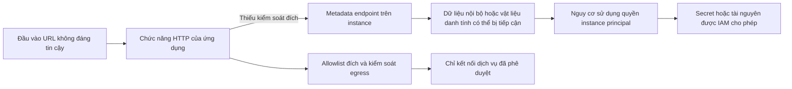

# Bảo vệ metadata endpoint và ngăn lộ credentials

Trong Oracle Cloud Infrastructure (OCI), một Compute instance cần biết nó đang chạy ở đâu, có những VNIC nào và được khởi tạo bằng cấu hình nào. Instance Metadata Service, thường gọi là IMDS, cung cấp các thông tin đó cho hệ điều hành, agent và ứng dụng. Các thành phần xác thực bằng instance principal cũng sử dụng thông tin danh tính của instance để thực hiện lời gọi OCI.

Nếu ứng dụng cho phép một yêu cầu không đáng tin cậy điều khiển kết nối HTTP từ máy chủ, metadata endpoint có thể trở thành đường tiếp cận dữ liệu nội bộ hoặc danh tính của instance. Việc máy chủ nằm trong private subnet không tự loại bỏ rủi ro này: yêu cầu nguy hiểm được phát đi từ chính workload đã có mặt trên máy.

Bài học thuộc chương **Bảo vệ mạng và máy chủ**, tập trung vào bảo vệ metadata của OCI Compute, hạn chế SSRF, thu hẹp quyền IAM và ngăn credentials đi vào metadata, log hay artifact triển khai. Các ví dụ gắn với ứng dụng trên Compute cần truy cập một secret chứa mật khẩu Oracle Database, nhưng không triển khai lại toàn bộ hệ thống mạng hoặc cơ sở dữ liệu.

## 1. Mục tiêu học tập

Sau bài học, người học có thể:

- Phân loại metadata, thông tin nhận dạng và dữ liệu xác thực cần bảo vệ.
- Giải thích IMDSv2 của OCI làm gì và giới hạn bảo vệ của nó.
- Lập kế hoạch chuyển sang IMDSv2 và tắt endpoint legacy mà vẫn giữ ứng dụng hoạt động.
- Kết hợp kiểm soát HTTP ở ứng dụng, giới hạn truy cập trên host và policy IAM theo quyền tối thiểu.
- Kiểm tra hiệu quả bằng dữ liệu không nhạy cảm, theo dõi dấu hiệu bất thường và xử lý khi credentials có nguy cơ bị lộ.

Mọi OCID, username và cấu hình trong bài là ví dụ. Chỉ thực hiện trên tài nguyên được giao; các đoạn lệnh không lấy private key, certificate identity hay token để làm bằng chứng thực hành.

## 2. Metadata endpoint chứa gì và vì sao cần bảo vệ?

### 2.1. Metadata có nhiều mức độ nhạy cảm

Trong OCI Compute, metadata service sử dụng địa chỉ link-local `169.254.169.254`. Một số nhóm dữ liệu thường gặp gồm thông tin instance, VNIC và custom metadata do người triển khai cung cấp. Cloud-init cũng sử dụng metadata phục vụ khởi tạo máy. [Nguồn: lấy instance metadata](https://docs.oracle.com/en-us/iaas/Content/Compute/Tasks/gettingmetadata.htm).

| Nhóm dữ liệu | Ví dụ | Cách đánh giá |
| --- | --- | --- |
| Thông tin vận hành | Instance OCID, region, availability domain | Không phải mật khẩu, nhưng có thể tiết lộ cấu trúc hạ tầng |
| Thông tin mạng | Địa chỉ private, VNIC, subnet liên quan | Có giá trị cho việc tìm hiểu môi trường nội bộ |
| Dữ liệu khởi tạo | Custom metadata và `user_data` | Có thể trở thành dữ liệu nhạy cảm nếu người triển khai đặt secret vào đó |
| Dữ liệu công khai phục vụ đăng nhập | SSH public key trong cấu hình khởi tạo | Public key không phải private key; vẫn cần giữ cấu hình đúng chủ sở hữu |
| Vật liệu xác thực và kết quả xác thực | Thành phần danh tính của instance, security token trong luồng SDK | Phải được bảo vệ theo vòng đời của cơ chế xác thực |

Không phải mọi trường metadata đều là credential. Tuy nhiên, một endpoint có cả dữ liệu quản trị lẫn dữ liệu liên quan đến danh tính không nên được phơi cho chức năng tải URL tùy ý hoặc người dùng không đáng tin cậy.

### 2.2. `user_data` không phải kho secrets

Một lỗi phổ biến là đưa mật khẩu DB, API token hoặc private key vào script cloud-init rồi mã hóa Base64 trước khi gửi lên OCI. Base64 chỉ là biểu diễn dữ liệu; nó không làm bí mật biến mất. Một người đọc được giá trị vẫn có thể giải ngược.

Dữ liệu khởi tạo còn có thể xuất hiện trong cấu hình IaC, state, kế hoạch triển khai, bản sao image, file cục bộ hoặc log bootstrap. Vì vậy, không chỉ kiểm tra xem ứng dụng có in mật khẩu hay không; phải xem xét toàn bộ nơi giá trị đã đi qua.

Cấu hình triển khai nên mang tham chiếu và tham số không bí mật, chẳng hạn:

```yaml
application: orders-api
environment: lab
secret_reference: <ocid-secret-db-password>
database_service: <service-name-duoc-phe-duyet>
```

Đoạn YAML chỉ minh họa cách tổ chức cấu hình, không phải schema cloud-init hoàn chỉnh. Secret OCID giúp ứng dụng tìm tài nguyên; nó không thay thế policy cấp quyền và không phải nội dung mật khẩu.

### 2.3. Instance principal mở rộng hậu quả khi host bị xâm nhập

Instance principal cho phép ứng dụng gọi API OCI mà không phải đặt API signing key của người dùng trên máy. OCI quản lý các certificate danh tính cần thiết cho cơ chế này. Tuy nhiên, Oracle lưu ý rằng người có quyền truy cập instance có thể sử dụng các quyền đã cấp cho instance đó. [Nguồn: gọi dịch vụ bằng instance principal](https://docs.oracle.com/en-us/iaas/Content/Identity/Tasks/callingservicesfrominstances.htm).

Nếu instance chỉ được đọc một secret phục vụ ứng dụng, tác động trên tài nguyên nghiệp vụ có thể được giới hạn ở phạm vi đó. Nếu instance được cấp quyền quản trị rộng khắp tenancy, một lỗi trên ứng dụng có thể kéo theo hậu quả lớn hơn nhiều.

Ranh giới IAM của instance principal là danh tính instance. Nó không tự phân biệt từng tiến trình Java, từng người dùng Linux hoặc từng container cùng chạy trên instance đó.

## 3. Luồng rủi ro từ SSRF đến lộ credentials

SSRF, viết tắt của Server-Side Request Forgery, xảy ra khi đầu vào không đáng tin cậy khiến máy chủ gửi yêu cầu tới một đích ngoài phạm vi dự định. Các chức năng cần chú ý gồm xem trước URL, lấy ảnh từ xa, chuyển tiếp webhook và gọi API theo địa chỉ người dùng nhập.



Sơ đồ thể hiện mô hình rủi ro để thiết kế phòng vệ. Nó không có nghĩa mọi SSRF đều tự lấy được credentials: mức độ ảnh hưởng phụ thuộc vào khả năng đọc phản hồi, điều khiển header, đường mạng, cấu hình IMDS và quyền của instance.

Ba tình huống cần tách biệt:

1. **Chỉ điều khiển URL**: ứng dụng gửi một GET đơn giản, không cho thêm header. Yêu cầu bắt buộc header của IMDSv2 có thể ngăn một số luồng này.
2. **Điều khiển cả URL và header hoặc có proxy hỗ trợ**: chỉ yêu cầu header cố định không còn là hàng rào đủ mạnh.
3. **Thực thi mã hoặc đăng nhập trên host**: tiến trình có thể tự tạo HTTP request. Cần hạn chế quyền trên host, phạm vi danh tính và quyền OCI, thay vì chỉ dựa vào định dạng request.

Biện pháp chống SSRF cần kết hợp kiểm soát ứng dụng với kiểm soát mạng thực tế; kiểm tra chuỗi URL đơn lẻ không bao phủ các thay đổi đích do DNS hoặc redirect. [Nguồn: hướng dẫn phòng ngừa SSRF của OWASP](https://cheatsheetseries.owasp.org/cheatsheets/Server_Side_Request_Forgery_Prevention_Cheat_Sheet.html).

## 4. Hiểu đúng IMDSv2 của OCI

### 4.1. Endpoint và header bắt buộc

IMDSv2 dùng đường dẫn `/opc/v2` và yêu cầu header:

```http
Authorization: Bearer Oracle
```

Giá trị `Oracle` là dấu hiệu cố định mà request cần có, không phải secret riêng của ứng dụng hay token được cấp cho một người dùng. IMDSv2 còn từ chối request có các header chuyển tiếp `Forwarded`, `X-Forwarded-For` hoặc `X-Forwarded-Host`. Khi tắt legacy, các đường `/opc/v1` và `/openstack` bị từ chối. [Nguồn: nâng cấp sang IMDSv2](https://docs.oracle.com/en-us/iaas/Content/Compute/Tasks/gettingmetadata.htm).

Không dùng việc thêm một forwarding header như một cơ chế bảo vệ chủ động: thành phần gửi request có thể không thêm hoặc có thể bỏ nó. Biện pháp cần thiết là giới hạn ai và chức năng nào có thể tạo kết nối tới metadata.

### 4.2. Những điều IMDSv2 không tự thực hiện

| Nhận định | Đánh giá đúng |
| --- | --- |
| Có header nghĩa là tiến trình đã được IAM xác thực | Header cố định không xác định người dùng hoặc tiến trình |
| Tắt v1 nghĩa là tắt toàn bộ metadata | v2 vẫn hoạt động cho các consumer hợp lệ |
| Instance private không có đường tới metadata | Workload trên instance vẫn có thể truy cập endpoint link-local |
| Bật v2 là đã xử lý xong SSRF | Vẫn cần kiểm soát URL, redirect, header và đường egress |
| Mọi tiến trình trên cùng VM có quyền OCI riêng | Instance principal dùng danh tính của instance |

Mục tiêu là đưa yêu cầu metadata về giao thức an toàn hơn và giảm những đường truy cập không mong muốn, đồng thời giữ phạm vi sử dụng có chủ đích.

## 5. Chuyển sang IMDSv2 mà không làm gián đoạn dịch vụ

### 5.1. Kiểm kê consumer trước khi thay đổi

Liệt kê các thành phần có thể dùng metadata:

- Cloud-init hoặc thành phần khởi tạo image.
- Oracle Cloud Agent và các plugin đang sử dụng.
- OCI SDK, CLI và các provider xác thực bằng instance principal.
- Script lấy region, hostname, VNIC hoặc custom metadata.
- Container hoặc dịch vụ chạy cùng host nhưng có vòng đời triển khai khác ứng dụng chính.

Xác minh khả năng hỗ trợ trên đúng image, phiên bản agent, SDK và cấu hình đang chạy. Không suy từ một VM đã chuyển thành công sang mọi image khác trong đội máy.

Thực hiện trước trên instance thử nghiệm hoặc một nhóm nhỏ. Quan sát đủ một chu kỳ có khởi động, refresh credentials, công việc định kỳ và các plugin liên quan; một lần gọi API thành công có thể chỉ đang dùng dữ liệu được cache.

### 5.2. Đọc cấu hình từ control plane

Ví dụ dưới dùng **Bash và OCI CLI** trên máy quản trị đã có quyền phù hợp:

```bash
OCI_REGION='<region-cua-instance>'
INSTANCE_OCID='<ocid-instance-lab>'

oci compute instance get \
  --region "$OCI_REGION" \
  --instance-id "$INSTANCE_OCID" \
  --query 'data."instance-options"' \
  --output json
```

Thuộc tính API `areLegacyImdsEndpointsDisabled` thể hiện việc vô hiệu hóa endpoint legacy. Trong JSON đầu ra CLI, tên trường thường hiển thị thành `are-legacy-imds-endpoints-disabled`. Đọc đúng giá trị, không nhầm một trường vắng mặt với bằng chứng đã chặn legacy.

### 5.3. Vô hiệu hóa endpoint legacy

Sau khi đã xác nhận tương thích và chuyển các consumer cần thiết:

```bash
oci compute instance update \
  --region "$OCI_REGION" \
  --instance-id "$INSTANCE_OCID" \
  --instance-options '{"areLegacyImdsEndpointsDisabled": true}' \
  --query 'data."instance-options"' \
  --output json
```

`--instance-options` nhận một đối tượng JSON. Lệnh chỉ minh họa thay đổi option liên quan tới metadata; người vận hành cần xem lại đích và quy trình thay đổi của môi trường trước khi thực hiện. [Nguồn: CLI cập nhật instance](https://docs.oracle.com/en-us/iaas/tools/oci-cli/latest/oci_cli_docs/cmdref/compute/instance/update.html).

Trong Console, chọn cấu hình IMDS chỉ cho phép version 2 nếu image và các thành phần đã đáp ứng. Chuẩn bị đường quản trị và cách phục hồi khi consumer không tương thích; không giả định ứng dụng luôn tiếp tục hoạt động chỉ vì thao tác cập nhật đã thành công.

### 5.4. Duy trì bằng IaC

Trong tài nguyên `oci_core_instance` hiện có, phần cấu hình liên quan có dạng:

```hcl
instance_options {
  are_legacy_imds_endpoints_disabled = true
}
```

Đây là đoạn trích đặt bên trong resource đầy đủ, không phải một cấu hình Terraform độc lập. Áp dụng cùng tiêu chuẩn vào template hoặc instance configuration mà quy trình tạo máy thực sự sử dụng. Một instance hiện tại đã được sửa không chứng minh instance thay thế hoặc instance autoscaling sẽ có cùng cấu hình. [Nguồn: Terraform resource `oci_core_instance`](https://docs.oracle.com/en-us/iaas/tools/terraform-provider-oci/latest/docs/r/core_instance.html).

## 6. Kiểm tra endpoint mà không thu thập dữ liệu xác thực

Dùng một metadata key không chứa credentials, chẳng hạn instance ID, và chỉ hiển thị mã HTTP. Các lệnh sau dành cho Linux có `curl` chạy trên instance lab.

### 6.1. Consumer hợp lệ gọi IMDSv2

```bash
curl --silent --show-error \
  --connect-timeout 2 --max-time 3 \
  --noproxy 169.254.169.254 \
  --output /dev/null \
  --write-out '%{http_code}\n' \
  --header 'Authorization: Bearer Oracle' \
  http://169.254.169.254/opc/v2/instance/id
```

Với runtime được phép và endpoint hoạt động, kỳ vọng mã thành công. Lệnh không in nội dung instance ID, không theo redirect và không đi qua HTTP proxy của môi trường. Timeout ngắn phù hợp cho kiểm tra kết nối, không phải cấu hình retry chuẩn cho mọi ứng dụng.

### 6.2. Request thiếu header và request legacy

```bash
# Thiếu header bắt buộc: không được nhận phản hồi thành công.
curl --silent --show-error \
  --connect-timeout 2 --max-time 3 \
  --noproxy 169.254.169.254 \
  --output /dev/null \
  --write-out '%{http_code}\n' \
  http://169.254.169.254/opc/v2/instance/id

# Sau khi tắt legacy, endpoint v1 phải bị từ chối.
curl --silent --show-error \
  --connect-timeout 2 --max-time 3 \
  --noproxy 169.254.169.254 \
  --output /dev/null \
  --write-out '%{http_code}\n' \
  http://169.254.169.254/opc/v1/instance/id
```

Nếu request thiếu header vẫn thành công, kiểm tra lại endpoint và đường request thực tế. Nếu legacy vẫn thành công, kiểm tra đúng instance và cấu hình đã có hiệu lực chưa. Với legacy bị vô hiệu hóa, tài liệu OCI mô tả phản hồi `404`; lỗi kết nối do host firewall là một trường hợp khác.

Khi `curl` không có phản hồi HTTP, giá trị `000` không phải status code do IMDS trả về. Cần xem exit code và lỗi kết nối để phân biệt timeout, reject và lỗi HTTP.

Không cần truy xuất toàn bộ cây metadata, `user_data`, dữ liệu danh tính hoặc security token để chứng minh biện pháp bảo vệ hoạt động.

## 7. Ngăn SSRF ở lớp ứng dụng

### 7.1. Thu hẹp loại đầu vào ngay từ thiết kế

Nếu ứng dụng chỉ cần gọi một vài đối tác đã biết, API có thể nhận `partnerId` thay vì URL tùy ý. Máy chủ ánh xạ ID đó sang một origin được quản trị viên kiểm soát. Người dùng không được tự chọn scheme, host, port hoặc header nhạy cảm.

Một chức năng xem trạng thái không nên tái sử dụng HTTP client có OCI signer, token hoặc header xác thực dành cho hệ thống nội bộ. Dữ liệu từ request người dùng cũng không được sao chép nguyên thành header của request outbound.

### 7.2. Ví dụ Java giới hạn đích và không tự theo redirect

Đoạn sau minh họa một phần thiết kế cho Java 11 trở lên:

```java
import java.io.IOException;
import java.net.URI;
import java.net.http.HttpClient;
import java.net.http.HttpRequest;
import java.net.http.HttpResponse;
import java.time.Duration;
import java.util.Map;

public final class PartnerHealthProbe {
    private static final Map<String, URI> TARGETS = Map.of(
            "billing", URI.create("https://billing.example/health"));

    private static final HttpClient CLIENT = HttpClient.newBuilder()
            .connectTimeout(Duration.ofSeconds(3))
            .followRedirects(HttpClient.Redirect.NEVER)
            .build();

    public static int check(String partnerId)
            throws IOException, InterruptedException {
        URI target = TARGETS.get(partnerId);
        if (target == null) {
            throw new IllegalArgumentException("Unknown partner");
        }

        HttpRequest request = HttpRequest.newBuilder(target)
                .timeout(Duration.ofSeconds(5))
                .GET()
                .build();

        return CLIENT.send(request, HttpResponse.BodyHandlers.discarding())
                .statusCode();
    }
}
```

`billing.example` là hostname minh họa, cần thay bằng đích đã phê duyệt. Client không theo `Location` tự động và không mang signer/header của OCI. Cấu hình redirect được hỗ trợ bởi Java HTTP client. [Nguồn: `HttpClient.Builder`](https://docs.oracle.com/en/java/javase/21/docs/api/java.net.http/java/net/http/HttpClient.Builder.html).

Mẫu này không phải bộ phòng vệ SSRF hoàn chỉnh. Vẫn phải kiểm soát người được sửa bảng đích, DNS, proxy và địa chỉ thực tế mà kết nối sử dụng. Một hostname được phép nhưng phân giải đến địa chỉ không được phép vẫn là vấn đề cần xử lý ở đường egress.

### 7.3. Nếu nghiệp vụ buộc phải nhận URL

Thiết kế cần xác định rõ scheme, cổng, hostname hoặc nhóm đích được phép; kiểm tra kết quả phân giải và đích thực tế của kết nối. Không chỉ so sánh một chuỗi với `169.254.169.254` rồi kết luận an toàn. Cần xét loopback, private/link-local, IPv4/IPv6, các cách biểu diễn địa chỉ và thay đổi do DNS.

Tắt redirect khi không cần. Nếu cần theo redirect, từng đích tiếp theo phải được đánh giá lại; không chỉ kiểm tra URL đầu tiên. Kiểm soát ở thời điểm xác minh và lúc kết nối phải nhất quán để tránh khoảng trống do thay đổi DNS.

Giới hạn timeout, kích thước phản hồi, số kết nối và loại nội dung cũng cần được cân nhắc. Chúng giúp kiểm soát việc sử dụng chức năng tải từ xa, nhưng không thay thế quyết định cho phép hoặc từ chối đích.

## 8. Hạn chế metadata trên host và runtime

### 8.1. Vì sao không dựa vào NSG hoặc security list?

Tài liệu OCI nêu security rules của VCN không được thực thi đối với lưu lượng liên quan đến `169.254.0.0/16`, trong đó có metadata và iSCSI. Vì thế, không thể chứng minh metadata đã bị chặn chỉ bằng việc bỏ rule egress thông thường trong NSG hoặc security list. [Nguồn: security rules của VCN](https://docs.oracle.com/en-us/iaas/Content/Network/Concepts/securityrules.htm).

Các lớp kiểm soát cần bổ sung gồm cấu hình IMDS, ứng dụng, firewall hoặc sandbox trên host và ranh giới runtime. Private subnet, NAT Gateway và Internet Gateway không phải cơ chế phân quyền từng tiến trình đối với IMDS.

### 8.2. Tách tiến trình cần metadata khỏi tiến trình nhận đầu vào không tin cậy

Ví dụ, một tiến trình `url-fetcher` chỉ tải dữ liệu từ đối tác và không cần quyền OCI. Một backend khác mới cần đọc secret DB. Không nên chạy cả hai dưới cùng một UID rồi kỳ vọng firewall phân biệt được chúng theo tài khoản.

Có thể dùng UID hoặc cơ chế quản lý tiến trình để hạn chế đường truy cập khi chúng cùng host. Với chênh lệch mức tin cậy lớn, tách thành các instance có danh tính và phạm vi quyền riêng sẽ tạo ranh giới rõ hơn. Quyết định này cần cân đối thêm chi phí Compute, vận hành và tính sẵn sàng.

### 8.3. Ví dụ rule nftables giới hạn một UID

Giả sử dịch vụ không cần metadata chạy trực tiếp trên host Linux bằng UID `2001`. Với môi trường đã chọn nftables làm cơ chế quản lý firewall, có thể thiết kế một bảng riêng như sau:

```nft
table inet metadata_guard {
    chain local_output {
        type filter hook output priority 10; policy accept;
        meta skuid 2001 ip daddr 169.254.169.254 tcp dport 80 counter reject with tcp reset
    }
}
```

`meta skuid` chọn UID gắn với socket phát sinh lưu lượng. Rule mẫu chỉ chặn HTTP đến đúng metadata IP cho UID đã chỉ định; không chặn toàn bộ dải link-local. [Nguồn: nftables socket UID/GID](https://wiki.nftables.org/wiki-nftables/index.php/Matching_packet_metainformation).

Đây là cấu hình cần được tích hợp và kiểm tra với firewall hiện hữu, không phải lệnh áp dụng mù lên mọi Oracle Linux image. Xác định đúng UID thực tế, backend firewall, thứ tự xử lý và cách duy trì sau reboot. Không trộn các công cụ quản lý firewall mà không rõ thành phần nào sở hữu ruleset.

Các giới hạn của mẫu phải được hiểu rõ:

- Nó nhắm tới lưu lượng phát sinh cục bộ tại hook `output`, không tự bao phủ mọi đường đi của container.
- Tiến trình khác UID, proxy cục bộ hoặc thành phần trung gian có thể tạo một đường cần kiểm soát riêng.
- Người có root hoặc khả năng quản trị mạng trên host có thể thay đổi quy tắc; đây không phải hàng rào chống lại quyền quản trị host đã bị chiếm.
- Nếu ứng dụng cần instance principal nằm cùng UID bị chặn, việc tạo hoặc refresh credentials có thể thất bại.

Không chặn toàn bộ `169.254.0.0/16` bằng một rule chung chỉ để xử lý metadata. Dải này còn phục vụ các chức năng nền tảng; thay đổi quá rộng có thể ảnh hưởng boot volume, lưu trữ hoặc dịch vụ của instance.

### 8.4. Container cần kiểm tra đường thực tế

Container dùng mạng bridge, host network hoặc các cơ chế CNI có thể đi qua hook và namespace khác nhau. UID nhìn thấy trong container cũng có thể khác UID tại host. Một phép thử bằng tài khoản SSH trên node không chứng minh container đã bị chặn.

Thực hiện kiểm tra bằng đúng container, service account của hệ điều hành và cấu hình mạng đang triển khai. Hạn chế privileged container, quyền sửa mạng và khả năng truy cập socket quản trị host. Không để một container xử lý dữ liệu không đáng tin cậy sử dụng danh tính rộng của cả node như một lựa chọn mặc định.

## 9. Giới hạn hậu quả bằng IAM và quản lý secrets

### 9.1. Danh tính có phạm vi hẹp

Dynamic group xác định các instance phù hợp với matching rule; policy cấp các thao tác được phép trên tài nguyên. Tránh dùng rule bao trùm một compartment chứa nhiều workload có mức tin cậy khác nhau rồi cấp quyền rộng cho toàn nhóm.

Ví dụ một runtime chỉ cần một secret có thể được giới hạn như sau:

```text
Allow dynamic-group OrdersRuntime to read secret-bundles in compartment OrdersSecrets where target.secret.id = '<ocid-secret-db-password>'
```

Đây là policy minh họa giới hạn theo tài nguyên; phải xem xét thêm mọi policy khác mà principal nhận được. Không cấp quyền quản trị IAM, khóa hoặc toàn bộ secrets chỉ vì ứng dụng cần lấy một mật khẩu. Tham khảo resource type và điều kiện hỗ trợ khi viết policy thực tế. [Nguồn: IAM cho Vault và Secret Management](https://docs.oracle.com/en-us/iaas/Content/Identity/policyreference/keypolicyreference.htm).

Ngay cả khi một tiến trình không được phép truy cập metadata, tài khoản quản trị host vẫn là một phần của ranh giới tin cậy. IAM cần được thiết kế sao cho khi host gặp sự cố, lượng tài nguyên nghiệp vụ có thể bị tác động vẫn nhỏ nhất có thể.

### 9.2. Đặt secret đúng nơi nhưng vẫn kiểm soát consumer

Mật khẩu Oracle Database nên được lưu trong Secret Management và chỉ cung cấp cho runtime cần nó. Khả năng lưu tập trung hỗ trợ quản lý nội dung và phiên bản. [Nguồn: tổng quan Secret Management](https://docs.oracle.com/en-us/iaas/Content/secret-management/overview.htm).

Dịch vụ lưu secret không tự giải quyết một instance đã được cấp quyền đọc quá rộng. Nếu kẻ tấn công sử dụng được danh tính có quyền đọc secret đó, nội dung vẫn có thể bị truy xuất theo các quyền được cấp.

Không đưa secret vào display name, tag, custom metadata, dòng lệnh hoặc thông báo lỗi. Trong ứng dụng, giới hạn việc sao chép giá trị vào biến môi trường, file tạm và đối tượng log; biến môi trường cũng không phải ranh giới bảo vệ trước một tiến trình có đủ quyền đọc môi trường hoặc bộ nhớ.

### 9.3. Dọn nguồn phát tán và xử lý dữ liệu đã lộ

Khi phát hiện secret từng nằm trong `user_data`, cần thay thế credential tại hệ thống đích và kiểm tra các bản lưu liên quan. Chỉ xóa một dòng khỏi template không làm token hoặc mật khẩu cũ hết hiệu lực.

CLI cập nhật instance có giới hạn đối với một số trường khởi tạo như `user_data` và `ssh_authorized_keys`; không giả định có thể sửa hoặc xóa tùy ý sau khi máy đã được launch. Có thể cần tạo lại instance từ cấu hình sạch, cùng việc xử lý image, state và artifact theo quy trình. [Nguồn: giới hạn cập nhật metadata](https://docs.oracle.com/en-us/iaas/tools/oci-cli/latest/oci_cli_docs/cmdref/compute/instance/update.html).

Phân biệt các loại dữ liệu khi thay thế: mật khẩu DB phải đổi tại DB; API token phải thu hồi ở dịch vụ cấp token; API signing key phải xử lý theo cơ chế quản lý khóa tương ứng. Việc xoay vòng certificate của instance không tự thay các mật khẩu mà ứng dụng đã đọc và có thể đã bị sao chép.

## 10. Quan sát metadata và hành vi sử dụng danh tính

### 10.1. Metric cho request metadata

OCI cung cấp metric `InstanceMetadataRequests` trong namespace `oci_compute`. Các dimension gồm `metadataVersion`, `path`, `resourceId`, `userAgent` và `status`, giúp quan sát consumer legacy, đường dẫn và kết quả request. [Nguồn: Compute Management Metrics](https://docs.oracle.com/en-us/iaas/Content/Compute/References/compute-management-metrics.htm).

Từ đó có thể xây dựng các tín hiệu vận hành:

| Tín hiệu | Việc cần tìm hiểu |
| --- | --- |
| Request v1 vẫn xuất hiện sau lịch chuyển đổi | Consumer chưa được chuyển hoặc script cũ còn chạy |
| Tăng lỗi metadata sau khi đổi option | Image, agent, SDK hoặc proxy không tương thích |
| Tần suất gọi tăng mạnh | Retry không có giới hạn, thiếu cache hoặc hành vi bất thường |
| Đường dẫn hoặc user agent ngoài danh sách dự kiến | Thành phần mới, cấu hình sai hoặc hoạt động cần điều tra |

Không dùng user agent như bằng chứng chắc chắn về danh tính tiến trình; giá trị này có thể được lựa chọn bởi client. Dữ liệu tổng hợp cũng không tự chỉ ra PID đã phát sinh request.

Một request đã bị chặn trên host có thể chưa hề đến IMDS, nên cần kết hợp counter firewall hoặc telemetry runtime. Không bật ghi toàn bộ nội dung phản hồi để bù cho việc thiếu quan sát; đó có thể chính là cách tạo thêm bản sao credentials.

### 10.2. Audit cho lời gọi OCI bằng instance principal

Đối với API OCI được instance gọi, Audit có thể liên kết hoạt động với instance principal. Cần đối chiếu thao tác trên secret, storage hoặc tài nguyên khác với luồng nghiệp vụ đã cho phép. Một request HTTP cục bộ đến metadata không nên được mặc định là một sự kiện Audit đầy đủ tương đương API control plane.

Nếu nhiều tiến trình dùng chung instance principal, Audit thường chỉ giúp xác định danh tính instance, không giải quyết riêng việc tiến trình nào đã khởi phát. Muốn truy vết tốt hơn, cần telemetry ứng dụng/host và thiết kế ranh giới workload phù hợp.

### 10.3. Giữ log ngoài đường lộ credentials

Log chẩn đoán chỉ nên có trạng thái, thời gian, loại consumer và tham chiếu tài nguyên khi cần. Loại bỏ header xác thực, token, private key, secret bundle và mật khẩu khỏi log, trace hoặc APM attribute.

Không bật shell tracing như `set -x` trong luồng lấy bí mật. Khi chia sẻ lỗi, phải xem lại cả request dump, environment dump và file hỗ trợ được agent thu thập. Một token đã bị che trên dashboard vẫn có thể tồn tại trong bản log gốc nếu cơ chế che chỉ diễn ra ở giao diện.

## 11. Ứng phó khi nghi ngờ metadata hoặc credentials bị truy cập sai

Quy trình cần xử lý cả điểm xâm nhập lẫn quyền và dữ liệu có thể đã bị sử dụng:

1. **Khoanh vùng instance hoặc workload**: hạn chế luồng không cần thiết, giữ đường quản trị phục vụ điều tra và tránh tự làm mất bằng chứng.
2. **Ghi nhận phạm vi danh tính**: xác định instance, dynamic group, policy và tài nguyên đã được phép truy cập tại thời điểm sự cố.
3. **Kiểm soát quyền OCI**: thu hẹp hoặc gỡ quyền không cần thiết theo quy trình, đồng thời kiểm tra hiệu lực thay đổi thay vì giả định cắt quyền tức thì.
4. **Xử lý credentials tại nơi cấp hoặc nơi sử dụng**: đổi mật khẩu DB, thu hồi token hoặc khóa liên quan khi có khả năng đã lộ.
5. **Kiểm tra hoạt động tài nguyên**: đối chiếu Audit, log ứng dụng/host và truy cập vào dữ liệu nghiệp vụ trong khoảng thời gian nghi ngờ.
6. **Khắc phục và triển khai lại**: sửa SSRF, làm sạch cấu hình và tạo lại workload từ nguồn tin cậy nếu host không còn đáng tin.
7. **Xác minh sau phục hồi**: kiểm tra cả đường được phép lẫn đường bị cấm, theo dõi refresh credentials và công việc định kỳ.

Thay đổi matching rule của dynamic group có thời gian lan truyền; tài liệu Oracle lưu ý có thể cần khoảng một giờ. Không coi việc vừa bỏ một tag hoặc sửa membership là bằng chứng mọi khả năng sử dụng danh tính đã bị loại bỏ. [Nguồn: cập nhật dynamic groups](https://docs.oracle.com/en-us/iaas/Content/Identity/Tasks/managingdynamicgroups.htm).

Tắt IMDSv1 hoặc chặn đường lấy credentials mới không thu hồi được mật khẩu và dữ liệu đã bị sao chép. Khôi phục thành công cần có bằng chứng cho từng loại credential và tài nguyên liên quan, không chỉ một lần kiểm tra endpoint.

## 12. Thực hành trong môi trường lab

### 12.1. Chuẩn bị

Dùng một instance thử nghiệm, tài khoản quản trị được giao và một dịch vụ không cần metadata chạy dưới UID riêng. Không đặt secret thật trong custom metadata. Nếu cần kiểm tra quyền đọc secret, chỉ dùng tài nguyên giả và policy có phạm vi hẹp.

Ghi nhận image, agent/SDK, cấu hình IMDS, các consumer metadata và quyền của instance trước khi thay đổi. Chọn một đường quản trị độc lập với chức năng HTTP đang thử để có thể khôi phục khi cấu hình sai.

### 12.2. Trình tự thực hiện

1. Đọc cấu hình IMDS từ control plane và xác định consumer v1 qua metric.
2. Chuyển các consumer cần thiết sang v2, thử cả khởi động và refresh trong lab.
3. Tắt legacy trên instance thử nghiệm và cập nhật mẫu IaC tương ứng.
4. Chạy kiểm tra instance ID bằng v2 có header, v2 thiếu header và endpoint legacy; chỉ lưu mã phản hồi.
5. Áp dụng cơ chế giới hạn host phù hợp cho dịch vụ không cần metadata.
6. Từ đúng UID/runtime của dịch vụ đó, thử request v2 có header tới key không nhạy cảm; kỳ vọng bị chặn bởi lớp host.
7. Từ consumer được phép, xác nhận hoạt động cần metadata vẫn chạy được, kể cả khi refresh thông tin xác thực.
8. Thử chức năng tải URL bằng các đích giả được kiểm soát để xác nhận allowlist và redirect hoạt động theo thiết kế.
9. Kiểm tra log, metrics và bằng chứng triển khai không chứa nội dung nhạy cảm.

### 12.3. Tiêu chí đánh giá kỹ thuật

| Nội dung cần chứng minh | Bằng chứng phù hợp |
| --- | --- |
| Legacy đã bị tắt | Option trên đúng instance và request legacy bị từ chối |
| Consumer hợp lệ tiếp tục hoạt động | V2 thành công cùng kiểm tra agent/ứng dụng và refresh |
| Dịch vụ không cần metadata bị hạn chế | Kiểm tra từ đúng UID/container và counter hoặc lỗi kết nối phù hợp |
| Chức năng HTTP không được chọn đích tùy ý | Kiểm tra mapping/allowlist, redirect và egress bằng đích thử nghiệm |
| IAM có phạm vi nghiệp vụ hẹp | Matching rule và tổng các policy áp dụng được đối chiếu |
| Credentials không đi vào bằng chứng | Log và artifact chỉ chứa tham chiếu cùng trạng thái cần thiết |

Không kết luận đạt chỉ vì một lệnh `curl` từ tài khoản quản trị thành công hoặc thất bại. Bằng chứng cần gắn với đúng runtime, đúng endpoint và lớp kiểm soát đang muốn đánh giá.

## 13. Những điểm cần ghi nhớ

Bảo vệ metadata trong OCI là bảo vệ một đường nối giữa workload trên host, cấu hình khởi tạo và danh tính của instance. IMDSv2 cùng việc tắt endpoint legacy là một phần của giải pháp; header cố định không tạo ra quyền riêng cho từng tiến trình.

Một thiết kế đầy đủ cần giảm dữ liệu nhạy cảm trong metadata, hạn chế SSRF, kiểm soát truy cập từ host/runtime, giữ IAM ở phạm vi cần thiết và theo dõi cách danh tính được sử dụng. Khi có sự cố, phải xử lý cả credentials đã lộ tại hệ thống đích và nguồn làm lộ, rồi xác minh lại luồng vận hành sau phục hồi.
