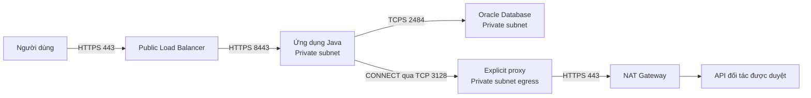

# Phân đoạn mạng và kiểm soát kết nối đi ra của ứng dụng

## 1. Mục tiêu và tình huống triển khai

Trong chương **Bảo vệ mạng và máy chủ** của module **CLOUD_PROVIDERS_ORACLE**, bài học này tập trung vào hai câu hỏi: một thành phần được phép kết nối tới thành phần nào, và ứng dụng được phép chủ động gửi dữ liệu ra đâu. Đây là phần nối tiếp giữa thiết kế VCN, phân quyền IAM, vận hành Compute và bảo vệ các dịch vụ cơ sở dữ liệu Oracle trong Oracle Cloud Infrastructure (OCI).

Sau bài học, người học có thể:

- Chia hạ tầng thành các vùng có trách nhiệm và quyền kết nối rõ ràng.
- Lập ma trận kết nối, chuyển ma trận thành NSG và thiết kế đường đi phù hợp.
- Phân biệt khả năng của NAT Gateway, Service Gateway, proxy và OCI Network Firewall.
- Kiểm chứng cả kết nối được phép lẫn kết nối phải bị chặn.
- Đưa chính sách mạng vào quy trình tự động hóa, giám sát và thay đổi có kiểm soát.

Xét một hệ thống đặt hàng: người dùng gọi Load Balancer qua HTTPS; Load Balancer chuyển yêu cầu tới ứng dụng Java; ứng dụng truy cập Oracle Database và gọi API đối tác. Nếu máy ứng dụng bị khai thác, kẻ tấn công có thể thử truy cập dịch vụ nội bộ khác hoặc đưa dữ liệu ra ngoài. Bảo vệ cổng nhận yêu cầu chưa xử lý được các kết nối do ứng dụng khởi tạo này.

Thiết kế trong bài là **một phương án minh họa**: tách vùng tiếp nhận, ứng dụng, dữ liệu và proxy egress; ứng dụng gọi API ngoài qua proxy. Địa chỉ, cổng và tên miền phải được thay bằng giá trị thực của môi trường. Bài không giả định mọi sản phẩm cơ sở dữ liệu OCI có cùng giao thức hoặc cùng listener.

## 2. Phân đoạn mạng có nhiều lớp

### 2.1. Phân đoạn theo đường đi và theo vai trò

Có hai nhóm lưu lượng cần mô tả:

- **North–south**: kết nối giữa hệ thống với Internet hoặc mạng bên ngoài.
- **East–west**: kết nối giữa các thành phần nội bộ, chẳng hạn ứng dụng với database.

Subnet giúp tổ chức địa chỉ và chính sách định tuyến. NSG giúp gom các tài nguyên có cùng vai trò kết nối, chẳng hạn nhóm Load Balancer, nhóm ứng dụng và nhóm database. Trong cùng VCN, NSG có thể tham chiếu NSG khác làm nguồn hoặc đích; cách này tránh phải duy trì danh sách IP từng máy khi ứng dụng tăng số lượng instance. [Tài liệu Oracle về Network Security Groups](https://docs.oracle.com/en-us/iaas/Content/Network/Concepts/networksecuritygroups.htm).

Tách hai máy sang hai subnet chưa tạo ra một quy tắc cấm giữa chúng. OCI mặc định có định tuyến nội bộ VCN; muốn giới hạn giao tiếp phải thiết kế thêm các rule bảo mật. Nếu cần kiểm tra lưu lượng qua một firewall trung gian, phải cấu hình định tuyến nội bộ tương ứng. [Tài liệu Oracle về định tuyến trong VCN](https://docs.oracle.com/en-us/iaas/Content/Network/Tasks/managingroutetables_topic-working.htm).

Ví dụ, tách ứng dụng và database thành hai subnet nhưng vẫn cho phép toàn bộ TCP giữa mọi địa chỉ trong VCN sẽ không đáp ứng yêu cầu “chỉ ứng dụng được kết nối database trên cổng listener”.

### 2.2. Phân biệt trách nhiệm của từng lớp

| Thành phần | Câu hỏi chính | Cách áp dụng trong thiết kế |
| --- | --- | --- |
| Compartment và IAM | Ai được tạo, sửa hoặc sử dụng tài nguyên? | Giới hạn người có quyền sửa NSG, route, gateway và quyền truy cập dữ liệu |
| VCN, subnet, route | Gói tin có đường tới đâu và qua điểm nào? | Tách bảng định tuyến ứng dụng và egress |
| Security List, NSG | Loại lưu lượng nào được đi qua VNIC? | Cho phép đúng vai trò, giao thức và cổng |
| Firewall trên máy chủ | Máy chủ chấp nhận hoặc phát kết nối nào? | Bổ sung giới hạn theo đặc điểm hệ điều hành và tiến trình |
| Proxy hoặc Network Firewall | Đích hoặc nội dung nào được phép qua điểm kiểm soát? | Kiểm soát API ngoài và lưu lại quyết định cho phép/chặn |
| Xác thực dịch vụ, IAM dữ liệu | Kết nối thành công thì được làm gì? | Giới hạn tài khoản database, bucket và quyền API |

Compartment không tự tạo tường ngăn lưu lượng. Ngược lại, mở được kết nối tới một dịch vụ không tự cấp quyền đọc dữ liệu của dịch vụ đó.

Một nhân viên không nên có quyền thay toàn bộ chính sách mạng chỉ vì cần triển khai phiên bản ứng dụng. Tương tự, instance principal của ứng dụng chỉ nên có quyền với các tài nguyên cần thiết. Thiết kế mạng và thiết kế danh tính cùng giới hạn thiệt hại khi một thành phần bị chiếm quyền.

## 3. Những đặc điểm OCI quyết định tính đúng của chính sách

### 3.1. Quyền cho phép được cộng dồn

Các rule của Security List gắn với subnet và tất cả NSG gắn với VNIC được kết hợp theo phép hợp. NSG và Security List là các rule **cho phép**; chúng không cung cấp một rule deny ưu tiên để phủ quyết rule allow ở nơi khác. Nếu một rule liên quan cho phép gói tin thì việc bỏ rule ở NSG khác không thu hồi được quyền đó. [Tài liệu Oracle về Security Rules](https://docs.oracle.com/en-us/iaas/Content/Network/Concepts/securityrules.htm).

Security List mặc định có rule cho phép egress rộng. Trước khi áp dụng danh sách đích hạn chế, cần kiểm tra và loại bỏ các allow rộng không phù hợp ở mọi Security List và NSG áp dụng cho VNIC. [Tài liệu Oracle về Security Lists](https://docs.oracle.com/en-us/iaas/Content/Network/Concepts/securitylists.htm).

Ví dụ cấu hình gây hiểu nhầm:

```text
NSG ứng dụng:
  EGRESS TCP -> NSG database:2484
  EGRESS TCP -> NSG proxy:3128

Security List của subnet ứng dụng:
  EGRESS ALL -> 0.0.0.0/0
```

Trong ví dụ này, ứng dụng vẫn có quyền egress IPv4 rộng ở lớp VCN. Mức hạn chế thực tế còn phụ thuộc định tuyến, firewall máy chủ và các điểm kiểm soát tiếp theo.

### 3.2. Stateful không đồng nghĩa phải mở cả hai chiều cho phản hồi

Với rule stateful, phản hồi của kết nối đã được theo dõi được cho phép tự động. Rule stateless cần rule thích hợp cho chiều phản hồi; khi hai loại cùng khớp một lưu lượng, stateless được ưu tiên. Vì vậy, không trộn hai loại một cách tình cờ. [Tài liệu Oracle về Stateful và Stateless Rules](https://docs.oracle.com/en-us/iaas/Content/Network/Concepts/securityrules.htm).

Với một kết nối mới từ ứng dụng đến database, thiết kế vẫn phải cho phép egress tại VNIC nguồn và ingress tại VNIC đích. Cơ chế stateful không thay thế quyền nhận kết nối mới của máy đích.

Ma trận ở bài này mô tả **bên khởi tạo kết nối**. Database không có quyền chủ động gọi Internet không có nghĩa database bị cấm trả kết quả cho truy vấn được phép. Đồng thời, hạn chế egress không ngăn dữ liệu nhạy cảm bị đưa ra trong phản hồi của một phiên ingress hợp lệ; ứng dụng vẫn phải kiểm tra quyền và dữ liệu trả về.

### 3.3. Không suy chính sách từ một bảng route duy nhất

Trong OCI có thể tồn tại bảng route ở cấp IP/VNIC bên cạnh subnet. Khi kiểm tra đường đi, cần xét bảng thực sự áp dụng; một route ở cấp tài nguyên có thể khiến lưu lượng đi khác dự kiến. [Tài liệu Oracle về VCN Route Tables](https://docs.oracle.com/en-us/iaas/Content/Network/Tasks/managingroutetables.htm).

Đối với bài thực hành, giả định không cấu hình route riêng tại IP/VNIC. Khi chuyển thiết kế sang môi trường thật, giả định này phải được kiểm chứng, cùng với các VNIC phụ, peering, DRG và đường sang mạng tại chỗ.

## 4. Thiết kế ứng dụng ba tầng và vùng egress

### 4.1. Sơ đồ và địa chỉ

Chọn VCN `10.42.0.0/16` với bốn subnet:

| Vùng | CIDR minh họa | Tài nguyên | Đường ra ngoài VCN |
| --- | --- | --- | --- |
| Tiếp nhận | `10.42.10.0/24` | Public Load Balancer | Internet Gateway phục vụ luồng công khai |
| Ứng dụng | `10.42.20.0/24` | Compute chạy Java | Không có default route Internet; gọi proxy qua mạng nội bộ |
| Dữ liệu | `10.42.30.0/24` | Oracle Database có TCPS | Không có default route Internet |
| Egress | `10.42.40.0/24` | Explicit HTTPS proxy | Default route tới NAT Gateway |

Ứng dụng, database và proxy dùng private subnet, không cấp public IP. Trong ví dụ, database đã được cấu hình TCPS trên `2484`, ứng dụng nhận HTTPS backend trên `8443`, proxy nhận HTTP CONNECT trên `3128`. Những cổng này là hợp đồng triển khai của hệ thống mẫu.



Sơ đồ thể hiện các kết nối được phép khởi tạo; các gói phản hồi đi theo phiên tương ứng. NAT Gateway là gateway của VCN, không phải một máy đặt trong subnet proxy.

### 4.2. Ma trận kết nối trước khi viết rule

| Bên khởi tạo | Đích | Giao thức/cổng | Quyết định | Mục đích |
| --- | --- | --- | --- | --- |
| Người dùng | Load Balancer | TCP 443 | Cho phép | Nhận yêu cầu HTTPS |
| Load Balancer | Ứng dụng | TCP 8443 | Cho phép | Chuyển yêu cầu và health check cùng cổng |
| Ứng dụng | Database | TCP 2484 | Cho phép | Kết nối TCPS đã cấu hình |
| Ứng dụng | Proxy | TCP 3128 | Cho phép | Yêu cầu proxy mở tunnel HTTPS |
| Proxy | API ngoài | TCP 443 | Theo allowlist tại proxy | Gọi dịch vụ đối tác |
| Ứng dụng | Internet trực tiếp | Mọi cổng | Không cấp quyền/đường đi | Buộc kết nối web ngoài qua proxy |
| Load Balancer | Database | Mọi cổng | Không cấp quyền | Chặn bỏ qua tầng ứng dụng |
| Database | Internet | Mọi cổng | Không cấp quyền/đường đi | Hạn chế kết nối chủ động |
| Proxy | Database | Mọi cổng | Không cấp quyền ingress ở database | Hạn chế di chuyển ngang |

Danh sách còn phải bổ sung các phụ thuộc thật như quản trị, DNS tùy chỉnh, đồng bộ thời gian, agent giám sát, sao lưu và kho gói. Mỗi phụ thuộc cần ghi rõ nguồn, đích, cổng, chủ sở hữu và lý do; không giải quyết các phụ thuộc chưa biết bằng một rule cho phép toàn bộ.

Nếu database thực tế cần nhiều cổng hoặc một mạng sao lưu riêng, cập nhật ma trận theo tài liệu của đúng dịch vụ Oracle Database đang triển khai. Không áp nguyên cổng `2484` cho mọi DB System hoặc Autonomous Database.

### 4.3. Bảng route theo mô hình explicit proxy

Trong cấu hình mẫu, các bảng route liên quan tới Internet là:

```text
RT-edge:
  0.0.0.0/0 -> Internet Gateway

RT-app:
  Không có default route tới Internet

RT-data:
  Không có default route tới Internet

RT-egress:
  0.0.0.0/0 -> NAT Gateway
```

Ứng dụng kết nối trực tiếp tới IP private của proxy nhờ định tuyến nội bộ VCN. **Không đặt default route của ứng dụng trỏ vào máy explicit proxy**: proxy nhận kết nối ở tầng ứng dụng, không tự trở thành router chuyển tiếp mọi gói IP.

Nếu một thư viện bỏ qua cấu hình proxy, kết nối Internet trực tiếp phải thất bại. Đây là đặc tính cần kiểm thử, không phải lý do để mở thêm NAT cho subnet ứng dụng.

## 5. Chọn cách kiểm soát kết nối đi ra

### 5.1. NAT Gateway cung cấp kết nối và địa chỉ ra ngoài

NAT Gateway cho tài nguyên không có public IP chủ động truy cập Internet và nhận phản hồi của kết nối đó, trong khi không cho Internet chủ động mở kết nối vào tài nguyên qua NAT. Nó không cung cấp allowlist tên miền hay chính sách kiểm tra HTTP. [Tài liệu Oracle về NAT Gateway](https://docs.oracle.com/en-us/iaas/Content/Network/Tasks/NATgateway.htm).

Vì vậy, phương án `ứng dụng -> NAT -> Internet` kết hợp rule `TCP 443 -> 0.0.0.0/0` cho phép kết nối HTTPS tới rất nhiều đích. Cổng 443 không xác nhận đích là đối tác hợp lệ, cũng không xác nhận dữ liệu gửi đi được phép.

### 5.2. Proxy phù hợp khi cần kiểm soát HTTP/HTTPS rõ ràng

Trong mô hình mẫu, NSG chỉ cho ứng dụng đi tới proxy; proxy quyết định đích bên ngoài. Chính sách logic có thể mô tả như sau; đây là **mã giả**, không phải cú pháp cấu hình OCI hay một sản phẩm proxy cụ thể:

```text
Chỉ nhận client từ nhóm ứng dụng được duyệt.
Chỉ cho phép CONNECT tới cổng 443.
Chỉ cho phép api.partner.example và telemetry.partner.example.
Từ chối đích IP trực tiếp và đích private/link-local ngoài chính sách.
Ghi log quyết định cho phép hoặc từ chối.
Từ chối các yêu cầu còn lại.
```

Các tên miền `.example` là placeholder. Khi triển khai, phải kiểm tra cách proxy xử lý DNS, DNS rebinding, IP đích sau phân giải, redirect và tunnel CONNECT. Không nên mở wildcard cho toàn bộ một nền tảng SaaS dùng chung nếu yêu cầu chỉ là một API.

Proxy CONNECT thông thường nhìn thấy tên đích và cổng yêu cầu, nhưng không mặc nhiên đọc được đường dẫn hoặc nội dung HTTPS trong tunnel. Một hostname được duyệt cũng có thể bị dùng sai mục đích; cần kết hợp xác thực, giới hạn quyền API và kiểm soát dữ liệu trong ứng dụng.

### 5.3. Network Firewall phù hợp với kiểm soát tập trung trên đường truyền

OCI Network Firewall cung cấp khả năng kiểm tra lưu lượng và phát hiện/ngăn chặn xâm nhập cho VCN. Đây là lựa chọn khi cần điểm kiểm soát trên đường truyền cho nhiều workload hoặc nhiều loại kết nối. [Tổng quan Oracle Network Firewall](https://docs.oracle.com/en-us/iaas/Content/network-firewall/overview.htm).

Khác với NSG, security rule trong policy firewall có thứ tự ưu tiên và hành động cho phép/chặn. Nếu không có rule nào khớp, firewall bỏ gói; cần thiết kế thứ tự rule có chủ đích. [Tài liệu Oracle về Firewall Policies](https://docs.oracle.com/en-us/iaas/Content/network-firewall/policies.htm).

Để lọc URL có đường dẫn hoặc query string trong HTTPS, phải xét yêu cầu giải mã TLS. Khả năng nhận diện hostname của lưu lượng mã hóa cũng có giới hạn; không được suy rằng tạo URL list là đã kiểm soát toàn bộ nội dung HTTPS. [Tài liệu Oracle về Firewall Policy Lists](https://docs.oracle.com/en-us/iaas/Content/network-firewall/creating-lists.htm), [các giới hạn đã biết của Network Firewall](https://docs.oracle.com/en-us/iaas/Content/network-firewall/knownissues.htm).

### 5.4. Service Gateway dành cho các dịch vụ Oracle được hỗ trợ

Service Gateway cung cấp đường riêng tới các dịch vụ thuộc Oracle Services Network được hỗ trợ trong region. Route và security rule có thể dùng service CIDR label thay cho danh sách IP endpoint tự duy trì. Nó không phải gateway chung tới mọi API Internet. [Tài liệu Oracle về Service Gateway](https://docs.oracle.com/en-us/iaas/Content/Network/Tasks/servicegateway.htm).

Ví dụ, nếu ứng dụng cần Object Storage, có thể thiết kế thêm đường Service Gateway phù hợp. Quyền ghi object vẫn phải giới hạn bằng IAM; kết nối tới endpoint Object Storage không tự giới hạn ứng dụng vào bucket của tổ chức.

Service Gateway là một đường egress riêng cần khai báo trong ma trận. Nếu yêu cầu là mọi kết nối phải qua kiểm tra tập trung, không được thêm đường này rồi mặc định coi nó đã đi qua proxy hoặc firewall.

## 6. Biểu diễn chính sách NSG bằng Terraform

Đoạn mã dưới đây minh họa phần NSG cho ma trận đã chọn. Nó giả định VCN, subnet, gateway, Compute, Load Balancer và database đã có; provider OCI đã được cấu hình với quyền cần thiết trong compartment thực hành.

Mã tạo bốn NSG, ba cặp rule nội bộ, một rule nhận HTTPS ở Load Balancer và một rule egress HTTPS ở proxy. Cú pháp nguồn/đích NSG và giới hạn cổng theo resource chính thức của OCI provider. [Tài liệu resource NSG Security Rule](https://docs.oracle.com/en-us/iaas/tools/terraform-provider-oci/latest/docs/r/core_network_security_group_security_rule.html).

```hcl
variable "compartment_id" {
  type = string
}

variable "vcn_id" {
  type = string
}

resource "oci_core_network_security_group" "tier" {
  for_each = toset(["edge", "app", "db", "proxy"])

  compartment_id = var.compartment_id
  vcn_id         = var.vcn_id
  display_name   = format("orders-%s", each.key)
}

locals {
  internal_flows = {
    edge_to_app = {
      from = "edge"
      to   = "app"
      port = 8443
    }
    app_to_db = {
      from = "app"
      to   = "db"
      port = 2484
    }
    app_to_proxy = {
      from = "app"
      to   = "proxy"
      port = 3128
    }
  }
}

resource "oci_core_network_security_group_security_rule" "internal_egress" {
  for_each = local.internal_flows

  network_security_group_id = oci_core_network_security_group.tier[each.value.from].id
  direction                 = "EGRESS"
  protocol                  = "6"
  stateless                 = false
  destination_type          = "NETWORK_SECURITY_GROUP"
  destination               = oci_core_network_security_group.tier[each.value.to].id
  description               = each.key

  tcp_options {
    destination_port_range {
      min = each.value.port
      max = each.value.port
    }
  }
}

resource "oci_core_network_security_group_security_rule" "internal_ingress" {
  for_each = local.internal_flows

  network_security_group_id = oci_core_network_security_group.tier[each.value.to].id
  direction                 = "INGRESS"
  protocol                  = "6"
  stateless                 = false
  source_type               = "NETWORK_SECURITY_GROUP"
  source                    = oci_core_network_security_group.tier[each.value.from].id
  description               = each.key

  tcp_options {
    destination_port_range {
      min = each.value.port
      max = each.value.port
    }
  }
}

resource "oci_core_network_security_group_security_rule" "edge_https" {
  network_security_group_id = oci_core_network_security_group.tier["edge"].id
  direction                 = "INGRESS"
  protocol                  = "6"
  stateless                 = false
  source_type               = "CIDR_BLOCK"
  source                    = "0.0.0.0/0"

  tcp_options {
    destination_port_range {
      min = 443
      max = 443
    }
  }
}

resource "oci_core_network_security_group_security_rule" "proxy_https_egress" {
  network_security_group_id = oci_core_network_security_group.tier["proxy"].id
  direction                 = "EGRESS"
  protocol                  = "6"
  stateless                 = false
  destination_type          = "CIDR_BLOCK"
  destination               = "0.0.0.0/0"

  tcp_options {
    destination_port_range {
      min = 443
      max = 443
    }
  }
}
```

Sau khi tạo NSG, phải gắn đúng NSG vào Load Balancer, VNIC ứng dụng, tài nguyên database có hỗ trợ NSG và VNIC proxy. Việc tạo NSG đơn thuần chưa áp chính sách cho bất kỳ tài nguyên nào.

Rule `proxy_https_egress` cố ý cho proxy mở TCP 443 tới địa chỉ IPv4 bên ngoài. Giới hạn tên miền thuộc cấu hình proxy; NSG không có trường FQDN để thay thế việc đó. Máy proxy phải được bảo vệ như một điểm egress có quyền cao hơn ứng dụng. Hạn chế quyền đăng nhập, quyền sửa allowlist và khả năng chạy tiến trình ngoài chức năng proxy.

Các điều kiện cần hoàn tất trước khi coi ví dụ đã triển khai đúng:

- Không còn rule rộng không phù hợp trong các Security List và NSG liên quan.
- Load Balancer dùng backend HTTPS `8443`, health check đã khớp cấu hình.
- Listener TCPS `2484`, chứng chỉ và xác thực database đã được cấu hình riêng.
- Proxy có allowlist thật, kiểm tra đích private/link-local và cơ chế ghi log.
- Các rule quản trị, DNS tùy chỉnh, ICMP cần thiết và phụ thuộc vận hành được thiết kế rõ.
- Không có route hoặc VNIC phụ tạo thêm đường egress cho ứng dụng.

Khi áp dụng cho tài nguyên đang phục vụ người dùng, xem Terraform plan và triển khai theo nhóm thử nghiệm trước. Mã minh họa không tự gỡ rule rộng hoặc tự sửa các tài nguyên đã tồn tại bên ngoài cấu hình.

## 7. Cấu hình ứng dụng Java sử dụng proxy

Trong mô hình explicit proxy, cấu hình mạng phải đi cùng cấu hình HTTP client. Với các thành phần JDK sử dụng cơ chế proxy mặc định, có thể truyền các system property như sau:

```bash
java \
  -Dhttps.proxyHost=10.42.40.10 \
  -Dhttps.proxyPort=3128 \
  '-Dhttp.nonProxyHosts=localhost|127.*|[::1]' \
  -jar orders.jar
```

JDK dùng `https.proxyHost` và `https.proxyPort` để chọn proxy cho HTTPS; HTTPS dùng chung `http.nonProxyHosts` với HTTP. [Tài liệu Oracle về Networking Properties của Java](https://docs.oracle.com/en/java/javase/25/docs/api/java.base/java/net/doc-files/net-properties.html).

Địa chỉ `10.42.40.10` là IP proxy mẫu. Thư viện HTTP có cấu hình client hoặc ProxySelector riêng có thể hoạt động khác; cần kiểm tra đúng client thực tế của ứng dụng và SDK đang sử dụng. Đặt biến môi trường `HTTPS_PROXY` không bảo đảm mọi thư viện Java đều sử dụng biến đó.

Trong ví dụ, JDBC kết nối trực tiếp tới database theo rule nội bộ đã cấp. Một HTTP CONNECT proxy không tự chuyển tiếp mọi giao thức database. Nếu ứng dụng còn gọi HTTP nội bộ, chỉ thêm các hostname thực sự cần vào danh sách bypass và kiểm chứng chúng có quyền mạng tương ứng.

Giữ kiểm tra chứng chỉ và hostname TLS. Nếu triển khai giải mã TLS tại proxy hoặc firewall, phải quản lý trust store và kiểm tra tương thích với các kết nối có certificate pinning hoặc mTLS; không dùng tùy chọn bỏ xác minh TLS làm cách khắc phục chung.

## 8. Khi thay proxy bằng OCI Network Firewall

### 8.1. Đường đi phải qua firewall ở cả hai chiều

Với kết nối trong suốt, một phương án khác là:

```text
Ứng dụng -> Network Firewall -> NAT Gateway -> Internet
Internet -> NAT Gateway -> Network Firewall -> Ứng dụng
```

Đây là phương án thay thế có bảng route riêng, không ghép tùy tiện vào mô hình explicit proxy ở phần trước.

Giả sử firewall có private IP `10.42.50.10` trong subnet kiểm tra `10.42.50.0/24`. Với phương án sử dụng NAT Gateway, thiết kế route điển hình là:

| Nơi áp dụng bảng route | Đích | Next hop |
| --- | --- | --- |
| Subnet ứng dụng | `0.0.0.0/0` | Private IP của Network Firewall |
| Subnet firewall | `0.0.0.0/0` | NAT Gateway |
| Bảng ingress route gắn NAT Gateway | `10.42.20.0/24` | Private IP của Network Firewall |

Dòng cuối đưa gói phản hồi từ NAT trở lại firewall, thay vì đi thẳng về ứng dụng. Sau khi kiểm tra, firewall chuyển về subnet ứng dụng qua đường nội bộ phù hợp. Phải xét cả các subnet nguồn khác nếu chúng cùng dùng đường kiểm tra này. [Hướng dẫn Oracle về Network Firewall với NAT Gateway](https://docs.oracle.com/en-us/iaas/Content/Resources/Assets/whitepapers/learn-oci-network-firewall-with-examples.pdf).

Việc chỉ đặt default route ở subnet ứng dụng thường chưa đủ để chứng minh không có đường vòng. Cần xét đường về, route cụ thể hơn và đường riêng tới dịch vụ Oracle.

### 8.2. Rule bảo mật phải phù hợp vai trò chuyển tiếp

Security List/NSG ở subnet và VNIC firewall được xét trước policy của firewall. Các rule này phải cho phép lưu lượng cần được firewall kiểm tra. Không sao chép máy móc bộ rule stateful của máy ứng dụng sang một subnet làm nhiệm vụ chuyển tiếp. [Tài liệu Oracle về định tuyến lưu lượng qua firewall](https://docs.oracle.com/en-us/iaas/Content/network-firewall/network-firewall-routing-traffic.htm).

Trong phương án firewall trong suốt, NSG của ứng dụng vẫn xét địa chỉ đích cuối cùng. Nó không coi mọi gói đã route qua firewall là kết nối tới cổng dịch vụ của firewall. Vì vậy, bộ rule `app -> proxy:3128` trong phương án trước phải được thay bằng bộ rule phù hợp lưu lượng thực, còn giới hạn tên miền và hành động chặn nằm ở policy firewall.

Nếu muốn kiểm tra cả ứng dụng tới database, phải thiết kế riêng đường ứng dụng–firewall–database và chiều về. Có firewall trong VCN không làm mọi kết nối east–west tự đi qua firewall.

### 8.3. Điểm cần quyết định trước khi chọn mô hình

| Nhu cầu | Hướng lựa chọn |
| --- | --- |
| Chỉ một vài API HTTPS, ứng dụng cấu hình được proxy | Explicit proxy với allowlist và chặn đường trực tiếp |
| Kiểm soát tập trung nhiều loại kết nối | Network Firewall và định tuyến bắt buộc |
| Đích IP ổn định, giao thức/cổng đơn giản | NSG kết hợp route và firewall máy chủ theo phạm vi cụ thể |
| Truy cập dịch vụ Oracle được hỗ trợ trong region | Service Gateway kết hợp IAM và rule phù hợp |
| Kiểm soát payload hoặc đường dẫn HTTPS | Thiết kế kiểm tra tầng ứng dụng/TLS, xác định giới hạn quan sát |

Lựa chọn cần dựa vào luồng dữ liệu thật và năng lực vận hành. Một điểm kiểm soát mới có thể tăng độ trễ, chi phí và phụ thuộc sẵn sàng; cần dự trù đo lường và xử lý sự cố.

## 9. DNS, link-local, IPv6 và các đường egress dễ bỏ sót

### 9.1. DNS không chỉ là bước phụ trước kết nối

Ứng dụng có thể cần DNS để tìm database, proxy hoặc endpoint dịch vụ. Với DNS tùy chỉnh, lập rule cho resolver được duyệt; xét cả UDP và TCP 53 theo nhu cầu. Nếu dùng OCI Private DNS resolver endpoint, áp NSG và quyền kết nối tương ứng cho endpoint đó. [Tài liệu Oracle về Resolver Endpoints](https://docs.oracle.com/iaas/Content/Network/Concepts/dns-topic-resolver_endpoints.htm).

Không nên cho phép DNS tới mọi địa chỉ chỉ để giải quyết một lỗi phân giải. DNS cũng có thể mang dữ liệu ra ngoài; nếu mô hình đe dọa bao gồm DNS tunneling, cần kiểm soát resolver, quyền truy vấn và khả năng giám sát DNS.

Chặn truy vấn tới resolver công cộng trên cổng 53 cũng chưa xử lý được DNS over HTTPS qua một đích HTTPS được phép. Allowlist đích và khả năng của ứng dụng phải được đánh giá cùng nhau.

### 9.2. Link-local là ngoại lệ cần hiểu rõ

OCI không áp Security Rules cho lưu lượng thuộc dải `169.254.0.0/16`, nơi có các dịch vụ như instance metadata. Không thể bảo vệ metadata chỉ bằng cách bỏ allow egress ở NSG. [Ghi chú Oracle về Security Rules và link-local](https://docs.oracle.com/en-us/iaas/Content/Network/Concepts/securityrules.htm).

Vì vậy, khi phòng chống SSRF, ứng dụng phải kiểm tra địa chỉ đích sau phân giải và qua redirect; proxy phải xử lý đích link-local; firewall máy chủ có thể bổ sung giới hạn theo nhu cầu. Trước khi chặn ở hệ điều hành, xác định phụ thuộc của DNS, agent, storage và các dịch vụ nền tảng để tránh làm hỏng vận hành.

### 9.3. Chính sách IPv4 không bao phủ IPv6

Nếu môi trường có IPv6, phải xem cả route, security rule và đường đi IPv6. Việc không có đường NAT IPv4 không đủ chứng minh không thể egress bằng IPv6. OCI có cơ chế địa chỉ và rule cho IPv6 riêng. [Tài liệu Oracle về IPv6](https://docs.oracle.com/en-us/iaas/Content/Network/Concepts/ipv6.htm).

Bài mẫu chỉ cấu hình IPv4. Trong môi trường dual stack, cần một trong hai quyết định được kiểm chứng: triển khai chính sách tương đương cho IPv6, hoặc không cấp đường IPv6 cho workload chưa có thiết kế kiểm soát tương ứng.

### 9.4. Các đường khác cũng phải có chủ sở hữu

Khi rà soát thiết kế, liệt kê thêm:

- VNIC phụ hoặc cấu hình route ở IP/VNIC.
- DRG, peering, VPN và FastConnect dẫn tới hệ thống có thể chuyển tiếp ra Internet.
- Service Gateway và private endpoint của các dịch vụ dữ liệu.
- Proxy khác, tunnel quản trị hoặc tiến trình có quyền chuyển tiếp.
- Với workload container, đường từ pod qua node và chính sách ở lớp điều phối.

Mỗi đường cần có mục đích, nhóm quản trị và bằng chứng kiểm thử. Chỉ cần một đường ngoài ma trận còn hoạt động là kết luận “bắt buộc qua điểm kiểm soát” có thể sai.

## 10. Thực hành triển khai và kiểm chứng

### 10.1. Chuẩn bị môi trường

Thực hiện trên môi trường lab có quyền quản trị phù hợp. Chuẩn bị VCN và các tài nguyên theo sơ đồ; lưu địa chỉ, NSG gắn thực tế, route table và các rule hiện có. Chọn hai HTTPS endpoint có DNS hợp lệ, do nhóm kiểm thử kiểm soát: một đích được duyệt và một đích không được duyệt.

Trình tự triển khai đề xuất:

1. Ghi nhận phụ thuộc của ứng dụng, gồm health check, DNS, database, agent và dịch vụ ngoài.
2. Thiết lập proxy cùng allowlist, logging và kiểm tra hoạt động từ nguồn được phép.
3. Tạo NSG từ ma trận; gắn đúng các tài nguyên, xác nhận ingress và egress ở hai đầu.
4. Cấu hình HTTP client Java qua proxy và xác nhận chức năng ứng dụng.
5. Thu hẹp Security List/NSG rộng; áp bảng route không có default Internet cho ứng dụng và dữ liệu.
6. Chạy bộ kiểm chứng từ đúng các nguồn; đối chiếu log rồi mới mở rộng triển khai.

Giữ một đường quản trị đã được thiết kế độc lập để sửa lỗi cấu hình. Không thêm quyền SSH công khai hoặc quyền egress rộng làm điều kiện mặc định của bài thực hành.

### 10.2. Kiểm tra chức năng từ máy ứng dụng

Các lệnh sau dùng Bash trên máy lab có `curl` và `nc`. Phải thay hostname `.example`, địa chỉ proxy và địa chỉ database bằng giá trị thật trước khi chạy. Không dùng kết quả không phân giải được hostname placeholder làm bằng chứng chặn mạng.

```bash
PROXY='http://10.42.40.10:3128'
DB_HOST='10.42.30.10'
ALLOWED_URL='https://api.partner.example/health'
DENIED_URL='https://blocked.partner.example/health'

# Phải kết nối được TCP tới listener đã được cấu hình.
nc -vz -w 5 "$DB_HOST" 2484

# Phải đi qua proxy và nhận được phản hồi từ endpoint được duyệt.
curl --verbose --connect-timeout 5 --max-time 15 \
  --proxy "$PROXY" --noproxy "" "$ALLOWED_URL"

# Phải bị proxy từ chối trước khi mở tunnel tới đích không được duyệt.
curl --verbose --connect-timeout 5 --max-time 15 \
  --proxy "$PROXY" --noproxy "" "$DENIED_URL"

# Bỏ qua mọi proxy: kết nối trực tiếp phải thất bại.
curl --verbose --connect-timeout 5 --max-time 15 \
  --noproxy '*' "$ALLOWED_URL"
```

`nc` thành công chỉ xác nhận mở được TCP, chưa xác nhận TCPS, chứng chỉ hay quyền đăng nhập database. Cần thêm phép thử bằng client database thực tế và tài khoản có quyền tối thiểu.

Với yêu cầu bị chặn ở proxy, xem phản hồi CONNECT và log proxy. HTTP 403 do dịch vụ đích trả về sau khi tunnel đã mở không chứng minh proxy chặn được đích.

Để loại trừ khả năng kết nối trực tiếp thất bại chỉ vì lỗi DNS, thử thêm một endpoint HTTPS có IP đã xác nhận. Ví dụ dưới đây vẫn giữ hostname cho SNI và kiểm tra chứng chỉ nhưng cấp IP bằng `--resolve`:

```bash
# Thay cả hostname và IP bằng endpoint lab đang hoạt động.
DIRECT_TEST_IP='<IP_PUBLIC_ENDPOINT_LAB>'
curl --verbose --connect-timeout 5 --max-time 15 \
  --noproxy '*' \
  --resolve "api.partner.example:443:$DIRECT_TEST_IP" \
  https://api.partner.example/health
```

Phép thử trực tiếp phải thất bại do chính sách/đường đi theo thiết kế. Xác nhận endpoint vẫn khỏe từ đường được phép để tránh kết luận sai do dịch vụ bên ngoài đang ngừng hoạt động.

### 10.3. Kiểm tra phân đoạn và chống đi vòng

| Phép thử | Nguồn chạy | Kết quả cần đạt | Bằng chứng |
| --- | --- | --- | --- |
| Gọi API được duyệt qua proxy | Ứng dụng | Thành công | Log proxy có đích đúng và phản hồi của dịch vụ |
| Gọi API ngoài allowlist qua proxy | Ứng dụng | Bị từ chối | Log proxy ghi quyết định chặn |
| Gọi HTTPS ngoài trực tiếp | Ứng dụng | Thất bại | Kiểm tra đường đi cùng phép thử endpoint khỏe |
| Kết nối TCPS tới DB | Ứng dụng | Thành công | TCP và client DB xác thực đúng |
| Kết nối tới DB | Nguồn thử nghiệm mang vai trò edge | Thất bại | Rule thực tế và log tương ứng |
| Chủ động mở kết nối Internet | Database hoặc nguồn lab có cùng chính sách | Thất bại | Không có quyền/đường đi ngoài thiết kế |
| Bỏ cấu hình proxy trong client | Ứng dụng | Kết nối web ngoài thất bại | Không có đường dự phòng trực tiếp |
| Thử egress IPv6 khi có dual stack | Ứng dụng | Tuân thủ cùng chính sách | Route và rule IPv6, kết quả kết nối |
| Truy cập bucket ngoài phạm vi được cấp | Ứng dụng, nếu có Object Storage | Không đọc/ghi được | Lỗi IAM và log dịch vụ phù hợp |

Một nguồn thử nghiệm mang vai trò edge cần được bố trí có kiểm soát; không đăng nhập trực tiếp vào dịch vụ Load Balancer được quản lý để chạy shell. Nếu dùng một instance kiểm thử, xác nhận nó có NSG và đường đi phù hợp với mục tiêu của phép thử.

Ngoài ra, thử chuyển hướng HTTP tới hostname không được duyệt và thử đích bằng IP. Khi kiểm tra SSRF, dùng đích lab an toàn mô phỏng dải cần bảo vệ; không thu thập credential hoặc nội dung metadata làm dữ liệu kiểm chứng.

### 10.4. Kiểm tra lỗi theo từng lớp

Khi một kết nối đúng bị lỗi, đi theo chuỗi sau:

1. **Ứng dụng:** client có dùng đúng proxy, hostname, cổng và timeout không?
2. **DNS:** kết quả A/AAAA có đúng endpoint dự kiến không?
3. **Nguồn:** VNIC gắn NSG nào, có route riêng hay firewall máy chủ chặn không?
4. **Đường đi:** bảng route thực sự áp dụng đưa gói qua gateway/firewall nào?
5. **Đích:** ingress có cho đúng nguồn, dịch vụ có lắng nghe đúng cổng không?
6. **Chiều về và giao thức:** route có đối xứng cần thiết, TLS và xác thực có thành công không?

Đặc biệt, không đổi rule thành `ALL -> 0.0.0.0/0` rồi coi việc kết nối được là đã sửa xong. Nếu cần ngoại lệ chẩn đoán, phải có phạm vi và thời điểm thu hồi rõ ràng.

## 11. Giám sát quyết định cho phép và từ chối

### 11.1. Dùng nhiều nguồn bằng chứng

VCN Flow Logs ghi lưu lượng được chấp nhận hoặc từ chối theo Security List/NSG, với thông tin nguồn, đích, cổng và giao thức. Nó không phải log HTTP và không tự cho biết một request có hợp lệ về nghiệp vụ hay không. Một số lưu lượng link-local, gồm VCN DNS và dịch vụ nền tảng khác, không xuất hiện trong flow logs. [Chi tiết Oracle về VCN Flow Logs](https://docs.oracle.com/en-us/iaas/Content/Logging/Reference/details_for_vcn_flow_logs.htm).

Nếu sử dụng Network Firewall, bật logging phù hợp để quan sát traffic và threat; không giả định việc tạo firewall đã tự hoàn tất cấu hình log. [Tài liệu Oracle về bật log firewall](https://docs.oracle.com/en-us/iaas/Content/network-firewall/enable-logs.htm).

Kết hợp các nguồn:

| Nguồn | Điều cần quan sát |
| --- | --- |
| VCN Flow Logs | Địa chỉ/cổng bất thường, kết nối bị NSG/Security List từ chối |
| Proxy access log | Client, hostname yêu cầu, quyết định allow/deny, lỗi mở tunnel |
| Network Firewall log, nếu dùng | Policy/rule, hành động, phiên và dấu hiệu đe dọa |
| Log ứng dụng | Dependency đang gọi, timeout, retry và kết quả nghiệp vụ |
| OCI Audit | Ai sửa tài nguyên hoặc cấu hình điều khiển |

OCI Audit phục vụ theo dõi thay đổi qua API/Console/CLI, khác với log lưu lượng của firewall. [Tài liệu Oracle về bảo mật và auditing Network Firewall](https://docs.oracle.com/en-us/iaas/Content/Security/Reference/network-firewall_security.htm).

Không kết luận “không có lưu lượng” chỉ vì một truy vấn log không trả kết quả. Phải kiểm tra log đã bật chưa, chọn đúng VNIC và khoảng thời gian chưa, có bộ lọc thu thập hoặc khoảng trống dữ liệu không. Tương tự, bản ghi ACCEPT ở VNIC không chứng minh ứng dụng đã bắt tay TLS hoặc nhận phản hồi thành công.

### 11.2. Tín hiệu giám sát nên gắn với thiết kế

Một số tín hiệu hữu ích cho hệ thống mẫu:

- Ứng dụng bắt đầu thử kết nối trực tiếp tới IP public.
- Proxy liên tục từ chối hostname mới hoặc nhận CONNECT tới cổng ngoài quy định.
- Số byte gửi tới một đích được duyệt tăng mạnh so với hành vi thông thường.
- Tăng lỗi proxy hoặc lỗi TLS sau thay đổi chứng chỉ.
- Có người thêm rule allow rộng, public IP, default route hoặc đường gateway mới.
- Database xuất hiện kết nối chủ động ngoài ma trận.

Đặt ngưỡng dựa trên hành vi đo được của hệ thống. Một đợt sao lưu hợp lệ có thể truyền nhiều dữ liệu; một kết nối điều khiển trái phép có thể truyền rất ít. Cần đối chiếu tín hiệu với danh tính workload, đích và lịch thay đổi.

Chỉ ghi thông tin cần thiết trong log. Tránh ghi token, mật khẩu, query string nhạy cảm hoặc toàn bộ nội dung yêu cầu chỉ để phục vụ chẩn đoán kết nối.

## 12. Vận hành, tính sẵn sàng và chi phí

### 12.1. Hạn chế quyền làm suy yếu chính sách

Phân tách trách nhiệm giữa nhóm triển khai ứng dụng và nhóm quản trị nền tảng mạng. Các thao tác cần kiểm soát gồm sửa NSG/Security List, gắn NSG khác vào tài nguyên, cấp public IP, sửa route và thay policy proxy/firewall.

Một rule đúng có thể mất tác dụng khi tài nguyên được gắn thêm một NSG có allow rộng. Vì vậy, quản lý cả nội dung rule lẫn quan hệ gắn tài nguyên. Với Terraform, xem thay đổi dưới dạng mã, phát hiện drift và giữ lịch sử thay đổi; tránh để hai công cụ cùng quản lý một đối tượng mà không có quy ước.

### 12.2. Không để điểm egress trở thành điểm gián đoạn không được dự trù

Một proxy đơn lẻ đủ cho lab nhưng chưa đáp ứng mọi yêu cầu sẵn sàng. Với môi trường sản xuất, thiết kế nhiều instance phù hợp fault domain/availability domain, health check và cơ chế phân phối kết nối hoặc chuyển dự phòng. Khi thêm endpoint trung gian, cập nhật ma trận và NSG theo đường đi thực tế.

Ứng dụng cần timeout, retry có giới hạn và backoff để sự cố proxy không tạo ra bão kết nối. Không cấu hình fallback tự động ra Internet trực tiếp khi proxy ngừng hoạt động, vì như vậy chính sự cố đã vô hiệu hóa kiểm soát.

Đối với Network Firewall, kiểm chứng hành vi sẵn sàng và khôi phục của cấu hình đã chọn. Việc dịch vụ được quản lý không loại bỏ trách nhiệm thiết kế route, policy và khả năng quan sát của người vận hành.

### 12.3. Kiểm soát chi phí theo phương án

So sánh chi phí cho từng phương án thay vì chỉ so số lượng tài nguyên:

- Proxy tự vận hành cần Compute, lưu trữ, cập nhật và nhân lực vận hành.
- Network Firewall cần tính phí dịch vụ và lưu lượng theo biểu giá đang áp dụng.
- Logging phát sinh dữ liệu lưu và xử lý; retention và bộ lọc thu thập phải phù hợp mục tiêu điều tra.
- Luồng qua nhiều tầng hoặc nhiều vùng triển khai có thể tăng độ trễ và chi phí truyền dữ liệu tương ứng.

Dùng phép đo lưu lượng và yêu cầu giữ log thực tế để ước tính. Không ghi một giá cố định vào thiết kế dài hạn; kiểm tra biểu giá và điều kiện hiện hành của region trước khi chốt phương án.

### 12.4. Thay đổi nhỏ, có bằng chứng và có cách phục hồi

Trước khi siết egress, lập danh sách phụ thuộc từ cấu hình ứng dụng, tài liệu dịch vụ và log quan sát được. Chạy trên một nhóm instance trước, giữ kết quả kiểm thử cùng thay đổi hạ tầng, rồi mở rộng.

Phương án phục hồi nên khôi phục cấu hình đã biết hoạt động hoặc thu hẹp thay đổi lỗi. Nếu có ngoại lệ khẩn cấp, ghi rõ đích, cổng, chủ sở hữu và thời hạn; không để ngoại lệ trở thành quyền vĩnh viễn.

## 13. Tiêu chí hoàn thành thiết kế

Thiết kế có thể đưa sang bước đánh giá tiếp theo khi có đủ các bằng chứng sau:

- Sơ đồ và ma trận mô tả nguồn khởi tạo, đích, giao thức, cổng cùng các phụ thuộc vận hành.
- Mỗi VNIC/tài nguyên đã gắn đúng NSG; mọi Security List và NSG áp dụng được kiểm tra chung.
- Ứng dụng gọi được database và API được duyệt, đồng thời không gọi được các đích ngoài phạm vi.
- Đã kiểm tra đường trực tiếp, đường về firewall nếu có, IPv6 và các gateway/route phụ.
- Metadata, DNS và SSRF được xử lý theo đặc điểm nền tảng thay vì dựa riêng vào NSG.
- Log phân biệt được quyết định mạng, quyết định proxy/firewall và kết quả của ứng dụng.
- Quyền sửa chính sách, thay đổi tự động, phục hồi, tính sẵn sàng và chi phí đều có phương án rõ.

Giới hạn kết nối đi ra là một hợp đồng giữa ứng dụng, mạng và danh tính. Trong hệ thống mẫu, hợp đồng đó thể hiện bằng việc ứng dụng chỉ mở kết nối nội bộ đã duyệt, còn proxy chịu trách nhiệm kiểm soát API ngoài. Khi bổ sung một dịch vụ Oracle hoặc một đối tác mới, cập nhật hợp đồng và kiểm chứng lại những đường liên quan trước khi cấp thêm quyền.
