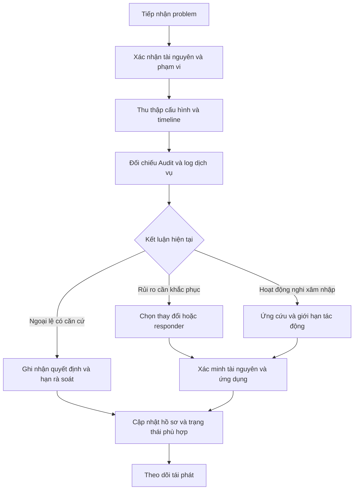
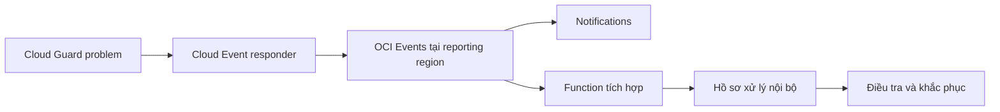

# Điều tra và xử lý Cloud Guard problems

Một cảnh báo bảo mật chỉ có giá trị khi đội vận hành xác định được tài nguyên nào bị ảnh hưởng, nguyên nhân là gì, cần thay đổi điều gì và có bằng chứng cho kết quả xử lý. Với Oracle Cloud Infrastructure (OCI), Cloud Guard problems là điểm bắt đầu cho chuỗi công việc đó.

Bài học thuộc chương **An toàn thông tin và kiểm toán** của module `CLOUD_PROVIDERS_ORACLE`. Phạm vi tập trung vào điều tra và xử lý problems trên hạ tầng OCI đã triển khai: xác định tenancy, compartment và tài nguyên liên quan; kiểm tra IAM; đối chiếu bằng chứng; khắc phục; rồi xác minh bảo mật, tính sẵn sàng và chi phí vận hành.

## 1. Kết quả cần đạt

Sau bài học, người học có thể:

- Đọc một problem và đặt nó vào đúng bối cảnh nghiệp vụ, target, region và quyền truy cập.
- Phân biệt cấu hình không an toàn với hoạt động đáng ngờ để chọn cách điều tra.
- Chọn đúng giữa chạy responder, xử lý bằng quy trình khác và dismiss có lý do.
- Theo dõi một lần thực thi responder và tìm nguyên nhân khi xử lý chưa thành công.
- Lưu hồ sơ gồm bằng chứng trước thay đổi, hành động xử lý và kết quả xác minh.
- Tự động hóa các bước phù hợp mà vẫn kiểm soát phạm vi tác động.

## 2. Hiểu đúng đối tượng đang điều tra

### 2.1. Problem, detector và responder

**Detector rule** mô tả điều kiện phát hiện; **detector recipe** gom các rule; **target** xác định phạm vi kiểm tra; **problem** ghi nhận phát hiện; **responder** thực hiện hành động phản ứng. Target gắn với compartment và phạm vi con theo cấu trúc target. Vì vậy, luôn xác nhận target thực tế quản lý tài nguyên. Xem [Cloud Guard Concepts](https://docs.oracle.com/en-us/iaas/Content/cloud-guard/using/cg-concepts.htm).

Ví dụ, một bucket dùng cho bản sao lưu cơ sở dữ liệu có cấu hình cho phép truy cập công khai. Problem đặt ra câu hỏi về độ an toàn của cấu hình. Nó chưa đủ để kết luận rằng dữ liệu đã bị tải xuống trái phép. Kết luận về truy cập dữ liệu cần bằng chứng riêng.

Tương tự, hoạt động quản trị bất thường là dấu hiệu cần xác minh. Một kỹ sư trực khẩn cấp và một người sử dụng thông tin xác thực bị lộ có thể tạo ra các hành động gần giống nhau trên hạ tầng. Bối cảnh định danh, thời gian và thay đổi đi kèm giúp phân biệt hai trường hợp.

### 2.2. Chọn hướng điều tra theo loại phát hiện

| Hướng phát hiện | Câu hỏi mở đầu | Bằng chứng nên tìm trong tình huống minh họa |
| --- | --- | --- |
| Configuration | Cấu hình hiện tại lệch yêu cầu ở đâu? | Thuộc tính tài nguyên, cấu hình IaC, thay đổi gần nhất |
| Activity | Ai đã thực hiện hành động, bằng định danh nào? | Audit, nguồn truy cập, yêu cầu thay đổi, chủ sở hữu tài khoản |
| Threat hoặc phát hiện liên quan nhiều tín hiệu | Các dấu hiệu có tạo thành một chuỗi đáng ngờ không? | Timeline, thực thể liên quan, log của nhiều dịch vụ |

Bảng là cách tổ chức điều tra trong bài học. Tên problem, dữ liệu chi tiết và detector khả dụng phải lấy từ môi trường thực tế; không giả định mọi tenancy đều có cùng tập phát hiện.

## 3. Chuẩn bị trước khi xử lý

### 3.1. Chốt phạm vi và trách nhiệm

Trước khi thay đổi tài nguyên, ghi nhận:

1. Tenancy và môi trường: học tập, phát triển hay production.
2. Compartment chứa tài nguyên, target phát hiện và region của tài nguyên.
3. Chủ sở hữu workload và đầu mối bảo mật.
4. Quy trình thay đổi hoặc ứng cứu áp dụng cho sự việc.
5. Dịch vụ phụ thuộc: ứng dụng, đường mạng quản trị, sao lưu và khôi phục.

Ví dụ, đổi bucket sang private có thể phù hợp với nơi chứa bản sao lưu, nhưng cần kiểm tra luồng phục hồi và ứng dụng đang đọc dữ liệu. Với Compute hoặc VCN, cô lập tài nguyên cũng cần giữ đường quản trị được cho phép và xem xét ảnh hưởng đến các thành phần còn hoạt động.

### 3.2. Tách quyền điều tra khỏi quyền thay đổi

Người đọc problem, người sửa tài nguyên trực tiếp và dịch vụ chạy responder là các chủ thể khác nhau. Quyền của người dùng không tự trở thành quyền của service `cloudguard`.

Ví dụ dưới đây dành cho một nhóm điều tra có phạm vi quan sát toàn tenancy. Quản trị viên phải điều chỉnh identity domain, tên nhóm và phạm vi theo mô hình IAM của tổ chức:

```text
Allow group SecurityInvestigators to read cloud-guard-problems in tenancy
Allow group SecurityInvestigators to read compartments in tenancy
Allow group SecurityInvestigators to inspect cloud-guard-config in tenancy
```

Đây là phần quyền đọc problems, chưa bao gồm quyền xem mọi trang, Audit, toàn bộ responder activity hoặc sửa tài nguyên. Khi cần thêm chức năng, cấp riêng theo nhiệm vụ. Oracle phân biệt `inspect` để liệt kê và `read` để đọc chi tiết trong [Cloud Guard Prerequisites](https://docs.oracle.com/en-us/iaas/Content/cloud-guard/using/prerequisites.htm).

Đối với responder sửa bucket, một ví dụ policy dịch vụ ở cấp compartment là:

```text
Allow service cloudguard to manage buckets in compartment SecurityLab
```

Chỉ dùng policy phù hợp với responder đã chọn và phạm vi được phép. Không sao chép mọi quyền responder vào tenancy để giải quyết một lỗi đơn lẻ. Tham khảo các quyền theo loại hành động trong [Policy Statements for OCI Responders](https://docs.oracle.com/en-us/iaas/Content/cloud-guard/using/respond-recipes-about.htm).

### 3.3. Phân biệt reporting region và region của tài nguyên

Cloud Guard có **reporting region**; tài nguyên được giám sát có thể ở region khác. Các thao tác Create, Update và Delete của Cloud Guard phải dùng reporting region; thao tác đọc có thể thực hiện từ các region khác. Ví dụ CLI trong bài dùng reporting region nhất quán cho Cloud Guard. Lệnh sửa bucket và đọc Audit dùng region liên quan đến tài nguyên hoặc sự kiện. Xem [Cloud Guard CLI](https://docs.oracle.com/en-us/iaas/tools/oci-cli/latest/oci_cli_docs/cmdref/cloud-guard.html).

Không mặc định reporting region trùng home region. Khi kết quả có vẻ thiếu, kiểm tra endpoint gọi dịch vụ và bộ lọc region của problem như hai yếu tố riêng.

## 4. Tiếp nhận và ưu tiên problem

### 4.1. Mở danh sách và loại bỏ bộ lọc gây hiểu nhầm

Trên Console, vào **Identity & Security → Cloud Guard → Alerts → Problems**. Chọn compartment, phạm vi compartment con, khoảng thời gian và các bộ lọc cần thiết. Khi mở từ một ô tổng hợp trên Overview, danh sách có thể đã được lọc sẵn.

Mở problem để xem phần chi tiết, **Problem History** và **Responder Activity**. Các cột như mức rủi ro, tài nguyên, target, region, thời điểm phát hiện đầu và gần nhất giúp định hướng bước tiếp theo. Tham khảo [Listing Problems and Getting Their Details](https://docs.oracle.com/en-us/iaas/Content/cloud-guard/using/problems-page-view-list.htm).

Không tìm thấy problem chưa đủ để kết luận tài nguyên an toàn. Trước hết, kiểm tra quyền người đọc, phạm vi target, trạng thái rule, bộ lọc thời gian và trạng thái problem.

### 4.2. Ưu tiên theo rủi ro thực tế

Mức rủi ro do công cụ cung cấp giúp sàng lọc ban đầu. Quyết định xử lý còn cần giá trị tài sản, khả năng tiếp cận, dấu hiệu khai thác và tác động nghiệp vụ.

| Yếu tố | Câu hỏi cần trả lời | Ví dụ ảnh hưởng đến ưu tiên |
| --- | --- | --- |
| Dữ liệu | Có dữ liệu khách hàng, bản sao lưu hay bí mật không? | Bucket chứa bản sao lưu production cần xử lý sớm |
| Khả năng tiếp cận | Đối tượng ngoài tổ chức có thể tới tài nguyên không? | Đường truy cập public mở rộng đối tượng có thể thử truy cập |
| Quyền của định danh | Định danh liên quan có thể thay đổi những gì? | Tài khoản triển khai có quyền trên nhiều compartment |
| Bằng chứng hoạt động | Có hành động tiếp diễn hoặc chuỗi hành vi bất thường không? | Thay đổi quyền rồi tạo thêm thông tin xác thực |
| Tính sẵn sàng | Khắc phục có thể làm gián đoạn dịch vụ nào? | Vô hiệu hóa nhầm định danh khiến tác vụ sao lưu thất bại |

Một nhóm có thể quy định mục tiêu tiếp nhận và xử lý theo cấp ưu tiên. Đây là cam kết vận hành nội bộ; không suy ra SLA xử lý sự cố từ màu cảnh báo của Cloud Guard.

## 5. Điều tra theo bằng chứng



Sơ đồ là quy trình đề xuất cho đội vận hành, không phải sơ đồ trạng thái API của Oracle.

### 5.1. Lập bản ghi ban đầu

Tối thiểu cần lưu:

- Problem OCID và mã hồ sơ nội bộ.
- Detector rule, loại detector và khuyến nghị đang hiển thị.
- Resource OCID hoặc định danh tài nguyên, compartment, target và region.
- Thời điểm phát hiện đầu, gần nhất và thời điểm bắt đầu điều tra.
- Cấu hình hiện tại, kết quả responder nếu đã có và các giả thuyết cần kiểm chứng.

Dùng OCID để nối dữ liệu giữa các nguồn. Tên hiển thị có thể được dùng lại, thay đổi hoặc giống nhau giữa môi trường. Chuẩn hóa timeline về UTC và ghi thêm múi giờ khi trao đổi với đội trực.

### 5.2. Phân biệt thời điểm phát hiện và thời điểm thay đổi

Giả sử một timeline minh họa như sau:

| Thời điểm UTC | Bằng chứng |
| --- | --- |
| 02:10 | Audit có yêu cầu cập nhật bucket thành công |
| 02:18 | Cloud Guard ghi nhận phát hiện đầu |
| 02:30 | Kỹ sư bắt đầu điều tra |
| 02:42 | Bucket được chuyển về cấu hình mong muốn |
| Sau đó | Đội vận hành kiểm tra lại tài nguyên và diễn biến problem |

Không lấy 02:18 làm thời điểm chắc chắn bắt đầu phơi lộ. Nếu bản ghi 02:10 thực sự là thay đổi gây lỗi, cửa sổ cần điều tra bắt đầu sớm hơn thời điểm detector ghi nhận. Khi chưa xác định được thay đổi gốc, mở rộng khoảng tìm kiếm và ghi rõ giới hạn của kết luận.

### 5.3. Đối chiếu OCI Audit

Tìm hành động quản trị quanh cửa sổ thời gian liên quan. Đối chiếu định danh gọi API, tài nguyên, nguồn truy cập khi có, thao tác, kết quả và request ID. Không chỉ tìm yêu cầu thay đổi đầu tiên; cần kiểm tra các lần sửa tiếp theo và trạng thái thực tế.

Audit ghi lại lời gọi API được hỗ trợ. Với Object Storage, Audit bao phủ sự kiện liên quan bucket, không bao phủ thao tác đối với object. Do đó, không dùng riêng Audit để kết luận rằng một object chưa từng bị đọc. Xem [Overview of Audit](https://docs.oracle.com/en-us/iaas/Content/Audit/Concepts/auditoverview.htm).

### 5.4. Bổ sung log theo câu hỏi điều tra

Với bucket, nếu cần điều tra đọc hoặc ghi object, xem Object Storage service logs đã được bật trong thời gian liên quan. Log có thể giúp đối chiếu object, nguồn truy cập, phương thức và kết quả. Oracle lưu ý việc chuyển giao service logs theo cơ chế best effort; thiếu một bản ghi không tự chứng minh không có truy cập. Xem [Details for Object Storage Logs](https://docs.oracle.com/en-us/iaas/Content/Logging/Reference/details_for_object_storage.htm).

Với các workload khác, chọn bằng chứng tương ứng:

- Compute: log hệ điều hành, ứng dụng và dấu hiệu sử dụng thông tin xác thực.
- VCN: cấu hình route, security list, NSG và VCN Flow Logs nếu đã thu thập.
- Cơ sở dữ liệu Oracle: log và audit của cơ sở dữ liệu theo cơ chế đã cấu hình.
- Pipeline: lần chạy triển khai, danh tính thực thi, commit và thay đổi đầu vào.

Bật log sau khi sự việc xảy ra giúp quan sát tiếp diễn, nhưng không tái tạo được dữ liệu chưa từng được ghi. Trong hồ sơ, phân biệt rõ bằng chứng đã có, bằng chứng chưa tìm thấy và bằng chứng không được thu thập.

### 5.5. Tìm nguyên nhân có thể tái tạo

Một lỗi cấu hình thường có nhiều lớp nguyên nhân. Ví dụ: bucket bị mở public vì một giá trị mặc định trong Terraform; pipeline có quyền cập nhật bucket; bước kiểm tra trước triển khai không phát hiện thay đổi đó.

Nếu chỉ sửa trực tiếp trên Console, lần triển khai sau có thể đưa cấu hình sai trở lại. Bản xử lý cần xác định cả hành động tức thời và nơi lưu cấu hình mong muốn.

Với hoạt động nghi xâm nhập, mở rộng điều tra theo định danh: kiểm tra quyền đã thay đổi, thông tin xác thực đã tạo và tài nguyên khác có thể bị tác động. Tránh vô hiệu hóa hàng loạt định danh chưa đánh giá phụ thuộc, vì có thể làm mất đường quản trị hoặc gián đoạn luồng phục hồi.

## 6. Chọn cách xử lý và đọc đúng trạng thái

### 6.1. Ba quyết định khác nhau

| Quyết định | Ý nghĩa | Điều kiện sử dụng trong quy trình đề xuất |
| --- | --- | --- |
| Remediate | Chạy Cloud Guard responder | Hành động phù hợp, đủ quyền và đã đánh giá ảnh hưởng |
| Mark as Resolved | Ghi nhận đã xử lý bằng cách khác | Có bằng chứng khắc phục thực tế |
| Dismiss | Bỏ qua và đóng phát hiện | Có căn cứ và quyết định ngoại lệ |

Không phải problem nào cũng có lựa chọn Remediate. Có thể xem Recommendation và xử lý theo quy trình riêng; khi cập nhật trạng thái, nên thêm diễn giải để hỗ trợ truy vết. Xem [Resolving a Problem](https://docs.oracle.com/en-us/iaas/Content/cloud-guard/using/problems-page-resolve.htm).

Ví dụ, pipeline đã sửa bucket và lần đọc lại xác nhận cấu hình đúng: có cơ sở dùng Mark as Resolved. Nếu bucket còn public ngoài ý muốn, bấm nút này không thay đổi thuộc tính bucket.

Một bucket phân phối tài liệu công khai có thể là ngoại lệ hợp lệ, nếu dữ liệu và mục đích đã được xác nhận. Trái lại, cho phép public nơi chứa bản sao lưu nhạy cảm chỉ vì chưa có thời gian xử lý là chấp nhận một rủi ro cần được quản lý rõ ràng.

### 6.2. Vòng đời và tái phát

Console dùng các nhãn Open, Remediated, Resolved, Dismissed và Deleted. Khi lỗi xuất hiện lại, problem đã giải quyết có thể mở lại; problem đang mở thường cập nhật lịch sử. Dismissed có thể tiếp tục cập nhật lịch sử; với Activity Detector, nó còn có thể chuyển lại Open. Tắt rule hoặc tháo recipe cũng có thể làm problem chuyển Resolved mà chưa sửa tài nguyên. Xem [Problem Lifecycle and Reconciliation](https://docs.oracle.com/en-us/iaas/Content/cloud-guard/using/problems-page-about.htm).

Vì vậy, tiêu chí đóng việc cần có cả cấu hình thực tế và diễn biến phát hiện. Khi số lượng problems giảm đột ngột, kiểm tra thay đổi phạm vi giám sát trước khi diễn giải đó là cải thiện bảo mật.

### 6.3. Nhãn Console khác tham số CLI

Trong lệnh `problem list`, `--lifecycle-state` nhận `ACTIVE` hoặc `INACTIVE`; `--lifecycle-detail` nhận `OPEN`, `RESOLVED`, `DISMISSED` hoặc `DELETED`. Không truyền `OPEN` vào `--lifecycle-state`. Liệt kê mặc định chỉ theo compartment được chỉ định; muốn gồm compartment con cần thiết lập subtree. Xem [CLI problem list](https://docs.oracle.com/en-us/iaas/tools/oci-cli/latest/oci_cli_docs/cmdref/cloud-guard/problem/list.html).

Không tự suy ra tham số `--status REMEDIATED` từ nhãn Remediated. Cách biểu diễn và thao tác hợp lệ phải theo command reference của lệnh đang sử dụng.

## 7. Thực thi và giám sát responder

### 7.1. Kiểm tra trước khi chạy

Trước khi chọn một responder, trả lời bốn câu hỏi:

1. Nó thay đổi chính xác thuộc tính hoặc tài nguyên nào?
2. Điều kiện áp dụng có khớp problem và tài nguyên hiện tại không?
3. Người thao tác và service có đủ quyền cho phần việc tương ứng không?
4. Ứng dụng còn hoạt động thế nào sau thay đổi, và phương án phục hồi là gì?

Đọc lại cấu hình ngay trước thao tác nếu đã có khoảng chờ dài. Một người khác hoặc pipeline có thể đã sửa tài nguyên sau thời điểm điều tra.

Ví dụ, responder **Make Bucket Private** phù hợp khi mục tiêu là bỏ truy cập công khai ngoài ý muốn. Nếu ứng dụng đang dựa vào truy cập anonymous, cần chuyển sang cơ chế truy cập được phép và kiểm tra nghiệp vụ cùng thay đổi bảo mật.

### 7.2. Đọc trạng thái lần thực thi

| Execution status | Cách hiểu và bước tiếp theo |
| --- | --- |
| Started | Đã bắt đầu; theo dõi tiến trình |
| Awaiting confirmation | Chờ quyết định Execute hoặc Skip |
| Awaiting input | Cần bổ sung đầu vào |
| Failed | Đọc lỗi; kiểm tra quyền và tài nguyên |
| Skipped | Đọc lý do bỏ qua |
| Succeeded | Hành động thành công; xác minh tiếp tài nguyên |

Skipped có thể xuất hiện khi nhiều responder liên quan nhưng chỉ một hành động được thực thi. Xem chi tiết trong Responder Activity thay vì kết luận từ riêng tên trạng thái. Tham khảo [Listing Responder Rule Actions and Getting the Details](https://docs.oracle.com/en-us/iaas/Content/cloud-guard/using/respond-dash-work.htm).

Succeeded là một bằng chứng về hành động responder. Hồ sơ vẫn cần chứng minh ứng dụng còn hoạt động, đường truy cập không mong muốn đã bị loại bỏ và nguồn cấu hình không tiếp tục tái tạo lỗi.

### 7.3. Tự động hóa theo phạm vi đã thử nghiệm

Với responder hỗ trợ chế độ tự động, cấu hình **Execute automatically** cần có điều kiện áp dụng. Cài đặt được điều chỉnh trong responder rule của recipe gắn với target. Xem [Editing Responder Rule Settings in an OCI Target's Recipes](https://docs.oracle.com/en-us/iaas/Content/cloud-guard/using/targets-modify-rules-respond.htm).

Một lộ trình triển khai đề xuất:

1. Chạy thủ công với tài nguyên thử nghiệm và kiểm tra kết quả.
2. Giữ bước xác nhận trong giai đoạn đánh giá tác động.
3. Chọn phạm vi nhỏ dựa trên các điều kiện mà rule thực tế hỗ trợ.
4. Theo dõi lỗi thực thi và ảnh hưởng ứng dụng.
5. Mở rộng sau khi có bằng chứng đáp ứng yêu cầu.

Ưu tiên tự động hóa hành động có phạm vi rõ và kết quả dễ xác minh. Với thay đổi có thể dừng workload, vô hiệu hóa định danh hoặc ảnh hưởng kết nối production, thiết kế riêng điều kiện áp dụng và phương án duy trì dịch vụ.

## 8. Thực hành: điều tra bucket public rồi khắc phục

### 8.1. Điều kiện thực hành

Dùng compartment học tập và một bucket thử nghiệm có sẵn, không chứa dữ liệu thật. Target phải bao phủ tài nguyên và detector liên quan phải đang hoạt động. Chỉ dùng problem đã xuất hiện trong môi trường được phép thực hành; không mở public tài nguyên production để tạo cảnh báo.

Ví dụ dưới đây giả định một problem liên quan đến bucket public. Tên detector, mức rủi ro và responder cụ thể phải đọc từ problem thực tế.

Các đoạn lệnh sử dụng **Bash**, phù hợp với OCI Cloud Shell hoặc môi trường Bash đã cài và cấu hình OCI CLI. Chúng là ví dụ để người học thực thi trong tài khoản của mình; không phải kết quả đã chạy trên một tenancy cụ thể.

### 8.2. Khai báo đầu vào

Thay các placeholder bằng giá trị đã xác nhận:

```bash
export REPORTING_REGION='<cloud-guard-reporting-region>'
export RESOURCE_REGION='<bucket-region>'
export COMPARTMENT_ID='<compartment-ocid>'
export PROBLEM_ID='<cloud-guard-problem-ocid>'
export NAMESPACE='<object-storage-namespace>'
export BUCKET_NAME='<lab-bucket-name>'
export START_TIME='<YYYY-MM-DDTHH:MM:00Z>'
export END_TIME='<YYYY-MM-DDTHH:MM:00Z>'
```

`START_TIME` và `END_TIME` là cửa sổ điều tra thực tế, gồm cả khoảng trước phát hiện đầu. Namespace Object Storage khác tên compartment và tên bucket.

### 8.3. Liệt kê và đọc problem

```bash
oci cloud-guard problem list \
  --compartment-id "$COMPARTMENT_ID" \
  --compartment-id-in-subtree true \
  --access-level ACCESSIBLE \
  --lifecycle-detail OPEN \
  --region "$REPORTING_REGION" \
  --all

oci cloud-guard problem get \
  --problem-id "$PROBLEM_ID" \
  --region "$REPORTING_REGION"
```

Lệnh đầu hỗ trợ tìm kiếm; lệnh thứ hai lấy đúng problem đã chọn. Kiểm tra resource, target, compartment và region trong kết quả trước khi chuyển sang thay đổi. `--all` thu thập các trang kết quả, không tự mở rộng bộ lọc thời gian hoặc quyền truy cập. Cú pháp đọc chi tiết được mô tả tại [CLI problem get](https://docs.oracle.com/en-us/iaas/tools/oci-cli/latest/oci_cli_docs/cmdref/cloud-guard/problem/get.html).

### 8.4. Đọc lịch sử và responder activity

```bash
oci cloud-guard problem list-problem-histories \
  --compartment-id "$COMPARTMENT_ID" \
  --problem-id "$PROBLEM_ID" \
  --region "$REPORTING_REGION" \
  --all

oci cloud-guard responder-activity-summary list-responder-activities \
  --problem-id "$PROBLEM_ID" \
  --region "$REPORTING_REGION" \
  --all
```

Dùng compartment phù hợp với problem đã đọc. Kiểm tra xem đã có ai xử lý, responder nào đã chạy và có lỗi cần tiếp nối hay không. Tham khảo [CLI list-problem-histories](https://docs.oracle.com/en-us/iaas/tools/oci-cli/latest/oci_cli_docs/cmdref/cloud-guard/problem/list-problem-histories.html) và [CLI list-responder-activities](https://docs.oracle.com/en-us/iaas/tools/oci-cli/latest/oci_cli_docs/cmdref/cloud-guard/responder-activity-summary/list-responder-activities.html).

### 8.5. Đối chiếu Audit

```bash
oci audit event list \
  --compartment-id "$COMPARTMENT_ID" \
  --start-time "$START_TIME" \
  --end-time "$END_TIME" \
  --region "$RESOURCE_REGION" \
  --all
```

Tìm sự kiện cập nhật đúng bucket rồi đối chiếu danh tính, yêu cầu và kết quả. Lệnh lấy sự kiện theo compartment và thời gian; kết quả cần được phân tích tiếp. Mốc thời gian của lệnh Audit yêu cầu giây và phần nhỏ của giây bằng 0. Xem [CLI audit event list](https://docs.oracle.com/en-us/iaas/tools/oci-cli/latest/oci_cli_docs/cmdref/audit/event/list.html).

Nếu điều tra mở rộng sang IAM hoặc dịch vụ khác, truy vấn thêm compartment và region liên quan đến những sự kiện đó. Không giới hạn mọi bằng chứng vào region của bucket một cách máy móc.

### 8.6. Chọn một cách khắc phục

**Cách A — dùng responder:** trên problem, chọn Remediate nếu có, đọc hành động được đề xuất, kiểm tra quyền và chạy sau khi xác nhận ảnh hưởng. Sau đó theo dõi Responder Activity. Không giả định việc chọn Remediate đồng nghĩa thao tác đã hoàn tất.

**Cách B — sửa trực tiếp:** nếu quy trình của nhóm yêu cầu thay đổi qua người vận hành hoặc pipeline, đọc bucket trước rồi cập nhật thuộc tính cần thiết:

```bash
oci os bucket get \
  --namespace-name "$NAMESPACE" \
  --bucket-name "$BUCKET_NAME" \
  --region "$RESOURCE_REGION"

oci os bucket update \
  --namespace-name "$NAMESPACE" \
  --bucket-name "$BUCKET_NAME" \
  --public-access-type NoPublicAccess \
  --region "$RESOURCE_REGION"
```

Lệnh `update` là thay đổi thực tế, cần quyền Object Storage của chủ thể thực thi. Nếu có nhiều bên cùng cập nhật, có thể sử dụng `--if-match` với ETag vừa đọc và xử lý xung đột bằng cách đọc lại trước khi quyết định tiếp. Tham khảo [CLI os bucket update](https://docs.oracle.com/en-us/iaas/tools/oci-cli/latest/oci_cli_docs/cmdref/os/bucket/update.html).

Hai cách là lựa chọn thay thế cho cùng bước khắc phục. Tránh chạy lặp một hành động khi responder đang thực hiện chỉ vì trạng thái Console chưa cập nhật.

### 8.7. Xác minh rồi mới cập nhật trạng thái

```bash
oci os bucket get \
  --namespace-name "$NAMESPACE" \
  --bucket-name "$BUCKET_NAME" \
  --region "$RESOURCE_REGION"
```

Xác nhận thuộc tính `public-access-type` là `NoPublicAccess`, thử truy cập với định danh hợp lệ và kiểm tra yêu cầu anonymous đến một object thử nghiệm đã biết. Không chỉ dựa vào việc danh sách object không hiển thị: thao tác liệt kê và thao tác đọc một object là hai phép kiểm tra khác nhau.

Rà soát riêng pre-authenticated requests (PAR). PAR cung cấp URL cho phép truy cập phạm vi đã cấp mà không cần thông tin đăng nhập của người sử dụng URL; việc đổi cấu hình public không thay thế công việc kiểm tra các URL này. Xem [Object Storage Pre-Authenticated Requests](https://docs.oracle.com/en-us/iaas/Content/Object/Tasks/usingpreauthenticatedrequests.htm).

Nếu dùng cách B và đã xác minh đầy đủ, cập nhật problem:

```bash
oci cloud-guard problem update-problem-status \
  --problem-id "$PROBLEM_ID" \
  --status RESOLVED \
  --region "$REPORTING_REGION"

oci cloud-guard problem get \
  --problem-id "$PROBLEM_ID" \
  --region "$REPORTING_REGION"
```

`update-problem-status` đổi trạng thái problem; nó không sửa bucket. Lệnh chấp nhận `OPEN`, `RESOLVED`, `DISMISSED` và `DELETED`. Trong bài thực hành chỉ dùng `RESOLVED` sau khắc phục; các giá trị khác không phải cách thay thế cho sửa cấu hình. Xem [CLI update-problem-status](https://docs.oracle.com/en-us/iaas/tools/oci-cli/latest/oci_cli_docs/cmdref/cloud-guard/problem/update-problem-status.html).

Lưu bằng chứng trên hồ sơ nội bộ và theo dõi diễn biến phát hiện tiếp theo. Nếu problem mở lại, kiểm tra tài nguyên và pipeline để phân biệt cấu hình tái phát với độ trễ đồng bộ trạng thái.

## 9. Xác minh kết quả trên ba lớp

| Lớp xác minh | Câu hỏi đóng việc | Bằng chứng mẫu |
| --- | --- | --- |
| Tài nguyên | Điều kiện gây rủi ro đã được loại bỏ chưa? | Kết quả đọc lại cấu hình, phép thử truy cập |
| Dịch vụ | Workload còn đáp ứng nhu cầu không? | Health check, luồng nghiệp vụ, thử đọc bản sao lưu |
| Giám sát và quản trị | Phát hiện còn được bao phủ và nguồn lỗi đã sửa chưa? | History, responder activity, target còn hiệu lực, thay đổi IaC |

Với tài nguyên dùng cho sao lưu Oracle Database, kiểm tra khả năng đọc và phục hồi theo quy trình thử nghiệm của nhóm. Một thay đổi quyền có thể bảo vệ dữ liệu nhưng làm hỏng luồng khôi phục nếu workload chưa có quyền cần thiết.

Nếu phát hiện đường truy cập khác hoặc có dấu hiệu thông tin xác thực bị lộ, mở thêm đầu việc ứng cứu phù hợp. Đừng dùng kết quả sửa một thuộc tính để kết luận toàn bộ sự việc đã kết thúc.

## 10. Ngoại lệ và dismiss có kiểm soát

Một ngoại lệ nên có bản ghi riêng với:

- Resource OCID, rule và phạm vi được ngoại lệ.
- Lý do nghiệp vụ cùng bằng chứng dữ liệu phù hợp mục đích.
- Rủi ro còn lại và biện pháp bù trừ.
- Chủ sở hữu, người quyết định và ngày hết hạn hoặc rà soát.
- Điều kiện buộc mở lại điều tra.

Ví dụ, bucket công khai chỉ chứa tài liệu đã được duyệt phát hành. Nhóm cần kiểm soát ai có quyền ghi và bảo đảm pipeline không đưa bản sao lưu hoặc tệp nội bộ vào cùng nơi đó. Tính hợp lệ của mục đích công khai không bảo đảm mọi nội dung được ghi vào bucket đều phù hợp.

Ngày hết hạn là trách nhiệm của quy trình ngoại lệ. Không giả định thao tác Dismiss tự tạo lịch rà soát hoặc tự mở lại problem vào ngày đã ghi trong hồ sơ.

Khi giảm cảnh báo nhiễu, ưu tiên tìm đúng điều kiện gây nhiễu và giới hạn thay đổi theo khả năng của rule. Mỗi thay đổi recipe cần được xem xét về phạm vi giám sát bị ảnh hưởng.

## 11. Tích hợp thông báo và theo dõi công việc

Cloud Guard có responder **Cloud Event** để chuyển thông tin problem sang OCI Events; từ đó tích hợp Notifications hoặc Functions. Thiết lập luồng này trong reporting region. Cần kiểm tra responder recipe gắn với target và rule Cloud Event trước khi chẩn đoán luồng thông báo. Xem [Configuring Notifications](https://docs.oracle.com/en-us/iaas/Content/cloud-guard/using/export-notifs-config.htm).

Một thiết kế đề xuất:



Khi xây dựng tích hợp, thiết kế cho tình huống nhận lại một sự kiện hoặc nhận các cập nhật gần nhau. Dùng problem OCID để liên kết hồ sơ, lưu event ID để nhận diện sự kiện đã xử lý và giữ lịch sử các lần tái phát. Không gộp mọi sự kiện của một problem thành một lần xử lý duy nhất.

Thông báo cần chứa đủ ngữ cảnh để phân công: problem, tài nguyên, compartment, region, thời gian và đầu mối sở hữu. Với sự kiện đóng problem, kiểm tra nội dung và lý do trước khi tự đóng hồ sơ ứng cứu; trạng thái công cụ không tự mô tả toàn bộ kết quả xác minh nghiệp vụ.

## 12. Xử lý các tình huống thường gặp

| Hiện tượng | Hướng kiểm tra | Bước tiếp theo |
| --- | --- | --- |
| Không thấy problem dự kiến | Compartment, thời gian, quyền đọc, target, detector | Xác nhận phạm vi và dùng problem OCID nếu có |
| Đọc được problem nhưng không chạy được xử lý | Quyền thao tác, service policy, reporting region | Đọc lỗi rồi bổ sung đúng phần còn thiếu |
| Responder Failed | Lỗi thực thi, tài nguyên còn tồn tại, cấu hình đã đổi | Xác định nguyên nhân trước khi thử lại |
| Awaiting confirmation kéo dài | Chưa có người quyết định hoặc chưa được phân công | Gắn chủ sở hữu và xử lý bước xác nhận |
| Resolved rồi lại Open | Cấu hình tái phát, pipeline ghi đè, chưa xử lý gốc | Đọc tài nguyên và so sánh timeline |
| Số problem giảm sau đổi recipe | Có thể đã thay đổi độ bao phủ | Đối chiếu target và rule với kế hoạch thay đổi |
| Dismissed vẫn có lịch sử mới | Phát hiện có thể còn tiếp diễn | Rà lại ngoại lệ và kiểu detector |
| Có sự kiện nhưng không có thông báo | Rule tích hợp, topic, subscription, region | Kiểm tra lần lượt các chặng của luồng gửi |

Bảng là hướng chẩn đoán, không khẳng định mỗi hiện tượng chỉ có một nguyên nhân. Ghi lại lỗi và request ID để trao đổi với quản trị viên hoặc bộ phận hỗ trợ khi cần.

## 13. Hồ sơ kiểm toán và tiêu chí hoàn tất

Một mẫu hồ sơ ngắn có thể dùng như sau:

```text
Mã hồ sơ:
Problem OCID / detector rule:
Tài nguyên / compartment / target / region:
Chủ sở hữu workload / người điều tra:
Phát hiện đầu / phát hiện gần nhất:
Cửa sổ thời gian điều tra:
Mức ưu tiên và lý do:
Bằng chứng trước thay đổi:
Kết luận / giả thuyết chưa xác nhận:
Nguyên nhân gốc:
Hành động / người hoặc service thực hiện / thời điểm:
Mã thay đổi / responder execution / request ID:
Kết quả kiểm tra bảo mật:
Kết quả kiểm tra ứng dụng và phục hồi:
Trạng thái Cloud Guard sau xử lý:
Thay đổi IaC hoặc pipeline để ngăn tái phát:
Ngoại lệ / hạn rà soát nếu có:
Giới hạn bằng chứng / công việc còn lại:
```

Lưu kết quả truy vấn và cấu hình với thời điểm thu thập, nguồn và người thực hiện. Kiểm soát quyền đọc hồ sơ vì log có thể chứa thông tin định danh hoặc chi tiết vận hành. Với yêu cầu bảo toàn bằng chứng, áp dụng cơ chế lưu trữ và kiểm tra toàn vẹn theo quy trình của tổ chức.

Không dùng giao diện Cloud Guard làm kho lưu bằng chứng dài hạn duy nhất. Xuất dữ liệu cần thiết sớm và đặt chính sách lưu theo nhu cầu kiểm toán thực tế; vòng đời dữ liệu của problem, Audit và log dịch vụ cần được quản lý riêng.

Một đầu việc khắc phục có thể đóng khi đã có bằng chứng rằng:

1. Tài nguyên và phạm vi bị ảnh hưởng đã được xác định.
2. Nguyên nhân đã được xử lý hoặc rủi ro còn lại có chủ sở hữu rõ ràng.
3. Cấu hình sau thay đổi đáp ứng mục tiêu bảo mật.
4. Luồng ứng dụng quan trọng vẫn hoạt động.
5. Trạng thái problem được cập nhật đúng với hành động đã làm.
6. Bằng chứng, quyết định và việc ngăn tái phát đã được ghi nhận.

## 14. Đo hiệu quả vận hành

Theo dõi những chỉ số có thể dẫn tới hành động cụ thể:

| Chỉ số đề xuất | Cách dùng |
| --- | --- |
| Thời gian từ phát hiện đến tiếp nhận | Phát hiện khoảng trống phân công và trực vận hành |
| Thời gian đến khắc phục đã xác minh | Đo tốc độ giảm rủi ro thực tế |
| Số lần tái phát theo rule và tài nguyên | Tìm nguồn cấu hình hoặc quy trình chưa được sửa |
| Tỷ lệ responder thành công | Xác định lỗi quyền, đầu vào và phạm vi tự động hóa |
| Ngoại lệ quá hạn | Rà soát rủi ro đã được bỏ qua nhưng chưa đánh giá lại |
| Khối lượng log và hồ sơ xuất | Điều chỉnh phạm vi, thời gian lưu và chi phí |

Nếu đo thời gian khắc phục bằng thời điểm bấm Resolved, nhóm có thể ghi nhận kết quả tốt dù tài nguyên chưa được sửa. Hãy ghi riêng thời điểm đổi trạng thái và thời điểm xác minh hoàn tất.

Chi phí vận hành gồm cả thời gian xử lý cảnh báo nhiễu, lưu log, truy vấn, tích hợp và tác động của thay đổi. Thu thập bằng chứng theo mục tiêu điều tra, giữ dữ liệu cần thiết và tránh tạo nhiều hồ sơ trùng cho cùng một lần phát hiện.

Khi vận hành đúng, mỗi problem dẫn tới một quyết định có căn cứ: khắc phục có xác minh, tiếp tục ứng cứu hoặc chấp nhận ngoại lệ có thời hạn. Người kiểm toán phải lần theo được quyết định đó từ bằng chứng ban đầu đến trạng thái tài nguyên sau xử lý.
