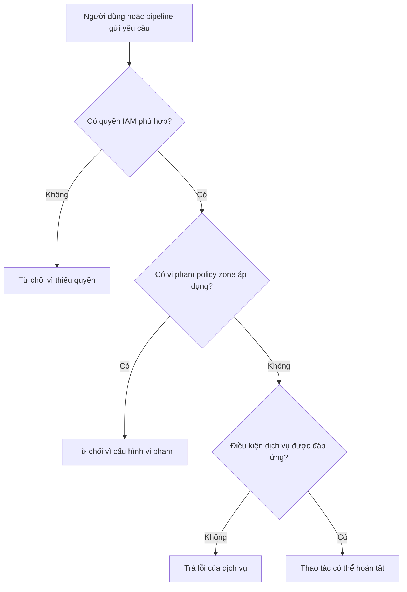

# Security Zones và cưỡng chế chính sách cấu hình an toàn

## 1. Mục tiêu và tình huống áp dụng

Trong Oracle Cloud Infrastructure (OCI), một tài khoản có đủ quyền triển khai vẫn có thể vô tình tạo cấu hình không phù hợp: mở bucket chứa hồ sơ khách hàng ra công khai, gắn tài nguyên vào một mạng ngoài phạm vi bảo vệ hoặc chọn sai cơ chế quản lý khóa. Với chương **An toàn thông tin và kiểm toán** của module `CLOUD_PROVIDERS_ORACLE`, bài này tập trung vào cách biến yêu cầu cấu hình an toàn thành ràng buộc có thể cưỡng chế bằng Security Zones.

Sau bài học, người học có thể:

- Giải thích mối quan hệ giữa security zone, compartment, recipe và policy.
- Phân biệt quyền IAM, kiểm tra cấu hình của Security Zones, phát hiện của Cloud Guard và bằng chứng Audit.
- Chọn phạm vi bảo vệ phù hợp với kiến trúc VCN, Compute, lưu trữ và cơ sở dữ liệu Oracle.
- Tạo một lab kiểm chứng có cả thao tác thành công và thao tác bị từ chối.
- Đưa thay đổi recipe vào quy trình tự động hóa, quản lý ngoại lệ và vận hành có bằng chứng.

**Tình huống xuyên suốt:** nhóm phát triển vận hành một ứng dụng Java xử lý hồ sơ khách hàng. Ứng dụng lưu tệp vào Object Storage và dùng cơ sở dữ liệu Oracle. Nhóm cần bảo đảm rằng một lần cập nhật qua Console hoặc pipeline không thể làm bucket hồ sơ trở thành public. Đồng thời, đội vận hành phải biết ai đã thử thay đổi cấu hình, yêu cầu nào bị chặn và tài nguyên cũ nào còn cần khắc phục.

## 2. Cơ chế cưỡng chế của Security Zones

Security Zones liên kết phạm vi compartment với một **security zone recipe**. Recipe chứa các policy cấu hình do OCI hỗ trợ. Khi xử lý thao tác thuộc phạm vi kiểm soát, OCI đối chiếu thao tác với các policy đang bật và từ chối nếu có vi phạm. Kiểm tra này áp dụng bất kể người gọi là ai; Security Zones không cấp thêm quyền quản trị tài nguyên. [Oracle: Overview of Security Zones](https://docs.oracle.com/en-us/iaas/Content/security-zone/using/security-zones.htm).

Có thể dùng biểu thức sau để thiết kế và giải thích một phép thử:

```text
Thao tác có thể thành công khi:
    IAM cho phép
    VÀ không vi phạm policy Security Zones áp dụng
    VÀ đáp ứng điều kiện riêng của dịch vụ.
```

Biểu thức trên là mô hình tư duy, không mô tả thứ tự thực thi nội bộ của OCI. Những điều kiện riêng của dịch vụ có thể là quota, tên bucket hợp lệ, trạng thái tài nguyên hoặc quyền sử dụng khóa.



Với tình huống bucket hồ sơ, cấp thêm quyền IAM cho người triển khai không giải quyết một yêu cầu bị chặn bởi policy cấm public. Hướng xử lý là sửa cấu hình đích hoặc xem xét lại yêu cầu kiến trúc theo quy trình quản trị.

Một người có quyền thay đổi recipe hoặc xóa zone lại có khả năng thay đổi chính hàng rào bảo vệ. Vì vậy, cần xét riêng hai loại quyền: **quyền triển khai workload** và **quyền quản trị cơ chế bảo vệ workload**.

## 3. Các thành phần và phạm vi bảo vệ

| Thành phần | Ý nghĩa khi thiết kế |
| --- | --- |
| Compartment | Đơn vị tổ chức tài nguyên và xác định phạm vi áp dụng |
| Security zone | Liên kết một phạm vi compartment với recipe |
| Security zone recipe | Tập policy cấu hình được chọn để cưỡng chế |
| Security zone policy | Một yêu cầu cấu hình cụ thể do Oracle cung cấp |
| Cloud Guard target | Phạm vi phục vụ giám sát và phát hiện |
| Cloud Guard problem | Bản ghi vấn đề được phát hiện, cần phân loại và xử lý |

Mặc định, compartment con thuộc cùng zone với compartment cha. OCI hỗ trợ tạo zone riêng cho compartment con hoặc loại một compartment con khỏi zone. Một compartment không đồng thời thuộc nhiều security zone. Do đó, cấu trúc cây compartment chưa đủ để chứng minh phạm vi bảo vệ thực tế; cần xem danh sách compartment liên kết với zone. [Oracle: Managing Security Zones](https://docs.oracle.com/en-us/iaas/Content/security-zone/using/managing-security-zones.htm).

Ví dụ tổ chức cho ứng dụng Java:

```text
Tenancy
├── SecurityArtifacts
│   └── Nơi quản lý recipe và thông tin quản trị bảo mật
├── CustomerWorkload
│   ├── Application
│   ├── Database
│   └── Documents
└── SecurityZoneLab
    └── Môi trường thử nghiệm độc lập
```

Đây là cấu trúc thiết kế minh họa. Khi đưa `CustomerWorkload` vào một zone, phải đối chiếu vị trí thực tế của subnet, volume, database và các tài nguyên liên quan. Cùng nằm trong tenancy hoặc có cùng nhãn môi trường chưa chứng minh các tài nguyên thuộc cùng zone.

Một quy tắc thiết kế hữu ích là lập danh sách **quan hệ phụ thuộc** trước khi chọn ranh giới:

```text
Compute instance → subnet
Compute instance → boot volume và block volume
Database → subnet và cấu hình backup
Ứng dụng → bucket → khóa mã hóa, nếu có yêu cầu khóa riêng
```

Danh sách này phục vụ rà soát kiến trúc. Không phải mọi mũi tên đều tương ứng với một policy yêu cầu hai tài nguyên phải cùng zone; phải kiểm tra policy áp dụng cho đúng loại quan hệ.

## 4. Phân biệt bốn lớp kiểm soát

| Lớp | Câu hỏi cần trả lời trong tình huống hồ sơ khách hàng |
| --- | --- |
| IAM | Principal nào được tạo hoặc cập nhật bucket? |
| Security Zones | Thay đổi dự kiến có vi phạm yêu cầu cấu hình đang cưỡng chế không? |
| Cloud Guard | Tài nguyên hiện hữu có vấn đề nào cần xử lý? |
| Audit | Yêu cầu nào đã xảy ra, ai gọi và kết quả ra sao? |

Cần phân biệt **một yêu cầu vi phạm đã bị chặn** với **một tài nguyên đang tồn tại ở trạng thái vi phạm**. Nếu lần cập nhật public bị từ chối, bucket có thể vẫn private; không nên suy ra rằng Cloud Guard nhất thiết phải tạo problem cho lần thử đó. Khi điều tra, hãy giữ cả phản hồi lỗi của yêu cầu và trạng thái bucket sau phép thử.

Ngược lại, bật zone cho một compartment có tài nguyên từ trước không đồng nghĩa mọi cấu hình cũ được sửa tự động. Tài nguyên cũ cần được phát hiện, phân công người chịu trách nhiệm và khắc phục. Trạng thái zone hoạt động là bằng chứng cơ chế đã được triển khai; mức tuân thủ của workload cần bằng chứng riêng.

## 5. Chọn recipe theo yêu cầu kiến trúc

### 5.1. Recipe do Oracle quản lý và custom recipe

OCI cung cấp `Maximum Security Recipe` do Oracle quản lý, người dùng không sửa trực tiếp. Có thể tạo hoặc clone thành custom recipe để chọn những policy phù hợp. Custom recipe là lựa chọn từ danh mục policy của OCI, không phải nơi tự viết bất kỳ điều kiện nghiệp vụ nào theo cú pháp IAM. [Oracle: Managing Recipes in Security Zones](https://docs.oracle.com/en-us/iaas/Content/security-zone/using/managing-recipes.htm).

Tên recipe không đủ để quyết định tính phù hợp. Một môi trường cần đường truy cập quản trị, tải gói phần mềm hoặc phục hồi dữ liệu phải có thiết kế tương ứng với các policy được bật. Danh mục OCI có những policy hạn chế rất chặt cả thao tác quản trị tài nguyên; cần đọc nội dung thực tế trước khi áp dụng một recipe rộng.

### 5.2. Ví dụ policy và ảnh hưởng cần kiểm chứng

Các ví dụ dưới đây chỉ có hiệu lực khi policy tương ứng đang bật và loại tài nguyên được hỗ trợ.

| Policy ví dụ | Điều kiện bị hạn chế |
| --- | --- |
| `deny public_buckets` | Bucket public |
| `deny buckets_without_vault_key` | Bucket thiếu khóa do khách hàng quản lý trong Vault |
| `deny public_subnets` | Subnet public |
| `deny NAT_gateway` | Thêm NAT gateway vào VCN trong zone |
| `deny SGW_gateway` | Thêm service gateway vào VCN trong zone |
| `deny database_without_backup` | Thiếu automatic backup trên loại DB system được hỗ trợ |

Các policy khác có thể giới hạn di chuyển compartment, gắn kết tài nguyên hoặc clone dữ liệu. Đối chiếu từng policy với dịch vụ và thao tác; không suy rộng một ràng buộc của DB system sang mọi dịch vụ cơ sở dữ liệu Oracle. [Oracle: Security Zone Policies](https://docs.oracle.com/en-us/iaas/Content/security-zone/using/security-zone-policies.htm).

### 5.3. Chuyển yêu cầu thành ma trận kiểm chứng

Trước khi triển khai, nên lập một bảng như sau:

| Yêu cầu của tổ chức | Thiết kế dự kiến | Bằng chứng cần thu |
| --- | --- | --- |
| Hồ sơ khách hàng không được public | Bucket private và policy chống public | Tạo private thành công; đổi sang public bị chặn |
| Chỉ dùng khóa do tổ chức quản lý | Cấu hình Vault và quyền dùng khóa phù hợp | Tạo bằng khóa hợp lệ thành công; thiếu khóa bị chặn |
| Phân tách quyền triển khai và bảo mật | Hai nhóm IAM riêng | Nhóm triển khai không sửa được zone hoặc recipe |
| Có khả năng phục hồi | Backup, kế hoạch restore và ràng buộc vị trí phù hợp | Một lần phục hồi thử đáp ứng mục tiêu đặt ra |
| Mọi ngoại lệ có chủ sở hữu | Quy trình ghi nhận và thời hạn đánh giá | Danh sách ngoại lệ còn hiệu lực, người chịu trách nhiệm |

Đây là ma trận đề xuất cho ví dụ trong bài. Mỗi hàng cần thêm người phụ trách, môi trường và tiêu chí chấp nhận khi áp dụng thực tế. Không dùng số lượng policy đang bật làm thước đo duy nhất cho chất lượng bảo vệ.

## 6. Thiết kế VCN, khóa và khả năng phục hồi

### 6.1. Xác định luồng mạng trước khi bật policy

Với ứng dụng Java, hãy mô tả từng luồng thay vì chỉ ghi “dùng private subnet”:

- Người dùng truy cập ứng dụng qua thành phần nào?
- Ứng dụng kết nối cơ sở dữ liệu bằng địa chỉ nào?
- Ứng dụng truy cập Object Storage qua đường nào?
- Máy chủ nhận bản vá hoặc tải dependency từ đâu?
- Người vận hành truy cập khi có sự cố bằng cách nào?

Đối chiếu từng luồng với loại gateway, endpoint, route và policy dự kiến. Việc một subnet không cấp public IP chưa trả lời toàn bộ câu hỏi về truy cập ra ngoài. Đồng thời, không thể mặc định NAT gateway hoặc service gateway luôn là phương án khả dụng nếu recipe đã bật policy hạn chế chúng.

Ví dụ, nhóm cần tải artifact Java từ một kho bên ngoài. Nếu thiết kế yêu cầu một đường egress mà recipe không cho phép, cần giải quyết trước khi triển khai: xem lại cách phân phối artifact, ranh giới workload hoặc ngoại lệ mạng. Chờ đến lúc pipeline lỗi mới tắt policy sẽ khiến quyết định bảo mật trở thành phản ứng tức thời.

Security Zones cũng không thay thế việc thiết kế NSG, security list, xác thực ứng dụng và TLS. Mỗi lớp giải quyết một phần khác nhau của đường truy cập.

### 6.2. Khóa do khách hàng quản lý tạo thêm phụ thuộc vận hành

Nếu tổ chức chọn cưỡng chế sử dụng khóa Vault cho bucket hồ sơ, một tham số OCID hợp lệ về cú pháp chưa đủ. Đội triển khai cần xác minh khóa khả dụng, principal và dịch vụ có quyền cần thiết, cùng quy trình xoay vòng và phục hồi.

Nên thực hiện theo thứ tự:

1. Chuẩn bị khóa và quyền sử dụng khóa.
2. Kiểm chứng workload tạo và đọc được dữ liệu thử bằng cấu hình mong muốn.
3. Bật ràng buộc bắt buộc khóa trên môi trường thử.
4. Kiểm chứng trường hợp bỏ sót khóa bị từ chối.
5. Chỉ sau đó mở rộng phạm vi.

Không vô hiệu hóa hoặc lên lịch xóa khóa chỉ để làm phép thử thất bại. Một phép thử cấu hình thiếu khóa đã đủ để kiểm chứng ràng buộc mà không ảnh hưởng khả năng đọc dữ liệu.

### 6.3. Phục hồi cũng phải nằm trong thiết kế

Yêu cầu giữ tài nguyên và dữ liệu trong phạm vi bảo vệ có thể ảnh hưởng kế hoạch chuyển compartment hoặc tạo bản sao phục hồi. Vì vậy, hãy đặt câu hỏi về restore ngay từ đầu:

- Tài nguyên phục hồi sẽ thuộc compartment và zone nào?
- Mạng và khóa cần dùng đã sẵn sàng ở nơi phục hồi chưa?
- Có phép thử nào chứng minh quy trình này thực thi được?
- Ai chịu trách nhiệm nếu bước restore bị từ chối bởi một ràng buộc cấu hình?

Policy backup và việc hoàn thành một lần restore là hai loại bằng chứng khác nhau. Mục tiêu RPO/RTO phải được đánh giá bằng quy trình phục hồi thực tế.

## 7. Chuẩn bị IAM và Cloud Guard

### 7.1. Tách vai trò quản trị

Đề xuất phân công cho ví dụ:

| Vai trò | Trách nhiệm |
| --- | --- |
| Quản trị nền tảng | Bật Cloud Guard, chuẩn bị compartment và quyền dịch vụ |
| Quản trị bảo mật | Chọn recipe, quản lý zone, đánh giá ngoại lệ |
| Nhóm triển khai | Tạo và cập nhật workload trong phạm vi được cấp |
| Kiểm toán | Đọc cấu hình bảo vệ và bằng chứng hoạt động |

Ví dụ policy IAM cho nhóm đọc cấu hình trong compartment quản trị:

```text
Allow group SecurityAuditors to read security-zone in compartment SecurityArtifacts
Allow group SecurityAuditors to read security-recipe in compartment SecurityArtifacts
```

Thay tên nhóm, miền định danh nếu cần và phạm vi compartment theo tenancy thực tế. Quyền đọc hai loại tài nguyên này không tự cấp quyền đọc Audit, Cloud Guard problem hoặc cấu hình workload. Cũng cần rà soát quyền rộng qua `cloud-guard-family`, vì aggregate resource type này bao gồm quyền đối với Security Zones. [Oracle: Securing Security Zones](https://docs.oracle.com/en-us/iaas/Content/Security/Reference/securityzone_security.htm).

Với nhóm tạo zone, tài liệu khởi đầu liệt kê cả quyền làm việc với cấu hình Cloud Guard, target, problem và quản lý security zone. Cần lấy các statement phù hợp từ hướng dẫn hiện hành, không giả định chỉ một quyền quản lý zone đáp ứng toàn bộ thao tác Console. [Oracle: Getting Started with Security Zones](https://docs.oracle.com/en-us/iaas/Content/security-zone/using/get-started.htm).

Trong thiết kế phân quyền, đặc biệt kiểm tra ai có thể cập nhật recipe, đổi recipe của zone, loại compartment con hoặc xóa zone. Đây là những thao tác có thể làm thay đổi phạm vi cưỡng chế.

### 7.2. Kiểm tra ảnh hưởng đến Cloud Guard target

Cloud Guard phải được bật trước khi tạo zone. Khi tạo zone, OCI cấu hình security zone target; target hiện có của compartment và các compartment con có thể bị thay thế, đồng thời detector recipe mặc định được áp dụng. Zone riêng ở compartment con cũng có target riêng. [Oracle: Creating a Security Zone](https://docs.oracle.com/en-us/iaas/Content/security-zone/using/create-security-zone.htm).

Trước khi áp dụng lên workload đang vận hành, ghi nhận target và detector recipe hiện tại, đặc biệt các tùy chỉnh mà đội giám sát đang sử dụng. Sau thay đổi, kiểm tra lại phạm vi giám sát và đường xử lý sự cố. Việc tạo zone không nên làm đội vận hành mất khả năng giải thích vì sao một vấn đề được phát hiện hoặc không còn được nhìn thấy.

## 8. Thực hành: cưỡng chế bucket private

### 8.1. Phạm vi và điều kiện

Lab này chỉ dùng compartment `SecurityZoneLab`, bucket rỗng và dữ liệu thử. Mục tiêu là quan sát một ràng buộc, vì vậy sử dụng **custom recipe chỉ bật policy cấm bucket public**. Recipe tối thiểu này phục vụ học cơ chế; production cần tập kiểm soát theo yêu cầu riêng.

Chuẩn bị:

- Cloud Guard đã được quản trị viên bật.
- Compartment lab không chứa workload đang vận hành và không nằm trong phạm vi zone khác ngoài dự kiến.
- Principal thực hành có quyền cần thiết để quản trị lab và tạo, đọc, cập nhật bucket.
- OCI CLI đã cấu hình xác thực, nếu dùng các lệnh bên dưới.
- Biết vùng endpoint quản trị Security Zones và vùng tạo bucket trong môi trường của mình.

Các lệnh là ví dụ để người học chạy trong lab; bài viết không giả định đã triển khai chúng vào tenancy.

### 8.2. Tạo custom recipe và zone trên Console

1. Mở **Identity & Security → Security Zones → Recipes**.
2. Tạo recipe `sz-lab-private-bucket-v1` trong compartment dành cho lab.
3. Trong danh sách policy, chỉ giữ bật `deny public_buckets`; tắt các policy khác cho bài thử tối thiểu này.
4. Ở trang review, xác nhận chính xác danh sách policy đang bật rồi tạo recipe.
5. Sao chép OCID recipe.
6. Tạo zone `sz-lab-private-bucket` cho đúng compartment lab và chọn recipe vừa tạo.
7. Chờ zone đạt trạng thái `Active`, kiểm tra compartment liên kết và recipe.

Khi tạo custom recipe mới, các policy được bật mặc định; vì vậy bước rà soát danh sách có ý nghĩa quyết định. Không chỉ lọc ra một policy, đánh dấu nó rồi bỏ qua các policy còn đang bật ngoài bộ lọc. [Oracle: Creating a Security Zone Recipe](https://docs.oracle.com/en-us/iaas/Content/security-zone/using/create-recipe.htm).

Có thể thay bước tạo zone trên Console bằng OCI CLI. **Chọn một cách tạo**, tránh chạy lệnh tạo lần nữa nếu zone đã tồn tại:

```powershell
$LabCompartmentId = '<OCID-compartment-lab>'
$LabRecipeId = '<OCID-custom-recipe>'
$ZoneControlRegion = '<region-endpoint-quan-tri-security-zones>'

oci cloud-guard security-zone create `
  --compartment-id $LabCompartmentId `
  --display-name 'sz-lab-private-bucket' `
  --security-zone-recipe-id $LabRecipeId `
  --region $ZoneControlRegion `
  --wait-for-state ACTIVE
```

Tham số tạo zone là `--security-zone-recipe-id`. Lệnh lấy recipe bên dưới lại dùng `--security-recipe-id`; cần phân biệt khi viết script. [Oracle CLI: security-zone create](https://docs.oracle.com/en-us/iaas/tools/oci-cli/latest/oci_cli_docs/cmdref/cloud-guard/security-zone/create.html).

Đọc lại cấu hình bằng OCID trả về hoặc lấy từ Console:

```powershell
$LabZoneId = '<OCID-zone-da-tao>'
$LabRecipeId = '<OCID-custom-recipe>'
$ZoneControlRegion = '<region-endpoint-quan-tri-security-zones>'

oci cloud-guard security-zone get `
  --security-zone-id $LabZoneId `
  --region $ZoneControlRegion

oci cloud-guard security-recipe get `
  --security-recipe-id $LabRecipeId `
  --region $ZoneControlRegion
```

Kiểm tra ID, trạng thái, compartment và policy thực tế thay vì chỉ dựa vào display name. Tham số của hai lệnh được mô tả trong [Oracle CLI: security-zone get](https://docs.oracle.com/en-us/iaas/tools/oci-cli/latest/oci_cli_docs/cmdref/cloud-guard/security-zone/get.html) và [Oracle CLI: security-recipe get](https://docs.oracle.com/en-us/iaas/tools/oci-cli/latest/oci_cli_docs/cmdref/cloud-guard/security-recipe/get.html).

### 8.3. Phép thử hợp lệ: tạo bucket private

Dùng một tên bucket chưa tồn tại trong namespace. Ví dụ PowerShell:

```powershell
$LabCompartmentId = '<OCID-compartment-lab>'
$ObjectNamespace = '<namespace-object-storage>'
$WorkloadRegion = '<region-tao-bucket>'
$LabBucketName = 'sz-lab-' + [guid]::NewGuid().ToString('N').Substring(0, 12)

oci os bucket create `
  --compartment-id $LabCompartmentId `
  --namespace-name $ObjectNamespace `
  --name $LabBucketName `
  --public-access-type NoPublicAccess `
  --region $WorkloadRegion

if ($LASTEXITCODE -ne 0) {
  throw 'Tao bucket private that bai; dung lab de kiem tra nguyen nhan.'
}
```

Kỳ vọng: tạo thành công và bucket có public access ở giá trị `NoPublicAccess`. Nếu thất bại, xử lý lỗi IAM, region, quota hoặc recipe trước khi thực hiện phép thử bị chặn. Các lựa chọn public access của lệnh tạo được nêu trong [Oracle CLI: bucket create](https://docs.oracle.com/en-us/iaas/tools/oci-cli/latest/oci_cli_docs/cmdref/os/bucket/create.html).

### 8.4. Phép thử bị chặn: cập nhật sang public

Tiếp tục trong cùng phiên PowerShell để giữ các biến của bước trước:

```powershell
oci os bucket update `
  --namespace-name $ObjectNamespace `
  --bucket-name $LabBucketName `
  --public-access-type ObjectRead `
  --region $WorkloadRegion

$PublicUpdateExitCode = $LASTEXITCODE
Write-Output "Exit code cua phep thu public: $PublicUpdateExitCode"
```

Kỳ vọng: yêu cầu thất bại và phản hồi cho biết liên quan đến ràng buộc Security Zones. Không gắn tiêu chí đạt với một HTTP status hoặc một câu thông báo lỗi cố định. Ghi lại thông báo, thời gian, request ID nếu có, principal và bucket đích. Cú pháp cập nhật public access nằm trong [Oracle CLI: bucket update](https://docs.oracle.com/en-us/iaas/tools/oci-cli/latest/oci_cli_docs/cmdref/os/bucket/update.html).

Sau đó mở chi tiết bucket trong Console để xác nhận nó **vẫn private**. Chỉ một exit code khác không chưa chứng minh policy đã hoạt động: sai namespace, mất mạng hoặc thiếu quyền cập nhật cũng có thể làm lệnh thất bại.

Nếu cập nhật public bất ngờ thành công, dừng phép thử, đưa bucket rỗng trở lại `NoPublicAccess` ngay, rồi kiểm tra recipe, zone và compartment. Không đưa dữ liệu thật vào bucket để tiếp tục thử.

### 8.5. Bằng chứng kết thúc lab

| Phép kiểm chứng | Điều kiện đạt |
| --- | --- |
| Đúng phạm vi | Bucket thuộc compartment có zone đã chọn |
| Đúng cấu hình bảo vệ | Zone hoạt động và dùng đúng custom recipe |
| Hành vi hợp lệ | Tạo bucket private thành công |
| Hành vi vi phạm | Cập nhật public bị chặn do policy áp dụng |
| Trạng thái cuối | Bucket vẫn private |
| Khả năng điều tra | Có thời gian, principal và thông tin yêu cầu để đối chiếu |

Hai phép thử cùng dùng một principal giúp giảm nhầm lẫn do thay đổi danh tính giữa các bước. Tuy vậy, vẫn phải xác nhận principal có quyền cập nhật bucket; quyền tạo và quyền cập nhật là hai hành động cần được xem xét riêng.

Khi hoàn tất, xóa bucket rỗng và các tài nguyên chỉ phục vụ lab theo phạm vi đã chuẩn bị. Việc xóa zone làm thay đổi cưỡng chế và cấu hình Cloud Guard, nên cần kiểm tra trạng thái giám sát sau dọn dẹp. [Oracle: Deleting a Security Zone](https://docs.oracle.com/en-us/iaas/Content/security-zone/using/delete-security-zone.htm).

## 9. Tiếp nhận tài nguyên cũ và xử lý vi phạm

Đối với compartment đã có dữ liệu, tách công việc thành hai luồng:

1. **Kiểm chứng cưỡng chế:** dùng yêu cầu thử có chủ đích để xác nhận thao tác mới bị chặn.
2. **Khắc phục tồn đọng:** dùng kết quả Cloud Guard và kiểm tra tài nguyên để xử lý cấu hình cũ.

Từ chi tiết zone, xem các compartment liên kết rồi mở vi phạm trong Cloud Guard. Problem cho biết tài nguyên, mô tả, mức rủi ro và hướng khắc phục. Oracle lưu ý zone mới có thể cần đến ba giờ để phát hiện vi phạm; danh sách trống ngay sau khi tạo không chứng minh tài nguyên đã tuân thủ. [Oracle: Viewing Policy Violations in a Security Zone](https://docs.oracle.com/en-us/iaas/Content/security-zone/using/view-policy-violations.htm).

Quy trình đề xuất cho một tài nguyên tồn đọng:

1. Xác nhận đúng resource OCID, môi trường và chủ sở hữu.
2. Đọc cấu hình hiện tại để xác định nguyên nhân.
3. Đánh giá ảnh hưởng của thay đổi lên ứng dụng và người dùng.
4. Lập phương án khắc phục cùng cách quay về cấu hình vận hành an toàn nếu có sự cố.
5. Thực hiện thay đổi, kiểm chứng dịch vụ và đọc lại cấu hình.
6. Theo dõi kết quả phát hiện sau lần quét tiếp theo.

Nếu cần thực hành luồng này, có thể dùng một lab riêng với bucket **private** chưa cấu hình khóa riêng rồi áp dụng recipe yêu cầu khóa, sau khi đã chuẩn bị Vault. Không cần tạo tài nguyên public từ trước để minh họa tài nguyên tồn đọng.

Ghi nhận ngoại lệ phải đi kèm lý do, người chịu trách nhiệm, phạm vi và thời hạn. Việc chấp nhận rủi ro trong quy trình nội bộ không tự thay đổi policy của OCI.

## 10. Đưa Security Zones vào quy trình tự động hóa

### 10.1. Quản lý recipe như một thay đổi hạ tầng

Một custom recipe có thể được nhiều zone sử dụng. Sửa recipe đang dùng có thể ảnh hưởng các zone liên quan. [Oracle: Updating a Security Zone Recipe](https://docs.oracle.com/en-us/iaas/Content/security-zone/using/edit-recipe.htm).

Đề xuất dùng quy ước phiên bản như `customer-data-v1`, `customer-data-v2` và tạo recipe mới cho thay đổi đáng kể. Tên có hậu tố phiên bản là quy ước quản trị của đội, không tự tạo cơ chế versioning hay tính bất biến trong OCI.

Quy trình mở rộng bảo vệ:

```text
Xác định yêu cầu mới
→ So sánh policy dự kiến với cấu hình đang áp dụng
→ Liệt kê zone, compartment và workload chịu ảnh hưởng
→ Kiểm chứng tại lab
→ Thử trên phạm vi nhỏ
→ Đổi recipe theo kế hoạch
→ Kiểm chứng luồng vận hành và theo dõi tồn đọng
```

OCI cho phép đổi recipe của zone. Vì hai recipe có thể áp dụng tập policy khác nhau, thay đổi này cần được xét như thay đổi hành vi hệ thống. [Oracle: Updating a Security Zone](https://docs.oracle.com/en-us/iaas/Content/security-zone/using/edit-security-zone.htm).

### 10.2. Cổng kiểm tra trước triển khai

Một pipeline cho ví dụ ứng dụng Java có thể thu và kiểm tra:

| Đầu vào | Cách sử dụng |
| --- | --- |
| Compartment đích | Xác định đúng phạm vi triển khai |
| Zone ID và recipe ID hiện tại | Phát hiện thay đổi ngoài dự kiến |
| Danh sách policy áp dụng | So sánh với cấu hình tài nguyên dự kiến |
| Phụ thuộc mạng và khóa | Kiểm tra sẵn sàng trước khi tạo workload |
| Kết quả triển khai | Liên kết tài nguyên và request với lần chạy |

Kiểm tra trước giúp phát hiện sớm lỗi, còn kết quả từ OCI vẫn là điều kiện quyết định thao tác thực tế có thành công hay không. Một kế hoạch hạ tầng được tạo thành công chưa chứng minh API apply sẽ được chấp nhận.

Nếu pipeline bị từ chối bởi Security Zones, lưu phản hồi và dừng phần triển khai phụ thuộc. Không lập vòng lặp tự tắt policy, cấp thêm quyền rộng hoặc retry vô hạn cho một cấu hình vốn không đáp ứng recipe.

### 10.3. Quản trị ngoại lệ có thể kiểm chứng

Ví dụ nhóm cần một kết nối chưa phù hợp recipe hiện tại. Hồ sơ ngoại lệ nên trả lời:

- Nhu cầu kinh doanh cụ thể là gì?
- Tài nguyên và policy nào bị ảnh hưởng?
- Phương án thay thế đã được cân nhắc ra sao?
- Ai chịu trách nhiệm về rủi ro và biện pháp bù đắp?
- Khi nào rà soát lại hoặc kết thúc ngoại lệ?
- Phép thử nào chứng minh cấu hình cuối vẫn đáp ứng các yêu cầu còn lại?

Đặc biệt xem xét phạm vi ảnh hưởng khi chọn sửa recipe dùng chung. Một nhu cầu của một ứng dụng không mặc nhiên là lý do nới ràng buộc cho mọi ứng dụng đang dùng recipe đó.

## 11. Audit và xử lý sự cố

### 11.1. Thu bằng chứng theo cùng một yêu cầu

Khi một thay đổi thất bại, bắt đầu từ bộ thông tin tối thiểu:

```text
Thời điểm xảy ra
Principal thực hiện
Compartment và resource đích
Thao tác, tham số cấu hình có liên quan
Phản hồi lỗi và request ID nếu có
Zone, recipe và policy áp dụng tại thời điểm đó
Trạng thái tài nguyên sau thao tác
```

Trong Audit, lọc theo compartment, khoảng thời gian và thao tác. Quy đổi múi giờ khi tìm theo GMT/UTC; sự kiện có thể xuất hiện trễ, thường trong khoảng 15 phút theo tài liệu Oracle nhưng thời gian xử lý có thể thay đổi. [Oracle: Viewing Audit Log Events](https://docs.oracle.com/en-us/iaas/Content/Audit/Tasks/viewinglogevents.htm).

Không đưa credential, token hoặc nội dung hồ sơ khách hàng vào gói bằng chứng. Request ID, OCID và cấu hình liên quan thường đủ để nối sự kiện giữa pipeline, lỗi dịch vụ và quá trình điều tra.

### 11.2. Chẩn đoán theo bằng chứng

| Hiện tượng | Kiểm tra tiếp theo |
| --- | --- |
| Tạo bucket private cũng thất bại | Quyền tạo, region, namespace, quota và các policy khác đang bật |
| Cập nhật public thất bại nhưng lỗi không nhắc ràng buộc cấu hình | Quyền cập nhật, lỗi dịch vụ và tham số yêu cầu |
| Cập nhật public thành công ngoài dự kiến | Zone hoạt động chưa, đúng compartment chưa, policy có bật không |
| Tài nguyên ở compartment con có hành vi khác | Có zone riêng hoặc bị loại khỏi phạm vi cha không |
| Không thấy problem ngay sau khi tạo zone | Chu kỳ phát hiện, target, phạm vi và cấu hình hiện tại |
| Workload lỗi sau khi đổi recipe | Policy thay đổi, phụ thuộc mạng, khóa và thao tác quản trị bị ảnh hưởng |
| Một nhóm sửa được cơ chế bảo vệ ngoài dự kiến | Quyền trực tiếp, quyền kế thừa và quyền qua resource type tổng hợp |

Ví dụ sự cố trong pipeline Java: bước tạo bucket private thành công nhưng bước cập nhật cấu hình tiếp theo thất bại. Không kết luận ngay rằng danh tính pipeline thiếu quyền. Trước hết so sánh tham số của hai yêu cầu, đọc thông báo và kiểm tra tập policy đang áp dụng. Nếu yêu cầu thứ hai chuyển bucket sang public, sửa cấu hình trong nguồn khai báo để những lần triển khai sau không lặp lại cùng lỗi.

## 12. Chi phí, tính sẵn sàng và tiêu chí hoàn thành

Recipe cần được đánh giá cùng thiết kế vận hành. Khóa, lưu trữ, backup, công cụ giám sát và các tài nguyên phục vụ kiến trúc có thể tạo chi phí; cần dự toán theo cấu hình và giá hiện hành của từng dịch vụ. Một lab chỉ kiểm chứng bucket private có thể giữ phạm vi nhỏ, dùng bucket rỗng và dọn dẹp khi xong.

Về tính sẵn sàng, hãy thử các thao tác đội vận hành thực sự cần: cập nhật ứng dụng, bổ sung dung lượng, thay instance, xoay khóa và phục hồi. Nếu một thao tác bị ràng buộc, quy trình ứng cứu cần biết trước phương án xử lý và người có quyền quyết định.

Một triển khai cho workload hồ sơ khách hàng đạt tiêu chí của bài khi có đủ:

- Bản đồ compartment và phạm vi zone thực tế.
- Recipe được chọn theo yêu cầu, có danh sách policy và lý do lựa chọn.
- Phân quyền tách người triển khai khỏi người thay đổi cơ chế bảo vệ.
- Cặp phép thử chứng minh cấu hình hợp lệ được chấp nhận và cấu hình vi phạm bị chặn.
- Bằng chứng đọc lại trạng thái tài nguyên sau phép thử.
- Quy trình xử lý tài nguyên tồn đọng, ngoại lệ và thay đổi recipe.
- Kế hoạch giám sát, chi phí và phục hồi phù hợp với kiến trúc.

Security Zones có giá trị khi yêu cầu cấu hình được thể hiện thành hành vi kiểm chứng được của nền tảng. Với ứng dụng Java trong bài, bằng chứng trực tiếp là bucket private được tạo đúng, yêu cầu chuyển public bị từ chối và đội vận hành truy được yêu cầu tương ứng để giải thích kết quả.
