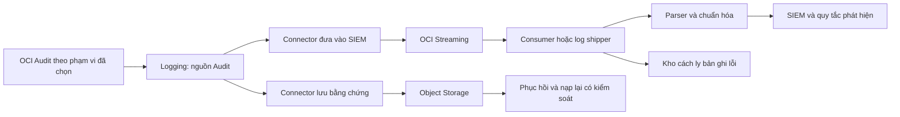

# Tập trung nhật ký kiểm toán và tích hợp SIEM

Một thay đổi IAM ở tenancy, một lần cập nhật đường mạng VCN và một thao tác trên bucket có thể thuộc cùng một chuỗi hoạt động. Nếu bằng chứng nằm rải rác theo region và compartment, đội bảo mật khó dựng lại diễn biến hoặc phát hiện hành vi liên quan nhiều dịch vụ. Tập trung nhật ký kiểm toán giúp xây dựng một đường truy vết chung; tích hợp SIEM giúp tìm kiếm, tương quan và chuyển phát hiện thành công việc xử lý.

Trong chương **An toàn thông tin và kiểm toán** của module `CLOUD_PROVIDERS_ORACLE`, bài học này trình bày cách đưa OCI Audit vào một luồng thu thập có kiểm soát. Thiết kế kết nối tenancy, compartment và IAM với giám sát hạ tầng Compute, VCN, lưu trữ và dịch vụ cơ sở dữ liệu Oracle; đồng thời xem xét tự động hóa, khả năng phục hồi và chi phí.

## 1. Kết quả cần đạt

Sau bài học, người học có thể:

- Phân biệt OCI Audit với log dịch vụ, log ứng dụng và audit bên trong cơ sở dữ liệu.
- Lập phạm vi thu thập theo tenancy, region, compartment và loại nguồn.
- Thiết kế luồng Audit → Connector Hub → Streaming → SIEM và nhánh lưu trữ bằng chứng.
- Phân tách quyền của người quản trị, connector, consumer và người điều tra.
- Chuẩn hóa sự kiện mà vẫn giữ bản gốc, xử lý dữ liệu trùng và quản lý checkpoint.
- Kiểm chứng việc thu thập bằng sự kiện thử nghiệm, phép đối soát và tình huống gián đoạn.

**SIEM** là hệ thống Security Information and Event Management: tiếp nhận sự kiện bảo mật, chuẩn hóa, tìm kiếm và tương quan để hỗ trợ phát hiện và điều tra. Nhận được JSON mới là bước đầu; dữ liệu còn phải đúng phạm vi, đúng trường và đến đủ sớm để phục vụ mục tiêu vận hành.

## 2. Xác định nhật ký nào cần tập trung

### 2.1. OCI Audit ghi nhận điều gì?

OCI Audit tự động ghi nhận lời gọi đến các public API được hỗ trợ, bao gồm lời gọi từ Console, CLI, SDK và dịch vụ OCI. Bản ghi giúp xác định thời gian, chủ thể, tài nguyên, yêu cầu và kết quả. Với Object Storage, Audit ghi nhận sự kiện liên quan bucket, không bao phủ thao tác đối với từng object. Xem [Overview of Audit](https://docs.oracle.com/en-us/iaas/Content/Audit/Concepts/auditoverview.htm).

Ví dụ, cập nhật cấu hình bucket giúp trả lời câu hỏi “ai thay đổi chế độ truy cập?”. Để điều tra “object nào đã được đọc?”, cần bổ sung nguồn ghi nhận truy cập dữ liệu phù hợp. Không thể suy ra dữ liệu chưa bị đọc chỉ vì không thấy thao tác đó trong Audit.

### 2.2. Phân biệt các lớp bằng chứng

| Nguồn trong thiết kế | Câu hỏi cần giải quyết | Cách sử dụng |
| --- | --- | --- |
| OCI Audit | Ai gọi API quản trị, với kết quả nào? | Truy vết thay đổi IAM và hạ tầng |
| Service logs | Dịch vụ xử lý yêu cầu hoặc truy cập ra sao? | Phân tích truy cập và lỗi của dịch vụ đã bật log |
| Log hệ điều hành, ứng dụng | Điều gì xảy ra trong workload? | Liên kết tài khoản, tiến trình và giao dịch ứng dụng |
| Audit cơ sở dữ liệu | Ai thực hiện hành động bên trong database? | Điều tra tài khoản, câu lệnh và đối tượng theo cấu hình audit |
| Cloud Guard problems | Công cụ đã phát hiện rủi ro nào? | Bổ sung ngữ cảnh phát hiện và xử lý |

Bảng là kế hoạch nguồn dữ liệu, không khẳng định mọi sự kiện trong từng lớp đều tự động xuất hiện trong OCI Audit. Cần cấu hình và kiểm chứng riêng các log dịch vụ, hệ điều hành, ứng dụng, database và nguồn định danh bổ sung.

Với Oracle Database, một API tạo hoặc cập nhật tài nguyên cơ sở dữ liệu thuộc lớp quản trị cloud; một thao tác SQL bên trong cơ sở dữ liệu thuộc lớp khác. Nếu mục tiêu là điều tra hành động đối với dữ liệu, kế hoạch thu thập phải bao gồm lớp database.

### 2.3. Tách mục tiêu lưu giữ khỏi mục tiêu phát hiện

Lưu giữ bằng chứng ưu tiên tính đầy đủ, khả năng truy nguyên và thời gian bảo quản. Phát hiện trên SIEM còn yêu cầu độ trễ, parser, quy tắc tương quan và người tiếp nhận cảnh báo.

Một nhóm có thể giữ bản gốc rộng hơn trong kho bằng chứng, trong khi đưa tập dữ liệu đã lựa chọn vào SIEM để kiểm soát chi phí. Việc lọc phải được ghi lại: nếu một loại sự kiện không vào SIEM, đội điều tra cần biết có thể tìm nó ở đâu và khôi phục bằng cách nào.

## 3. Lập bản đồ phạm vi trước khi tạo connector

### 3.1. Ma trận nguồn thu thập

Lập một bản kiểm kê như sau trước khi triển khai:

| Tenancy | Region | Compartment hoặc phạm vi | Nguồn | Đích dự kiến | Chủ sở hữu |
| --- | --- | --- | --- | --- | --- |
| Tenancy học tập | Region A | Root và phạm vi quản trị cần kiểm chứng | Audit | SIEM và kho bằng chứng | Nhóm nền tảng |
| Tenancy học tập | Region A | Production | Audit | SIEM và kho bằng chứng | Nhóm bảo mật |
| Tenancy học tập | Region B | Disaster Recovery | Audit | SIEM và kho bằng chứng | Nhóm vận hành |
| Tenancy học tập | Region A | Database | Audit và nguồn database riêng | Theo mục tiêu điều tra | DBA |

Đây là ví dụ tổ chức, không phải danh sách tên compartment bắt buộc. Với mỗi dòng, ghi thêm connector OCID, stream OCID, bộ lọc, thời điểm bắt đầu và tình trạng kiểm chứng.

### 3.2. Kiểm tra độ bao phủ bằng sự kiện thực tế

Không dùng tên “central” của một compartment hoặc connector làm bằng chứng đã thu thập toàn tenancy. Xác nhận rõ phạm vi compartment con trong cấu hình đang sử dụng. Chọn mẫu sự kiện ở root, compartment con và mỗi region cần bao phủ để kiểm chứng.

Khi có compartment hoặc region mới, quy trình cấp hạ tầng phải cập nhật ma trận này. Khi tài nguyên chuyển compartment, kiểm tra cả phạm vi nguồn lẫn quyền đọc của người điều tra.

Đối với IAM và nguồn định danh, xác minh nơi sự kiện thực tế xuất hiện thay vì suy ra từ region của ứng dụng. Các nguồn của identity domain cũng cần được đưa vào bản kiểm kê nếu tình huống phát hiện phụ thuộc vào chúng.

## 4. Kiến trúc tham chiếu

### 4.1. Luồng thu thập và lưu trữ độc lập



Sơ đồ là kiến trúc đề xuất. Hai nhánh dùng các connector riêng: một chuyển tới Streaming, một chuyển tới Object Storage. Nhánh bằng chứng không phụ thuộc vào khả năng tiếp nhận của SIEM, nhưng vẫn phụ thuộc vào nguồn, connector và quyền truy cập của chính nó.

Oracle cung cấp mô hình xuất Audit qua Connector Hub và dùng Streaming để tích hợp SIEM trong [Enable Security Operations](https://docs.oracle.com/en-us/iaas/Content/cloud-adoption-framework/security-strategy.htm).

### 4.2. Vai trò của từng thành phần

- **Logging** cung cấp điểm truy cập nguồn Audit trong luồng này.
- **Connector Hub** chuyển dữ liệu từ nguồn OCI đến đích đã chọn; tài liệu cũ có thể gọi là Service Connector Hub.
- **Streaming** tạo vùng đệm giữa bên thu thập và bên xử lý.
- **Consumer** đọc dữ liệu, chuyển sang định dạng SIEM chấp nhận và quản lý tiến độ.
- **Object Storage** giữ bản gốc hoặc bản bao chứa nguyên vẹn phục vụ điều tra và nạp lại.
- **SIEM** áp dụng parser, mô hình dữ liệu, quy tắc và quy trình phân công.

Không cần chuyển mọi log về một region vật lý chỉ để có giao diện điều tra tập trung. Có thể tổ chức pipeline theo region rồi hợp nhất tìm kiếm trên SIEM, tùy yêu cầu lưu trú dữ liệu, mạng và phục hồi.

### 4.3. Các cách tích hợp khác

| Phương án | Khi có thể phù hợp | Nội dung cần đánh giá |
| --- | --- | --- |
| Logging → Streaming → consumer → SIEM | Cần vùng đệm và mở rộng consumer | Retention, checkpoint, parser, khả năng đọc lại |
| Logging → Functions → API nhận của SIEM | Tích hợp đích qua HTTP, xử lý theo batch | Timeout, giới hạn đích, xác nhận tiếp nhận, retry |
| Logging → Object Storage → SIEM đọc theo lô | Chấp nhận độ trễ theo lô, cần lưu bản gốc | Liệt kê object, chống đọc trùng, thời gian xử lý |
| Connector hoặc add-on do nhà cung cấp SIEM hỗ trợ | Đã có tích hợp phù hợp phiên bản sản phẩm | Schema, auth, quyền, phạm vi và giới hạn hỗ trợ |

Đây là các lựa chọn thiết kế. Cấu hình của Splunk, Microsoft Sentinel, QRadar hoặc SIEM khác phải theo tích hợp thực tế; không coi một cấu hình Kafka hay HTTP là dùng chung cho mọi sản phẩm.

## 5. Thiết kế IAM và bảo vệ đường truyền

### 5.1. Phân tách chủ thể

| Chủ thể | Nhiệm vụ | Phạm vi quyền cần xem xét |
| --- | --- | --- |
| Quản trị pipeline | Tạo, sửa connector và cấu hình liên quan | Nguồn, connector và đích được giao |
| Connector | Chuyển dữ liệu tới đích | Ghi đúng stream hoặc bucket |
| Consumer | Đọc stream và gửi SIEM | Đọc đúng stream, lấy bí mật cần thiết |
| Người điều tra | Tìm kiếm dữ liệu và lấy bằng chứng | Quyền đọc theo nhiệm vụ |
| Quản trị lưu giữ | Quản lý retention và vòng đời | Kho bằng chứng theo phân quyền riêng |

Một nhóm được xem log không nhất thiết được đổi bộ lọc thu thập; consumer không cần quyền quản trị toàn bộ hạ tầng. Phân tách này giúp giảm cả rủi ro lộ dữ liệu và nguy cơ làm gián đoạn luồng bằng chứng.

### 5.2. Quyền đọc Audit

Ví dụ cho nhóm được giao điều tra Audit toàn tenancy:

```text
Allow group SecurityAuditReaders to read audit-events in tenancy
```

Thay tên nhóm và identity domain theo môi trường. Thu hẹp phạm vi nếu nhiệm vụ chỉ áp dụng cho một compartment. Resource type `audit-events` dùng quyền `read` cho `ListEvents`; `inspect` không cấp quyền đọc sự kiện. Xem [Details for the Audit Service](https://docs.oracle.com/en-us/iaas/Content/Identity/Reference/auditpolicyreference.htm).

Nếu cần tìm cả service logs hoặc custom logs trong Logging, cấp thêm quyền đối với log group và log content tương ứng. Quyền đọc Audit không tự cấp quyền đọc mọi nguồn Logging. Xem [Required Permissions for Searching Logs](https://docs.oracle.com/en-us/iaas/Content/Logging/Concepts/searchinglogs.htm).

### 5.3. Quyền của connector và consumer

Khi tạo connector trên Console, xem xét các policy được đề xuất cho nguồn, task và đích. Kiểm tra từng policy trước khi áp dụng; đặc biệt chú ý compartment chứa connector và tài nguyên đích.

Một mẫu quyền ghi Streaming cho connector, cần thay đầy đủ placeholder:

```text
Allow any-user to use stream-push in compartment id <stream-compartment-ocid>
where all {
  request.principal.type='serviceconnector',
  target.stream.id='<stream-ocid>',
  request.principal.compartment.id='<connector-compartment-ocid>'
}
```

Điều kiện giới hạn loại principal, stream và compartment của connector. Mẫu này áp dụng cho các connector phù hợp trong compartment đó, không chỉ một connector. Nếu yêu cầu cô lập chặt hơn, thiết kế dynamic group hoặc compartment chuyên dụng. Xem [Connector Hub Authorization](https://docs.oracle.com/en-us/iaas/Content/connector-hub/overview.htm#auth).

Consumer có thể dùng nhóm riêng để đọc stream:

```text
Allow group SIEMConsumers to use stream-pull in compartment SecurityLogging
```

Đây là mẫu ở cấp compartment, chưa bao gồm mọi quyền tra cứu metadata mà công cụ có thể yêu cầu. Điều chỉnh theo connector của SIEM và resource scope thực tế. Oracle minh họa quyền này trong [Ingest OCI Logs into Third-Party SIEM Platforms Using Log Shippers](https://docs.oracle.com/en/learn/ocilogs-log-shipper/index.html).

### 5.4. Mạng và bí mật

Với consumer dùng public endpoint, kiểm tra egress, DNS, TLS và đường tới đích SIEM. Nếu dùng private endpoint, consumer phải có đường mạng và phân giải tên phù hợp; một collector ngoài OCI không tự truy cập được endpoint private chỉ vì có thông tin xác thực.

Đối với bí mật tích hợp:

- Lưu auth token hoặc khóa đích trong cơ chế quản lý bí mật được chọn.
- Tách tài khoản tích hợp khỏi tài khoản cá nhân của kỹ sư.
- Kiểm thử luân chuyển bí mật mà không làm mất tiến độ đọc.
- Không ghi token, header nhạy cảm hoặc toàn bộ cấu hình xác thực vào log lỗi.

Nếu dùng Kafka API của OCI Streaming, cấu hình thông thường dùng `SASL_SSL`, `PLAIN`, auth token và endpoint theo region trên cổng 9092. Lấy đúng thông tin đăng nhập theo tenancy, identity domain và stream pool; không dùng mật khẩu Console thay auth token. Xem [Using Kafka APIs](https://docs.oracle.com/en-us/iaas/Content/Streaming/Tasks/kafkacompatibility_topic-Configuration.htm).

## 6. Cấu hình luồng từ Audit đến Streaming

### 6.1. Tạo vùng đệm trước

Trong compartment dành cho logging, tạo stream pool và stream cho nguồn Audit. Ghi lại region, stream OCID, stream pool OCID, số partition, endpoint và thời gian lưu.

OCI Streaming cho phép chọn retention khi tạo stream từ 24 đến 168 giờ. Số partition ảnh hưởng khả năng đọc và ghi; phải tính theo tải thực tế và giới hạn tenancy. Xem [Creating a Stream](https://docs.oracle.com/en-us/iaas/Content/Streaming/Tasks/creatingstreamsandstreampools_create-stream.htm).

Ví dụ, một nhóm dự kiến SIEM có thể bảo trì nhiều giờ nên cần vùng đệm đủ để phát hiện lỗi, xử lý và đọc hết tồn đọng. Lựa chọn retention chỉ có ý nghĩa nếu consumer có đủ năng lực bắt kịp trước khi bản ghi cũ hết hạn.

### 6.2. Chọn nguồn Audit

Trong Connector Hub, tạo connector với **Source = Logging**, chọn compartment nguồn và nhóm log đặc biệt **`_Audit`**. Kiểm tra mọi phạm vi được đưa vào nguồn; thêm các nguồn cần thiết theo cấu hình giao diện hoặc truy vấn được hỗ trợ.

Chọn **Target = Streaming** và đúng stream. Bật service log cho connector để theo dõi quá trình chuyển. Sau khi kiểm tra policy và cấu hình, tạo connector rồi ghi lại thời điểm bắt đầu thu thập. Tham khảo [Creating a Connector](https://docs.oracle.com/en-us/iaas/Content/connector-hub/create-service-connector.htm).

Không tạo một log group thông thường có tên giống Audit rồi coi đó là nguồn kiểm toán tích hợp. Tìm mẫu sự kiện nguồn để xác nhận lựa chọn đúng trước khi đưa pipeline vào vận hành.

### 6.3. Lọc dữ liệu có chủ đích

Trong giai đoạn kiểm chứng, nên bắt đầu với phạm vi học tập đủ nhỏ và bộ lọc dễ đối soát. Chỉ thêm bộ lọc sau khi đã biết trường nào thực sự có trong dữ liệu đầu vào.

Connector Hub hỗ trợ một tập con của ngôn ngữ truy vấn Logging. Không sao chép một truy vấn phân tích có phép tổng hợp từ Search sang connector rồi giả định nó hoạt động như một phép chuyển tiếp sự kiện. Xem [Log Query Reference for Connector Hub](https://docs.oracle.com/en-us/iaas/Content/connector-hub/queryreference.htm).

Hai nguyên tắc lọc hữu ích:

1. Ghi rõ bộ lọc nào áp dụng trước khi vào kho bằng chứng và bộ lọc nào chỉ áp dụng trước SIEM.
2. Đánh giá cả hành động thành công và thất bại. Hành động thành công trái phép hoặc ngoài quy trình có thể đáng điều tra hơn một lỗi quyền đơn lẻ.

Một pipeline chỉ giữ HTTP 4xx/5xx sẽ bỏ qua nhiều thay đổi thành công. Một pipeline chỉ giữ HTTP 2xx lại có thể bỏ qua hoạt động dò quyền. Bộ lọc phải xuất phát từ mục tiêu phát hiện và điều tra.

## 7. Hiểu đúng các thời hạn lưu và khả năng bù dữ liệu

### 7.1. Bốn thời hạn khác nhau

| Lớp | Ý nghĩa của thời gian lưu | Quyết định vận hành |
| --- | --- | --- |
| OCI Audit | Thời gian sự kiện còn ở nguồn Audit | Khả năng tra cứu và xuất lại từ nguồn |
| Nguồn Logging của Connector Hub | Cửa sổ connector có thể bù chuyển tiếp | Thời hạn xử lý lỗi nguồn đến đích |
| OCI Streaming | Thời gian message còn trong vùng đệm | Thời gian consumer được phép chậm |
| SIEM và kho bằng chứng | Thời gian giữ theo cấu hình từng đích | Tìm kiếm, điều tra và bảo quản |

OCI Audit giữ log **365 ngày**; tài liệu hiện hành nêu đây là thiết lập cấp tenancy không thay đổi được. Không dùng hướng dẫn cũ về chỉnh retention Audit để thiết kế hệ thống mới. Xem [Audit Log Retention Period](https://docs.oracle.com/en-us/iaas/Content/Audit/Tasks/settingretentionperiod.htm).

### 7.2. Cửa sổ 24 giờ của nguồn Logging

Nguồn Logging trong Connector Hub có cửa sổ bù **24 giờ**. Connector mới bắt đầu chuyển từ thời điểm tạo; nếu lỗi kéo dài vượt cửa sổ nguồn, một phần dữ liệu không được chuyển tiếp. Không thể mặc định connector tự đọc bù toàn bộ lịch sử Audit 365 ngày. Xem [Retention Period: Logging Source](https://docs.oracle.com/en-us/iaas/Content/connector-hub/create-service-connector-logging-source.htm).

Ví dụ minh họa: quyền ghi stream bị hỏng trong 30 giờ. Sau khi sửa quyền, connector hoạt động trở lại không tự chứng minh SIEM đã có đủ mọi sự kiện trong 30 giờ đó. Phải xác định khoảng thiếu và chạy quy trình phục hồi từ nguồn còn lưu hoặc kho bằng chứng đã thu thập.

### 7.3. Thời gian phục hồi phải gồm cả thời gian bắt kịp

Giả sử tải nguồn ổn định là `r` sự kiện/giây; consumer xử lý được `c` sự kiện/giây với `c > r`. Sau khi ngừng `t` giây, ước lượng tồn đọng là `r × t`. Thời gian bắt kịp xấp xỉ:

```text
backlog = r × t
catch_up_time = backlog / (c - r)
```

Nếu nguồn phát 100 sự kiện/giây, consumer xử lý 300 sự kiện/giây và ngừng 2 giờ, tồn đọng xấp xỉ 720.000 sự kiện; cần thêm khoảng 1 giờ để bắt kịp khi tải mới vẫn tiếp tục. Đây là tính toán minh họa, chưa gồm burst, throttling hoặc lỗi parser.

Chọn retention và ngưỡng cảnh báo dựa trên tổng thời gian phát hiện lỗi, khôi phục và bắt kịp. Theo dõi tuổi của bản ghi chưa xử lý lâu nhất để biết thời gian còn lại trước khi dữ liệu hết hạn.

## 8. Chuẩn hóa sự kiện cho SIEM

### 8.1. Giữ bản gốc trước khi chuyển đổi

Consumer nên lưu hoặc chuyển tiếp nguyên vẹn dữ liệu nguồn, kèm thông tin đường đi và phiên bản parser. Chuẩn hóa phục vụ truy vấn, nhưng bản gốc giúp giải thích khi mapping sai hoặc schema thay đổi.

Ví dụ một phần sự kiện theo envelope Audit, chỉ nhằm minh họa các trường:

```json
{
  "eventID": "11111111-2222-4333-8444-555555555555",
  "eventTime": "2026-11-20T02:10:00Z",
  "data": {
    "compartmentId": "<compartment-ocid>",
    "eventName": "UpdateBucket",
    "resourceId": "<bucket-ocid>",
    "identity": {
      "principalId": "<principal-ocid>",
      "ipAddress": "192.0.2.10"
    },
    "request": {
      "id": "example-request-id",
      "action": "POST"
    },
    "response": {
      "status": "200"
    }
  }
}
```

Trong envelope này, `eventID` định danh sự kiện; `data.request.id` định danh request; `data.request.action` là HTTP method; `data.eventName` là tên thao tác API. Không dùng các trường đó thay thế lẫn nhau. Xem [Contents of an Audit Log Event](https://docs.oracle.com/en-us/iaas/Content/Audit/Reference/logeventreference.htm).

### 8.2. Tạo hồ sơ parser theo đầu vào thực tế

Dữ liệu nhận qua CLI, Logging và từng tích hợp có thể có lớp bao hoặc tên trường được biểu diễn khác. Không áp một đường dẫn JSON duy nhất cho mọi đầu vào. Lấy mẫu thực tế rồi ghi rõ parser xử lý envelope nào, mảng nào và thông tin region nằm ở đâu.

Một bảng mapping nội bộ đề xuất:

| Trường chuẩn hóa của nhóm | Ý nghĩa | Quy tắc chuyển đổi |
| --- | --- | --- |
| `event_uid` | Định danh sự kiện nguồn | Giữ ID ổn định, không tạo lại khi retry |
| `event_time` | Thời điểm sự kiện | Phân tích timestamp và chuẩn hóa UTC |
| `ingested_at` | Thời điểm SIEM tiếp nhận | Ghi riêng, không ghi đè thời điểm sự kiện |
| `tenant_id`, `region`, `compartment_id` | Phạm vi hạ tầng | Lấy từ payload hoặc metadata đã xác thực |
| `actor_id`, `source_ip` | Chủ thể và nguồn truy cập | Giữ null khi nguồn không có |
| `operation`, `http_method` | Thao tác nghiệp vụ API và giao thức | Tách thành hai trường |
| `resource_id`, `request_id` | Đối tượng và liên kết request | Giữ nguyên giá trị nguồn |
| `status_code` | Kết quả HTTP khi có | Chuẩn hóa kiểu dữ liệu có kiểm tra |
| `raw_reference`, `parser_version` | Truy nguyên | Liên kết bản gốc và phiên bản biến đổi |

Tên trường trên là mô hình minh họa, không phải schema bắt buộc của OCI hoặc một SIEM cụ thể. Nếu dùng mô hình chuẩn của SIEM, mapping phải đáp ứng cả ngữ nghĩa và kiểu dữ liệu của mô hình đó.

### 8.3. Xử lý null, batch và schema mới

Không tự điền tên quản trị viên, IP nội bộ hoặc region mặc định khi trường thiếu. Giá trị suy đoán có thể làm sai tương quan và gán nhầm trách nhiệm.

Consumer cần phân biệt một message vận chuyển với một sự kiện Audit. Kiểm tra đầu vào là object, mảng hay payload nén và cơ chế mã hóa do giao thức sử dụng. Với native Streaming API, xử lý Base64 theo API; thư viện Kafka có cách biểu diễn bytes riêng. Tránh giải mã hai lần hoặc coi cả batch là một sự kiện.

Với bản ghi không phân tích được, giữ nguyên dữ liệu trong kho cách ly có kiểm soát, ghi lý do và báo động theo số lượng. Kho này là thành phần do nhóm triển khai thiết kế; không giả định mọi công cụ có sẵn dead-letter queue cho pipeline này.

## 9. Xử lý trùng lặp, checkpoint và thứ tự

### 9.1. Thiết kế cho giao nhận ít nhất một lần

Connector Hub dùng cơ chế giao nhận **at least once** theo batch; retry có thể đưa lại dữ liệu đã xuất hiện ở đích. Cập nhật cấu hình connector cũng có thể ảnh hưởng điểm tiếp tục xử lý. Xem [Connector Hub Delivery Details](https://docs.oracle.com/en-us/iaas/Content/connector-hub/overview.htm#deliverydetails).

Vì vậy, không dùng tổng số message nhận được làm tổng số sự kiện duy nhất. Thiết kế một khóa chống trùng dựa trên ID sự kiện nguồn kết hợp ngữ cảnh như tenancy và loại nguồn. Không chỉ dựa vào request ID: một thao tác có thể có nhiều bản ghi liên quan cần giữ riêng.

Nếu schema chưa có ID sự kiện đáng tin cậy, xây dựng phương án dự phòng có tài liệu, lưu dấu việc dùng khóa dự phòng và kiểm tra nguy cơ gộp nhầm. Hash toàn bộ dữ liệu sau khi đã thêm timestamp tiếp nhận sẽ không ổn định giữa các lần retry.

### 9.2. Commit sau khi dữ liệu đã được giữ an toàn

Pseudocode sau mô tả trách nhiệm của consumer, không phải API chạy trực tiếp:

```text
đọc batch từ stream
cho mỗi message theo partition:
    giải mã đúng định dạng vận chuyển
    tách các sự kiện trong message
    chuẩn hóa hoặc chuyển vào kho cách ly bền vững
    gửi sự kiện hợp lệ với khóa chống trùng
    xác nhận từng kết quả hoặc ghi vào vùng đệm bền vững
commit phần tiến độ liên tục đã được giữ an toàn
nếu một bước chưa an toàn:
    giữ checkpoint và thử lại theo chính sách
```

Nếu SIEM tiếp nhận batch một phần, chỉ xác nhận HTTP ở cấp request có thể chưa đủ để kết luận mọi bản ghi đã được nhận. Cần hiểu cơ chế xác nhận và lỗi từng bản ghi của đích cụ thể.

Không commit vượt một message chưa được xử lý an toàn trong cùng partition chỉ vì message phía sau đã thành công. Nếu consumer dừng sau khi gửi SIEM nhưng trước khi commit, dữ liệu có thể được đọc lại; chống trùng giúp xử lý trường hợp này.

### 9.3. Consumer group và thứ tự

Các instance trong cùng consumer group chia nhau partition. Hai đích độc lập cần các group riêng để mỗi đích nhận đủ dữ liệu của mình. Native Streaming có các lựa chọn bắt đầu như `TRIM_HORIZON`, `AT_TIME` và `LATEST`; chọn theo nhu cầu và phạm vi dữ liệu còn lưu. Xem [Using Consumer Groups](https://docs.oracle.com/en-us/iaas/Content/Streaming/Tasks/using_consumer_groups.htm).

Streaming bảo đảm thứ tự theo partition, không phải một thứ tự thời gian toàn cục cho mọi nguồn và region. Xem [Overview of Streaming](https://docs.oracle.com/en-us/iaas/Content/Streaming/Concepts/streamingoverview.htm).

Quy tắc tương quan nên dùng thời điểm sự kiện, xử lý sự kiện đến muộn và có cửa sổ phù hợp. Không suy ra quan hệ nhân quả chỉ từ thứ tự SIEM nhận hai message.

## 10. Lưu giữ bằng chứng và phục hồi

### 10.1. Thiết kế kho lưu bản gốc

Nhánh Object Storage nên có:

- Bucket riêng theo phạm vi quản trị hoặc phân loại dữ liệu.
- Quyền ghi pipeline tách khỏi quyền đọc điều tra và quản lý lưu giữ.
- Phân vùng dữ liệu theo nguồn, region và thời gian phù hợp khả năng xuất thực tế.
- Bản kê đối soát: khoảng thời gian, số bản ghi, object và kết quả kiểm tra toàn vẹn.
- Quy trình đọc lại, giải nén, kiểm tra và nạp dữ liệu khi cần.

Nếu tự tạo object hoặc manifest bổ sung, có thể ghi checksum và phiên bản schema để phát hiện thay đổi. Checksum không tự chứng minh nguồn gốc hoặc chuỗi quản lý bằng chứng; vẫn cần quyền truy cập, lịch sử thao tác và nơi giữ manifest được bảo vệ.

### 10.2. Retention rule khác lifecycle policy

Retention rule ngăn sửa hoặc xóa dữ liệu trong thời gian bảo vệ. Lifecycle policy phục vụ chuyển tầng hoặc xóa theo vòng đời và không được dùng để vượt qua retention đang hiệu lực. Khóa retention rule là thao tác không đảo ngược; cần thử nghiệm và quyết định lưu giữ riêng trước khi khóa. Xem [Object Storage Data Retention Rules](https://docs.oracle.com/en-us/iaas/Content/Object/Tasks/usingretentionrules.htm).

Không giả định có thể bật đồng thời mọi cơ chế versioning, retention và replication trong cùng một cấu hình bucket. Kiểm tra tương thích tính năng theo thiết kế thực tế. Thử phục hồi object trước khi chọn tầng lưu có thời gian khôi phục dài.

### 10.3. Runbook nạp bù

Khi phát hiện thiếu dữ liệu:

1. Xác định tenancy, region, compartment, nguồn và khoảng thời gian bị ảnh hưởng.
2. Giữ nguyên bằng chứng lỗi và checkpoint; tránh reset consumer theo phỏng đoán.
3. Kiểm tra dữ liệu còn trong stream, kho bằng chứng hoặc nguồn Audit.
4. Chọn cách đọc lại phù hợp, chia khoảng thời gian và xử lý phân trang.
5. Gắn nhãn lần nạp bù, giữ thời điểm sự kiện gốc và dùng khóa chống trùng.
6. Kiểm soát rule phát hiện để sự kiện lịch sử không tạo loạt cảnh báo sai ngữ cảnh.
7. Đối soát ID sự kiện, ghi nhận phần khôi phục được và phần không có bằng chứng.

Một connector vừa tạo không thay thế công cụ xuất lịch sử. Khi dùng API để phục hồi, cần tính quyền, giới hạn truy vấn và tải; không coi một lệnh truy vấn nhỏ là pipeline xuất hàng loạt cho toàn tenancy.

## 11. Thực hành có hướng dẫn

### 11.1. Chuẩn bị môi trường

Dùng compartment học tập với tài nguyên thử nghiệm, quyền đã cấp và một SIEM thử nghiệm hoặc collector có thể kiểm tra đầu ra. Chuẩn bị stream, connector chuyển tiếp và nhánh lưu bằng chứng theo các mục trước.

Các lệnh sau sử dụng **Bash**, phù hợp OCI Cloud Shell hoặc môi trường đã cài OCI CLI. Chúng là ví dụ để người học chạy trong môi trường được phép, không phải kết quả đã thực thi trên một tenancy cụ thể.

```bash
export REGION='<source-region>'
export COMPARTMENT_ID='<audit-source-compartment-ocid>'
export CONNECTOR_ID='<siem-connector-ocid>'
export STREAM_ID='<audit-stream-ocid>'
export START_TIME='<YYYY-MM-DDTHH:MM:00Z>'
export END_TIME='<YYYY-MM-DDTHH:MM:00Z>'
```

### 11.2. Kiểm tra cấu hình tài nguyên vận chuyển

```bash
oci sch service-connector get \
  --service-connector-id "$CONNECTOR_ID" \
  --region "$REGION"

oci streaming admin stream get \
  --stream-id "$STREAM_ID" \
  --region "$REGION"
```

Kiểm tra nguồn, task lọc, đích, trạng thái connector và thông tin stream thực tế. Metadata đúng chưa chứng minh dữ liệu đã được SIEM tiếp nhận. Tham khảo [CLI service-connector get](https://docs.oracle.com/en-us/iaas/tools/oci-cli/latest/oci_cli_docs/cmdref/sch/service-connector/get.html) và [CLI stream get](https://docs.oracle.com/en-us/iaas/tools/oci-cli/latest/oci_cli_docs/cmdref/streaming/admin/stream/get.html).

### 11.3. Tạo sự kiện thử nghiệm có dấu nhận biết

Chọn một thay đổi ít ảnh hưởng được phép trong lab, chẳng hạn cập nhật tag trên tài nguyên thử nghiệm mà người học sở hữu. Ghi lại:

- Resource OCID và compartment.
- Người thực hiện, region và thời điểm UTC.
- Giá trị tag thử nghiệm, ví dụ `audit_test=siem-lab-001`.
- Request ID nếu công cụ cung cấp.

Sau khi kiểm chứng, hoàn nguyên tag nếu cần; chính thao tác hoàn nguyên cũng có thể tạo thêm bản ghi. Không yêu cầu thao tác lỗi quyền, thay đổi IAM production hoặc mở public tài nguyên để thử pipeline.

### 11.4. Tìm bản ghi tại nguồn

```bash
oci audit event list \
  --compartment-id "$COMPARTMENT_ID" \
  --start-time "$START_TIME" \
  --end-time "$END_TIME" \
  --region "$REGION" \
  --all
```

Mốc thời gian cần giây và phần nhỏ của giây bằng 0; lệnh lấy sự kiện theo compartment và khoảng thời gian. `--all` lấy các trang kết quả, không tự bổ sung mọi compartment hoặc region. Xem [CLI audit event list](https://docs.oracle.com/en-us/iaas/tools/oci-cli/latest/oci_cli_docs/cmdref/audit/event/list.html).

Trên Logging Search, có thể bắt đầu bằng truy vấn phạm vi sau rồi chọn thời gian trên giao diện:

```text
search "<compartment-ocid>/_Audit"
```

Mở JSON để xác định ID sự kiện, tên thao tác và tài nguyên khớp thay đổi thử nghiệm. Tính đến độ trễ dữ liệu; nếu chưa thấy, kiểm tra quyền, phạm vi và thời gian trước khi kết luận mất log. Giao diện Audit hỗ trợ khám phá sự kiện và xuất JSON, xem [Audit Logs](https://docs.oracle.com/en-us/iaas/Content/Logging/Concepts/audit_logs.htm).

### 11.5. Theo cùng sự kiện qua các chặng

| Chặng | Điều cần chứng minh |
| --- | --- |
| Audit hoặc Logging | Sự kiện nguồn tồn tại và thuộc phạm vi đã chọn |
| Connector | Có lần chuyển dữ liệu phù hợp, không có lỗi quyền hoặc đích |
| Stream và consumer | Consumer nhận payload có sự kiện thử nghiệm |
| Parser | Trường thời gian, chủ thể, thao tác và tài nguyên được ánh xạ đúng |
| SIEM | Tìm được sự kiện duy nhất theo khóa nguồn |
| Kho bằng chứng | Có thể lấy lại dữ liệu chứa cùng ID sự kiện |

Không chỉ so số lượng message. Một message có thể chứa nhiều sự kiện; một sự kiện có thể được vận chuyển lại. Kết quả đạt là tìm được cùng sự kiện và đối chiếu được nội dung quan trọng ở các điểm cần bảo đảm.

### 11.6. Thử gián đoạn consumer

Trong lab, dừng consumer trong khoảng ngắn, giữ nguyên connector và cấu hình stream. Tạo một sự kiện thử nghiệm nữa, sau đó khởi động lại consumer bằng checkpoint đã lưu.

Xác minh rằng dữ liệu tồn đọng được đọc, độ trễ giảm và lần chạy lại không tạo sự kiện chuẩn hóa trùng. Nếu consumer được cấu hình bắt đầu ở `LATEST` mỗi lần khởi động, nó có thể bỏ qua dữ liệu đang chờ; phải kiểm tra cách công cụ thực tế quản lý checkpoint.

Ghi lại thời gian bắt kịp và lỗi nếu có. Bài thử này kiểm tra gián đoạn consumer; nó không thay thế kiểm tra lỗi connector trước stream hoặc khả năng phục hồi khi quá hạn lưu.

## 12. Từ dữ liệu tập trung đến phát hiện trên SIEM

### 12.1. Bắt đầu bằng use case có thể xác minh

| Use case đề xuất | Ngữ cảnh cần thêm | Cách giảm cảnh báo nhiễu |
| --- | --- | --- |
| Thay đổi IAM ngoài quy trình | Chủ sở hữu, cửa sổ triển khai, mã thay đổi | Phân biệt pipeline hợp lệ với định danh bất thường |
| Thay đổi mạng làm tăng phạm vi truy cập | Rule trước và sau, workload, nguồn CIDR | Đánh giá nội dung thay đổi thay vì chỉ tên API |
| Thay đổi truy cập bucket | Phân loại dữ liệu và mục đích bucket | Tách kho tài liệu công khai khỏi dữ liệu nội bộ |
| Định danh gọi API khác thường | Baseline hoạt động, loại xác thực, nguồn truy cập | Xét IP, thời gian và chuỗi hành động cùng nhau |
| Thay đổi cấu hình thu thập log | Connector, policy và lịch bảo trì | Xác minh cả thay đổi được phép và tác động thực tế |

Đây là ý tưởng rule nội bộ, không phải danh sách rule có sẵn của OCI hoặc SIEM. Với mỗi use case, phải xác nhận các trường cần thiết đã được thu thập.

### 12.2. Tương quan có cửa sổ thời gian

Ví dụ logic khái niệm:

```text
nếu cùng actor_id trong cùng tenancy:
    thay đổi quyền quản trị
    rồi thực hiện hành động nhạy cảm trên tài nguyên
    trong cửa sổ điều tra đã chọn
và không khớp thay đổi được cho phép:
    tạo phát hiện kèm các event_uid liên quan
```

Không gọi đây là bằng chứng xâm nhập chỉ vì rule khớp. Cảnh báo cần kèm sự kiện gốc, ngữ cảnh thay đổi và người tiếp nhận để điều tra. Một phát hiện có thể tương quan thêm Cloud Guard, log hệ điều hành hoặc database khi những nguồn đó có sẵn.

### 12.3. Giữ liên kết điều tra

Hồ sơ phát hiện nên có tenancy, region, compartment, tài nguyên, actor, cửa sổ thời gian, ID các sự kiện và liên kết bản gốc. Khi xử lý sự việc, ghi lại thay đổi đã làm và bằng chứng xác minh; không chỉ đóng cảnh báo trên SIEM.

## 13. Giám sát chính pipeline thu thập

### 13.1. Đo dữ liệu đến đủ và đúng

| Chỉ số đề xuất | Ý nghĩa | Hành động khi bất thường |
| --- | --- | --- |
| Độ trễ sự kiện đến SIEM | Chênh lệch thời điểm sự kiện và tiếp nhận | Xác định chặng chậm |
| Tuổi dữ liệu chưa xử lý lâu nhất | Khoảng cách đến hết hạn vùng đệm | Tăng năng lực hoặc phục hồi có kiểm soát |
| Lỗi chuyển và throttling | Đường đi không đáp ứng tải hoặc quyền | Đọc lỗi và kiểm tra nguồn, đích |
| Tỷ lệ lỗi parser | Schema hoặc payload chưa được xử lý | Giữ bản gốc, sửa parser, nạp lại |
| Tỷ lệ sự kiện trùng | Retry, overlap hoặc checkpoint | Kiểm tra chống trùng và điểm tiếp tục |
| Sự kiện duy nhất theo nguồn và thời gian | Cơ sở đối soát độ bao phủ | Điều tra khoảng thiếu |
| Số byte vào SIEM và kho lưu | Theo dõi chi phí, tải và thay đổi đột ngột | Kiểm tra nguồn và bộ lọc |

Không có log mới có thể là ít hoạt động hoặc có sự cố thu thập. Dùng sự kiện kiểm chứng định kỳ được phép và baseline phù hợp từng nguồn để phân biệt hai tình huống.

### 13.2. Quan sát Connector Hub

Service logs của connector hỗ trợ xem từng lần chuyển thành công hoặc thất bại và mặc định chưa bật. Bật chúng khi triển khai để có bằng chứng vận hành, xem [Logs for Connector Hub](https://docs.oracle.com/en-us/iaas/Content/connector-hub/service-logging.htm).

Theo dõi thêm data freshness và lỗi dịch vụ theo hướng dẫn [Troubleshooting Connectors](https://docs.oracle.com/en-us/iaas/Content/connector-hub/troubleshooting.htm). Connector có trạng thái hoạt động nhưng chưa chuyển đúng nguồn vẫn không đáp ứng yêu cầu thu thập.

Lưu log của pipeline trong phạm vi riêng và tránh chọn chính những log phát sinh đó vào một vòng chuyển tiếp không được kiểm soát. Cảnh báo pipeline cần có kênh mà đội trực còn nhận được khi SIEM không sẵn sàng.

## 14. Chẩn đoán sự cố thường gặp

| Hiện tượng | Kiểm tra đầu tiên | Hướng xử lý |
| --- | --- | --- |
| Audit có sự kiện, SIEM không có | Nguồn `_Audit`, bộ lọc, quyền ghi stream | Theo ID sự kiện qua từng chặng |
| Chỉ có log ở một region | Danh mục nguồn và pipeline theo region | Bổ sung phạm vi và kiểm chứng từng region |
| Root có log nhưng thiếu workload | Compartment con và quyền truy cập | Xác minh phạm vi nguồn bằng sự kiện mẫu |
| Consumer lỗi xác thực | Token, user/domain, stream pool, endpoint | Sửa cấu hình và đọc lại bằng checkpoint |
| Consumer chạy nhưng không đọc | Group, offset, partition, đường mạng | Kiểm tra tiến độ thực tế và dữ liệu còn lưu |
| SIEM nhận JSON nhưng truy vấn không ra | Parser, index, timestamp, timezone | So sánh payload nguồn với trường chuẩn hóa |
| Cảnh báo tăng sau khởi động lại | Trùng, replay hoặc thay đổi group | Đối soát khóa sự kiện và nhãn nạp bù |
| SIEM có log mới nhưng thiếu khoảng cũ | Gián đoạn vượt cửa sổ nguồn hoặc stream | Xác định khoảng thiếu và chạy runbook phục hồi |
| Lỗi parser làm nghẽn partition | Một bản ghi không được xử lý | Cách ly bền vững và tiếp tục theo chính sách |
| Kho bằng chứng có object nhưng thiếu sự kiện | Batch, bộ lọc, giải nén, định dạng | Kiểm tra nội dung và bản kê thay vì chỉ tên object |

Mỗi hiện tượng có thể có nhiều nguyên nhân. Giữ request ID, connector OCID, thời gian lỗi và mẫu payload đã bảo vệ thông tin nhạy cảm để hỗ trợ điều tra.

## 15. Chi phí, tính sẵn sàng và quản lý thay đổi

### 15.1. Tính chi phí theo toàn đường đi

Chi phí có thể gồm vùng đệm Streaming, Logging phát sinh thêm, lưu Object Storage, truy vấn, mạng, collector, Functions và mức nạp của SIEM. Không suy ra toàn pipeline miễn phí từ việc Audit được cung cấp sẵn.

Ước lượng dung lượng thô trước khi tính giá theo dịch vụ:

```text
raw_bytes_per_day = events_per_second × average_event_bytes × 86400
```

Ví dụ 100 sự kiện/giây, trung bình 2 KiB/sự kiện tạo khoảng 16,48 GiB/ngày trước nén. Dung lượng tính phí còn phụ thuộc định dạng batch, bản sao, chỉ mục và quy tắc tính của từng dịch vụ. Đo mẫu thực tế trước khi quyết định lọc hoặc thời gian lưu.

### 15.2. Bảo vệ khả năng phục hồi

Tách nhánh lưu bằng chứng giúp giảm phụ thuộc vào SIEM, nhưng không loại bỏ mọi điểm lỗi chung. Kiểm tra quyền, nguồn, mạng và khả năng phục hồi theo region. Nếu yêu cầu kho thứ hai hoặc region dự phòng, xác minh cấu hình sao chép tương thích với retention và yêu cầu lưu trú dữ liệu.

Không đặt dữ liệu bằng chứng, khóa giải mã và toàn bộ quyền khôi phục vào cùng một tài khoản vận hành duy nhất. Phương án sao chép không có ích nếu đội ứng cứu không còn quyền hoặc khóa để đọc dữ liệu.

### 15.3. Quản lý pipeline như hạ tầng

Đưa định nghĩa connector, danh sách nguồn, stream, quyền, parser và rule vào quy trình quản lý phiên bản phù hợp. Mỗi thay đổi cần mô tả phạm vi, thời điểm chuyển đổi, khả năng trùng hoặc thiếu dữ liệu và cách quay lại.

Khi thay pipeline, có thể chạy song song ngắn hạn với chống trùng và đối soát. Không xóa luồng cũ chỉ vì luồng mới nhận được một message; cần chứng minh phạm vi nguồn, trường dữ liệu và độ trễ đã đáp ứng yêu cầu.

## 16. Tiêu chí nghiệm thu và bàn giao

Một luồng tập trung Audit và tích hợp SIEM đủ điều kiện bàn giao khi:

1. Có ma trận nguồn theo tenancy, region và compartment, kèm chủ sở hữu.
2. Quyền người dùng, connector, consumer và kho bằng chứng được phân tách.
3. Sự kiện kiểm chứng đi từ nguồn tới SIEM và nhánh lưu trữ với nội dung đúng.
4. Parser giữ được thời điểm, chủ thể, thao tác, tài nguyên và liên kết bản gốc.
5. Dữ liệu trùng, lỗi phân tích và checkpoint được xử lý theo chính sách rõ ràng.
6. Có cảnh báo độ trễ và kế hoạch xử lý trước khi hết cửa sổ bù dữ liệu.
7. Bài thử gián đoạn consumer và quy trình nạp lại đã có kết quả ghi nhận.
8. Có cấu hình retention, dự toán dung lượng và người quyết định thay đổi.

Hồ sơ bàn giao nên ghi connector và stream OCID, phạm vi nguồn, các bộ lọc, phiên bản parser, nơi lưu bản gốc, dashboard vận hành, runbook phục hồi và kết quả kiểm chứng. Nhờ đó, người tiếp quản có thể trả lời ba câu hỏi cụ thể: đang thu thập những gì, có khoảng thiếu nào và làm thế nào lấy lại bằng chứng cho một sự kiện.
