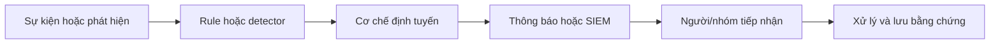

# Đánh giá cấu hình landing zone theo yêu cầu bảo mật

## 1. Mục tiêu và cách hiểu đúng về landing zone

Trong chương **An toàn thông tin và kiểm toán** của module **CLOUD_PROVIDERS_ORACLE**, bài học này trình bày cách đánh giá một landing zone OCI trước khi đưa workload vào vận hành hoặc sau khi cấu hình nền tảng thay đổi.

Landing zone là nền tảng dùng chung cho các workload: cấu trúc tenancy và compartment, danh tính và IAM, kết nối mạng, dịch vụ bảo mật, thu thập log cùng cách triển khai và vận hành. Đánh giá landing zone cần trả lời được bốn câu hỏi:

1. Tổ chức yêu cầu điều gì và yêu cầu đó áp dụng cho tài nguyên nào?
2. Cấu hình OCI thực tế có đáp ứng yêu cầu hay không?
3. Bằng chứng nào hỗ trợ kết luận và còn phần nào chưa kiểm tra được?
4. Sai lệch phải được sửa, kiểm chứng lại hoặc chấp nhận bởi ai?

OCI Core Landing Zone là một blueprint có tự động hóa, kết hợp thiết kế compartment, IAM, mạng và các dịch vụ bảo mật. Oracle mô tả blueprint này là sự hợp nhất của các hướng tiếp cận Oracle Enterprise Landing Zone và CIS Landing Zone. Cần ghi rõ phiên bản blueprint và lựa chọn triển khai khi dùng nó làm cơ sở đánh giá. [Tài liệu Oracle về OCI Core Landing Zone](https://docs.oracle.com/en-us/iaas/Content/cloud-adoption-framework/oci-core-landing-zone.htm).

Việc dùng một template theo CIS không tự chứng minh rằng tenancy đang triển khai đáp ứng toàn bộ yêu cầu của tổ chức. Biến đầu vào, tài nguyên thêm sau triển khai, thay đổi thủ công và phạm vi kiểm tra đều có thể làm kết quả thực tế khác blueprint.

Sau bài học, người học có thể xây dựng bộ tiêu chí, thu thập bằng chứng OCI, kiểm tra cấu hình trọng yếu, ghi nhận phát hiện và đưa ra kết luận có điều kiện rõ ràng. Phạm vi bao gồm nền tảng hạ tầng cho Compute, lưu trữ và dịch vụ cơ sở dữ liệu Oracle; không thay thế đánh giá chi tiết mã ứng dụng hoặc kiểm thử toàn bộ hệ quản trị cơ sở dữ liệu.

## 2. Chuyển yêu cầu bảo mật thành tiêu chí kiểm tra

### 2.1. Chọn nguồn yêu cầu và cố định phiên bản

Một đợt đánh giá thường phải kết hợp:

- Chính sách nội bộ về phân loại dữ liệu, truy cập đặc quyền và thời gian giữ log.
- Yêu cầu của workload: kết nối đối tác, dịch vụ database, sao lưu và khả năng phục hồi.
- Tiêu chuẩn hoặc benchmark mà tổ chức đã chọn, với đúng phiên bản và hồ sơ áp dụng.
- Thiết kế landing zone đã được phê duyệt và các ngoại lệ còn hiệu lực.
- Trách nhiệm của Oracle và của khách hàng đối với từng dịch vụ.

Trong mô hình trách nhiệm chia sẻ, tổ chức vẫn chịu trách nhiệm về những phần cấu hình và vận hành thuộc quyền kiểm soát của mình, như IAM, VCN, ứng dụng và dữ liệu. Ranh giới cụ thể phải xét theo loại dịch vụ đang sử dụng. [Tài liệu Oracle về Shared Security Model](https://docs.oracle.com/en-us/iaas/Content/cloud-adoption-framework/security.htm).

Nếu chưa có benchmark được phê duyệt, có thể xây dựng baseline nội bộ để thực hành. Phải ghi rõ đó là baseline minh họa; không gắn nhãn “đạt CIS” hoặc “đạt tuân thủ” dựa trên các tiêu chí tự đặt.

### 2.2. Viết yêu cầu sao cho kiểm chứng được

Yêu cầu “hệ thống phải an toàn” chưa đủ để đánh giá. Có thể chuyển thành:

```text
Yêu cầu:
  Máy chủ xử lý dữ liệu nhạy cảm không được có public IP.

Phạm vi:
  Tất cả VNIC của Compute thuộc App-Prod và Data-Prod,
  trong mọi region được đưa vào vận hành.

Cách kiểm tra:
  Đối chiếu inventory, cấu hình VNIC và subnet;
  xét cả VNIC phụ và tài nguyên tạo ngoài Terraform.

Tiêu chí đạt:
  Không có public IP; subnet cấm cấp public IP;
  không có ngoại lệ chưa được phê duyệt.

Bằng chứng:
  Kết quả API có OCID, region và thời điểm;
  cấu hình subnet; kết quả kiểm tra danh sách VNIC.

Chủ sở hữu:
  Nhóm nền tảng phối hợp với nhóm ứng dụng.
```

Public endpoint của Load Balancer được phê duyệt có thể là một trường hợp khác với public IP trên máy ứng dụng. Phải định nghĩa phạm vi ngay từ đầu để đánh giá theo nhu cầu nghiệp vụ thực tế.

### 2.3. Ma trận kiểm soát mẫu

Các mã dưới đây là **mã nội bộ minh họa**, không phải số hiệu của CIS hay một tiêu chuẩn chính thức.

| Mã | Yêu cầu minh họa | Phạm vi | Bằng chứng chính |
| --- | --- | --- | --- |
| LZ-IAM-01 | Truy cập quản trị của con người đi qua cơ chế xác thực được phê duyệt, có MFA theo chính sách | Identity domain, IdP, nhóm quản trị | Sign-on policy, ánh xạ nhóm, kiểm thử đăng nhập |
| LZ-IAM-02 | Nhóm vận hành workload không có quyền quản trị toàn tenancy | Policy root, compartment cha/con | Statement, thành viên nhóm, kiểm thử quyền |
| LZ-NET-01 | Ứng dụng và database nhạy cảm không có public IP | Mọi VNIC trong phạm vi | VNIC, subnet, inventory |
| LZ-NET-02 | Kết nối nội bộ và egress chỉ phục vụ luồng được duyệt | VCN, NSG, Security List, route | Ma trận kết nối, cấu hình, phép thử |
| LZ-DAT-01 | Bucket dữ liệu nhạy cảm không công khai và chia sẻ có kiểm soát | Object Storage, PAR, IAM | Bucket detail, PAR metadata, policy |
| LZ-KEY-01 | Dữ liệu dùng cơ chế mã hóa và quản lý khóa theo phân loại | Storage, database, Vault | Key reference, trạng thái khóa, IAM |
| LZ-LOG-01 | Truy xuất được thay đổi quản trị và log cần thiết theo thời gian giữ đã duyệt | Audit, Logging, kho lưu trữ | Sự kiện mẫu, log nguồn/đích, retention |
| LZ-DET-01 | Workload trong phạm vi được giám sát bằng detector phù hợp | Cloud Guard target và recipe | Phạm vi target, rule đang bật, problem mẫu |
| LZ-GRD-01 | Có kiểm soát phòng ngừa cho các cấu hình bị cấm đã xác định | Security Zones hoặc cơ chế được chọn | Recipe, phạm vi, phép thử trong lab |
| LZ-OPS-01 | Có quy trình khắc phục, phục hồi và đánh giá lại | Nhóm vận hành và quy trình IaC | Lịch thay đổi, bằng chứng kiểm thử, người chịu trách nhiệm |

Mỗi dòng cần thêm mức độ quan trọng, người sở hữu, cách kiểm tra và điều kiện ngoại lệ. Không dùng cùng một tiêu chí cho mọi dịch vụ database nếu chúng có mô hình kết nối và vận hành khác nhau.

## 3. Xác định phạm vi để tránh kết luận thiếu dữ liệu

### 3.1. Phạm vi phải mô tả được cả chiều tổ chức và chiều kỹ thuật

Trước khi thu thập dữ liệu, ghi lại:

| Chiều phạm vi | Thông tin cần có |
| --- | --- |
| Tenancy | OCID, home region, tổ chức sở hữu |
| Compartment | Root, các compartment cha, con và phần dùng chung liên quan |
| Region | Các region đang có workload, log, khóa và bản sao lưu |
| Danh tính | Identity domain, IdP, nhóm, dynamic group và service principal liên quan |
| Workload | Compute, lưu trữ, database, OKE hoặc dịch vụ khác thực sự được dùng |
| Kết nối | Internet, peering, DRG, VPN, FastConnect và mạng tại chỗ |
| Thời gian | Mốc chụp cấu hình và khoảng log được đánh giá |
| Công cụ | Phiên bản CLI, bộ thu thập, blueprint, Terraform module và bộ rule |

Compartment là tài nguyên có phạm vi toàn tenancy, trong khi nhiều tài nguyên hạ tầng cần kiểm tra theo từng region. Chỉ xem một region trên Console có thể bỏ sót tài nguyên thuộc cùng compartment ở nơi khác. [Tài liệu Oracle về Compartments](https://docs.oracle.com/en-us/iaas/Content/Identity/compartments/Working_with_Compartments.htm).

Trong quá trình đánh giá, ghi nhận tài nguyên đã xóa hoặc đang chuyển trạng thái nếu chúng liên quan đến sự kiện trong khoảng log. Inventory hiện tại và lịch sử hoạt động trả lời hai câu hỏi khác nhau.

### 3.2. Quyền của người đánh giá là một phần của bằng chứng

Tài khoản đánh giá cần quyền đọc cấu hình và log trong phạm vi đã thống nhất. Không mặc định cấp quyền quản trị toàn tenancy chỉ để tiện chạy công cụ.

Nếu một API trả lỗi thiếu quyền hoặc chỉ nhìn thấy một phần tài nguyên, kết quả là **chưa đủ bằng chứng**, không phải “không có tài nguyên vi phạm”. Thu thập danh sách lỗi, endpoint, compartment và region bị ảnh hưởng để xác định khoảng trống.

Cần đặc biệt chú ý quyền đọc IAM, Cloud Guard, nội dung log và metadata của tài nguyên. Người đánh giá không cần lấy nội dung secret, private key, mật khẩu database hoặc URL PAR đầy đủ chỉ để kiểm tra chính sách.

### 3.3. Trạng thái kết quả nên có ý nghĩa riêng

| Trạng thái | Ý nghĩa |
| --- | --- |
| PASS | Bằng chứng đủ và tiêu chí trong phạm vi được đáp ứng |
| FAIL | Có bằng chứng cho thấy tiêu chí không được đáp ứng |
| NOT_TESTED | Chưa kiểm tra hoặc bằng chứng chưa đủ, gồm trường hợp thiếu quyền |
| NOT_APPLICABLE | Tiêu chí không áp dụng, có lý do và người xác nhận |
| EXCEPTION | Có sai lệch và quyết định chấp nhận rủi ro còn hiệu lực |

Một ngoại lệ được phê duyệt không biến cấu hình sai lệch thành PASS. Khi tổng hợp, báo riêng số lượng FAIL, NOT_TESTED và EXCEPTION để người phê duyệt nhìn thấy giới hạn của kết luận.

## 4. Thu thập và quản lý bằng chứng

### 4.1. Ba lớp bằng chứng bổ sung cho nhau

Đối với một kiểm soát quan trọng, nên phân biệt:

1. **Thiết kế:** sơ đồ, Terraform, baseline, ma trận kết nối và quy trình đã duyệt.
2. **Cấu hình thực tế:** dữ liệu API hoặc Console về tài nguyên đang tồn tại.
3. **Hiệu lực vận hành:** kết quả kiểm thử có kiểm soát, log và khả năng xử lý sự kiện.

Ví dụ, Terraform khai báo một NSG hạn chế chỉ chứng minh ý định thiết kế. Cần xác nhận VNIC đang gắn NSG đó, không có rule rộng khác và kết nối trái phạm vi thực sự bị chặn.

Tương tự, có một Notifications topic không chứng minh thông báo đã tới người trực. Có bản sao lưu không chứng minh có thể khôi phục đủ dữ liệu trong thời gian yêu cầu.

### 4.2. Mỗi bằng chứng cần có ngữ cảnh

Một bản ghi tối thiểu nên chứa:

```yaml
evidenceId: E-NET-014
controlId: LZ-NET-02
resourceId: "<OCID tài nguyên>"
compartmentId: "<OCID compartment>"
region: "<region>"
collectedAtUtc: "<thời điểm UTC>"
source: "OCI API hoặc CLI, kèm thao tác đã dùng"
collector: "<danh tính thu thập>"
scope: "NSG, Security List và route liên quan tới VNIC ứng dụng"
limitations: "Chưa kiểm thử đường qua mạng tại chỗ"
```

Đây là mẫu bản ghi trong hồ sơ đánh giá, không phải cấu trúc tài nguyên OCI. OCID và thời điểm giúp phân biệt tài nguyên có cùng display name, đồng thời tránh dùng bằng chứng cũ cho một tài nguyên vừa được tạo lại.

Bảo vệ kho bằng chứng bằng quyền truy cập phù hợp, lịch sử thay đổi và thời hạn giữ. Nếu tính toàn vẹn là yêu cầu, bổ sung checksum hoặc cơ chế lưu trữ tương ứng; checksum chỉ có ý nghĩa khi giá trị tham chiếu cũng được bảo vệ.

### 4.3. Phân biệt kiểm tra toàn bộ và lấy mẫu

Các cấu hình có thể liệt kê bằng API như public IP, NSG và bucket thường nên kiểm tra trên toàn bộ inventory trong phạm vi. Kiểm thử đăng nhập, khôi phục hoặc xử lý cảnh báo có thể lấy mẫu theo nhóm rủi ro và mô hình triển khai.

Báo cáo phải nêu rõ tập được kiểm tra và cách lấy mẫu. Không suy rộng một lần khôi phục thành công của môi trường thử nghiệm sang mọi database sản xuất có cấu hình khác.

## 5. Đánh giá tổ chức tài nguyên và IAM

### 5.1. Cây compartment phải hỗ trợ phân tách trách nhiệm

Một cấu trúc minh họa có thể là:

```text
Tenancy
└── LandingZone
    ├── Network
    ├── Security
    ├── App-NonProd
    ├── App-Prod
    └── Data-Prod
```

Cần xác định nhóm nào quản lý từng nhánh, tài nguyên nào dùng chung và ai được sửa chính sách. Tên compartment đẹp chưa chứng minh có phân tách trách nhiệm.

Trong OCI, quyền từ compartment cha được kế thừa xuống con. Vì vậy, phải đọc policy ở root và mọi cấp cha liên quan, thay vì chỉ đọc policy ở compartment workload. [Tài liệu Oracle về Policy Inheritance](https://docs.oracle.com/en-us/iaas/Content/Identity/Concepts/policies.htm).

### 5.2. Đọc statement và quan hệ danh tính

Với mỗi quyền có ảnh hưởng lớn, xác định:

- Chủ thể: nhóm người dùng, dynamic group, dịch vụ hoặc danh tính liên kết.
- Hành động và resource type được cấp.
- Phạm vi: tenancy, compartment và điều kiện đi kèm.
- Nhóm thực tế chứa ai, ánh xạ từ IdP nào và ai được sửa nhóm.
- Ai được sửa policy, tag hoặc thuộc tính có thể làm thay đổi quyền hiệu lực.

Ví dụ statement minh họa cần điều tra:

```text
Allow group CorpDomain/AppOperators to manage all-resources in tenancy
```

Nếu vai trò chỉ là vận hành ứng dụng sản xuất, statement này rộng hơn nhu cầu đã mô tả. Cần thu hẹp theo tác vụ và phạm vi thật; không thay bằng một policy khác chỉ dựa vào tên nhóm.

Quyền `manage all-resources` ở một compartment cũng có thể bao gồm quyền quản lý policy tại đó. Nơi gắn policy quyết định ai có thể quản lý policy; đây là điểm phải xem khi thiết kế phân tách trách nhiệm. [Tài liệu Oracle về Policy Attachment](https://docs.oracle.com/en-us/iaas/Content/Identity/policieshow/Policy_Attachment.htm), [hướng dẫn IAM của Oracle](https://docs.oracle.com/en-us/iaas/Content/Resources/Assets/whitepapers/best-practices-for-iam-on-oci.pdf).

### 5.3. Kiểm tra xác thực của con người và credential của workload

Đối với người dùng, đối chiếu identity domain, liên kết IdP, sign-on policy và khả năng đăng nhập thực tế. Nếu MFA nằm ở IdP bên ngoài, thu thập bằng chứng từ chuỗi xác thực đó. Chính sách MFA cho OCI Console không tự chứng minh rằng API credential đã được bảo vệ tương đương. [Tài liệu Oracle về IAM MFA](https://docs.oracle.com/en-us/iaas/Content/Security/Reference/iam_security_topic-IAM_MFA.htm), [phạm vi của Console Sign-On Policy](https://docs.oracle.com/en-us/iaas/Content/Security/Reference/iam_security_topic-iam_mfa_identity_domains_signon_policy.htm).

Đối với workload, rà soát API key, auth token, secret và quyền instance/resource principal. Dynamic group cần có quy tắc membership đúng phạm vi; nếu membership dựa vào tag, phải đánh giá cả quyền sửa tag. Tránh tình huống một nhóm có thể tự gắn thuộc tính để tham gia nhóm tài nguyên được cấp quyền cao hơn.

Tài khoản khẩn cấp cần người sở hữu, phương thức lưu giữ, kiểm thử sử dụng và giám sát sau khi dùng. Hồ sơ đánh giá không nên chứa credential của tài khoản đó.

## 6. Đánh giá mạng và đường quản trị

### 6.1. Kiểm tra theo luồng dữ liệu

Bắt đầu từ sơ đồ và ma trận luồng đã được duyệt, rồi đối chiếu tài nguyên:

| Nội dung | Câu hỏi đánh giá | Dấu hiệu cần điều tra |
| --- | --- | --- |
| Điểm công khai | Chỉ có endpoint được duyệt tiếp nhận Internet? | Public IP mới trên máy ứng dụng hoặc database |
| Phân đoạn | Chỉ vai trò cần thiết được kết nối nhau? | Cho phép toàn bộ VCN tới mọi cổng |
| Quản trị | Ai vào được SSH/RDP và qua đường nào? | Cổng quản trị mở rộng ra Internet |
| Egress | Ứng dụng được phép chủ động gọi những đích nào? | Default route và allow egress rộng ngoài thiết kế |
| Kết nối ngoài VCN | Peering, DRG và mạng tại chỗ dẫn tới đâu? | Có đường vòng qua hệ thống trung gian |
| IPv6 | Có cùng mức kiểm soát với IPv4? | Rule hoặc route IPv6 chưa được đánh giá |

Với mỗi kết nối quan trọng, kiểm tra từ VNIC nguồn tới VNIC đích và chiều về. Nếu thiết kế yêu cầu qua firewall, phải chứng minh đường đi thực tế qua điểm kiểm tra; việc firewall tồn tại trong VCN chưa đủ.

### 6.2. Đánh giá toàn bộ rule áp dụng cho VNIC

Trong OCI, các allow rule từ Security List và NSG liên quan được kết hợp; một rule hẹp ở NSG không phủ quyết rule rộng ở Security List. Người đánh giá cần lấy cả danh sách rule và quan hệ gắn chúng vào subnet/VNIC. Đồng thời kiểm tra stateful/stateless để hiểu quyền của kết nối mới và lưu lượng phản hồi. [Tài liệu Oracle về Security Rules](https://docs.oracle.com/en-us/iaas/Content/Network/Concepts/securityrules.htm).

Một phát hiện nên mô tả cấu hình hiệu lực, chẳng hạn: “Security List gắn với subnet ứng dụng cho phép TCP tới mọi đích trên mọi cổng, vượt ma trận egress đã duyệt”, thay vì chỉ ghi “NSG chưa an toàn”.

Nếu landing zone sử dụng Zero Trust Packet Routing (ZPR), phải đánh giá thêm security attribute, policy ZPR và quyền sửa chúng. Các endpoint có thuộc tính ZPR cần được kiểm tra cùng các lớp kiểm soát mạng liên quan, không chỉ NSG. [Tài liệu Oracle về ZPR](https://docs.oracle.com/en-us/iaas/Content/zero-trust-packet-routing/home.htm).

### 6.3. Kiểm chứng quản trị và kết nối trái phạm vi

Chọn phép thử theo tiêu chí đã duyệt, ví dụ:

- Người vận hành có thể quản trị qua Bastion hoặc đường private được thiết kế.
- Nguồn ngoài phạm vi không mở được kết nối tới cổng quản trị.
- Ứng dụng gọi được đúng listener của database, nhưng một nguồn không thuộc vai trò ứng dụng không gọi được.
- API đối tác được duyệt hoạt động, trong khi đường egress trực tiếp ngoài chính sách bị chặn.
- Khi điểm kiểm soát lỗi, không xuất hiện fallback tự động bỏ qua kiểm soát.

Các phép thử chủ động cần kế hoạch và môi trường phù hợp. Tránh sửa chính sách sản xuất chỉ để tạo một cấu hình sai có thể quan sát được. Có thể kiểm tra hành vi phòng ngừa trong compartment lab với tài nguyên và dữ liệu thử nghiệm.

## 7. Đánh giá dữ liệu, khóa và nền tảng workload

### 7.1. Object Storage: private bucket chưa kết thúc đánh giá

Cần xem public access, IAM với bucket/object, cơ chế chia sẻ, mã hóa, logging, sao lưu và thời hạn giữ theo phân loại dữ liệu.

Đặc biệt, Pre-Authenticated Request (PAR) cấp quyền qua một URL mà người giữ URL có thể sử dụng trong phạm vi được cấp. Vì vậy, bucket không công khai vẫn cần kiểm tra PAR, thời hạn, phạm vi đọc/ghi và người sở hữu. Không đưa URL PAR đầy đủ vào báo cáo phổ biến rộng. [Tài liệu Oracle về Object Storage PAR](https://docs.oracle.com/en-us/iaas/Content/Object/Tasks/usingpreauthenticatedrequests.htm).

Cần phân biệt ba kết luận:

```text
Bucket không public:
  Chưa phát hiện cấu hình public access.

Chia sẻ được kiểm soát:
  Đã đánh giá IAM, PAR và các cơ chế chia sẻ đang dùng.

Dữ liệu được bảo vệ theo yêu cầu:
  Đã xét thêm mã hóa, lưu giữ, sao lưu và log cần thiết.
```

Một bằng chứng không thay thế được cả ba kết luận. Nếu yêu cầu cấm chia sẻ bằng PAR mà chưa liệt kê được PAR, tiêu chí liên quan vẫn là NOT_TESTED.

### 7.2. Mã hóa phải đi cùng quản lý vòng đời khóa

Đối với từng nhóm tài nguyên, xác định tổ chức yêu cầu khóa do Oracle quản lý hay khóa khách hàng quản lý. Không đánh dấu mọi tài nguyên dùng khóa do Oracle quản lý là FAIL nếu baseline không yêu cầu CMK.

Với tài nguyên cần CMK, kiểm tra:

- Tài nguyên đang tham chiếu đúng khóa và đúng phạm vi quản trị.
- Trạng thái khóa và khả năng dịch vụ sử dụng khóa.
- Người được quản trị khóa khác với người chỉ cần dùng khóa khi yêu cầu phân tách trách nhiệm áp dụng.
- Chính sách xoay vòng, theo dõi sử dụng và phương án phục hồi khóa.
- Vai trò có quyền vô hiệu hóa hoặc lên lịch xóa khóa và quy trình thay đổi tương ứng.

OCI KMS quản lý khóa trong vault và tích hợp với các dịch vụ dữ liệu. Việc có một vault trong compartment Security không tự chứng minh mọi storage hoặc database đang dùng khóa trong vault đó. [Tài liệu Oracle về Vault và Key Management](https://docs.oracle.com/en-us/iaas/Content/KeyManagement/Concepts/keyoverview.htm).

Không thử vô hiệu hóa hoặc lên lịch xóa khóa sản xuất để kiểm tra phân quyền. Oracle lưu ý trạng thái Pending Deletion có thể làm dữ liệu dùng khóa trở nên không truy cập được ngay, trước thời điểm xóa vĩnh viễn. Đánh giá quyền và kiểm thử hành vi bằng khóa lab theo kế hoạch riêng. [Tài liệu Oracle về xóa khóa](https://docs.oracle.com/en-us/iaas/Content/KeyManagement/Tasks/managingkeys_topic-To_delete_a_key.htm).

### 7.3. Compute và database phải có người chịu trách nhiệm

Đối với Compute, kiểm tra baseline image, cập nhật hệ điều hành, tài khoản quản trị, agent cần thiết và phạm vi phát hiện lỗ hổng. Trạng thái “đã bật dịch vụ quét” chưa chứng minh mọi instance đã nằm trong target, được quét gần đây và có người xử lý kết quả.

Đối với dịch vụ database Oracle, hồ sơ đánh giá nền tảng cần chỉ rõ:

- Dịch vụ và mô hình triển khai thực tế.
- Endpoint công khai/private, subnet, NSG và các luồng kết nối được phê duyệt.
- Quản lý credential, wallet/chứng chỉ khi có và quyền của workload truy cập database.
- Trách nhiệm cập nhật, sao lưu, audit database và khôi phục.
- Những kiểm tra thuộc nền tảng landing zone và những kiểm tra phải chuyển cho DBA hoặc chủ dịch vụ.

OCI Audit về thao tác dịch vụ không thay thế được audit bên trong database. IAM trên OCI cũng không tự thay thế quyền của user/schema trong hệ quản trị cơ sở dữ liệu.

### 7.4. Khả năng phục hồi là một yêu cầu cần bằng chứng

Nếu yêu cầu nêu RPO/RTO, lấy bằng chứng về chính sách sao lưu, bản sao có thể sử dụng và kết quả khôi phục. RPO là mức mất dữ liệu chấp nhận được theo thời gian; RTO là thời gian khôi phục mục tiêu. Hai giá trị này phải gắn với workload cụ thể.

Một quy trình khôi phục cần xét cả khóa mã hóa, danh tính, DNS và kết nối, không chỉ dữ liệu. Chẳng hạn, có bản sao lưu tại region dự phòng nhưng không có quyền sử dụng khóa cần thiết có thể làm phương án phục hồi không đạt mục tiêu.

## 8. Đánh giá Audit, Logging và tuyến thông báo

### 8.1. Chọn đúng loại log cho câu hỏi cần trả lời

OCI Audit tự ghi các lời gọi tới public API endpoint được hỗ trợ, bao gồm thao tác qua Console, CLI và SDK. Audit có thể cho biết ai thực hiện thao tác quản trị, vào lúc nào và kết quả ra sao. Với Object Storage, Audit ghi các sự kiện liên quan bucket, không bao phủ sự kiện object. [Tổng quan Oracle Audit](https://docs.oracle.com/en-us/iaas/Content/Audit/Concepts/auditoverview.htm).

Đối với truy cập object, kiểm tra service log phù hợp. Object Storage có các nhóm Read Access Events và Write Access Events; việc cần nhóm nào phụ thuộc yêu cầu quan sát dữ liệu. [Tài liệu Oracle về Object Storage Logs](https://docs.oracle.com/en-us/iaas/Content/Logging/Reference/details_for_object_storage.htm).

VCN Flow Logs phục vụ quan sát luồng được chấp nhận hoặc từ chối theo rule mạng; nó không thay thế log HTTP hoặc audit database. Một số lưu lượng nền tảng ở địa chỉ link-local không xuất hiện trong flow logs. [Chi tiết Oracle về VCN Flow Logs](https://docs.oracle.com/en-us/iaas/Content/Logging/Reference/details_for_vcn_flow_logs.htm).

| Câu hỏi | Nguồn bằng chứng thích hợp |
| --- | --- |
| Ai sửa policy hoặc tài nguyên? | OCI Audit và cấu hình trước/sau nếu có |
| Kết nối ứng dụng–database bị chặn ở lớp mạng? | Flow Logs, cấu hình đường đi và phép thử |
| Ai truy cập object nhạy cảm? | Log truy cập Object Storage phù hợp |
| Thao tác bên trong database là gì? | Cơ chế audit của database |
| Cảnh báo đã tới người xử lý chưa? | Bằng chứng từ toàn bộ tuyến phát hiện–thông báo–tiếp nhận |

Không kết luận thiếu log khi chỉ tìm sai compartment, region hoặc khoảng thời gian. Ngược lại, một ảnh chụp “logging enabled” chưa chứng minh truy vấn được sự kiện cần thiết.

### 8.2. Đối chiếu retention với yêu cầu thực tế

Theo tài liệu OCI, Audit giữ log 365 ngày; thời hạn này áp dụng ở cấp tenancy và không thể thay đổi. Nếu tổ chức yêu cầu giữ lâu hơn, phải đánh giá cơ chế xuất/lưu trữ bổ sung. [Tài liệu Oracle về Audit retention](https://docs.oracle.com/en-us/iaas/Content/Audit/Tasks/settingretentionperiod.htm), [hướng dẫn Oracle về chiến lược auditing](https://docs.oracle.com/en-us/iaas/Content/cloud-adoption-framework/auditing.htm).

Ví dụ **giả định nội bộ**: tổ chức yêu cầu truy xuất sự kiện quản trị trong 730 ngày. Để đánh giá, cần kiểm tra đường chuyển log sang kho lưu, phạm vi nguồn, khả năng phát hiện gián đoạn và quyền truy cập/xóa. Chỉ nhìn retention của Audit sẽ chưa chứng minh đáp ứng được 730 ngày.

Retention của các loại log khác phải kiểm tra riêng; không dùng giá trị của Audit để suy ra thời gian giữ của OCI Logging, kho object hoặc SIEM.

### 8.3. Kiểm tra một tuyến thông báo hoàn chỉnh

Một tuyến minh họa:



Các thành phần cụ thể phụ thuộc thiết kế và nguồn sự kiện; không phải mọi detector đều đi qua cùng một dịch vụ.

Trong phép thử đã lên kế hoạch, tạo một sự kiện lab phù hợp và kiểm tra:

1. Sự kiện xuất hiện ở nguồn.
2. Điều kiện rule/detector thực sự khớp.
3. Đích nhận đã được cấu hình và có quyền cần thiết.
4. Người hoặc hệ thống tiếp nhận thấy thông báo.
5. Có người chịu trách nhiệm và cách theo dõi xử lý.

Một subscription tồn tại nhưng chưa hoạt động, một rule sai điều kiện hoặc một người nhận không còn phụ trách đều có thể khiến tuyến thông báo không đạt yêu cầu.

## 9. Đánh giá Cloud Guard và Security Zones

### 9.1. Cloud Guard: đánh giá phạm vi và cấu hình phát hiện

Cloud Guard dùng target để xác định phạm vi, detector để tìm vấn đề và responder để xử lý theo cấu hình. Đánh giá phải xem cấu trúc target, các recipe gắn vào target và danh sách rule thực sự có hiệu lực. [Tài liệu Oracle về bắt đầu với Cloud Guard](https://docs.oracle.com/en-us/iaas/Content/cloud-guard/using/part-start.htm).

Cần kiểm tra:

- Các compartment sản xuất, dịch vụ dùng chung và region cần theo dõi có nằm trong phạm vi không?
- Có target riêng cho nhánh con làm thay đổi bộ rule áp dụng không?
- Rule cần thiết đang bật hay tắt, có điều kiện loại trừ nào?
- Problem được tiếp nhận, phân loại và xử lý như thế nào?
- Responder nào chỉ đề xuất, responder nào được phép tự hành động?

Không giả định mọi detector rule đều bật mặc định. Một số rule cần recipe do khách hàng quản lý và cấu hình phù hợp mục tiêu giám sát. [Tài liệu Oracle về Detector Recipes](https://docs.oracle.com/en-us/iaas/Content/cloud-guard/using/detect-recipes.htm).

Dashboard không có problem có thể do không có sai lệch, nhưng cũng có thể do phạm vi hoặc rule chưa phù hợp. Cần đối chiếu inventory, cấu hình và một số sự kiện thử nghiệm có kiểm soát.

### 9.2. Security Zones: xác định chính sách phòng ngừa thực sự

Security Zone liên kết compartment với một recipe. OCI kiểm tra các thao tác được hỗ trợ theo các policy trong recipe và từ chối thao tác vi phạm. Tài nguyên tồn tại trước zone vẫn cần được kiểm tra; tích hợp với Cloud Guard giúp phát hiện vi phạm ở tài nguyên hiện có. [Tài liệu Oracle về Security Zones](https://docs.oracle.com/en-us/iaas/Content/security-zone/using/security-zones.htm).

Một đánh giá cần ghi rõ:

- Zone bao phủ compartment nào, có nhánh con được loại trừ hoặc zone riêng không?
- Recipe nào đang dùng và những policy nào đã bị tắt?
- Chính sách có phù hợp loại tài nguyên và đường triển khai của workload không?
- Ai có quyền sửa zone/recipe hoặc di chuyển tài nguyên?
- Phép thử nào chứng minh thao tác bị cấm bị từ chối trong phạm vi hỗ trợ?

Security Zone không thay thế NSG, firewall máy chủ, IAM dữ liệu hoặc bảo mật ứng dụng. Cũng không nên kết luận “đạt” chỉ vì compartment có biểu tượng Security Zone: recipe tùy chỉnh có thể khác baseline đã được duyệt.

### 9.3. Phân biệt ba chức năng

| Chức năng | Vai trò trong đánh giá | Ví dụ bằng chứng |
| --- | --- | --- |
| Phòng ngừa | Ngăn cấu hình bị cấm được tạo hoặc sửa | Policy hiệu lực và thao tác lab bị từ chối |
| Phát hiện | Nhận diện cấu hình hoặc hoạt động có vấn đề | Detector, target và problem tương ứng |
| Ứng phó | Đưa phát hiện tới người hoặc hành động xử lý | Log thông báo, quy trình và kết quả xử lý |

Một landing zone cần được xem trên cả ba chức năng theo baseline đã chọn. Nếu yêu cầu phòng ngừa mà chỉ triển khai cảnh báo sau sự kiện, phải ghi nhận khoảng cách đó.

## 10. Thu thập cấu hình bằng OCI CLI

### 10.1. Chuẩn bị ngữ cảnh và giới hạn của bộ lệnh

Các lệnh dưới đây là ví dụ **chỉ đọc** để người học thực hiện trong môi trường OCI được phép đánh giá. Chúng không cấu thành một công cụ kiểm toán đầy đủ và không tự sửa tài nguyên.

Ví dụ dùng Bash, OCI CLI đã cài đặt và một profile đánh giá đã được cấp quyền. Thay toàn bộ placeholder bằng giá trị thực; sử dụng home region cho các truy vấn IAM trong ví dụ, region workload cho NSG và reporting region đã cấu hình cho Cloud Guard.

```bash
OCI_PROFILE='LZ_REVIEW'
TENANCY_OCID='<OCID tenancy>'
LZ_OCID='<OCID compartment LandingZone>'
PROD_OCID='<OCID compartment App-Prod>'
APP_NSG_OCID='<OCID NSG ứng dụng>'

HOME_REGION='<home region>'
WORKLOAD_REGION='<region workload>'
CLOUD_GUARD_REGION='<reporting region Cloud Guard>'
```

Không đưa private key hoặc token vào câu lệnh. Trong hồ sơ thu thập, ghi profile/principal sử dụng, phiên bản CLI, region, thời điểm và lỗi phát sinh; bảo vệ kết quả theo phân loại dữ liệu.

### 10.2. Lập danh sách compartment

```bash
oci iam compartment list \
  --compartment-id "$TENANCY_OCID" \
  --compartment-id-in-subtree true \
  --access-level ANY \
  --all \
  --profile "$OCI_PROFILE" \
  --region "$HOME_REGION"
```

Khi truy vấn ở tenancy root, `--compartment-id-in-subtree true` cho phép lấy cây compartment; `--all` lấy các trang kết quả. Bổ sung tenancy root vào inventory đánh giá thay vì giả định nó xuất hiện như một compartment con. Tùy chọn liệt kê không tự cấp quyền đọc tài nguyên bên trong compartment. [Tham chiếu Oracle CLI cho compartment list](https://docs.oracle.com/en-us/iaas/tools/oci-cli/latest/oci_cli_docs/cmdref/iam/compartment/list.html).

Đối chiếu danh sách với phạm vi đã duyệt và inventory tài nguyên theo từng region. Một cây compartment đầy đủ vẫn chưa phải inventory đầy đủ của Compute, mạng, bucket và database.

### 10.3. Đọc policy tại root, cha và workload

```bash
for COMPARTMENT_ID in "$TENANCY_OCID" "$LZ_OCID" "$PROD_OCID"; do
  oci iam policy list \
    --compartment-id "$COMPARTMENT_ID" \
    --all \
    --profile "$OCI_PROFILE" \
    --region "$HOME_REGION"
done
```

Ví dụ kiểm tra nhánh `Tenancy -> LandingZone -> App-Prod`. Nếu cây thật có cấp cha khác hoặc nhiều workload, phải truy vấn đủ các phạm vi liên quan.

API trả policy tại compartment được chỉ định; vẫn phải phân tích các statement và quan hệ nhóm để hiểu quyền áp dụng. Không coi kết quả `policy list` ở App-Prod là toàn bộ quyền hiệu lực trên App-Prod. [Tham chiếu Oracle CLI cho policy list](https://docs.oracle.com/en-us/iaas/tools/oci-cli/latest/oci_cli_docs/cmdref/iam/policy/list.html).

Kết quả này chưa thay thế việc đánh giá sign-on policy, thành viên nhóm, federation hoặc membership của dynamic group. Những phần đó cần nguồn bằng chứng tương ứng.

### 10.4. Đọc rule của một NSG

```bash
oci network nsg rules list \
  --nsg-id "$APP_NSG_OCID" \
  --all \
  --profile "$OCI_PROFILE" \
  --region "$WORKLOAD_REGION"
```

Lệnh lấy rule của NSG được chỉ định. Sau đó phải lấy các NSG khác và Security List cùng áp dụng, xác nhận quan hệ gắn VNIC, subnet và route. [Tham chiếu Oracle CLI cho NSG rules list](https://docs.oracle.com/en-us/iaas/tools/oci-cli/latest/oci_cli_docs/cmdref/network/nsg/rules/list.html).

Nếu tài nguyên có ZPR, firewall hoặc route riêng ở cấp tài nguyên, bổ sung nguồn cấu hình đó vào hồ sơ. Một JSON rule đơn lẻ không đủ chứng minh phân đoạn mạng.

### 10.5. Liệt kê target Cloud Guard có thể truy cập

```bash
oci cloud-guard target list \
  --compartment-id "$TENANCY_OCID" \
  --compartment-id-in-subtree true \
  --access-level ACCESSIBLE \
  --all \
  --profile "$OCI_PROFILE" \
  --region "$CLOUD_GUARD_REGION"
```

Tùy chọn subtree mở rộng danh sách target xuống các compartment con. Với `ACCESSIBLE`, kết quả phụ thuộc quyền nhìn thấy của principal; cần đối chiếu với inventory và ghi rõ phần chưa truy cập được. Danh sách target cũng chưa cho biết mọi detector rule đang bật hay không. [Tham chiếu Oracle CLI cho Cloud Guard target list](https://docs.oracle.com/en-us/iaas/tools/oci-cli/latest/oci_cli_docs/cmdref/cloud-guard/target/list.html).

Không tìm thấy target có thể do region hoặc quyền chưa đúng. Trước khi ghi FAIL vì thiếu target, xác minh ngữ cảnh truy vấn và thiết kế target kế thừa/bao phủ nhánh compartment.

### 10.6. Xử lý lỗi thu thập như một kết quả riêng

Một bộ thu thập cần ghi ít nhất:

```text
Nguồn truy vấn và tham số phạm vi
Thời điểm bắt đầu/kết thúc
Có lấy hết các trang kết quả không
Số tài nguyên thu được
Compartment/region bị lỗi
Lỗi thiếu quyền hoặc giới hạn truy vấn
Các tiêu chí bị ảnh hưởng bởi dữ liệu thiếu
```

Không được thay lỗi truy vấn bằng một mảng rỗng rồi kết luận PASS. Khi phạm vi lớn, cần xử lý phân trang, retry có giới hạn và kiểm soát tốc độ; lỗi vẫn phải được giữ để người đánh giá biết độ bao phủ.

## 11. Từ bằng chứng đến phát hiện và quyết định

### 11.1. Một phát hiện phải chỉ rõ khoảng cách

Cấu trúc tối thiểu:

```yaml
findingId: LZ-F-001
controlId: LZ-IAM-02
title: Nhóm vận hành ứng dụng có quyền rộng ở cấp tenancy
status: FAIL
severity: HIGH
scope:
  tenancyId: "<OCID tenancy>"
  policyId: "<OCID policy>"
expected: Quyền vận hành giới hạn theo tác vụ và compartment đã duyệt
observed: Statement cấp manage all-resources in tenancy cho AppOperators
evidence:
  - E-IAM-001
  - E-IAM-002
impact: Có thể thay đổi tài nguyên ngoài phạm vi vận hành ứng dụng
owner: Nhóm quản trị IAM
remediation: Thiết kế lại quyền theo tác vụ và kiểm tra luồng triển khai liên quan
dueDate: "<ngày theo quy trình xử lý rủi ro>"
retest:
  - Đọc lại policy ở root và mọi cấp cha liên quan
  - Xác nhận nhóm vẫn thực hiện được tác vụ được duyệt
  - Xác nhận không thực hiện được tác vụ ngoài phạm vi trong môi trường thử
```

Đây là mẫu phát hiện giả định. Mức HIGH chỉ có ý nghĩa trong thang phân loại đã thống nhất; không áp nguyên mức độ này cho mọi tổ chức.

Một phát hiện hữu ích gắn **yêu cầu – cấu hình quan sát – tác động – cách kiểm chứng lại**. Ghi “IAM có vấn đề” hoặc “cần hardening” sẽ khó giao việc và khó xác nhận đã xử lý xong.

### 11.2. Phân loại mức độ dựa vào bối cảnh

Xét ít nhất:

- Mức nhạy cảm và giá trị của dữ liệu/tài nguyên.
- Khả năng tiếp cận từ Internet hoặc các vùng ít tin cậy.
- Quyền có thể đạt được nếu cấu hình bị lợi dụng.
- Phạm vi ảnh hưởng: một instance, một workload hay toàn tenancy.
- Kiểm soát bù trừ đã được kiểm chứng.
- Khả năng phát hiện, khôi phục và thời gian tồn tại sai lệch.

Không dùng điểm tổng hợp để che một sai lệch nghiêm trọng. Ví dụ, nhiều kiểm soát logging đạt không bù được một tài khoản vận hành có thể sửa mọi policy của tenancy.

Đối với NOT_TESTED, nêu rủi ro chưa biết và việc cần làm để có bằng chứng. Không tự quy đổi “chưa kiểm tra” thành rủi ro bằng không.

### 11.3. Ví dụ tổng hợp một đợt đánh giá

Bảng sau hoàn toàn minh họa, không phải kết quả quét một tenancy thật:

| Phát hiện | Quan sát giả định | Trạng thái | Hướng xử lý |
| --- | --- | --- | --- |
| LZ-F-001 | Nhóm ứng dụng có quyền quản trị toàn tenancy | FAIL | Thu hẹp quyền, kiểm thử tác vụ hợp lệ và trái phạm vi |
| LZ-F-002 | Yêu cầu giữ Audit 730 ngày, nhưng chưa có lưu trữ ngoài khoảng giữ gốc | FAIL | Thiết kế và kiểm chứng xuất log cùng quyền bảo vệ kho |
| LZ-F-003 | Compartment Data-Prod chưa nằm trong phạm vi detector cần thiết | FAIL | Sửa cấu hình target/recipe, xác nhận phạm vi và phát hiện |
| LZ-F-004 | Chưa có kết quả khôi phục cho mô hình database đang dùng | NOT_TESTED | Thực hiện phép thử phù hợp với RPO/RTO |
| LZ-F-005 | Endpoint công khai thử nghiệm có ngoại lệ được duyệt và còn hạn | EXCEPTION | Theo dõi phạm vi, điều kiện và ngày hết hạn |

Nếu yêu cầu tiếp nhận workload quy định phải có bằng chứng khôi phục, LZ-F-004 có thể là điều kiện ngăn tiếp nhận dù chưa chứng minh được cấu hình vi phạm.

Kết luận mẫu có thể là: “Chưa đủ điều kiện tiếp nhận workload nhạy cảm trong phạm vi App-Prod và Data-Prod: còn sai lệch về quyền, lưu giữ log và phạm vi phát hiện; bằng chứng khôi phục chưa đầy đủ. Cần đánh giá lại sau khi hoàn thành các hành động đã giao.”

Kết luận cần nêu đúng phạm vi, thời điểm và giới hạn dữ liệu. Không suy từ một nhánh đã đánh giá sang toàn tenancy hoặc mọi region.

### 11.4. Quản lý ngoại lệ và chấp nhận rủi ro

Ngoại lệ cần có yêu cầu bị lệch, tài nguyên cụ thể, lý do nghiệp vụ, kiểm soát bù trừ, chủ sở hữu, người có thẩm quyền chấp nhận và ngày hết hạn. Có thể thêm điều kiện thu hồi sớm khi dữ liệu hoặc phạm vi sử dụng thay đổi.

Người đánh giá mô tả rủi ro và bằng chứng; quyết định chấp nhận thuộc vai trò được tổ chức phân quyền. Một ghi chú của người triển khai không tự thay thế phê duyệt ngoại lệ.

Khi hết hạn, ngoại lệ phải được gia hạn theo quy trình hoặc được đóng bằng bằng chứng khắc phục. Không giữ trạng thái EXCEPTION vô thời hạn chỉ vì hệ thống vẫn hoạt động.

## 12. Đưa đánh giá vào quy trình triển khai và vận hành

### 12.1. Kiểm tra trước triển khai và sau triển khai

Trước triển khai, đọc mã IaC và tham số để phát hiện những lựa chọn trái baseline: public endpoint chưa duyệt, policy rộng, log bị tắt hoặc scope sai.

Sau triển khai, thu thập cấu hình thực tế và chạy những phép thử cần thiết. Hai thời điểm bổ sung cho nhau vì mã nguồn không phản ánh được mọi thay đổi ngoài IaC, còn ảnh chụp cấu hình không chứng minh đầy đủ ý định thiết kế.

Trong OCI Resource Manager, drift detection so sánh trạng thái thực tế với cấu hình đã thực thi của stack. Nó hữu ích để tìm thay đổi ngoài quy trình, nhưng chỉ bao phủ tài nguyên trong phạm vi được quản lý/kiểm tra; không tự trở thành một đánh giá bảo mật toàn tenancy. [Tài liệu Oracle về Resource Manager drift detection](https://docs.oracle.com/en-us/iaas/Content/ResourceManager/Tasks/detect-drift.htm).

### 12.2. Tự động hóa phần có thể lặp lại

Một luồng đánh giá có thể tổ chức như sau:

```text
Baseline có phiên bản + phạm vi được duyệt
    -> Inventory và thu thập cấu hình
    -> Kiểm tra rule tự động
    -> Đánh giá phần thiếu dữ liệu và kiểm soát cần phán đoán
    -> Kiểm thử hành vi theo kế hoạch
    -> Báo cáo, giao việc và quyết định
    -> Khắc phục rồi kiểm chứng lại phần liên quan
```

Các kiểm tra như public IP, rule rộng, log được bật hay thiếu tag sở hữu thường có thể tự động hóa. Đánh giá quyền có đúng nhu cầu công việc, ngoại lệ có hợp lý và kết quả phục hồi có đáp ứng nghiệp vụ vẫn cần người chịu trách nhiệm.

Nếu sử dụng bộ kiểm tra benchmark, ghi phiên bản, nguồn, quyền cần thiết, các tiêu chí được hỗ trợ và điều kiện giới hạn. Tránh chạy mã thu thập chưa hiểu rõ bằng credential đặc quyền; công cụ được chọn phải có phạm vi hành động phù hợp với đợt đánh giá.

### 12.3. Đánh giá lại theo thay đổi

Các sự kiện nên kích hoạt việc xem xét lại phần liên quan gồm:

- Thêm region, compartment, workload hoặc dịch vụ database.
- Thay cấu trúc nhóm, federation, dynamic group hoặc policy IAM.
- Thay route, gateway, peering, public endpoint hoặc cơ chế egress.
- Đổi recipe Cloud Guard/Security Zones hoặc policy ZPR.
- Đổi cơ chế mã hóa, khóa, lưu giữ log hoặc sao lưu.
- Nâng phiên bản blueprint/module IaC hoặc phát hiện drift quan trọng.
- Hết hạn ngoại lệ, xảy ra sự cố hoặc thay đổi yêu cầu dữ liệu.

Không nhất thiết lặp lại toàn bộ đánh giá sau mọi chỉnh sửa nhỏ. Xác định phần bị ảnh hưởng, quan hệ dùng chung và bằng chứng nào đã hết giá trị, rồi kiểm chứng lại đúng phạm vi đó.

### 12.4. Cân bằng bảo mật, tính sẵn sàng và chi phí

Một kiểm soát mới phải có người vận hành, log cần thiết và khả năng xử lý sự cố. Chặn egress có thể ảnh hưởng cập nhật phần mềm; thay quyền khóa có thể ảnh hưởng đọc dữ liệu; tăng log có thể tăng chi phí lưu trữ và xử lý.

Trong đánh giá, ghi rõ phụ thuộc và chi phí vận hành của phương án khắc phục. Các ví dụ cần dự trù gồm lưu trữ log dài hạn, sao lưu/khôi phục, Compute cho điểm kiểm soát và dịch vụ bảo mật được lựa chọn. Dùng biểu giá, lưu lượng đo được và điều kiện region hiện hành khi lập dự toán.

Một biện pháp được đề xuất cần có kế hoạch triển khai theo giai đoạn và phục hồi khi lỗi. Không tắt log hoặc mở quyền rộng để giảm khó khăn vận hành rồi vẫn giữ kết luận PASS theo baseline cũ.

## 13. Hồ sơ đầu ra và tiêu chí kết thúc

Hồ sơ đánh giá nên đủ để một người khác hiểu và kiểm chứng quyết định, gồm:

- Mục tiêu, baseline có phiên bản, phạm vi tenancy/compartment/region và thời điểm.
- Danh sách tài nguyên, mức độ bao phủ và mọi lỗi thu thập chưa giải quyết.
- Ma trận kiểm soát với trạng thái, bằng chứng và người sở hữu.
- Phát hiện có tác động, mức độ, hành động khắc phục và cách kiểm chứng lại.
- Danh sách ngoại lệ, thẩm quyền phê duyệt và thời hạn.
- Kết quả kiểm thử chức năng bảo mật, tuyến cảnh báo và phục hồi trong phạm vi.
- Kết luận tiếp nhận hoặc chưa tiếp nhận, với điều kiện và rủi ro còn lại rõ ràng.

Đợt đánh giá kết thúc khi kết luận có đủ bằng chứng theo phạm vi đã thống nhất, các phần chưa kiểm tra được thể hiện minh bạch và trách nhiệm xử lý đã được giao. Khi một cấu hình, giả định hoặc yêu cầu nền tảng thay đổi, bằng chứng cũ cần được xem xét lại trước khi tiếp tục dựa vào kết luận đó.
